# 小七姐：Prompt is not enough

> 来源：[https://waytoagi.feishu.cn/docx/YgeIdLwZAopSy0xJnuOcqnaRn0e](https://waytoagi.feishu.cn/docx/YgeIdLwZAopSy0xJnuOcqnaRn0e)

> 作者：[**小七姐**](https://vxc3hj17dym.feishu.cn/wiki/RxnSw84QIiC63KkBrofc2altnuf)**         **免费知识星球：[**Prompt 星球**](https://t.zsxq.com/15KhQ0RE7)

# 一、从提示词优化到底层能力提升

在过去的一年半时间里，我一直在深度探索和使用如何更好的引导大模型生成我们需要的内容， 也一直在进行提示词（prompt）系统化教学。这段经历让我对提示词的发展和应用有了深的认识，我的认知也产生了一个重要的转变：

>

### “从单纯的提示词优化到更加关注人的底层能力的提升。”

>

## (一) 提示词探索路径

1.  **OpenAI官方的六项最佳实践**

最初，我们主要依赖 OpenAI 官方给出的指导，包括写清晰具体的指令、给模型时间思考、使用分隔符等基本技巧——这些实践为我们使用大模型开了个好头。

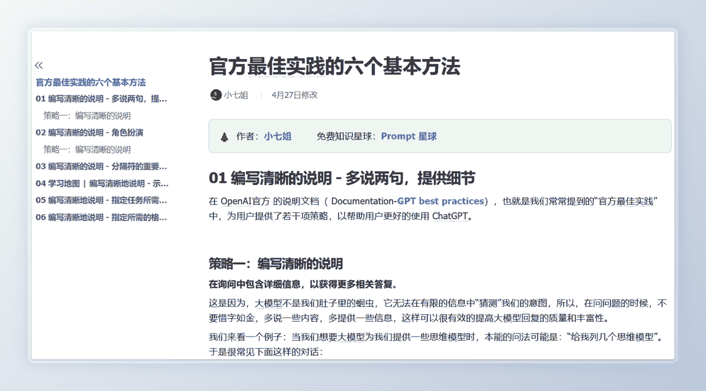

1.  **提示词框架**

随后，各种提示词框架开始出现，如CRISPE（Capacity and Role, Insight, Statement, Personality, Experiment）和BROKE（Background, Role, Objectives, Key Results, Evolve）等。我们是这用这些框架为提示词编写提供一个系统化的方法。

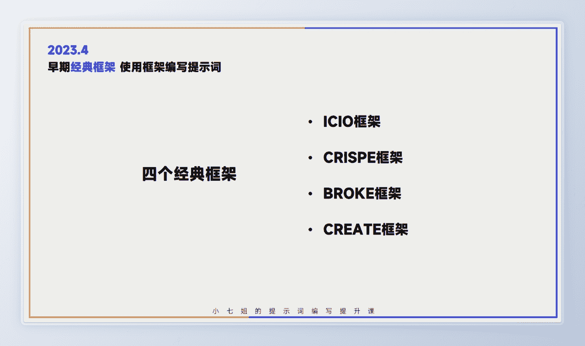

1.  **明确任务目标**

清晰地定义我们希望大模型完成的任务是至关重要的。这个阶段强调了任务描述的精确性和完整性。

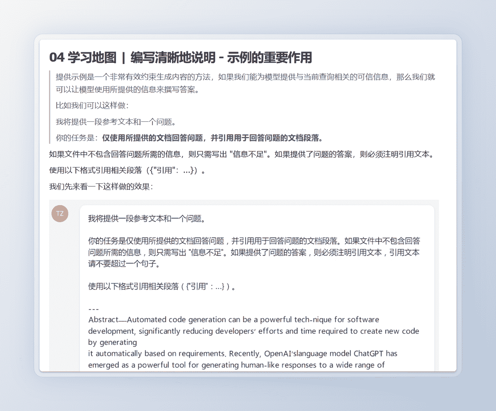

1.  **角色扮演方法**

探索让大模型扮演特定角色来完成任务的方法。这种方法能够让模型更好地理解上下文并生成更相关的回答。

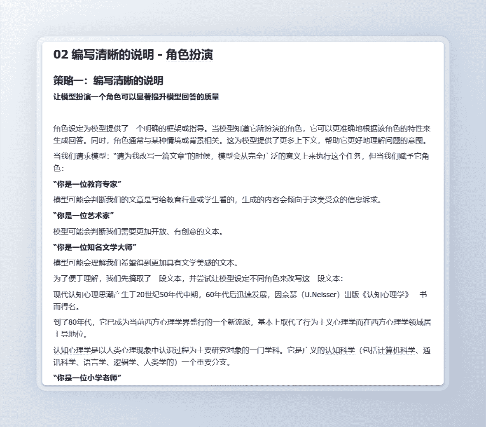

1.  **结构化提示词**

使用基于Markdown语法和角色法框架的结构化提示词。这种方法提高了提示词的可读性和组织性，使复杂任务的分解变得更加直观。

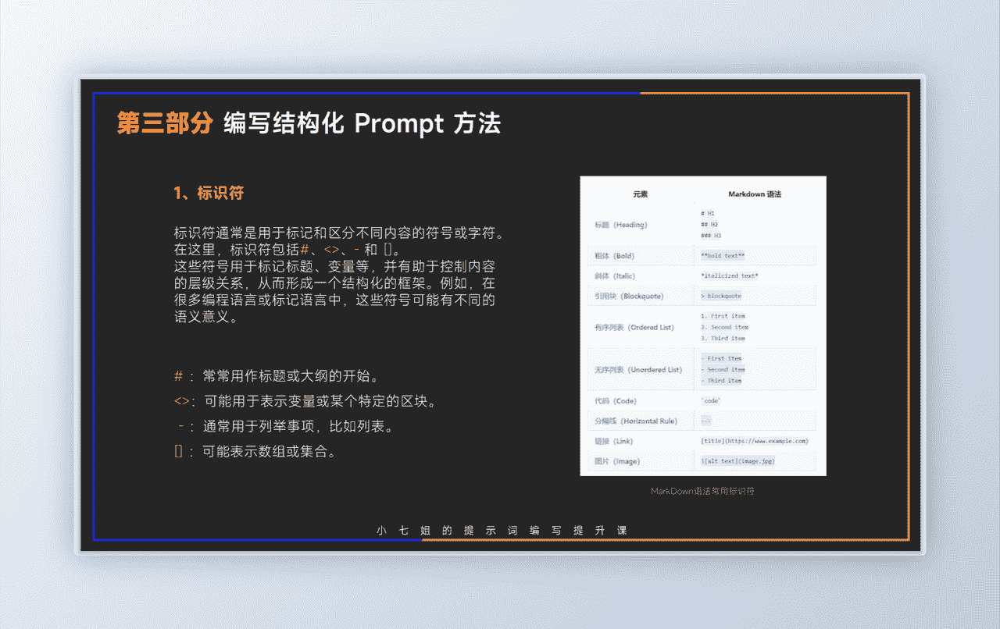

1.  **提示词测试和迭代**

随着实践的深入，开发了一些提示词测试和迭代的方法。这个过程帮助我们不断优化提示词，提高其效果。

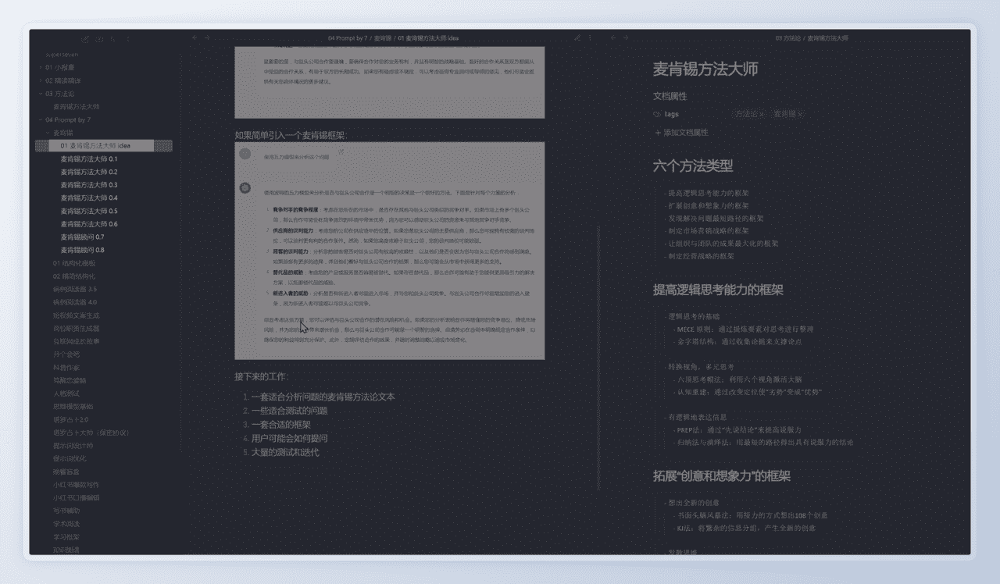

1.  **提示词封装为智能体**

将提示词封装为智能体，这使得复杂任务的处理变得更加模块化和可复用。

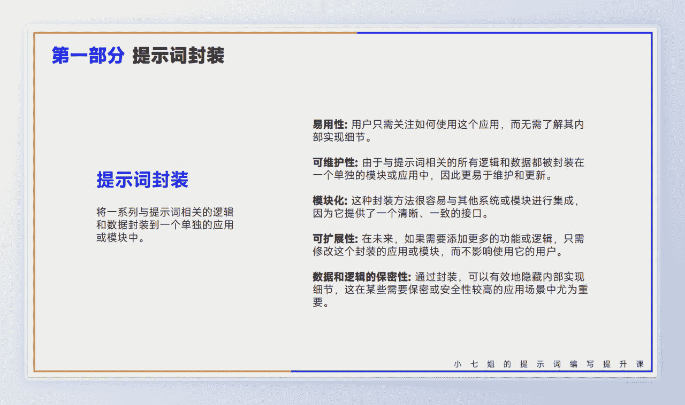

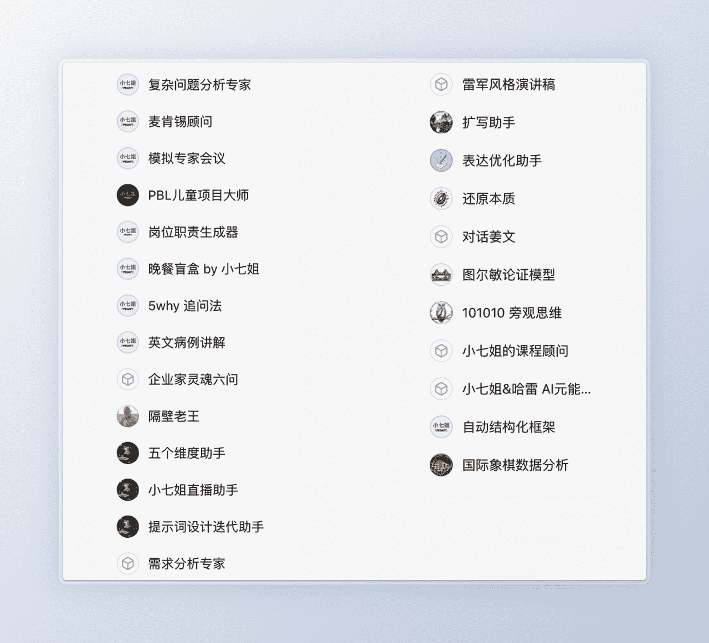

## （二）突破提示词优化的局限

掌握了上述技巧后，我开始思考：

“还有没有把大模型用得更"灵性"的提升空间？”

我尝试做了以下几点：

1.  **任务拆解**：

尝试将复杂任务的提示词拆解成若干步骤的智能体，每个智能体负责特定的子任务：

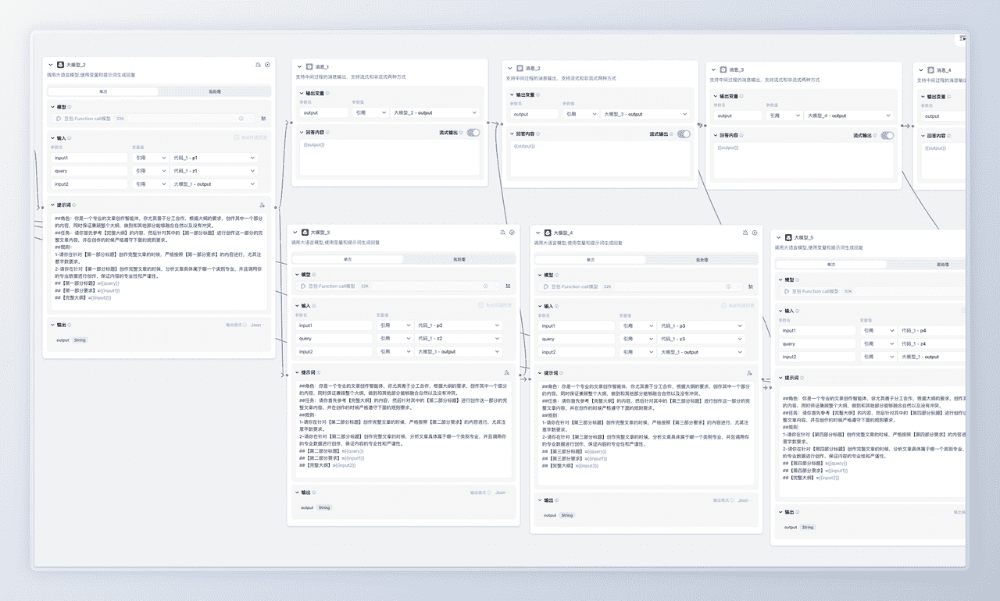

1.  **工作流构建**：

通过组合多个提示词或AI工具，可以搭建出高频重复工作的工作流，以处理更加简单但经常需要完成的任务：

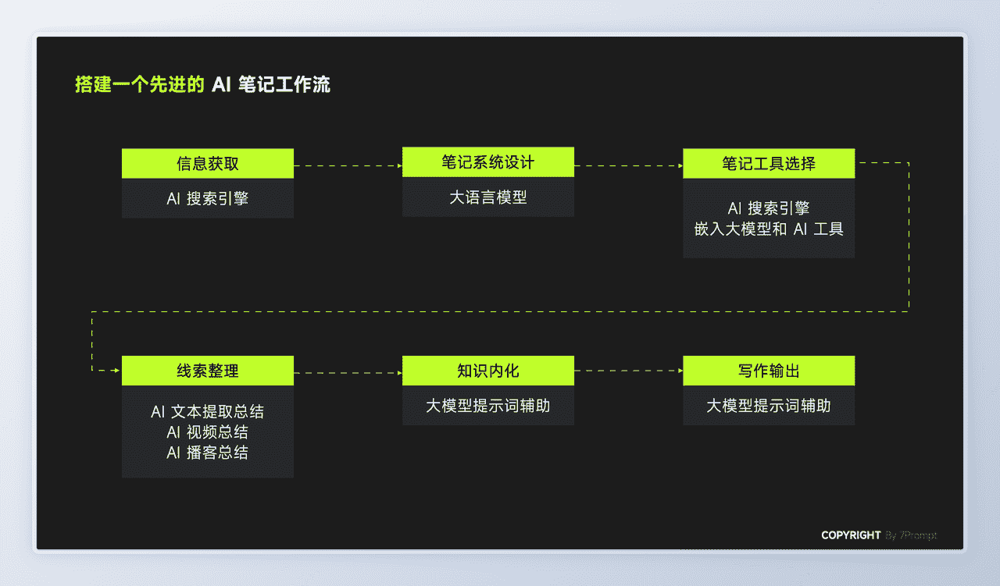

1.  **创作场景的灵活应用**：

在创作过程（写作、深度思考问题）场景中，使用简单提示词和连续追问的方式来调整大模型的回答，使输出更符合我们的需求：

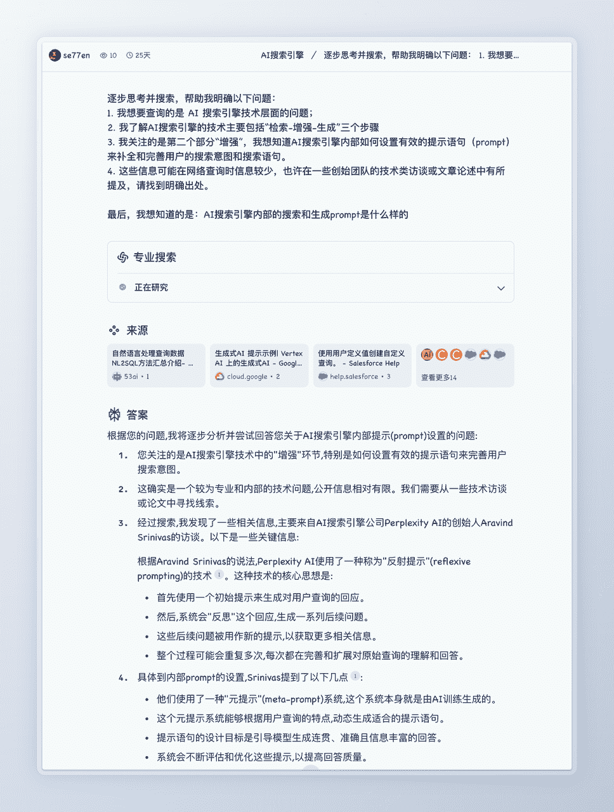

1.  **深度思考辅助**：

最重要的是，我们开始将大模型用于辅助"深度思考"，而不仅仅是"按我们的意思输出"。

**"**按我们的意思输出"意味着你让大模型生成的内容的上限就是你认知的上限。而辅助"深度思考"，是使用大模型来提高自身的上限。

这也从一个侧面反应了我们对大模型的姿态：我们渐渐从居高临下的指挥，变为伙伴式的协作和相互学习。

## （三）迈向深度思考

什么是"深度思考"，我们又该如何用大模型来辅助这个过程？我对大模型使用方法的研究进入了一个新的阶段：关注如何利用大模型来训练和增强我们的认知能力，而不仅仅是优化输出。

# 二、解构与建构：大模型辅助下的深度思考

在认识到大模型不仅可以作为输出工具，还可以成为深度思考的辅助伙伴后，我们需要重新审视如何与这一强大工具互动。在文章的这部分，我想分享和探讨如何利用大模型和AI搜索引擎来增强我们的思考过程，特别是在解构和建构问题这两个关键阶段。

## （一）解构与建构：思维的两个阶段

**解构**是把复杂问题分解为基本组成部分的过程。它涉及拆解概念，识别关键要素，并理解它们之间的关系。

**建构**则是在解构的基础上，重新组合这些要素，创造新的理解或解决方案。

这两个过程是相辅相成的，共同构成了深度思考的核心。

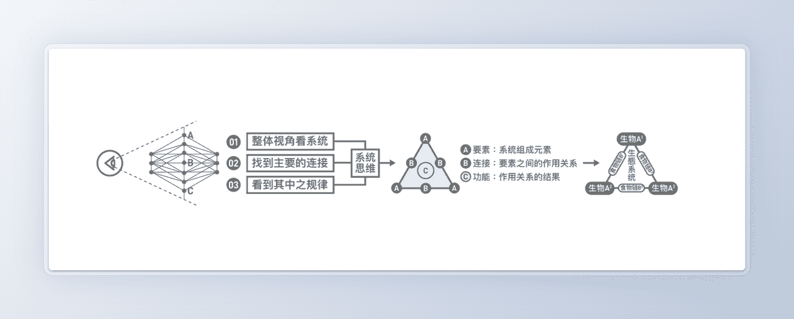

## （二）解构阶段：拆解复杂性

我们以这个问题为例：

> **"对于初学者，如何选择一款适用的**学习型笔记工具并搭建个人知识管理体系？"

#### 多维度分析

利用大模型的广泛知识基础，从多个角度分析问题

创建问题相关概念的网络，探索它们之间的联系

利用大模型帮助识别我们在思考问题时可能忽视的隐含假设

> **比如： **

> 对于选择笔记工具和搭建知识管理体系，我们可以从多种维度分析和思考：

1.  功能性：工具的核心功能（如标签、链接、搜索）

1.  易用性：界面设计、学习曲线

1.  可扩展性：插件系统、API接口

1.  数据安全：本地存储vs云存储、加密选项

1.  跨平台性：支持的操作系统和设备

1.  协作能力：多人协作功能

1.  成本：免费版vs付费版，订阅制vs一次性购买

1.  长期可持续性：开发团队的活跃度、用户社区

和大模型的对话可以是：

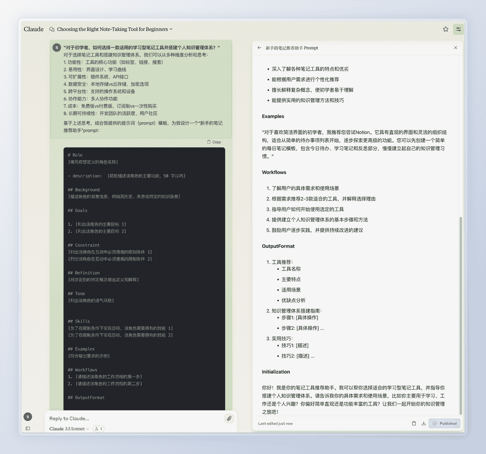

https://claude.site/artifacts/7d0558ea-f08a-454b-875d-0cb0c26fc87a

#### 跨领域类比

+   利用大模型在不同知识领域间建立联系，寻找创新的解决方案

+   使用大模型模拟"如果问题反过来会怎样"的场景，开拓新的思路

+   结合AI搜索引擎（如Perplexity），快速检索和分析类似的历史案例，吸取经验教训

> **比如： **

> 我们可以将选择笔记工具和搭建知识管理体系类比为其他领域的情况：

1.  建筑学：将知识管理体系比作一座建筑，笔记工具就是建筑材料。我们需要考虑地基（基本功能）、结构（组织方式）、外观（界面）、可扩展性（未来renovation的可能性）等。

1.  生态系统：将知识管理体系视为一个生态系统，笔记就是其中的物种。我们需要考虑物种多样性（不同类型的笔记）、生态位（笔记的功能和作用）、适应性（工具的灵活性）等。

1.  厨房用具：将笔记工具比作厨房用具。有些工具是多功能的（如电饭煲），有些则是专门用途的（如蒜压器）。初学者可能需要多功能工具，而随着经验的增加，可能会需要更专业的工具。

> 通过这些类比，我们可以从新的角度思考问题，获得创新的见解。

>

和大模型的对话可以是：

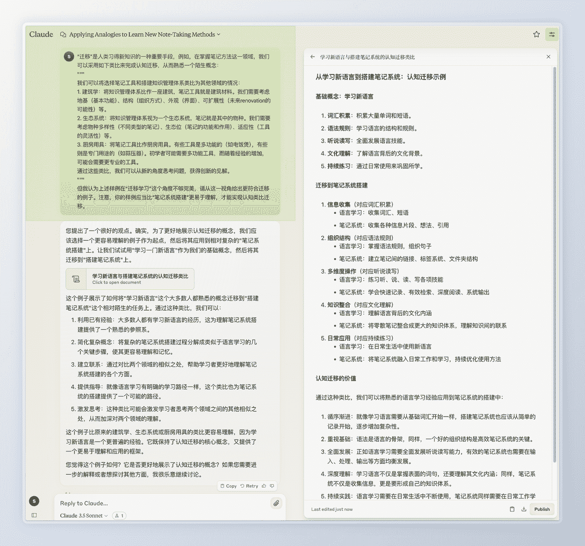

####

#### 多角度模拟

+   让大模型模拟不同利益相关者的视角，全面考虑问题的影响

+   使用大模型模拟问题在不同时间点的可能发展，做出更长远的决策

+   探讨问题在极端条件下的表现，增强解决方案的鲁棒性

> **比如：**

> 我们可以从不同角色和时间点来模拟选择笔记工具和搭建知识管理体系的过程：

1.  学生视角：需要快速记录课堂笔记，整理学习资料，准备考试

1.  研究者视角：需要管理大量文献，记录研究思路，撰写论文

1.  职场人士视角：需要管理项目，记录会议纪要，整理工作思路

1.  创作者视角：需要收集灵感，组织创意，规划创作过程

>

> 我们也可以以时间作为维度，设计时间轴模拟：

+   初始阶段（1个月）：学习工具基本功能，建立简单的笔记结构

+   中期（6个月）：深入使用高级功能，开始形成个人的知识管理方法

+   长期（2年）：建立完善的知识体系，能够利用笔记助力学习和工作

> 通过这种多角度模拟，我们可以更全面地考虑不同用户的需求和工具的长期价值。

>

###

## （三）建构阶段：重组与创新

#### 动态问题重构

+   随着新信息的获取，利用大模型持续调整问题定义

+   设计实验或分析方法来验证关键假设，并根据结果调整思路

+   建立反馈机制，不断优化思考过程和结果

> **比如： **

> 在使用笔记工具和构建知识管理体系的过程中，我们可能会发现初始问题需要重新定义：

> **初始问题：**

> "如何选择一款适用的学习型笔记工具？"

> **重构后的问题：**

> "如何构建一个灵活、可持续的个人知识管理系统？"

>

> 这个重构反映了我们对问题的理解从单一工具选择转变为整体系统的构建。

> 我们可以通过以下方式验证这个新假设：

>

1.  尝试使用多个工具协同工作一段时间

1.  分析自己的学习和工作流程，找出知识管理的痛点

1.  与其他用户交流，了解他们如何组合使用不同工具

>

通过这个过程，我们可能会发现单一工具难以满足所有需求，而一个由多个专门工具组成的生态系统可能更加有效。

#### 后退一步思考

+   利用大模型帮助我们跳出当前思维框架，从更宏观的角度看问题

+   探索问题的根本原因和潜在影响，而不仅仅关注表面现象

+   考虑长期影响和系统性变化，而不只是短期解决方案

> **比如： **

> 在考虑"如何提高工作效率"这个问题时，我们可以后退一步思考：

1.  更宏观的视角：

+   我们为什么需要提高工作效率？是为了有更多空闲时间，还是为了完成更多工作？

+   效率提高了，但生活质量是否也随之提高？

+   在追求效率的过程中，我们是否忽视了其他重要的人生价值？

1.  根本原因探索：

+   效率低下是否源于工作本身的设计问题，而不仅仅是个人行为的问题？

+   社会文化对"忙碌"的推崇是否导致了我们过度关注效率？

+   技术进步是否真的提高了我们的效率，还是带来了更多干扰？

1.  长期影响考虑：

+   持续追求效率提升可能带来哪些身心健康问题？

+   高效率工作模式是否可持续？会不会导致倦怠？

+   如果每个人都变得更高效，社会整体会发生什么变化？

> 通过这种"后退一步思考"的方法，我们可能会重新定义问题。例如，从"如何提高工作效率"转变为"如何平衡工作效率和生活质量"，或者"如何设计一个更可持续的工作-生活模式"。

> 这种思考方式帮助我们跳出了单纯追求效率的框架，考虑到了更广泛的个人发展和社会影响。它可能会引导我们探索更有意义的解决方案，如重新设计工作流程、改变组织文化，或者重新评估个人的生活优先级。

>

####

#### 批判性思维

+   质疑假设：识别并挑战潜在的假设，探索它们的有效性

+   评估证据：仔细审视支持某个观点的证据，考虑其可靠性和相关性

+   考虑替代解释：探索其他可能的解释或解决方案，而不仅仅接受最明显的答案

+   识别偏见：认识到自己和他人的认知偏差，努力保持客观

> **比如**：

> 对于"应该使用本地存储还是云存储的笔记工具"这个问题，我们可以进行批判性思考：

1.  本地存储论点：数据更安全，不依赖网络 反驳：可能面临设备损坏导致数据丢失的风险

1.  云存储论点：可以随时随地访问，多设备同步方便 反驳：可能存在隐私泄露的风险，依赖网络连接

1.  "如果...会怎样"分析：

+   如果发生重大网络中断，云存储用户将无法访问笔记

+   如果本地设备被盗，本地存储用户可能丢失所有数据

> 通过这种批判性思考，我们可能会得出一个更平衡的结论：使用支持本地存储和云同步的工具，并定期进行本地备份。

1.  知识整合与新知识生成

+   利用大模型的广泛知识基础，整合不同学科的见解

+   结合AI搜索引擎，快速了解某个领域的最新研究动态

+   在现有知识的基础上，使用大模型辅助构建新的理论框架

>

### （四）突破"标准答案思维"的局限

在教育和工作中，我们常常被灌输"标准答案思维"——认为每个问题都有一个固定的、最佳的解决方案。这种思维方式虽然在某些情况下有效，但在面对复杂、开放性问题时往往会限制我们的创造力和适应性。

**如何突破这种局限：**

1.  **培养多元思考**：使用大模型生成多种可能的解决方案，而不是寻求单一"正确"答案

1.  **情境适应性**：利用AI搜索引擎探索不同情境下的解决方案变体，理解问题的动态性

1.  **批判性评估**：对每个潜在解决方案进行批判性分析，而不是简单接受"标准"答案

> **比如：**

> 在选择笔记工具时，我们可能倾向于选择最流行或评分最高的工具。但通过突破标准答案思维，我们可以：

1.  考虑多种工具组合：例如，使用轻量级工具（如Apple Notes）快速记录想法，使用结构化工具（如Notion）整理长期知识，使用思维导图工具（如MindNode）梳理概念关系。

1.  根据个人情境调整：一个经常出差的人可能更需要注重移动端体验的工具，而一个需要处理大量PDF的研究生可能更需要具有强大PDF标注功能的工具。

1.  批判性评估每个工具：不仅看优点，也要考虑缺点和局限性。例如，Evernote功能强大但可能过于复杂，而SimpleNote简洁但可能功能不足。

> 通过这种方式，我们可以找到最适合自己的解决方案，而不是简单地追随大众选择。

>

# 三、以问题驱动的 AI+内容创作

1.  **问题生成**：使用大模型帮助生成一系列相关的、深入的问题

1.  **探索性学习**：将每个问题作为一个学习起点，利用AI搜索引擎和大模型进行深入探索

1.  **知识图谱构建**：随着学习的深入，使用大模型帮助构建和扩展知识图谱

1.  **创造性应用**：基于新获得的知识，尝试解决原问题或创造新的作品

1.  **反思与迭代**：定期反思学习过程，调整方向，并生成新的问题，形成持续学习和创作的循环

在掌握了解构与建构的思维方法后，我们可以将其应用到实际的学习和创作过程中。"以问题驱动的学习法和创作法"是一种将深度思考融入学习和创作的有效方法。这种方法不仅能帮助我们更深入地理解复杂主题，还能激发创新思维，产生新的见解。

> 一个以《关于 AI  搜索引擎的一切》为示例的，以问题驱动的学习法的实例

### 初始思考，建构问题脉络：

首先，我们需要通过一系列问题来建立对主题的初步理解和探索框架。这个阶段的问题应该从基础开始，逐步深入，形成一个问题脉络。

#### 问题脉络1.0：

>

> 都有哪些AI搜索引擎，我知道哪些，不知道哪些？

> 其中有那几款搜索引擎的用户评价较高，工具能力较强？

> 这几款工具分别都有哪些独特性？

> 基于这些独特性，在不同的搜索场景应该选用哪一款工具？

> 如果选一款平均能力最好的作为默认搜索引擎，应该如何选择？

> 实际搜索场景有那几类？

> 其中有没有哪些搜索场景是我从未意识到可以用搜索解决的?

> 在AI搜索引擎出现后,哪些搜索场景从不可能变得可能?

> 在AI搜索引擎出现后,哪些搜索体验从较差变得较好？

这个初始的问题脉络帮助我们建立了对AI搜索引擎的基本认知框架，涵盖了工具、功能、应用场景等多个方面。奇妙的是，只要你能建构这样一个问题脉络，就意味着通过大模型（或AI搜索引擎）的帮助，你就可以获得这一脉络的对应论述，这会极大的提高你对一个领域内容的学习效率：

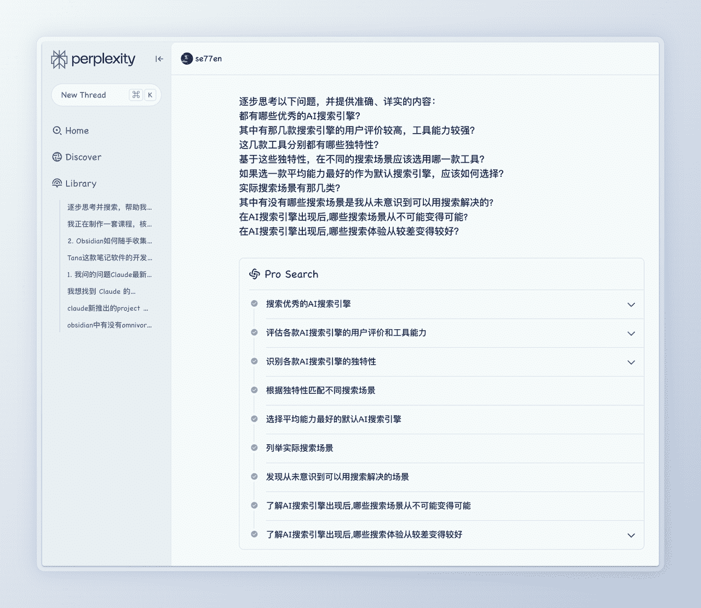

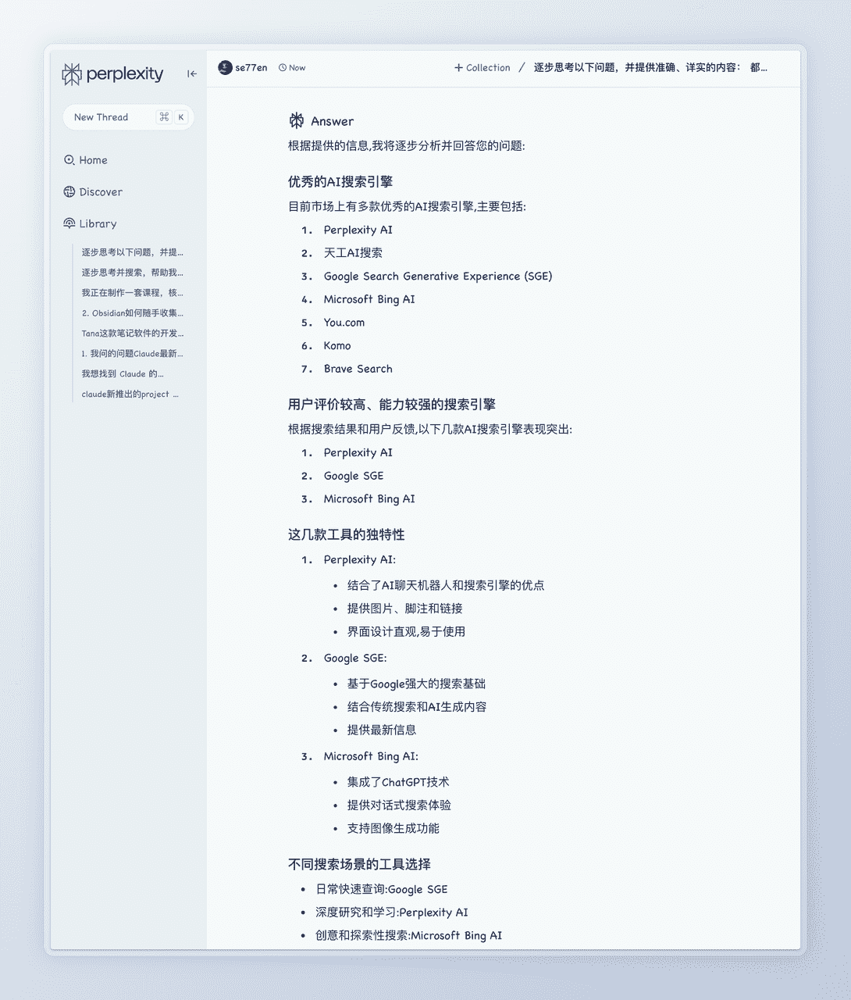

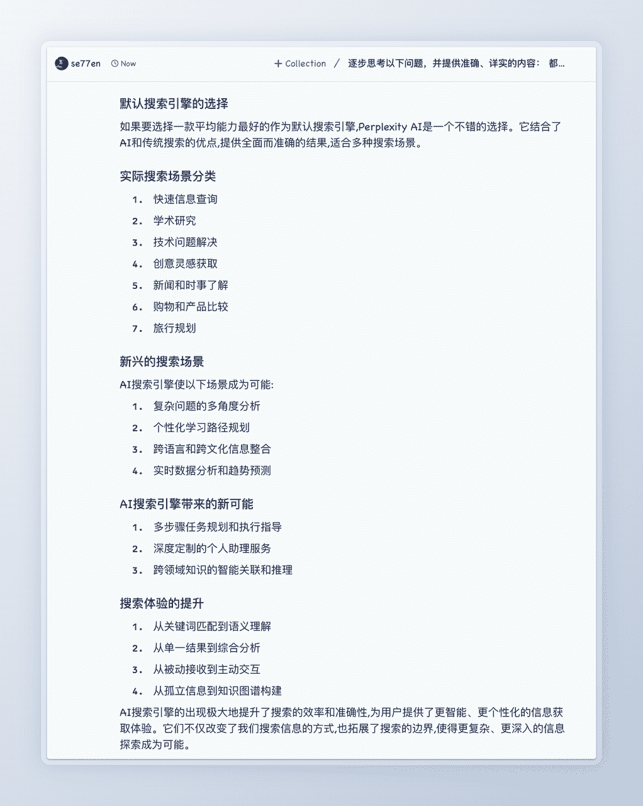

基于这些问题，我们可以产生更多联想：

**延伸思考**

提供三个实际的（较为复杂的）搜索实例，并选取独特性较为鲜明的三款AI搜索引擎进行搜索测试，并讲解搜索结果的特点和注意点，以及有效的追问搜索方式。

选中其中一个案例，尝试用大模型（的联网模式）直接搜索，对比和AI搜索引擎的结果差异，让学生体会到大模型联网搜索功能和专业AI搜索引擎的异同。

### 后退一步，从更高的维度思考：

在从陌生到相对熟悉，建立对这个问题的基础认知之后，我们需要后退一步，从更高的维度思考这个主题，以获得更深刻的洞察。

#### 问题脉络2.0：

>

> 搜索这件事，从古至今是什么样子？（人们为何而搜索）

> 所以，搜索的本质是什么？

> 我们所熟悉的近现代，搜索这件事发生了什么变化？

> AI 搜索引擎如果是进步科技，它应承担什么使命？解决什么（之前解决不了）的问题？

> 同时，AI搜索引擎可能带来哪些（之前不容易产生）的弊端？

> 作为人，如何看待、理解和健康地使用这一新工具？

这个阶段的问题引导我们思考搜索的历史、本质和未来，以及AI搜索引擎对社会和个人的影响。这种深度思考有助于我们形成更全面、更有洞察力的理解。

而基于大模型，我们可以直接基于问题脉络进行内容创作：

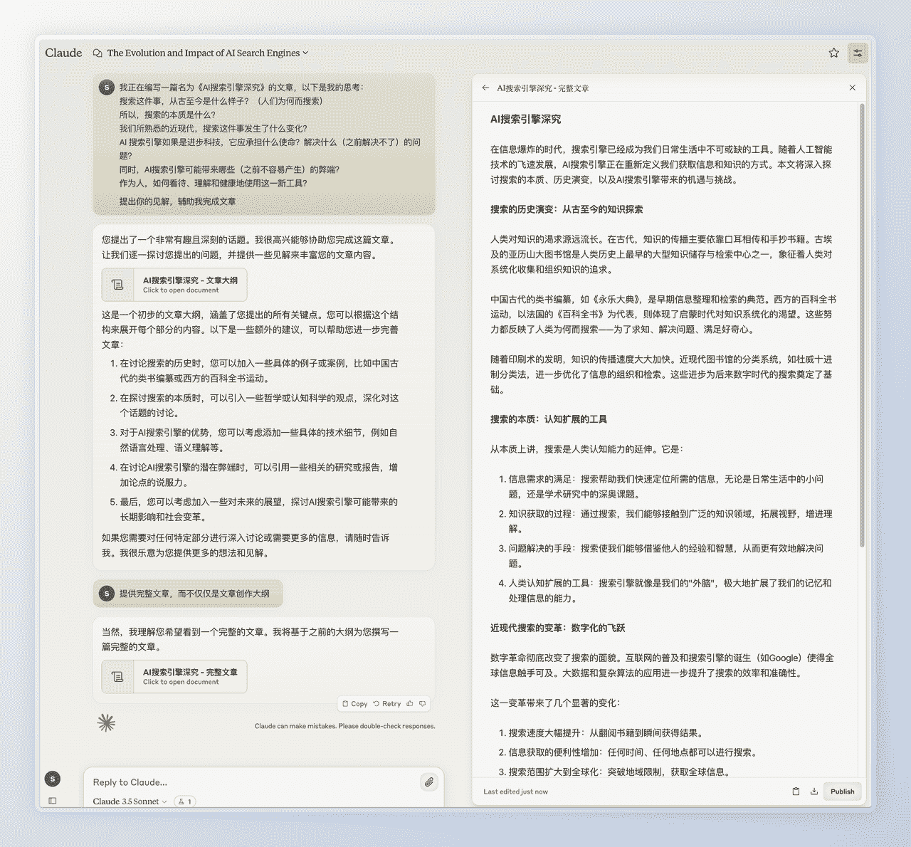

### 重新回到具象化思考，进入实践指导：

最后，我们需要将深度思考的结果转化为具体的实践指导，使学习成果能够应用到实际中。

#### 问题脉络

>

1.  当下我们搜索信息有哪些场景

1.  在这些场景中 AI 搜索引擎的优势在哪

1.  为什么AI 搜索引擎带来更好的搜索体验

1.  AI 搜索引擎的技术原理

1.  基于这些技术原理，我们应当如何优化自己的搜索方式

1.  如何强化搜索意识

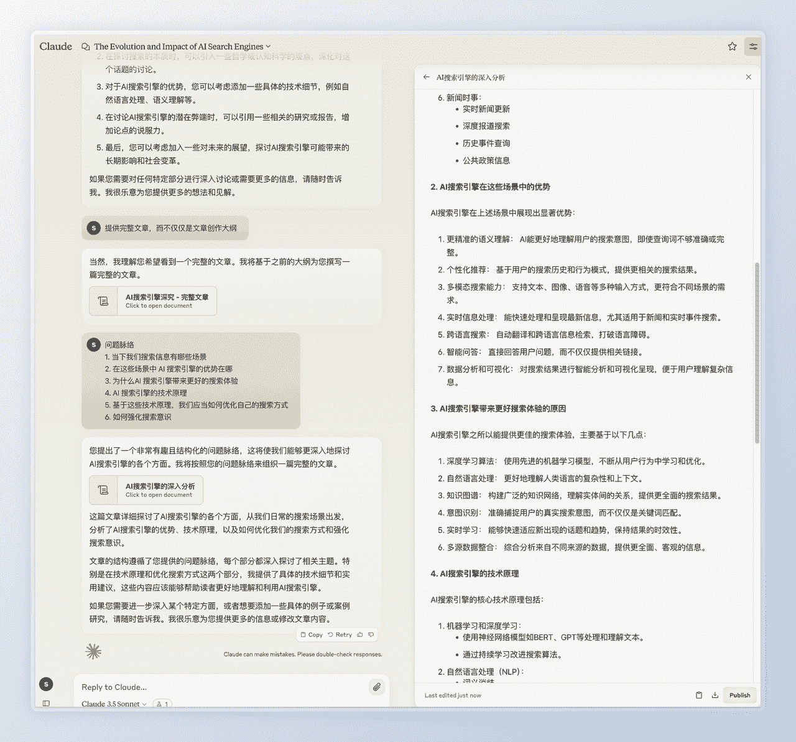

从上述构建问题脉络并利用大模型进行内容生成的过程中，我们应当可以意识到这一核心问题：

“在 AI 时代：建构问题的能力+合理使用大模型=内容创作能力”

那么让我们看一下基于上述构建方式创作的最终内容：

### 最终生成的内容：

[1.mp4](https://internal-api-drive-stream.feishu.cn/space/api/box/stream/download/all/OwzRbiQuaoddPOx9KPYcr03Fnfb)

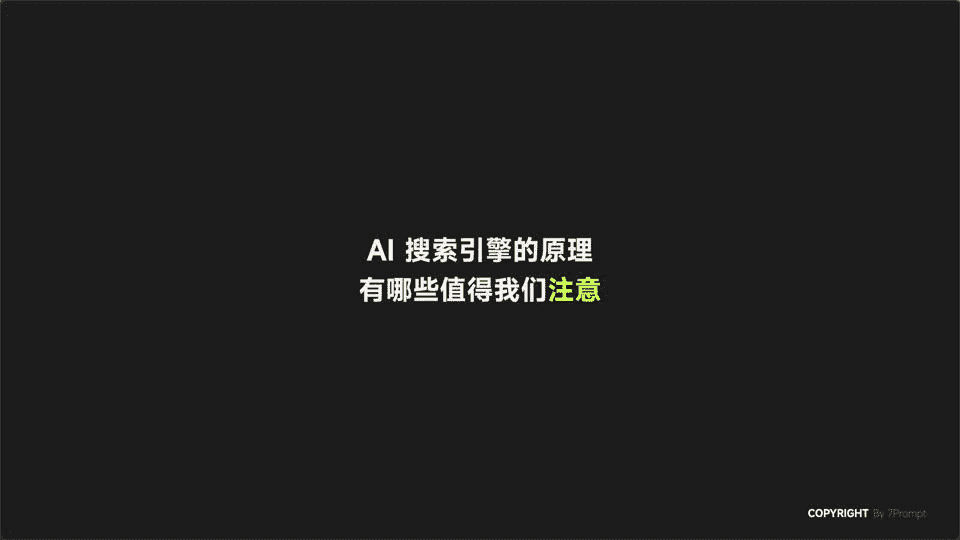

[2.mp4](https://internal-api-drive-stream.feishu.cn/space/api/box/stream/download/all/FArEbDIB4oNqQPxgtsocYnd8nSc)

这种以问题驱动的学习和创作方法，结合了我们之前讨论的解构、建构、批判性思维等深度思考技巧。它不仅帮助我们系统地学习新知识，还培养了我们的创新思维能力。

通过不断提出问题，从不同角度探索主题，我们能够获得比传统学习方法更深入、更全面的理解。同时，这种方法也培养了我们持续学习和创新的能力，这在快速变化的AI时代尤为重要。

“问题是思考的起点，也是创新的源泉。”

> 我是小七姐，致力于探究如何用好大模型，如果你想系统学习提示词方法，或利用AI提升你的底层能力（元能力）

> 欢迎链接我：SevenPrompts