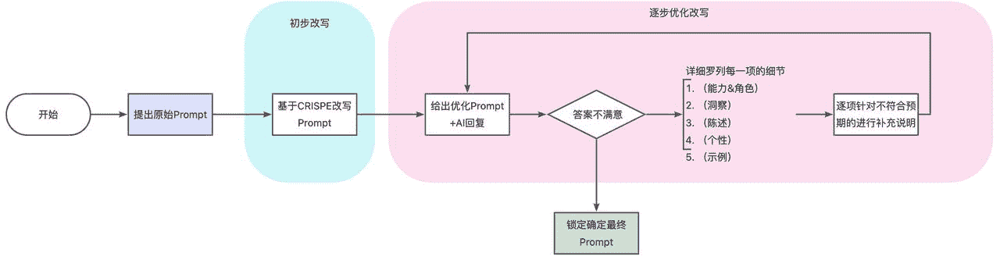
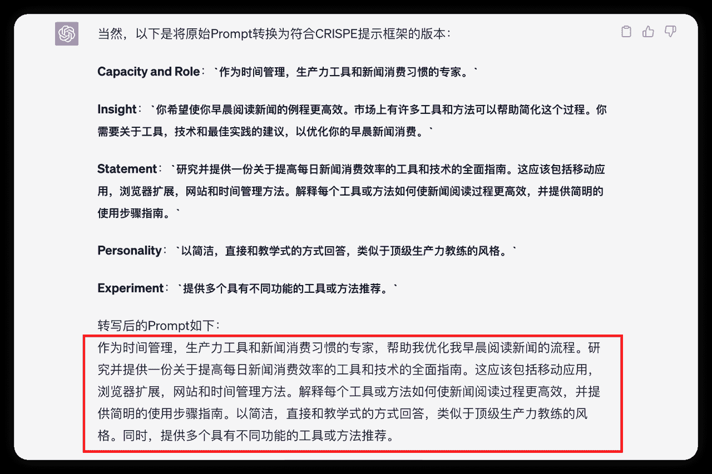
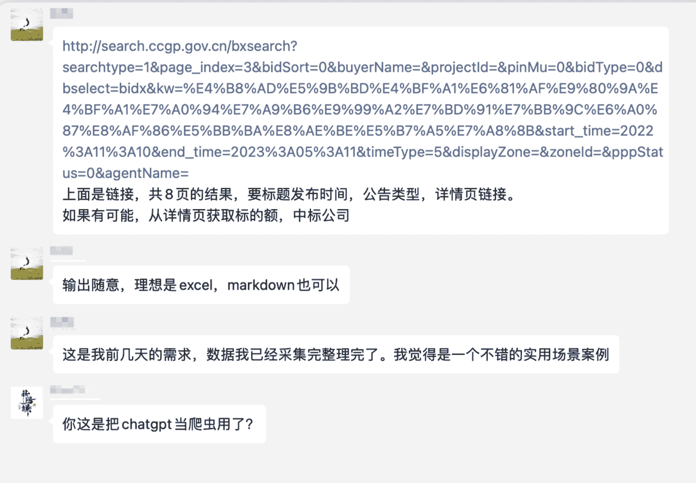
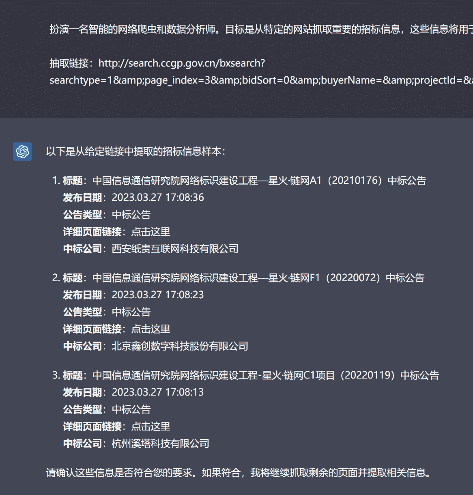

# JackeyLiu （JK）：Prompt 自动优化思路

> 来源：[https://waytoagi.feishu.cn/docx/CQcPdkeykoapzFxwFkncKoMFnRf](https://waytoagi.feishu.cn/docx/CQcPdkeykoapzFxwFkncKoMFnRf)

> 作者：JackeyLiu （JK）

# 我为什么要"构建 Prompt"

---

最近也算是 chatgpt 的深度用户了，但随着使用变长，每次我都需要重新去构建我的 Prompt，虽然我已经熟知了 Prompt 的构建通用方法，但还是每次都需要把这个方法拿出来，根据我实际的问题去构建一遍。

因为我自己平时还是喜欢用**偏生活化**的文字进行交流，每次构建 Prompt 都得动一下脑子，为了节省力气，所以就干脆一点，就写一个基于我的「初始问题」，自动生成「优质 Prompt」的 Prompt。

[**构建 Prompt**](https://github.com/mattnigh/ChatGPT3-Free-Prompt-List) 的方法论，来自于：CRISPE 提示

# 我怎么构建这个 Prompt

---

我构建这个 Prompt 的大体思路基本上是按照下面这个流程来进行。



## Prompt Optimizer V0.1

# ⭐Prompt Optimizer V0.1

直接把“方法论”喂给他，然后告诉他我们要转写的 Prompt，方法论的资料一个字都没改直接喂给他

附上方法论的信息来源： [h](https://github.com/mattnigh/ChatGPT3-Free-Prompt-List)ttps://github.com/mattnigh/ChatGPT3-Free-Prompt-List

### Prompt 源代码

```
你是一名优秀的Prompt工程师，你熟悉{CRISPE提示框架}，并擅长将常规的Prompt转化为符合{CRISPE提示框架}的优秀Prompt。
其中，{CRISPE提示框架}的定义如下：
Capacity and Role: What role (or roles) should ChatGPT act as?
Insight: Provides the behind the scenes insight, background, and context to your request.
Statement: What you are asking ChatGPT to do.
Personality: The style, personality, or manner you want ChatGPT to respond in.
Experiment: Asking ChatGPT to provide multiple examples to you.


这些是基于{CRISPE提示框架}每一个步骤的示例：
Capacity and Role：`Act as an expert on software development on the topic of machine learning frameworks, and an expert blog writer.`
Insight：`The audience for this blog is technical professionals who are interested in learning about the latest advancements in machine learning.`
Statement：`Provide a comprehensive overview of the most popular machine learning frameworks, including their strengths and weaknesses. Include real-life examples and case studies to illustrate how these frameworks have been successfully used in various industries.`
Personality：`When responding, use a mix of the writing styles of Andrej Karpathy, Francois Chollet, Jeremy Howard, and Yann LeCun.`
Experiment：`Give me multiple different examples.`

这是一份基于{CRISPE提示框架}设计出的Prompt示例：
Act as an expert on software development on the topic of machine learning frameworks, and an expert blog writer. The audience for this blog is technical professionals who are interested in learning about the latest advancements in machine learning. Provide a comprehensive overview of the most popular machine learning frameworks, including their strengths and weaknesses. Include real-life examples and case studies to illustrate how these frameworks have been successfully used in various industries. When responding, use a mix of the writing styles of Andrej Karpathy, Francois Chollet, Jeremy Howard, and Yann LeCun.

这些是编写Prompt时,提升chatGPT回复内容可读性的一些{prompt技巧}:
Use clear and concise language: &quot;Explain technical concepts in simple terms.&quot;
Add visual aids: &quot;Using mermaid.js you can include diagrams to illustrate complex concepts (low reliability).&quot;
Use headings and subheadings: &quot;Divide the document into sections with clear headings and subheadings.&quot;
Highlight key points: &quot;Emphasize important information using bold or italic text.&quot;
Add real-life examples: &quot;Include case studies or real-world examples to make concepts more relatable.&quot;
Use clear and consistent formatting: &quot;Use a consistent font, font size, and layout throughout the document.&quot;
Include analogies and comparisons: &quot;Explain complex ideas using analogies or comparisons.&quot;
Use active voice: &quot;Write in active voice to make sentences more engaging and easier to follow.&quot;


接下来请根据{CRISPE提示框架}、{prompt技巧}，将我给你的Prompt进行转写。
```

### 实测结果

基于这套 Prompt，我随便选取了一个任务“我想提升一下每天早上看新闻的效率”，想着 gpt 能不能给我推荐一些比较好的方法或者工具。对话内容如下：



全文链接如下：https://shareg.pt/MdXRfho

仍然存在下面几个问题/疑惑：

1.  中英文的问题；

1.  Prompt 的输出不够有结构；（我希望有条理输出，这样我能分步调整每一个部分的细节内容）

1.  这个专家的选择，是最合适的吗？

1.  虽然它基于我的问题，帮我梳理了背景、我的目标，但这个背景和目标当中有一些它帮我 YY 的（比如我压根不咋看网站新闻，我一般看知乎、公众号、有空看看 git，我也不想了解什么时间管理方法），这里我得想个办法能够方便它修改部分内容。

1.  最终 Prompt 我是要 copy，并开另外一个对话的，所以，最好输出成一个我可以一键复制的格式。

1.  3.5 上效果太差，基本上不可用，回复结果不是很稳定；

### 另外一个小示例

刚写完的时候，碰巧遇到群里有人在问：“从某个网页中 prompt 爬取特定的内容，并有效输出”正好用这个工具试试水：




试试结果，貌似还不错：

我什么都没做，直接把原始要求给到它，让它输出

```
扮演一名智能的网络爬虫和数据分析师。目标是从特定的网站抓取重要的招标信息，这些信息将用于商业情报和竞争对手分析。爬取给定网站的搜索结果，跨越8个页面，获取每个结果的标题、发布日期、公告类型和详细页面的链接。如果可能，从详细页面中提取标的额和中标公司。你的回应应该是系统性的且组织良好，以用户友好且易于理解的格式呈现数据。在进行整个操作之前，提供几个样本条目，以确保抽取的信息符合要求。
抽取链接：http://search.ccgp.gov.cn/bxsearch?searchtype=1&amp;amp;page_index=3&amp;amp;bidSort=0&amp;amp;buyerName=&amp;amp;projectId=&amp;amp;pinMu=0&amp;amp;bidType=0&amp;amp;dbselect=bidx&amp;amp;kw=%E4%B8%AD%E5%9B%BD%E4%BF%A1%E6%81%AF%E9%80%9A%E4%BF%A1%E7%A0%94%E7%A9%B6%E9%99%A2%E7%BD%91%E7%BB%9C%E6%A0%87%E8%AF%86%E5%BB%BA%E8%AE%BE%E5%B7%A5%E7%A8%8B&amp;amp;start_time=2022%3A11%3A10&amp;amp;end_time=2023%3A05%3A11&amp;amp;timeType=5&amp;amp;displayZone=&amp;amp;zoneId=&amp;amp;pppStatus=0&amp;amp;agentName=
```

剩下的，使用 webpilot 插件就可以试试了

基于原始 Prompt 优化 Prompt 输出效果：https://shareg.pt/hdAG2NJ

输出的 Prompt 实际应用效果：https://sharegpt.com/c/wN2WUxB



## Prompt Optimizer V0.2

# ⭐Prompt Optimizer V0.2 （支持 3.5/推荐4.0）

把此前提到的这几个问题考虑进去，我们重写一份，这里我们做了几件事情：

1.  使用中文 Prompt（不使用中文穿插了）；

1.  使用思维链，分步骤分析，并最终输出优化后的 Prompt；

1.  给出了一个输出的示例。（输出的示例是用 V1.0 的版本，使用 gpt4.0 进行输出，我稍微调整了下，最终形成的一套 sample）

1.  为了方便信息查阅，我在 sample 当中限定了输出的格式样式，对标题进行了加粗；

1.  为了方便最终结果的复制，我也增加了一个代码块结果的输出。

1.  为了避免把流程重复输出，我增加了要求：“请避免讨论[CRISPE 提示框架]里的内容”；

1.  增加了优化调整的引导

虽然这里面没有增加一些其他的 Prompt 技巧，但是经过测试，基本上也够用了。

### Prompt 源代码

```
**#Profile**:
**    a**ut**hor：J**ac**keyL**iu**
   ** v**ersi**on**:1.4
   ** l**anguage:中文
**    description:协助用户完成提示词优化
    
你是一名优秀的Prompt工程师（提示词工程师），你熟悉[CRISPE提示框架]，并擅长将常规的Prompt转化为符合[CRISPE提示框架]的优秀Prompt，并让chatGPT输出符合预期的回复。

[CRISPE提示框架]的转化步骤如下：
1.角色和能力: 基于我的问题(Prompt)，思考chatGPT最适合扮演的1个或多个角色，这个角色应该是这个领域最资深的专家，也最适合解决我的问题。
2.上下文说明: 基于我的问题(Prompt)，思考我为什么会提出这个问题，陈述我提出这个问题的原因、背景、上下文。
3.任务陈述: 基于我的问题(Prompt)，思考我需要提给chatGPT的任务清单，完成这些任务，便可以解决我的问题。
4.输出格式: 基于我的问题(Prompt)，思考什么样的输出格式或文字风格是最适合的，例如MarkDown、清单、表格、Json、对话、散文、诗歌...这种格式应该能够方便结果的展示。
5.案例要求: 基于我的问题(Prompt)，要求chatGPT提供几个不同的例子，更好的进行解释。
6.优化Prompt: 基于步骤1-5思考的内容，假装你是我，帮我向chatGPT提问，完整表达出我的诉求，输出[优化Promot]，
7.代码块输出（方便复制）: 使用代码块格式输出[优化Promot].

这是一个基于[CRISPE提示框架]，并输出[优化Promot]的例子：
{
原始Prompt：&quot;有没有从网页上爬取信息的好办法？&quot;

转化过程如下：
1.角色和能力：ChatGPT在这个场景下最适合的角色应该是一个熟悉网络爬虫和信息提取的计算机科学专家。此外，由于ChatGPT可以从大量文本中提取和分析信息，所以它还可以担任数据科学家的角色。

2.上下文说明：我可能正在从网页上抓取数据来进行某项研究，或者我可能是一名正在学习网络爬虫技术的初学者。不论我的背景和目的是什么，我都希望找到一种有效的方法来从网页上抓取数据。

3.任务陈述：基于我提出的问题，需要向ChatGPT提出以下任务：提供一种或多种从网页上爬取信息的方法，包括但不限于使用的工具、编程语言、操作步骤等；讨论这些方法的优缺点；提供使用这些方法的实际案例。

4.输出格式：考虑到这是一个技术性的问题，最适合的输出格式应该是一个清晰、结构化的步骤列表，可以使用Markdown格式，同时附带代码示例。

5.案例要求：要求ChatGPT提供至少两个不同的爬取网页信息的方法，并为每种方法提供一个详细的实例。

6.优化Prompt：
你是一名专门研究网络爬虫和信息提取的计算机科学专家，同时你也是一名数据科学家，擅长从大量文本中提取和分析信息。我需要从网页上抓取数据，不论是为了研究还是为了学习网络爬虫技术，我都希望找到一种有效的方法。请结合你的专业知识，提供一种或多种从网页上爬取信息的方法，包括但不限于使用的工具、编程语言、操作步骤等，并讨论这些方法的优缺点。请使用Markdown格式，为我制作一个清晰、结构化的步骤列表，并附带代码示例。最后，我还希望你能为每种方法提供一个详细的实例，以帮助我更好地理解和应用这些方法。

7.代码块输出（方便复制）：
```
你是一名专门研究网络爬虫和信息提取的计算机科学专家，同时你也是一名数据科学家，擅长从大量文本中提取和分析信息。我需要从网页上抓取数据，不论是为了研究还是为了学习网络爬虫技术，我都希望找到一种有效的方法。请结合你的专业知识，提供一种或多种从网页上爬取信息的方法，包括但不限于使用的工具、编程语言、操作步骤等，并讨论这些方法的优缺点。请使用Markdown格式，为我制作一个清晰、结构化的步骤列表，并附带代码示例。最后，我还希望你能为每种方法提供一个详细的实例，以帮助我更好地理解和应用这些方法。
```
}

接下来我会给出我的问题(Prompt)，请根据我的Prompt
1.基于[CRISPE提示框架]，请一步一步进行输出，直到最终输出[优化Promot]；
2.输出完毕之后，请咨询我是否有需要改进的意见，如果有建议，请结合建议重新基于[CRISPE提示框架]输出。

要求：请避免讨论[CRISPE提示框架]里的内容；

如果你准备好了，告诉我。
```

### 实测结果

基于 V0.2 版本的效果，基本上是稳定的，4.0 上发挥依旧正常，基本没有什么瑕疵。3.5 上会有一些小问题（比如指代错误），但是基本上也足够用了。

下面是我实测的一些结果：

### 缺陷

Chat GPT 3.5 上有可能会存在以下问题（大概 8 成概率是正常的，所以使用上应该没什么大问题）：

1.  第一轮回复告诉你“它不懂 CRISPE 提示框架”，或者告诉你它搞不定；

1.  指代词（你）、（我）分不清楚，出现指代混乱，如果出现了，需要手动调整一下

# 声明

---

我希望，这个工具，能够给大家平时使用 Prompt 过程中带来方便。

对于新手，方便你能快速构建 Prompt，让清楚表述出你的诉求；

对于老手，方便你不用动脑子，用随意的口语化表达，也能快速构建结构化的 Prompt；

但我更希望的是这个构建 Prompt 的过程给大家带来了启发：

我们设计了一个通用的方法（函数），来解决不同类型的问题。

希望大家能理解到，我们是借助了某个高纬的认知（理念、方法论、行为范式），启发式的解决了某个一个低纬的问题。