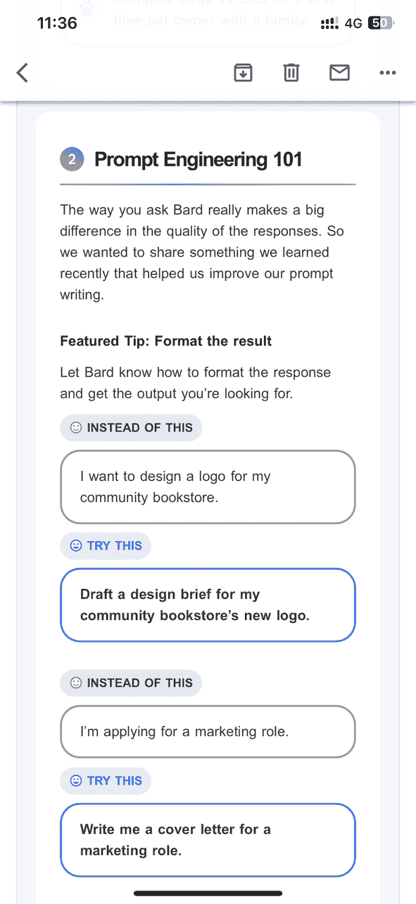
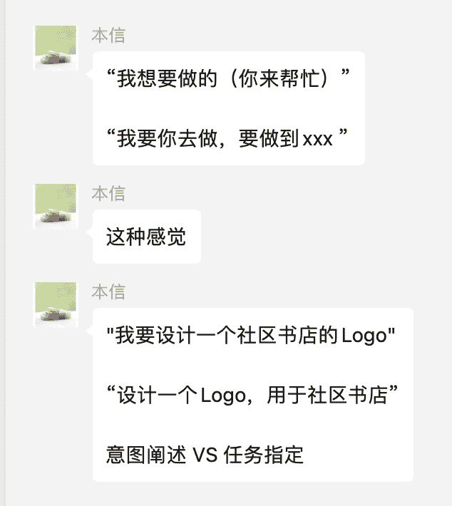

# 本信：Bard的prompt使用技巧

> 来源：[https://waytoagi.feishu.cn/docx/BbWBdQ18go0LPBx8dY9cKoM1nEb](https://waytoagi.feishu.cn/docx/BbWBdQ18go0LPBx8dY9cKoM1nEb)

今天Litong Cao同学收到了bard的EDM ,内容如下：

> **疑问来了：**

> 这个有啥规律么 感觉就是不要说的太口语化

> 那比如说我让他画个logo，不能直接说给我画个网站logo

> 那应该怎么说？ 感觉上面的英文翻译成中文不是一样么？

> **本信同学给出了一个解答：**

> Bard建议使用“给AI下具体设计任务”的方式,而不是简单地“要求AI直接输出内容”。这可以让AI更好地发挥创造力,同时也便于人类对最终输出进行检查和修改。

> 通过比对可以看出,Bard推荐的优化prompt采用了更明确的任务驱动方式,有助于AI生成更好的内容。这是一个提高prompt质量的很好建议。

尝试了一下

https://g.co/bard/share/aa17479887c2

> i want to design a logo for my AI webside

Here are some tips on how to design a logo for your AI website:

+   Keep it simple and memorable. Your logo should be easy to remember and identify, even when it is small or used in different contexts.

+   Use relevant symbols or icons. Symbols or icons can help to communicate the meaning of your brand and make your logo more visually appealing.

+   Choose colors that are associated with technology and trust. Colors like blue, green, and white are often associated with technology and trust, which can be helpful for an AI website.

+   Use a consistent font. The font you choose should be consistent with the overall branding of your website.

+   Get feedback from others. Once you have designed a few logos, get feedback from others to see which one they prefer.

Here are some examples of AI logos that follow these tips:

+   The Google AI logo uses a simple, memorable icon of a lightbulb to represent creativity and innovation. The colors are blue and green, which are often associated with technology and trust. The font is consistent with the overall branding of Google.

+   Opens in a new window

+   [seeklogo.com](https://seeklogo.com/vector-logo/393117/google-ai)

+   The IBM Watson logo uses a combination of symbols and text to represent the power and intelligence of AI. The symbols include a brain, a gear, and a wave, which all represent different aspects of AI. The text is simple and easy to read.

+   Opens in a new window

+   www.sv-europe.com

+   The OpenAI logo uses a simple, geometric design to represent the openness and transparency of the OpenAI project. The colors are white and blue, which are often associated with technology and trust. The font is consistent with the overall branding of OpenAI.

+   Opens in a new window

+   commons.wikimedia.org

If you are not sure how to design a logo for your AI website, you can use an AI logo generator. There are many different AI logo generators available online, and they can help you to create a logo that is both visually appealing and relevant to your brand.

Here are some of the best AI logo generators:

+   Logomaster.ai

+   Free Logo Design

+   Logo AI

+   Looka logo maker (formerly known Logojoy)

+   Brandmark

+   DesignEvo

+   Tailor Brands

+   Designhill

I hope these tips help you to design a logo for your AI website that is both memorable and effective.

> Draft a design brief for my AI webside new logo

Sure, here is a design brief for your AI website's new logo:

Project Name: AI Website New Logo

Client: [Your Name]

Date: 2023-08-30

1.  Purpose:

The purpose of this logo is to create a strong and memorable visual identity for my AI website. The logo should be modern, professional, and visually appealing. It should also be versatile enough to be used on a variety of marketing materials, such as my website, business cards, and social media pages.

1.  Target Audience:

My target audience for this logo is businesses and individuals who are interested in using AI to solve their problems. The logo should appeal to this audience by conveying a sense of innovation, creativity, and intelligence.

1.  Brand Attributes:

The following are the brand attributes that I want my logo to reflect:

+   Innovation: My AI website is constantly innovating and developing new ways to use AI. I want my logo to convey a sense of forward-thinking and creativity.

+   Creativity: I believe that AI can be used to solve problems in a creative and innovative way. I want my logo to reflect this creativity and innovation.

+   Intelligence: AI is a powerful tool that can be used to solve complex problems. I want my logo to convey a sense of intelligence and sophistication.

1.  Design Specifications:

The following are some design specifications that I would like to consider for my logo:

+   Colors: I would like my logo to use a modern color palette that is both visually appealing and relevant to my target audience.

+   Shapes: I would like my logo to use simple, geometric shapes that are easy to remember and recognize.

+   Font: I would like my logo to use a modern, sans-serif font that is easy to read and understand.

1.  Approval Process:

I will approve the final logo design by giving the designer written feedback within 5 business days of receiving the design.

1.  Additional Information:

I am open to any creative ideas that you may have for my logo design. I am confident that we can work together to create a logo that is both visually appealing and effective in communicating the values of my AI website.

Thank you for your time and consideration. I look forward to hearing from you soon.