# 夙愿：用 AI 化繁为简，解决复杂问题的指南

> 来源：[https://waytoagi.feishu.cn/docx/UeqmdHi0iojEFoxBUmscBUMAnQX](https://waytoagi.feishu.cn/docx/UeqmdHi0iojEFoxBUmscBUMAnQX)

> 作者: 夙愿

> 这里是我的个人介绍：[ 🧑夙愿的个人说明书🧑](https://zi6nfl20s5u.feishu.cn/wiki/UEPmwdkZ4iNsOek2jJPcqSDKn3b)

AI + 分治法解决复杂任务---写好提示词的思维框架

大家好，很高兴能在 ChatGPT 一周岁生日这天和大家一起分享学习🎉。

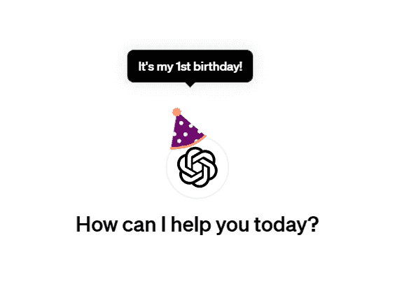

今天给大家分享的主题是： AI + 分治法解决复杂任务

📢在接下来的分享内容中，提示词 = 指令 =  Prompt ，AI = GPT = ChatGPT

那么大家坐稳扶好，跟着我的思路走。

# 一、分治法

不知道大家有没有这样的感觉🤷

用 GPT 处理一些涉及多个步骤和方面的复杂任务时，往往不能仅通过一次对话完成🤔

比如说，让 GPT 写文章时，我明明要求了 GPT 写 1200 字的文章，但是它只写了 800 字左右📉

再比如，让 GPT 给我写一个完整的程序时，它只给我写了一个代码框架示例。

我在早期使用 GPT 的过程中，也遇到了这样的卡点⛔

后来，我发现了一个很有效的方法——分治法，这是一个古老而强大的策略，教会我们如何「分而治之」。

分治法的核心在于将一个庞大的问题拆分成若干个更小、更易于管理的部分✂️。

我举个栗子🌰，假设我要组织一场大型聚会，如果一下子想把所有事情一股脑儿都做好，我头都大了🤯。

但如果我将大任务拆分成多个小任务，比如安排食物🍔、音乐🎶、场地🏟️等，然后分别解决，事情就会变得简单得多。

为了方便大家理解分治法，我画了一幅简单的示意图：

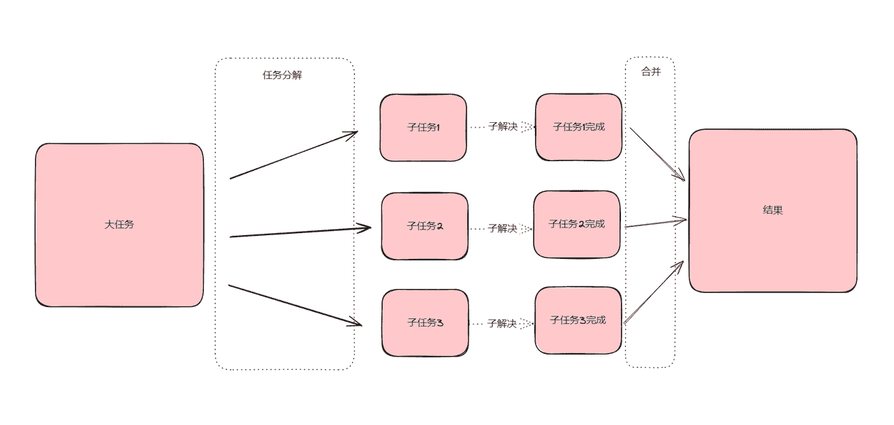

用一句话总结分治法：将大任务拆分成一个个更小的子任务，逐个完成子任务后，将结果合并，就得到了最终结果✅

# 二、Prompt Chain（提示词链）

把分治法这种思维运用到 GPT 提示词上，我们就能更好地指导 GPT 处理复杂的任务🚀

这就引出了一个新的概念：Prompt Chain⛓️

它不是一个单独的工具，而是一种策略📋

通过将多个相关的提示词串联起来，形成一个处理复杂问题的连续流程。

就像这样：

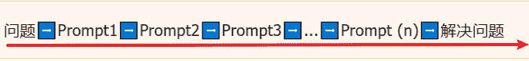

大家可能会问，为什么要用这个所谓的 Prompt Chain 呢❓

1、**Token 长度限制**

在航海手册第四课中，可以看到每一个模型的 token 限制：

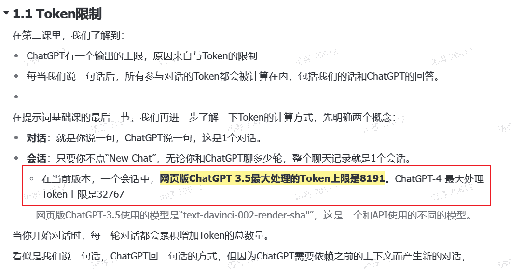

📝 GPT 输出文字有限制，是因为 token 的限制，每当我们向 GPT 输入一段内容，所有参与对话的 token 都会被计算在内，包括我们输入的内容和 GPT 的回答。

📌 这意味着，如果你和 GPT 的交互流程过长、你的生产内容（例如文章）过长，都会导致 token 超出，最终导致生成内容质量不佳，无法满足你的预期。

2、**任务流复杂导致稳定性下降**

我们期望 GPT 能够在一次对话中，就能达到我们的最终诉求。

但是，很可惜，如果任务相当复杂，就很有可能导致任务系统稳定性下降，俗称“GPT 抽风了，开始胡言乱语”😪

因为所有的提示词内容，都会占一定的权重，导致各个子任务相互影响，最终导致工序错乱，信息紊乱🔄

同时，在一段提示词当中完成全部的任务，在调试时会异常困难，当生成的内容不符合预期时，比较难定位到出现问题的段落和文字🔍

**3、Prompt 并不是万能的**

有的复杂任务拆解成一个个小任务之后，其实有相当一部分不是靠提示词+GPT 就可以解决的。

例如有的人需求是：“GPT 能帮我快速在小红书上起号吗？🤔帮我直接写做出爆款文案吗？”

我想问：

你的对标账号是什么❓ GPT 知道吗？不知道！GPT 知道从哪里去找吗？不知道！只能人类自己去找对标账号🔍。

他的优秀文案有哪些📝？——GPT 知道吗？不知道！GPT 能帮你提取视频文案吗？不能！需要人类使用批量提取文案工具去提取。

你的用户群是哪些🤷？——GPT 知道你的用户群吗？不知道！只能人类自己做好粉丝画像分析再告诉 GPT 。

从上面的问题中，我们可以看到：其实 GPT 并不能帮助我们做到全部的事情💡

很多时候，在我们的解决方案当中，一定会穿插一些 GPT 能力之外的事情🌌

这些事情，需要我们用其他的一些非 AI 大模型的工具来进行辅助🔨

当然，你完全可以将这些工具，也穿插在你的 Prompt Chain 的工作流当中⚙️

讲了这么多，总结一下，Prompt Chain 本质上想要传达的是：

1.  你需要将你的需求做细颗粒度的分解，也就是把大任务拆成小任务，小任务拆成更小的任务👷

1.  你需要将每个小任务选择合适的工具/模型来实现🔧；

好，明白了 Prompt Chain 的原理之后，接下来，我们用几个示例来讲解怎么运用 Prompt Chain 在实际的 AI 对话中。

---

### 一）关卡 1🚩

假设我想让 GPT 帮我计划一场周末郊游🏞️，但是如果我只问一个很宽泛的问题：

“怎样计划一场完美的郊游？”

这样的问题对 GPT 来说太过笼统，它会给出一些泛泛而谈的建议，俗称“正确的废话”🗯️

因为它不确定我具体的背景信息。

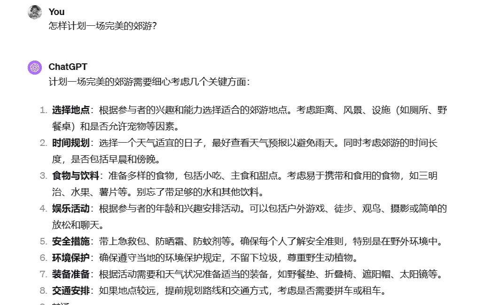

但如果我使用 Prompt Chain，和 GPT 一步一步来解决问题🔍

我可能会先问：“联网搜索一下这周末无锡的天气怎样？”☁️，GPT 会给我一个明确的天气预报。

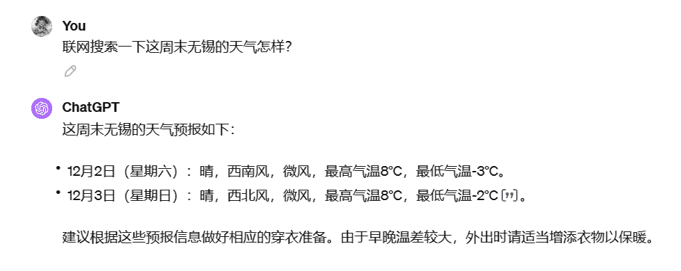

接着，我再问：“在这样的天气下，有哪些推荐的户外活动？”🌤️

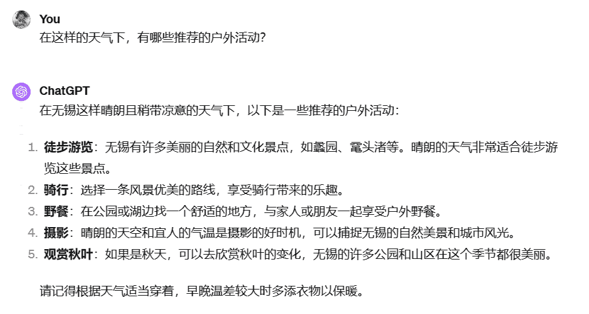

基于天气状况，GPT 会给出几个合适的活动建议🚵

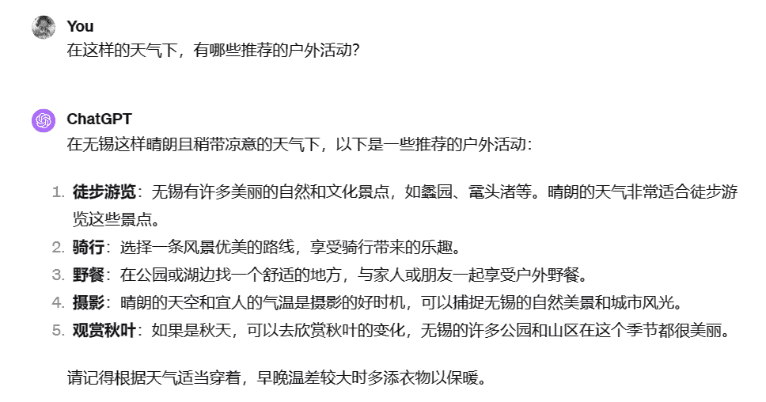

然后我继续问：“我选择 xxx 活动需要做哪些准备？帮我列一份列表”📋

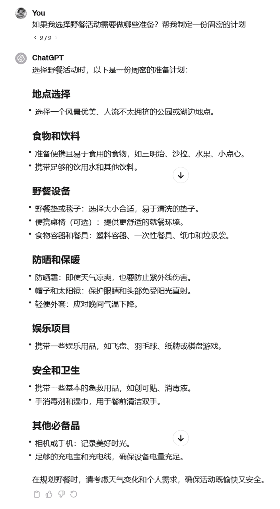

...

通过这样一连串的问题和回答，GPT 就能逐步构建出我的完美周末郊游计划🏕️

其中，

+   **第一个 Prompt**：「联网搜索一下这周末无锡的天气怎样？」

+   **第二个 Prompt**：「在这样的天气下，有哪些推荐的户外活动？」

+   **第三个 Prompt**：「我选择 xxx 活动需要做哪些准备？帮我列一份列表」

每个 Prompt 都是一个小任务，连在一起，就能顺畅地完成整个大任务。

就像我们做菜，先切菜🔪，再炒菜🍳，最后出锅🍲，每一步都为下一步做准备，最终完成一道美味的佳肴🍽️。

---

### 二）关卡 2🚩

让我们通过一个更落地的实际案例来看看分治法和 Prompt Chain 是如何发挥作用的🔍

几周前，我接到一个代写任务，根据《工程经济学课程报告要求》写一份课程课程报告📝

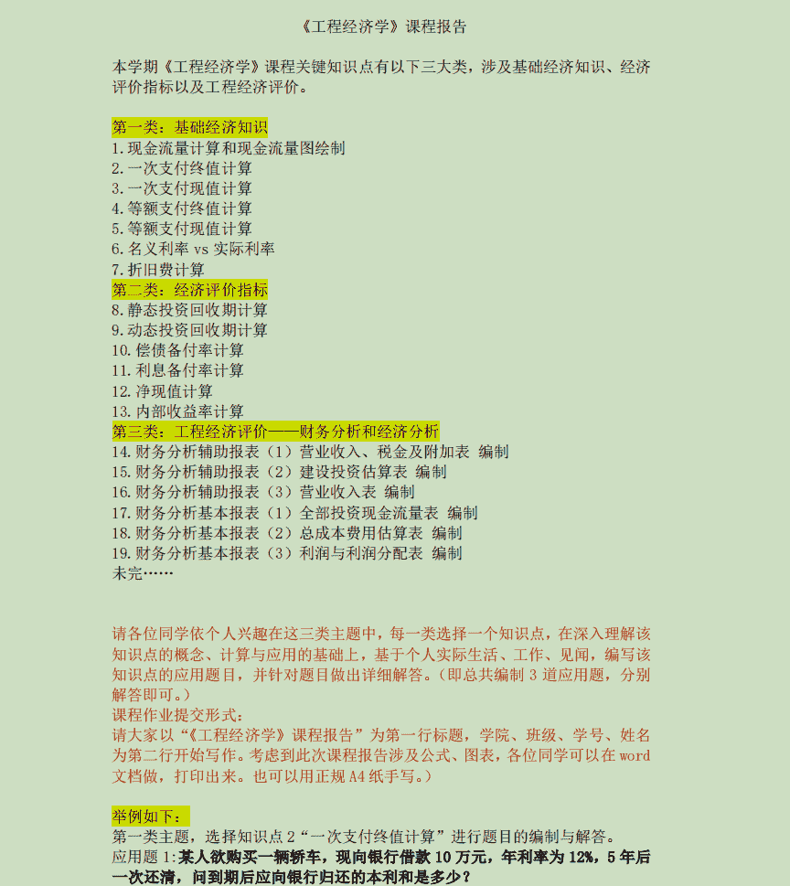

这是一个挺大的任务，而我作为一个从来没有学过工程经济学的人，一下子根本不知道从哪里开始🤷

于是，我用 GPT 协助我完成这个任务🤖

先看一个错误的示例，全选复制《工程经济学课程报告要求》的所有文字并粘贴到对话框中。

然后再说“帮我写一份《工程经济学》课程报告”

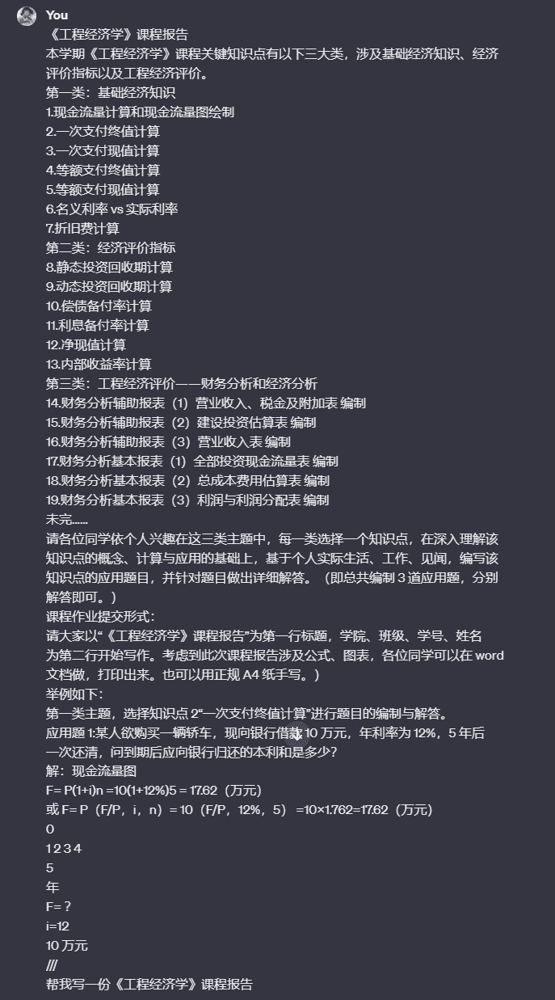

GPT 的回答是：

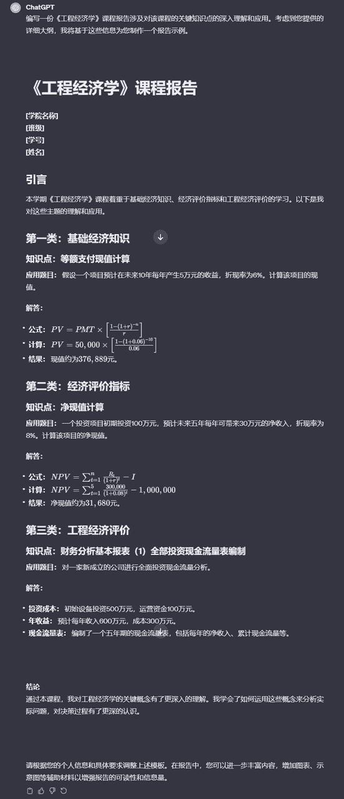

GPT 它只是给出一份课程报告的简单示例，根本不能拿来直接用！🚫

还记得分治法吗？把任务拆解成一个个小任务，再逐个击破，最终合并到一起🧩

所以，正确的做法应该是

**步骤一：**先拆分任务🔧

这里，可以运用这段提示词：

> 我要完成 XXX 任务，请你帮我将任务拆解，列出任务清单，并且规划任务执行者。

>

> - 任务清单：将复杂任务细化为具体的小任务，明确每个任务的执行方式和执行者。

> 

> - 执行者分为三种：GPT、人机协同或纯人类

> 

> + GPT：任务完全能由 GPT 大模型独立自主完成。例如：GPT 根据人类输入的文章， 总结整理

> + 纯人类：任务只能靠人类完成，GPT 无法帮忙。例如：打印文件（因为 GPT 无法连接真实世界的硬件设备）

> + 人机协同：任务需要人类与 GPT 通过文字交流的方式共同解决。

为什么要分为三种执行者呢？🤔我们先看一下这样做的效果：

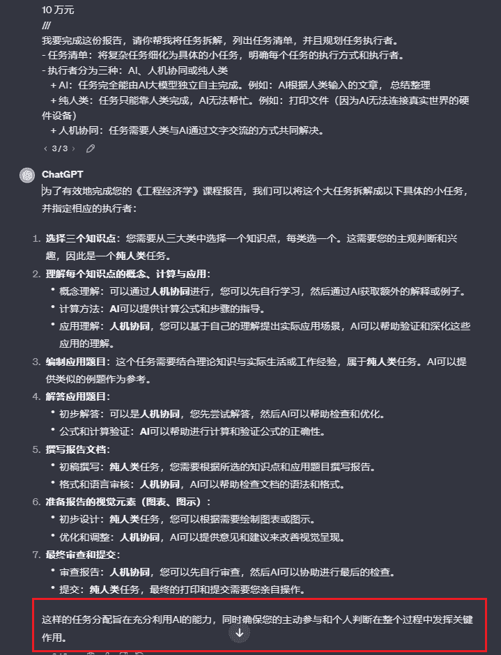

首先，我们要清楚，AI 解决任务的方式和人类不一样的。

对人类来说：

> 任务清单（人类）：

1.  阅读文章，了解《工程经济学》课程的三大类知识点📚

1.  根据个人兴趣，在三大类知识点中各选择一个知识点进行深入学习🔍

1.  深入理解所选知识点的概念、计算与应用，并基于个人实际生活、工作、见闻，编写该知识点的应用题目🧠

1.  针对编写的应用题目做出详细解答🖋️

1.  以“《工程经济学》课程报告”为第一行标题，学院、班级、学号、姓名为第二行，开始写作📝

1.  考虑使用 word 文档或正规 A4 纸手写，打印出来🖨️

但是，对 GPT 来说：

> 任务清单（GPT）：

1.  阅读文章，辅助人类了解《工程经济学》课程的三大类知识点💡

1.  辅助人类在三大类知识点中各选择一个知识点🔍

1.  创建 word 文件📁

1.  编写该知识点的应用题目，并详细解答🖊️

1.  将题目和解题过程写到 word 中📄

目前，GPT 的每一次决策都依赖人类的反馈、选择，

我们应该意识到 「**纯人工解决问题**」和「**人机协同解决问题**」的方式是不同的。

意识不到这点的人，可能会误以为 GPT 完全能按照纯人工的方式去解决问题。

例如，我之前看到一段提示词，是关于英语练习的，提示词中有一句是“每日提醒用户学习”

GPT 怎么给用户提醒？到点了给用户发一条消息提醒他们学习英语？目前的 GPT 可做不到这点🚫

好，拉回来，刚才我们已经完成了**步骤一：拆分任务，**现在，我们开始逐个击破🥊

1.  选择三个知识点（纯人类）🧑

1.  理解每个知识点的概念、计算与应用（人机协同）🤖👥

1.  编写应用题目（人机协同）✍️

1.  解答应用题目（人机协同）🖋️

1.  撰写报告文档（人机协同）📑

1.  最终审查（纯人类）🔍

**1、选择三个知识点（纯人类）**

刚刚 GPT 给我们规划的是纯人类，但是我只是完成任务，不是为了学东西，那肯定是让 GPT 帮我选择最简单、最好做的知识点🎯

灵活变通，不是说必须要根据 GPT 规划的计划去执行🔄

所以，Prompt1:

```
考虑所选知识点的概念、计算与应用，并基于个人实际生活、**工作、见闻，从这三大类知识点**中各选择一个最简单、最容易完成、最快完成的知识点，只选择出知识点即可
```

为什么我在结尾写的是“只选择出知识点即可”？因为我怕 GPT 自作多情，选完知识点后就直接开始 kuku 写🚫

这违背了我们的“一次只完成一个小任务”原则📌

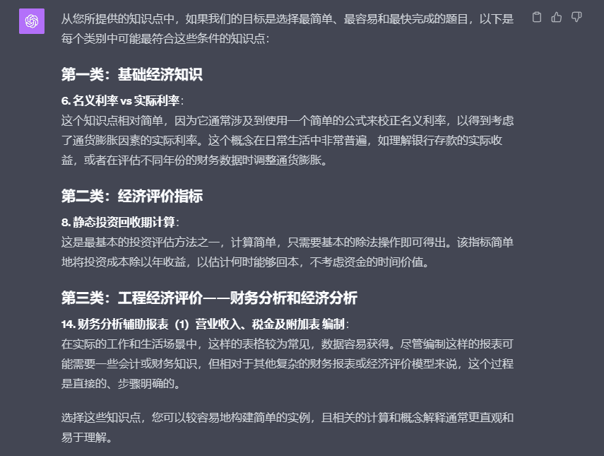

现在，GPT 帮我选择了上面这三个知识点📍

2、理解每个知识点的概念、计算与应用（人机协同）🧑💻🤖

我只是完成任务，不是为了学东西，所以这一步直接跳过⏭️

3、编写、解答应用题目（人机协同）

由于选择的知识点比较简单，可以把编写题目和解题这两个步骤放到同一个 Prompt 中解决。

我们需要解决三个知识点，很明显，这里又能把任务进行拆分🔀

首先是第一个知识点，输入 Prompt2.1：

```
我选的第一个知识点是“名义利率 vs 实际利率”。
在深入理解该知识点的概念、计算与应用的基础上，基于个人实际生活、工作、见闻，编写该知识点的应用题目，并针对题目做出详细解答。
```

GPT 输出结果：

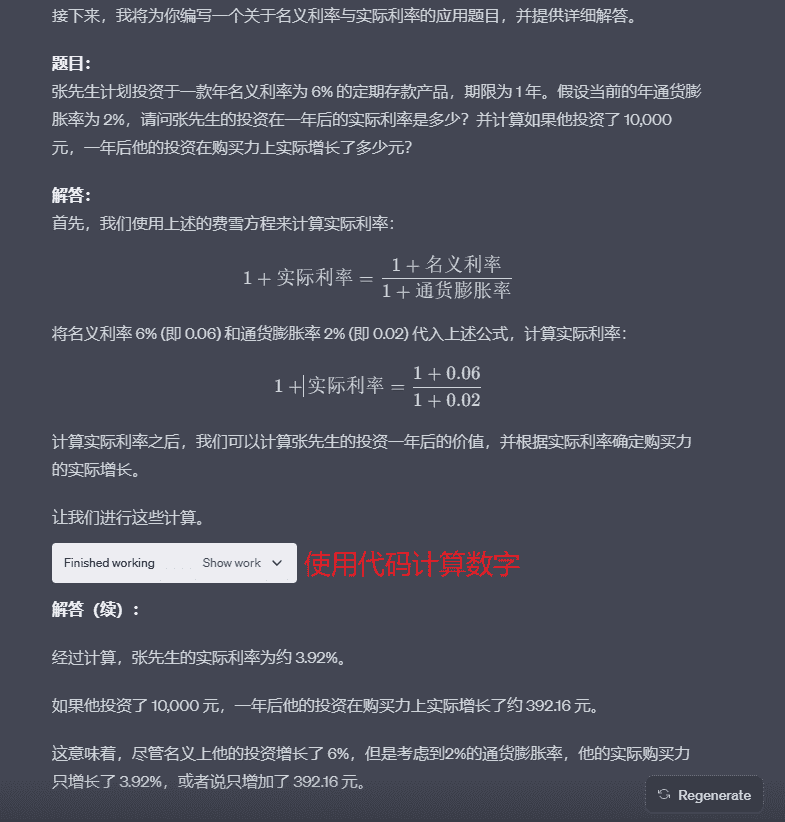

接着，让 GPT 把第一个知识点的题目和答案添加到 word 文档中。

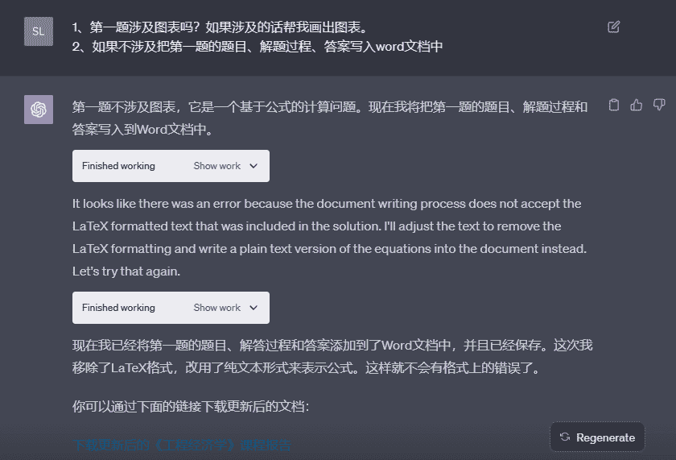

然后是第二个知识点，输入 Prompt2.2：

```
第二类：经济评价指标
我选择 “静态投资回收期计算”。这个指标是最基本的，不需要考虑资金的时间价值，只需简单的加减法即可计算出。
在深入理解该知识点的概念、计算与应用的基础上，基于个人实际生活、工作、见闻，编写该知识点的应用题目，并针对题目做出详细解答。

完成之后，将题目和解答过程添加到 word 中
```

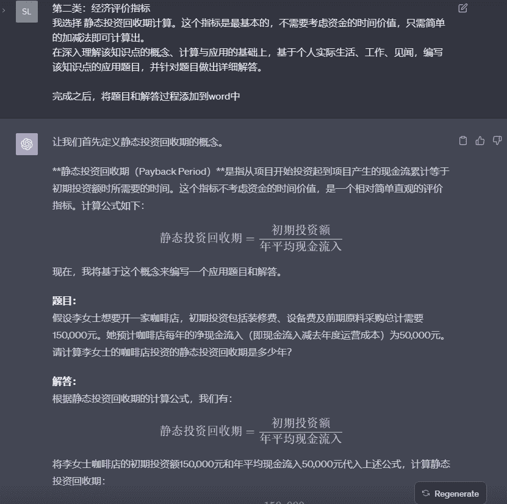

##

接着，第三个知识点，Prompt2.3:

```
下一个：第三类：工程经济评价——财务分析和经济分析
14。 财务分析辅助报表（1）营业收入、税金及附加表 编制：
```

由于 GPT 已经执行了两次同样的任务，它已经学会了怎么做。

所以现在我们就不需要把提示词写得这么详细了📝

GPT 的输出结果跟上一个的差不多，我就不贴图片了。

4、撰写报告文档（人机协同）和最终审查（纯人类）

Prompt3:

```
请提供 word 文档的下载链接
```

我将更新了第三个知识点之后的 word 文件下载到桌面，打开，检查一下。

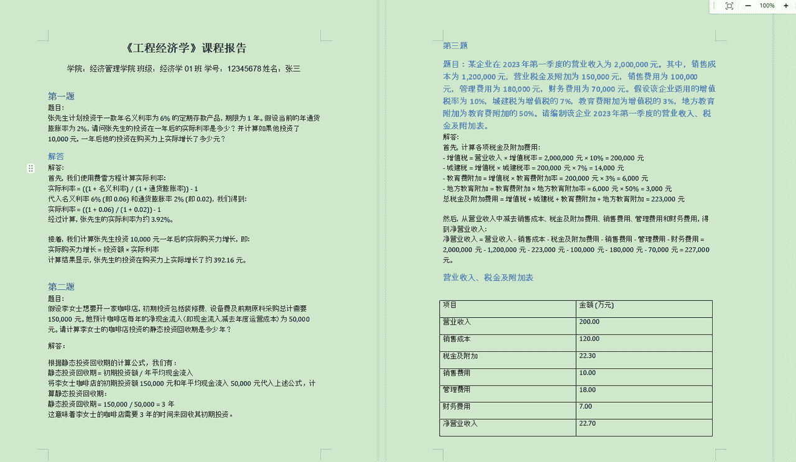

嗯，没啥问题，人工调整一下格式，就完成任务了✔️

以上就是一个用分治法和 Prompt Chain 解决复杂问题的实际案例🎓

我们回顾一下。

首先**：拆分任务**

1.  选择三个知识点（纯人类）🧑

1.  理解每个知识点的概念、计算与应用（人机协同）🧑🤖

1.  编写应用题目（人机协同）✍️

1.  解答应用题目（人机协同）🖋️

1.  撰写报告文档（人机协同）📑

1.  最终审查（纯人类）🔍

接着，设计 Prompt Chain

为每个小任务设计一个 Prompt：

+   **Prompt1**：「考虑所选知识点的概念、计算与应用，并基于个人实际生活、**工作、见闻，从这三大类知识点**中各选择一个最简单、最容易完成、最快完成的知识点。只选择出知识点即可」

>

+   **Prompt2.1**：「我选的第一个知识点是“名义利率 vs 实际利率”。
在深入理解该知识点的概念、计算与应用的基础上，基于个人实际生活、工作、见闻，编写该知识点的应用题目，并针对题目做出详细解答」

>

+   **Prompt2.2**：「第二类：经济评价指标
我选择 “静态投资回收期计算”。这个指标是最基本的，不需要考虑资金的时间价值，只需简单的加减法即可计算出。
在深入理解该知识点的概念、计算与应用的基础上，基于个人实际生活、工作、见闻，编写该知识点的应用题目，并针对题目做出详细解答。
完成之后，将题目和解答过程添加到 word 中」

>

+   **Prompt2.3**：「下一个：第三类：工程经济评价——财务分析和经济分析
14。 财务分析辅助报表（1）营业收入、税金及附加表 编制：」

>

+   **Prompt3**：「下一个：请提供 word 文档的下载链接」

最后，执行 Prompt Chain  🚀

通过这样的步骤，GPT 能够更有效地完成每一部分任务，最后我们将这些部分组合起来，就能构成一篇完整、深入的课程报告了📝

希望这个例子能够启发大家在面对复杂问题时，试着用这种方法来寻找解决方案🔍

我们再看一个例子。

### 三）关卡 3🚩

一个月前，我社区投稿了一篇[夙愿：使用 GPT 模仿创作内容的万能思路](https://waytoagi.feishu.cn/wiki/MzgBw4gcUi8mibkjAA5cuPignMe)

在这个教程中，我通过逐步构建和不断优化提示词，最终迭代出一个小红书视频标题生成助手🔧

「小红书视频标题生成助手」这套提示词并不是一下子就写出来的。

我也是用分治法将这个复杂任务拆解，拆解成了下面几个小任务：

> 1、收集高质量的标题示例作为后续分析的基础（纯人类）🧑

> 2、询问 GPT 分析标题特点的维度 （人机协同）🧑🤖

> 3、让 GPT 根据这些维度分析标题特点（人机协同）🧑🤖

> 4、编写提示词（纯人类）✍️

> 5、测试提示词（人机协同）🧪

> 6、迭代提示词（人机协同）🔄

接着再给**人机协同**的任务设计 Prompt Chian🔗

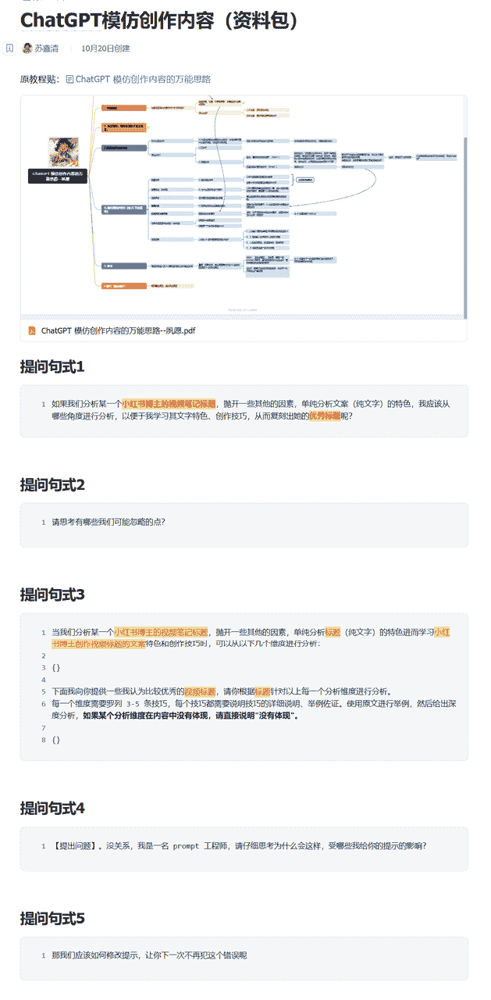

其中，收集高质量标题这一步我用的工具是后羿采集器，与 AI 无关。

所以，从广义的角度来看，Prompt Chain提示词链，这条链的每一个节点不一定是 AI ，它可能是其他工具。

时间关系，我就不进一步展开讲解了，还没看过视频的同学，我十分推荐你去看，并且视频教的方法实践起来📺

# 三、结尾

在 ChatGPT 一岁的生日之际，我们一起见证了 AI 的飞速成长🚀

回想这一年来，我们从最开始只是好奇尝试，到现在能用 AI 解决实际问题，每一个进步都令人振奋💡

我希望今晚分享的分治法和 Prompt Chain 能帮到大家在未来更好地用 AI 工具提高效率🛠️

在 AI 时代，让我们把使用 AI 工具变成一种习惯，像呼吸一样自然💨

无论是解决复杂的工作问题，还是规划轻松愉快的周末郊游，AI 都能成为我们的得力助手。

最后，发一个小彩蛋：

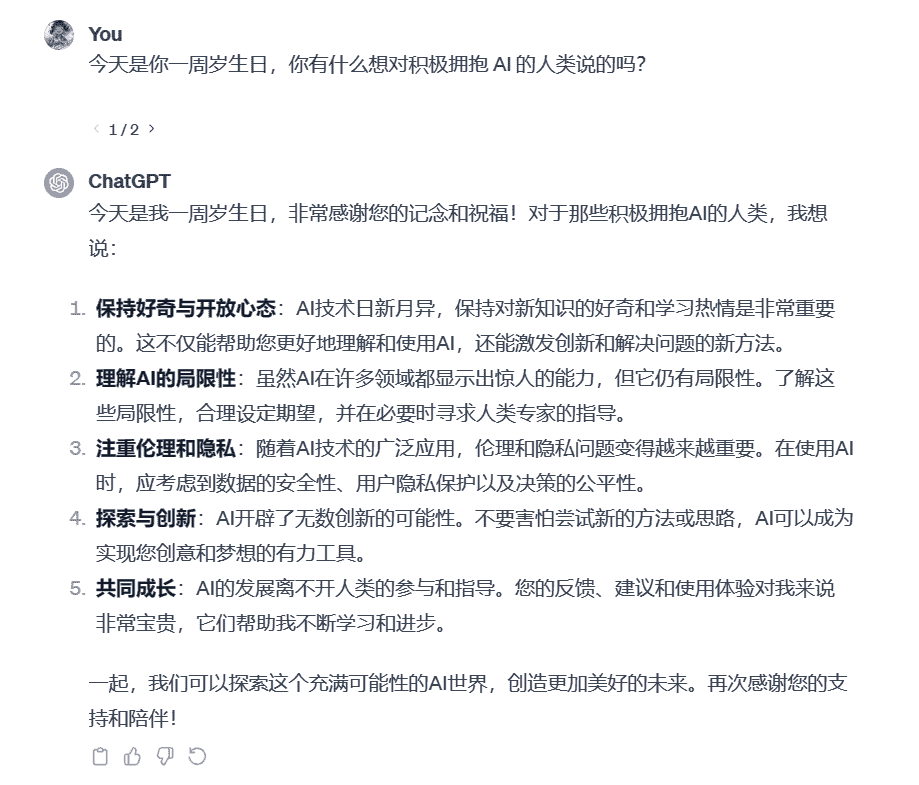