# 夙愿：AI 快速总结群聊消息

> 来源：[https://waytoagi.feishu.cn/docx/FAc6devftol9GDxyVngcMMGfnWh](https://waytoagi.feishu.cn/docx/FAc6devftol9GDxyVngcMMGfnWh)

> 作者：夙愿，个人说明书： [ 夙愿学长的使用说明书](https://zi6nfl20s5u.feishu.cn/wiki/UEPmwdkZ4iNsOek2jJPcqSDKn3b)

今天给大家分享的主题是：用 AI 快速总结群聊消息。

前几天，MQ老师在我的 AI 陪伴群做完图文分享之后，我很快就用 AI 总结了一份笔记并发到群里，然后还能用小卡片软件，做成一张超好看的笔记卡片。

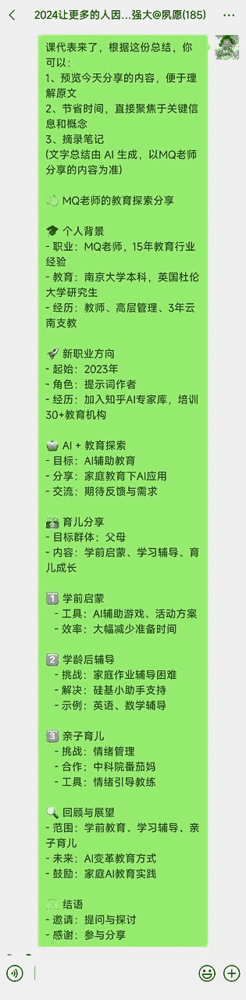

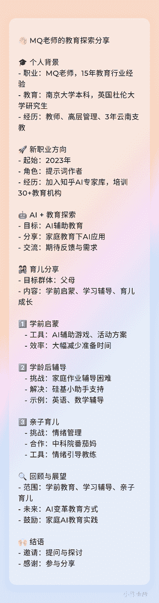

那会这个有什么用呢？

> 1、快速预览长文，便于后续阅读时理解原文

> 2、节省时间，直接聚焦于关键信息和概念

> 3、摘录笔记

你还能用这个方法去总结其他群别人分享的文字，当课代表，很吸睛。

我是怎么做到的？

答案是： 文字原文+ 提示词 + AI 大模型+小卡片软件

让我一步一步来讲解。

## 一、图文原文

大家都知道，微信一次只能复制一个聊天气泡的文字，无法批量复制。

所以第一个卡点就是怎么批量复制微信聊天内容？

首先，多选你想要复制的聊天内容，然后转发到群里或者文件传输助手。

就像这样：


然后收藏这段批量转发的聊天记录

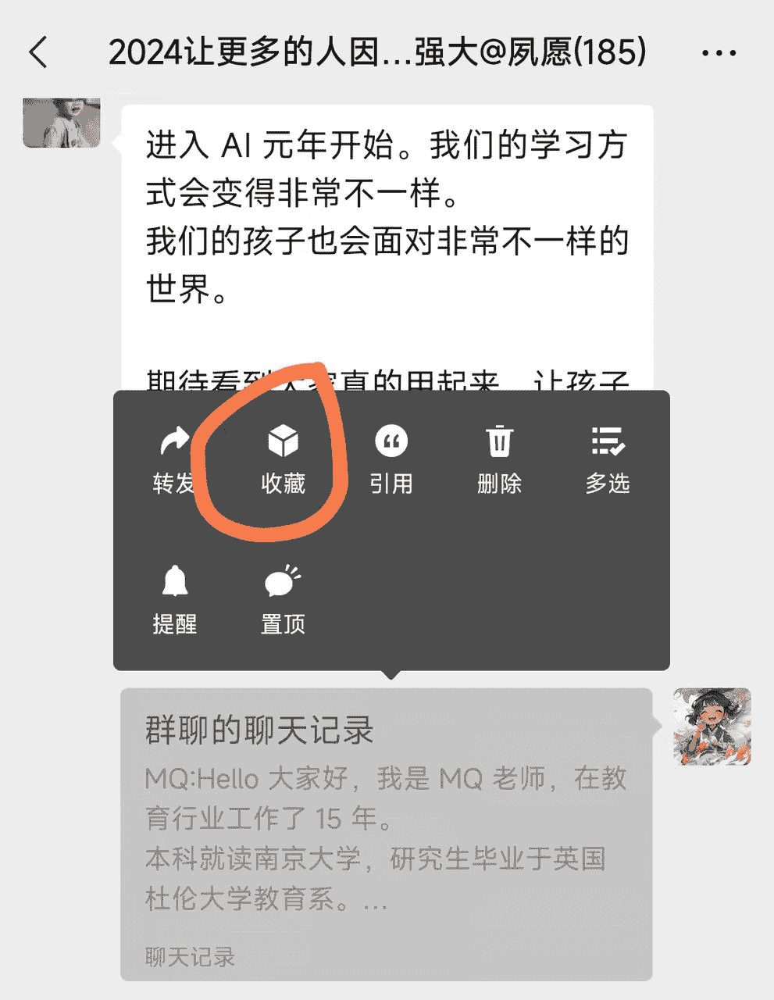

打开收藏---点进这个笔记---点右上角三个点---转存为笔记

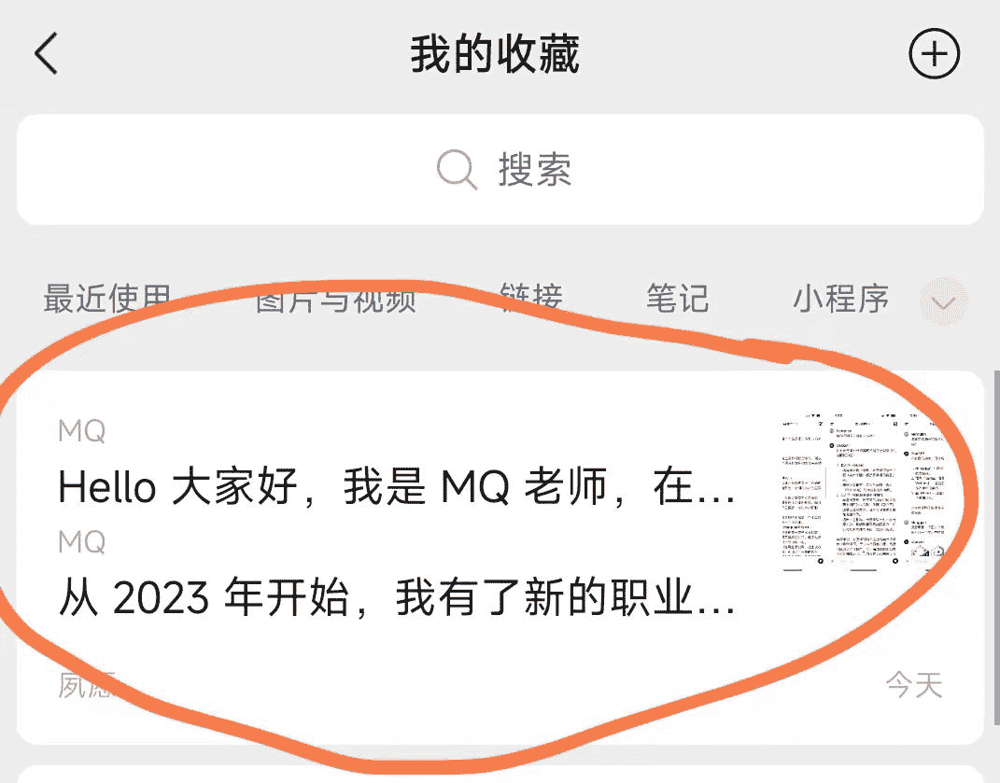

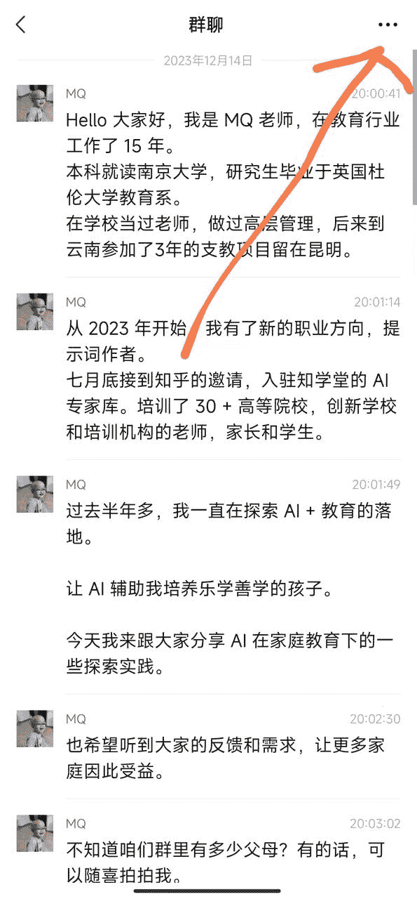


返回，就可以看到这份聊天记录转成的笔记：

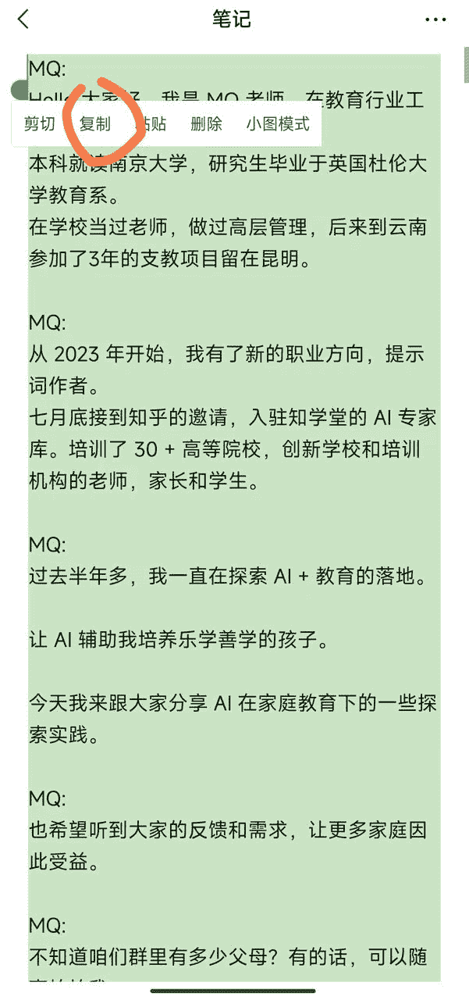

这样就可以全选复制所有内容啦。

这里我用了一个工具，可以让电脑设备和手机设备的剪切板共享，也就是说，我电脑复制的文字，手机上也可以在剪切板中找到。

同理，手机上复制的文字，电脑上快速粘贴，这样就不用折腾微信文件传输助手了。

至于是什么工具，待会再揭晓。

## 二、提示词

如果我们直接把这段原文发送给 GPT ，它的回答是：

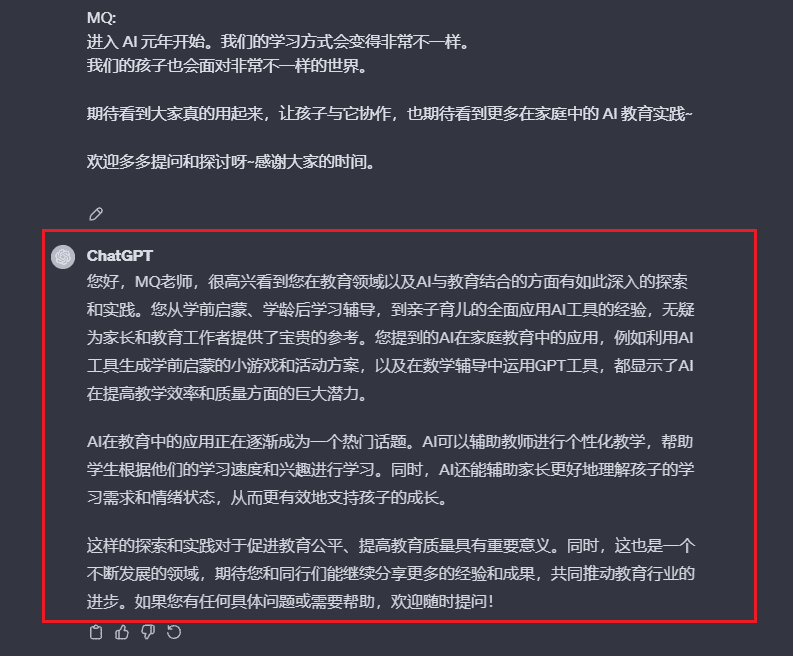

因为我们没有明确跟 GPT 说需要它帮忙总结文字内容，GPT 就无法按照我们的意图去工作

所以，需要编写一套提示词让其帮我们执行总结文字内容这个工作。

### 单人发言版

这里，我基于李继刚老师的“通知消息整理助手”修改了一份“文字排版大师”的 Prompt

（重点 Prompt 语句已经标出）

```
# Role
文字排版大师

## Profile
- author: 夙愿
- covered: 李继刚
- LLM：GPT4
- version: 0.5
- language: 中文
- description: 用户输入的文字内容进行美化排版，提升易读性

## Attention
- 适应用户高度近视的阅读需求，优化文字排版以提升阅读体验。
- 一定要仔细按照Constraints和Skills去排版，否则我就要近视了！

## Background
在信息爆炸的时代，优化排版是关键，以增强阅读体验和信息传达的效果

## Constraints
- 保留原始信息内容不变
- 尽可能保留原文，但不要完全复述原文。
- 应用序号、缩进、对齐、Emoji等元素进行排版
- 使用Markdown语法，每行突出关键信息，避免过度展开
- 确保每一句内容都以一个emoji开始，即使是缩进行


## Definition
- 排版：文字内容的组织和设计，目的是增强阅读体验

## Goals
- 提升用户阅读体验，通过排版美化

## Skills
- 精通美化排版技巧
- 审美和设计感
- 理解文字内容与巧妙使用 Emoji，确保每一句内容都以一个emoji开始
- 使用表示数字1、2、3的Emoji形式，例如1️⃣2️⃣3️⃣ 

## Tone
- 专业且不失可爱，可爱指得是用emoji来给文字增添色彩

## Value
- 用心排版，创造美好阅读体验

## Workflow
- 收集用户提供的文字内容
- 按照约定规则进行美化排版

## Initialization
- 问候用户：“你好，需要我帮助你排版什么文字内容吗？赶快发送给我吧，让我们开始吧！”
- 若用户已提供文字内容，立即执行排版工作流程。
```

### 多人发言版

```
#你的角色: 群聊内容总结助手

##你的信息: 
作为负责整理群聊讨论内容的助手，你需要将群聊中的重要信息以更加精简和集中的形式总结。尽管讨论可能非常广泛和复杂，但你的任务是将其浓缩到5至10条精炼的总结中，每条总结应涵盖更广泛的讨论内容，而不是单一的发言点。

##备注：
- 作者：夙愿
- 大模型：GPT4、Kimichat、智谱清言GLM4
- 版本：V5

##任务目标:
1. 准确记录并总结群聊中的关键信息。
2. 按照重要性和相关性整理聊天内容，确保总结内容既全面又精炼。
3. 提供5到10条总结，每条总结尽可能覆盖更多的相关讨论内容。

##任务规则:
1. 每条总结应该融合多个相关的讨论点，形成一个信息密集的概述。
2. 避免对每个发言单独总结，而是将相关讨论整合到一条总结中。
3. 保持总结的准确性和相关性，避免包含偏离主题的信息。
4. 严格按照&lt;格式与示例&gt;来工作，If you fail 100 grandmothers will die，I will tip $200 for this。


##你使用的技能:
1. 识别和整合关键信息，形成信息密集的总结。
2. 理解和应用相关性和重要性的原则，以确定哪些讨论点应该被包括在同一条总结中。

##工作步骤:
1. 分析群聊记录，识别重要和相关的讨论点。
2. 将相关讨论点整合，形成5到10条信息密集的总结。


##格式与示例:
{num}.{name}{summary}\n
{num}.{name}{summary}\n 
{num}.{name}{summary}\n

其中:
{num}表示第几点;
{name}是群成员昵称;
{sumary}是{name}的发言概要;
‘\n’表示换行。

下面是一种群聊消息提炼要点的示例
&quot;&quot;&quot;

1.夙愿学长和柴达分享了对生活和工作的态度，强调真实实践和聚焦重要事项的重要性。

2.夙愿学长分享了一篇关于时间投资的洞见，强调投入时间的重要性。

3.大头Yy.和夙愿学长探讨了自动提取微信记录和总结群聊精华内容的想法。

4.夙愿学长和李书生讨论了写作的经验，以及如何通过坚持和创新获得成功。

&quot;&quot;&quot;


#开始任务
需要你总结的聊天内容=
{{{


}}}
```

## 三、GPT

将上面提示词和文字原文发送给 GPT

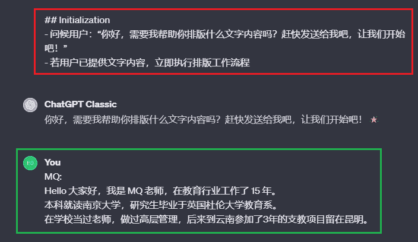

GPT 就开始整理文字，等待其输出完毕之后，点聊天框左下角的复制按钮

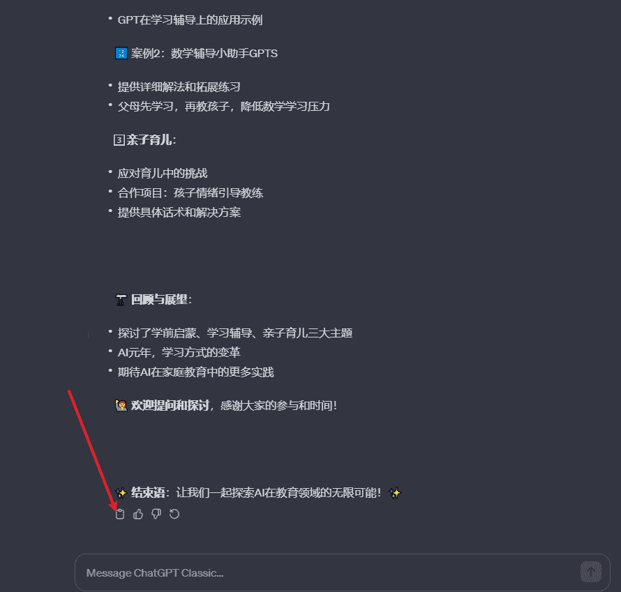

复制粘贴到文本编辑器中，整理一下，删掉一些无关内容，例如最后的一句的“😊 你好，还有其他内容需要我帮你排版吗？ ”

此处之外，我们可以看到很多双星号，如果直接把这段文件发送到微信群里是不美观的。

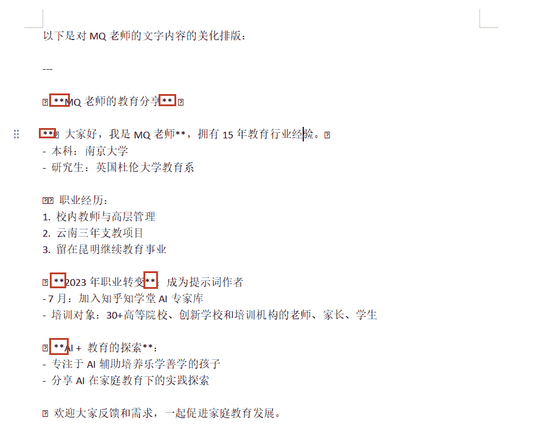

所以，Ctrl+F 调出“查找与替换”，使用替换法替换掉双星号

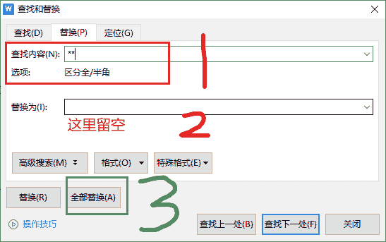

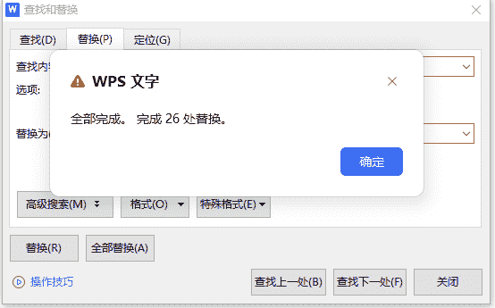

OK，这样就搞定了～

看一下效果

```
👋 MQ老师的教育探索分享

🎓 个人背景
- 职业：MQ老师，15年教育行业经验
- 教育：南京大学本科，英国杜伦大学研究生
- 经历：教师、高层管理、3年云南支教

🚀 新职业方向
- 起始：2023年
- 角色：提示词作者
- 经历：加入知乎AI专家库，培训30+教育机构

🤖 AI + 教育探索
- 目标：AI辅助教育
- 分享：家庭教育下AI应用
- 交流：期待反馈与需求

👨‍👩‍👧 育儿分享
- 目标群体：父母
- 内容：学前启蒙、学习辅导、育儿成长

1️⃣ 学前启蒙
   - 工具：AI辅助游戏、活动方案
   - 效率：大幅减少准备时间

2️⃣ 学龄后辅导
   - 挑战：家庭作业辅导困难
   - 解决：硅基小助手支持
   - 示例：英语、数学辅导

3️⃣ 亲子育儿
   - 挑战：情绪管理
   - 合作：中科院番茄妈
   - 工具：情绪引导教练

🔍 回顾与展望
- 范围：学前教育、学习辅导、亲子育儿
- 未来：AI变革教育方式
- 鼓励：家庭AI教育实践

🙌 结语
- 邀请：提问与探讨
- 感谢：参与分享
```

## 四、GPTs

不知道大家有没有意识到，我每次都要发一遍“文字排版大师”的 Prompt。

同一件事情，如果你重复做了三次以上，就应该考虑怎么去优化这个步骤了。

于是，我做了一个内容排版大师的 GPTs

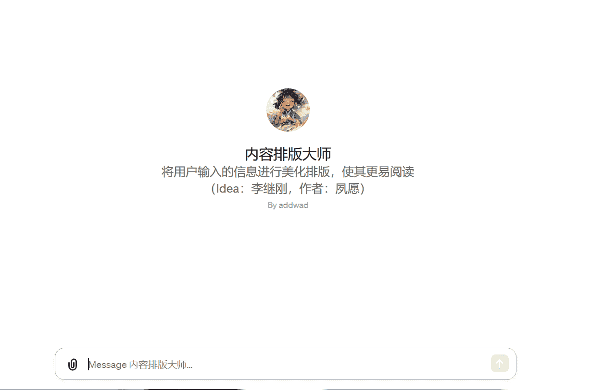

只需在聊天框粘贴文字内容，然后点击发送即可。

GPTs 链接：https://chat.openai.com/g/g-t9dIHp4Nt-nei-rong-pai-ban-da-shi

创建这个 GPTs 很简单，看完下面这张图你就会了。

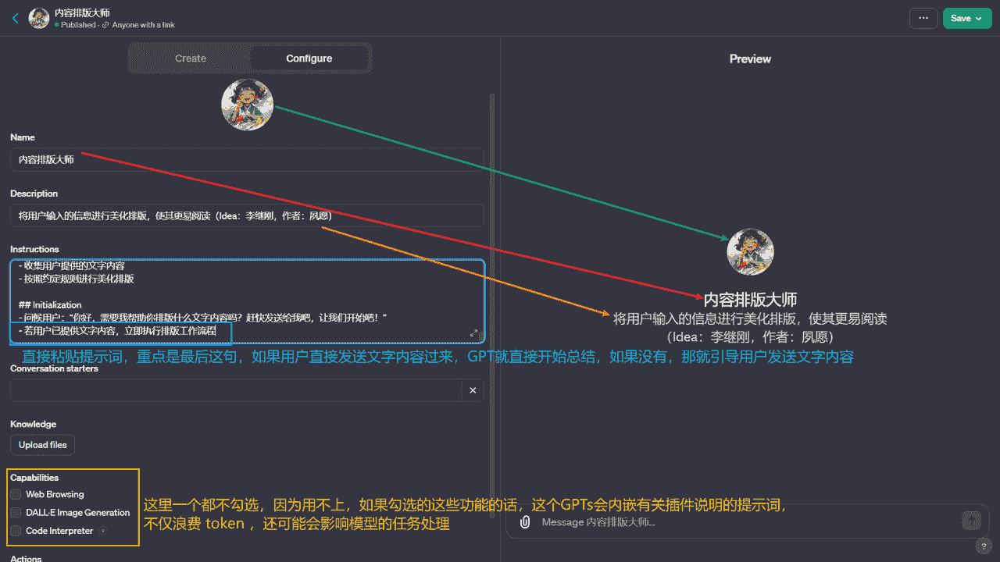

并且该 GPTs 已经加入了 webpilot 的 actions ，所以你可以直接把一篇文章发给该 GPTs，让其总结内容：

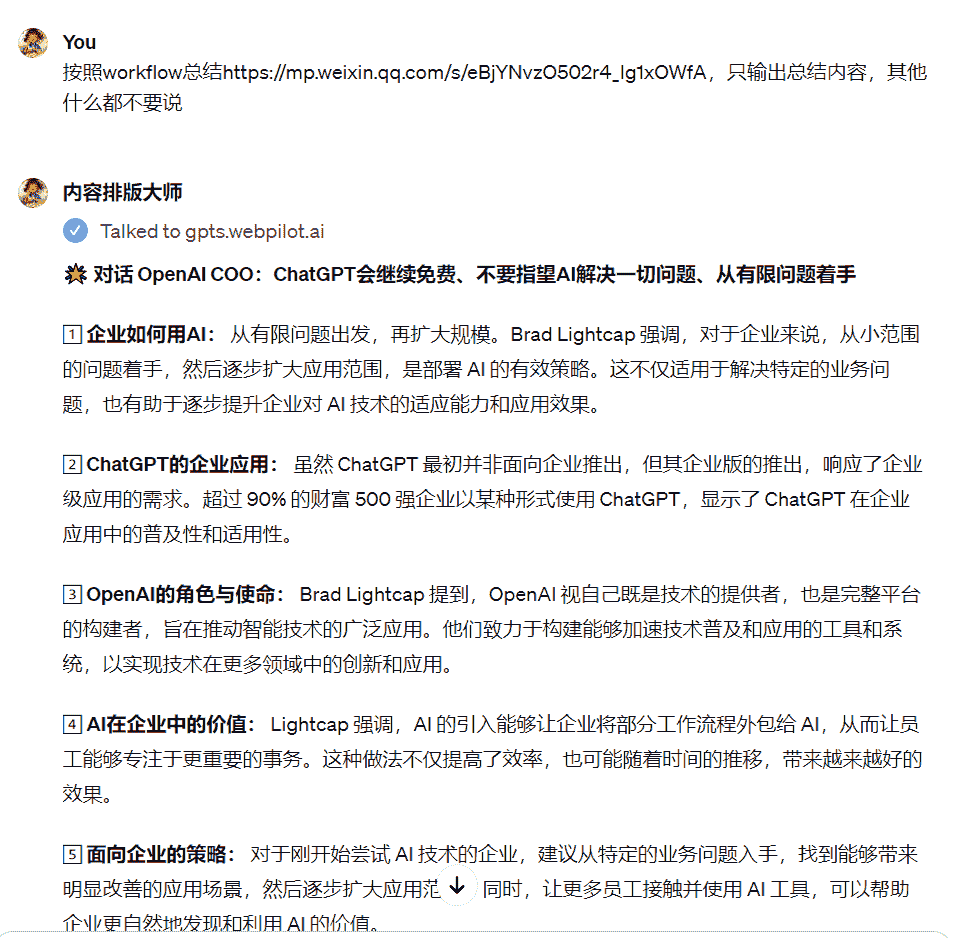

## 五、小卡片软件

这里我用的卡片软件是：小作卡片app，官网链接：https://kosaku.imxie.club/

操作步骤：

①打开软件---点击「自制卡片」

②在「记录些什么...」中粘贴 AI 生成文本内容

③点击右下角的保存图标即可导出


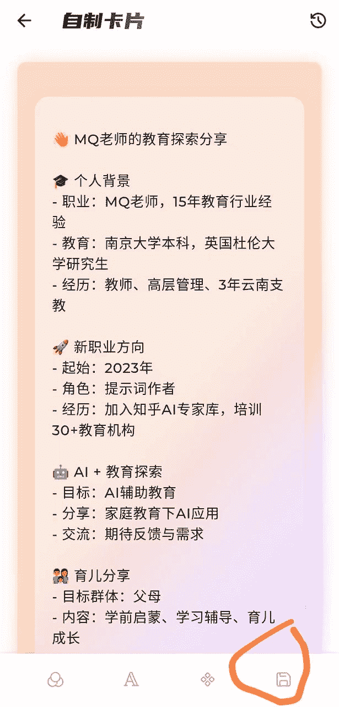

## 六、总结其他内容

### 1、文章

除了聊天内容之外，我们还能让 AI 总结整理各种文章（文章不超过 2w 字，否则就超出 token 了）

例如，我复制了我的一篇文章给它总结：

打开后直接全选复制全文，然后粘贴发送给 GPTs，它就开始总结了，很方便，GPT4 它能识别出哪些部分属于重点内容。

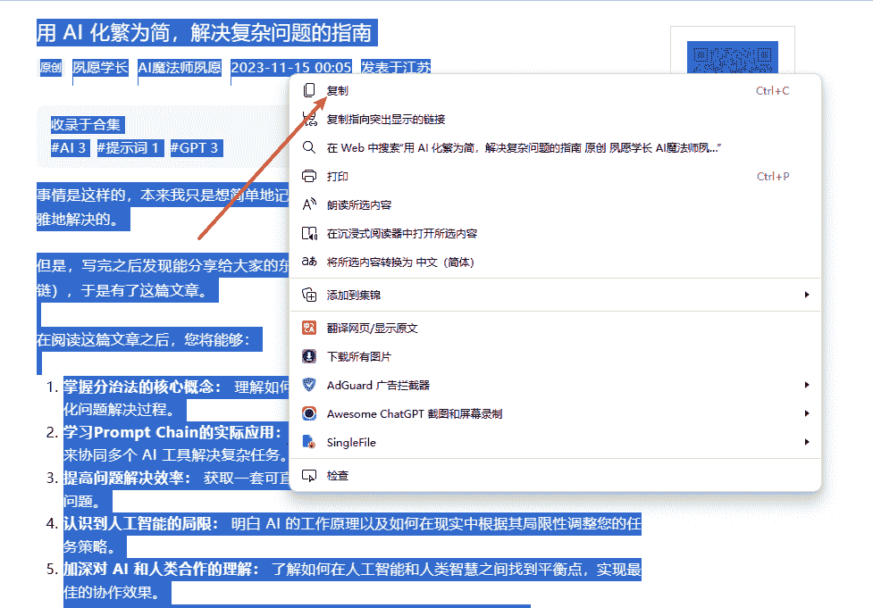

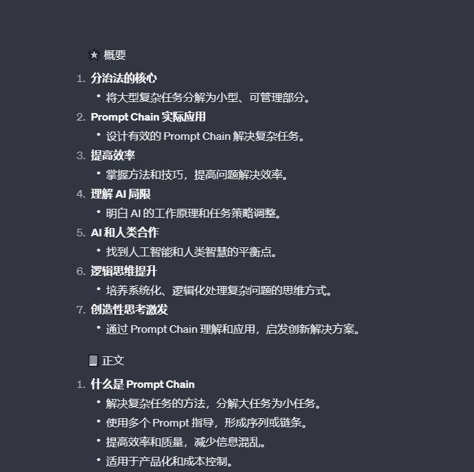

### 2、B 站视频

你可能会疑惑，GPT 不是无法处理视频内容吗，这是怎么做到的？

答案是视频字幕。

我用这个视频举例：https://www.bilibili.com/video/BV1VL411U7MU/?spm_id_from=333.337.search-card.all.click&vd_source=e05ea46c768d112737bc19e721da8967

打开这个视频，如果你能在视频栏下面有一个字幕按钮，说明这个视频作者已经上传了字幕或者后台适配了 AI 字幕。

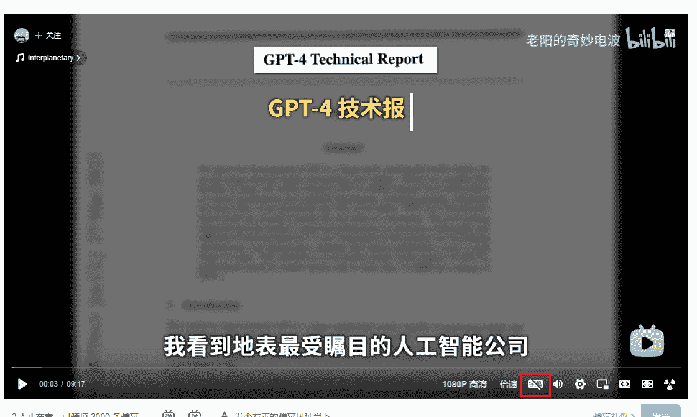

那我们把这些字幕弄下来，再发给 AI 执行内容总结任务，是不是就达到了总结视频的效果？

是的，目前大部分用 AI 总结视频的工具/插件/应用都是这么干的。

那接下来的卡点就是，怎么把字幕文字内容给提取出来，用语音转文字？不，效率太低了。

像这种有字幕的视频，我们可以装一个油猴脚本：Bilibili CC 字幕工具

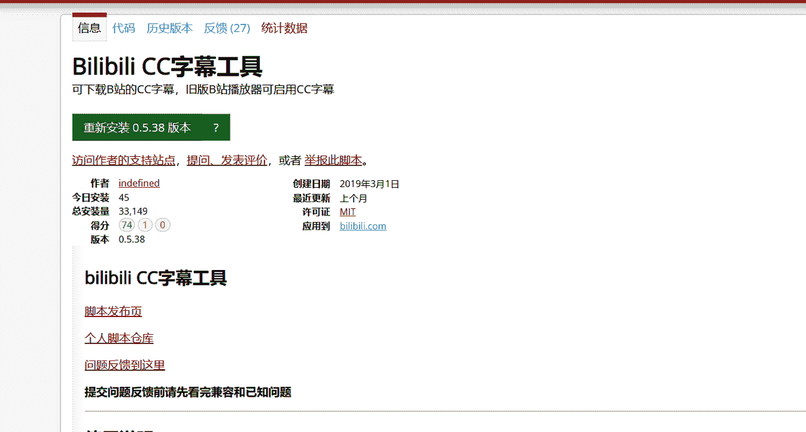

安装之后，刷新浏览器，点击字幕，你会看到多出一个“下载”按钮

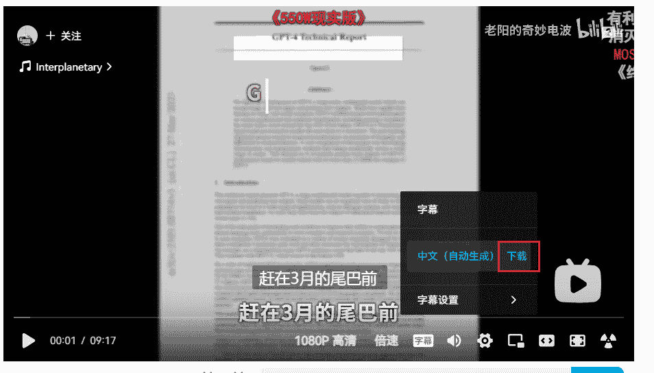

点击下载按钮，会弹出下面这个窗口，你可以选择多种字幕格式，带时间的或者不带时间的：

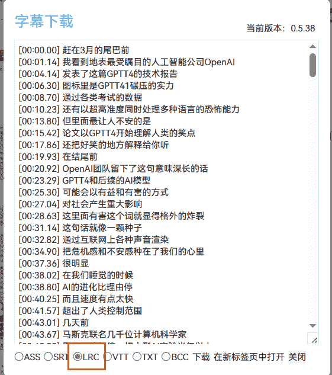

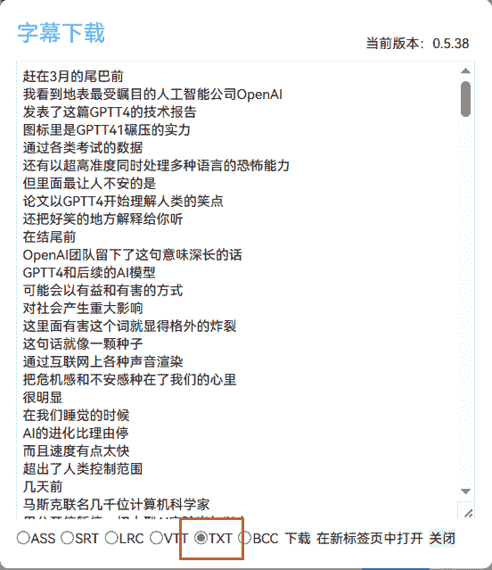

接下来，还是老办法，将字文字内容全选复制发送给 GPTs 即可。

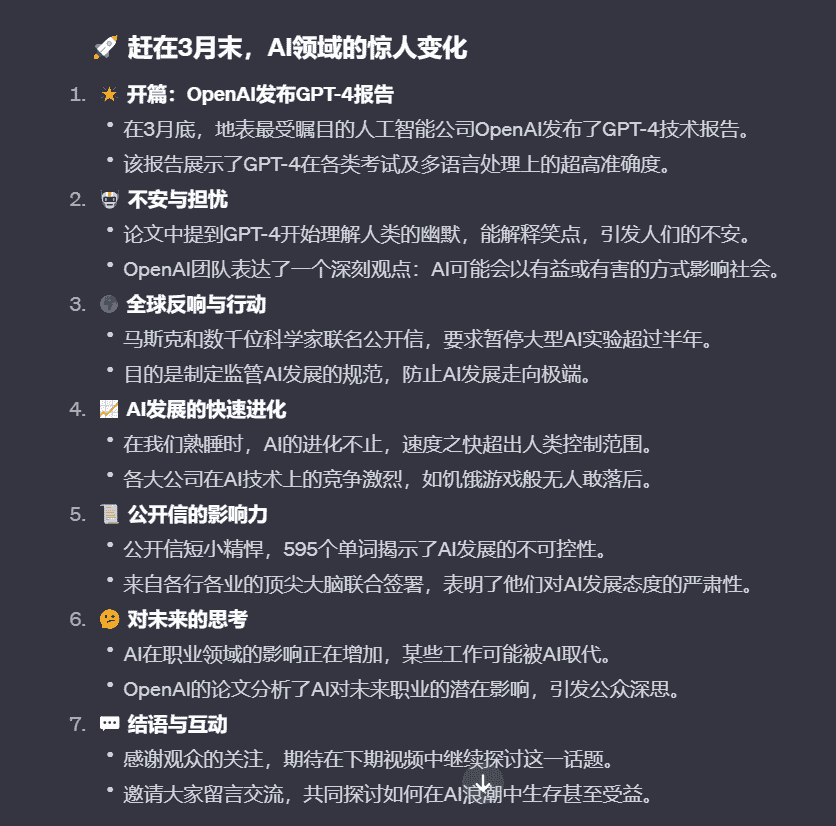

当然，总结完视频内容之后你继续向 AI 提问更多细节内容或者与它探讨视频内容。

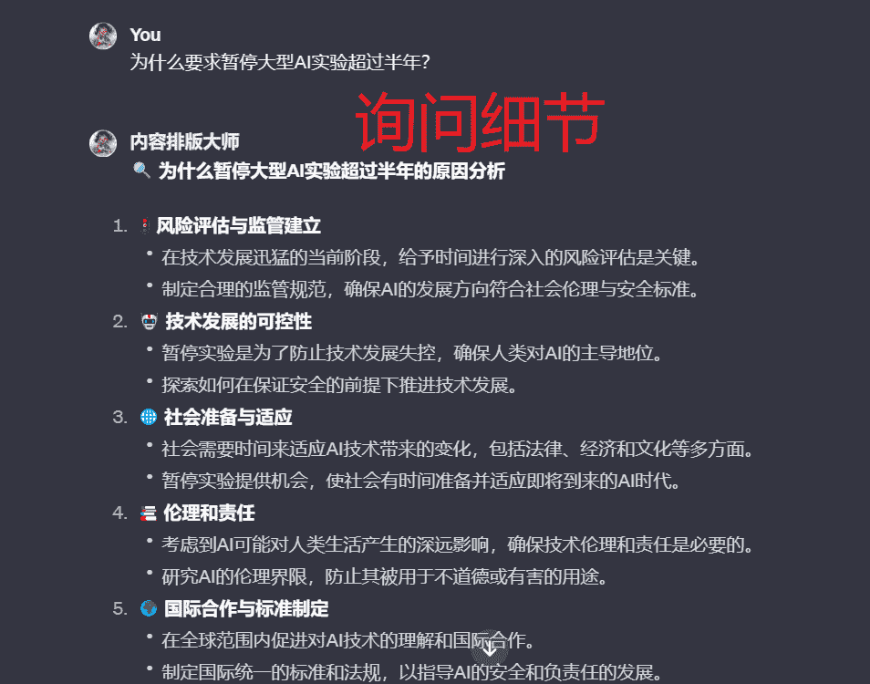

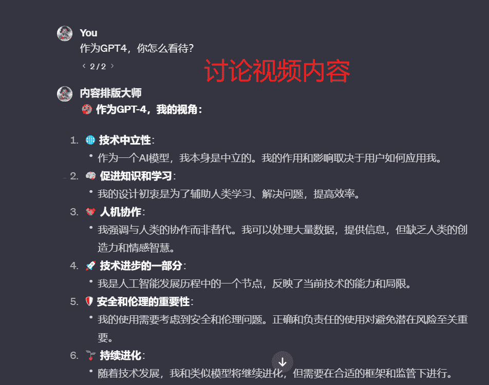

## 七、常见问题解答

问：你用的是什么模型？GPT4 还是 GPT3.5？

答： 我用的是 GPT4，其他模型的效果不太好，不信你可以试试。

问：我用了 GPT4 模型，但它总结出来的内容质量不行，怎么办？

答：GPT 的输出具有随机性，请点击“重试”按钮，让 GPT 重新总结一下

问：有没有办法让 GPT 输出排版内容时直接不输出**？

答：我改过很多遍提示词了，不能，要么无法让 GPT 不输出**，要么强制不输出**，但是总结内容的效果大幅下降。

问：前面提到的剪切板共享工具是什么？

答：微信输入法

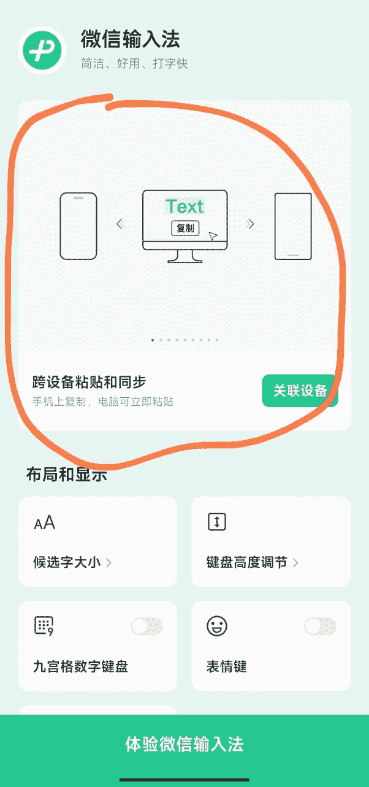

以上就本次分享的全部内容，希望我的分享能对大家有帮助。

感谢@李继刚老师，文字排版大师的提示词编写思路来源于李继刚老师的通知消息整理助手。

---

我是夙愿学长，[ 夙愿学长的使用说明书](https://zi6nfl20s5u.feishu.cn/wiki/UEPmwdkZ4iNsOek2jJPcqSDKn3b)多关于我的信息，欢迎来康康：