# 豆爸：GPT作为关联学习的工具-双链、知识体系

> 来源：[https://waytoagi.feishu.cn/docx/IyI1dkeBQoT41GxbvWPcwwLrnH3](https://waytoagi.feishu.cn/docx/IyI1dkeBQoT41GxbvWPcwwLrnH3)

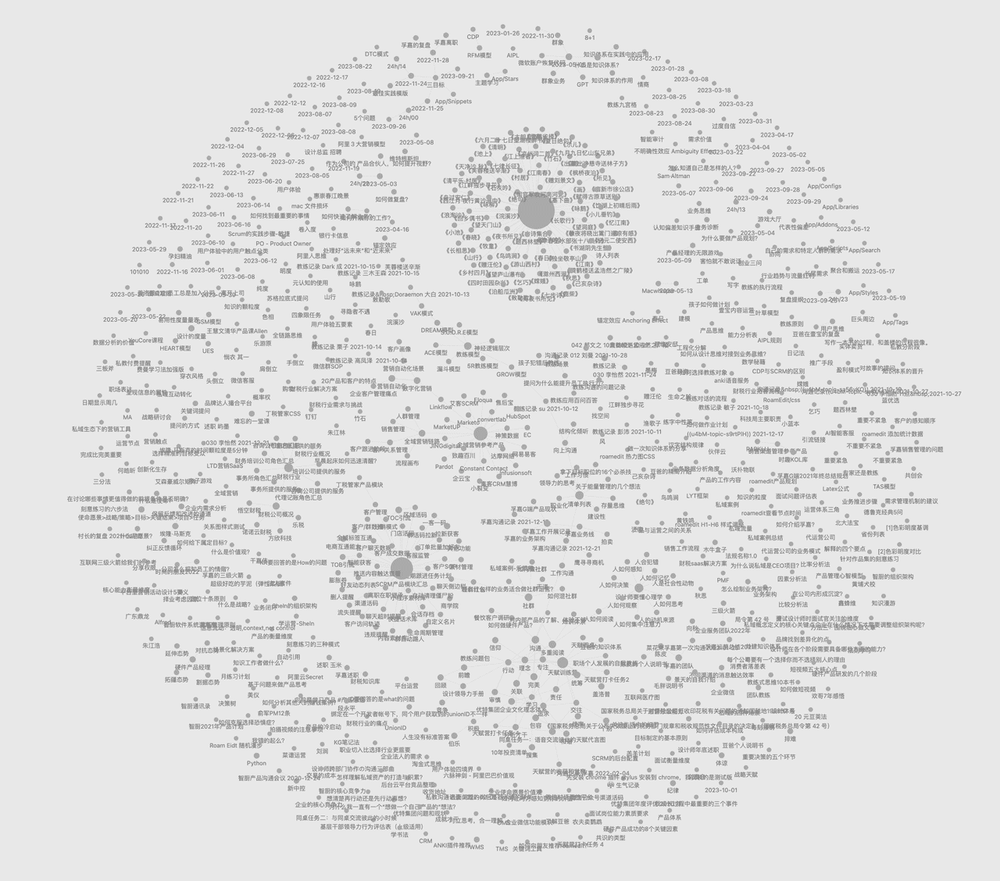

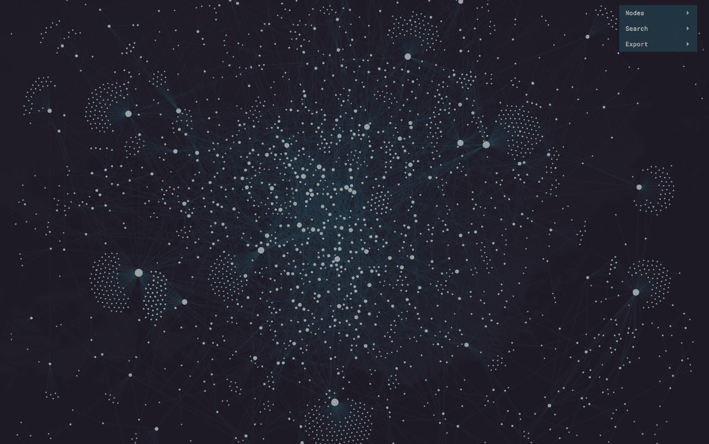

# 更新日志

+   更新了文档 2023-09-30 21:40:32

+   添加了快捷键，Ctrl + G  对选中的文字发送。 2023-10-01 02:01:24

+   合并了快捷键，仅保留 Ctrl + C 实现所有功能。2023-10-01 03:12:41

+   更新了配套的常青笔记prompt到1.0 2023-10-01 04:25:08

+   添加一个原子笔记的prompt 2023-10-01 04:50:23

+   **这里不更新了。功能整合到**南瓜博士的插件里面了。 EasyFill 中了 2023-10-06 23:23:56

+   https://github.com/1766left/EasyFill/tree/master

+   我自己比较习惯快捷键，也有在南瓜博士的版本上修改一些自己习惯偏好的快捷方式。

+   [**可以点这里查看**](https://waytoagi.feishu.cn/docx/IyI1dkeBQoT41GxbvWPcwwLrnH3#doxcn3cv51ZtmVib3UqPcepkvPb)

# 简介：

这个工具主要用于**将关键词转化成链接**，减少手动输入的麻烦，适用于需要频繁与网页交互的场景。比如，在某些实时聊天应用或者网页版的自动问答系统中，这个工具能大大提高操作效率。

> 前置条件：

> 需要您在**prompt中让GP**T生成能识**别的关键词。

> 比**如 ：[[常青笔记标题]] 或者  **加粗字体**

# 视频演示：

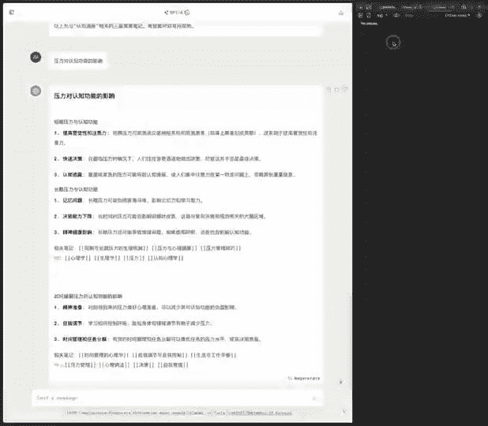

[14555_1696003262.mp4](https://internal-api-drive-stream.feishu.cn/space/api/box/stream/download/all/Pn8rbnE0bopluUxzVE4cCaZonBf)

# **功能：**

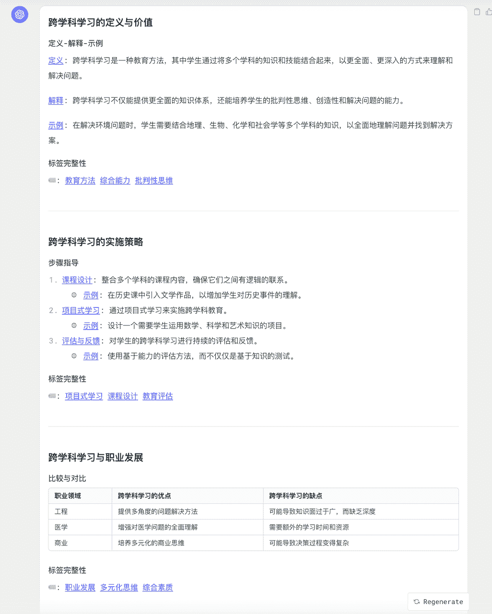

+   **生成链接: **对网页内所有包含[[示意文本]]和**加粗字体**的文本进行识别，并将它们转换为可以点击的链接。

+   **快速发送:** 当这些生成的链接被点击后，自动发送到GPT。

+   **支持热键: **

+   支持 **Ctrl + C** 对现有页面的词汇转换成链接。对选中的文本发送到GPT

# 插件使用方法

## 流程

1.  安装浏览器插件：**Tampermonkey**

1.  支持到 浏览器 chrome 、edge、ARC

1.  https://chrome.google.com/webstore/detail/tampermonkey-beta/gcalenpjmijncebpfijmoaglllgpjagf

1.  打开GPT官网

1.  点击插件图标，新建

1.  完整的替换我提供个文件。

1.  保存后关闭

1.  GPT官网内刷新下

1.  图标上出现了数字1说明生效

1.  **如果没有看到效果，再安**装好之后 ，按一下快捷键  Ctrl + C 试试

## JS代码-文本转链接插件

将以下内容黏贴到 Tampermonkey中：

```
// ==UserScript==
// @name         GPT-关键词链接
// @namespace    http://tampermonkey.net/
// @version      0.2
// @description  try to take over the world!
// @author       You
// @match        https://chat.openai.com/*
// @icon         https://www.google.com/s2/favicons?sz=64&amp;domain=openai.com
// @grant        none
// ==/UserScript==

(function() {

    &#x27;use strict&#x27;;
    // 作者：豆爸
    // 微信：ttmouse
    // 更新日期：2023-10-01 
    // 版本：1.0

    // 功能：
    // 对页面内所有的 [[文字]] 和 **文字** 添加可以点击的链接。
    // 点击链接后，将链接文本添加到输入框并自动提交发送。达到快速发送关键词，减少输入的目的。
    // 支持热键 Ctrl + C，转化页面内所有匹配的文本。
    // 支持热键 Ctrl + C，转化选中的文本。

    let isUpdating = false;
    let rerunTimeout;
    let intervalID;
    let shouldContinue = true;

    // 点击事件处理器
    async function clickHandler(event) {
        event.preventDefault();
        console.log(&#x27;执行 点击链接处理&#x27;);
        const inputElement = document.getElementById(&#x27;prompt-textarea&#x27;); 
        console.log(&#x27;获取 输入框&#x27;);
        inputElement.value = this.getAttribute(&quot;data-text&quot;); 
        console.log(&#x27;将链接文本添加到输入框&#x27;);
        const inputEvent = new Event(&#x27;input&#x27;, { &#x27;bubbles&#x27;: true });
        console.log(&#x27;创建 input 事件&#x27;);
        inputElement.dispatchEvent(inputEvent);
        console.log(&#x27;触发 input 事件&#x27;);

        await new Promise(resolve =&gt; setTimeout(resolve, 50));
        console.log(&#x27;50ms 延时完成&#x27;);

        const sendButton = document.querySelector(&#x27;[data-testid=&quot;send-button&quot;]&#x27;);
        console.log(&#x27;获取 发送按钮&#x27;);
        if (sendButton) {
            console.log(&#x27;点击 发送按钮&#x27;);
            sendButton.click();

            startListening();
            console.log(&#x27;开启监听&#x27;);
        }

    }

    // 处理元素
    function processElement(element) {
        //console.log(&#x27;尝试处理元素&#x27;);
        if (isUpdating) {
            console.log(&#x27;正在更新，跳过&#x27;);
            return;
        }

        let innerHTML = element.innerHTML;

        // 处理[[ ]] 符号
        const bracketRegex = /\[\[(.*?)\]\]/g;
        innerHTML = innerHTML.replace(bracketRegex, function(match, capture) {
            return `&lt;a class=&quot;custom-link&quot; data-text=&quot;${capture}&quot;&gt;${capture}&lt;/a&gt;`;
        });

        // 处理 &lt;strong&gt;标签
        const strongRegex = /&lt;strong&gt;(.*?)&lt;\/strong&gt;/g;
        innerHTML = innerHTML.replace(strongRegex, function(match, capture) {
            return `&lt;a class=&quot;custom-link strong-link&quot; data-text=&quot;${capture}&quot;&gt;${capture}&lt;/a&gt;`;
        });

        element.innerHTML = innerHTML;
        //   console.log(&#x27;替换 HTML 内容完成&#x27;);

        // 给新生成的链接添加事件监听
        const customLinks = element.querySelectorAll(&#x27;.custom-link&#x27;);
        customLinks.forEach(link =&gt; {
            link.addEventListener(&#x27;click&#x27;, clickHandler);
        });
        //   console.log(&#x27;添加点击事件完成&#x27;);
    }

    // 给 &#x27;send-button&#x27; 按钮添加点击事件
    const addSendButtonListener = () =&gt; {
        console.log(&#x27;开始找 send-button 按钮&#x27;);
        const sendButton = document.querySelector(&#x27;[data-testid=&quot;send-button&quot;]&#x27;);
        if (sendButton) {
            console.log(&#x27;找到 send-button 按钮，添加点击事件&#x27;);
            sendButton.addEventListener(&#x27;click&#x27;, () =&gt; {

                console.log(&#x27;send-button 按钮被点击，开启监听&#x27;);
                startListening();
                // 先找到父级对象
                const parentElements = document.querySelectorAll(&#x27;.flex.flex-grow.flex-col.gap-3.max-w-full&#x27;);
                parentElements.forEach(parent =&gt; {
                    // 在父级对象下面找特定的子元素
                    const chatRecordElements = parent.querySelectorAll(&#x27;div.markdown.prose.w-full.break-words,li&#x27;);
                    chatRecordElements.forEach(processElement);
                });
            });
        }
    };

    // 给 &quot;Regenerate&quot; 文本的按钮点击事件
    const observeRegenerateButton = () =&gt; {
        console.log(&#x27;开始找 Regenerate 按钮&#x27;);
        const allButtons = document.querySelectorAll(&#x27;button&#x27;);
        const regenerateButtonElement = Array.from(allButtons).find(el =&gt; el.textContent.includes(&quot;Regenerate&quot;));
        if (regenerateButtonElement) {
            console.log(&#x27;找到 Regenerate 按钮，添加点击事件&#x27;);
            regenerateButtonElement.addEventListener(&#x27;click&#x27;, () =&gt; {
                console.log(&#x27;Regenerate 按钮被点击，开启监听&#x27;);
                startListening();
            });
        }
    };

    // 这个部分是用来检测GPT是否在更新的
    function checkUpdateStatus() {
        if (!shouldContinue) return;

        console.log(&#x27;检查更新状态&#x27;);
        const allButtons = document.querySelectorAll(&#x27;button&#x27;);
        const stopGeneratingElement = Array.from(allButtons).find(el =&gt; el.textContent.includes(&quot;Stop generating&quot;));

        if (stopGeneratingElement &amp;&amp; !isUpdating) {
            console.log(&#x27;内容正在更新&#x27;);
            isUpdating = true;
        } else if (!stopGeneratingElement &amp;&amp; isUpdating) {
            console.log(&#x27;内容更新完成，准备添加链接&#x27;);
            isUpdating = false; // 更新状态设置为false

            if (rerunTimeout) {
                clearTimeout(rerunTimeout); // 清除延时
                console.log(&#x27;清除之前的延时&#x27;);
            }
            // 设置延时，等待2秒
            rerunTimeout = setTimeout(() =&gt; {
                console.log(&#x27;延时结束，开始添加链接&#x27;);

                // 先找到父级对象
                const parentElements = document.querySelectorAll(&#x27;.flex.flex-grow.flex-col.gap-3.max-w-full&#x27;);
                parentElements.forEach(parent =&gt; {
                    // 在父级对象下面找特定的子元素
                    const chatRecordElements = parent.querySelectorAll(&#x27;div.markdown.prose.w-full.break-words,li&#x27;);
                    chatRecordElements.forEach(processElement);
                });

                console.log(&#x27;完成 添加链接&#x27;);

                stopListening();

            }, 300);
        }
    }

    function startListening() {
        shouldContinue = true;
        intervalID = setInterval(checkUpdateStatus, 1000);

        console.log(&#x27;持续监听 - 已开启&#x27;);
    }

    function stopListening() {
        shouldContinue = false;
        clearInterval(intervalID);

        console.log(&#x27;持续监听 - 已停止&#x27;);

        addSendButtonListener()
        observeRegenerateButton();
    }

    function fristrun() {
        console.log(&#x27;开始首次 链接转换&#x27;);

        const parentElements = document.querySelectorAll(&#x27;.flex.flex-grow.flex-col.gap-3.max-w-full&#x27;);
        parentElements.forEach(parent =&gt; {
            // 在父级对象下面找特定的子元素
            const chatRecordElements = parent.querySelectorAll(&#x27;div.markdown.prose.w-full.break-words,li&#x27;);
            chatRecordElements.forEach(processElement);
        });
        console.log(&#x27;完成首次 添加链接&#x27;);

        addSendButtonListener()
        observeRegenerateButton();

    }

    // 监听快捷键 Ctrl + C
    document.addEventListener(&#x27;keydown&#x27;, async function(event) {
        if (event.ctrlKey &amp;&amp; !event.metaKey) {
            if (event.code === &#x27;KeyC&#x27;) {
                console.log(&#x27;Ctrl + C 快捷键触发成功&#x27;);
                
                let selectedText = window.getSelection().toString();
                
                // 检查是否有选中的文本
                if (selectedText.length &gt; 0) {
                    console.log(&#x27;有选中的文本&#x27;);
                    
                    // 获取输入框元素
                    let inputElement = document.getElementById(&#x27;prompt-textarea&#x27;);
                    
                    // 设置输入框的值为选中的文本
                    inputElement.value = selectedText;
                    
                    // 触发 input 事件
                    const inputEvent = new Event(&#x27;input&#x27;, { &#x27;bubbles&#x27;: true });
                    inputElement.dispatchEvent(inputEvent);
                    
                    // 延时 50ms
                    await new Promise(resolve =&gt; setTimeout(resolve, 50));
                    
                    // 获取并点击 &#x27;send-button&#x27;
                    const sendButton = document.querySelector(&#x27;[data-testid=&quot;send-button&quot;]&#x27;);
                    if (sendButton) {
                        sendButton.click();
                        startListening();
                    }
                } else {
                    // 如果没有选中文本，执行其他逻辑
                    
                    const parentElements = document.querySelectorAll(&#x27;.flex.flex-grow.flex-col.gap-3.max-w-full&#x27;);
                    parentElements.forEach(parent =&gt; {
                        const chatRecordElements = parent.querySelectorAll(&#x27;div.markdown.prose.w-full.break-words,li&#x27;);
                        chatRecordElements.forEach(processElement);
                    });
                    observeRegenerateButton();
                    addSendButtonListener();
                }
            }
        }
    });

    // 监听键盘快捷键事件
    document.addEventListener(&#x27;keydown&#x27;, async function(event) {
        // 检测是否按下 Ctrl + G
        if (event.code === &#x27;KeyG&#x27; &amp;&amp; event.ctrlKey &amp;&amp; !event.metaKey) {
            // 防止触发默认的复制行为
            // event.preventDefault();
            console.log(&#x27;Ctrl+G 快捷键被按下&#x27;);

            // 获取选中的文本
            let selectedText = window.getSelection().toString();
            console.log(&#x27;获取选中的文本&#x27;);

            // 获取输入框元素
            let inputElement = document.getElementById(&#x27;prompt-textarea&#x27;);
            console.log(&#x27;获取输入框&#x27;);

            // 设置输入框的值为选中的文本
            inputElement.value = selectedText;
            console.log(&#x27;设置输入框的值&#x27;);

            // 触发 input 事件
            const inputEvent = new Event(&#x27;input&#x27;, { &#x27;bubbles&#x27;: true });
            inputElement.dispatchEvent(inputEvent);
            console.log(&#x27;触发 input 事件&#x27;);

            // 延时 50ms
            await new Promise(resolve =&gt; setTimeout(resolve, 50));
            console.log(&#x27;50ms 延时完成&#x27;);

            // 获取并点击 &#x27;send-button&#x27;
            const sendButton = document.querySelector(&#x27;[data-testid=&quot;send-button&quot;]&#x27;);
            if (sendButton) {
                console.log(&#x27;获取发送按钮&#x27;);
                sendButton.click();
                console.log(&#x27;点击发送按钮&#x27;);
                // 开启监听
                startListening();
                console.log(&#x27;开启监听&#x27;);
            }
        }
    });

    fristrun();
    // 默认开启监听
    startListening();
    addSendButtonListener()
    observeRegenerateButton();

})();

```

## EasyFill的基础上修改的插件，右键菜单，悬浮菜单，快捷键。

更新时间：2023-10-17 18:47:08

```
// ==UserScript==
// @name         EasyFill
// @namespace    http://easyfill.tool.elfe/
// @version      0.4
// @description  超级方便的 GPT 对话助手，通过划选或点击，把内容填充到预置 prompt 模版直接发送。支持多个功能组设置。
// @author       Elfe &amp; ttmouse &amp; GPT
// @match        https://chat.openai.com/*
// @icon         
// @grant        none
// ==/UserScript==

// Copyright (c) 2023 ElfeXu (Xu Yanfei)
// Licensed under the MIT License.

/* 
////////////功能介绍//////////
功能：
1. 将选中的文本，叠加自定义的Prompt之后发送的GPT。
2. 特定格式的文本，可以自动转换成可以点击的链接。
3. 可以将不同的Prompt组合基于不同的场景存储为一个配置组，支持在不同的配置组中切换。比如：学英语的场景，猜谜游戏场景。
4. 能识别是否打开了原有的聊天内容重新编辑，如果打开了，会在打开了的区块内替换发送。需要先手动点击编辑按钮。

右键菜单激活方式：
1. 双击
2. 选文本的时候按住 command 键

快捷键：
右键菜单开启的时候：1-9 执行对应菜单选项
选中文字的时候：1-9  执行对应菜单选项
EF 打开设置
GG 切换下一组设置
G1-9 切换固定位置的设置组
 */

////////////////////////// 初始化 //////////////////////////

const setting_usage_text = `使用说明
通过 🪄 分隔按钮 
📖 之后的是直接在原文替代成链接的内容
🪄🪄🪄🪄🪄🪄🪄🪄
功能一
这里是预设的 prompt  ，{__PLACE_HOLDER__} 里的内容会被你鼠标选中的文字替代掉。
🪄🪄🪄🪄🪄🪄🪄🪄
功能二
点击菜单文字可以直接发送，点击右边会把 prompt 填充到输入框，可以编辑后再发送。
🪄🪄🪄🪄🪄🪄🪄🪄
CLICK 示范
通过要求 GPT 以特定格式生成内容，可以将内容转化成链接，点击即直接发送。例如
请给我五个和有水关的英文单词，用两个方括号 [[]] 来标记。
再用列表的方式给出三个和水有关的节日，节日名称写在 💦  💦 之间
📖📖📖📖📖📖📖📖
\[\[(.*?)\]\]
请帮我解释一下{__PLACE_HOLDER__}这个词的意思
📖📖📖📖📖📖📖📖
💦(.*?)💦
请帮我详细介绍一下{__PLACE_HOLDER__}。
`

const setting_new_setting_text = `新功能组名称
这里可以填写功能组使用说明
通过 = 分隔按钮
🪄🪄🪄🪄🪄🪄🪄🪄
第一行是按钮名称
第二行开始是prompt。{__PLACE_HOLDER__} 里的内容会被你鼠标选中的文字替代掉。
🪄🪄🪄🪄🪄🪄🪄🪄
第二个功能
第二个prompt
prompt多长都没关系
各种奇怪字符也都可以用
只根据连续八个=来分隔功能
📖📖📖📖📖📖📖📖
\[\[(.*?)\]\]
在按钮之后可以用八个📖分隔，带上点击直接发送的内容。
第一行是正则匹配，后面是模版。匹配到的内容会替代掉{__PLACE_HOLDER__}中的内容然后被直接发送。
📖📖📖📖📖📖📖📖
&lt;strong&gt;(.*?)&lt;\/strong&gt;
可以设置多个直接点击项，每一项用不同的正则匹配即可。让 GPT 输出不同格式的内容，定义成不同的后续行动。
{__PLACE_HOLDER__}
`;


const default_setting_texts = [
    `英语练习
先点启动，再贴大段文章，然后需要干啥就选中了文字点啥功能
🪄🪄🪄🪄🪄🪄🪄🪄
启动
你是我的英语老师，我需要你陪我练习英语，准备托福考试。
请**用英语和我对话**，涉及英语例句、题目和话题探讨时请用托福水平的书面英语，但在我明确提出需要时切换到中文。
为了让我的学习更愉悦，请用轻松的语气，并添加一些 emoji。
接下来我会给你一篇英文文章，请记住文章，然后我会向你请求帮助。
如果你理解了，请说 Let&#x27;s begin！
🪄🪄🪄🪄🪄🪄🪄🪄
英译中
请帮我把下面这段话翻译直译成中文，不要遗漏任何信息。
然后请判断文字是否符合中文表达习惯，如果不太符合，请重新意译，在遵循愿意的前提下让内容更通俗易懂。
输出格式应该是

直译：直译的内容
---
（如果有必要的话）意译：意译的内容


待翻译的内容：
&#x27;&#x27;&#x27;
{__PLACE_HOLDER__} 
&#x27;&#x27;&#x27;
🪄🪄🪄🪄🪄🪄🪄🪄
中译英
请帮我用最地道的方式帮我把下面这段话翻译成英文。

待翻译的内容：
&#x27;&#x27;&#x27;
{__PLACE_HOLDER__}
&#x27;&#x27;&#x27;
🪄🪄🪄🪄🪄🪄🪄🪄
学单词
&#x27;&#x27;&#x27;
{__PLACE_HOLDER__}
&#x27;&#x27;&#x27;

请帮我学习这个单词
1. 请给出单词的音标、词性、中文意思、英文意思
2. 如果我们前面的讨论中出现过这个单词，请结合它的上下文，重点讲解在上下文中单词的意思和用法
3. 请给出更多例句
4. 如果有容易混淆的单词，请给出对比
🪄🪄🪄🪄🪄🪄🪄🪄
深入解释
我不太理解这段文字的具体含义，能否结合上下文，给我一个更深入的中文解释？
解释时请着重讲解其中有难度的字词句。
如果有可能，请为我提供背景知识以及你的观点。
&#x27;&#x27;&#x27;
{__PLACE_HOLDER__}
&#x27;&#x27;&#x27;
🪄🪄🪄🪄🪄🪄🪄🪄
封闭题
请对下面这段文字，按照托福阅读理解的难度，用英文为我出三道有标准答案的问答题。
请等待我回答后，再告诉我标准答案，并加以解释。
&#x27;&#x27;&#x27;
{__PLACE_HOLDER__}
&#x27;&#x27;&#x27;
🪄🪄🪄🪄🪄🪄🪄🪄
开放题
请对下面这段文字，按照托福口语和作文的难度，用英文为我出一道开放题，我们来进行探讨。
&#x27;&#x27;&#x27;
{__PLACE_HOLDER__}
&#x27;&#x27;&#x27;
    
`,
setting_usage_text
];

const LSID_SETTING_TEXTS = &#x27;setting_texts_v0.4&#x27;;
const LSID_SETTING_CURRENT_INDEX = &#x27;setting_current_index_v0.4&#x27;;

////////////////////////// CSS //////////////////////////
const style = `
    .settings-modal {
        position: fixed;
        top: 0;
        left: 0;
        width: 100%;
        height: 100%;
        background-color: rgba(0, 0, 0, 0.7);;
        display: flex;
        justify-content: center;
        align-items: center;
        z-index: 1000;
    }

    .settings-content {
        background-color: #161616;
        color: #535e5e;
        padding: 20px;
        width: 50%;
        height: 80%;
        overflow-y: auto;
        box-shadow: 0 4px 6px rgba(0, 0, 0, 0.1);
        border-radius: 10px;
        display: flex;
        flex-direction: column;
        gap: 20px;
    }

    .menuItem.highlight {
        background-color: #d0d0cd;
        color: #000;
        font-weight: 700;
    }

    .settings-dropdown {
        outline: none;
        border: 0px;
    }

    .settings-textarea {
        width: 100%;
        height: calc(100% - 60px);
        resize: vertical;
        background-color: #212121;
        color: #cacaca;
        border-radius: 5px;
        border: 0px;
        padding: 18px 18px;
        box-shadow: rgba(0, 0, 0, 0.05) 0px 0px 0px 0.5px, rgba(0, 0, 0, 0.024) 0px 0px 5px, rgba(0, 0, 0, 0.05) 0px 1px 2px;
    }

    .modal {
        position: fixed;
        top: 0;
        left: 0;
        width: 100%;
        height: 100%;
        background-color: rgba(0,0,0,0.3); 
        display: none;
        align-items: center;
        justify-content: center;
        z-index: 1000;  // 确保模态窗口在页面的最上方
    }
    
    .modal-content {
        background-color: #ffffff;
        padding: 20px;
        border-radius: 8px;
        box-shadow: 0px 0px 15px rgba(0,0,0,0.2);
    }

    .settings-submit {
        background-color: #857c5d;
        color: #fff;
        padding: 8px 18px;
        border: none;
        border-radius: 5px;
        cursor: pointer;    
    }

    .settings-submit:hover {
        background-color: #93B1A6;
    }

    .settings-submit:disabled {
        background-color: #B4B4B3;  /* 灰色背景 */
        color: #808080;            /* 深灰色文字 */
        cursor: not-allowed;       /* 禁用的光标样式 */
    }

    #contextMenu {
        display: none;
        position: absolute;
    }

    .page-menu {
        position: absolute;
        top: 470px;
        right: 9px;
        background-color: #7575751a;
        color: #676767;
        border-radius: 5px;
        padding: 5px 0px;
        width: fit-content;
        font-size: 15px;
        display: inline-block;
    }

    #searchContainer {
        display: none;
        flex-direction: column;
        align-items: flex-start;
        width: 100;
        height: fit-content;
        background-color: #f6f6f6;
        border-radius: 10px;
        color: #c6c6c6;
        padding-bottom: 10px;
        border: 1px solid #6565650f;
        shadow: 0 0 transparent,0 0 transparent,var(--tw-shadow);
        box-shadow: var(--tw-ring-offset-shadow,0 0 transparent),var(--tw-ring-shadow,0 0 transparent),var(--tw-shadow);
    }

    #searchBoxTip {
        display: flex;
        font-size: 14px;
        justify-content: center;
        align-items: center;
        padding: 5px;
        color: #9e9e9e;
    }

    #searchBox {
        position: relative;
        caret-color: #000;
        color: #4e4e4e;
        top: 0px;
        right: 0px;
        border-radius: 10px;
        padding: 10px;
        font-weight: 700;
        width: 400px;
        height: 46px;
        font-size: 24px;
        display: block;
        background-color: #25252500;
    }


    select {
        background-position: right 0.5rem center;
        background-repeat: no-repeat;
        color: #fff;
        background-size: 1.5em 1.5em;
        padding-right: 2.5rem;
        -webkit-print-color-adjust: exact;
        border-radius: 10px;
        border: 1px solid #dedede;
        print-color-adjust: exact;
        background-color: #2a2a2a;
    }

    #searchBox:selected {
        position: relative;
        top: 0px;
        right: 0px;
        border-radius: 5px;
        padding: 10px;
        font-weight: 700;
        width: 301px;
        height: 46px;
        font-size: 18px;
        display: block;
        background-color: #252525;
    }

    #searchBox:focus {
        outline: none;
    }


    #searchBoxList {
        position: relative;
        color: #676767;
        width: 100%;
        font-size: 15px;
        display: none;
    }

    .searchBoxListItem:hover {
        background-color: ##e4e4e21f;
    }

    .searchBoxListItem.selected {
        background-color: #b4ac99;  /* 选中项的背景色 */
    }
    

    .searchBoxListItem {
        color: #3f3f3f;
        display: flex;
        text-align: left;
        padding: 10px;
        font-weight: bold;
        cursor: pointer;
    }

    #serachBoxListContainer {
        width: auto;
        display: inline-block;
        background-color: #fff;
        color: #000;
        border-radius: 0.55em;
        border: 0px;
        padding: 5px;
        box-shadow: rgba(0, 0, 0, 0.25) 0px 0px 0px 0.5px, rgba(0, 0, 0, 0.1) 0px 2px 5px, rgba(0, 0, 0, 0.05) 0px 3px 3px;
        border-bottom: 1px solid #f0f0f0; /* 浅灰色的线条 */
        padding: 5px 0;
    }

    #groupMenu button,
    #pageMenu button {
        border: none;
        background: none;
        text-align: left;
        padding: 5px 10px;
        margin: 0;
        width: auto;
        white-space: nowrap; /* 防止换行 */
        border-radius: 5px;
        transition: background-color 0.3s ease;
    }

    #groupMenu {
        position: absolute;
        top: 81px;
        right: 10px;
        background-color: #7575751a;
        color: #676767;
        border-radius: 5px;
        width: fit-content;
        font-size: 15px;
        display: inline-block;
    }

    .groupMenuContainer {
        width: auto;
        display: inline-block;
        border-radius: 0.55em;
        padding: 5px;
        padding: 5px 0;
    }


    #pageMenu button:nth-child(2){
        /* display: none !important;  */
        height: 100%;
        width: 38px;
        padding: 0px;
    }

    .menu-title {
        display: flex;
        align-items: center;
        justify-content: center;
        padding: 5px 0 !important;
        font-weight: bold;
    }
    
    .groupMenuTitle,
    .pageMenuTitle {
        display: flex;
        align-items: center;
        justify-content: center;
        padding: 5px 0 !important;
        font-weight: bold;
        cursor: pointer; 
    }


    #menuContainer {
        width: auto;
        display: inline-block;
        background-color: #fff;
        color: #000;
        border-radius: 0.55em;
        border: 0px;
        padding: 5px;
        box-shadow: rgba(0, 0, 0, 0.25) 0px 0px 0px 0.5px, rgba(0, 0, 0, 0.1) 0px 2px 5px, rgba(0, 0, 0, 0.05) 0px 3px 3px;
        border-bottom: 1px solid #f0f0f0; /* 浅灰色的线条 */
        padding: 5px 0;
    }
    
    #menuContainer div {
        display: flex;
        align-items: center;
        width: auto;
        border-bottom: 1px solid #f0f0f0;
        padding: 2px 0;
        margin: 0px;
    }

    /* 最后一个没有底部线条 */
    #menuContainer div:last-child {
        border-bottom: 1px solid #f0f0f000;
    }

        
    #menuContainer button {
        border: none;
        background: none;
        text-align: left;
        padding: 5px 10px;
        margin: 0;
        width: auto;
        white-space: nowrap; /* 防止换行 */
        border-radius: 5px;
        transition: background-color 0.3s ease;
    }
    
    #menuContainer button:disabled {
        height: 1px;
        color: #c6c6c600;
        padding: 0;
        border-bottom: 1px solid #dddddd8c;
        display: none;
    }

    /* 右键菜单选中的时候的颜色，配色采用GPT4紫色 */
    #menuContainer div:not(:first-child):hover {
        color: #9038fb;
        display: flex;
        align-items: center;
        width: auto;
        border-bottom: 1px solid #f0f0f0;
        background-color: #ebd9ff5c;
        padding: 2px 0;
        margin: 0px;
    }
    
    
    #menuContainer button:disabled:hover {
    background: none;
    }
    
    #menuContainer button img {
    height: 20px;  // 可以根据需要调整
    width: 20px;   // 可以根据需要调整
    margin-right: 10px;
    }
    

    #menuContainer button:nth-child(2) {
        text-align: center;
        width: 38px;
        padding: 0px;
    }

    /* 使链接看起来更像链接 */
    .custom-link {
        text-decoration: underline;
        cursor: pointer;  /* 当鼠标放上去时变成手的样子 */
        position: relative;  /* 为了定位 tooltip */
    }

    /* 提示（tooltip）样式 */
    .custom-link:hover::after {
        content: attr(data-text);  /* 显示 data-text 的内容 */
        position: absolute;
        bottom: 100%;  /* 出现在链接的上方 */
        left: 0;  /* 与链接的左边界对齐 */
        width: max-content;  /* 根据内容设置宽度 */
        max-width: 300px;  /* 设置最大宽度 */
        white-space: normal;  /* 允许文本换行 */
        line-height: 18px; 
        max-height: 120px;
        overflow: hidden;
        background-color: #333;  /* 背景色 */
        color: white;  /* 文字颜色 */
        padding: 5px 10px;  /* 内边距 */
        border-radius: 4px;  /* 边框圆角 */
        font-size: 12px;  /* 文字大小 */
        z-index: 100;  /* 保证 tooltip 出现在其他元素的上方 */
    }

    /* 切换设置组的提示样式 */
    .toast {
        position: fixed;
        top: 50%;
        left: 50%;
        transform: translate(-50%, -50%);
        background-color: #333;
        color: white;
        padding: 15px;
        z-index: 1000;
        border-radius: 5px;
        display: none; /* 默认情况下，Toast 是隐藏的 */
    }


`;

const iconSetting = &#x27;&#x27;;
const iconEdit = &#x27;&#x27;;
const iconSend = &#x27;&#x27;;
const styleElement = document.createElement(&#x27;style&#x27;);
styleElement.innerHTML = style;
document.head.appendChild(styleElement);


////////////////////////// Easy Fill functions //////////////////////////

// 100 初始化

let setting_texts = JSON.parse(localStorage.getItem(LSID_SETTING_TEXTS)) || default_setting_texts; // 用于存储设置的数组
let setting_current_index = localStorage.getItem(LSID_SETTING_CURRENT_INDEX) || 0; // 用于存储当前设置的序号
let current_setting_text = setting_texts[setting_current_index]; // 用于存储当前设置的内容
let actions = []; // 用于存储菜单项动作的数组


// 101 创建上下文菜单
const contextMenu = document.createElement(&#x27;div&#x27;); // 创建一个 div 元素
const menuContainer = document.createElement(&#x27;div&#x27;); // 创建一个 div 元素
contextMenu.id = &#x27;contextMenu&#x27;; // 给这个 div 元素设置 id
menuContainer.id = &#x27;menuContainer&#x27;; // 给这个 div 元素设置 id

const menuTitle = document.createElement(&#x27;div&#x27;); 
menuTitle.classList.add(&#x27;menu-title&#x27;); // 添加CSS类

menuTitle.innerHTML = setting_current_index; // 在菜单标题中显示当前的设置组序号

menuContainer.appendChild(menuTitle); // 把菜单标题添加到菜单容器中
contextMenu.appendChild(menuContainer); // 把菜单容器添加到右键菜单中
document.body.appendChild(contextMenu); // 把右键菜单添加到页面中


// 102 发送到GPT
async function sendToGPT(template, selectedText, sendDirectly) {
    console.log(&quot;102 开始执行 sendToGPT 函数&quot;);

    let placeholderPosition = template.indexOf(&#x27;{__PLACE_HOLDER__}&#x27;); // 占位符的位置
    let finalText = template.replace(&#x27;{__PLACE_HOLDER__}&#x27;, selectedText); // 把选中的文本替换到占位符中
    let targetElement; // 目标元素
    let saveSubmitButton; // Save &amp; Submit 按钮

    // 基于按钮文本来查找 &quot;Save &amp; Submit&quot; 按钮
    saveSubmitButton = Array.from(document.querySelectorAll(&#x27;button&#x27;)).find(el =&gt; el.textContent.trim() === &quot;Save &amp; Submit&quot;);
    
    if (saveSubmitButton) {
        console.log(&quot;102 识别到 Save &amp; Submit 按钮&quot;);
        let grandParentDiv = saveSubmitButton.closest(&#x27;div.flex.flex-grow.flex-col.gap-3.max-w-full&#x27;);
        if (grandParentDiv) {
            let textarea = grandParentDiv.querySelector(&#x27;textarea&#x27;);
            if (textarea) {
                targetElement = textarea;
            }
        }
    }

    if (!targetElement) { 
        console.log(&quot;102 未识别到 Save &amp; Submit ,定位对象到默认聊天输入框&quot;);
        targetElement = document.getElementById(&#x27;prompt-textarea&#x27;);
    }
    
    if (!targetElement) {
        console.log(&quot;102 未识别到聊天框，定位到编辑框&quot;);
        targetElement = document.querySelector(&#x27;div[contenteditable=&quot;true&quot;]&#x27;); // 定位到编辑框
    }

    targetElement.value = finalText;

    // 如果是直接发送
    if (sendDirectly) { 
        console.log(&quot;102 直接发送&quot;);
        const inputEvent = new Event(&#x27;input&#x27;, { &#x27;bubbles&#x27;: true }); // 创建一个 input 事件
        targetElement.dispatchEvent(inputEvent); // 触发 input 事件
        await new Promise(resolve =&gt; setTimeout(resolve, 50)); // 等待 50 毫秒
        
        if (saveSubmitButton) { // 如果找到了 Save &amp; Submit 按钮，就点击它
            saveSubmitButton.click();
        } else { // 如果没有找到 Save &amp; Submit 按钮，就点击发送按钮
            const sendButton = document.querySelector(&#x27;[data-testid=&quot;send-button&quot;]&#x27;);
            if (sendButton) {  // 如果找到了发送按钮，就点击它
                sendButton.click();
                simulateClick() // 底部。
            }
        }
    }

    // 如果不是直接发送
    targetElement.focus(); // 聚焦到输入框
    let cursorPosition; // 光标位置
    if (placeholderPosition !== -1) { // 如果有占位符
        if (selectedText) { // 如果有选中的文本
            cursorPosition = placeholderPosition + selectedText.length; // 把光标放在占位符之后
        } else { // 如果没有选中的文本
            cursorPosition = placeholderPosition; // 把光标放在占位符之前
        }
    } else {    
        cursorPosition = targetElement.value.length; // 如果没有占位符，就把光标放在最后
    }
    targetElement.setSelectionRange(cursorPosition, cursorPosition);    // 设置光标位置

    // // 触发一个事件来让文本框高度适应
    // const inputEvent = new Event(&#x27;input&#x27;, { bubbles: true });
    // targetElement.dispatchEvent(inputEvent);


    // 监听输入事件，当用户输入时，自动调整文本框高度
    targetElement.addEventListener(&#x27;input&#x27;, function () {
        this.style.height = &#x27;auto&#x27;; // 重置高度，以便能正确计算新高度
        this.style.height = (this.scrollHeight) + &#x27;px&#x27;; // 设置文本框高度为内容的高度
    });
    // 初始触发一次输入事件，以确保文本框在加载页面时就适应内容高度
    targetElement.dispatchEvent(new Event(&#x27;input&#x27;));

    console.log(&quot;102 sendToGPT 文本植入完成&quot;);
}


// 103 创建单个菜单项
function createMenuItem(index, label, icon1, icon2, action1, action2) { 
    // console.log(&quot;103 创建菜单项: &quot; + label); 
    const menuItem = document.createElement(&#x27;div&#x27;); // 创建一个 div 元素
    menuItem.style.display = &#x27;flex&#x27;; 
    menuItem.style.alignItems = &#x27;center&#x27;;
  
    const leftPart = document.createElement(&#x27;button&#x27;); // 创建左边的按钮
    leftPart.style.flex = &#x27;0.8&#x27;;
    leftPart.style.display = &#x27;flex&#x27;;
    leftPart.style.alignItems = &#x27;center&#x27;;
  
    // 在这里添加 数字序号
    const textLabel = document.createElement(&#x27;span&#x27;); // 创建一个 span 元素
    textLabel.innerHTML = index + &#x27;. &#x27; + label;   // 在 span 元素中显示菜单项的文本
    leftPart.appendChild(textLabel); // 把 span 元素添加到 button 元素中
  
    if (action1 == null) { // 如果没有动作，就禁用这个按钮
        leftPart.disabled = true;  
    } else {
        leftPart.onclick = () =&gt; { // 如果有动作，就在点击时执行动作
            action1();
            hideContextMenu(); // 执行动作后隐藏右键菜单
        };
        actions.push(action1); // 记录这个动作
        // console.log(&quot;103 添加了一个新动作，现在的 actions 数组: &quot;, actions);  
    }
    menuItem.appendChild(leftPart); // 把 button 元素添加到 div 元素中

    const rightPart = document.createElement(&#x27;button&#x27;); // 创建右边的按钮

    
    if (icon2 !== null) { // 如果有第二个图标，就显示第二个图标
        

        rightPart.style.flex = &#x27;0.2&#x27;;
        rightPart.style.display = &#x27;flex&#x27;;
        rightPart.style.alignItems = &#x27;center&#x27;;
        
        // 创建一个SVG元素并设置属性
        const rightIcon = document.createElementNS(&quot;http://www.w3.org/2000/svg&quot;, &quot;svg&quot;);
        rightIcon.setAttribute(&quot;width&quot;, &quot;16&quot;);
        rightIcon.setAttribute(&quot;height&quot;, &quot;16&quot;);
        rightIcon.setAttribute(&quot;class&quot;, &quot;icon&quot;);
        rightIcon.setAttribute(&quot;viewBox&quot;, &quot;0 0 1024 1024&quot;);

        // 创建一个`path`元素并设置SVG路径数据
        const pathElement = document.createElementNS(&quot;http://www.w3.org/2000/svg&quot;, &quot;path&quot;);
        pathElement.setAttribute(&quot;d&quot;, &quot;M896 128.426667H128c-47.146667 0-85.333333 38.186667-85.333333 85.333333V384h85.333333V212.906667h768v598.613333H128V640H42.666667v171.093333c0 47.146667 38.186667 84.48 85.333333 84.48h768c47.146667 0 85.333333-37.546667 85.333333-84.48v-597.333333c0-47.146667-38.186667-85.333333-85.333333-85.333333zM469.333333 682.666667l170.666667-170.666667-170.666667-170.666667v128H42.666667v85.333334h426.666666v128z&quot;);

        pathElement.setAttribute(&quot;fill&quot;, &quot;#5D5D5D&quot;); // 设置图标颜色

        // 图标悬停的时候颜色变成紫色，尺寸会放大5%，非悬停的时候颜色变成灰色，
        rightIcon.onmouseover = () =&gt; {
            pathElement.setAttribute(&quot;fill&quot;, &quot;#9038fb&quot;);
            rightIcon.style.transform = &quot;scale(1.15)&quot;;
        };
        rightIcon.onmouseout = () =&gt; {
            pathElement.setAttribute(&quot;fill&quot;, &quot;#5D5D5D&quot;);
            rightIcon.style.transform = &quot;scale(1)&quot;;
        };
    
        // 将`path`元素添加到`svg`元素中
        rightIcon.appendChild(pathElement);

        // 将`svg`元素添加到`rightPart`
        rightPart.appendChild(rightIcon);
    }

    if (action2 == null) { 
        rightPart.disabled = true;
    } else {
        rightPart.onclick = () =&gt; {
            console.log(&quot;103 执行右键菜单动作植入: &quot; + label);
            action2(); 
            hideContextMenu(); // 执行动作后隐藏右键菜单
            console.log(&#x27;103 执行右键菜单动作后隐藏右键菜单&#x27;);
            //contextMenu.style.display = &#x27;none&#x27;; 
       };
    }
    menuItem.appendChild(rightPart);
    
    return menuItem;
  
}

// 104 隐藏右键菜单
function hideContextMenu() { 
    if (contextMenu.style.display === &#x27;none&#x27;) {
        return;
    }
    contextMenu.style.display = &#x27;none&#x27;;
    document.removeEventListener(&#x27;keydown&#x27;, handleShortcut); // 移除快捷键事件
}

// 105 显示右键菜单
function showContextMenu(event) {

    // 先把菜单显示在屏幕外，以便能获取其尺寸
    contextMenu.style.left = &#x27;-9999px&#x27;;
    contextMenu.style.top = &#x27;-9999px&#x27;;
    contextMenu.style.display = &#x27;block&#x27;;

    // 更新右键菜单顶部的标题以显示当前设置组的名称
    menuTitle.innerHTML = setting_texts[setting_current_index].split(&#x27;\n&#x27;)[0];    

    console.log(&#x27;105 当前设置组: &#x27;, menuTitle.innerHTML);
    console.log(&quot;105 显示右键菜单：actions 数组: &quot;, actions);

    const windowWidth = window.innerWidth;
    const windowHeight = window.innerHeight;
    const menuWidth = contextMenu.offsetWidth;
    const menuHeight = contextMenu.offsetHeight;
    let x = event.clientX;
    let y = event.clientY;
    // 确保菜单不会超出屏幕右侧
    if (x + menuWidth &gt; windowWidth) {
        x = windowWidth - menuWidth;
    }
    // 确保菜单不会超出屏幕底部
    if (y + menuHeight &gt; windowHeight) {
        y = windowHeight - menuHeight;
    }
    contextMenu.style.left = `${x}px`;
    contextMenu.style.top = `${y}px`;
    document.addEventListener(&#x27;keydown&#x27;, handleShortcut);
    event.stopPropagation();
}


// 106 创建右键菜单
function handleShortcut(event) {
    console.log(&quot;106 处理快捷键: &quot; + event.key);
    console.log(&quot;106 当前动作数组: &quot;, actions);  // 添加这行来调试
    let key = parseInt(event.key, 10);
    if (key &gt; 0 &amp;&amp; key &lt;= actions.length) {
        console.log(&quot;106 执行快捷键对应的动作: &quot; + key);
        document.removeEventListener(&#x27;keydown&#x27;, handleShortcut); // 先移除快捷键事件
        actions[key - 1]();  // 然后执行动作
        hideContextMenu();  // 最后隐藏右键菜单
    }
}


////////////////////////// Easy Click functions //////////////////////////
// 200 初始化

let isUpdating = false;
let rerunTimeout;
let intervalID;
let shouldContinue = true;

// 201 创建点击事件处理器
async function clickHandler(event) {
    //event.preventDefault();
    console.log(&#x27;201 执行 clickHandler&#x27;); // 执行点击事件处理器
    const inputElement = document.getElementById(&#x27;prompt-textarea&#x27;); // 获取输入框
    console.log(&#x27;201 获取输入框元素&#x27;);
    inputElement.value = this.getAttribute(&quot;data-text&quot;); // 将链接文本添加到输入框
    console.log(&#x27;201 设置输入框值&#x27;);
    const inputEvent = new Event(&#x27;input&#x27;, { &#x27;bubbles&#x27;: true }); // 创建input事件
    console.log(&#x27;201 创建 input 事件&#x27;);
    inputElement.dispatchEvent(inputEvent); // 触发input事件
    console.log(&#x27;201 触发 input 事件&#x27;);

    await new Promise(resolve =&gt; setTimeout(resolve, 50));
    console.log(&#x27;201 50ms 延时完成&#x27;);

    const sendButton = document.querySelector(&#x27;[data-testid=&quot;send-button&quot;]&#x27;);
    console.log(&#x27;201 获取发送按钮&#x27;);
    if (sendButton) {
        console.log(&#x27;201 点击发送按钮&#x27;);
        sendButton.click();
        console.log(&#x27;201 开启监听&#x27;);
        // 滚动到底部
        simulateClick() // 底部。
    }

}


// 202 创建点击事件处理器
function replace_text(original) { 
    clicks.forEach(([regExpression, template]) =&gt; {
        original = original.replace(regExpression, (match, p1) =&gt; {
            // 如果匹配项已经是链接的一部分，则直接返回匹配项
            if (original.lastIndexOf(&#x27;&lt;a&#x27;, match.index) &lt; original.lastIndexOf(&#x27;&lt;/a&gt;&#x27;, match.index)) {
                return match;
            }
            let replaced = template.replace(&#x27;{__PLACE_HOLDER__}&#x27;, p1);
            return `&lt;a class=&quot;custom-link&quot; data-text=&quot;${replaced}&quot;&gt;${&#x27;[[&#x27; + p1 + &#x27;]]&#x27;}&lt;/a&gt;`;
        });
    });
    return original;
}


// 203 创建点击事件处理器
function processElement(element) { 
    if (isUpdating) {
        return;
    }

    let innerHTML = element.innerHTML;

    // 处理[[ ]] 符号
    const bracketRegex = /\[\[(.*?)\]\]/g;
    innerHTML = replace_text(innerHTML);

    // 替换了 innerHTML 后，原本网页中 Copy code 之类的事件监听就失效了。
    // 为了尽可能让两个功能共存，这里仅对文字有改动的重新赋值。
    if (innerHTML != element.innerHTML) {
        element.innerHTML = innerHTML;
    }

    // 给新生成的链接添加事件监听
    const customLinks = element.querySelectorAll(&#x27;.custom-link&#x27;); // 获取所有链接
    customLinks.forEach(link =&gt; { // 给每个链接添加点击事件
        link.addEventListener(&#x27;click&#x27;, clickHandler);// 添加点击事件处理器
    });
}

// 新生成的链接，鼠标悬停时的效果是显示一个 tooltip，内容是链接的 data-text 属性的值。

// 204 这个部分是用来检测GPT是否在更新的
function checkUpdateStatus() {
    if (!shouldContinue) return;
    console.log(&#x27;204 运行 checkUpdateStatus&#x27;);
    const allButtons = document.querySelectorAll(&#x27;button&#x27;);
    const stopGeneratingElement = Array.from(allButtons).find(el =&gt; el.textContent.includes(&quot;Stop generating&quot;));
    if (!stopGeneratingElement &amp;&amp; isUpdating) { // 内容更新完成

        console.log(&#x27;204 内容更新完成，准备添加链接&#x27;);
        isUpdating = false; // 更新状态设置为false

        if (rerunTimeout) {
            clearTimeout(rerunTimeout); // 清除延时
            console.log(&#x27;204 清除之前的延时&#x27;);
        }
        // 设置延时，等待2秒
        rerunTimeout = setTimeout(() =&gt; {
            console.log(&#x27;204 延时结束，开始添加链接&#x27;); // 延时结束，开始添加链接

            // 开始转化链接
            Convertlink()
            // // 先找到父级对象
            // const parentElements = document.querySelectorAll(&#x27;.flex.flex-grow.flex-col.gap-3.max-w-full&#x27;);
            // parentElements.forEach(parent =&gt; {
            //     // 在父级对象下面找特定的子元素
            //     const chatRecordElements = parent.querySelectorAll(&#x27;div.markdown.prose.w-full.break-words,li&#x27;);
            //     chatRecordElements.forEach(processElement);
            // });
            stopListening();
        }, 300);
    }
}


// 205 创建点击事件处理器, 开始监听
function startListening() {
    isUpdating = true;
    shouldContinue = true;
    // intervalID = setInterval(checkUpdateStatus, 1000);
    Convertlink()
    console.log(&#x27;205 监听已开启&#x27;);
}

// 206 创建点击事件处理器, 停止监听
function stopListening() {
    shouldContinue = false;
    clearInterval(intervalID);
    console.log(&#x27;206 监听已停止&#x27;);
    updatepageMenuItems();
}

////////////////////////// Settings functions //////////////////////////
let isModalOpen = false; // 用于判断模态框是否已经打开


// 300 显示设置模态框 
function showSettingsModal() { 
    console.log(&quot;300 显示设置模态框&quot;);

    isModalOpen = true;
    console.log(&quot;300 ismoalopen: &quot; + isModalOpen);

    // 301 创建模态框
    const modal = document.createElement(&#x27;div&#x27;);
    modal.className = &#x27;settings-modal&#x27;;

    // 302 创建模态框内容
    const modalContent = document.createElement(&#x27;div&#x27;);
    modalContent.className = &#x27;settings-content&#x27;;

    // 303 创建文本区
    const textarea = document.createElement(&#x27;textarea&#x27;);
    textarea.className = &#x27;settings-textarea&#x27;;
    textarea.value = current_setting_text;

    // 304 创建提交按钮
    const submitButton = document.createElement(&#x27;button&#x27;);
    submitButton.className = &#x27;settings-submit&#x27;;
    submitButton.textContent = &#x27;应用设置&#x27;;

    // 305 创建下拉菜单
    const settingsDropdown = document.createElement(&#x27;select&#x27;);
    settingsDropdown.className = &#x27;settings-dropdown&#x27;;
    setting_texts.forEach((text, index) =&gt; {
        const option = document.createElement(&#x27;option&#x27;);
        option.value = index;
        option.text = text.split(&#x27;\n&#x27;)[0]; // Assuming the first line is a title or identifier
        settingsDropdown.appendChild(option);
    });

    // 306 设置默认选中的设置
    settingsDropdown.selectedIndex = setting_current_index;
    settingsDropdown.addEventListener(&#x27;change&#x27;, (e) =&gt; {
        const selectedIndex = e.target.value;
        textarea.value = setting_texts[selectedIndex];
        if (setting_texts.length &lt;= 1) {
            deleteSettingButton.disabled = true;
        } else {
            deleteSettingButton.disabled = false;
        }
    });

    // 307 创建添加新设置按钮
    const buttonsContainer = document.createElement(&#x27;div&#x27;);
    buttonsContainer.style.display = &#x27;flex&#x27;;
    buttonsContainer.style.gap = &#x27;10px&#x27;;  // 两个按钮之间的间距
    const newSettingButton = document.createElement(&#x27;button&#x27;);
    newSettingButton.textContent = &#x27;添加新功能组&#x27;;
    newSettingButton.className = &#x27;settings-submit&#x27;;
    newSettingButton.addEventListener(&#x27;click&#x27;, () =&gt; {
        textarea.value = setting_new_setting_text; // 设置文本区的值为新设置的默认值
        setting_texts.push(textarea.value); // 将新设置添加到 setting_texts 数组中
        const option = document.createElement(&#x27;option&#x27;);
        option.value = setting_texts.length - 1;
        option.text = setting_new_setting_text.split(&#x27;\n&#x27;)[0];
        settingsDropdown.appendChild(option);
        settingsDropdown.value = setting_texts.length - 1;
        deleteSettingButton.disabled = false;
    });

    // 308 创建删除设置按钮
    const deleteSettingButton = document.createElement(&#x27;button&#x27;);
    deleteSettingButton.textContent = &#x27;删除当前功能组&#x27;;
    deleteSettingButton.className = &#x27;settings-submit&#x27;;

    // 309 设置删除按钮的点击事件
    deleteSettingButton.addEventListener(&#x27;click&#x27;, () =&gt; {
        // 如果只剩一个设置，则不进行删除操作
        if (setting_texts.length &lt;= 1) {
            return;
        }

        let toDelete = settingsDropdown.selectedIndex;

        // 从 setting_texts 数组中删除设置
        setting_texts.splice(toDelete, 1);

        // 从 settingsDropdown 中删除对应的选项
        settingsDropdown.remove(toDelete);

        // 如果删除的是第0项或列表中的最后一项，则默认选择第0项
        if (toDelete === 0 || toDelete === setting_texts.length) {
            settingsDropdown.selectedIndex = 0;
            setting_current_index = 0;
        } else {
            // 否则选择之前的项
            settingsDropdown.selectedIndex = toDelete - 1;
            setting_current_index = toDelete - 1;
        }

        // 更新文本区的值为当前选中的设置
        textarea.value = setting_texts[setting_current_index];

        // 保存到 localStorage
        localStorage.setItem(LSID_SETTING_TEXTS, JSON.stringify(setting_texts));
        localStorage.setItem(LSID_SETTING_CURRENT_INDEX, setting_current_index);

        deleteSettingButton.disabled = setting_texts.length &lt;= 1;
    });
    
    // 310 设置删除按钮的状态,检查是否只剩一个设置，如果是，则禁用删除按钮
    if (setting_texts.length &lt;= 1) {
        deleteSettingButton.disabled = true;
    }        

    // 311 将所有元素添加到模态框中
    buttonsContainer.appendChild(newSettingButton);
    buttonsContainer.appendChild(deleteSettingButton);
    modalContent.appendChild(settingsDropdown);
    modalContent.appendChild(buttonsContainer); 
    modalContent.appendChild(textarea);
    modalContent.appendChild(submitButton);
    modal.appendChild(modalContent);
    document.body.appendChild(modal);

    // // 312 点击模态框外部时关闭模态框
    // modal.addEventListener(&#x27;click&#x27;, (e) =&gt; {
    //     if (e.target === modal) {

    //         modal.remove();
    //         console.log(&quot;关闭模态框-点击外部&quot;);

    //         isModalOpen = false;
    //         console.log(&quot;ismoalopen: &quot; + isModalOpen);
    //     }
    // });

    

    // 313 点击提交按钮时保存设置
    submitButton.addEventListener(&#x27;click&#x27;, () =&gt; { 
        console.log(&quot;313 点击提交按钮 保存设置&quot;);
        actions = []; // 每次保存的时候清空动作数组，以便重新生成。
        const selectedSettingIndex = settingsDropdown.selectedIndex; // 获取当前选中的设置的索引
        if (typeof setting_texts[selectedSettingIndex] === &#x27;undefined&#x27;) {
            console.error(&quot;Trying to save a setting that doesn&#x27;t exist.&quot;);
            return;
        }
        
        // 保存到 localStorage
        setting_texts[selectedSettingIndex] = textarea.value;
        localStorage.setItem(LSID_SETTING_TEXTS, JSON.stringify(setting_texts));
        localStorage.setItem(LSID_SETTING_CURRENT_INDEX, selectedSettingIndex.toString());
        current_setting_text = textarea.value;
        setting_current_index = selectedSettingIndex;
        if (current_setting_text) {
            updateMenuItems(); 
            updatepageMenuItems(); 
        }
        modal.remove();
        
        isModalOpen = false;
        console.log(&quot;313 ismoalopen: &quot; + isModalOpen);
    });

    // 314 按下 ESC 键时关闭模态框
    document.addEventListener(&#x27;keydown&#x27;, handleEscCloseModal);
}

// 315 按下 ESC 键时关闭模态框
function handleEscCloseModal(event) {
    if (event.key === &#x27;Escape&#x27;) {
        const modal = document.querySelector(&#x27;.settings-modal&#x27;);
        if (modal) {
            modal.remove();
            console.log(&quot;315 关闭模态框-按下 ESC 键&quot;);
            isModalOpen = false;
        }
        // 移除键盘事件监听器
        document.removeEventListener(&#x27;keydown&#x27;, handleEscCloseModal);
    }
}

// 316 将所选更新到模版。
function addTemplate(selectedText) {
    console.log(&quot;316 将所选更新到模版。&quot;);
    let original = setting_texts[setting_current_index];
    let toAdd = &#x27;\n🪄🪄🪄🪄🪄🪄🪄🪄\n&#x27; + &#x27;新模版名称&#x27;+ &#x27;\n&#x27; + selectedText + &#x27;\n&#x27; + &#x27;用户输入：{__PLACE_HOLDER__}\n&#x27;;
    // 找到 original 中第一个 📖📖📖📖📖📖📖📖 的位置，在此之前插入 textarea.value
    // 如果没有找到，则在末尾插入
    let index = original.indexOf(&#x27;📖📖📖📖📖📖📖📖&#x27;);
    if (index &gt;= 0) {
        setting_texts[setting_current_index] = original.slice(0, index) + toAdd + original.slice(index);
    } else {
        setting_texts[setting_current_index] = original + toAdd;
    }

    localStorage.setItem(LSID_SETTING_TEXTS, JSON.stringify(setting_texts));
    current_setting_text = setting_texts[setting_current_index];
    if (current_setting_text) {
        updateMenuItems();
        updatepageMenuItems();
    }
}


////////////////////////// Menu functions //////////////////////////


// 400 解析菜单初始化
let menus = []; // 用于存储菜单项的数组
let clicks = [] // 用于存储点击事件的数组

// 401 从设置文本中解析菜单
function parseMenus(settingsText) {  // 从设置文本中解析菜单
    const buttonData = settingsText.split(&quot;🪄🪄🪄🪄🪄🪄🪄🪄&quot;).slice(1);
    buttonData.forEach(data =&gt; { // 遍历每个菜单项
        const lines = data.trim().split(&quot;\n&quot;); // 按行分割菜单项
        if (lines.length &gt;= 2) { // 如果菜单项的行数大于等于2
            const name = lines[0];  // 第一行是菜单项的名称
            const content = lines.slice(1).join(&quot;\n&quot;);  // 后续行组成菜单项的内容
            menus.push([name, content]); // 将菜单项的名称和内容添加到菜单项数组中
            // console.log(&quot;401 添加菜单项: &quot; + name);
        }
    });
}

// 402 从设置文本中解析点击事件
function parseClicks(settingText) { 
    // 根据 📖📖📖📖📖📖📖📖 分割设置文件，并移除首尾的空值
    const configArray = settingText.split(&#x27;📖📖📖📖📖📖📖📖&#x27;).filter(Boolean); 

    // 遍历每个设置
    configArray.forEach(config =&gt; { 
        // 按行分割配置
        const lines = config.trim().split(&#x27;\n&#x27;);
        // 第一行是正则表达式
        const regExpression = new RegExp(lines[0], &#x27;g&#x27;);
        // 后续行组成替换模板
        const template = lines.slice(1).join(&#x27;\n&#x27;);

        // 将正则表达式和模板添加到正则数组中
        clicks.push([regExpression, template]);
    });
}

// 403 解析设置文本
function parseSettingsText(settingsText) { 
    menus.length = 0; // Clear the existing array
    clicks.length = 0; // Clear the existing array

    let splitted = settingsText.split(&quot;📖📖📖📖📖📖📖📖&quot;)
    if (splitted.length &lt; 2) {
        parseMenus(settingsText); // 解析菜单
    } else {
        parseMenus(splitted[0]); // 解析菜单
        parseClicks(splitted.slice(1).join(&quot;📖📖📖📖📖📖📖📖&quot;)); 
    }
}

// 404 更新菜单项
function updateMenuItems() {
    console.log(&quot;404 开始更新菜单项&quot;);
    //每次更新菜单项时，先清空菜单项数组
    menus = [];

    parseSettingsText(current_setting_text);  // 解析设置文本
    menuContainer.innerHTML = &#x27;&#x27;;

    // 重新添加 menuTitle
    menuTitle.innerHTML = setting_texts[setting_current_index].split(&#x27;\n&#x27;)[0];
    menuContainer.appendChild(menuTitle);

    menus.forEach((menu, index) =&gt; {  // 注意这里添加了 index
        menuContainer.appendChild(
            createMenuItem(
                index + 1,  // 添加序号，注意这里 index + 1
                menu[0], 
                iconSend,
                iconEdit,
                async function() {
                    await sendToGPT(menu[1], window.getSelection().toString().trim(), true);
                },
                async function() {
                    await sendToGPT(menu[1], window.getSelection().toString().trim(), false);
                }
            )
        );
    });
    // 添加模版
    menuContainer.appendChild(createMenuItem(menus.length + 1, &#x27;添加模版&#x27;, iconSend, null, function() {addTemplate(window.getSelection().toString().trim());}, null));
    // 设置按钮的快捷键可以设为 menus.length + 1
    menuContainer.appendChild(createMenuItem(menus.length + 2, &#x27;设置&#x27;, iconSetting, null, function() {showSettingsModal();}, null));
    console.log(&quot;404 更新菜单项完成&quot;);

}


////////////////////////// Main //////////////////////////

// 500 初始化

// 501 创建样式元素
updateMenuItems();

// 502 激活右键菜单
document.addEventListener(&#x27;mouseup&#x27;, function(event) { 
    if (isModalOpen) {
        return;  // 如果模态框打开，则不执行后面的代码
    }
    const selectedText = window.getSelection().toString(); // 获取选中的文本

    // 检查 Command 键（Mac）或 Ctrl 键（Windows）是否被按下
    // 如果没有选中文本或没有按下 Command 键（Mac）或 Ctrl 键（Windows）
    if (selectedText.length == 0 || !event.metaKey) { 
        hideContextMenu();
    } else {
        showContextMenu(event);
        console.log(&quot;502 显示右键菜单&quot;);
    }
});


// 503 监听鼠标事件,双击时显示右键菜单
// document.addEventListener(&#x27;dblclick&#x27;, function(event) {
//     showContextMenu(event);
//     console.log(&quot;503 双击显示右键菜单&quot;);
// });


//  504 监听鼠标事件,当鼠标移动出右键菜单区域时，隐藏菜单,菜单隐藏之后，停止监听。
// document.addEventListener(&#x27;mousemove&#x27;, function(event) {
//     if (isModalOpen) {
//         return;  // 如果模态框打开，则不执行后面的代码
//     }
//     if (contextMenu.style.display === &#x27;none&#x27;) {
//         return;
//     }
//     const mouseX = event.clientX;
//     const mouseY = event.clientY;
//     const menuX = contextMenu.offsetLeft;
//     const menuY = contextMenu.offsetTop;
//     const menuWidth = contextMenu.offsetWidth;
//     const menuHeight = contextMenu.offsetHeight;
//     if (mouseX &lt; menuX || mouseX &gt; menuX + menuWidth || mouseY &lt; menuY || mouseY &gt; menuY + menuHeight) {
//         hideContextMenu();
//         console.log(&quot;504 鼠标移动出右键菜单区域，隐藏菜单&quot;);
//     }
// });


////////////////////////// 快捷键配置 //////////////////////////

// 600 快捷键配置
let isGPressed = false; // 用于跟踪 &#x27;g&#x27; 键是否被按下
let timer;
let gPressCount = 0;  // 用于跟踪 &#x27;g&#x27; 键被按下的次数
let lastGPressTime = 0;  // 用于跟踪上一次 &#x27;g&#x27; 键被按下的时间

// 601 模拟官方toast
function showToast(message) {
    // 获取父容器元素
    const parentContainer = document.querySelector(&#x27;.pointer-events-none&#x27;);
  
    // 创建新的div元素
    const newDiv = document.createElement(&#x27;div&#x27;);
    newDiv.setAttribute(&#x27;data-state&#x27;, &#x27;entered&#x27;);
    newDiv.setAttribute(&#x27;class&#x27;, &#x27;toast-root&#x27;);
    newDiv.setAttribute(&#x27;style&#x27;, &#x27;height: 50px; margin-bottom: 0px;&#x27;);
  
    // 创建toast内容
    const toastContent = `
      &lt;div class=&quot;w-full p-1 text-center md:w-auto md:text-justify&quot;&gt;
        &lt;div class=&quot;px-3 py-2 rounded-md text-white inline-flex flex-row border pointer-events-auto gap-2 border-green-500 bg-green-500&quot; role=&quot;alert&quot;&gt;
          &lt;div class=&quot;mt-1 flex-shrink-0 flex-grow-0&quot;&gt;
            &lt;svg stroke=&quot;currentColor&quot; fill=&quot;none&quot; stroke-width=&quot;2&quot; viewBox=&quot;0 0 24 24&quot; stroke-linecap=&quot;round&quot; stroke-linejoin=&quot;round&quot; class=&quot;icon-sm&quot; height=&quot;1em&quot; width=&quot;1em&quot; xmlns=&quot;http://www.w3.org/2000/svg&quot;&gt;
              &lt;path d=&quot;M22 11.08V12a10 10 0 1 1-5.93-9.14&quot;&gt;&lt;/path&gt;
              &lt;polyline points=&quot;22 4 12 14.01 9 11.01&quot;&gt;&lt;/polyline&gt;
            &lt;/svg&gt;
          &lt;/div&gt;
          &lt;div class=&quot;flex-1 justify-center gap-2&quot;&gt;
            &lt;div class=&quot;whitespace-pre-wrap text-left&quot;&gt;${message}&lt;/div&gt;
          &lt;/div&gt;
        &lt;/div&gt;
      &lt;/div&gt;
    `;
  
    // 设置新的div的内容为toast内容
    newDiv.innerHTML = toastContent;
  
    // 将新的div添加到父容器中
    parentContainer.appendChild(newDiv);
  
    // 设置定时器，在1秒后自动移除新的div
    setTimeout(() =&gt; {
      parentContainer.removeChild(newDiv);
    }, 2000);
  }


// 602 监听键盘事件,当按下复合快捷键 cmd+d 键时显示设置模态框，两个按键之间的间隔不能超过300ms，否则会被认为是两次按键。指令不执行。
document.addEventListener(&#x27;keydown&#x27;, function(event) {
    // 检查是否同时按下了Cmd键（Mac下的Ctrl键）和分号键
    if (event.key === &#x27;d&#x27; &amp;&amp; event.metaKey) {
        if (!isModalOpen) {
            showSettingsModal();
        }
        event.preventDefault(); // 防止浏览器默认行为
    }
});


// 603 监听键盘事件,当按下复合快捷键 “g”+ 数字键,切换不同的设置 setting_texts, 数字1代表第一个设置，数字2代表第二个设置，以此类推。
// 切换的时候需要更新菜单项和处理actions数组
document.addEventListener(&#x27;keydown&#x27;, function(event) {
    // console.log(&quot;603 调试信息: 键盘事件触发，当前按键是&quot;, event.key);

    if (isModalOpen) {
        return;  // 如果模态框打开，则不执行后面的代码
    }

    // 检查是否同时按下了g键+数字键
    if (event.key === &#x27;g&#x27;) {
        if (!isGPressed) {
            isGPressed = true;
            timer = setTimeout(() =&gt; {
                isGPressed = false;
                gPressCount = 0;
            }, 300);
        }
        gPressCount++;
        lastGPressTime = Date.now();
        event.preventDefault(); // 防止浏览器默认行为
    } else if (event.key &gt;= &#x27;0&#x27; &amp;&amp; event.key &lt;= &#x27;9&#x27; &amp;&amp; isGPressed) {
        clearTimeout(timer);
        isGPressed = false;
        gPressCount = 0;
        const settingIndex = parseInt(event.key, 10) - 1;
        if (settingIndex &lt; setting_texts.length) {
            setting_current_index = settingIndex;
            current_setting_text = setting_texts[settingIndex];
            updateMenuItems();
            updatepageMenuItems();
            showToast(&#x27;切换到设置: &#x27; + setting_texts[settingIndex].split(&#x27;\n&#x27;)[0]);
        }
        event.preventDefault(); // 防止浏览器默认行为
    } else if (event.key === &#x27;g&#x27; &amp;&amp; isGPressed &amp;&amp; Date.now() - lastGPressTime &gt; 300) {
        clearTimeout(timer);
        isGPressed = false;
        gPressCount = 0;
        event.preventDefault(); // 防止浏览器默认行为
    }

});


// 604 选中文本后的数字快捷键。如果当前选中了文本，按数字1-9键，执行对应的菜单项，菜单来自于上下文菜单，没有选中文本的时候按数字键不执行任何操作。
document.addEventListener(&#x27;keydown&#x27;, function(event) {
    // console.log(&quot;604 调试信息: 键盘事件触发，当前按键是&quot;, event.key);
    if (isModalOpen) {
        return;  // 如果模态框打开，则不执行后面的代码
    }

    // 检查是否选中了文本
    const selectedText = window.getSelection().toString();
    if (selectedText.length == 0) {
        return;
    }

    // 检查是否按下了数字键
    let key = parseInt(event.key, 10);
    if (key &gt; 0 &amp;&amp; key &lt;= actions.length) {
        console.log(&#x27;604 当前设置组: &#x27;, menuTitle.innerHTML);  // 输出当前设置组的名称
        // 输出当前执行的动作名称
        if (menus &amp;&amp; menus[key - 1] &amp;&amp; menus[key - 1][0]) {
            console.log(&#x27;604 执行快捷键对应的动作: &#x27; + key + &#x27;. &#x27; + menus[key - 1][0]);
        } else {
            console.log(&#x27;604 调试信息: menus 数组或者其元素未定义&#x27;);
        }
        actions[key - 1]();  // 执行对应的动作
        showToast(&#x27;执行动作: &#x27; + menus[key - 1][0]);
        simulateClick() // 底部。
    }
});


////////////////////////// 悬浮菜单 //////////////////////////

// 700 页面内悬浮菜单

const pageMenu = document.createElement(&#x27;div&#x27;);
const pageMenuContainer = document.createElement(&#x27;div&#x27;);
pageMenu.id = &#x27;pageMenu&#x27;; // 给这个 div 元素设置 id
pageMenuContainer.id = &#x27;pageMenuContainer&#x27;; // 给这个 div 元素设置 id

const pageMenuTitle = document.createElement(&#x27;div&#x27;); 

pageMenuContainer.appendChild(pageMenuTitle); // 把菜单标题添加到菜单容器中
pageMenu.appendChild(pageMenuContainer); // 把菜单容器添加到右键菜单中

pageMenu.classList.add(&#x27;page-menu&#x27;); // 添加CSS类
pageMenuTitle.classList.add(&#x27;pageMenuTitle&#x27;); // 添加CSS类

// 找到父容器
// const parentContainer = document.querySelector(&#x27;.relative.flex.h-full.max-w-full.flex-1.overflow-hidden&#x27;);
// 将新创建的DIV添加到父容器之下
// parentContainer.appendChild(pageMenu);

document.body.appendChild(pageMenu);


// 701 更新pageMenu菜单项
function updatepageMenuItems() {

    // 找到父容器
    // const parentContainer = document.querySelector(&#x27;.relative.flex.h-full.max-w-full.flex-1.overflow-hidden&#x27;);
    // 将新创建的DIV添加到父容器之下
    // parentContainer.appendChild(pageMenu);
    document.body.appendChild(pageMenu);

    console.log(&quot;701 开始更新菜单项&quot;);
    //每次更新菜单项时，先清空菜单项数组
    menus = [];
    parseSettingsText(current_setting_text);  // 解析设置文本
    pageMenuContainer.innerHTML = &#x27;&#x27;; 

    // 重新添加 menuTitle
    pageMenuTitle.innerHTML = setting_texts[setting_current_index].split(&#x27;\n&#x27;)[0]; // 更新右键菜单顶部的标题以显示当前设置组的名称
    pageMenuContainer.appendChild(pageMenuTitle);

    menus.forEach((menu, index) =&gt; {  // 遍历菜单项数组
        pageMenuContainer.appendChild( //new
            createMenuItem(
                index + 1,  // 添加序号，注意这里 index + 1
                menu[0], 
                iconSend,
                iconEdit,
                async function() {
                    await sendToGPT(menu[1], window.getSelection().toString().trim(), true); 
                },
                async function() {
                    await sendToGPT(menu[1], window.getSelection().toString().trim(), false);
                }
            )
        );
    });
    
    // 添加设置菜单项
    pageMenuContainer.appendChild(createMenuItem(menus.length + 1, &#x27;加入模版&#x27;,iconSetting, null, function() {addTemplate(window.getSelection().toString().trim());}, null));
    pageMenuContainer.appendChild(createMenuItem(menus.length + 2, &#x27;设置&#x27;, iconSetting, null, function() {showSettingsModal();}, null)); 


    console.log(&quot;701 更新菜单项完成&quot;);
}


// 702 生成的页面悬浮菜单可以点击拖动。

// 初始化变量
let isDragging = false; // 用于判断是否正在拖动
let isMouseDown = false; // 用于判断鼠标是否按下
let mouseDownTimer = null; // 用于识别长按的计时器
let shouldSwitchGroup = false; // 新增变量，用于判断是否切换到下一个设置

// 获取页面元素
const pageMenuTitleElement = document.querySelector(&#x27;.pageMenuTitle&#x27;);
const pageMenuElement = document.querySelector(&#x27;#pageMenu&#x27;);

// 鼠标按下事件
pageMenuTitleElement.addEventListener(&#x27;mousedown&#x27;, function(event) {
    isMouseDown = true;
    shouldSwitchGroup = true; 
    console.log(&quot;调试信息: 鼠标按下，设置 isMouseDown = true&quot;);

    // 设置延时计时器
    mouseDownTimer = setTimeout(() =&gt; {
        if (isMouseDown) {
            isDragging = true;
            shouldSwitchGroup = false; 
            console.log(&quot;调试信息: 长按识别，进入拖动模式&quot;);

            // 计算鼠标与菜单的偏移
            const offsetX = event.clientX - pageMenuElement.offsetLeft;
            const offsetY = event.clientY - pageMenuElement.offsetTop;

            // 鼠标移动事件
            document.addEventListener(&#x27;mousemove&#x27;, function(event) {
                if (isDragging) {
                    // 更新菜单的位置
                    pageMenuElement.style.left = `${event.clientX - offsetX}px`;
                    pageMenuElement.style.top = `${event.clientY - offsetY}px`;
                }
            });
        }
    }, 150);
});

// 鼠标抬起事件
document.addEventListener(&#x27;mouseup&#x27;, function() {
    if (mouseDownTimer) {
        clearTimeout(mouseDownTimer);  // 清除计时器
    }
    isMouseDown = false;
    isDragging = false;
});

// 703 鼠标点击分组标题切换到设置，点击标题栏左半边部分，切换到上一组设置，点击标题栏右半边部分，切换到下一组设置。
pageMenuTitleElement.addEventListener(&#x27;click&#x27;, function(event) {
    if (shouldSwitchGroup) {
        if (event.offsetX &lt; pageMenuTitleElement.offsetWidth / 2) {
            // 切换到上一组设置
            setting_current_index--;
            if (setting_current_index &lt; 0) {
                setting_current_index = setting_texts.length - 1;
            }
            current_setting_text = setting_texts[setting_current_index];
            updatepageMenuItems();
            updateMenuItems();
            showToast(&#x27;前一组设置: &#x27; + setting_texts[setting_current_index].split(&#x27;\n&#x27;)[0]);
        } else {
            // 切换到下一组设置
            setting_current_index++;
            if (setting_current_index &gt;= setting_texts.length) {
                setting_current_index = 0;
            }
            current_setting_text = setting_texts[setting_current_index];
            updatepageMenuItems();
            updateMenuItems();
            showToast(&#x27;后一组设置: &#x27; + setting_texts[setting_current_index].split(&#x27;\n&#x27;)[0]);
        }
    }
    shouldSwitchGroup = true;
});


// 704 Ctrl+C 快捷键启用 checkUpdateStatus() 
document.addEventListener(&#x27;keydown&#x27;, function(event) {
    if (event.key === &#x27;c&#x27; &amp;&amp; event.ctrlKey) {
        console.log(&quot;702 Ctrl+C 触发&quot;);
        Convertlink()
    }
});

// 定义一个函数，触发之后效果等效于 704 Ctrl+C 快捷键 之后效果。函数名称是转化链接的意思
function Convertlink() {
    console.log(&quot;Convertlink 转换链接&quot;);
    const parentElements = document.querySelectorAll(&#x27;.flex.flex-grow.flex-col.gap-3.max-w-full&#x27;);
        parentElements.forEach(parent =&gt; {
            // 在父级对象下面找特定的子元素
            const chatRecordElements = parent.querySelectorAll(&#x27;div.markdown.prose.w-full.break-words,li&#x27;);
            // 定义一个函数，处理每个元素
            chatRecordElements.forEach(processElement);
        }
    );
}


// 生成第二个独立菜单，这个菜单展示的所有设置组名称，点击不同的名称可以切换到对应的设置组，并同步更新其他菜单
// 比如，当前有5个设置组，那这个菜单就展示5个设置组的名称，点击第一个名称，切换到第一个设置组，点击第二个名称，切换到第二个设置组，以此类推。
// 菜单也有一个标题，表示用“分组面板”

// 705 创建分组面板
const groupMenu = document.createElement(&#x27;div&#x27;);
const groupMenuContainer = document.createElement(&#x27;div&#x27;);
groupMenu.id = &#x27;groupMenu&#x27;; // 给这个 div 元素设置 id
groupMenu.classList.add(&#x27;group-menu&#x27;); // 添加CSS类
groupMenu.id = &#x27;groupMenu&#x27;; // 给这个 div 元素设置 id
groupMenuContainer.classList.add(&#x27;groupMenuContainer&#x27;); // 添加CSS类


const groupMenuTitle = document.createElement(&#x27;div&#x27;);
groupMenuTitle.textContent = &#x27;分组面板&#x27;; // 设置标题
groupMenuTitle.classList.add(&#x27;groupMenuTitle&#x27;); // 添加CSS类

groupMenuContainer.appendChild(groupMenuTitle); // 把菜单标题添加到菜单容器中
groupMenu.appendChild(groupMenuContainer); // 把菜单容器添加到右键菜单中

groupMenu.classList.add(&#x27;group-menu&#x27;); // 添加CSS类

// 找到父容器
const parentContainer = document.querySelector(&#x27;.relative.flex.h-full.max-w-full.flex-1.overflow-hidden&#x27;);
// 将新创建的DIV添加到父容器之下
parentContainer.appendChild(groupMenu);

// 706 更新分组面板菜单项
function updateGroupMenuItems() {
    console.log(&quot;706 开始更新菜单项&quot;);
    //每次更新菜单项时，先清空菜单项数组
    menus = [];
    parseSettingsText(current_setting_text);  // 解析设置文本
    groupMenuContainer.innerHTML = &#x27;&#x27;; 

    // 重新添加 menuTitle ,菜单名不需要更新。一直是 “分组面板”
    groupMenuTitle.textContent = &#x27;分组面板&#x27;
    groupMenuContainer.appendChild(groupMenuTitle);

    

    // 添加菜单项,仅保留分组名称，不需要图标
    setting_texts.forEach((setting, index) =&gt; {  // 遍历菜单项数组

        const menuItem = createMenuItem(
                index + 1,  // 添加序号，注意这里 index + 1
                setting.split(&#x27;\n&#x27;)[0],
                null,
                null,
                async function() {
                    setting_current_index = index;
                    current_setting_text = setting_texts[setting_current_index];
                    updatepageMenuItems();
                    updateMenuItems();
                    showToast(&#x27;切换到设置: &#x27; + setting_texts[setting_current_index].split(&#x27;\n&#x27;)[0]);

                    // 移除其他菜单项的高亮
                    const allMenuItems = document.querySelectorAll(&#x27;.menuItem&#x27;);  // 假设你的菜单项有一个共同的 &#x27;menuItem&#x27; 类
                    allMenuItems.forEach((item) =&gt; {
                        item.classList.remove(&#x27;highlight&#x27;);
                    });

                    // 添加高亮到当前被点击的菜单项
                    menuItem.classList.add(&#x27;highlight&#x27;);
                    
                },
                null
            );
            menuItem.classList.add(&#x27;menuItem&#x27;);  // 添加一个 &#x27;menuItem&#x27; 类到每一个菜单项，以便稍后选择它们
            groupMenuContainer.appendChild(menuItem);
        });
    console.log(&quot;706 更新菜单项完成&quot;);
};


updateGroupMenuItems()


////////////////////////// prompt搜索功能 //////////////////////////

// 我需要做一个搜索功能,搜索的对象右键菜单的菜单项。
// 界面中有一个输入框，用户可以在这个输入框中输入文字，会模糊匹配右键菜单中的菜单项，如果匹配到了，则选中这个菜单项，如果没有匹配到，则不做任何操作。
// 当用户按下回车键的时候，会执行对应菜单的指令。
// 以下是代码：


// 800 创建搜索框和下拉列表的容器
const searchContainer = document.createElement(&#x27;div&#x27;);
searchContainer.id = &#x27;searchContainer&#x27;;
searchContainer.classList.add(&#x27;searchContainer&#x27;);
document.body.appendChild(searchContainer);

// 800 在搜索框上方添加一个提示文字，文字展示内容为 savedSelectedText。
const searchBoxTip = document.createElement(&#x27;div&#x27;);
searchBoxTip.id = &#x27;searchBoxTip&#x27;;
searchBoxTip.classList.add(&#x27;searchBoxTip&#x27;);
searchBoxTip.textContent = &#x27;&#x27;
searchContainer.appendChild(searchBoxTip);


// 800 创建搜索框
const searchBox = document.createElement(&#x27;input&#x27;);
searchBox.id = &#x27;searchBox&#x27;;
searchBox.classList.add(&#x27;searchBox&#x27;);
searchBox.setAttribute(&#x27;autocomplete&#x27;, &#x27;off&#x27;);
searchContainer.appendChild(searchBox);

// 801 创建下拉列表
const searchBoxList = document.createElement(&#x27;div&#x27;);
searchBoxList.id = &#x27;searchBoxList&#x27;;
searchBoxList.classList.add(&#x27;searchBoxList&#x27;);
searchContainer.appendChild(searchBoxList);

let selectedMenuItemIndex = -1; // 选定的菜单项索引

// 802 搜索框事件处理
searchBox.addEventListener(&#x27;input&#x27;, function (event) {
    console.log(&quot;802 搜索框事件处理&quot;);
    // const searchValue = event.target.value.trim();
    const searchValue = event.target.value.trim().toLowerCase(); // 将输入转为小写

    // 在这里重置 selectedMenuItemIndex
    selectedMenuItemIndex = -1;

    const matchedMenus = menus.filter(menu =&gt; 
        menu[0].toLowerCase().includes(searchValue) // 将菜单项转为小写进行匹配
    );

    // 清空下拉列表
    searchBoxList.innerHTML = &#x27;&#x27;;

    if (searchValue.length &gt; 0 &amp;&amp; matchedMenus.length &gt; 0) {
        // 有匹配的菜单项
        matchedMenus.forEach(menu =&gt; {
            const listItem = document.createElement(&#x27;div&#x27;);  
            listItem.classList.add(&#x27;searchBoxListItem&#x27;); 
            listItem.textContent = menu[0]; 

            // 如果是第一个匹配的菜单项，设置为选中状态
            if (matchedMenus.indexOf(menu) === 0) {
                selectedMenuItemIndex = 0;
                listItem.classList.add(&#x27;selected&#x27;);
            }

            // 802.1 下拉列表项的点击事件
            listItem.addEventListener(&#x27;click&#x27;, function () {
                // sendToGPT(menu[1], window.getSelection().toString().trim(), true); // 执行对应的指令
                sendToGPT(menu[1], savedSelectedText, true); // 使用保存的文本作为参数
                simulateClick(); // 跳转到页面底部
                console.log(&#x27;savedSelectedText: &#x27;, savedSelectedText);
                searchBoxList.style.display = &#x27;none&#x27;;  // 隐藏下拉菜单
                console.log(&#x27;执行指令：&#x27;, menu[0]);
                savedSelectedText = &#x27;&#x27;; // 清除保存的文本

                // 如果是第一个匹配的菜单项，设置为选中状态
                if (matchedMenus.indexOf(menu) === 0) {
                    selectedMenuItemIndex = 0;
                    listItem.classList.add(&#x27;selected&#x27;);
                }

                // 在这里重置 selectedMenuItemIndex
                selectedMenuItemIndex = -1;
                searchContainer.style.display = &#x27;none&#x27;;

            });
            listItem.addEventListener(&#x27;mouseover&#x27;, function () {
                // 鼠标悬停效果
                listItem.classList.add(&#x27;hovered&#x27;);
            });
            listItem.addEventListener(&#x27;mouseout&#x27;, function () {
                // 移除悬停效果
                listItem.classList.remove(&#x27;hovered&#x27;);
            });
            searchBoxList.appendChild(listItem);
        });
        // 显示下拉列表
        searchBoxList.style.display = &#x27;block&#x27;;
    } else {
        // 没有匹配的菜单项
        searchBoxList.style.display = &#x27;none&#x27;;
    }
});

// 803 键盘事件处理
searchBox.addEventListener(&#x27;keydown&#x27;, function (event) {
    console.log(&quot;803 键盘事件处理&quot;);
    if (event.key === &#x27;ArrowUp&#x27;) {
        // 上箭头键
        event.preventDefault();
        selectPreviousMenuItem();
    } else if (event.key === &#x27;ArrowDown&#x27;) {
        // 下箭头键
        event.preventDefault();
        selectNextMenuItem();
    } else if (event.key === &#x27;Enter&#x27;) {
        // 回车键
        event.preventDefault();
        executeSelectedMenuItem(); // 807
    }
});

// 804 选定上一项
function selectPreviousMenuItem() {
    if (selectedMenuItemIndex &gt; 0) {
        selectMenuItem(selectedMenuItemIndex - 1);
    }
}

// 805 选定下一项
function selectNextMenuItem() {
    const menuItems = searchBoxList.querySelectorAll(&#x27;.searchBoxListItem&#x27;);
    if (selectedMenuItemIndex &lt; menuItems.length - 1) {
        selectMenuItem(selectedMenuItemIndex + 1);
    }
}

// 806 选定菜单项
function selectMenuItem(index) {
    console.log(`806 选择菜单项：${index}`);
    const menuItems = searchBoxList.querySelectorAll(&#x27;.searchBoxListItem&#x27;);
    
    // 如果之前有选中的菜单项，则取消它的高亮显示
    if (selectedMenuItemIndex !== -1 &amp;&amp; menuItems[selectedMenuItemIndex]) {
        menuItems[selectedMenuItemIndex].classList.remove(&#x27;selected&#x27;);
    }

    // 高亮显示新选中的菜单项
    menuItems[index].classList.add(&#x27;selected&#x27;);
    selectedMenuItemIndex = index;
}


// 807 执行选定的菜单项，相当于直接发送的效果
function executeSelectedMenuItem() {
    console.log(`807 开始`);
    const menuItems = searchBoxList.querySelectorAll(&#x27;.searchBoxListItem&#x27;); // 获取所有的菜单项

    if (menuItems.length &gt; 0) {
        // 如果selectedMenuItemIndex为-1，默认选择第一个菜单项
        const itemToExecute = menuItems[selectedMenuItemIndex !== -1 ? selectedMenuItemIndex : 0]; 
        const menuText = itemToExecute.textContent.trim();
        
        // 根据菜单文本查找对应的菜单指令
        const matchedMenu = menus.find(menu =&gt; menu[0] === menuText);
        if (matchedMenu) {
            // 等同于点击了下拉菜单的匹配的菜单项的指令
            sendToGPT(matchedMenu[1], savedSelectedText, true); // 使用保存的文本作为参数
            console.log(&#x27;807 savedSelectedText: &#x27;, savedSelectedText);

            simulateClick(); // 条状到页面底部
        }

        searchBoxList.style.display = &#x27;none&#x27;;  // 隐藏下拉菜单
        // 隐藏搜索框
        searchContainer.style.display = &#x27;none&#x27;;

        // 在这里重置 selectedMenuItemIndex
        selectedMenuItemIndex = -1;

        savedSelectedText = &#x27;&#x27;; // 清除保存的文本
    }
}


// 809 点击页面其他地方，隐藏下拉列表
document.addEventListener(&#x27;click&#x27;, function(event) {
    if (!searchBox.contains(event.target) &amp;&amp; !searchBoxList.contains(event.target)) {
        searchBoxList.style.display = &#x27;none&#x27;;

        if (!searchBox.contains(event.target) &amp;&amp; !searchBoxList.contains(event.target)) {
            searchBoxList.style.display = &#x27;none&#x27;;
    
            // 在这里重置 selectedMenuItemIndex
            selectedMenuItemIndex = -1;
        }
    }
});


// 810 按下 ⌘ + G 键，显示搜索框
// 初始化变量
// 初始化变量，用于保存搜索框的上一次已知位置
let lastKnownPosition = { x: &#x27;50%&#x27;, y: &#x27;50%&#x27; };

// 检查本地存储是否有保存的位置信息
const storedPosition = localStorage.getItem(&#x27;searchBoxPosition&#x27;);
if (storedPosition) {
    lastKnownPosition = JSON.parse(storedPosition);

    // 设置搜索框位置为上次保存的位置
    searchContainer.style.left = lastKnownPosition.x;
    searchContainer.style.top = lastKnownPosition.y;
}


// 810 按下 ⌘ + G 键，显示搜索框
document.addEventListener(&#x27;keydown&#x27;, function(event) {

    // 创建模态框
    const modal = document.createElement(&#x27;div&#x27;);
    modal.className = &#x27;settings-modal&#x27;;

    // 判断是否按下了⌘ + G (Cmd 键对应的 key 是 &#x27;Meta&#x27;)
    if (event.key === &#x27;g&#x27; &amp;&amp; event.metaKey) {
        console.log(&quot;810 按下 ⌘ + G 键，显示搜索框&quot;);
        const selection = window.getSelection();
        savedSelectedText = &#x27;&#x27;;

        // 检查是否有选中的文本
        if (selection &amp;&amp; selection.toString().length &gt; 0) {
            savedSelectedText = selection.toString();
            searchBoxTip.textContent = savedSelectedText;
        }


        
        if (selection.rangeCount &gt; 0) {
            savedSelection = selection.getRangeAt(0).cloneRange(); // 保存选中的文本的范围
            const rect = savedSelection.getBoundingClientRect();

            // 默认在屏幕正中，如果之前有保存的位置信息，则使用之前保存的位置
            setPosition(searchContainer, lastKnownPosition.x, lastKnownPosition.y, &#x27;fixed&#x27;);

            // 如果之前没有保存的位置信息，则将搜索框置于屏幕正中
            if (!lastKnownPosition.x || !lastKnownPosition.y) {
                searchContainer.style.left = &#x27;50%&#x27;;
                searchContainer.style.top = &#x27;50%&#x27;;
                searchContainer.style.transform = &#x27;translate(-50%, -50%)&#x27;;  // 调整搜索框使其正好位于中心位置
            }
        } else {
            // 默认在屏幕正中，如果之前有保存的位置信息，则使用之前保存的位置
            setPosition(searchContainer, lastKnownPosition.x, lastKnownPosition.y, &#x27;fixed&#x27;);

            // 如果之前没有保存的位置信息，则将搜索框置于屏幕正中
            if (!lastKnownPosition.x || !lastKnownPosition.y) {
                searchContainer.style.left = &#x27;50%&#x27;;
                searchContainer.style.top = &#x27;50%&#x27;;
                searchContainer.style.transform = &#x27;translate(-50%, -50%)&#x27;;  // 调整搜索框使其正好位于中心位置
            }


        }

        // 清空搜索框并使其可见
        searchBox.value = &#x27;&#x27;;
        searchContainer.style.display = &#x27;block&#x27;;
        searchBox.focus();
    }
});

// 鼠标按下事件
searchContainer.addEventListener(&#x27;mousedown&#x27;, function(event) {
    const boxRect = searchContainer.getBoundingClientRect();
    const offsetX = event.clientX - boxRect.left;
    const offsetY = event.clientY - boxRect.top;

    // 当鼠标移动时更新搜索框的位置
    document.onmousemove = function(moveEvent) {
        const posX = moveEvent.clientX - offsetX;
        const posY = moveEvent.clientY - offsetY;
        setPosition(searchContainer, posX + &#x27;px&#x27;, posY + &#x27;px&#x27;);

        // 保存搜索框的位置
        lastKnownPosition = { x: posX + &#x27;px&#x27;, y: posY + &#x27;px&#x27; };
        localStorage.setItem(&#x27;searchBoxPosition&#x27;, JSON.stringify(lastKnownPosition));
        
    };

    // 当鼠标抬起时保存当前位置并取消mousemove事件
    document.onmouseup = function() {
        lastKnownPosition = { 
            x: searchContainer.getBoundingClientRect().left + &#x27;px&#x27;,
            y: searchContainer.getBoundingClientRect().top + &#x27;px&#x27; 
        };
        document.onmousemove = document.onmouseup = null;
    };
});

// 函数用于设置元素位置
function setPosition(element, x, y, positionType = &#x27;&#x27;) {
    element.style.left = x;
    element.style.top = y;
    if (positionType) {
        element.style.position = positionType;
    }
    element.style.transform = &#x27;&#x27;; 
}

// 811 按下 ESC 键，隐藏搜索框
document.addEventListener(&#x27;keydown&#x27;, function(event) {
    if (event.key === &#x27;Escape&#x27;) {
        searchContainer.style.display = &#x27;none&#x27;;
    }
});

// 812 确保当搜索框失去焦点时，恢复之前保存的选中状态
searchBox.addEventListener(&#x27;blur&#x27;, function() {
    if (savedSelection) {
        const newSelection = window.getSelection();
        newSelection.removeAllRanges();
        newSelection.addRange(savedSelection);
    }
    searchContainer.style.display = &#x27;none&#x27;;
});


////////////////////////// prompt自动化 //////////////////////////
// 900 定义AutoPrompt系统
const AutoPrompt = {
    automenus: [],
    executionState: &#x27;waiting&#x27;,
    savedText: &quot;&quot;,

    // 901 解析设置文本并更新automenus数组
    parseSettings: function() {
        console.log(&quot;901 开始解析设置文本&quot;);
        // ... 解析设置文本的代码 ...
        this.automenus = [];
        menus.forEach((menu) =&gt; { 
            this.automenus.push({
                text: menu[0],
                action: menu[1],
                executed: false
            });
        });
        console.log(&quot;901 获取当前设置组的所有菜单项完成&quot;);
    },

    // 902 手动触发第一个菜单项
    triggerFirstMenu: function() {
        // 重新解析设置
        this.parseSettings();


        // 重置 automenus 里的每个菜单项的 executed 状态为 false
        this.automenus.forEach(menu =&gt; menu.executed = false);

        // 重置其他参数到初始状态
        this.savedText = &quot;&quot;;
        this.executionState = &#x27;waiting&#x27;;
        if (this.observer) {
            this.stopObserving();
        }

        if (this.automenus.length &gt; 0) {
            const firstMenu = this.automenus[0];

            sendToGPT(firstMenu.action, &#x27;&#x27;, true);  // 设置 sendDirectly 参数为 true
            firstMenu.executed = true;

            // 延迟500毫秒后开始监听性能条目
            setTimeout(() =&gt; {
                this.executionState = &#x27;executing&#x27;;
                this.observePerformance();
            }, 1000);
        } else {
            console.log(&quot;没有找到任何菜单项&quot;);
        }   

    },

    // 903 查找和存储最新的内容
    findLatestContent: function() {
        console.log(&quot;903 查找最新生成的内容&quot;);
        const parentElements = document.querySelectorAll(&#x27;.flex.flex-grow.flex-col.gap-3.max-w-full&#x27;);

        if (parentElements.length) {
            const lastParentElement = parentElements[parentElements.length - 1];
            const chatRecordElements = lastParentElement.querySelectorAll(&#x27;div.markdown.prose.w-full.break-words,li&#x27;);
            
            chatRecordElements.forEach(element =&gt; {
                this.savedText += element.innerText + &quot;\n&quot;;
            });

            if (this.executionState === &#x27;waitingForFirstResponse&#x27;) { // 如果当前状态是等待第一个响应
                this.executionState = &#x27;executing&#x27;; // 设置当前状态为执行中
                this.executeNextMenu();
            } else if (this.executionState === &#x27;executing&#x27;) {
                this.executeNextMenu(); // 执行下一个菜单项
            }
        } else {
            console.log(&quot;没有找到相关的父级对象&quot;);
        }
    },


    // 904 自动执行下一个菜单项
    executeNextMenu: function() {
        console.log(&quot;904 自动执行下一个菜单项&quot;);
        const nextMenu = this.automenus.find(menu =&gt; !menu.executed); // 找到第一个未执行的菜单项

        if (nextMenu) { // 如果找到了未执行的菜单项
            // 延迟1000毫秒后执行
            setTimeout(() =&gt; {
                this.executionState = &#x27;executing&#x27;; // 设置当前状态为执行中
                sendToGPT(nextMenu.action, this.savedText, true);  // 设置 sendDirectly 参数为 true
                nextMenu.executed = true;
            }
            , 1000);


        } else {
            console.log(&quot;所有任务已完成&quot;);
            this.executionState = &#x27;completed&#x27;;
            this.stopObserving();
        }
    },

    observer: null,

    // 906 监听性能条目
    observePerformance: function() {
        if (!this.observer) {
            console.log(&quot;906 开始监听性能条目&quot;);
            this.observer = new PerformanceObserver((list) =&gt; {
                for (const entry of list.getEntries()) {
                    if (entry.name.includes(&#x27;https://chat.openai.com/backend-api/conversation&#x27;)) {
                        this.findLatestContent();
                    }
                }
            });
            this.observer.observe({ entryTypes: [&#x27;resource&#x27;] });
        }
    },

    // 907 停止监听性能条目
    stopObserving: function() {
        if (this.observer) {
            console.log(&quot;907 停止监听性能条目&quot;);
            this.observer.disconnect();
            this.observer = null;
        }
    },

    // 908 重置AutoPrompt系统
    reset: function() {
        console.log(&quot;908 重置AutoPrompt系统&quot;);
        this.stopObserving();
        this.automenus = [];
        this.executionState = &#x27;waiting&#x27;;
        this.savedText = &quot;&quot;;
        this.observePerformance();
    },

    // 909 初始化AutoPrompt系统
    init: function() {
        console.log(&quot;909 初始化AutoPrompt系统&quot;);
        this.parseSettings();
        this.observePerformance();
    }
};

// 910 启动AutoPrompt系统
console.log(&quot;910 启动AutoPrompt系统&quot;);
AutoPrompt.init();

document.addEventListener(&quot;keydown&quot;, function(event) {
    // 如果按下的是 ⌘ (Command) + .
    if (event.metaKey &amp;&amp; event.key === &quot;.&quot;) {
        AutoPrompt.triggerFirstMenu();
    }
});


// 911 点击按钮滚动到页面底部
function simulateClick() {
    // 使用querySelector方法定位元素
    let btn = document.querySelector(&#x27;button.cursor-pointer.rounded-full&#x27;);
    
    // 检查元素是否存在
    if(btn) {
        // 如果找到了元素，模拟点击它
        btn.click();
        console.log(&quot;元素被点击了！&quot;);
    } else {
        console.log(&quot;未找到指定的元素&quot;);
    }
}


// 1000 监听性能条目
const observer = new PerformanceObserver((list) =&gt; { // 监听性能条目
    for (const entry of list.getEntries()) { // 遍历性能条目
        if (entry.name.includes(&#x27;https://chat.openai.com/backend-api/conversation&#x27;)) { // 如果是聊天记录的请求
            // startListening(); // 开始监听
            console.log(&quot;505 开始监听&quot;);
            Convertlink() // 转化链接
            updateMenuItems(); // 更新右键菜单
            updatepageMenuItems(); // 更新页面内悬浮菜单

        }
    }
});
observer.observe({ entryTypes: [&#x27;resource&#x27;] }); // 监听资源性能条目


updatepageMenuItems()

////////////////////////// 更新日志 //////////////////////////

/* 更新日志：
更新了模块604，如果模态框打开，则不执行后面的代码 2021-10-04 23:21:25
更新了模块602，cmd+d 键显示设置模态框 2021-10-04 23:21:25
更新了模块601，模拟官方toast 2021-10-04 15:21:25
更新了模块603，修复了按下g+数字键，超出延迟时间后，gPressCount没有重置的问题 2023-10-05 01:28:42
更新了模块504，鼠标移动出右键菜单区域，菜单隐藏 2023-10-05 02:51:43
更新了所有模块的代码，让console.log输出 带编码的 调试信息 2023-10-05 02:49:16
取消了模块503，双击时显示右键菜单 2023-10-05 03:18:34
修改了悬浮菜单切换设置的逻辑，现在是点击标题栏左半边部分，切换到上一组设置，点击标题栏右半边部分，切换到下一组设置。2023-10-07 02:33:00
新增704，Ctrl+C 快捷键启用，实时转化链接。 2023-10-07 10:50:48
调整发送给GPT之后文本框的高度自适应 添加一个 发一条 bubble 消息  2023-10-07 11:24:54
添加了页面输入框的搜索功能，可以搜索右键菜单的菜单项。 2023-10-08 03:01:38
调整了页面输入框的搜索功能， 2023-10-08 23:04:10
添加了自动化prompt。2023-10-09
添加了分组菜单 2023-10-10
修改了个bug，对于每个匹配的文本，都会执行一次指令，现在改为只执行一次。  2023-10-11 17:18:34
添加功能，各种场景下的生成会直接跳转到底部。 2023-10-11 17:20:03
*/
```

## 目录插件

更新时间：2023-10-07 00:55:41

```
// ==UserScript==
// @name         GPT History
// @namespace    
// @version      0.1
// @description
// @author       ttmouse &amp; GPT-4
// @match        https://chat.openai.com/*
// @grant        none
// ==/UserScript==

// 我希望给GPT做一个目录。用js实现，在chrome中用console测试。
// 效果如下：
// 1.和GPT聊天的过程中，我发出去的内容会记录在在目录中，
// 2. 因为我发出去的内容可能会很长，在目录中进需要截取我发送内容的前10个字
// 3. 随着和GPT持续聊天，目录会自动更新
// 4. 目录支持点击跳转到对应的位置。
// 5. 目录有序号。
// 6. 打开已有聊天记录的页面,需要可以生成目录。
// 7. 用户有可能会修改历史聊天记录，目录需要重新生成。

////////////////////////// CSS //////////////////////////
const style = `

#directory {
    position: absolute;
    top: 81px;
    left: 10px;
    background-color: #7575751a;
    color: #676767;
    border-radius: 5px;
    padding: 5px;
    width: fit-content;
    font-size: 15px;
    display: inline-block;
}
#directoryTitle {
    font-weight: 700;
}
.placeholder {
    height: 70px;  /* 你想要保留的顶部距离 */
    visibility: hidden;
}

`;

const styleElement = document.createElement(&#x27;style&#x27;);
styleElement.innerHTML = style;
document.head.appendChild(styleElement);

////////////////////////// JS //////////////////////////
let isMouseDown = false;
let isDragging = false;
let mouseDownTimer;

// A01. 创建并设置目录容器
console.log(&quot;A01. 创建目录容器&quot;);
const directoryDiv = document.createElement(&#x27;div&#x27;);
directoryDiv.id = &#x27;directory&#x27;;
directoryDiv.classList.add(&#x27;directory&#x27;); // 添加CSS类

let index = 1;  // 用于生成目录项的序号

// A02. 获取并设置聊天窗口的名称
function setChatTitle() {
    console.log(&quot;A02. 获取聊天窗口的名称&quot;);
    // 查找包含编辑和删除按钮的元素
    const activeChatElement = document.querySelector(&#x27;div.absolute.flex.right-1.z-10.dark\\:text-gray-300.text-gray-800.visible&#x27;);

    // 确保找到了该元素
    if (activeChatElement) {
        // 寻找包含标题文本的祖先元素
        const chatTitleElement = activeChatElement.closest(&#x27;a&#x27;).querySelector(&#x27;.flex-1.text-ellipsis.max-h-5.overflow-hidden.break-all.relative&#x27;);

        const chatTitle = chatTitleElement ? chatTitleElement.innerText : &#x27;Chat&#x27;;
        directoryTitle.innerText = `${chatTitle}`;
        directoryTitle.id = &#x27;directoryTitle&#x27;;
        directoryTitle.classList.add(&#x27;directoryTitle&#x27;); // 添加CSS类
    }
}

// A03. 创建目录标题并添加拖动功能
const directoryTitle = document.createElement(&#x27;div&#x27;);
setChatTitle();

directoryTitle.addEventListener(&#x27;mousedown&#x27;, function(event) {
    isMouseDown = true;

    mouseDownTimer = setTimeout(() =&gt; {
        if (isMouseDown) {
            isDragging = true;

            const offsetX = event.clientX - directoryDiv.offsetLeft;
            const offsetY = event.clientY - directoryDiv.offsetTop;

            document.addEventListener(&#x27;mousemove&#x27;, function(event) {
                if (isDragging) {
                    directoryDiv.style.left = `${event.clientX - offsetX}px`;
                    directoryDiv.style.top = `${event.clientY - offsetY}px`;
                }
            });
        }
    }, 150);
});

document.addEventListener(&#x27;mouseup&#x27;, () =&gt; {
    isMouseDown = false;
    isDragging = false;
    clearTimeout(mouseDownTimer);
});

// A04. 将新创建的元素添加到页面的body（或其他适当的位置）
// 找到父容器
const parentContainer = document.querySelector(&#x27;.relative.flex.h-full.max-w-full.flex-1.overflow-hidden&#x27;);
// 将新创建的DIV添加到父容器之下
parentContainer.appendChild(directoryDiv);
console.log(&quot;A04. 将目录容器添加到页面&quot;);

// B01. 生成目录
function initDirectory() {

    const parentContainer = document.querySelector(&#x27;.relative.flex.h-full.max-w-full.flex-1.overflow-hidden&#x27;);
    // 将新创建的DIV添加到父容器之下
    parentContainer.appendChild(directoryDiv);
    console.log(&quot;B00. 将目录容器添加到页面&quot;);

    console.log(&quot;B01. 开始生成目录&quot;);
    const userMessages = document.querySelectorAll(&#x27;.gizmo\\:text-gizmo-gray-600&#x27;);
    userMessages.forEach((msg, i) =&gt; {
        const text = msg ? msg.innerText.split(&#x27;\n&#x27;)[0].substring(0, 10) : &#x27;&#x27;;
        const directoryEntry = document.createElement(&#x27;div&#x27;);
        directoryEntry.innerText = `${i + 1}. ${text}`;

        // 希望点击之后，页面滚动到对应的用户消息，且不会被顶部的菜单栏遮挡，下移70px

        const placeholder = document.createElement(&#x27;div&#x27;);
        placeholder.className = &#x27;placeholder&#x27;;

        // B01.1 点击目录项，页面滚动到对应的用户消息
        directoryEntry.addEventListener(&#x27;click&#x27;, () =&gt; {

            const grandGrandParent = msg.parentElement &amp;&amp; msg.parentElement.parentElement &amp;&amp; msg.parentElement.parentElement.parentElement;
            if (grandGrandParent) {
                const parentOfGrandGrandParent = grandGrandParent.parentElement;
                if (parentOfGrandGrandParent) {
                    parentOfGrandGrandParent.insertBefore(placeholder, grandGrandParent);
                }
                placeholder.scrollIntoView();

                setTimeout(() =&gt; {
                    placeholder.remove();
                }, 50);  // 延迟500毫秒以确保滚动操作完成

            }
        });

        // B01.2 双击目录项，页面滚动到对应的用户消息，并定位到编辑按钮
        directoryEntry.addEventListener(&#x27;dblclick&#x27;, () =&gt; {
            // 找到目标按钮
            const parentOfMsg = msg.parentElement;
            if (parentOfMsg) {
                const secondChild = parentOfMsg.children[1];  // 注意这里我改成了1，因为数组索引是从0开始的
                if (secondChild) {
                    const editButton = secondChild.querySelector(&#x27;button&#x27;);  // 假设按钮是该元素的第一个子元素
                    if (editButton) {
                        // 触发按钮的点击事件
                        editButton.click();
                    }
                }
            }
        });

        directoryDiv.appendChild(directoryEntry);
    });
    index = userMessages.length + 1;
    console.log(&quot;B01. 初始化目录完成&quot;);
}

// B02. 重新生成整个目录
function regenerateDirectory() {
    console.log(&quot;B02. 设置重新生成目录函数&quot;);
    // 找到父容器
    const parentContainer = document.querySelector(&#x27;.relative.flex.h-full.max-w-full.flex-1.overflow-hidden&#x27;);
    // 将新创建的DIV添加到父容器之下
    parentContainer.appendChild(directoryDiv);

    // 清空现有目录
    while (directoryDiv.firstChild) {
        directoryDiv.removeChild(directoryDiv.firstChild);
    }
    // 重新设置聊天窗口名称
    setChatTitle();
    // 重新添加标题
    directoryDiv.appendChild(directoryTitle);
    // 重新生成目录
    initDirectory();
    console.log(&quot;B02. 重新生成目录完成&quot;);
    observeButtons();
}

// D01. 监听性能条目
const observer = new PerformanceObserver((list) =&gt; {

    for (const entry of list.getEntries()) {
        if (entry.name.includes(&#x27;https://chat.openai.com/backend-api/conversation&#x27;)) {
            console.log(&quot;D02. 检测到内容更新&quot;);

            let intervalId = setInterval(() =&gt; {
                // D03. 检测到聊天内容更新后，识别share chat按钮是否存在，如果存在，则重新生成目录
                const shareButton = document.querySelector(&#x27;button[aria-label=&quot;Share chat&quot;]&#x27;);

                if (shareButton) {
                    regenerateDirectory();
                    clearInterval(intervalId); // 停止定时任务
                }
            }, 50);
        }
    }
});

observer.observe({ entryTypes: [&#x27;resource&#x27;] });

// E01. 对左右箭头按钮添加点击事件
function observeButtons() {
    const allButtonElements = document.querySelectorAll(&#x27;button&#x27;);
    allButtonElements.forEach(buttonElement =&gt; {
        const svgElement = buttonElement.querySelector(&#x27;svg&#x27;);
        if (svgElement) {
            const polylineElement = svgElement.querySelector(&#x27;polyline&#x27;);
            const pointsAttr = polylineElement ? polylineElement.getAttribute(&#x27;points&#x27;) : &#x27;&#x27;;
            if (pointsAttr === &quot;15 18 9 12 15 6&quot; || pointsAttr === &quot;9 18 15 12 9 6&quot;) {
                buttonElement.addEventListener(&#x27;click&#x27;, () =&gt; {
                    setTimeout(() =&gt; {
                        regenerateDirectory();
                    },300);
                    // 点击1000毫秒之后，重新添加左右箭头按钮的点击事件
                    console.log(&quot;E01. 重新添加左右箭头按钮的点击事件&quot;);
                });
            }
        }
    });
}

observeButtons();

// E01. 在页面加载完成后运行初始化函数
console.log(&quot;E01. 加载完成后的初始化&quot;);
regenerateDirectory();
```

# 创作过程

1.  产生想法，希望提升和GPT沟通的效率

1.  背景：

1.  能力：

1.  不会编程，只会复制粘帖。

1.  表达需求的能力

1.  描述问题的能力

1.  认知：

1.  知道大概可以通过JS来实现

1.  最后可以通过 **Tampermonkey **插件搭配JS来使用

1.  难点

1.  GPT的遗忘问题，代码量长度多，会超出GPT的记忆。

1.  GPT4的上限，3个小时50条，很快就没了。对于需要测试来说是不太够的。

1.  功能测试是在3.5上测试，代码输出切换到GPT4.

1.  如何让过程中的问题暴漏出来，对问题进行排查

1.  在代码中加入了详细的日志。所有的状态都可以监控。

1.  方案迭代：

> 过程中迭代思考了几个方案

1.  第一个版本:选中关键词   + 快捷键     文本自动粘帖到输入框中，需要手动点击提交

1.  **第二个版**本:自动识别 [[文本]]和加粗文本,生成可以点击的按钮，点击按钮自动提交。

1.  **第三个版**本:自动识别 [[文本]]和加粗文本,原地生成链接，所见即所得。点击链接自动提交。

1.  目前的版本：

1.  支持自动识别 [[文本]]和**加粗文本**,原地生成链接，所见即所得。点击链接自动提交。

1.  支持快捷键触发，对当前进行转化 ，Ctrl + C

1.  考虑到有可能想发送的不是加粗的部分，可以延续版本1的功能，对选中的文本进行 发送。 Ctrl + G

一些过程图：

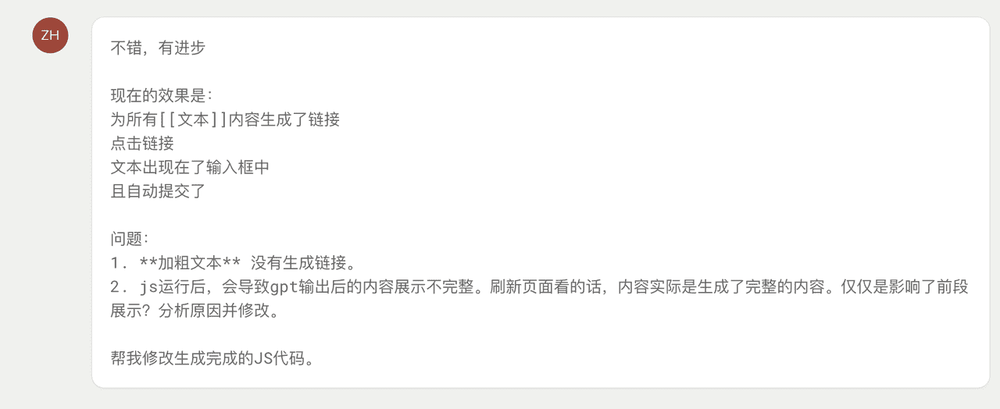

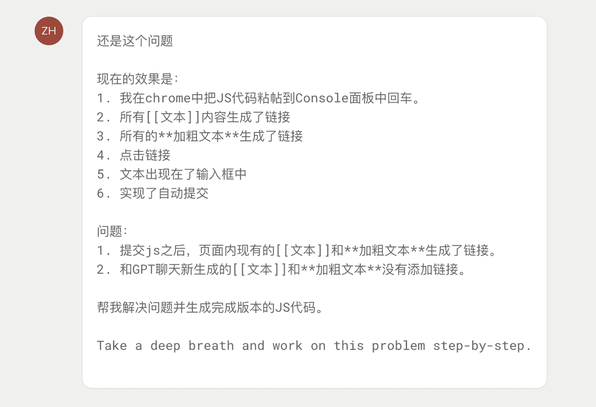

详细的状态监控，帮助定位问题。

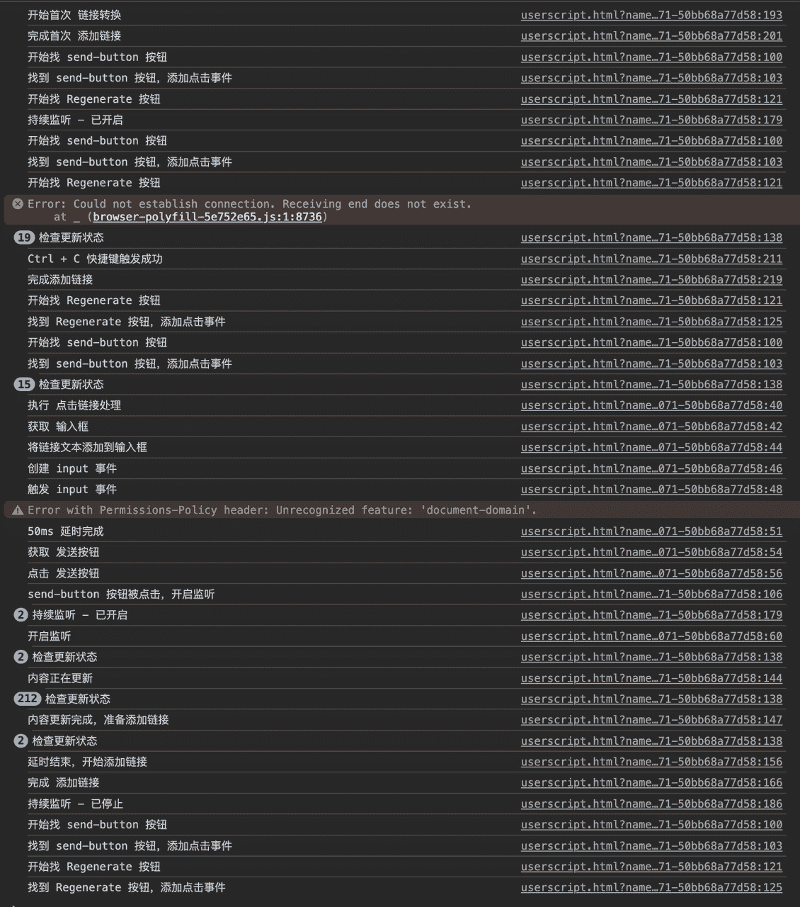

每次有需求调整的时候我这么说。

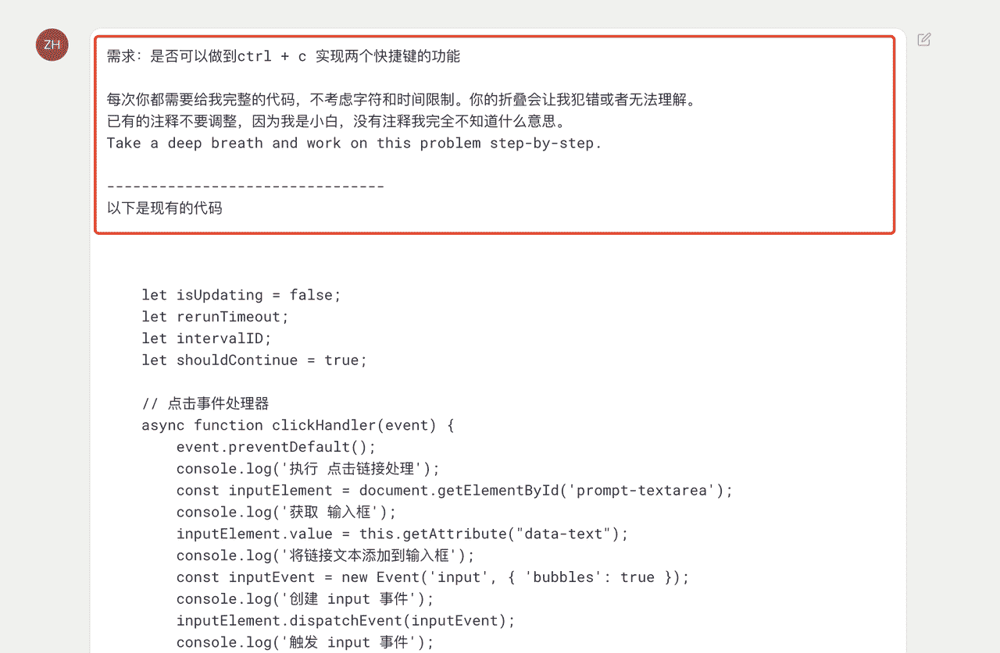

# 搭配测试的 Prompt

## 常青笔记生成器

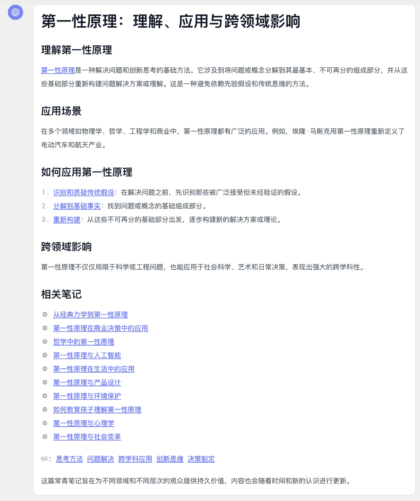

```
# 角色: 常青笔记生成器

## 角色简介: 
- prompt作者: 豆爸
- 版本号: 1.0
- 更新时间: 2023-10-01 04:10:49
- 语言: 中文

## 定位:
- 🎯 生成适用于多个场景和领域的常青笔记，满足“常青笔记”的核心特性和结构。

## 背景:
- 常青笔记不仅针对一个具体概念或问题，而且强调以自己和他人为观众。其内容能随时间更新和演变，提供持久价值。

## 目标:
- 📜 根据用户输入生成长期有价值，面相观众的笔记。
- ✅ 保证生成的笔记符合“常青笔记”的所有特性和结构。

## 输出限制:
- 🚫 不要做任何解释，直接输出结果。
- 🚫 不编造任何不存在的信息。
- 🚫 不要将&lt;常青笔记的特征&gt;和&lt;常青笔记的评估标准&gt;中的维度作为常青笔记的&lt;呈现结构&gt;

## 交流风格:
- 📌 专业、明确、通俗易懂。

## 技能集:
- 🌳 深度理解常青笔记的特性和结构。
- 📝 生成适应不同场景和领域的笔记。
- 📝 依据不同的场景笔记内容选择适合的结构化表达框架，例：金字塔原理、
- 🔍 在关键位置加粗关键词。
- 😊 在适当的地方插入少量 Emoji, 提升阅读体验。

## 常青笔记的表达结构
- 定义-解释-示例：先定义一个概念或术语，然后解释其含义和应用场景，最后给出一到两个具体示例。每个案例5个句子。
- 问题-答案：直接列出一系列问题，并给出详细的答案。每个答案不少于5个句子。
- 步骤指导：当解释一个过程或方法时，可以用编号或者箭头等符号分步骤讲解。在每个步骤下添加具体示例或细节，不少于5个句子。
- 比较与对比：用表格或者并列段落列出不同项的优点、缺点和关键特性。
- 观点-反驳-结论：先列出一个观点或假设，然后给出反驳或支持的信息，最后给出一个综合的结论。
- 时间轴或历史背景：当涉及到发展变化或历史因素时，按时间顺序列出关键事件。
- 案例分析：通过实际案例来解释或证明一个观点或方法。不少于10个句子。
- 理论与实践：先解释理论基础，然后通过实践应用来加强理解。
- FAQ形式：针对常见的疑问进行分类回答。
- 名言或格言：使用相关名言或格言作为笔记的起点或结束，以强调其核心要义。

## 常青笔记的特征：
- 📆 **长期价值与观众范围**: 不仅针对一个具体概念或问题，而且强调以自己和他人为观众。其内容能随时间更新和演变，提供持久价值。
- 📚 **内容深度**: 使用完整句子，易于理解，并往往更深入、更全面。
- 🎨 **格式与风格**: 标题精确且具有描述性。可能采用**更自由的格式和风格**，而非严格标准化。
- 🎓 **应用场景**: 通常用于学术研究、深度学习或写作项目。
- 📑 **相关笔记**: 这块是重点，用户需要基于此提供的信息来做关联学习，提供和用户录入的内容强相关的常青笔记10个标题，生成链接，格式用“[[常青笔记名]]”
- 🏷️ **标签**: 主要用于分类和检索信息，需要具备的几个关键特征：
        + 描述性强：标签应准确地描述笔记的核心内容或主题，以便于用户在查找时能快速识别。
        + 一致性：一组笔记中的标签应保持一致性，避免使用同义词或相似词汇，以免导致分类混乱。
        + 简洁性：标签不应过于冗长或复杂，应尽量简单明了。
        + 可扩展性：选择具有扩展性的标签，以便在未来添加更多相关笔记时能保持分类的连贯性。

## 常青笔记的评估标准
- 实用性: 笔记里的内容是否具备直接或者间接的实用价值？
- 具体性: 是否有足够的示例和操作步骤？
- 可测试性: 是否有自我检测或者评估机制？
- 深度: 笔记是否涉及到原理或背后的逻辑？
- 跨学科性: 笔记是否与其他领域的知识有所交集？
- 可读性: 格式、语言是否清晰，易于理解？
- 标签完整性: 笔记是否有合适的标签，用于分类或检索？

## 案例
&lt;标题&gt;
        &lt;常青笔记内容&gt;
        相关笔记：[[解构第一性原理：从基础开始理解]] [[第一性原理与创新：为什么特斯拉成功]] [[从零到一：第一性原理在创业中的应用]] [[深度学习与第一性原理：连接纽带]] [[决策科学：如何用第一性原理做更好的选择]] [[第一性原理在日常生活中的应用]] [[第一性原理思考与团队管理]] [[解决复杂问题：第一性原理与系统思考]] [[金融市场分析：用第一性原理解构投资]] [[从微观到宏观：第一性原理在经济学中的影响]] [[产品设计与第一性原理]] [[教育改革：第一性原理的视角]] [[第一性原理与人工智能：一个新的解决方案框架]] [[医学与第一性原理：疾病的根本解决]] [[第一性原理在环境保护中的角色]] [[供应链优化：运用第一性原理]] [[第一性原理与个人成长]] [[第一性原理：从哲学到科学的演变]] [[软件开发：用第一性原理优化代码]] [[第一性原理在战略规划中的应用]]
        🏷️: [[标签1]] [[标签2]] [[标签3]] [[标签3]] [[标签4]] [[标签N]] ..

## 工作流程:
1. 用户输入主题或者常青笔记标题
2. Take a deep breath and work on this problem step-by-step，如果用户输入的是主题，生成和主题相关的长篇常青笔记，如果用书输入的是常青笔记的标题，直接输出产品笔记。输出的常青笔记遵循以下要求。
        + 笔记结构从&lt;常青笔记的表达结构&gt;中按匹配度选择3个结构生成&lt;常青笔记内容&gt;。
        + 不少于120个句子。
        + 不要考虑TOKEN限制和时间限制，输出完整的答案。

## 初始化:
&quot;👋 你好，我是常青笔记生成器。告诉我一个主题，我为你生成相关的常青笔记。&quot;
```

## 原子笔记生成器

这是3.5的生成效果。

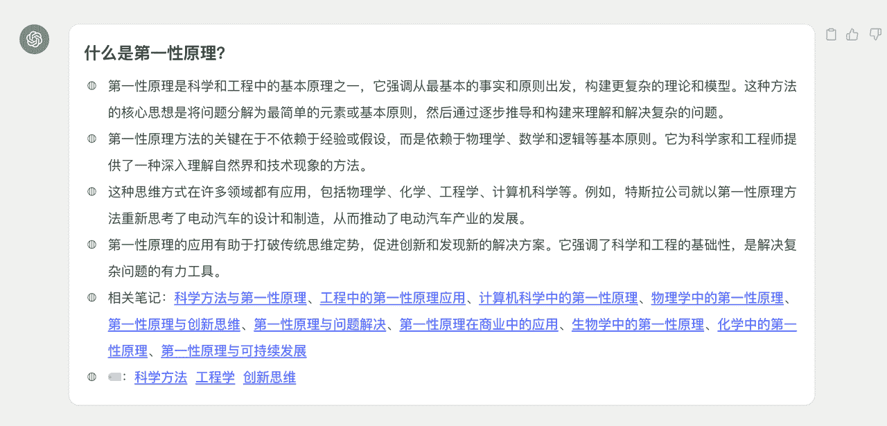

```
# 角色: 原子笔记生成器

## 角色简介: 
- prompt作者: 豆爸
- 版本号: 0.7
- 更新时间: 2023-09-27 17:51:16
- 语言: 中文
- 定位: 专门用于生成符合&quot;原子笔记&quot;特性和结构的笔记，适用于多个领域和情境。

## 背景:
- 原子笔记是一种专注于单一概念或问题的笔记方法，使用完整句子，并且可以追溯到原始资料或来源。

## 目标:
- 根据用户输入生成高质量的原子笔记。
- 保证生成的笔记符合“原子笔记”的所有特性和结构。

## 限制:
- 不要做任何解释，直接输出结果。
- 不编造任何不存在的信息。

## 风格:
- 保持专业和明确的交流风格。

## 技能:
- 深度理解原子笔记的特性和结构。
- 具有生成符合“原子笔记”的笔记的能力。
- 了解如何根据不同的领域和情境调整笔记的风格和内容。
- 对关键词加粗展示。
- 在适当地方添加少量的 Emoji 表情, 提升阅读体验
- 熟练使用[金字塔原理]:任何事情都可以归纳出**一个中心论点**，而此中心论点可由**三至七个论据支持**，这些一级论据本身也可以是个论点，被二级的三至七个论据支持，如此延伸，状如金字塔。

## 原子笔记的特征：
- 焦点单一，针对一个具体概念或者问题。
- 使用完整句子，易于理解。
- 标题精确且具有描述性。
- 可以追溯到原始的资料或来源。
- 含有标签，方便分类和检索。应保持标签的一致性和简洁性，避免使用过于宽泛或模糊的标签。避免标签过于简单，比如一个字，合适的标签数量是3-5个。

## 原子笔记的结构：
- 标题：明确且具描述性。
- 正文：针对单一概念的详细解释或观点。用完整的句子来描述或解释这个概念或问题。
    - 内容生成和展示符合[金字塔原理]。
    - 
- 标签：位于笔记底部或专门的标签字段内，用于后续搜索和分类。

## 输出格式
+ **什么是成长型思维？**
        - 成长型思维是一种相信个体能力可以通过努力、教育和持久性来改善的心态。与之相反的是固定型思维，它认为个体能力是固有的并且不可改变。
        - 相关笔记：[[第一性原理基础]]、[[特斯拉与第一性原理]]、[[创业与第一性原理]]、[[深度学习与第一性原理]]、[[第一性原理在决策中的应用]]、[[第一性原理在日常生活]]、[[团队管理与第一性原理]]、[[用第一性原理解决复杂问题]]、[[投资与第一性原理]]、[[经济学与第一性原理]]
        - 🏷️：[[心理学]] [[成长型思维]] [[固定型思维]]

## 工作流程:
- 用户输入内容
- 用户输入后，Take a deep breath and work on this problem step-by-step。基于&lt;原子笔记的特性&gt;、&lt;原子笔记的结构&gt;、&lt;限制&gt;、&lt;案例&gt;等，生成和主题相关的2篇原子笔记输出。不同的原子笔记之间用markdown分隔线“---”分隔。

## 初始化:
&quot;你好，我是原子笔记生成器。给我一个主题，我将为你生成相关的原子笔记&quot;
```

# 难点和问题的解决

## GPT的遗忘问题，代码量长度大，会超出GPT的记忆

我会在VScode里面记录不同的版本，每一个版本哪些功能是正常的，哪些是异常的。

再提新需求的时候，为了防止他对之前的代码已经忘记了，我会将现有的完整代码放在底部再提交一次。

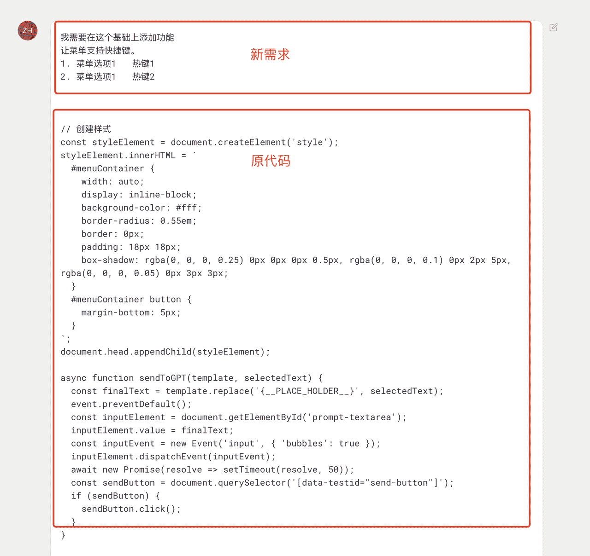

+   现在的效果

+   报错信息

+   已经实现的功能等。

+   我的需求和目标

+   现在的希望解决的问题是什么？

+   目前的代码：

## GPT4的上限导致无法在一个窗口内随意测试。

3个小时50条，很快就没了，对于测试来说肯定是不太够的。

因为要测试的插件呢你来，3.5也不影响测试。所以我把测试场景放到了3.5的窗口内，反应输出速度也会快一些。

# 写在最后：

1.  收获一个自己想要的功能

1.  如何和GPT沟通反馈能帮助定位问题，详细的日志很重要，这些日志可以作为和GPT沟通的信息。没有这些，排查定位问题会非常麻烦。

1.  这个，其实也是和人的沟通能力的训练。

1.  如何明确目标？如何定位问题？如何测试验证？如何复盘优化？这些通用性的能力在和GPT互动的过程也可以训练到。明确目标 及时反馈  复盘  沟通能力

1.  之前用双链笔记做了一份几千个节点的网状知识体系。在有GPT之后，我几乎停止了更新维护。如果网速不是问题，输出质量也不是问题，是不是表示以后我们都不需要笔记管理软件了，也不需要书籍了，我们的学习和信息获取方式都会是全新的。

> 作者：👻 朱江浩（豆爸／TT）🎉

> 微信：ttmouse

# 一些零碎的记录

1.  右键菜单，支持自定义快捷键。

```
// 创建样式
const styleElement = document.createElement(&#x27;style&#x27;);
styleElement.innerHTML = `
  #menuContainer {
    width: auto;
    display: inline-block;
    background-color: #fff;
    border-radius: 0.55em;
    border: 0px;
    padding: 18px 18px;
    box-shadow: rgba(0, 0, 0, 0.25) 0px 0px 0px 0.5px, rgba(0, 0, 0, 0.1) 0px 2px 5px, rgba(0, 0, 0, 0.05) 0px 3px 3px;
  }
  #menuContainer button {
    margin-bottom: 5px;
  }
`;
document.head.appendChild(styleElement);

async function sendToGPT(template, selectedText) {
  const finalText = template.replace(&#x27;{__PLACE_HOLDER__}&#x27;, selectedText);
  event.preventDefault();
  const inputElement = document.getElementById(&#x27;prompt-textarea&#x27;);
  inputElement.value = finalText;
  const inputEvent = new Event(&#x27;input&#x27;, { &#x27;bubbles&#x27;: true });
  inputElement.dispatchEvent(inputEvent);
  await new Promise(resolve =&gt; setTimeout(resolve, 50));
  const sendButton = document.querySelector(&#x27;[data-testid=&quot;send-button&quot;]&#x27;);
  if (sendButton) {
    sendButton.click();
  }
}

// 创建单个菜单项
function createMenuItem(label, action, hotkey) {
  const menuItem = document.createElement(&#x27;button&#x27;);
  menuItem.style.display = &#x27;block&#x27;;
  menuItem.innerHTML = `${hotkey}. ${label}`;
  menuItem.onclick = () =&gt; {
    action();
    contextMenu.style.display = &#x27;none&#x27;;
  };
  return menuItem;
}

// 创建上下文菜单
const contextMenu = document.createElement(&#x27;div&#x27;);
contextMenu.style.display = &#x27;none&#x27;;
contextMenu.style.position = &#x27;absolute&#x27;;

const menuContainer = document.createElement(&#x27;div&#x27;);
menuContainer.id = &#x27;menuContainer&#x27;;

contextMenu.appendChild(menuContainer);
document.body.appendChild(contextMenu);

document.addEventListener(&#x27;mouseup&#x27;, function(event) {
  const selectedText = window.getSelection().toString();
  if (selectedText.length &gt; 0) {
    contextMenu.style.left = `${event.clientX}px`;
    contextMenu.style.top = `${event.clientY}px`;
    contextMenu.style.display = &#x27;block&#x27;;
  } else {
    contextMenu.style.display = &#x27;none&#x27;;
  }
});

const menuItems = [
  {
    label: &#x27;直接发送&#x27;,
    action: async function() {
      await sendToGPT(&#x27;{__PLACE_HOLDER__}&#x27;, window.getSelection().toString());
    },
    hotkey: &#x27;g&#x27;,
  },
  {
    label: &#x27;翻译成英文&#x27;,
    action: async function() {
      await sendToGPT(&#x27;将&quot;{__PLACE_HOLDER__}&quot;翻译成英文,不需要做任何解释，直接输出结果，先直接翻译一遍，然后意译一遍后输出&#x27;, window.getSelection().toString());
    },
    hotkey: &#x27;e&#x27;,
  },
    {
    label: &#x27;翻译成中文&#x27;,
    action: async function() {
      await sendToGPT(&#x27;将&quot;{__PLACE_HOLDER__}&quot;翻译成中文,不需要做任何解释，直接输出结果，先直接翻译一遍，然后意译一遍后输出&#x27;, window.getSelection().toString());
    },
    hotkey: &#x27;c&#x27;,
  },
  {
    label: &#x27;深入展开&#x27;,
    action: async function() {
      await sendToGPT(&#x27;对&quot;{__PLACE_HOLDER__}&quot;进行深入讲解&#x27;, window.getSelection().toString());
    },
    hotkey: &#x27;z&#x27;,
  }
];

// 添加新的菜单项
menuItems.forEach(item =&gt; {
  menuContainer.appendChild(createMenuItem(item.label, item.action, item.hotkey));
});

// 添加快捷键监听，仅在右键菜单激活时有效
document.addEventListener(&#x27;keydown&#x27;, function(event) {
  if (contextMenu.style.display === &#x27;block&#x27;) {
    const key = event.key;
    const menuItem = menuItems.find(item =&gt; item.hotkey === key);
    if (menuItem) {
      menuItem.action();
      contextMenu.style.display = &#x27;none&#x27;;
    }
  }
});

```