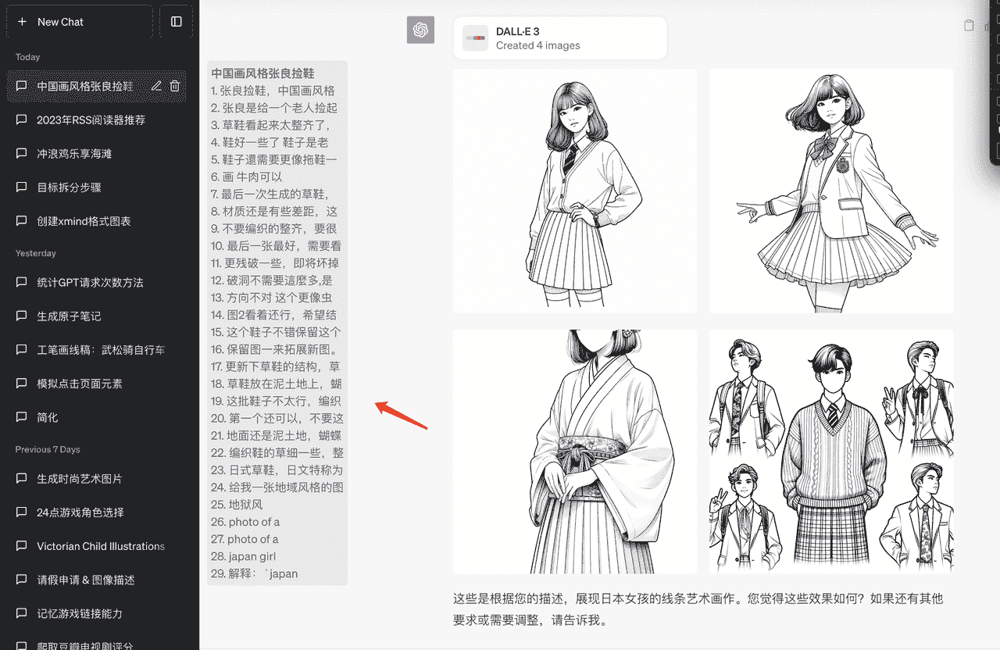
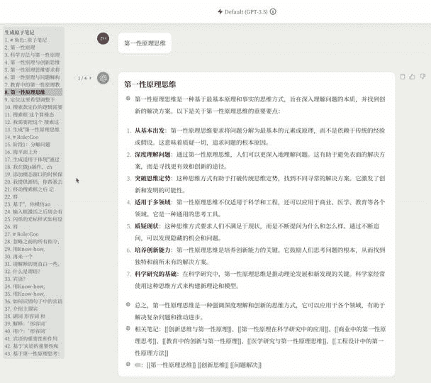

# 豆爸：GPT 生成历史记录目录

> 来源：[https://waytoagi.feishu.cn/docx/NScad7fWCos3W6x8Y23chJbqnZg](https://waytoagi.feishu.cn/docx/NScad7fWCos3W6x8Y23chJbqnZg)





[录屏2023-10-14 23.31.27.mov](https://internal-api-drive-stream.feishu.cn/space/api/box/stream/download/all/LRTZbgFRion76ExRJwBcIa9VnCd)

# 目录的功能

1.  自动生成目录.

1.  目录支持点击跳转，需要在页面上先用鼠标滚动一下，再点击。在页面最底部的时候无法点击目录。

1.  双击目录项可以打开编辑模式。对历史内容进行编辑.

1.  目录支持拖动改变目录位置,点击目录头部拖动.

1.  支持目录高亮展示当前位置.  2023-10-15 00:02:13

1.  自动适配深色浅色皮肤 2023-10-25 01:16:12

需要通过油猴安装， 参考[南瓜博士：用GPT写的油猴脚本](https://waytoagi.feishu.cn/wiki/W2bRwZsq9iCTwikt4X1cwXBjnOe)

# 更新日志

安装最顶部的版本就好了。

1.  修了个在最底部点击目录跳转会出现问题的bug 2023-10-15 00:45:16

1.  添加了跳转目录的缓动效果. 有动画 2023-10-15 00:50:56

1.  修复会把"Today"识别出来的bug, 2023-10-21 16:35:24

1.  GPT的css调整导致失效，重新定位对象 2023-10-25 00:50:21

1.  增加了皮肤颜色的适配，原来仅支持浅色皮肤，现在支持深色了。

1.  官网更新，导致高亮无效，已经修复， 2023-10-30 11:04:44

1.  支持目录调整宽度

1.  支持新版gpt 2023-11-12 11:27:03

## 支持GPT新版，支持双击进入编辑。

还差一个取消编辑按钮无法恢复监听，暂不管了。

```
// ==UserScript==
// @name         GPT History
// @namespace    
// @version      2023-11-11 14:34:28
// @description
// @author       ttmouse &amp; GPT-4
// @match        https://chat.openai.com/*
// @grant        none
// ==/UserScript==

////////////////////////// CSS //////////////////////////
const style = `

/* 浅色皮肤 */
.light #directory {
    position: absolute;
    top: 81px;
    left: 10px;
    background-color: #7575751a;
    color: #676767;
    border-radius: 5px;
    padding: 5px;
    width: 190px;
    font-size: 15px;
    display: inline-block;
    white-space: nowrap;  /* 不折行 */
    overflow: hidden;      /* 隐藏超出的内容 */
    text-overflow: ellipsis;  /* 用...来表示溢出的文本 */
}

.truncate {
    white-space: nowrap;  /* 不折行 */
    overflow: hidden;      /* 隐藏超出的内容 */
    text-overflow: ellipsis;  /* 用...来表示溢出的文本 */
  }

/* 深色皮肤 */
.dark #directory {
    position: absolute;
    top: 81px;
    left: 10px;
    background-color: #0000005c;
    color: #e0e0e0c7;
    border-radius: 5px;
    padding: 5px;
    width: 190px;
    font-size: 15px;
    line-height: 170%;
    display: inline-block;
    white-space: nowrap;  /* 不折行 */
    overflow: hidden;      /* 隐藏超出的内容 */
    text-overflow: ellipsis;  /* 用...来表示溢出的文本 */
}

#directoryTitle {
    font-weight: 700;
}
.placeholder {
    height: 70px;  /* 你想要保留的顶部距离 */
    visibility: hidden;
}

.highlight {
    background-color: #c4c4c4;
    color: #000;
    font-weight: 700;
}

.resizeHandle:hover {
    width: 3px;
    height: 100%;
    cursor: ew-resize;
    background: rgb(204 204 204 / 39%);
    position: absolute;
    right: 0px;
    top: 0px;
}
.resizeHandle {
    width: 3px;
    height: 100%;
    cursor: ew-resize;
    background: rgb(204 204 204 / 0%);
    position: absolute;
    right: 0px;
    top: 0px;
}
`;

const styleElement = document.createElement(&#x27;style&#x27;);
styleElement.innerHTML = style;
document.head.appendChild(styleElement);

////////////////////////// JS //////////////////////////

// 001 Global State
let isMouseDown = false;
let isDragging = false;
let mouseDownTimer;
let isResizing = false;
let lastX;
let index = 1; // 用于生成目录项的序号

// 002 创建目录容器
function createDirectoryContainer() {
    const directoryDiv = document.createElement(&#x27;div&#x27;);
    directoryDiv.id = &#x27;directory&#x27;;
    directoryDiv.classList.add(&#x27;directory&#x27;);

    const resizeHandle = document.createElement(&#x27;div&#x27;);
    resizeHandle.id = &#x27;resizeHandle&#x27;;
    resizeHandle.classList.add(&#x27;resizeHandle&#x27;);
    directoryDiv.appendChild(resizeHandle);

    return directoryDiv;
}

// 003 设置目录标题
function setChatTitle(directoryTitle) {
    const activeMenuElement = document.querySelector(&#x27;a.bg-token-surface-primary:not(:hover)&#x27;);
    let chatTitle = activeMenuElement ? activeMenuElement.textContent.trim() : &#x27;Title&#x27;;

    if (directoryTitle) {
        directoryTitle.innerText = chatTitle;
        directoryTitle.id = &#x27;directoryTitle&#x27;;
        directoryTitle.classList.add(&#x27;directoryTitle&#x27;);
    }
}

// 004 创建目录标题
function createDirectoryTitle(directoryDiv) {
    const directoryTitle = document.createElement(&#x27;div&#x27;);
    setChatTitle(directoryTitle);

    directoryTitle.addEventListener(&#x27;mousedown&#x27;, function(event) {
        startDrag(event, directoryDiv);
    });

    return directoryTitle;
}

// 005 处理鼠标按下事件
function startDrag(event, directoryDiv) {
    isMouseDown = true;
    mouseDownTimer = setTimeout(() =&gt; {
        if (isMouseDown) {
            isDragging = true;
            initiateDrag(event, directoryDiv);
        }
    }, 150);
}

// 006 处理鼠标移动事件
function initiateDrag(event, directoryDiv) {
    const offsetX = event.clientX - directoryDiv.offsetLeft;
    const offsetY = event.clientY - directoryDiv.offsetTop;

    document.addEventListener(&#x27;mousemove&#x27;, (event) =&gt; {
        if (isDragging) {
            directoryDiv.style.left = `${event.clientX - offsetX}px`;
            directoryDiv.style.top = `${event.clientY - offsetY}px`;
        }
    });
}

// 007 获取所有用户消息
function addDirectoryEntries(directoryDiv, resizeHandle) { 
    const userMessages = document.querySelectorAll(&#x27;div[data-message-author-role=&quot;user&quot;]&gt;div&#x27;); // 获取所有用户消息

    userMessages.forEach((msg, i) =&gt; { // 遍历所有用户消息
        const directoryEntry = createDirectoryEntry(msg, i); 
        directoryDiv.appendChild(directoryEntry);
    });

    index = userMessages.length + 1;
    directoryDiv.appendChild(resizeHandle); // 将resizeHandle放在最后
}

// 008 创建目录项
function createDirectoryEntry(msg, i) { 
    // const text = msg ? msg.innerText.split(&#x27;\n&#x27;)[0] : &#x27;&#x27;;  
    const text = msg ? msg.innerText.split(&#x27;\n&#x27;).find(line =&gt; line.trim() !== &#x27;&#x27;) : &#x27;&#x27;;
    const directoryEntry = document.createElement(&#x27;div&#x27;);
    directoryEntry.className = &#x27;truncate&#x27;;
    directoryEntry.innerText = `${i + 1}. ${text}`;
    directoryEntry.setAttribute(&#x27;data-index&#x27;, i);

    directoryEntry.addEventListener(&#x27;click&#x27;, () =&gt; {
        scrollToMessage(msg);
    });

    directoryEntry.addEventListener(&#x27;dblclick&#x27;, () =&gt; {
        editMessage(msg);
    });

    return directoryEntry;
}

// 009 滚动到对应消息位置,距离顶部70px
function scrollToMessage(msg) {
    performScrollAdjustment();

    setTimeout(() =&gt; {
        const grandGrandParent = msg.parentElement?.parentElement?.parentElement?.parentElement?.parentElement; 
        // 获取消息的爷爷爷爷爷爷爷爷爷节点
        if (grandGrandParent) {
            const scrollContainer = grandGrandParent.closest(&#x27;div[class*=&quot;react-scroll-to-bottom--css-&quot;]&#x27;);

            if (scrollContainer) {
                const elementPosition = grandGrandParent.getBoundingClientRect().top - scrollContainer.getBoundingClientRect().top;
                const offset = 70; // 自定义间距
                const targetScrollTop = scrollContainer.scrollTop + elementPosition - offset;

                smoothScroll(scrollContainer, targetScrollTop, 500); // 500ms 的滚动动画
            }
        }
    }, 10);
}

// 009.1 平滑滚动函数
function smoothScroll(element, target, duration) {
    const start = element.scrollTop;
    const change = target - start;
    let currentTime = 0;
    const increment = 20;

    function animateScroll() {
        currentTime += increment;
        const val = Math.easeInOutQuad(currentTime, start, change, duration);
        element.scrollTop = val;
        if (currentTime &lt; duration) {
            requestAnimationFrame(animateScroll);
        }
    }

    animateScroll();
}

// 009.2 缓动函数
Math.easeInOutQuad = function (t, b, c, d) {
    t /= d / 2;
    if (t &lt; 1) return c / 2 * t * t + b;
    t--;
    return -c / 2 * (t * (t - 2) - 1) + b;
};

// 010 执行小幅度滚动调整
function performScrollAdjustment() {
    const parentContainers = document.querySelectorAll(&#x27;div[class*=&quot;react-scroll-to-bottom--css-&quot;][class*=&quot;h-full&quot;]&#x27;);
    let parentContainer = parentContainers.length ? parentContainers[0] : null;

    if (parentContainer) {
        let actualScrollContainer = parentContainer.querySelector(&#x27;div[class*=&quot;react-scroll-to-bottom--css-&quot;]&#x27;);
        if (actualScrollContainer) {
            const originalScrollTop = actualScrollContainer.scrollTop;
            actualScrollContainer.scrollTop = originalScrollTop - 1;
        }
    }
}

// 011 创建占位符
function createPlaceholder() {
    const placeholder = document.createElement(&#x27;div&#x27;);
    placeholder.className = &#x27;placeholder&#x27;;
    return placeholder;
}

// 012 模拟编辑消息的按钮点击
function editMessage(msg) {
    // 获取消息的上上上级元素
    const grandGrandParent = msg.parentElement?.parentElement?.parentElement;

    if (grandGrandParent) {
        // 定位到上上上级元素的第二个子元素
        const secondChild = grandGrandParent.children[1];
        if (secondChild) {
            // 在第二个子元素的子元素中查找编辑按钮
            const editButton = secondChild.querySelector(&#x27;button&#x27;);
            if (editButton) {
                editButton.click();
                focusOnTextarea(msg);
                setTimeout(() =&gt; focusOnTextarea(grandGrandParent), 10);
            }
        }
    }
}

// 013 聚焦到文本框并全选文本
function focusOnTextarea(grandGrandParent) {
    // 由于 DOM 结构已变更，直接在上上上级元素中查找 textarea
    const textareaElement = grandGrandParent.querySelector(&#x27;textarea&#x27;);
    if (textareaElement) {
        textareaElement.focus();
        // 设置文本选择范围为整个文本，以实现全选效果
        textareaElement.setSelectionRange(0, textareaElement.value.length);
    }
    
}

// 014 处理调整大小的逻辑
function setupResizeHandle(resizeHandle, directoryDiv) {
    resizeHandle.addEventListener(&#x27;mousedown&#x27;, (event) =&gt; {
        isResizing = true;
        lastX = event.clientX;
        document.addEventListener(&#x27;mousemove&#x27;, (event) =&gt; handleMouseMove(event, directoryDiv));
        document.addEventListener(&#x27;mouseup&#x27;, () =&gt; {
            isResizing = false;
            document.removeEventListener(&#x27;mousemove&#x27;, (event) =&gt; handleMouseMove(event, directoryDiv));
        });
    });
}

// 015 处理鼠标移动事件
function handleMouseMove(event, directoryDiv) {
    if (isResizing) {
        const dx = event.clientX - lastX;
        lastX = event.clientX;
        directoryDiv.style.width = `${parseInt(getComputedStyle(directoryDiv).width, 10) + dx}px`;
    }
}

// 016 初始化目录
function initDirectory() {
    if (document.querySelector(&#x27;#directory&#x27;)) {
        return; // 如果目录已存在，不再重复创建
    }
    const directoryDiv = createDirectoryContainer();
    const directoryTitle = createDirectoryTitle(directoryDiv);
    directoryDiv.appendChild(directoryTitle);

    const resizeHandle = directoryDiv.querySelector(&#x27;#resizeHandle&#x27;);
    addDirectoryEntries(directoryDiv, resizeHandle);
    setupResizeHandle(resizeHandle, directoryDiv);

    // 修改这部分以匹配原始代码中目录的添加位置
    const parentContainer = document.querySelector(&#x27;.relative.flex.h-full.max-w-full.flex-1.overflow-hidden&#x27;);
    if (parentContainer) {
        parentContainer.appendChild(directoryDiv);
    } else {
        document.body.appendChild(directoryDiv);
    }
}

// 017 主入口
initDirectory();
document.addEventListener(&#x27;mouseup&#x27;, () =&gt; {
    isMouseDown = false;
    isDragging = false;
    clearTimeout(mouseDownTimer);
});

// 018 监控页面是否更新
function observePerformanceChanges(callback) { // 监控页面是否更新
    const observer = new PerformanceObserver((list) =&gt; { // 监控页面性能
        for (const entry of list.getEntries()) { // 遍历所有性能条目
            if (entry.name.includes(&#x27;https://chat.openai.com/backend-api/conversation&#x27;)) { // 如果条目名称包含指定字符串
                console.log(&quot;检测到内容更新&quot;);
                callback(); // 执行回调函数
            }
        }
    });
    observer.observe({ entryTypes: [&#x27;resource&#x27;] });
}

// 019 重构后的重新生成目录函数,识别到分享按钮后再生成目录
function regenerateDirectoryOnContentUpdate() { 
    let intervalId = setInterval(() =&gt; {
        const shareButton = document.querySelector(&#x27;button svg[viewBox=&quot;0 0 24 24&quot;][fill=&quot;none&quot;]&#x27;);
        if (shareButton) {
            regenerateDirectory(); // 识别到分享按钮后，重新生成目录
            clearInterval(intervalId); // 识别到分享按钮后，停止循环
        }
    }, 50);
}

// 020 重构后的重新生成目录函数
function regenerateDirectory() {
    const directoryDiv = document.querySelector(&#x27;#directory&#x27;);
    directoryDiv.innerHTML = &#x27;&#x27;; // 清空目录内容

    const directoryTitle = createDirectoryTitle(directoryDiv);
    directoryDiv.appendChild(directoryTitle);

    const resizeHandle = document.createElement(&#x27;div&#x27;);
    resizeHandle.id = &#x27;resizeHandle&#x27;;
    resizeHandle.classList.add(&#x27;resizeHandle&#x27;);
    addDirectoryEntries(directoryDiv, resizeHandle);
    setupResizeHandle(resizeHandle, directoryDiv);
    // 重新绑定滚动事件监听器以确保高亮功能正常工作
    setupScrollListener();
}

// 021 监听左右箭头按钮点击事件
function observeArrowButtons() {
    const allButtonElements = document.querySelectorAll(&#x27;button&#x27;);
    allButtonElements.forEach(buttonElement =&gt; {
        const svgElement = buttonElement.querySelector(&#x27;svg&#x27;);
        if (svgElement) {
            const polylineElement = svgElement.querySelector(&#x27;polyline&#x27;);
            const pointsAttr = polylineElement ? polylineElement.getAttribute(&#x27;points&#x27;) : &#x27;&#x27;;
            if (pointsAttr === &quot;15 18 9 12 15 6&quot; || pointsAttr === &quot;9 18 15 12 9 6&quot;) {
                buttonElement.addEventListener(&#x27;click&#x27;, () =&gt; {
                    setTimeout(regenerateDirectory, 300);
                });
            }
        }
    });
}

// 022 目录高亮展示
function highlightDirectoryEntry() {
    const userMessageTextDivs = document.querySelectorAll(&#x27;div[data-message-author-role=&quot;user&quot;]&gt;div&#x27;);
    let closestToTop = null;
    let minTop = Infinity;

    userMessageTextDivs.forEach((textDiv, i) =&gt; {
        const userMessageDiv = textDiv.parentElement;
        if (userMessageDiv) {
            const rect = userMessageDiv.getBoundingClientRect();
            const directoryEntry = document.querySelector(`[data-index=&quot;${i}&quot;]`);
            if (directoryEntry) {
                directoryEntry.classList.remove(&#x27;highlight&#x27;);

                if (rect.top &gt;= 0 &amp;&amp; rect.top &lt; minTop) {
                    minTop = rect.top;
                    closestToTop = directoryEntry;
                }
            }
        }
    });

    if (closestToTop) {
        closestToTop.classList.add(&#x27;highlight&#x27;);
    }
}

// 023 监听滚动事件
function setupScrollListener() {
    const scrollContainer = document.querySelector(&#x27;div[class*=&quot;react-scroll-to-bottom--css-&quot;][class*=&quot;h-full&quot;]&#x27;);
    if (scrollContainer) {
        scrollContainer.addEventListener(&#x27;scroll&#x27;, highlightDirectoryEntry, true);
    }
}

// 024 初始化函数
function initialize() {
    initDirectory();
    observePerformanceChanges(regenerateDirectoryOnContentUpdate);
    observeArrowButtons();
    setupScrollListener();
}

initialize();

```

## 仅保留用户输入的内容

```
// ==UserScript==
// @name         GPT History
// @namespace    
// @version      0.3
// @description
// @author       ttmouse &amp; GPT-4
// @match        https://chat.openai.com/*
// @grant        none
// ==/UserScript==

// 我希望给GPT做一个目录。用js实现，在chrome中用console测试。
// 效果如下：
// 1.和GPT聊天的过程中，我发出去的内容会记录在在目录中，
// 2. 因为我发出去的内容可能会很长，在目录中进需要截取我发送内容的前10个字
// 3. 随着和GPT持续聊天，目录会自动更新
// 4. 目录支持点击跳转到对应的位置。
// 5. 目录有序号。
// 6. 打开已有聊天记录的页面,需要可以生成目录。
// 7. 用户有可能会修改历史聊天记录，目录需要重新生成。

////////////////////////// CSS //////////////////////////
const style = `

/* 浅色皮肤 */
.light #directory {
    position: absolute;
    top: 81px;
    left: 10px;
    background-color: #7575751a;
    color: #676767;
    border-radius: 5px;
    padding: 5px;
    width: 190px;
    font-size: 15px;
    display: inline-block;
    white-space: nowrap;  /* 不折行 */
    overflow: hidden;      /* 隐藏超出的内容 */
    text-overflow: ellipsis;  /* 用...来表示溢出的文本 */
}

.truncate {
    white-space: nowrap;  /* 不折行 */
    overflow: hidden;      /* 隐藏超出的内容 */
    text-overflow: ellipsis;  /* 用...来表示溢出的文本 */
  }

/* 深色皮肤 */
.dark #directory {
    position: absolute;
    top: 81px;
    left: 10px;
    background-color: #0000005c;
    color: #e0e0e0c7;
    border-radius: 5px;
    padding: 5px;
    width: 190px;
    font-size: 15px;
    line-height: 170%;
    display: inline-block;
    white-space: nowrap;  /* 不折行 */
    overflow: hidden;      /* 隐藏超出的内容 */
    text-overflow: ellipsis;  /* 用...来表示溢出的文本 */
}

#directoryTitle {
    font-weight: 700;
}
.placeholder {
    height: 70px;  /* 你想要保留的顶部距离 */
    visibility: hidden;
}

.highlight {
    background-color: #c4c4c4;
    color: #000;
    font-weight: 700;
}

.resizeHandle:hover {
    width: 3px;
    height: 100%;
    cursor: ew-resize;
    background: rgb(204 204 204 / 39%);
    position: absolute;
    right: 0px;
    top: 0px;
}
.resizeHandle {
    width: 3px;
    height: 100%;
    cursor: ew-resize;
    background: rgb(204 204 204 / 0%);
    position: absolute;
    right: 0px;
    top: 0px;
}
`;

const styleElement = document.createElement(&#x27;style&#x27;);
styleElement.innerHTML = style;
document.head.appendChild(styleElement);

////////////////////////// JS //////////////////////////
let isMouseDown = false;
let isDragging = false;
let mouseDownTimer;

// A01. 创建并设置目录容器
// A01. 创建并设置目录容器
console.log(&quot;A01. 创建目录容器&quot;);
const directoryDiv = document.createElement(&#x27;div&#x27;);
directoryDiv.id = &#x27;directory&#x27;;
directoryDiv.classList.add(&#x27;directory&#x27;); // 添加CSS类
const directoryItems = []; 

// 添加 resizeHandle 到 directoryDiv
const resizeHandle = document.createElement(&#x27;div&#x27;);
resizeHandle.id = &#x27;resizeHandle&#x27;;
resizeHandle.classList.add(&#x27;resizeHandle&#x27;); // 添加CSS类
directoryDiv.appendChild(resizeHandle);

let index = 1;  // 用于生成目录项的序号

// A02. 获取并设置聊天窗口的名称
function setChatTitle() {
    console.log(&quot;A02. 获取聊天窗口的名称&quot;);
    // 查找包含编辑和删除按钮的元素
    const activeChatElement = document.querySelector(&#x27;div.absolute.flex.right-1.z-10.dark\\:text-gray-300.text-gray-800.visible&#x27;);

    // 确保找到了该元素
    if (activeChatElement) {
        // 寻找包含标题文本的祖先元素
        const chatTitleElement = activeChatElement.closest(&#x27;a&#x27;).querySelector(&#x27;.flex-1.text-ellipsis.max-h-5.overflow-hidden.break-all.relative&#x27;);

        const chatTitle = chatTitleElement ? chatTitleElement.innerText : &#x27;Chat&#x27;;
        directoryTitle.innerText = `${chatTitle}`;
        directoryTitle.id = &#x27;directoryTitle&#x27;;
        directoryTitle.classList.add(&#x27;directoryTitle&#x27;); // 添加CSS类
    }
}

// A03. 创建目录标题并添加拖动功能
const directoryTitle = document.createElement(&#x27;div&#x27;);
setChatTitle();

directoryTitle.addEventListener(&#x27;mousedown&#x27;, function(event) {
    isMouseDown = true;

    mouseDownTimer = setTimeout(() =&gt; {
        if (isMouseDown) {
            isDragging = true;

            const offsetX = event.clientX - directoryDiv.offsetLeft;
            const offsetY = event.clientY - directoryDiv.offsetTop;

            document.addEventListener(&#x27;mousemove&#x27;, function(event) {
                if (isDragging) {
                    directoryDiv.style.left = `${event.clientX - offsetX}px`;
                    directoryDiv.style.top = `${event.clientY - offsetY}px`;
                }
            });
        }
    }, 150);
});

document.addEventListener(&#x27;mouseup&#x27;, () =&gt; {
    isMouseDown = false;
    isDragging = false;
    clearTimeout(mouseDownTimer);
});

function appendDirectoryToParent() {
    const parentContainer = document.querySelector(&#x27;.relative.flex.h-full.max-w-full.flex-1.overflow-hidden&#x27;);   

    parentContainer.appendChild(directoryDiv);
}

// B01. 生成目录
function initDirectory() {

    appendDirectoryToParent()
    console.log(&quot;B00. 将目录容器添加到页面&quot;);
    console.log(&quot;B01. 开始生成目录&quot;);
    const userMessages = document.querySelectorAll(&#x27;.relative.flex.flex-col.gizmo\\:w-full:not(.agent-turn)&#x27;);

    userMessages.forEach((msg, i) =&gt; {
        // const text = msg ? msg.innerText.split(&#x27;\n&#x27;)[0].substring(0, 10) : &#x27;&#x27;;  // 获取用户消息的前10个字
        const text = msg ? msg.innerText.split(&#x27;\n&#x27;)[0] : &#x27;&#x27;;  
        const directoryEntry = document.createElement(&#x27;div&#x27;);
        directoryEntry.className = &#x27;truncate&#x27;;  // 添加CSS类
        directoryEntry.innerText = `${i + 1}. ${text}`;

        directoryEntry.setAttribute(&#x27;data-index&#x27;, i);  // 为每个目录项添加一个自定义属性，用于标识对应的用户消息的索引

        // 希望点击之后，页面滚动到对应的用户消息，且不会被顶部的菜单栏遮挡，下移70px

        const placeholder = document.createElement(&#x27;div&#x27;);
        placeholder.className = &#x27;placeholder&#x27;;

        // B01.1 点击目录项，页面滚动到对应的用户消息
        directoryEntry.addEventListener(&#x27;click&#x27;, () =&gt; {

            // 模拟滚动来解决在底部无法点击目录的问题
            // 找到父容器
            const parentContainers = document.querySelectorAll(&#x27;div[class*=&quot;react-scroll-to-bottom--css-&quot;][class*=&quot;h-full&quot;]&#x27;);
            let parentContainer = null;

            for (const container of parentContainers) {
                if (container.classList.contains(&#x27;h-full&#x27;)) {  // 用其他不会变的类名进一步确认
                    parentContainer = container;
                    break;
                }
            }
            // 从父容器找到实际的滚动容器
            let actualScrollContainer = null;
            if (parentContainer) {
                actualScrollContainer = parentContainer.querySelector(&#x27;div[class*=&quot;react-scroll-to-bottom--css-&quot;]&#x27;);
            }

            // 进行模拟滚动
            if (actualScrollContainer) {
                const originalScrollTop = actualScrollContainer.scrollTop;
                actualScrollContainer.scrollTop = originalScrollTop - 1;
            }

            // 延迟一小段时间后进行跳转
            setTimeout(() =&gt; {
                const grandGrandParent = msg.parentElement &amp;&amp; msg.parentElement.parentElement &amp;&amp; msg.parentElement.parentElement.parentElement;
                if (grandGrandParent) {
                    const parentOfGrandGrandParent = grandGrandParent.parentElement;
                    if (parentOfGrandGrandParent) {
                        parentOfGrandGrandParent.insertBefore(placeholder, grandGrandParent);
                    }

                    // 跳转到对应位置,有缓动效果
                    placeholder.scrollIntoView({behavior: &quot;smooth&quot;, block: &quot;start&quot;, inline: &quot;nearest&quot;});

                    setTimeout(() =&gt; {
                        placeholder.remove();
                    }, 0);  // 延迟500毫秒以确保滚动操作完成
                }
            }, 0); // 延迟200毫秒

        });

        // B01.2 双击目录项，页面滚动到对应的用户消息，并定位到编辑按钮
        directoryEntry.addEventListener(&#x27;dblclick&#x27;, () =&gt; {
            // 找到目标按钮
            const parentOfMsg = msg.parentElement;
            if (parentOfMsg) {
                const secondChild = parentOfMsg.children[1];  // 注意这里我改成了1，因为数组索引是从0开始的
                if (secondChild) {
                    const editButton = secondChild.querySelector(&#x27;button&#x27;);  // 假设按钮是该元素的第一个子元素
                    if (editButton) {
                        // 触发按钮的点击事件
                        editButton.click();

                        // 获取 msg 的第一个子元素
                        const firstChild = msg.children &amp;&amp; msg.children[0];

                        if (firstChild) {
                            // 在第一个子元素里查找更深一层的子元素
                            const deeperDiv = firstChild.querySelector(&#x27;div&#x27;);

                            if (deeperDiv) {
                                // 在更深一层的子元素里查找 textarea
                                const textareaElement = deeperDiv.querySelector(&#x27;textarea&#x27;);
                                if (textareaElement) {
                                    console.log(&quot;调试信息: 找到 textarea 并设置光标&quot;);
                                    
                                    // 设置光标到 textarea 文本的末尾
                                    textareaElement.focus();
                                    // textareaElement.setSelectionRange(textareaElement.value.length, textareaElement.value.length); // 设置光标到文本末尾

                                    // 选择文本框内的所有文本
                                    textareaElement.select();
                                    // textareaElement.setSelectionRange(0, textareaElement.value.length); // 选择文本框内的所有文本

                                } else {
                                    console.log(&quot;调试信息: 没有找到对应的 textarea&quot;);
                                }
                            } else {
                                console.log(&quot;调试信息: 没有找到第一个子元素&quot;);
                            }
                            
                        }
                    }
                }
            }

        });

        directoryDiv.appendChild(directoryEntry);
        directoryDiv.appendChild(resizeHandle);

    });
    index = userMessages.length + 1;
    console.log(&quot;B01. 初始化目录完成&quot;);
}

// B02. 重新生成整个目录
function regenerateDirectory() {
    console.log(&quot;B02. 设置重新生成目录函数&quot;);
    
    appendDirectoryToParent()

    // 清空现有目录
    while (directoryDiv.firstChild) {
        directoryDiv.removeChild(directoryDiv.firstChild);
    }
    // 重新设置聊天窗口名称
    setChatTitle();
    // 重新添加标题
    directoryDiv.appendChild(directoryTitle);
    // 重新生成目录
    initDirectory();
    console.log(&quot;B02. 重新生成目录完成&quot;);
    observeButtons();
    ScrollEventListener() 
}

// D01. 监听性能条目
const observer = new PerformanceObserver((list) =&gt; {

    for (const entry of list.getEntries()) {
        if (entry.name.includes(&#x27;https://chat.openai.com/backend-api/conversation&#x27;)) {
            console.log(&quot;D02. 检测到内容更新&quot;);

            let intervalId = setInterval(() =&gt; {
                // D03. 检测到聊天内容更新后，识别share chat按钮是否存在，如果存在，则重新生成目录
                const shareButton = document.querySelector(&#x27;button[aria-label=&quot;Share chat&quot;]&#x27;);

                if (shareButton) {
                    regenerateDirectory();
                    clearInterval(intervalId); // 停止定时任务
                }
            }, 50);
        }
    }
});

observer.observe({ entryTypes: [&#x27;resource&#x27;] });

// E01. 对左右箭头按钮添加点击事件
function observeButtons() {
    const allButtonElements = document.querySelectorAll(&#x27;button&#x27;);
    allButtonElements.forEach(buttonElement =&gt; {
        const svgElement = buttonElement.querySelector(&#x27;svg&#x27;);
        if (svgElement) {
            const polylineElement = svgElement.querySelector(&#x27;polyline&#x27;);
            const pointsAttr = polylineElement ? polylineElement.getAttribute(&#x27;points&#x27;) : &#x27;&#x27;;
            if (pointsAttr === &quot;15 18 9 12 15 6&quot; || pointsAttr === &quot;9 18 15 12 9 6&quot;) {
                buttonElement.addEventListener(&#x27;click&#x27;, () =&gt; {
                    setTimeout(() =&gt; {
                        regenerateDirectory();
                    },300);
                    // 点击1000毫秒之后，重新添加左右箭头按钮的点击事件
                    console.log(&quot;E01. 重新添加左右箭头按钮的点击事件&quot;);
                });
            }
        }
    });
}

// F01. 基于当前页面展示的内容，来让菜单对应目录部分高亮展示。 以下是代码：
function highlightDirectoryEntry() {
    const userMessages = document.querySelectorAll(&#x27;.relative.flex.flex-col.gizmo\\:w-full:not(.agent-turn)&#x27;);
    let closestToTop = null;
    let minTop = Infinity;

    userMessages.forEach((msg, i) =&gt; { // 遍历所有用户消息
        const grandGrandParent = msg.parentElement &amp;&amp; msg.parentElement.parentElement &amp;&amp; msg.parentElement.parentElement.parentElement;  // 找到用户消息的祖先元素
        if (grandGrandParent) { // 确保找到了祖先元素
            const rect = grandGrandParent.getBoundingClientRect(); // 获取元素的位置信息
            // console.log(`Element at index ${i} position:`, rect);  // 打印元素位置信息
            const directoryEntry = document.querySelector(`[data-index=&quot;${i}&quot;]`); // 获取对应的目录项

            // 移除所有高亮
            if (directoryEntry) {
                directoryEntry.classList.remove(&#x27;highlight&#x27;);
            }

            // 记录最接近顶部但仍在视窗内的元素
            if (rect.top &gt;= 0 &amp;&amp; rect.top &lt;= window.innerHeight) {  
                if (rect.top &lt; minTop) {
                    minTop = rect.top;
                    closestToTop = directoryEntry;
                }
            }
        }
    });

    // 只高亮最接近顶部的元素
    if (closestToTop) {
        closestToTop.classList.add(&#x27;highlight&#x27;);
    }
}

// F02. 监听滚动事件
function ScrollEventListener() {
// 找到实际的滚动容器
    const parentContainers = document.querySelectorAll(&#x27;div[class*=&quot;react-scroll-to-bottom--css-&quot;][class*=&quot;h-full&quot;]&#x27;);
    let parentContainer = null;

    for (const container of parentContainers) {
        if (container.classList.contains(&#x27;h-full&#x27;)) {  // 用其他不会变的类名进一步确认
            parentContainer = container;
            break;
        }
    }

    // 再找到子对象（滚动容器）
    let actualScrollContainer = null;
    if (parentContainer) {
        actualScrollContainer = parentContainer.querySelector(&#x27;div[class*=&quot;react-scroll-to-bottom--css-&quot;]&#x27;);
    }

    // 绑定滚动事件监听器到实际的滚动容器
    if (actualScrollContainer) {
        console.log(&quot;F02 找到了实际的滚动容器&quot;);
        actualScrollContainer.addEventListener(&#x27;scroll&#x27;, highlightDirectoryEntry, true);
    }
}

let isResizing = false;
let lastX;

// 监听mousedown事件
resizeHandle.addEventListener(&#x27;mousedown&#x27;, (event) =&gt; {
    isResizing = true;
    lastX = event.clientX;
    document.addEventListener(&#x27;mousemove&#x27;, handleMouseMove);
    document.addEventListener(&#x27;mouseup&#x27;, () =&gt; {
        // 停止调整大小
        isResizing = false;
        document.removeEventListener(&#x27;mousemove&#x27;, handleMouseMove);
    });
});

// 处理mousemove事件
function handleMouseMove(event) {
    if (isResizing) {
        const dx = event.clientX - lastX;
        lastX = event.clientX;

        // 更新目录的宽度
        directoryDiv.style.width = (parseInt(getComputedStyle(directoryDiv).width, 10) + dx) + &#x27;px&#x27;;
    }
}

// H01. 在页面加载完成后运行初始化函数

// 初始化后
initDirectory();
// highlightDirectoryEntry();

observeButtons();
console.log(&quot;E01. 加载完成后的初始化&quot;);
regenerateDirectory();
ScrollEventListener()

// 更新日志：
/* 
- 只是目录双击之后，页面滚动到对应的用户消息，并定位到编辑按钮
- 知识目录高亮 
- 修了个bug，底部也可以用了 2023-10-15 00:47:48

*/
```

## GPT升级导致高亮目录无效，已经修复，支持了目录调整宽度 2023-10-30 11:05:05

```
// ==UserScript==
// @name         GPT History
// @namespace    
// @version      0.3
// @description
// @author       ttmouse &amp; GPT-4
// @match        https://chat.openai.com/*
// @grant        none
// ==/UserScript==

// 我希望给GPT做一个目录。用js实现，在chrome中用console测试。
// 效果如下：
// 1.和GPT聊天的过程中，我发出去的内容会记录在在目录中，
// 2. 因为我发出去的内容可能会很长，在目录中进需要截取我发送内容的前10个字
// 3. 随着和GPT持续聊天，目录会自动更新
// 4. 目录支持点击跳转到对应的位置。
// 5. 目录有序号。
// 6. 打开已有聊天记录的页面,需要可以生成目录。
// 7. 用户有可能会修改历史聊天记录，目录需要重新生成。

////////////////////////// CSS //////////////////////////
const style = `

/* 浅色皮肤 */
.light #directory {
    position: absolute;
    top: 81px;
    left: 10px;
    background-color: #7575751a;
    color: #676767;
    border-radius: 5px;
    padding: 5px;
    width: 190px;
    font-size: 15px;
    display: inline-block;
    white-space: nowrap;  /* 不折行 */
    overflow: hidden;      /* 隐藏超出的内容 */
    text-overflow: ellipsis;  /* 用...来表示溢出的文本 */
}

.truncate {
    white-space: nowrap;  /* 不折行 */
    overflow: hidden;      /* 隐藏超出的内容 */
    text-overflow: ellipsis;  /* 用...来表示溢出的文本 */
  }

/* 深色皮肤 */
.dark #directory {
    position: absolute;
    top: 81px;
    left: 10px;
    background-color: #0000005c;
    color: #e0e0e0c7;
    border-radius: 5px;
    padding: 5px;
    width: 190px;
    font-size: 15px;
    line-height: 170%;
    display: inline-block;
    white-space: nowrap;  /* 不折行 */
    overflow: hidden;      /* 隐藏超出的内容 */
    text-overflow: ellipsis;  /* 用...来表示溢出的文本 */
}

#directoryTitle {
    font-weight: 700;
}
.placeholder {
    height: 70px;  /* 你想要保留的顶部距离 */
    visibility: hidden;
}

.highlight {
    background-color: #c4c4c4;
    color: #000;
    font-weight: 700;
}

.resizeHandle:hover {
    width: 3px;
    height: 100%;
    cursor: ew-resize;
    background: rgb(204 204 204 / 39%);
    position: absolute;
    right: 0px;
    top: 0px;
}
.resizeHandle {
    width: 3px;
    height: 100%;
    cursor: ew-resize;
    background: rgb(204 204 204 / 0%);
    position: absolute;
    right: 0px;
    top: 0px;
}
`;

const styleElement = document.createElement(&#x27;style&#x27;);
styleElement.innerHTML = style;
document.head.appendChild(styleElement);

////////////////////////// JS //////////////////////////
let isMouseDown = false;
let isDragging = false;
let mouseDownTimer;

// A01. 创建并设置目录容器
// A01. 创建并设置目录容器
console.log(&quot;A01. 创建目录容器&quot;);
const directoryDiv = document.createElement(&#x27;div&#x27;);
directoryDiv.id = &#x27;directory&#x27;;
directoryDiv.classList.add(&#x27;directory&#x27;); // 添加CSS类
const directoryItems = []; 

// 添加 resizeHandle 到 directoryDiv
const resizeHandle = document.createElement(&#x27;div&#x27;);
resizeHandle.id = &#x27;resizeHandle&#x27;;
resizeHandle.classList.add(&#x27;resizeHandle&#x27;); // 添加CSS类
directoryDiv.appendChild(resizeHandle);

let index = 1;  // 用于生成目录项的序号

// A02. 获取并设置聊天窗口的名称
function setChatTitle() {
    console.log(&quot;A02. 获取聊天窗口的名称&quot;);
    // 查找包含编辑和删除按钮的元素
    const activeChatElement = document.querySelector(&#x27;div.absolute.flex.right-1.z-10.dark\\:text-gray-300.text-gray-800.visible&#x27;);

    // 确保找到了该元素
    if (activeChatElement) {
        // 寻找包含标题文本的祖先元素
        const chatTitleElement = activeChatElement.closest(&#x27;a&#x27;).querySelector(&#x27;.flex-1.text-ellipsis.max-h-5.overflow-hidden.break-all.relative&#x27;);

        const chatTitle = chatTitleElement ? chatTitleElement.innerText : &#x27;Chat&#x27;;
        directoryTitle.innerText = `${chatTitle}`;
        directoryTitle.id = &#x27;directoryTitle&#x27;;
        directoryTitle.classList.add(&#x27;directoryTitle&#x27;); // 添加CSS类
    }
}

// A03. 创建目录标题并添加拖动功能
const directoryTitle = document.createElement(&#x27;div&#x27;);
setChatTitle();

directoryTitle.addEventListener(&#x27;mousedown&#x27;, function(event) {
    isMouseDown = true;

    mouseDownTimer = setTimeout(() =&gt; {
        if (isMouseDown) {
            isDragging = true;

            const offsetX = event.clientX - directoryDiv.offsetLeft;
            const offsetY = event.clientY - directoryDiv.offsetTop;

            document.addEventListener(&#x27;mousemove&#x27;, function(event) {
                if (isDragging) {
                    directoryDiv.style.left = `${event.clientX - offsetX}px`;
                    directoryDiv.style.top = `${event.clientY - offsetY}px`;
                }
            });
        }
    }, 150);
});

document.addEventListener(&#x27;mouseup&#x27;, () =&gt; {
    isMouseDown = false;
    isDragging = false;
    clearTimeout(mouseDownTimer);
});

function appendDirectoryToParent() {
    const parentContainer = document.querySelector(&#x27;.relative.flex.h-full.max-w-full.flex-1.overflow-hidden&#x27;);
    parentContainer.appendChild(directoryDiv);
}

// B01. 生成目录
function initDirectory() {

    appendDirectoryToParent()
    console.log(&quot;B00. 将目录容器添加到页面&quot;);
    console.log(&quot;B01. 开始生成目录&quot;);
    const userMessages = document.querySelectorAll(&#x27;.relative.flex.flex-col.gizmo\\:w-full&#x27;);

    userMessages.forEach((msg, i) =&gt; {
        // const text = msg ? msg.innerText.split(&#x27;\n&#x27;)[0].substring(0, 10) : &#x27;&#x27;;  // 获取用户消息的前10个字
        const text = msg ? msg.innerText.split(&#x27;\n&#x27;)[0] : &#x27;&#x27;;  
        const directoryEntry = document.createElement(&#x27;div&#x27;);
        directoryEntry.className = &#x27;truncate&#x27;;  // 添加CSS类
        directoryEntry.innerText = `${i + 1}. ${text}`;

        directoryEntry.setAttribute(&#x27;data-index&#x27;, i);  // 为每个目录项添加一个自定义属性，用于标识对应的用户消息的索引

        // 希望点击之后，页面滚动到对应的用户消息，且不会被顶部的菜单栏遮挡，下移70px

        const placeholder = document.createElement(&#x27;div&#x27;);
        placeholder.className = &#x27;placeholder&#x27;;

        // B01.1 点击目录项，页面滚动到对应的用户消息
        directoryEntry.addEventListener(&#x27;click&#x27;, () =&gt; {

            // 模拟滚动来解决在底部无法点击目录的问题
            // 找到父容器
            const parentContainers = document.querySelectorAll(&#x27;div[class*=&quot;react-scroll-to-bottom--css-&quot;][class*=&quot;h-full&quot;]&#x27;);
            let parentContainer = null;

            for (const container of parentContainers) {
                if (container.classList.contains(&#x27;h-full&#x27;)) {  // 用其他不会变的类名进一步确认
                    parentContainer = container;
                    break;
                }
            }
            // 从父容器找到实际的滚动容器
            let actualScrollContainer = null;
            if (parentContainer) {
                actualScrollContainer = parentContainer.querySelector(&#x27;div[class*=&quot;react-scroll-to-bottom--css-&quot;]&#x27;);
            }

            // 进行模拟滚动
            if (actualScrollContainer) {
                const originalScrollTop = actualScrollContainer.scrollTop;
                actualScrollContainer.scrollTop = originalScrollTop - 1;
            }

            // 延迟一小段时间后进行跳转
            setTimeout(() =&gt; {
                const grandGrandParent = msg.parentElement &amp;&amp; msg.parentElement.parentElement &amp;&amp; msg.parentElement.parentElement.parentElement;
                if (grandGrandParent) {
                    const parentOfGrandGrandParent = grandGrandParent.parentElement;
                    if (parentOfGrandGrandParent) {
                        parentOfGrandGrandParent.insertBefore(placeholder, grandGrandParent);
                    }

                    // 跳转到对应位置,有缓动效果
                    placeholder.scrollIntoView({behavior: &quot;smooth&quot;, block: &quot;start&quot;, inline: &quot;nearest&quot;});

                    setTimeout(() =&gt; {
                        placeholder.remove();
                    }, 0);  // 延迟500毫秒以确保滚动操作完成
                }
            }, 0); // 延迟200毫秒

        });

        // B01.2 双击目录项，页面滚动到对应的用户消息，并定位到编辑按钮
        directoryEntry.addEventListener(&#x27;dblclick&#x27;, () =&gt; {
            // 找到目标按钮
            const parentOfMsg = msg.parentElement;
            if (parentOfMsg) {
                const secondChild = parentOfMsg.children[1];  // 注意这里我改成了1，因为数组索引是从0开始的
                if (secondChild) {
                    const editButton = secondChild.querySelector(&#x27;button&#x27;);  // 假设按钮是该元素的第一个子元素
                    if (editButton) {
                        // 触发按钮的点击事件
                        editButton.click();

                        // 获取 msg 的第一个子元素
                        const firstChild = msg.children &amp;&amp; msg.children[0];

                        if (firstChild) {
                            // 在第一个子元素里查找更深一层的子元素
                            const deeperDiv = firstChild.querySelector(&#x27;div&#x27;);

                            if (deeperDiv) {
                                // 在更深一层的子元素里查找 textarea
                                const textareaElement = deeperDiv.querySelector(&#x27;textarea&#x27;);
                                if (textareaElement) {
                                    console.log(&quot;调试信息: 找到 textarea 并设置光标&quot;);
                                    
                                    // 设置光标到 textarea 文本的末尾
                                    textareaElement.focus();
                                    // textareaElement.setSelectionRange(textareaElement.value.length, textareaElement.value.length); // 设置光标到文本末尾

                                    // 选择文本框内的所有文本
                                    textareaElement.select();
                                    // textareaElement.setSelectionRange(0, textareaElement.value.length); // 选择文本框内的所有文本

                                } else {
                                    console.log(&quot;调试信息: 没有找到对应的 textarea&quot;);
                                }
                            } else {
                                console.log(&quot;调试信息: 没有找到第一个子元素&quot;);
                            }
                            
                        }
                    }
                }
            }

        });

        directoryDiv.appendChild(directoryEntry);
        directoryDiv.appendChild(resizeHandle);

    });
    index = userMessages.length + 1;
    console.log(&quot;B01. 初始化目录完成&quot;);
}

// B02. 重新生成整个目录
function regenerateDirectory() {
    console.log(&quot;B02. 设置重新生成目录函数&quot;);
    
    appendDirectoryToParent()

    // 清空现有目录
    while (directoryDiv.firstChild) {
        directoryDiv.removeChild(directoryDiv.firstChild);
    }
    // 重新设置聊天窗口名称
    setChatTitle();
    // 重新添加标题
    directoryDiv.appendChild(directoryTitle);
    // 重新生成目录
    initDirectory();
    console.log(&quot;B02. 重新生成目录完成&quot;);
    observeButtons();
    ScrollEventListener() 
}

// D01. 监听性能条目
const observer = new PerformanceObserver((list) =&gt; {

    for (const entry of list.getEntries()) {
        if (entry.name.includes(&#x27;https://chat.openai.com/backend-api/conversation&#x27;)) {
            console.log(&quot;D02. 检测到内容更新&quot;);

            let intervalId = setInterval(() =&gt; {
                // D03. 检测到聊天内容更新后，识别share chat按钮是否存在，如果存在，则重新生成目录
                const shareButton = document.querySelector(&#x27;button[aria-label=&quot;Share chat&quot;]&#x27;);

                if (shareButton) {
                    regenerateDirectory();
                    clearInterval(intervalId); // 停止定时任务
                }
            }, 50);
        }
    }
});

observer.observe({ entryTypes: [&#x27;resource&#x27;] });

// E01. 对左右箭头按钮添加点击事件
function observeButtons() {
    const allButtonElements = document.querySelectorAll(&#x27;button&#x27;);
    allButtonElements.forEach(buttonElement =&gt; {
        const svgElement = buttonElement.querySelector(&#x27;svg&#x27;);
        if (svgElement) {
            const polylineElement = svgElement.querySelector(&#x27;polyline&#x27;);
            const pointsAttr = polylineElement ? polylineElement.getAttribute(&#x27;points&#x27;) : &#x27;&#x27;;
            if (pointsAttr === &quot;15 18 9 12 15 6&quot; || pointsAttr === &quot;9 18 15 12 9 6&quot;) {
                buttonElement.addEventListener(&#x27;click&#x27;, () =&gt; {
                    setTimeout(() =&gt; {
                        regenerateDirectory();
                    },300);
                    // 点击1000毫秒之后，重新添加左右箭头按钮的点击事件
                    console.log(&quot;E01. 重新添加左右箭头按钮的点击事件&quot;);
                });
            }
        }
    });
}

// F01. 基于当前页面展示的内容，来让菜单对应目录部分高亮展示。 以下是代码：
function highlightDirectoryEntry() {
    const userMessages = document.querySelectorAll(&#x27;.relative.flex.flex-col.gizmo\\:w-full&#x27;); 
    let closestToTop = null;
    let minTop = Infinity;

    userMessages.forEach((msg, i) =&gt; { // 遍历所有用户消息
        const grandGrandParent = msg.parentElement &amp;&amp; msg.parentElement.parentElement &amp;&amp; msg.parentElement.parentElement.parentElement;  // 找到用户消息的祖先元素
        if (grandGrandParent) { // 确保找到了祖先元素
            const rect = grandGrandParent.getBoundingClientRect(); // 获取元素的位置信息
            // console.log(`Element at index ${i} position:`, rect);  // 打印元素位置信息
            const directoryEntry = document.querySelector(`[data-index=&quot;${i}&quot;]`); // 获取对应的目录项

            // 移除所有高亮
            if (directoryEntry) {
                directoryEntry.classList.remove(&#x27;highlight&#x27;);
            }

            // 记录最接近顶部但仍在视窗内的元素
            if (rect.top &gt;= 0 &amp;&amp; rect.top &lt;= window.innerHeight) {  
                if (rect.top &lt; minTop) {
                    minTop = rect.top;
                    closestToTop = directoryEntry;
                }
            }
        }
    });

    // 只高亮最接近顶部的元素
    if (closestToTop) {
        closestToTop.classList.add(&#x27;highlight&#x27;);
    }
}

// F02. 监听滚动事件
function ScrollEventListener() {
// 找到实际的滚动容器
    const parentContainers = document.querySelectorAll(&#x27;div[class*=&quot;react-scroll-to-bottom--css-&quot;][class*=&quot;h-full&quot;]&#x27;);
    let parentContainer = null;

    for (const container of parentContainers) {
        if (container.classList.contains(&#x27;h-full&#x27;)) {  // 用其他不会变的类名进一步确认
            parentContainer = container;
            break;
        }
    }

    // 再找到子对象（滚动容器）
    let actualScrollContainer = null;
    if (parentContainer) {
        actualScrollContainer = parentContainer.querySelector(&#x27;div[class*=&quot;react-scroll-to-bottom--css-&quot;]&#x27;);
    }

    // 绑定滚动事件监听器到实际的滚动容器
    if (actualScrollContainer) {
        console.log(&quot;F02 找到了实际的滚动容器&quot;);
        actualScrollContainer.addEventListener(&#x27;scroll&#x27;, highlightDirectoryEntry, true);
    }
}

let isResizing = false;
let lastX;

// 监听mousedown事件
resizeHandle.addEventListener(&#x27;mousedown&#x27;, (event) =&gt; {
    isResizing = true;
    lastX = event.clientX;
    document.addEventListener(&#x27;mousemove&#x27;, handleMouseMove);
    document.addEventListener(&#x27;mouseup&#x27;, () =&gt; {
        // 停止调整大小
        isResizing = false;
        document.removeEventListener(&#x27;mousemove&#x27;, handleMouseMove);
    });
});

// 处理mousemove事件
function handleMouseMove(event) {
    if (isResizing) {
        const dx = event.clientX - lastX;
        lastX = event.clientX;

        // 更新目录的宽度
        directoryDiv.style.width = (parseInt(getComputedStyle(directoryDiv).width, 10) + dx) + &#x27;px&#x27;;
    }
}

// H01. 在页面加载完成后运行初始化函数

// 初始化后
initDirectory();
// highlightDirectoryEntry();

observeButtons();
console.log(&quot;E01. 加载完成后的初始化&quot;);
regenerateDirectory();
ScrollEventListener()

// 更新日志：
/* 
- 只是目录双击之后，页面滚动到对应的用户消息，并定位到编辑按钮
- 知识目录高亮 
- 修了个bug，底部也可以用了 2023-10-15 00:47:48

*/
```

## GPT升级之后导致失效，已经修复，且支持了深色皮肤的适配 2023-10-25 00:50:43

```
// ==UserScript==
// @name         GPT History
// @namespace    
// @version      0.3
// @description
// @author       ttmouse &amp; GPT-4
// @match        https://chat.openai.com/*
// @grant        none
// ==/UserScript==

// 我希望给GPT做一个目录。用js实现，在chrome中用console测试。
// 效果如下：
// 1.和GPT聊天的过程中，我发出去的内容会记录在在目录中，
// 2. 因为我发出去的内容可能会很长，在目录中进需要截取我发送内容的前10个字
// 3. 随着和GPT持续聊天，目录会自动更新
// 4. 目录支持点击跳转到对应的位置。
// 5. 目录有序号。
// 6. 打开已有聊天记录的页面,需要可以生成目录。
// 7. 用户有可能会修改历史聊天记录，目录需要重新生成。

////////////////////////// CSS //////////////////////////
const style = `

/* 浅色皮肤 */
.light #directory {
    position: absolute;
    top: 81px;
    left: 10px;
    background-color: #7575751a;
    color: #676767;
    border-radius: 5px;
    padding: 5px;
    width: fit-content;
    font-size: 15px;
    display: inline-block;
}

/* 深色皮肤 */
.dark #directory {
    position: absolute;
    top: 81px;
    left: 10px;
    background-color: #0000005c;
    color: #e0e0e0c7;
    border-radius: 5px;
    padding: 5px;
    width: fit-content;
    font-size: 15px;
    line-height: 170%;
    display: inline-block;
}

#directoryTitle {
    font-weight: 700;
}
.placeholder {
    height: 70px;  /* 你想要保留的顶部距离 */
    visibility: hidden;
}

.highlight {
    background-color: #c4c4c4;
    color: #000;
    font-weight: 700;
}
`;

const styleElement = document.createElement(&#x27;style&#x27;);
styleElement.innerHTML = style;
document.head.appendChild(styleElement);

////////////////////////// JS //////////////////////////
let isMouseDown = false;
let isDragging = false;
let mouseDownTimer;

// A01. 创建并设置目录容器
console.log(&quot;A01. 创建目录容器&quot;);
const directoryDiv = document.createElement(&#x27;div&#x27;);
directoryDiv.id = &#x27;directory&#x27;;
directoryDiv.classList.add(&#x27;directory&#x27;); // 添加CSS类
const directoryItems = []; 

let index = 1;  // 用于生成目录项的序号

// A02. 获取并设置聊天窗口的名称
function setChatTitle() {
    console.log(&quot;A02. 获取聊天窗口的名称&quot;);
    // 查找包含编辑和删除按钮的元素
    const activeChatElement = document.querySelector(&#x27;div.absolute.flex.right-1.z-10.dark\\:text-gray-300.text-gray-800.visible&#x27;);

    // 确保找到了该元素
    if (activeChatElement) {
        // 寻找包含标题文本的祖先元素
        const chatTitleElement = activeChatElement.closest(&#x27;a&#x27;).querySelector(&#x27;.flex-1.text-ellipsis.max-h-5.overflow-hidden.break-all.relative&#x27;);

        const chatTitle = chatTitleElement ? chatTitleElement.innerText : &#x27;Chat&#x27;;
        directoryTitle.innerText = `${chatTitle}`;
        directoryTitle.id = &#x27;directoryTitle&#x27;;
        directoryTitle.classList.add(&#x27;directoryTitle&#x27;); // 添加CSS类
    }
}

// A03. 创建目录标题并添加拖动功能
const directoryTitle = document.createElement(&#x27;div&#x27;);
setChatTitle();

directoryTitle.addEventListener(&#x27;mousedown&#x27;, function(event) {
    isMouseDown = true;

    mouseDownTimer = setTimeout(() =&gt; {
        if (isMouseDown) {
            isDragging = true;

            const offsetX = event.clientX - directoryDiv.offsetLeft;
            const offsetY = event.clientY - directoryDiv.offsetTop;

            document.addEventListener(&#x27;mousemove&#x27;, function(event) {
                if (isDragging) {
                    directoryDiv.style.left = `${event.clientX - offsetX}px`;
                    directoryDiv.style.top = `${event.clientY - offsetY}px`;
                }
            });
        }
    }, 150);
});

document.addEventListener(&#x27;mouseup&#x27;, () =&gt; {
    isMouseDown = false;
    isDragging = false;
    clearTimeout(mouseDownTimer);
});

// A04. 将新创建的元素添加到页面的body（或其他适当的位置）
// 找到父容器
// const parentContainer = document.querySelector(&#x27;.relative.flex.h-full.max-w-full.flex-1.overflow-hidden&#x27;);
// 将新创建的DIV添加到父容器之下
// parentContainer.appendChild(directoryDiv);
// 添加到页面
// console.log(&quot;A04. 将目录容器添加到页面&quot;);

function appendDirectoryToParent() {
    const parentContainer = document.querySelector(&#x27;.relative.flex.h-full.max-w-full.flex-1.overflow-hidden&#x27;);
    parentContainer.appendChild(directoryDiv);
}

// B01. 生成目录
function initDirectory() {

    appendDirectoryToParent()
    console.log(&quot;B00. 将目录容器添加到页面&quot;);
    console.log(&quot;B01. 开始生成目录&quot;);
    const userMessages = document.querySelectorAll(&#x27;.relative.flex.flex-col.flex-col.gizmo\\:w-full&#x27;);

    userMessages.forEach((msg, i) =&gt; {
        const text = msg ? msg.innerText.split(&#x27;\n&#x27;)[0].substring(0, 10) : &#x27;&#x27;;
        const directoryEntry = document.createElement(&#x27;div&#x27;);
        directoryEntry.innerText = `${i + 1}. ${text}`;

        directoryEntry.setAttribute(&#x27;data-index&#x27;, i);  // 为每个目录项添加一个自定义属性，用于标识对应的用户消息的索引

        // 希望点击之后，页面滚动到对应的用户消息，且不会被顶部的菜单栏遮挡，下移70px

        const placeholder = document.createElement(&#x27;div&#x27;);
        placeholder.className = &#x27;placeholder&#x27;;

        // B01.1 点击目录项，页面滚动到对应的用户消息
        directoryEntry.addEventListener(&#x27;click&#x27;, () =&gt; {

            // 找到父元素
            const actualScrollContainer = document.querySelector(&#x27;div[class^=&quot;react-scroll-to-bottom--css-&quot;][class*=&quot;dark:bg-gray-800&quot;]&#x27;);
            // 从父元素找到实际的滚动子元素（这里假设它是第一个子元素）
            const actualScrollContainerChild = actualScrollContainer ? actualScrollContainer.children[0] : null;
            // 模拟微小的滚动
            if (actualScrollContainerChild) {
                const originalScrollTop = actualScrollContainerChild.scrollTop;
                actualScrollContainerChild.scrollTop = originalScrollTop - 1;
            }

            // 延迟一小段时间后进行跳转
            setTimeout(() =&gt; {
                const grandGrandParent = msg.parentElement &amp;&amp; msg.parentElement.parentElement &amp;&amp; msg.parentElement.parentElement.parentElement;
                if (grandGrandParent) {
                    const parentOfGrandGrandParent = grandGrandParent.parentElement;
                    if (parentOfGrandGrandParent) {
                        parentOfGrandGrandParent.insertBefore(placeholder, grandGrandParent);
                    }

                    // 跳转到对应位置,有缓动效果
                    placeholder.scrollIntoView({behavior: &quot;smooth&quot;, block: &quot;start&quot;, inline: &quot;nearest&quot;});

                    setTimeout(() =&gt; {
                        placeholder.remove();
                    }, 0);  // 延迟500毫秒以确保滚动操作完成
                }
            }, 0); // 延迟200毫秒

        });

        // B01.2 双击目录项，页面滚动到对应的用户消息，并定位到编辑按钮
        directoryEntry.addEventListener(&#x27;dblclick&#x27;, () =&gt; {
            // 找到目标按钮
            const parentOfMsg = msg.parentElement;
            if (parentOfMsg) {
                const secondChild = parentOfMsg.children[1];  // 注意这里我改成了1，因为数组索引是从0开始的
                if (secondChild) {
                    const editButton = secondChild.querySelector(&#x27;button&#x27;);  // 假设按钮是该元素的第一个子元素
                    if (editButton) {
                        // 触发按钮的点击事件
                        editButton.click();

                        // 获取 msg 的第一个子元素
                        const firstChild = msg.children &amp;&amp; msg.children[0];

                        if (firstChild) {
                            // 在第一个子元素里查找更深一层的子元素
                            const deeperDiv = firstChild.querySelector(&#x27;div&#x27;);

                            if (deeperDiv) {
                                // 在更深一层的子元素里查找 textarea
                                const textareaElement = deeperDiv.querySelector(&#x27;textarea&#x27;);
                                if (textareaElement) {
                                    console.log(&quot;调试信息: 找到 textarea 并设置光标&quot;);
                                    
                                    // 设置光标到 textarea 文本的末尾
                                    textareaElement.focus();
                                    // textareaElement.setSelectionRange(textareaElement.value.length, textareaElement.value.length); // 设置光标到文本末尾

                                    // 选择文本框内的所有文本
                                    textareaElement.select();
                                    // textareaElement.setSelectionRange(0, textareaElement.value.length); // 选择文本框内的所有文本

                                } else {
                                    console.log(&quot;调试信息: 没有找到对应的 textarea&quot;);
                                }
                            } else {
                                console.log(&quot;调试信息: 没有找到第一个子元素&quot;);
                            }
                            
                        }
                    }
                }
            }

        });

        

        directoryDiv.appendChild(directoryEntry);
    });
    index = userMessages.length + 1;
    console.log(&quot;B01. 初始化目录完成&quot;);
}

// B02. 重新生成整个目录
function regenerateDirectory() {
    console.log(&quot;B02. 设置重新生成目录函数&quot;);
    
    appendDirectoryToParent()

    // 清空现有目录
    while (directoryDiv.firstChild) {
        directoryDiv.removeChild(directoryDiv.firstChild);
    }
    // 重新设置聊天窗口名称
    setChatTitle();
    // 重新添加标题
    directoryDiv.appendChild(directoryTitle);
    // 重新生成目录
    initDirectory();
    console.log(&quot;B02. 重新生成目录完成&quot;);
    observeButtons();
    ScrollEventListener() 
}

// D01. 监听性能条目
const observer = new PerformanceObserver((list) =&gt; {

    for (const entry of list.getEntries()) {
        if (entry.name.includes(&#x27;https://chat.openai.com/backend-api/conversation&#x27;)) {
            console.log(&quot;D02. 检测到内容更新&quot;);

            let intervalId = setInterval(() =&gt; {
                // D03. 检测到聊天内容更新后，识别share chat按钮是否存在，如果存在，则重新生成目录
                const shareButton = document.querySelector(&#x27;button[aria-label=&quot;Share chat&quot;]&#x27;);

                if (shareButton) {
                    regenerateDirectory();
                    clearInterval(intervalId); // 停止定时任务
                }
            }, 50);
        }
    }
});

observer.observe({ entryTypes: [&#x27;resource&#x27;] });

// E01. 对左右箭头按钮添加点击事件
function observeButtons() {
    const allButtonElements = document.querySelectorAll(&#x27;button&#x27;);
    allButtonElements.forEach(buttonElement =&gt; {
        const svgElement = buttonElement.querySelector(&#x27;svg&#x27;);
        if (svgElement) {
            const polylineElement = svgElement.querySelector(&#x27;polyline&#x27;);
            const pointsAttr = polylineElement ? polylineElement.getAttribute(&#x27;points&#x27;) : &#x27;&#x27;;
            if (pointsAttr === &quot;15 18 9 12 15 6&quot; || pointsAttr === &quot;9 18 15 12 9 6&quot;) {
                buttonElement.addEventListener(&#x27;click&#x27;, () =&gt; {
                    setTimeout(() =&gt; {
                        regenerateDirectory();
                    },300);
                    // 点击1000毫秒之后，重新添加左右箭头按钮的点击事件
                    console.log(&quot;E01. 重新添加左右箭头按钮的点击事件&quot;);
                });
            }
        }
    });
}

// F01. 基于当前页面展示的内容，来让菜单对应目录部分高亮展示。 以下是代码：
function highlightDirectoryEntry() {
    const userMessages = document.querySelectorAll(&#x27;.relative.flex.flex-col.flex-col.gizmo\\:w-full&#x27;);
    let closestToTop = null;
    let minTop = Infinity;

    userMessages.forEach((msg, i) =&gt; {
        const grandGrandParent = msg.parentElement &amp;&amp; msg.parentElement.parentElement &amp;&amp; msg.parentElement.parentElement.parentElement;
        if (grandGrandParent) {
            const rect = grandGrandParent.getBoundingClientRect();
            const directoryEntry = document.querySelector(`[data-index=&quot;${i}&quot;]`);

            // 移除所有高亮
            if (directoryEntry) {
                directoryEntry.classList.remove(&#x27;highlight&#x27;);
            }

            // 记录最接近顶部但仍在视窗内的元素
            if (rect.top &gt;= 0 &amp;&amp; rect.top &lt;= window.innerHeight) {  // 修改这里，只检查顶部是否在视窗内
                if (rect.top &lt; minTop) {
                    minTop = rect.top;
                    closestToTop = directoryEntry;
                }
            }
        }
    });

    // 只高亮最接近顶部的元素
    if (closestToTop) {
        closestToTop.classList.add(&#x27;highlight&#x27;);
    }
}

// F02. 监听滚动事件
function ScrollEventListener() {
// 找到实际的滚动容器
    const actualScrollContainer = document.querySelector(&#x27;div[class^=&quot;react-scroll-to-bottom--css-&quot;][class*=&quot;dark:bg-gray-800&quot;]&#x27;);
    // 绑定滚动事件监听器到实际的滚动容器
    if (actualScrollContainer) {
        console.log(&quot;F02 找到了实际的滚动容器&quot;);
        actualScrollContainer.addEventListener(&#x27;scroll&#x27;, highlightDirectoryEntry, true);
    }
}

// G01. 在页面加载完成后运行初始化函数

// 初始化后
initDirectory();
// highlightDirectoryEntry();

observeButtons();
console.log(&quot;E01. 加载完成后的初始化&quot;);
regenerateDirectory();
ScrollEventListener()

// 更新日志：
/* 
- 只是目录双击之后，页面滚动到对应的用户消息，并定位到编辑按钮
- 知识目录高亮 
- 修了个bug，底部也可以用了 2023-10-15 00:47:48

*/
```

## 修复会把"Today"识别出来的bug, 2023-10-21 16:35:24

```
// ==UserScript==
// @name         GPT History
// @namespace    
// @version      0.3
// @description
// @author       ttmouse &amp; GPT-4
// @match        https://chat.openai.com/*
// @grant        none
// ==/UserScript==

// 我希望给GPT做一个目录。用js实现，在chrome中用console测试。
// 效果如下：
// 1.和GPT聊天的过程中，我发出去的内容会记录在在目录中，
// 2. 因为我发出去的内容可能会很长，在目录中进需要截取我发送内容的前10个字
// 3. 随着和GPT持续聊天，目录会自动更新
// 4. 目录支持点击跳转到对应的位置。
// 5. 目录有序号。
// 6. 打开已有聊天记录的页面,需要可以生成目录。
// 7. 用户有可能会修改历史聊天记录，目录需要重新生成。

////////////////////////// CSS //////////////////////////
const style = `

#directory {
    position: absolute;
    top: 81px;
    left: 10px;
    background-color: #7575751a;
    color: #676767;
    border-radius: 5px;
    padding: 5px;
    width: fit-content;
    font-size: 15px;
    display: inline-block;
}
#directoryTitle {
    font-weight: 700;
}
.placeholder {
    height: 70px;  /* 你想要保留的顶部距离 */
    visibility: hidden;
}

.highlight {
    background-color: #c4c4c4;
    color: #000;
    font-weight: 700;
}
`;

const styleElement = document.createElement(&#x27;style&#x27;);
styleElement.innerHTML = style;
document.head.appendChild(styleElement);

////////////////////////// JS //////////////////////////
let isMouseDown = false;
let isDragging = false;
let mouseDownTimer;

// A01. 创建并设置目录容器
console.log(&quot;A01. 创建目录容器&quot;);
const directoryDiv = document.createElement(&#x27;div&#x27;);
directoryDiv.id = &#x27;directory&#x27;;
directoryDiv.classList.add(&#x27;directory&#x27;); // 添加CSS类
const directoryItems = []; 

let index = 1;  // 用于生成目录项的序号

// A02. 获取并设置聊天窗口的名称
function setChatTitle() {
    console.log(&quot;A02. 获取聊天窗口的名称&quot;);
    // 查找包含编辑和删除按钮的元素
    const activeChatElement = document.querySelector(&#x27;div.absolute.flex.right-1.z-10.dark\\:text-gray-300.text-gray-800.visible&#x27;);

    // 确保找到了该元素
    if (activeChatElement) {
        // 寻找包含标题文本的祖先元素
        const chatTitleElement = activeChatElement.closest(&#x27;a&#x27;).querySelector(&#x27;.flex-1.text-ellipsis.max-h-5.overflow-hidden.break-all.relative&#x27;);

        const chatTitle = chatTitleElement ? chatTitleElement.innerText : &#x27;Chat&#x27;;
        directoryTitle.innerText = `${chatTitle}`;
        directoryTitle.id = &#x27;directoryTitle&#x27;;
        directoryTitle.classList.add(&#x27;directoryTitle&#x27;); // 添加CSS类
    }
}

// A03. 创建目录标题并添加拖动功能
const directoryTitle = document.createElement(&#x27;div&#x27;);
setChatTitle();

directoryTitle.addEventListener(&#x27;mousedown&#x27;, function(event) {
    isMouseDown = true;

    mouseDownTimer = setTimeout(() =&gt; {
        if (isMouseDown) {
            isDragging = true;

            const offsetX = event.clientX - directoryDiv.offsetLeft;
            const offsetY = event.clientY - directoryDiv.offsetTop;

            document.addEventListener(&#x27;mousemove&#x27;, function(event) {
                if (isDragging) {
                    directoryDiv.style.left = `${event.clientX - offsetX}px`;
                    directoryDiv.style.top = `${event.clientY - offsetY}px`;
                }
            });
        }
    }, 150);
});

document.addEventListener(&#x27;mouseup&#x27;, () =&gt; {
    isMouseDown = false;
    isDragging = false;
    clearTimeout(mouseDownTimer);
});

// A04. 将新创建的元素添加到页面的body（或其他适当的位置）
// 找到父容器
// const parentContainer = document.querySelector(&#x27;.relative.flex.h-full.max-w-full.flex-1.overflow-hidden&#x27;);
// 将新创建的DIV添加到父容器之下
// parentContainer.appendChild(directoryDiv);
// 添加到页面
// console.log(&quot;A04. 将目录容器添加到页面&quot;);

function appendDirectoryToParent() {
    const parentContainer = document.querySelector(&#x27;.relative.flex.h-full.max-w-full.flex-1.overflow-hidden&#x27;);
    parentContainer.appendChild(directoryDiv);
}

// B01. 生成目录
function initDirectory() {

    appendDirectoryToParent()
    console.log(&quot;B00. 将目录容器添加到页面&quot;);
    console.log(&quot;B01. 开始生成目录&quot;);
    const userMessages = document.querySelectorAll(&#x27;.gizmo\\:text-gizmo-gray-600.gizmo\\:dark\\:text-gray-300&#x27;);

    userMessages.forEach((msg, i) =&gt; {
        const text = msg ? msg.innerText.split(&#x27;\n&#x27;)[0].substring(0, 10) : &#x27;&#x27;;
        const directoryEntry = document.createElement(&#x27;div&#x27;);
        directoryEntry.innerText = `${i + 1}. ${text}`;

        directoryEntry.setAttribute(&#x27;data-index&#x27;, i);  // 为每个目录项添加一个自定义属性，用于标识对应的用户消息的索引

        // 希望点击之后，页面滚动到对应的用户消息，且不会被顶部的菜单栏遮挡，下移70px

        const placeholder = document.createElement(&#x27;div&#x27;);
        placeholder.className = &#x27;placeholder&#x27;;

        // B01.1 点击目录项，页面滚动到对应的用户消息
        directoryEntry.addEventListener(&#x27;click&#x27;, () =&gt; {

            // 找到父元素
            const actualScrollContainer = document.querySelector(&#x27;div[class^=&quot;react-scroll-to-bottom--css-&quot;][class*=&quot;dark:bg-gray-800&quot;]&#x27;);
            // 从父元素找到实际的滚动子元素（这里假设它是第一个子元素）
            const actualScrollContainerChild = actualScrollContainer ? actualScrollContainer.children[0] : null;
            // 模拟微小的滚动
            if (actualScrollContainerChild) {
                const originalScrollTop = actualScrollContainerChild.scrollTop;
                actualScrollContainerChild.scrollTop = originalScrollTop - 1;
            }

            // 延迟一小段时间后进行跳转
            setTimeout(() =&gt; {
                const grandGrandParent = msg.parentElement &amp;&amp; msg.parentElement.parentElement &amp;&amp; msg.parentElement.parentElement.parentElement;
                if (grandGrandParent) {
                    const parentOfGrandGrandParent = grandGrandParent.parentElement;
                    if (parentOfGrandGrandParent) {
                        parentOfGrandGrandParent.insertBefore(placeholder, grandGrandParent);
                    }

                    // 跳转到对应位置,有缓动效果
                    placeholder.scrollIntoView({behavior: &quot;smooth&quot;, block: &quot;start&quot;, inline: &quot;nearest&quot;});

                    setTimeout(() =&gt; {
                        placeholder.remove();
                    }, 0);  // 延迟500毫秒以确保滚动操作完成
                }
            }, 0); // 延迟200毫秒

        });

        // B01.2 双击目录项，页面滚动到对应的用户消息，并定位到编辑按钮
        directoryEntry.addEventListener(&#x27;dblclick&#x27;, () =&gt; {
            // 找到目标按钮
            const parentOfMsg = msg.parentElement;
            if (parentOfMsg) {
                const secondChild = parentOfMsg.children[1];  // 注意这里我改成了1，因为数组索引是从0开始的
                if (secondChild) {
                    const editButton = secondChild.querySelector(&#x27;button&#x27;);  // 假设按钮是该元素的第一个子元素
                    if (editButton) {
                        // 触发按钮的点击事件
                        editButton.click();

                        // 获取 msg 的第一个子元素
                        const firstChild = msg.children &amp;&amp; msg.children[0];

                        if (firstChild) {
                            // 在第一个子元素里查找更深一层的子元素
                            const deeperDiv = firstChild.querySelector(&#x27;div&#x27;);

                            if (deeperDiv) {
                                // 在更深一层的子元素里查找 textarea
                                const textareaElement = deeperDiv.querySelector(&#x27;textarea&#x27;);
                                if (textareaElement) {
                                    console.log(&quot;调试信息: 找到 textarea 并设置光标&quot;);
                                    
                                    // 设置光标到 textarea 文本的末尾
                                    textareaElement.focus();
                                    // textareaElement.setSelectionRange(textareaElement.value.length, textareaElement.value.length); // 设置光标到文本末尾

                                    // 选择文本框内的所有文本
                                    textareaElement.select();
                                    // textareaElement.setSelectionRange(0, textareaElement.value.length); // 选择文本框内的所有文本

                                } else {
                                    console.log(&quot;调试信息: 没有找到对应的 textarea&quot;);
                                }
                            } else {
                                console.log(&quot;调试信息: 没有找到第一个子元素&quot;);
                            }
                            
                        }
                    }
                }
            }

        });

        

        directoryDiv.appendChild(directoryEntry);
    });
    index = userMessages.length + 1;
    console.log(&quot;B01. 初始化目录完成&quot;);
}

// B02. 重新生成整个目录
function regenerateDirectory() {
    console.log(&quot;B02. 设置重新生成目录函数&quot;);
    
    appendDirectoryToParent()

    // 清空现有目录
    while (directoryDiv.firstChild) {
        directoryDiv.removeChild(directoryDiv.firstChild);
    }
    // 重新设置聊天窗口名称
    setChatTitle();
    // 重新添加标题
    directoryDiv.appendChild(directoryTitle);
    // 重新生成目录
    initDirectory();
    console.log(&quot;B02. 重新生成目录完成&quot;);
    observeButtons();
    ScrollEventListener() 
}

// D01. 监听性能条目
const observer = new PerformanceObserver((list) =&gt; {

    for (const entry of list.getEntries()) {
        if (entry.name.includes(&#x27;https://chat.openai.com/backend-api/conversation&#x27;)) {
            console.log(&quot;D02. 检测到内容更新&quot;);

            let intervalId = setInterval(() =&gt; {
                // D03. 检测到聊天内容更新后，识别share chat按钮是否存在，如果存在，则重新生成目录
                const shareButton = document.querySelector(&#x27;button[aria-label=&quot;Share chat&quot;]&#x27;);

                if (shareButton) {
                    regenerateDirectory();
                    clearInterval(intervalId); // 停止定时任务
                }
            }, 50);
        }
    }
});

observer.observe({ entryTypes: [&#x27;resource&#x27;] });

// E01. 对左右箭头按钮添加点击事件
function observeButtons() {
    const allButtonElements = document.querySelectorAll(&#x27;button&#x27;);
    allButtonElements.forEach(buttonElement =&gt; {
        const svgElement = buttonElement.querySelector(&#x27;svg&#x27;);
        if (svgElement) {
            const polylineElement = svgElement.querySelector(&#x27;polyline&#x27;);
            const pointsAttr = polylineElement ? polylineElement.getAttribute(&#x27;points&#x27;) : &#x27;&#x27;;
            if (pointsAttr === &quot;15 18 9 12 15 6&quot; || pointsAttr === &quot;9 18 15 12 9 6&quot;) {
                buttonElement.addEventListener(&#x27;click&#x27;, () =&gt; {
                    setTimeout(() =&gt; {
                        regenerateDirectory();
                    },300);
                    // 点击1000毫秒之后，重新添加左右箭头按钮的点击事件
                    console.log(&quot;E01. 重新添加左右箭头按钮的点击事件&quot;);
                });
            }
        }
    });
}

// F01. 基于当前页面展示的内容，来让菜单对应目录部分高亮展示。 以下是代码：
function highlightDirectoryEntry() {
    const userMessages = document.querySelectorAll(&#x27;.gizmo\\:text-gizmo-gray-600.gizmo\\:dark\\:text-gray-300&#x27;);
    let closestToTop = null;
    let minTop = Infinity;

    userMessages.forEach((msg, i) =&gt; {
        const grandGrandParent = msg.parentElement &amp;&amp; msg.parentElement.parentElement &amp;&amp; msg.parentElement.parentElement.parentElement;
        if (grandGrandParent) {
            const rect = grandGrandParent.getBoundingClientRect();
            const directoryEntry = document.querySelector(`[data-index=&quot;${i}&quot;]`);

            // 移除所有高亮
            if (directoryEntry) {
                directoryEntry.classList.remove(&#x27;highlight&#x27;);
            }

            // 记录最接近顶部但仍在视窗内的元素
            if (rect.top &gt;= 0 &amp;&amp; rect.top &lt;= window.innerHeight) {  // 修改这里，只检查顶部是否在视窗内
                if (rect.top &lt; minTop) {
                    minTop = rect.top;
                    closestToTop = directoryEntry;
                }
            }
        }
    });

    // 只高亮最接近顶部的元素
    if (closestToTop) {
        closestToTop.classList.add(&#x27;highlight&#x27;);
    }
}

// F02. 监听滚动事件
function ScrollEventListener() {
// 找到实际的滚动容器
    const actualScrollContainer = document.querySelector(&#x27;div[class^=&quot;react-scroll-to-bottom--css-&quot;][class*=&quot;dark:bg-gray-800&quot;]&#x27;);
    // 绑定滚动事件监听器到实际的滚动容器
    if (actualScrollContainer) {
        console.log(&quot;F02 找到了实际的滚动容器&quot;);
        actualScrollContainer.addEventListener(&#x27;scroll&#x27;, highlightDirectoryEntry, true);
    }
}

// G01. 在页面加载完成后运行初始化函数

// 初始化后
initDirectory();
// highlightDirectoryEntry();

observeButtons();
console.log(&quot;E01. 加载完成后的初始化&quot;);
regenerateDirectory();
ScrollEventListener()

// 更新日志：
/* 
- 只是目录双击之后，页面滚动到对应的用户消息，并定位到编辑按钮
- 知识目录高亮 
- 修了个bug，底部也可以用了 2023-10-15 00:47:48

*/
```

## 支持目录高亮 2023-10-15 00:45:46

1.  支持目录高亮

```
// ==UserScript==
// @name         GPT History
// @namespace    
// @version      0.3
// @description
// @author       ttmouse &amp; GPT-4
// @match        https://chat.openai.com/*
// @grant        none
// ==/UserScript==

// 我希望给GPT做一个目录。用js实现，在chrome中用console测试。
// 效果如下：
// 1.和GPT聊天的过程中，我发出去的内容会记录在在目录中，
// 2. 因为我发出去的内容可能会很长，在目录中进需要截取我发送内容的前10个字
// 3. 随着和GPT持续聊天，目录会自动更新
// 4. 目录支持点击跳转到对应的位置。
// 5. 目录有序号。
// 6. 打开已有聊天记录的页面,需要可以生成目录。
// 7. 用户有可能会修改历史聊天记录，目录需要重新生成。

////////////////////////// CSS //////////////////////////
const style = `

#directory {
    position: absolute;
    top: 81px;
    left: 10px;
    background-color: #7575751a;
    color: #676767;
    border-radius: 5px;
    padding: 5px;
    width: fit-content;
    font-size: 15px;
    display: inline-block;
}
#directoryTitle {
    font-weight: 700;
}
.placeholder {
    height: 70px;  /* 你想要保留的顶部距离 */
    visibility: hidden;
}

.highlight {
    background-color: #c4c4c4;
    color: #000;
    font-weight: 700;
}
`;

const styleElement = document.createElement(&#x27;style&#x27;);
styleElement.innerHTML = style;
document.head.appendChild(styleElement);

////////////////////////// JS //////////////////////////
let isMouseDown = false;
let isDragging = false;
let mouseDownTimer;

// A01. 创建并设置目录容器
console.log(&quot;A01. 创建目录容器&quot;);
const directoryDiv = document.createElement(&#x27;div&#x27;);
directoryDiv.id = &#x27;directory&#x27;;
directoryDiv.classList.add(&#x27;directory&#x27;); // 添加CSS类
const directoryItems = []; 

let index = 1;  // 用于生成目录项的序号

// A02. 获取并设置聊天窗口的名称
function setChatTitle() {
    console.log(&quot;A02. 获取聊天窗口的名称&quot;);
    // 查找包含编辑和删除按钮的元素
    const activeChatElement = document.querySelector(&#x27;div.absolute.flex.right-1.z-10.dark\\:text-gray-300.text-gray-800.visible&#x27;);

    // 确保找到了该元素
    if (activeChatElement) {
        // 寻找包含标题文本的祖先元素
        const chatTitleElement = activeChatElement.closest(&#x27;a&#x27;).querySelector(&#x27;.flex-1.text-ellipsis.max-h-5.overflow-hidden.break-all.relative&#x27;);

        const chatTitle = chatTitleElement ? chatTitleElement.innerText : &#x27;Chat&#x27;;
        directoryTitle.innerText = `${chatTitle}`;
        directoryTitle.id = &#x27;directoryTitle&#x27;;
        directoryTitle.classList.add(&#x27;directoryTitle&#x27;); // 添加CSS类
    }
}

// A03. 创建目录标题并添加拖动功能
const directoryTitle = document.createElement(&#x27;div&#x27;);
setChatTitle();

directoryTitle.addEventListener(&#x27;mousedown&#x27;, function(event) {
    isMouseDown = true;

    mouseDownTimer = setTimeout(() =&gt; {
        if (isMouseDown) {
            isDragging = true;

            const offsetX = event.clientX - directoryDiv.offsetLeft;
            const offsetY = event.clientY - directoryDiv.offsetTop;

            document.addEventListener(&#x27;mousemove&#x27;, function(event) {
                if (isDragging) {
                    directoryDiv.style.left = `${event.clientX - offsetX}px`;
                    directoryDiv.style.top = `${event.clientY - offsetY}px`;
                }
            });
        }
    }, 150);
});

document.addEventListener(&#x27;mouseup&#x27;, () =&gt; {
    isMouseDown = false;
    isDragging = false;
    clearTimeout(mouseDownTimer);
});

// A04. 将新创建的元素添加到页面的body（或其他适当的位置）
// 找到父容器
// const parentContainer = document.querySelector(&#x27;.relative.flex.h-full.max-w-full.flex-1.overflow-hidden&#x27;);
// 将新创建的DIV添加到父容器之下
// parentContainer.appendChild(directoryDiv);
// 添加到页面
// console.log(&quot;A04. 将目录容器添加到页面&quot;);

function appendDirectoryToParent() {
    const parentContainer = document.querySelector(&#x27;.relative.flex.h-full.max-w-full.flex-1.overflow-hidden&#x27;);
    parentContainer.appendChild(directoryDiv);
}

// B01. 生成目录
function initDirectory() {

    appendDirectoryToParent()
    console.log(&quot;B00. 将目录容器添加到页面&quot;);
    console.log(&quot;B01. 开始生成目录&quot;);
    const userMessages = document.querySelectorAll(&#x27;.gizmo\\:text-gizmo-gray-600&#x27;);

    userMessages.forEach((msg, i) =&gt; {
        const text = msg ? msg.innerText.split(&#x27;\n&#x27;)[0].substring(0, 10) : &#x27;&#x27;;
        const directoryEntry = document.createElement(&#x27;div&#x27;);
        directoryEntry.innerText = `${i + 1}. ${text}`;

        directoryEntry.setAttribute(&#x27;data-index&#x27;, i);  // 为每个目录项添加一个自定义属性，用于标识对应的用户消息的索引

        // 希望点击之后，页面滚动到对应的用户消息，且不会被顶部的菜单栏遮挡，下移70px

        const placeholder = document.createElement(&#x27;div&#x27;);
        placeholder.className = &#x27;placeholder&#x27;;

        // B01.1 点击目录项，页面滚动到对应的用户消息
        directoryEntry.addEventListener(&#x27;click&#x27;, () =&gt; {

            // 找到父元素
            const actualScrollContainer = document.querySelector(&#x27;div[class^=&quot;react-scroll-to-bottom--css-&quot;][class*=&quot;dark:bg-gray-800&quot;]&#x27;);
            // 从父元素找到实际的滚动子元素（这里假设它是第一个子元素）
            const actualScrollContainerChild = actualScrollContainer ? actualScrollContainer.children[0] : null;
            // 模拟微小的滚动
            if (actualScrollContainerChild) {
                const originalScrollTop = actualScrollContainerChild.scrollTop;
                actualScrollContainerChild.scrollTop = originalScrollTop - 1;
            }

            // 延迟一小段时间后进行跳转
            setTimeout(() =&gt; {
                const grandGrandParent = msg.parentElement &amp;&amp; msg.parentElement.parentElement &amp;&amp; msg.parentElement.parentElement.parentElement;
                if (grandGrandParent) {
                    const parentOfGrandGrandParent = grandGrandParent.parentElement;
                    if (parentOfGrandGrandParent) {
                        parentOfGrandGrandParent.insertBefore(placeholder, grandGrandParent);
                    }

                    // 跳转到对应位置,有缓动效果
                    placeholder.scrollIntoView({behavior: &quot;smooth&quot;, block: &quot;start&quot;, inline: &quot;nearest&quot;});

                    setTimeout(() =&gt; {
                        placeholder.remove();
                    }, 0);  // 延迟500毫秒以确保滚动操作完成
                }
            }, 0); // 延迟200毫秒

        });

        // B01.2 双击目录项，页面滚动到对应的用户消息，并定位到编辑按钮
        directoryEntry.addEventListener(&#x27;dblclick&#x27;, () =&gt; {
            // 找到目标按钮
            const parentOfMsg = msg.parentElement;
            if (parentOfMsg) {
                const secondChild = parentOfMsg.children[1];  // 注意这里我改成了1，因为数组索引是从0开始的
                if (secondChild) {
                    const editButton = secondChild.querySelector(&#x27;button&#x27;);  // 假设按钮是该元素的第一个子元素
                    if (editButton) {
                        // 触发按钮的点击事件
                        editButton.click();

                        // 获取 msg 的第一个子元素
                        const firstChild = msg.children &amp;&amp; msg.children[0];

                        if (firstChild) {
                            // 在第一个子元素里查找更深一层的子元素
                            const deeperDiv = firstChild.querySelector(&#x27;div&#x27;);

                            if (deeperDiv) {
                                // 在更深一层的子元素里查找 textarea
                                const textareaElement = deeperDiv.querySelector(&#x27;textarea&#x27;);
                                if (textareaElement) {
                                    console.log(&quot;调试信息: 找到 textarea 并设置光标&quot;);
                                    
                                    // 设置光标到 textarea 文本的末尾
                                    textareaElement.focus();
                                    // textareaElement.setSelectionRange(textareaElement.value.length, textareaElement.value.length); // 设置光标到文本末尾

                                    // 选择文本框内的所有文本
                                    textareaElement.select();
                                    // textareaElement.setSelectionRange(0, textareaElement.value.length); // 选择文本框内的所有文本

                                } else {
                                    console.log(&quot;调试信息: 没有找到对应的 textarea&quot;);
                                }
                            } else {
                                console.log(&quot;调试信息: 没有找到第一个子元素&quot;);
                            }
                            
                        }
                    }
                }
            }

        });

        

        directoryDiv.appendChild(directoryEntry);
    });
    index = userMessages.length + 1;
    console.log(&quot;B01. 初始化目录完成&quot;);
}

// B02. 重新生成整个目录
function regenerateDirectory() {
    console.log(&quot;B02. 设置重新生成目录函数&quot;);
    
    appendDirectoryToParent()

    // 清空现有目录
    while (directoryDiv.firstChild) {
        directoryDiv.removeChild(directoryDiv.firstChild);
    }
    // 重新设置聊天窗口名称
    setChatTitle();
    // 重新添加标题
    directoryDiv.appendChild(directoryTitle);
    // 重新生成目录
    initDirectory();
    console.log(&quot;B02. 重新生成目录完成&quot;);
    observeButtons();
    ScrollEventListener() 
}

// D01. 监听性能条目
const observer = new PerformanceObserver((list) =&gt; {

    for (const entry of list.getEntries()) {
        if (entry.name.includes(&#x27;https://chat.openai.com/backend-api/conversation&#x27;)) {
            console.log(&quot;D02. 检测到内容更新&quot;);

            let intervalId = setInterval(() =&gt; {
                // D03. 检测到聊天内容更新后，识别share chat按钮是否存在，如果存在，则重新生成目录
                const shareButton = document.querySelector(&#x27;button[aria-label=&quot;Share chat&quot;]&#x27;);

                if (shareButton) {
                    regenerateDirectory();
                    clearInterval(intervalId); // 停止定时任务
                }
            }, 50);
        }
    }
});

observer.observe({ entryTypes: [&#x27;resource&#x27;] });

// E01. 对左右箭头按钮添加点击事件
function observeButtons() {
    const allButtonElements = document.querySelectorAll(&#x27;button&#x27;);
    allButtonElements.forEach(buttonElement =&gt; {
        const svgElement = buttonElement.querySelector(&#x27;svg&#x27;);
        if (svgElement) {
            const polylineElement = svgElement.querySelector(&#x27;polyline&#x27;);
            const pointsAttr = polylineElement ? polylineElement.getAttribute(&#x27;points&#x27;) : &#x27;&#x27;;
            if (pointsAttr === &quot;15 18 9 12 15 6&quot; || pointsAttr === &quot;9 18 15 12 9 6&quot;) {
                buttonElement.addEventListener(&#x27;click&#x27;, () =&gt; {
                    setTimeout(() =&gt; {
                        regenerateDirectory();
                    },300);
                    // 点击1000毫秒之后，重新添加左右箭头按钮的点击事件
                    console.log(&quot;E01. 重新添加左右箭头按钮的点击事件&quot;);
                });
            }
        }
    });
}

// F01. 基于当前页面展示的内容，来让菜单对应目录部分高亮展示。 以下是代码：
function highlightDirectoryEntry() {
    const userMessages = document.querySelectorAll(&#x27;.gizmo\\:text-gizmo-gray-600&#x27;);
    let closestToTop = null;
    let minTop = Infinity;

    userMessages.forEach((msg, i) =&gt; {
        const grandGrandParent = msg.parentElement &amp;&amp; msg.parentElement.parentElement &amp;&amp; msg.parentElement.parentElement.parentElement;
        if (grandGrandParent) {
            const rect = grandGrandParent.getBoundingClientRect();
            const directoryEntry = document.querySelector(`[data-index=&quot;${i}&quot;]`);

            // 移除所有高亮
            if (directoryEntry) {
                directoryEntry.classList.remove(&#x27;highlight&#x27;);
            }

            // 记录最接近顶部但仍在视窗内的元素
            if (rect.top &gt;= 0 &amp;&amp; rect.top &lt;= window.innerHeight) {  // 修改这里，只检查顶部是否在视窗内
                if (rect.top &lt; minTop) {
                    minTop = rect.top;
                    closestToTop = directoryEntry;
                }
            }
        }
    });

    // 只高亮最接近顶部的元素
    if (closestToTop) {
        closestToTop.classList.add(&#x27;highlight&#x27;);
    }
}

// F02. 监听滚动事件
function ScrollEventListener() {
// 找到实际的滚动容器
    const actualScrollContainer = document.querySelector(&#x27;div[class^=&quot;react-scroll-to-bottom--css-&quot;][class*=&quot;dark:bg-gray-800&quot;]&#x27;);
    // 绑定滚动事件监听器到实际的滚动容器
    if (actualScrollContainer) {
        console.log(&quot;F02 找到了实际的滚动容器&quot;);
        actualScrollContainer.addEventListener(&#x27;scroll&#x27;, highlightDirectoryEntry, true);
    }
}

// G01. 在页面加载完成后运行初始化函数

// 初始化后
initDirectory();
// highlightDirectoryEntry();

observeButtons();
console.log(&quot;E01. 加载完成后的初始化&quot;);
regenerateDirectory();
ScrollEventListener()

// 更新日志：
/* 
- 只是目录双击之后，页面滚动到对应的用户消息，并定位到编辑按钮
- 知识目录高亮 
- 修了个bug，底部也可以用了 2023-10-15 00:47:48

*/
```

## GPT历史目录 - 2023-10-12

```
// ==UserScript==
// @name         GPT History
// @namespace    
// @version      0.1
// @description
// @author       ttmouse &amp; GPT-4
// @match        https://chat.openai.com/*
// @grant        none
// ==/UserScript==

// 我希望给GPT做一个目录。用js实现，在chrome中用console测试。
// 效果如下：
// 1.和GPT聊天的过程中，我发出去的内容会记录在在目录中，
// 2. 因为我发出去的内容可能会很长，在目录中进需要截取我发送内容的前10个字
// 3. 随着和GPT持续聊天，目录会自动更新
// 4. 目录支持点击跳转到对应的位置。
// 5. 目录有序号。
// 6. 打开已有聊天记录的页面,需要可以生成目录。
// 7. 用户有可能会修改历史聊天记录，目录需要重新生成。

////////////////////////// CSS //////////////////////////
const style = `

#directory {
    position: absolute;
    top: 81px;
    left: 10px;
    background-color: #7575751a;
    color: #676767;
    border-radius: 5px;
    padding: 5px;
    width: fit-content;
    font-size: 15px;
    display: inline-block;
}
#directoryTitle {
    font-weight: 700;
}
.placeholder {
    height: 70px;  /* 你想要保留的顶部距离 */
    visibility: hidden;
}

`;

const styleElement = document.createElement(&#x27;style&#x27;);
styleElement.innerHTML = style;
document.head.appendChild(styleElement);

////////////////////////// JS //////////////////////////
let isMouseDown = false;
let isDragging = false;
let mouseDownTimer;

// A01. 创建并设置目录容器
console.log(&quot;A01. 创建目录容器&quot;);
const directoryDiv = document.createElement(&#x27;div&#x27;);
directoryDiv.id = &#x27;directory&#x27;;
directoryDiv.classList.add(&#x27;directory&#x27;); // 添加CSS类

let index = 1;  // 用于生成目录项的序号

// A02. 获取并设置聊天窗口的名称
function setChatTitle() {
    console.log(&quot;A02. 获取聊天窗口的名称&quot;);
    // 查找包含编辑和删除按钮的元素
    const activeChatElement = document.querySelector(&#x27;div.absolute.flex.right-1.z-10.dark\\:text-gray-300.text-gray-800.visible&#x27;);

    // 确保找到了该元素
    if (activeChatElement) {
        // 寻找包含标题文本的祖先元素
        const chatTitleElement = activeChatElement.closest(&#x27;a&#x27;).querySelector(&#x27;.flex-1.text-ellipsis.max-h-5.overflow-hidden.break-all.relative&#x27;);

        const chatTitle = chatTitleElement ? chatTitleElement.innerText : &#x27;Chat&#x27;;
        directoryTitle.innerText = `${chatTitle}`;
        directoryTitle.id = &#x27;directoryTitle&#x27;;
        directoryTitle.classList.add(&#x27;directoryTitle&#x27;); // 添加CSS类
    }
}

// A03. 创建目录标题并添加拖动功能
const directoryTitle = document.createElement(&#x27;div&#x27;);
setChatTitle();

directoryTitle.addEventListener(&#x27;mousedown&#x27;, function(event) {
    isMouseDown = true;

    mouseDownTimer = setTimeout(() =&gt; {
        if (isMouseDown) {
            isDragging = true;

            const offsetX = event.clientX - directoryDiv.offsetLeft;
            const offsetY = event.clientY - directoryDiv.offsetTop;

            document.addEventListener(&#x27;mousemove&#x27;, function(event) {
                if (isDragging) {
                    directoryDiv.style.left = `${event.clientX - offsetX}px`;
                    directoryDiv.style.top = `${event.clientY - offsetY}px`;
                }
            });
        }
    }, 150);
});

document.addEventListener(&#x27;mouseup&#x27;, () =&gt; {
    isMouseDown = false;
    isDragging = false;
    clearTimeout(mouseDownTimer);
});

// A04. 将新创建的元素添加到页面的body（或其他适当的位置）
// 找到父容器
const parentContainer = document.querySelector(&#x27;.relative.flex.h-full.max-w-full.flex-1.overflow-hidden&#x27;);
// 将新创建的DIV添加到父容器之下
parentContainer.appendChild(directoryDiv);
// 添加到页面
console.log(&quot;A04. 将目录容器添加到页面&quot;);

// B01. 生成目录
function initDirectory() {

    const parentContainer = document.querySelector(&#x27;.relative.flex.h-full.max-w-full.flex-1.overflow-hidden&#x27;);
    // 将新创建的DIV添加到父容器之下
    parentContainer.appendChild(directoryDiv);
    console.log(&quot;B00. 将目录容器添加到页面&quot;);

    console.log(&quot;B01. 开始生成目录&quot;);
    const userMessages = document.querySelectorAll(&#x27;.gizmo\\:text-gizmo-gray-600&#x27;);
    userMessages.forEach((msg, i) =&gt; {
        const text = msg ? msg.innerText.split(&#x27;\n&#x27;)[0].substring(0, 10) : &#x27;&#x27;;
        const directoryEntry = document.createElement(&#x27;div&#x27;);
        directoryEntry.innerText = `${i + 1}. ${text}`;

        // 希望点击之后，页面滚动到对应的用户消息，且不会被顶部的菜单栏遮挡，下移70px

        const placeholder = document.createElement(&#x27;div&#x27;);
        placeholder.className = &#x27;placeholder&#x27;;

        // B01.1 点击目录项，页面滚动到对应的用户消息
        directoryEntry.addEventListener(&#x27;click&#x27;, () =&gt; {

            const grandGrandParent = msg.parentElement &amp;&amp; msg.parentElement.parentElement &amp;&amp; msg.parentElement.parentElement.parentElement;
            if (grandGrandParent) {
                const parentOfGrandGrandParent = grandGrandParent.parentElement;
                if (parentOfGrandGrandParent) {
                    parentOfGrandGrandParent.insertBefore(placeholder, grandGrandParent);
                }
                placeholder.scrollIntoView();

                setTimeout(() =&gt; {
                    placeholder.remove();
                }, 50);  // 延迟500毫秒以确保滚动操作完成

            }
        });

        // B01.2 双击目录项，页面滚动到对应的用户消息，并定位到编辑按钮
        directoryEntry.addEventListener(&#x27;dblclick&#x27;, () =&gt; {
            // 找到目标按钮
            const parentOfMsg = msg.parentElement;
            if (parentOfMsg) {
                const secondChild = parentOfMsg.children[1];  // 注意这里我改成了1，因为数组索引是从0开始的
                if (secondChild) {
                    const editButton = secondChild.querySelector(&#x27;button&#x27;);  // 假设按钮是该元素的第一个子元素
                    if (editButton) {
                        // 触发按钮的点击事件
                        editButton.click();

                        // 获取 msg 的第一个子元素
                        const firstChild = msg.children &amp;&amp; msg.children[0];

                        if (firstChild) {
                            // 在第一个子元素里查找更深一层的子元素
                            const deeperDiv = firstChild.querySelector(&#x27;div&#x27;);

                            if (deeperDiv) {
                                // 在更深一层的子元素里查找 textarea
                                const textareaElement = deeperDiv.querySelector(&#x27;textarea&#x27;);
                                if (textareaElement) {
                                    console.log(&quot;调试信息: 找到 textarea 并设置光标&quot;);
                                    
                                    // 设置光标到 textarea 文本的末尾
                                    textareaElement.focus();
                                    // textareaElement.setSelectionRange(textareaElement.value.length, textareaElement.value.length); // 设置光标到文本末尾

                                    // 选择文本框内的所有文本
                                    textareaElement.select();
                                    // textareaElement.setSelectionRange(0, textareaElement.value.length); // 选择文本框内的所有文本

                                } else {
                                    console.log(&quot;调试信息: 没有找到对应的 textarea&quot;);
                                }
                            } else {
                                console.log(&quot;调试信息: 没有找到第一个子元素&quot;);
                            }
                            
                        }
                    }
                }
            }

        });

        directoryDiv.appendChild(directoryEntry);
    });
    index = userMessages.length + 1;
    console.log(&quot;B01. 初始化目录完成&quot;);
}

// B02. 重新生成整个目录
function regenerateDirectory() {
    console.log(&quot;B02. 设置重新生成目录函数&quot;);
    // 找到父容器
    const parentContainer = document.querySelector(&#x27;.relative.flex.h-full.max-w-full.flex-1.overflow-hidden&#x27;);
    // 将新创建的DIV添加到父容器之下
    parentContainer.appendChild(directoryDiv);

    // 清空现有目录
    while (directoryDiv.firstChild) {
        directoryDiv.removeChild(directoryDiv.firstChild);
    }
    // 重新设置聊天窗口名称
    setChatTitle();
    // 重新添加标题
    directoryDiv.appendChild(directoryTitle);
    // 重新生成目录
    initDirectory();
    console.log(&quot;B02. 重新生成目录完成&quot;);
    observeButtons();
}

// D01. 监听性能条目
const observer = new PerformanceObserver((list) =&gt; {

    for (const entry of list.getEntries()) {
        if (entry.name.includes(&#x27;https://chat.openai.com/backend-api/conversation&#x27;)) {
            console.log(&quot;D02. 检测到内容更新&quot;);

            let intervalId = setInterval(() =&gt; {
                // D03. 检测到聊天内容更新后，识别share chat按钮是否存在，如果存在，则重新生成目录
                const shareButton = document.querySelector(&#x27;button[aria-label=&quot;Share chat&quot;]&#x27;);

                if (shareButton) {
                    regenerateDirectory();
                    clearInterval(intervalId); // 停止定时任务
                }
            }, 50);
        }
    }
});

observer.observe({ entryTypes: [&#x27;resource&#x27;] });

// E01. 对左右箭头按钮添加点击事件
function observeButtons() {
    const allButtonElements = document.querySelectorAll(&#x27;button&#x27;);
    allButtonElements.forEach(buttonElement =&gt; {
        const svgElement = buttonElement.querySelector(&#x27;svg&#x27;);
        if (svgElement) {
            const polylineElement = svgElement.querySelector(&#x27;polyline&#x27;);
            const pointsAttr = polylineElement ? polylineElement.getAttribute(&#x27;points&#x27;) : &#x27;&#x27;;
            if (pointsAttr === &quot;15 18 9 12 15 6&quot; || pointsAttr === &quot;9 18 15 12 9 6&quot;) {
                buttonElement.addEventListener(&#x27;click&#x27;, () =&gt; {
                    setTimeout(() =&gt; {
                        regenerateDirectory();
                    },300);
                    // 点击1000毫秒之后，重新添加左右箭头按钮的点击事件
                    console.log(&quot;E01. 重新添加左右箭头按钮的点击事件&quot;);
                });
            }
        }
    });
}

observeButtons();

// E01. 在页面加载完成后运行初始化函数
console.log(&quot;E01. 加载完成后的初始化&quot;);
regenerateDirectory();

// 更新日志：
/* 
- 只是目录双击之后，页面滚动到对应的用户消息，并定位到编辑按钮

*/
```