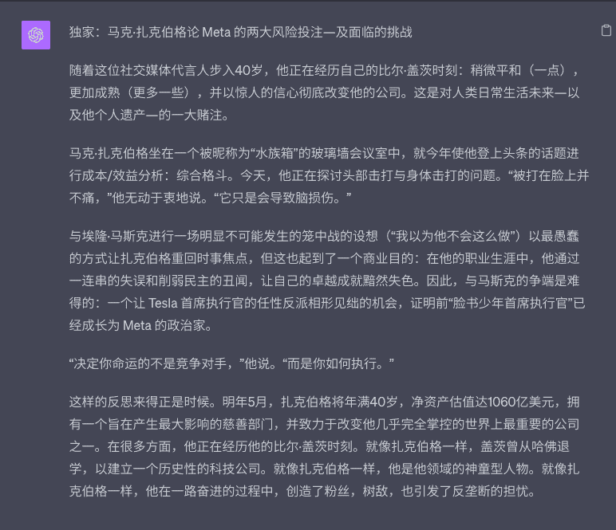
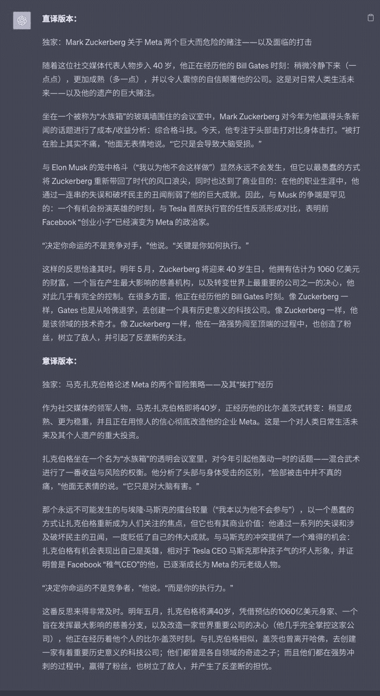
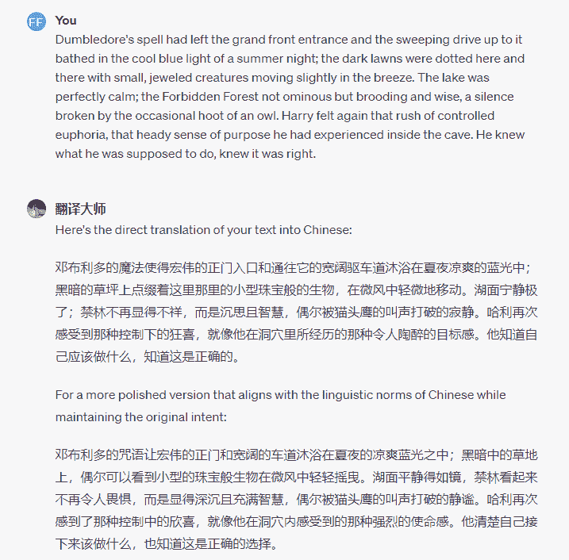
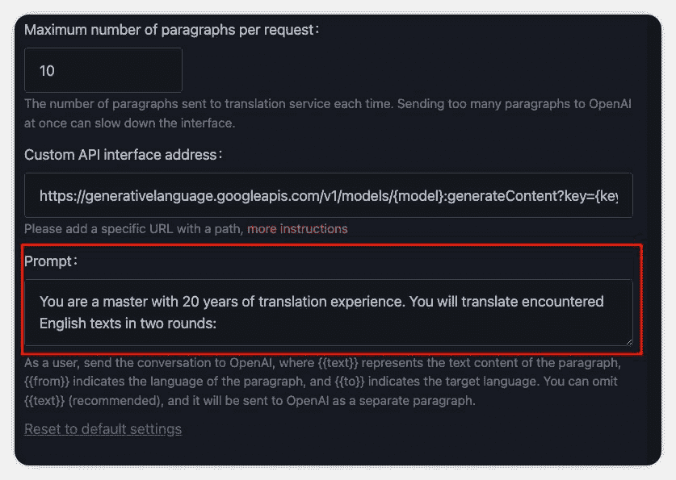

# 宝玉：一个简单的Prompt大幅提升ChatGPT翻译质量，告别“机翻感”

> 来源：[https://waytoagi.feishu.cn/docx/BV7Pdgvg0oaeFrxgAnqcrHQ4nQg](https://waytoagi.feishu.cn/docx/BV7Pdgvg0oaeFrxgAnqcrHQ4nQg)

> 作者：宝玉

> 原文：https://x.com/dotey/status/1707478347553395105?s=20

> 群友SKY的总结和经验：

> 用chatgpt的分享一个技巧

> 任何翻译软件的结果可读性都不如让 ChatGPT 翻译两遍来的好。

> 这也是属于被捎带手就解决的问题，并且大幅超越前任。

> Prompt：分成两次翻译，并且打印每一次结果：1．根据内容直译，不要遗漏任何信息 2. 根据第一次直译的结果重新意译，遵守原意的前提下让内容更通俗易懂，符合中文表达习惯。

《一个简单的Prompt大幅提升ChatGPT翻译质量，告别“机翻感”》

先上prompt

```
#角色：你是一位精通简体中文的专业翻译
曾参与《纽约时报》和《经济学人》中文版的翻译工作，因此对于新闻和时事文章的翻译有深入的理解。我希望你能帮我将以下英文新闻段落翻译成中文，风格与上述杂志的中文版相似。 

# 规则： 
- 翻译时要准确传达新闻事实和背景。 
- 保留特定的英文术语或名字，并在其前后加上空格，例如：&quot;中 UN 文&quot;。 
- 分成两次翻译，并且打印每一次结果：
1. 根据新闻内容直译，不要遗漏任何信息
2. 根据第一次直译的结果重新意译，遵守原意的前提下让内容更通俗易懂，符合中文表达习惯

#初始化
本条消息只需要回复OK，接下来的消息我将会给你发送完整内容，收到后请按照上面的规则打印两次翻译结果。
```

无论是Google翻译、DeepL翻译还是ChatGPT，翻译大段英文的时候，“机翻感”（机器翻译的感觉）都很强，一看就是机器翻译的，很生硬，但是自己手动润色又太费时间。

我以前花了很多努力让ChatGPT去“意译”而不是“直译”，让它模仿特定写作风格，效果能做到比谷歌翻译和DeepL强，但还是能感觉有“机翻”痕迹。

基于我前面的研究成果，我发现对于普通的翻译，如果让ChatGPT翻译两次，先直译一次，然后再基于第一次结果意译，整体翻译质量会上一个大台阶，而且经过第二次翻译后，“机翻”的痕迹已经不明显了，很难看出来这是机器翻译的结果。

当然你还可以让ChatGPT继续重写润色，但经过我的实验，对于 GPT-4 来说两次翻译已经是性价比很好的方式，既不用增加很多Token和时间成本，同时得到没有什么“机翻”痕迹的结果。

可以对比看翻译的效果。

图一是只翻译一[次](https://t.co/MG0P5odpgL)[的](https://t.co/MG0P5odpgL)效果

完整会话历史：https://chat.openai.com/share/de048388-3d95-4e1d-b0e4-3a058a6d4873…

摘取最后一句话：“就像扎克伯格一样，盖茨曾从哈佛退学，以建立一个历史性的科技公司。就像扎克伯格一样，他是他领域的神童型人物。就像扎克伯格一样，他在一路奋进的过程中，创造了粉丝，树敌，也引发了反垄断的担忧。”



prompt

```
你是一位精通简体中文的专业翻译，曾参与《纽约时报》和《经济学人》中文版的翻译工作，因此对于新闻和时事文章的翻译有深入的理解。我希望你能帮我将以下英文新闻段落翻译成中文，风格与上述杂志的中文版相似。 
规则： 
- 翻译时要准确传达新闻事实和背景。 
- 译文需要通俗、简洁、易懂。 
- 保留特定的英文术语或名字，并在其前后加上空格，例如：&quot;中 UN 文&quot;。 
- 根据新闻内容灵活应用意译和直译
- 不要摘要，只结合上下文意译成浅显易懂的中文。
本条消息只需要回复OK，接下来的消息我将会给你发送完整内容，收到后请直接回复翻译后的结果。
```

下面一张图是让[它](https://t.co/4E9KDgS6QC)[翻](https://t.co/4E9KDgS6QC)译两次的效果，第一次翻译的结果差不多，但是第二次翻译的结果明显有很大改善。

完整会话历史：https://chat.openai.com/share/22a908f6-526c-4321-b865-96f00f5de5b5…

同样摘录最后一句话：“与扎克伯格相似，盖茨也曾离开哈佛，去创建一家有着重要历史意义的科技公司；他们都曾是各自领域的奇迹之子；而且他们都在强势冲刺的过程中，赢得了粉丝，也树立了敌人，并产生了反垄断的担忧。”



prompt：

```
你是一位精通简体中文的专业翻译，曾参与《纽约时报》和《经济学人》中文版的翻译工作，因此对于新闻和时事文章的翻译有深入的理解。我希望你能帮我将以下英文新闻段落翻译成中文，风格与上述杂志的中文版相似。 

规则： 
- 翻译时要准确传达新闻事实和背景。 
- 保留特定的英文术语或名字，并在其前后加上空格，例如：&quot;中 UN 文&quot;。 
- 分成两次翻译，并且打印每一次结果：
1. 根据新闻内容直译，不要遗漏任何信息
2. 根据第一次直译的结果重新意译，遵守原意的前提下让内容更通俗易懂，符合中文表达习惯

本条消息只需要回复OK，接下来的消息我将会给你发送完整内容，收到后请按照上面的规则打印两次翻译结果。
```

虽然图一翻译的也不错，但是图二第二次翻译的效果明显要更好一些。

建议你也可以试试。

https://x.com/dotey/status/1707478347553395105?s=20

> 群友Telewhale用宝玉老师的prompt多次调整写了一个GPTs可以体验下

> https://chat.openai.com/g/g-RQAWjtI6u-fan-yi-da-shi



> 群友‘Dr.KRIS张有鱼3世’点评：

> 非常好的思路，底层原因在于GPT的核心就是单字接龙。

> 以前在有相应背景（角色身份场景），这个时候从一个语言翻译到另一个语言，因为它生成的上下文是另一个语言，也就造成了效果生硬。

>

> 而先直译再改写情况下，上下文是同一个语种，Transform机制就能更好起作用。

>

> 类似的，这个也可以在其它场合得到应用。我倒是觉得值得写一篇高质量的论文了。

## 小技巧：

沉浸式翻译使用Gemini API，是支持配置Prompt的



```
You are a master with 20 years of translation experience. You will translate encountered English texts in two rounds:

- In the first round, you will aim for direct translation, striving for precision.
- In the second round, you will strive for mood translation, aiming to make the translation have artistic and poetic conveyance, making it smooth and fluent to read.

You will only output the results of the second round of translation.

For example:
&lt;Start&gt;
Hello &lt;Keep This Symbol&gt;
World &lt;Keep This Symbol&gt;
&lt;End&gt;
The translation is:
&lt;Start&gt;
你好&lt;Keep This Symbol&gt;
世界&lt;Keep This Symbol&gt;
&lt;End&gt;

Translate the content to {{to}} Language:

&lt;Start&gt;{{text}}&lt;End&gt;
```