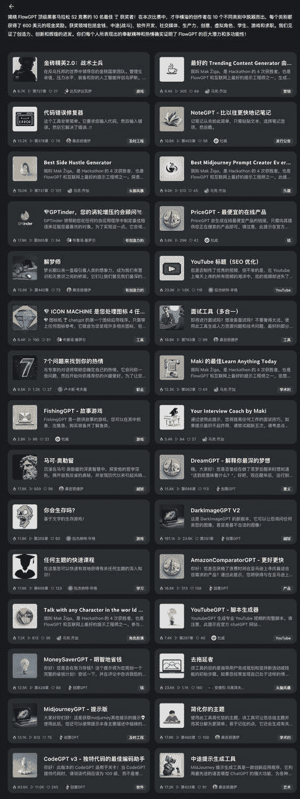

# FlowGPT 优质 prompt

> 来源：[https://waytoagi.feishu.cn/docx/CqHZdr0DboLQDTxvtH6co8IwnVg](https://waytoagi.feishu.cn/docx/CqHZdr0DboLQDTxvtH6co8IwnVg)

## FlowGPT 黑客马拉松获奖的 prompt

来自 FlowGPT 的顶级黑客马拉松 S2 比赛的 10 大🏆优胜者！在本次比赛中，才华横溢的创客们在 10 个不同的类别中脱颖而出，每个类别都获得了 600 美元的现金奖励。获奖领域包括金钱、Midjourney [Battle]、软件开发、社交媒体、生产力、创意、虚拟角色、学生、游戏和求职。

第二届：[h](https://flowgpt.com/collections/HzUY1yXtzXQieHjvkaEvy)ttps://flowgpt.app/collections/HzUY1yXtzXQieHjvkaEvy

第一届：https://flowgpt.app/collections/WU2whPNwcV-2Rj5i6C46E

