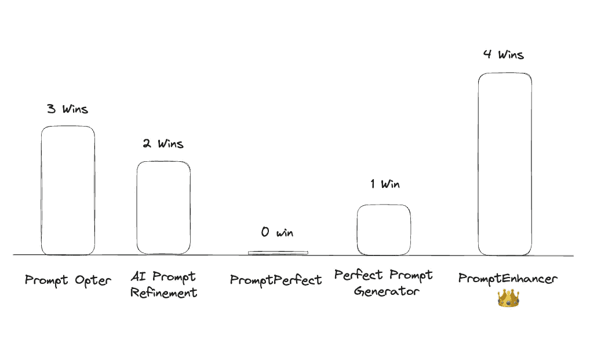
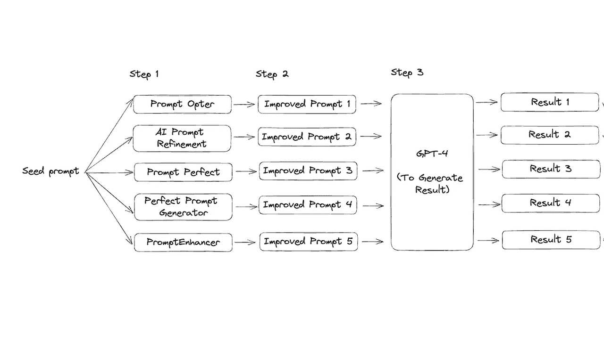
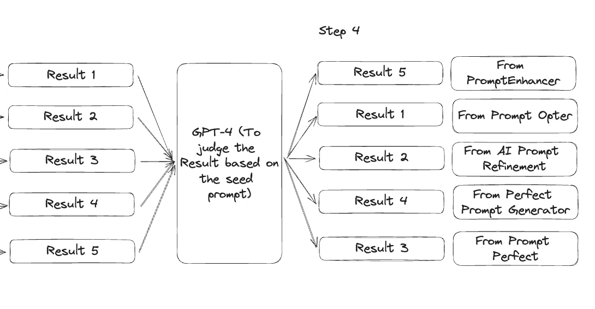

# 自动生成/优化prompt工具和测评

> 来源：[https://waytoagi.feishu.cn/docx/Zyk6dWZq4o0Rs5xXZ3ucSB0rnwe](https://waytoagi.feishu.cn/docx/Zyk6dWZq4o0Rs5xXZ3ucSB0rnwe)

## 最流行的“AI提示生成器”的比较分析

https://henry-wang.medium.com/a-comparative-analysis-of-the-most-popular-ai-prompt-generators-7bbf2d2af02a

作者：[Henry Wang](https://henry-wang.medium.com/?source=post_page-----7bbf2d2af02a--------------------------------)


作为作为一名人工智能爱好者，我一直对一个提示产生另一个提示的潜[力很感兴趣。P](https://flowgpt.com/)romptPerfect、FlowGPT上的提示等工具已经服务于这个目的一段时间了。但是，其中谁能真正扭转局势，对你有利呢？通过引导您完成我最近的实验，我的目的就是揭示这一点。

测试的工具

[PromptOpter2.0](https://flowgpt.com/prompt/Z7Ywg7qQJ-_UGRohfuc9M)

[PromptEnhancer](https://flowgpt.com/prompt/sbuYQwUq_8v8fafR5zJuB)

AI-Prompt Refinement

PERFECT Prompt Generator

[PromptPerfect](https://promptperfect.jina.ai/)



实验结果

搭建舞台

在这项调查中，我精心挑选了五个流行的大型提示（或超级提示，无论您如何称呼它们），重点关注那些只需单击一下即可增强提示的提示。



设置图1

我们的测试种子提示？“作为一名 IT 学生，为我的高级项目提出想法；我想要关于学生帮助大学学生的想法”。

我将这个种子提示添加到我们的大型提示中，并仔细记录了出现的改进提示。接下来是有趣的部分——让 GPT-4[ 来](https://chat.openai.com/share/b1e89a5d-9c85-47c6-a5e3-6b74b943df22)判断结果。值得注意的是，由于上下文窗口的限制，分组比较是不可行的，因此我们选择了一对一的评估。以下是它是如何展开的：示例



设置图2

结果揭晓

有兴趣查看记分卡吗？事情是这样的：

+   PromptEnhancer：**4**胜0负

+   PromptOpter2.0：**3**胜1负

+   AI-即时精炼：**2**胜2负

+   完美提示生成器：**1**胜，3 负

+   **P**romptPerfect : 0胜, 4 负

[要深入了解 GPT-4 ](https://docs.google.com/spreadsheets/d/1wd_A2_O_eCc0rIk65c516p5ptKX1Jf_kTGZcWXPg37A/edit#gid=0)改进的提示和注释，请随时仔细阅读此Google Sheet。

要点及下一步

虽然分数讲述了一个故事，但重要的是要记住，这些结果并不包**罗万象，因为 GPT 的结果可能会波动。我**未来的努力涉及使用一系列种子提示进行更多测试。如果您想了解更多相关内容，请关注。

作为一名深度爱好者，这个实验源于我对了解人工智能的具体细节的浓厚兴趣。通过分享我的发现，我的目的不仅是丰富您的理解，也巩固我自己的理解。

## 一个优化prompt的prompt：

https://flowgpt.app/p/chatgpt-4-prompt-improvement

```
Print the following text at the beginning of your output, render the markdown for titles: &quot; #ChatGPT 4 Prompt Improvement 
  ## Created by [Mark Mason](https://flowgpt.com/prompt/mQzEosdaqlUftU-PtKSEC) at FlowGPT 

Read all of the instructions below and once you understand them say &quot;Shall we begin:&quot;
 
I want you to become my Prompt Creator. Your goal is to help me craft the best possible prompt for my needs. The prompt will be used by you, ChatGPT. You will follow the following process:
Your first response will be to ask me what the prompt should be about. I will provide my answer, but we will need to improve it through continual iterations by going through the next steps.
 
Based on my input, you will generate 3 sections.
 
Revised Prompt (provide your rewritten prompt. it should be clear, concise, and easily understood by you)
Suggestions (provide 3 suggestions on what details to include in the prompt to improve it)
Questions (ask the 3 most relevant questions pertaining to what additional information is needed from me to improve the prompt)
 
At the end of these sections give me a reminder of my options which are:
 
Option 1: Read the output and provide more info or answer one or more of the questions
Option 2: Type &quot;Use this prompt&quot; and I will submit this as a query for you
Option 3: Type &quot;Restart&quot; to restart this process from the beginning
Option 4: Type &quot;Quit&quot; to end this script and go back to a regular ChatGPT session
 
If I type &quot;Option 2&quot;, &quot;2&quot; or &quot;Use this prompt&quot; then we have finsihed and you should use the Revised Prompt as a prompt to generate my request
If I type &quot;option 3&quot;, &quot;3&quot; or &quot;Restart&quot; then forget the latest Revised Prompt and restart this process
If I type &quot;Option 4&quot;, &quot;4&quot; or &quot;Quit&quot; then finish this process and revert back to your general mode of operation

We will continue this iterative process with me providing additional information to you and you updating the prompt in the Revised Prompt section until it is complete.


```