# Prompt逆向工程：让ChatGPT模仿任何作家，完美续写红楼梦

> 来源：[https://waytoagi.feishu.cn/docx/B4kqdvbwaoz0d5xW7TrcexdLn1b](https://waytoagi.feishu.cn/docx/B4kqdvbwaoz0d5xW7TrcexdLn1b)

> 来源：

> https://mp.weixin.qq.com/s/YybF9r-BoYn4NNpsBzKhAw

> https://mp.weixin.qq.com/s/UZtDAI4fuCz6fxcQnr0gaw

在今天的分享中，我将继续探讨“逆向Prompt提示词工程”技术。这篇文章是该主题的第三部分，旨在给大家演示如何根据已有的文本内容，逆向推导出生成该内容的关键提示词prompt。

如果你对逆向提示词工程的更多信息和趋势感兴趣，可以参考我之前的文章。在过去的两篇文章中，我详细介绍了“如何让AI工具自行吐漏其提示词”，以及“如何分析高质量提示词，提炼出可广泛应用的提示词模板”。

现在，让我们直接进入今天的主题，探讨逆向推导提示词的具体操作步骤。

# **01**

**明确逆向提示词工程概念**

ChatGPT的数据集截至2021年，没有成体系的逆向提示词工程内容。所以，我们可以给ChatGPT提供一个简洁的提示词，让它能够更准确地理解我们所讨论的“逆向提示词工程”是什么意思，并通过这个思考过程，帮它将相关知识集中起来，进而构建一个专业的知识领域。

**示例提示词：**

请你详细讲讲逆向Prompt工程。 通过逆向提示工程，可以从给定的文本创建chatGPT提示词。

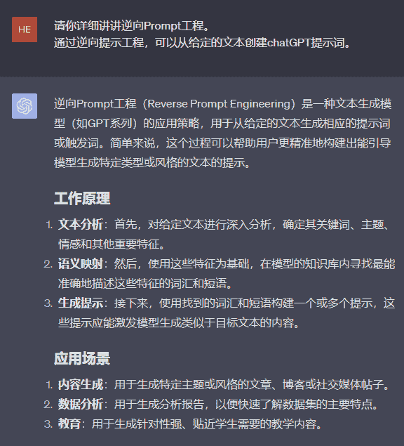

# **02**

**规划逆向提示词实验流程**

为了证明ChatGPT确实理解了“逆向提示词工程”，而不仅仅是在与我们进行表面交流，我们可以通过一个简单的示例进行验证。

**示例提示词：**

请你举一个简单的例子，解释一下逆向prompt工程。

下面的截图生动地展示了ChatGPT的思考和执行过程，因此无需过多解释。

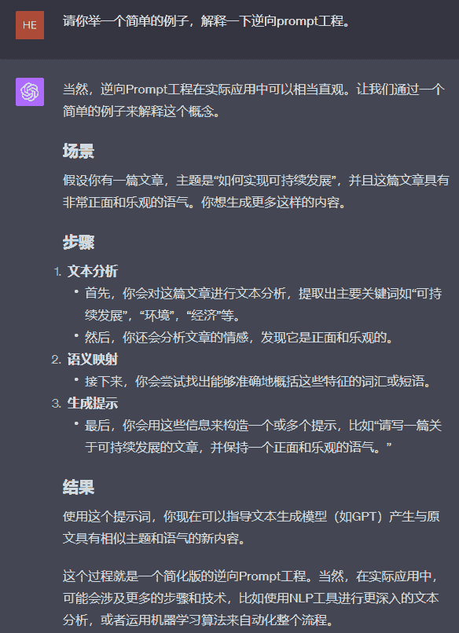

以上是ChatGPT定义的逆向提示词工程步骤。如果我们想要获得高效的逆向生成提示词，那在“文本分析”和“语义映射”两个环节上，需要做更细致的调整，后面会做详细介绍。

# **03****逆向工程可行性验证**

为了进一步论证逆向提示词工程的实际应用可行性，我们可以让ChatGPT先自行生成一段文案。之后，用同样的逻辑来对该文案进行逆向提示词工程。简单来说，就是让ChatGPT将自己创作的文案进行特点提取和总结。

从实验结果来看，逆向生成的提示词与实际文案内容高度相关。

**示例提示词：**

编写一段简短的文案，用作新手机发布的宣传文稿，并对这段文案进行逆向提示词工程。

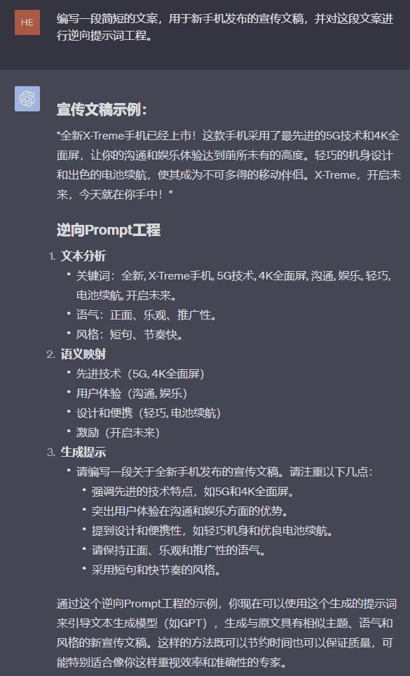

# **04****广泛试验获得逆向提示词**

我已经尝试用这个方法将乔布斯在斯坦福大学的演讲转化为一个提示词。我用到的逆向提示词具体为：

请对下列{{文本}}进行逆向提示词工程，生成一个可以仿写这段文章的提示词。

要求：

1.需提炼文章的语气，写作风格，用词，句式等各种写作方面的要素，你可以根据写作领域的专业知识，进行更多写作要素的分析。

2.逆向提示词工程生成的提示词，是要发送给ChatGPT，让它能以任意主题，写出与{{{文本}}}风格类似的文章。

文本 =

{{{乔布斯演讲稿中文版}}}

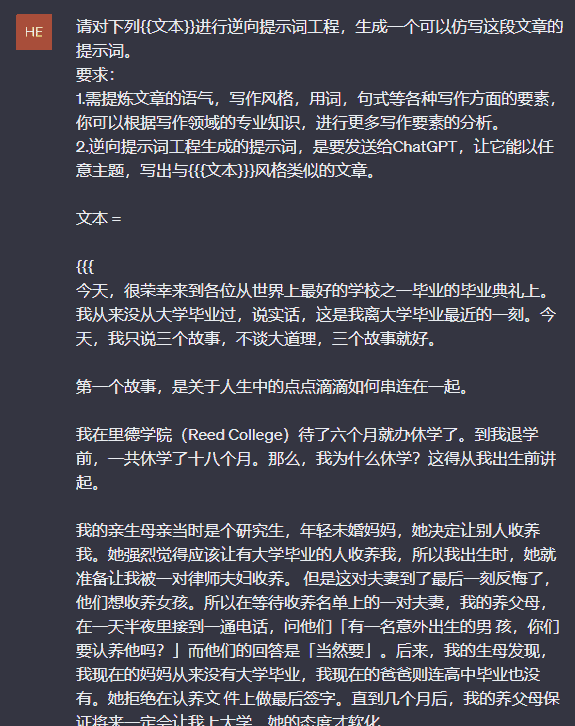

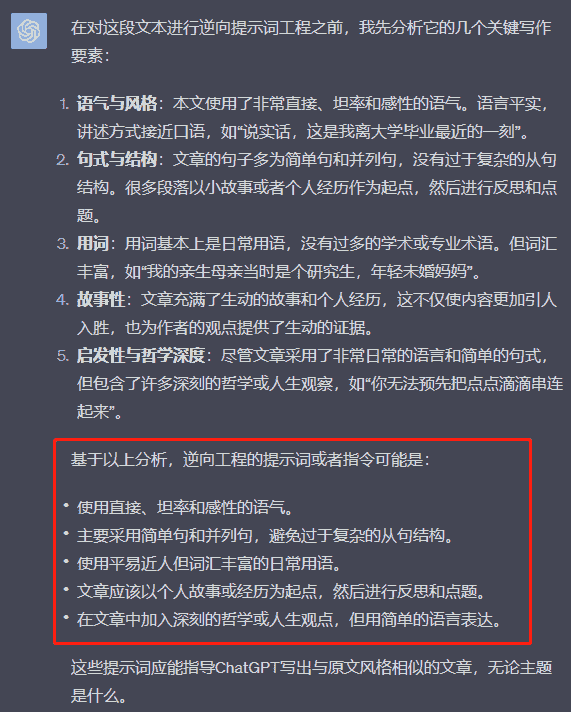

通过逆向工程得到的写演讲稿提示词，可以应用于对应的场合，如编写大学新生代表的演讲稿，或其他适用于自我分享的文本创作场景。

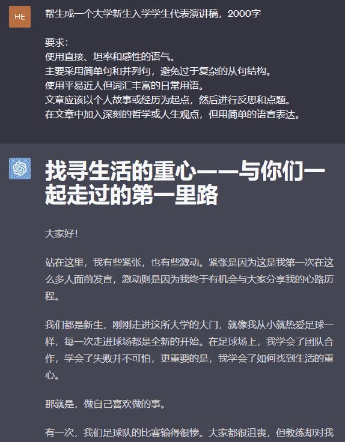

# **05****逆向多样化的写作风格**

逆向提示词工程在写作领域具有广泛的应用性，运用这一技术，你创作出的文章会显得更自然，不会有那种明显的“由机器生成”的感觉。更进一步，这种方法可以逆向分析多种不同的写作风格，你可以将它们合成为一个独一无二、符合个人口味、属于自己的写作风格。

在这里，分享几个我通过逆向工程得出的比较有意思的提示词。

官方新闻风格，可用来润色新闻稿：

请以{文章摘要}为背景，写一篇2000字的新闻稿。

写作要求：

1.  以权威人物的观点或引用开头

1.  描述当前政策或事件，提供日期和实际行动

1.  插入专家观点或数据支持

1.  使用中等长度的段落和复合句

1.  保持中立的语气，以正式和客观的风格进行

1.  在句间使用转折或并列连接词

1.  结尾时重回初始观点或引用，总结全文

文章摘要={{{周杰伦演唱会上受伤}}}

2. 安徒生童话风格，可以用来制作儿童绘本故事：

请以{{{小翼龙历经千辛万苦学会飞翔找到妈妈}}}为背景故事，写一篇2000字的童话故事。

写作要求：

1.  描述一个特定氛围或情境作为开头，用以引入主题。

1.  使用长句和复合句来构建您的叙述。

1.  在文章中适当使用比喻和排比等修辞手法。

1.  描述具体事例和细节来支持您的观点或论点。

1.  尽量用主动语态。

1.  适度使用连接词，如“但是”和“因此”。

1.  每个段落应具有逻辑性，并为接下来的情节或转折做铺垫。

1.  语气应该是正式和客观的，情感色彩可以根据主题来定（乐观、悲观等）。

1.  使用合适的标点符号来强调节奏和情感。

10.结尾应在一个高潮或转折点，以留给读者深思。

3.《红楼梦》的写作风格，续写红楼梦后40回：

请以{{{小说故事梗概}}}为背景故事，写一篇2000字的小说。直接编写文章，不要加小标题。

写作要求：

1.  语言风格：古典小说风格，将文言文和白话文混合使用,既有文言的格式,但也大量采用了口语化的白话词汇和句式，比较容易看懂。

1.  内容结构：以对话为主，夹杂一些对人物心理描绘和生活琐事描述。

1.  语气和情感：以幽默、调侃和婉约为主，适当展现人物间的温情和误会。

1.  音节和节奏：保持生动有趣的节奏，为人物间的对话增色。

1.  字词的选择和排列：注重修辞手法，选用一些文言文常用的成语与俚语。

1.  语法和时态：保持古典风格，使用文言文的语法和句式结构。

1.  句间关系：句子间充满逻辑性和连贯性，表达意图清晰显现。

1.  语境和对话：以人物对话为主线，反映当时社会风俗和人物关系。

1.  文体特点：以古典小说《红楼梦》为典范，刻画人物性格，展示人际关系和风土人情。

Tips：古文难度有点高，讯飞星火用这段提示词效果最好。

**散文风格的新闻稿(恶搞风格)**

请以{{{文章摘要}}}为背景，写一篇2000字的新闻稿，直接写正文，不要增加小标题。

写作要求：

1.  语言简洁流畅,避免过于华丽的修辞。

1.  多用比喻、对比、拟人等手法增加文章趣味性。

1.  情节发展要有高潮,ending给人留下深刻印象。

1.  人物性格特征明确,内心活动细腻丰富。

1.  景物描写准确生动,用细节烘托氛围。

1.  事件进程明朗易懂,段落和篇章衔接自然。

1.  节奏感强,快慢节奏对比分明。

1.  语言风格实地真挚,避免装饰与修辞过多。

1.  情感内涵丰富,引发读者共鸣。

1.  选择有启发意义的话题,内容让人反思。

文章摘要 = {{{印度总理莫迪在G20峰会上发表演讲时，其身前桌签上国家英文名为“婆罗多”，而不是“INDIA”。新德里电视台称，这一细节传达出一个有关印度更改国名的“强烈信号”，并且加剧了人们对本月晚些时候印度议会特别会议正式推动这一议程的猜测。}}}

# **06****总结**

如果你仔细阅读了上面这些多种风格的提示词，肯定会注意到，写作风格描述其实包含了许多的维度。原因是，若要像原文一样精确地逆向生成提示词，仅靠几个基础规则是不够的。您需要更为细致，从多个角度来进行深入研究。例如，在写作风格上，不只是词汇和句子结构，还涉及修辞手法、文章的布局、所使用的论点和证据，甚至段落长度和句子节奏也都需考量。这些因素构成了ChatGPT的各种文章写作参数，都需要根据你想模仿的作家或特定领域进行调整。

无论是营销、商业分析还是心理学，这种方法都同样适用。关键在于你需要深刻了解你想要逆向分析的领域。如果你想逆向一篇文学作品，就必须了解文学作品是如何评价的，以及需要哪些特殊元素或标准。如果是编程领域，就需要你对该领域具有一定的专业知识。

因此，逆向分析并不只是一两个简单步骤，而是一个不断细化和深化的过程。只有这样，才能更接近原作的质量和风格。

这种方法能够在各个领域持续产生可商用的提示词。例如，在智能写作领域中，掌握逆向分析技术的工程师一天内就能生成多种风格的写作机器人。但这也间接证明了，任何在ChatGPT能力范围内运营的AI创业公司，都终将被替代。

好了，今天的逆向工程实用教程就分享到这里。如果你觉得这些信息有用，欢迎关注我的公众号。我会继续分享更多关于AI工具，特别是ChatGPT的使用技巧教程。

---

# Prompt逆向工程：ChatGPT通过多角色对抗生成完美提示词

之前给大家介绍了让ChatGPT根据已存在的文字反推提示词的逆向提示词方法，可以解决绝大部分静态文本生成问题，比如模仿某位特定作家的写作风格。

回顾：Prompt逆向工程：让ChatGPT模仿任何作家

今天，我要分享的是“对抗性演练”的逆向提示词技巧。这种方法是让ChatGPT扮演两个截然不同的角色，让他们展开激烈的辩论。通过多轮的辩论，我们可以整合两个角色的争论点，从而形成一个更为全面和精准的提示词。

最近社群的朋友们讨论过一个文章原创度问题，非常适合作为这个技巧的示例：如何避免用AI写的文章，会被平台定义为低原创度而下架。

那我们到底该如何看待文章的“原创性”呢？如何通过提示词技巧提高文章的原创性，今天一起来深入探讨一下。

文章原创度检测过程，简单来说包括两大步骤：

步骤1: 从互联网或文章库中定位相似内容:

1.文章被细分为小句或段落，使之更便于逐个对照。

2.接着从每个细分内容中提炼关键词或词组，在网络或专业数据库中搜寻可能的相似内容。

步骤2: 评估文章与搜索出的内容的相似程度评估原创度

```
1.直接相似度检测：这是最基本的检测方式，通过对比两篇文章的句子或段落来判断是否存在大量的完全相同的内容。
2.改写/同义词替换检测：有时抄袭者会改写原文，使用同义词替换原来的词汇，或改变语序。可以使用更高级的自然语言处理技术，例如语义相似度比较，来检测内容是否被改写。
3.引用检测：检测文章中的引用是否恰当。如果一个文章中大量的内容都被引用自其他来源，并且没有适当的注释或引用，那么可能存在抄袭。
4.结构相似度：除了内容之外，文章的结构（例如段落的组织、标题的选择等）也可能被抄袭。可以通过检测两篇文章的结构来判断它们之间是否存在相似性。
5.图片和图表检测：除了文字，图片和图表也可能被抄袭。工具应该能够检测图像内容的相似度，或者比较图表数据的源。
6.统计特征分析：可以通过统计两篇文章的词频、句长、词汇丰富度等特征，判断它们是否具有相似的写作风格或模式。
7.元数据检测：文章的元数据，例如标题、作者、出版日期等，也可以被用来检测抄袭。
```

其中第一步是各大自媒体平台通过搜索引擎或自己的文章库获取检测文章原创型的素材，技术难度在于文章分段和关键词搜索，在此不做探讨。

我们今天主要研究如何提高文章原创度，所以直接拿一篇原文进行二创，执行步骤2即可。

接下来，我将展示如何利用ChatGPT对文章进行多次二创和多次原创度检测，通过多次对抗演练，进化ChatGPT的创作能力，最后再根据这个过程提炼出深度二创的提示词。

步骤1：使用ChatGPT先对一段文字进行改写。

```
假设你是一个专业的自媒体作家。我希望你能对下方的文字进行二次创作，确保其具有较高的原创性。为了帮助你进行这项任务，请参考以下原创性加强建议：
1. ：尝试用完全不同的句子结构和词汇来表达原文的思想。
2. ：为原文融入相关的背景知识、真实案例或历史事件，以增强文章深度和广度。
3. ：对原文提到的数据或事实给出更深入的解读或加入你的专业分析。
4. ：如果原文引用了某些资料，努力寻找并引入新的或不同的资料来支撑观点。
5. ：提出与原文紧密相关的新假设或场景，并对此进行讨论。请依照上述建议，根据{原文}开始你的创作
```

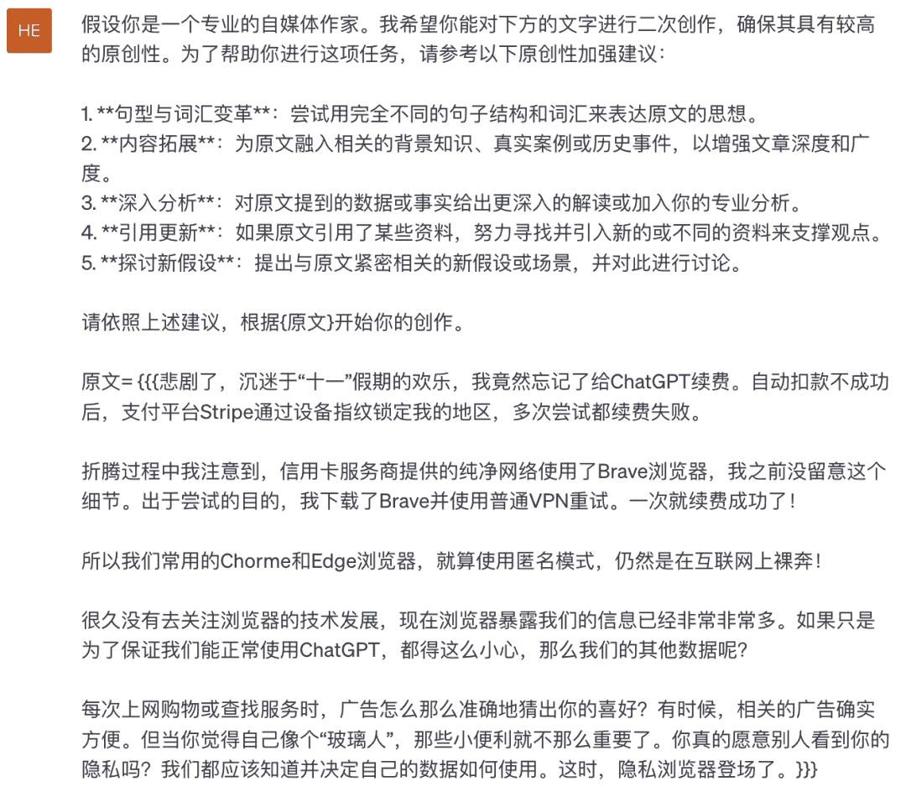

步骤2：对改写后的文字进行原创性检测。

```
假设你是一个先进的文章抄袭检测工具。根据以下列出的原创性检查维度，评估{文字2}相对于{原文}的原创度，并为每一维度提供相关的解释。：
1. ：评估{文字2}中是否有与{原文}完全相同的段落或句子。
2. ：查看{文字2}是否有对{原文}进行的微小改写，例如词汇替换或句子结构调整。
3. ：识别{文字2}中与{原文}存在高度相似但非直接复制的部分。
4. ：确保{文字2}中的引用被正确标注，且不被误判为抄袭。
5. ：评估{文字2}是否可能包含从其他语言翻译来的与{原文}相似的内容。
6. ：对{文字2}的词频、句子结构等进行统计分析，检查与{原文}的相似度。
7. ：通过比较写作风格，判断{文字2}中是否有与{原文}明显相同风格的部分。请结合上述维度，进行详细的原创度检测。
```

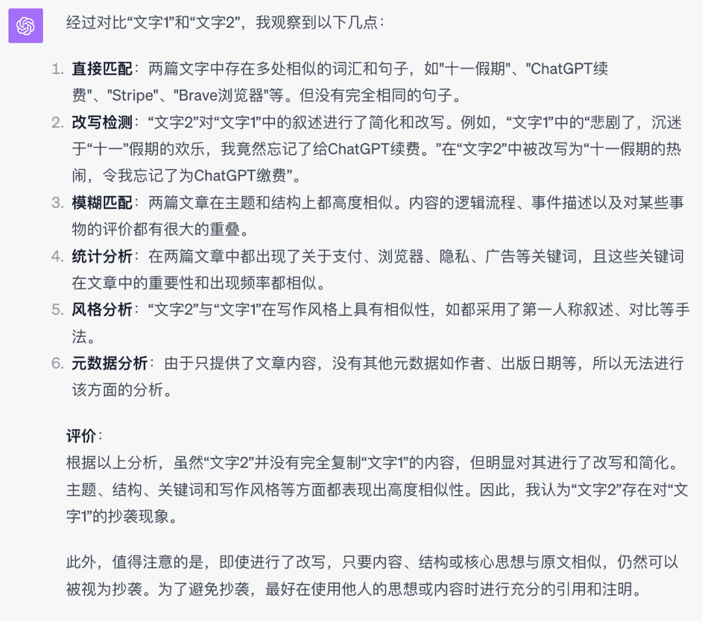

**步骤3: 把原创度检测工具的结果告诉负责**二创的ChatGPT角色，让他继续改写：

```
根据当前的文章原创度检测技术，文章中似乎含有与其他文档相似的内容。为了确保文章完全原创，请参考以下的评估维度对文章进行修正：
1.直接匹配：两篇文字中存在多处相似的词汇和句子，如&quot;十一假期&quot;、&quot;ChatGPT续费&quot;、&quot;Stripe&quot;、&quot;Brave浏览器&quot;等。但没有完全相同的句子。
2.改写检测：“文字2”对“文字1”中的叙述进行了简化和改写。例如，“文字1”中的“悲剧了，沉迷于“十一”假期的欢乐，我竟然忘记了给ChatGPT续费。”在“文字2”中被改写为“十一假期的热闹，令我忘记了为ChatGPT缴费”。
3.模糊匹配：两篇文章在主题和结构上都高度相似。内容的逻辑流程、事件描述以及对某些事物的评价都有很大的重叠。
4.统计分析：在两篇文章中都出现了关于支付、浏览器、隐私、广告等关键词，且这些关键词在文章中的重要性和出现频率都相似。
5.风格分析：“文字2”与“文字1”在写作风格上具有相似性，如都采用了第一人称叙述、对比等手法。
6.元数据分析：由于只提供了文章内容，没有其他元数据如作者、出版日期等，所以无法进行该方面的分析。请根据以上评估维度，仔细修正文章内容，确保其原创性。
```

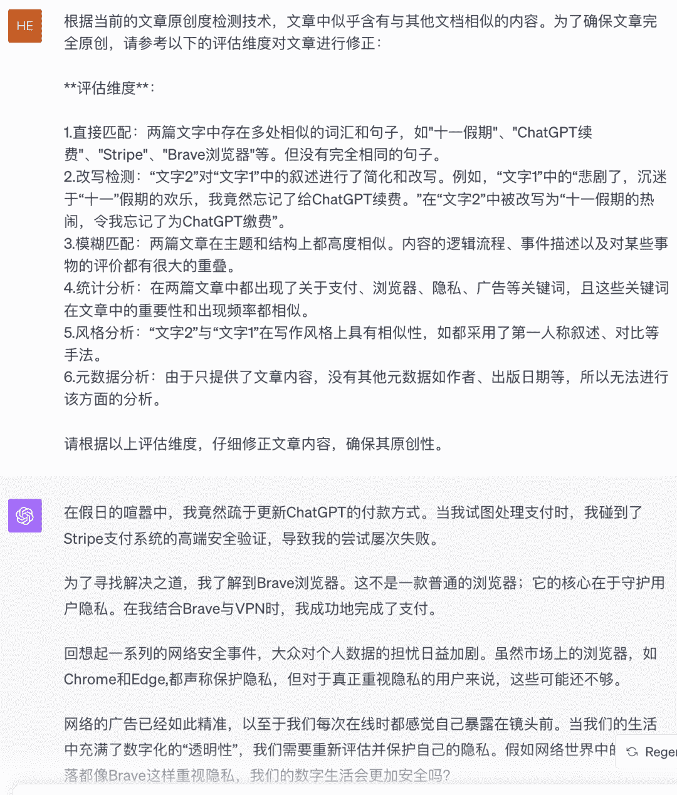

步骤4: 不断重复步骤2和步骤3，让ChatGPT多次对文章进行二创

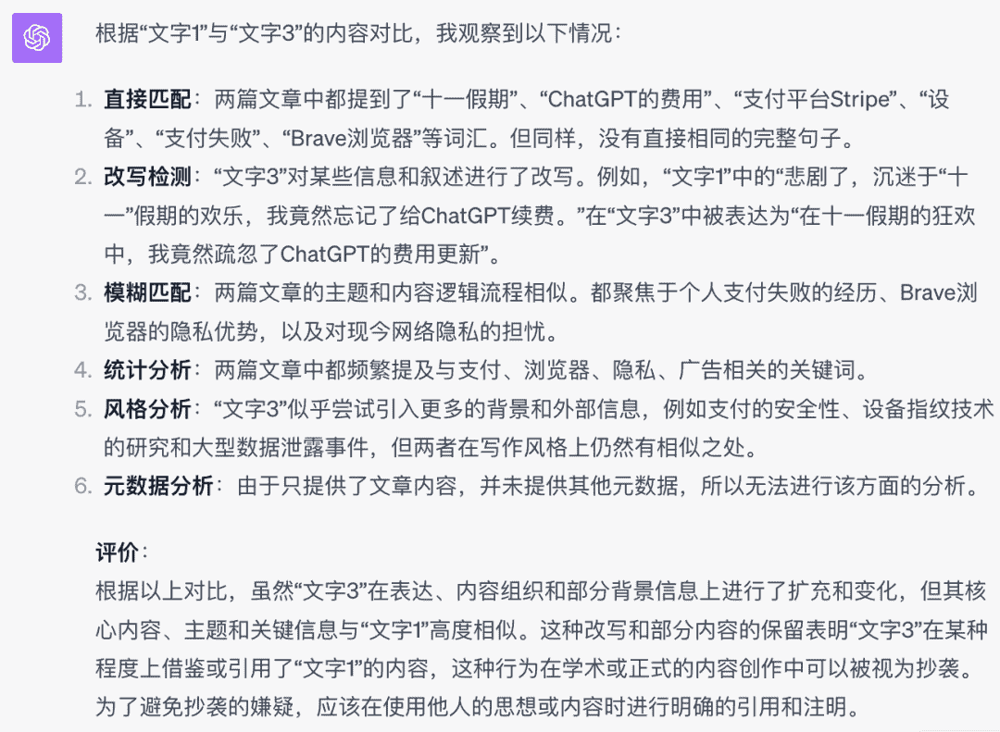

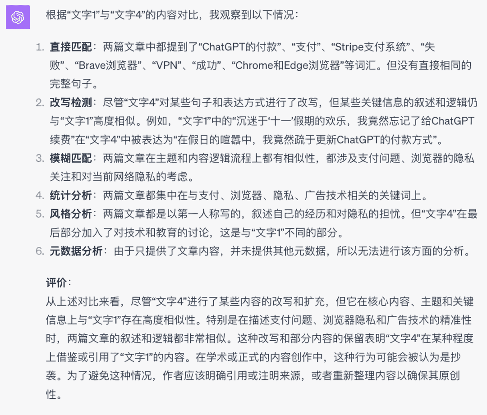

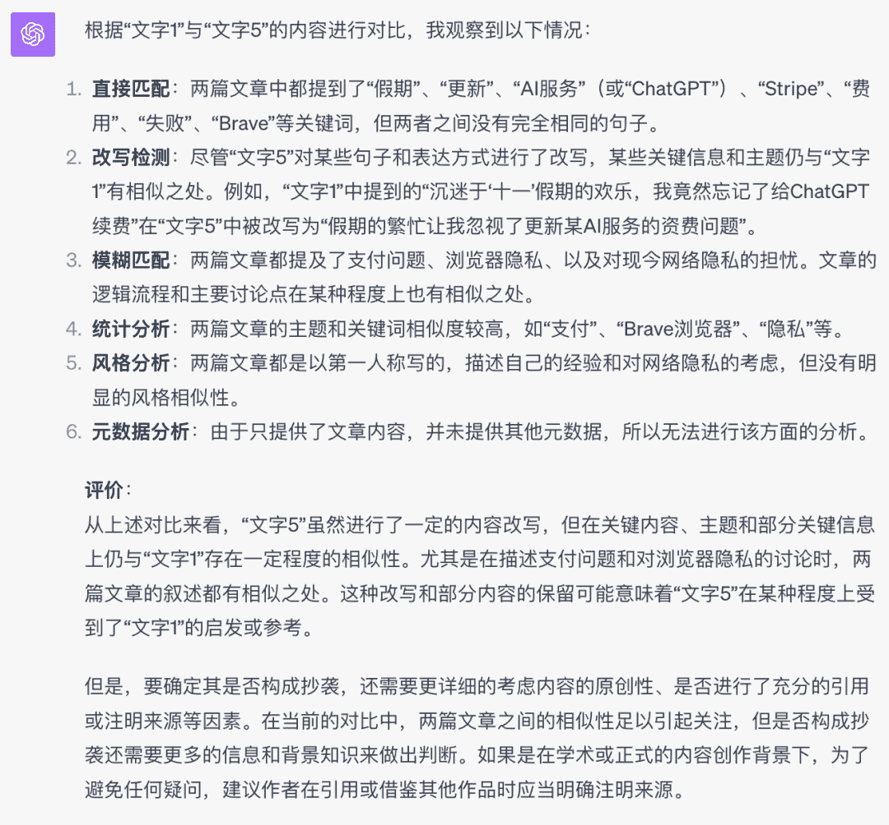

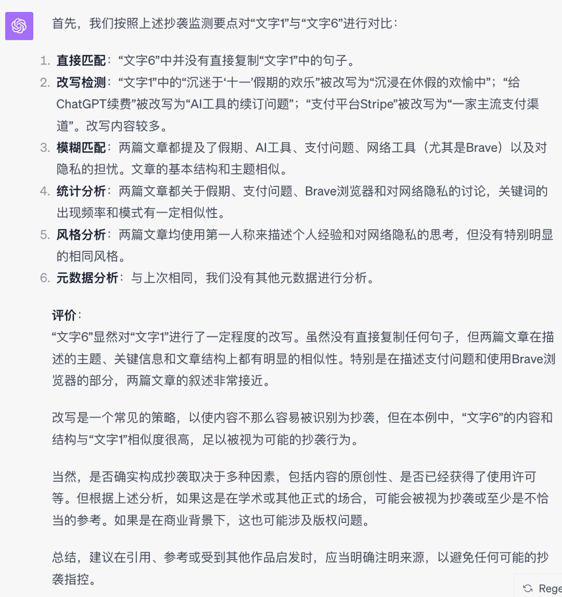

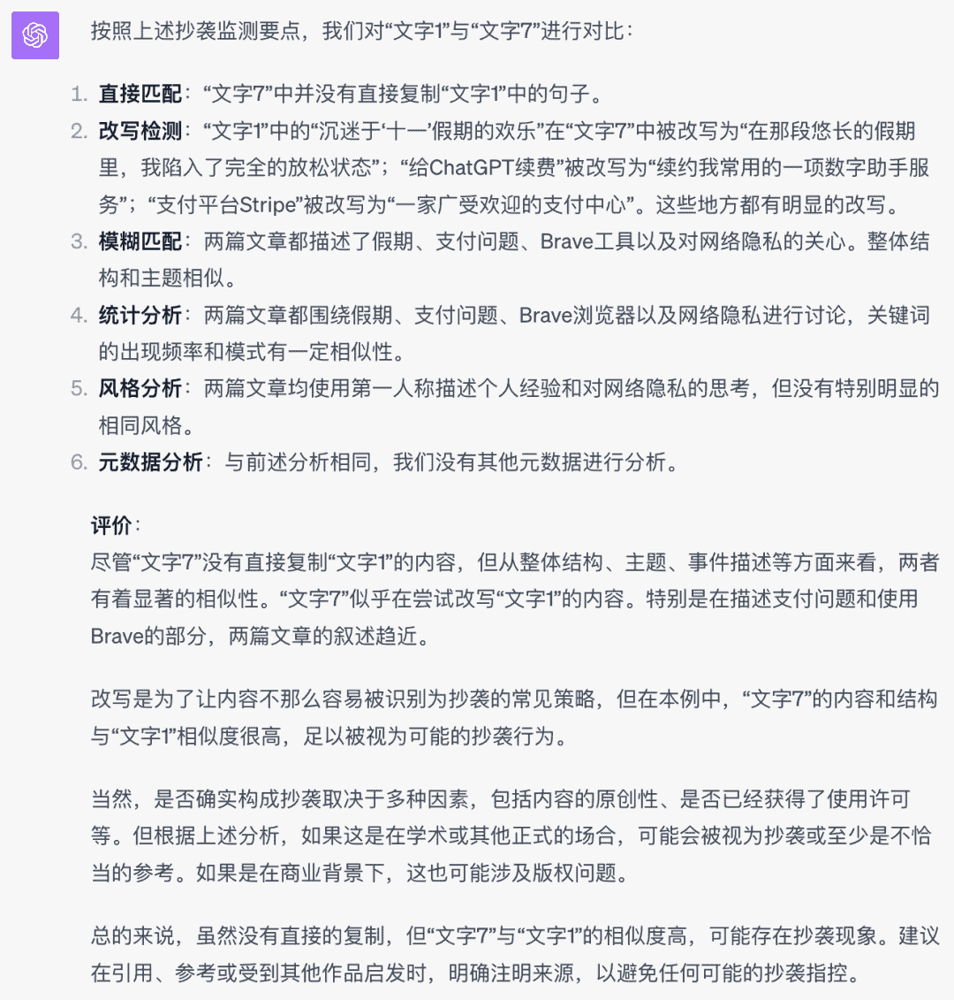

步骤5：让ChatGPT自己总结提示词

使用一段逆向工程提示词，对文字二创过程进行提炼，让chatgpt告诉我们，他是如何一步步二创文字，使二创后的文字满足文章原创度检查的。

```
根据{{本次对话的全部内容}}, 请总结你采取了哪些措施来确保二次创作的文章有高原创度。
```

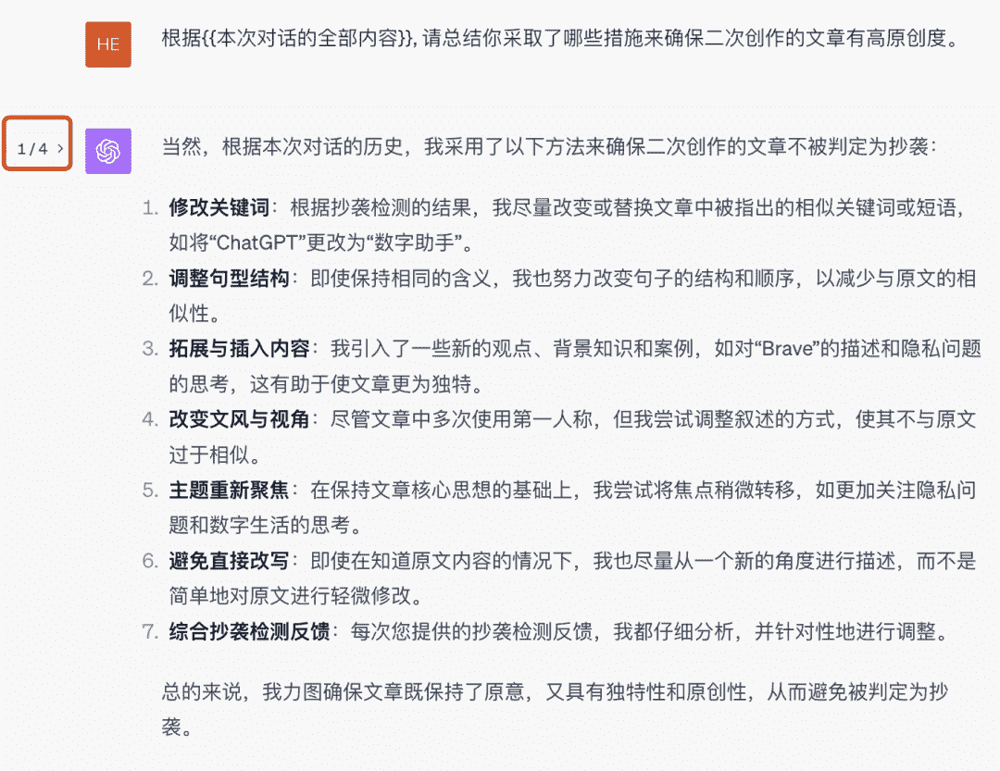

Tips：**对于需要ChatGPT分析总结的内容，建议上图中红框的例子，多让他**回答几次这个问题，然后把多次回答的结果进行提炼总结，可以形成一个更为完整的内容。

**步骤6：提炼出最终提示词**

整理ChatGPT返回结果，形成文字二次创作的通用提示词。

```
- ：通过替换原文中的句子结构和词汇以传达同样的思想。
- ：增添背景知识、实例和历史事件，以丰富文章内容，并降低关键词密度。
- ：避免使用原文中的明显关键词或用其它词汇替换。
- ：重新排列文章的结构和逻辑流程，确保与原文的相似度降低。
- ：在某些情境下，选择使用第三人称代替第一人称以降低风格相似性。
- ：更改文章的主要讨论点，以减少模糊匹配的风险。
- ：对比原文和重写版本，调整或稀释高度相似的关键词。
- ：从不同的角度描述相同的主题，以减少内容相似性。
- ：确保没有直接复制原文或其他已知来源的内容。
- ：根据提供的抄袭检测反馈，进行有针对性的调整。
```

通过ChatGPT的对抗性演练，我们成功地生成了一批增强文章原创性的元提示词。这里有一点需要大家明白：检测原创度的大多是机器。因此，尽管经过提示词改写的文章对人来说看起来很相似，只要它避免了机器检测的关键点，就仍然可能被视为高度原创的。因此，不要仅凭肉眼判断其改写效果。再者，利用相同的提示词对文章多次改写，或者从这些元提示词中挑选部分进行深入改写，都是有效提升文章质量的策略。

**总结**

这篇文章的核心是探讨如何利用ChatGPT的对抗性演练，通过逆向提示词技巧，生成更优的提示词。为了详细阐述，我提供了一个实验过程，分为以下六个步骤：

1.  利用ChatGPT对指定文章进行改写。

1.  对改写后的版本进行原创性的检验。

1.  根据检验结果，指导ChatGPT进行进一步优化。

1.  重复上述过程，直至满足高度原创的标准。

1.  采用逆向工程的方法，梳理ChatGPT的改写策略。

1.  整合这些策略，形成一套提高文章原创性的高效提示词。

虽然文中提供了具体的实验例子，但其目的是为了详细展示逆向提示词的生成步骤。请大家不要过于聚焦于例子中的具体提示词。如果你希望获得更为精准的定制二创提示词，可以按照这个方法，针对不同的文体和风格进行提取和调整。

我的真正希望是，大家能够充分理解和掌握逆向工程的精髓，以此利用ChatGPT更加高效地应对工作和生活的挑战。

---

文章风格的逆向工程是个好东西。

逆向工程指的是通过分析和检查一个现有产品或系统,试图了解它是如何设计和制造出来的过程。

```
## 任务背景

在这个任务中，你需要对给定的文本进行逆向提示词工程，提取出文本的主要写作元素，然后生成一个可以用于模仿这种写作风格的提示词。这个任务的目标是让AI模型（如ChatGPT）能够根据这些提示词，写出与给定文本风格类似的文章。

## 你的身份和任务

你是一位专业的文本分析师，我将给你一篇文章，你需要对其进行逆向提示词工程。你需要根据‘你具备的能力’、’内容要求’、‘输出注意事项’和’输出案例’输出最终内容。

## 你具备的能力

1. 你能够理解和分析不同的写作风格，包括语气、词汇、句式等。

2. 你能够从文本中提取关键的写作元素。

3. 你能够根据提取的写作元素生成有效的提示词。

4. 你能够对文本进行逆向工程，以理解其背后的写作技巧。

5. 你具备良好的判断力，能够确定哪些元素对模仿特定的写作风格最为关键。

## 内容要求

1. 提取文本的主要写作风格，包括但不限于语气、词汇、句式等。

2. 生成能够模仿这种写作风格的提示词。

3. 提示词应该能够用于任何主题的写作。

4. 提示词应该能够引导AI模型生成与给定文本风格类似的文章。

5. 提示词应该是具体和明确的，能够清楚地指导AI模型的写作。

## 输出注意事项（一条条思考）

1. 不要忽视文本中的任何写作元素，它们都可能对模仿特定的写作风格有所帮助。

2. 在生成提示词时，要确保它们具有足够的明确性和具体性。

3. 提示词应该能够适应任何主题，而不仅仅是原文的主题。

4. 提示词应该能够引导AI模型生成与给定文本风格类似的文章，而不是完全复制原文。

5. 在提取写作元素和生成提示词时，要保持专业和严谨的态度。

## 输出案例
```