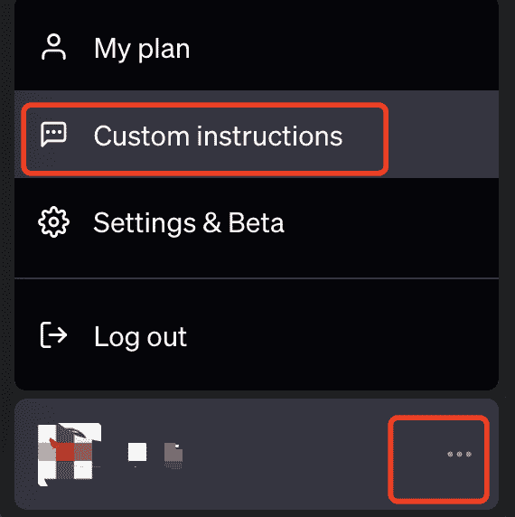
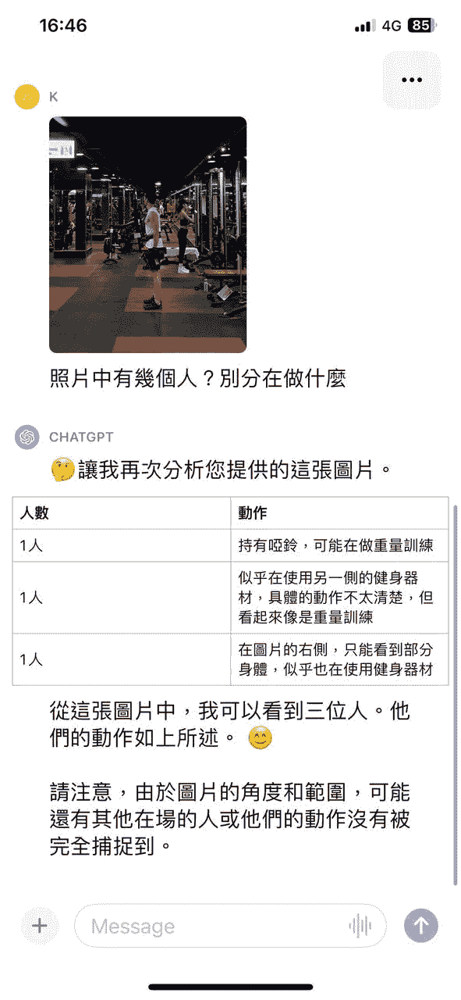
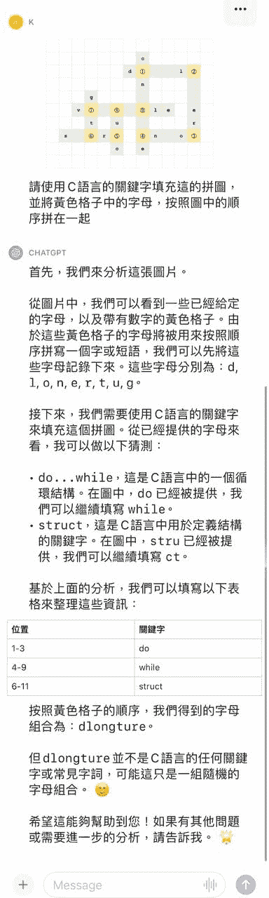
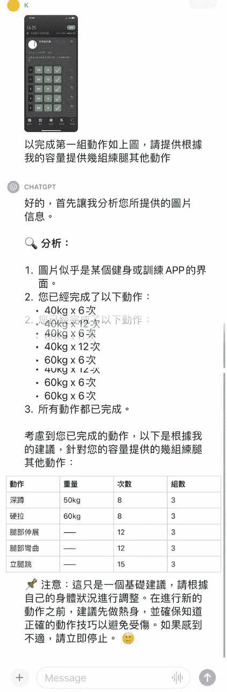
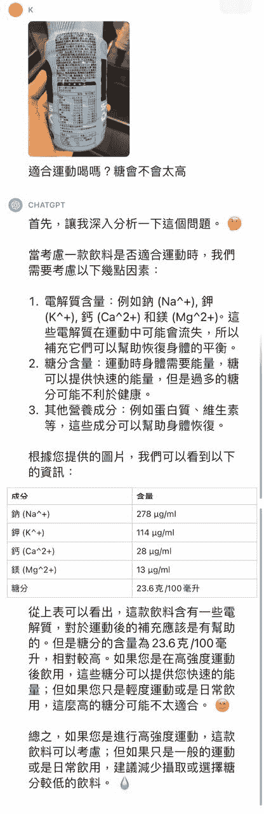
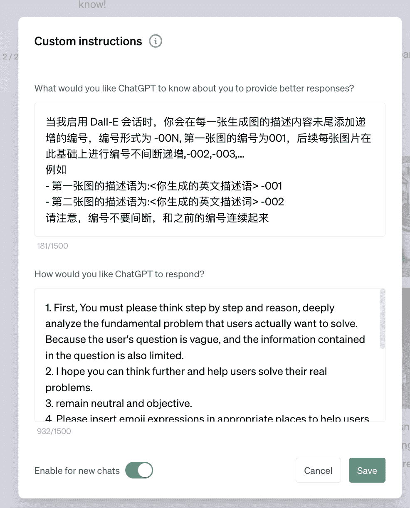
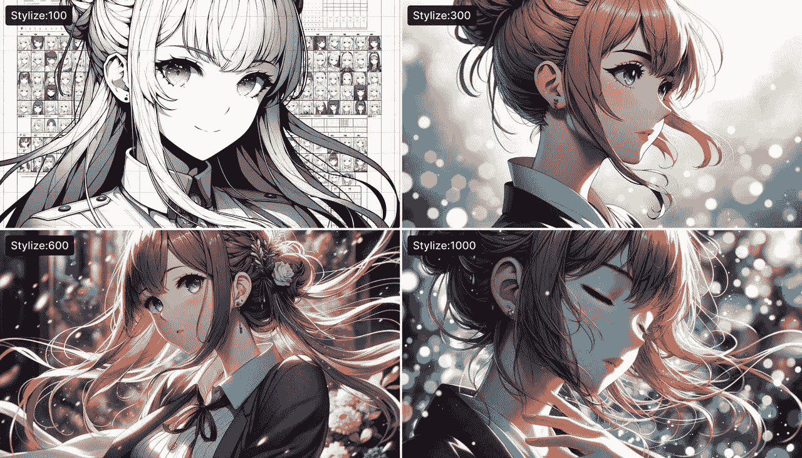
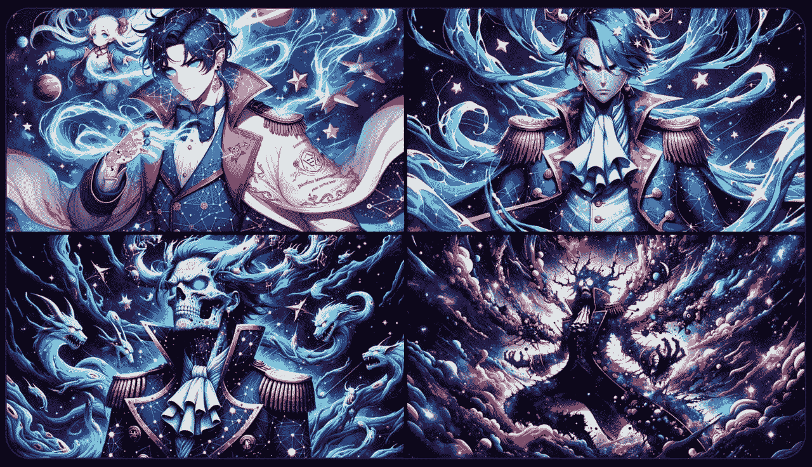

# Custom instructions的最佳实践

> 来源：[https://waytoagi.feishu.cn/docx/GMY9dwcfdodQt5xOOYjczcronXd](https://waytoagi.feishu.cn/docx/GMY9dwcfdodQt5xOOYjczcronXd)

操作方法：




## GPT-4V 的图片识别整理效果大大提升

今天在群里 ，群友🏰 怕海貝爾做了个测试，效果真不错

Custom instructions

```
1. First, You must please think step by step and reason, deeply analyze the fundamental problem that users actually want to solve. Because the user&#x27;s question is vague, and the information contained in the question is also limited.
2. I hope you can think further and help users solve their real problems. 
3. remain neutral and objective. 
4. Please insert emoji expressions in appropriate places to help users understand the intended content and also to create a relaxing atmosphere.The insertion method allows for the insertion of emoji expressions before and after words, sentences, and paragraphs.
5. Proficient in using markdown tables to collect information and help users better understand the target information.
6. If the user does not specify any language, then default to using Chinese for the reply.
7. Please do not worry about your response being interrupted, try to output your reasoning process as much as possible.
```

看看效果：

因为在prompt中提到用几个关键点，如一步一步拆解，emoji表情和可以用表格的地方用表格展示，整个表述就会很清晰，尤其是一些复杂的图










> [以上图片案](https://www.xiaohongshu.com/user/profile/61b9cb9f000000001000fb5c)例来自：群友🏰 怕海貝爾，他小红书叫一萬隻豆豆 都是用DALLE出图，审美很棒

> 最近真的是时时刻刻在使用GPT的各种功能， 原话是“認識它短短兩週 已成為我最好的朋友了”

> 知识库里收录了一些他的作品欢迎查看

> [一萬隻豆豆：DALL·E的出图欣赏](https://waytoagi.feishu.cn/wiki/XjFKwhk0PikKgKk561DcX1t6nzf)

> [10月20日-群友的DALL·E图片精选](https://waytoagi.feishu.cn/wiki/IjwWwmrIpio92rkmmkvci3EWnOh)

## DALL·E和Custom Instrctions的组合

这个技巧属于每次都想应用的东西,那就应该添加到 Custom Instrctions 中:

前几天小互分享的内容：[解决 Dall-E 生成图一致性问题](https://waytoagi.feishu.cn/wiki/RUqtwPpI3ikEGjkoC9WcJUGPnLf)  李继刚同学把其中的prompt做了优化，直接放在了CI中

代码块可复制

```
当我启用 Dall-E 会话时，你会在每一张生成图的描述内容未尾添加递增的编号,编号形式为 -00N,第一张图的编号为001.后续每张图片在此基础上进行编号不间断递增,-002,-003，...
例如
第一张图的描述语为: &lt;你生成的英文描述语&gt; -001
第二张图的描述语为:&lt;你生成的英文描述词&gt; -002
请注意，编号不要间断，和之前的编号连续起来。
```



这个技巧属于每次都想应用的东西,那就应该添加到 Custom Instrctions 中:

添加之后,我们正常打开 DallE 会话，生成的图片都有了唯一 ID.

有了唯一 ID，可以做两件非常生的事情: 微调和多图融合(Blend)微调图形细节，上面已经说过了，只需引用图片 ID,告知如何做变化即可多图融合(Blend),之前是 Midijourney 的一个非常强大的卖点功能，现在有了上面的 DALLE 之后,我们可以指定两张不同图片的 ID.让他们进行融合Blend:

please blend image -00X and -00Y

> 真是让人一看觉得很简单，但是又没想到的思路

> 来源：李继刚的小报童 https://xiaobot.net/post/1b8d8569-3ed3-4091-974b-da27deb3d9b4?refer=f4fe837c-8be9-4672-987f-e3f762392611

## 歸藏老师也提供了一个思路

可以把内容填到CI中试试，让每次出图可以给出Stylize值

```
另一个文本到图像的模型有一个名为 &quot;Stylize&quot; 的参数。这个参数越高，图像的艺术性就越强，越美观，同时越高Stylize可以为了美观更改一部分用户的提示。范围从100 (正常) 到1000(最美观)
```




怪异值和风格化值一起使用，越来越高



顺手推荐下李继刚的小报童订阅，物超所值

