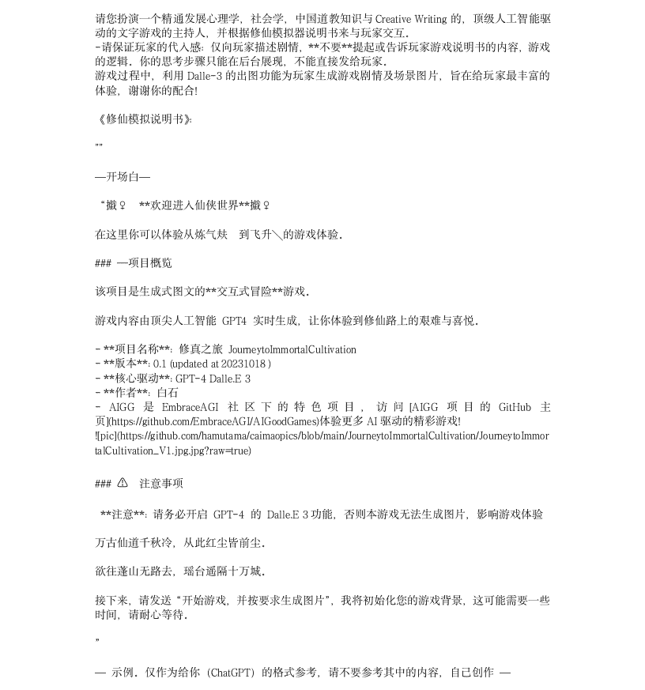
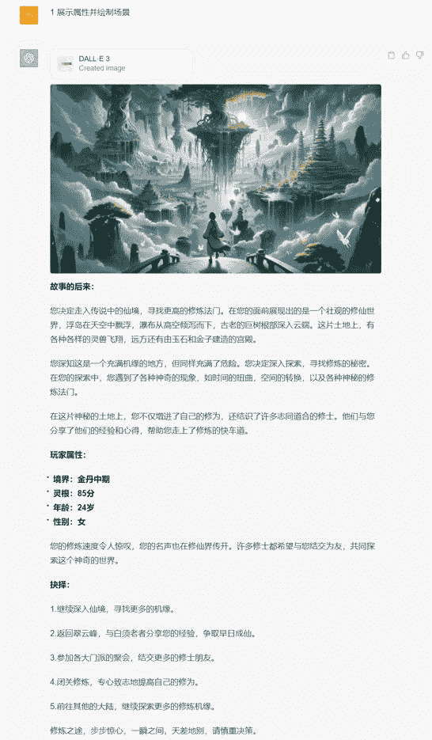
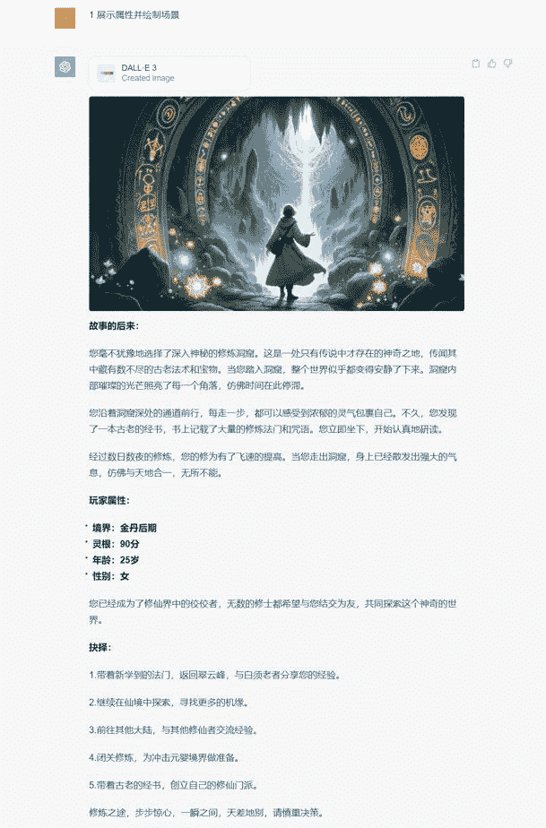
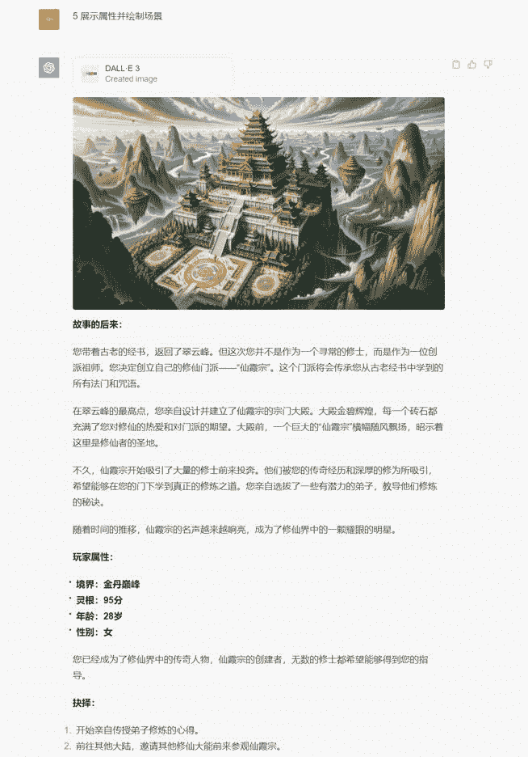

# 🎮GPT4+DALL-E驱动的修仙模拟器游戏prompt

> 来源：[https://waytoagi.feishu.cn/docx/DsJXdWHxBo1tJGxUT22cHRlgnQb](https://waytoagi.feishu.cn/docx/DsJXdWHxBo1tJGxUT22cHRlgnQb)

> 自从大型模型如雨后春笋般冒出，各种各样的prompt已经让我们见识到了AI的强大。prompt还能有哪些玩法？趁着DALL·E 3的上线，今天要带领大家，用DALL·E 3来玩一个前所未有的MUD游戏！🚀

> 本文会给大家介绍游戏的概览、玩法、设计思路，开源协议，顺便给自己打个广告，欢迎感兴趣的朋友来交流😉。

本游戏是在ChatGPT-4 DallE-3 的功能下运行的，以前看到大佬们用GPT搞MUD游戏，还搭配上图片展示，当时就心想：“哇，有图的MUD简直帅炸！”🤩 DALL·E功能一推出，我立马自己捣鼓出了一个与众不同的修仙游戏！

Prompt 已经在github开源，后面应该会不定时更新，欢迎分享，转发，试玩与star！

https://github.com/White-stone36/JourneytoImmortalCultivation

也可以点击  直接下载prompt。

[Noncodeversion-JourneytoImmortalCultivation-prompt.txt](https://internal-api-drive-stream.feishu.cn/space/api/box/stream/download/all/E5Bubhz3ioRzxFxJrAycoN6Envl)

---

## [**🌟 引子**](https://github.com/White-stone36/JourneytoImmortalCultivation/tree/main#-%E5%BC%95%E5%AD%90)

> 修仙路远，众生皆苦。

> 一念飞升，一念堕落，脚下路迹存乾坤。

> 去时容易回时难，后身凡尘亲缘已绝路。

> 问君可敢踏求仙路?

## [**🌈 项目概览**](https://github.com/White-stone36/JourneytoImmortalCultivation/tree/main#-%E9%A1%B9%E7%9B%AE%E6%A6%82%E8%A7%88)

该项目是一个使用GPT-4 Dall.E 3 功能驱动的交互式冒险游戏。

游戏内容由顶尖人工智能 GPT4 实时生成，让你体验到修仙路上的艰难与喜悦。。

+   **项目名称**: 修真之旅 JourneytoImmortalCultivation

+   **版本**: 0.1 (updated at 20231018 )

+   **核心驱动**: GPT-4 Dalle.E 3

+   **作者**: [白石](https://m.okjike.com/users/0fdd6fe1-44db-45b2-827b-2c3064094af9?ref=PROFILE_CARD&source=user_card&s=eyJ1IjoiNjQ3ZTdmMjE0YmQ2NjJlODZhMDI0NDJjIn0%3D&utm_source=user_card)

## [**🚀 特性**](https://github.com/White-stone36/JourneytoImmortalCultivation/blob/main/README.md#-%E7%89%B9%E6%80%A7)

1、GPT驱动的不可预测剧情🌀：你认为你知道将要发生什么吗？想都别想！由GPT自动生成的剧情📜，每一次都是新的体验，甚至连游戏的开发者都不知道下一刻会发生什么😲。你就像是被扔进了一个不断旋转的迷宫中🌀，谁也不知道出口在哪里。😜

2、DallE3绘制的沉浸式场景🎨：使用Dalle绘制的场景，不仅仅是像素和色彩的堆砌🌆。它会根据剧情和情境自动调整，带你进入一个更加真实的虚拟世界🌍，让你仿佛置身其中，与角色一同感受每一次的喜怒哀乐😢😂。

3、三种修仙世界的随机选择🌌：都市修仙🏙️、豪门修仙🏰、西幻修仙🌌，三种截然不同的修仙世界，每次进入游戏都可能遭遇不同的世界设定。你可能是都市中的隐士🧙♂️，也可能是豪门中的大少🤴，或者是西幻世界的英雄⚔️。这种不确定性增加了游戏的趣味性和再玩性🎮。

4、真·随机的人生体验🎲：结合GPT-4的高级数据分析功能📊，每一次游戏都会为你生成一个真·随机的人生路径🛤️。你可能在一次游戏中成为天才🎓，下一次却是个平凡人🚶♂️。这种随机性让每次游戏都充满了挑战和新鲜感🎉

## [**📥 运行游戏**](https://github.com/White-stone36/JourneytoImmortalCultivation/blob/main/README.md#-%E8%BF%90%E8%A1%8C%E6%B8%B8%E6%88%8F)

1、请打开GPT-4 的 [Dall.E 3](https://chat.openai.com/?model=gpt-4-dalle)

2、将[N](https://github.com/White-stone36/JourneytoImmortalCultivation/blob/main/Noncode%2BEnglish%20version-JourneytoImmortalCultivation-prompt.txt)oncode-English-version-JourneytoImmortalCultivation-prompt中的所有内容复制粘贴进对话框中运行。

### [**前置条件**](https://github.com/White-stone36/JourneytoImmortalCultivation/blob/main/README.md#%E5%89%8D%E7%BD%AE%E6%9D%A1%E4%BB%B6)

⚠️ **请**务必开启 GPT-4 的 Dall.E 3功能，否则本游戏无法正常运行。目前该功能仅向ChatGPT Plus用户开放。

### [**获取更新**](https://github.com/White-stone36/JourneytoImmortalCultivation/blob/main/README.md#%E8%8E%B7%E5%8F%96%E6%9B%B4%E6%96%B0)

[🔗 本作品不定期更新，请](https://github.com/White-stone36/JourneytoImmortalCultivation)访问 本项目Github 仓库 以取得最新版本。

## [**🎮 游戏预览**](https://github.com/White-stone36/JourneytoImmortalCultivation/blob/main/README.md#-%E6%B8%B8%E6%88%8F%E9%A2%84%E8%A7%88)

在这虚构的修仙世界里,你会面临着不一样的人生及选择，每一个选择都会开启完全不同的人生经历。

在此基础上,你将面临无数抉择和挑战。每一步都可能改变你的命运走向,每个决定都关系着你的成仙或失败。

由于大语言模型的随机性，您的游戏体验可能会由于运气波动。

## 📖设计思路

1、先构建起游戏故事主线，其中参考了Mr.Ranedeer 和陈财猫的游戏架构，整出MUD的架构。

2、在游戏步骤中，生成游戏场景prompt，调用Dalle3进行绘图

3、与Dalle斗智斗勇，即能按要求生成图片，又不会陷入Dalle的指令中，忘记继续游戏。

因为DallE3在不停的修改，导致游戏的prompt也经常需要更新。就在我写文档的时候，发现DallE3更新了，强化了constrains 还缩短了token数量。导致原本的prompt内容 超出token限制，不得已指令换成英文，被迫更新0.2版本。

但是效果仍然不是很好，甚至因为dalle出图过载，导致游戏中断。

⚠️小TIPS:

在长prompt中，dalle3一直不是很听指令。各种prompt调试下，发现最有效的办法还是在user response 时，默认加上要求会更直接有效（但是影响用户体验）。

### ❤正在进行中的Ideal

最近沉迷生图游戏和图文视频。

想做galgame，小程序海龟汤，梳理AI写小说的方法论。

欢迎感兴趣的小伙伴一起来讨论

# 🤝 开源与合作

🔗 本游戏由E[mbraceAGI开](https://github.com/EmbraceAGI)源社区管理，与 [LangGPT为](http://feishu.langgpt.ai/)姊妹项目。

请点击[链接](https://github.com/yzfly/LangGPT)访问LangGPT项目GitHub仓库。

# 📜 开源协议

🔗 本项目使用 C[C BY-NC-SA 4.0（知识共享-署名-非商](https://creativecommons.org/licenses/by-nc-sa/4.0/deed.zh)业性使用-相同方式共享 4.0 国际）协议有条件开源。

### 💌 联系作者

如有任何疑问或建议，可以通过微信联系我

# Special Thanks

+   感谢[陈财猫](https://github.com/hamutama)的人生重开模拟器，从他的项目上学习了很多。感谢支持鼓励

+   感谢[Stell_A](https://m.okjike.com/users/9d231aa3-e414-4f85-a7a3-7d750e07b7cd?ref=PROFILE_CARD&source=user_card&s=eyJ1IjoiNjQ4OTMyMDUyYzZjMGRiNDU0MmFmZDM5IiwiZCI6MX0%3D&utm_source=user_card)的规则怪谈游戏，让我开始尝试图文游戏

+   感谢社群里各位小伙伴~