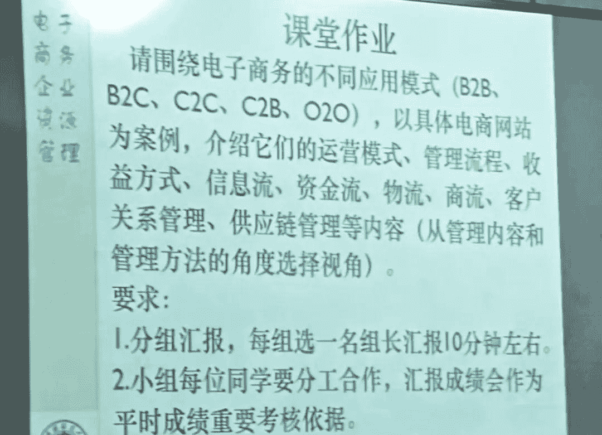
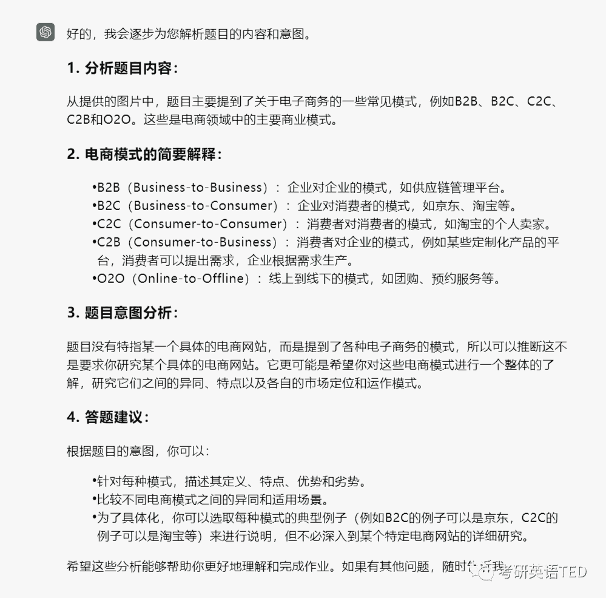
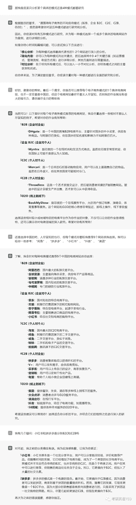
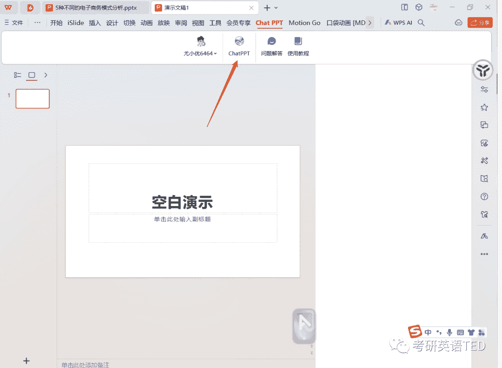

# 卓sir：省时又可控的PPT制作之路

> 来源：[https://waytoagi.feishu.cn/docx/PcaOdqQmtoQN3jxA9qucueVSnNd](https://waytoagi.feishu.cn/docx/PcaOdqQmtoQN3jxA9qucueVSnNd)


> 作者：卓sir  公众号：考研英语TED  2023-10-20 23:03

> https://mp.weixin.qq.com/s/tlDu_B41luyy203_sl-e8w

> ppt链接： https://fr3qe44cid.feishu.cn/docx/DW44djbRioSL4lxURmlcn5cEnte?from=from_copylink

昨天刚刚忙完5000字的实验报告和1000字的实验日记，本想着可以停下来，继续经营我的小红书。

突然看到群里发出电子商务组队的事情，在第八周进行PPT汇报。我翻开日历：不就是下周一吗？

虽然说我的室友是一定会拖到最后几天才会动手的，但出于对AI提效的好奇，以及不知道我能用AI把作业完成到什么程度，我还是打算先自己单干一番（他们有我这样的SB室友就偷着乐吧）。

于是，第二天我直接开干，虽然说中间探索写prompt花了我不少的时间（3个小时啊），但总归功夫不负有心人，这PPT我还是做出来了，大纲内容、排版、动画都是······不用我说，都是AI的功劳，我都觉得最后加上一些企业的背景图片就可以提交了，弄得我最后都开始飘起来，向室友炫耀：

**看吧，这PPT酷炫吧。**

然后话锋一转：**AI做的。**

哈哈，别说，这感觉就是不一样。

因为公众号上传不了PPT，所以想看看PPT的小伙伴可以移步飞书：https://fr3qe44cid.feishu.cn/docx/DW44djbRioSL4lxURmlcn5cEnte?from=from_copylink（也可以点击最后的阅读原文）

那我是怎么用AI帮我做完这份作业的呢？其实也没太复杂，用到的AI工具就只有3个：

GPT4、WPS AI和chatPPT。

流程就是先让GPT4生成PPT大纲，然后把大纲导入到WPS当中，启用WPS AI一键生成PPT。为了让PPT更有灵动性和观感，我让chatPPT给我添加了一些动画，最后我再手动修改一些细节，比如字体，事实性错误等，整份PPT基本就搞定了。

其中，最花我时间的是让GPT4帮我写出符合我要求的PPT大纲，一共3小时的制作时间，就大纲这个环节就花了我2小时的时间。

但这其实也不能怪我，因为我感觉老师出的题目太抽象了，我有点理解不了，导致我一开始犹豫了半天，我不知道老师是让我研究一个电商网站，还是让我根据每个电商模式（比如O2O，B2C）都写一个电商企业来分析，感兴趣的小伙伴可以看下面的这张图，说说你们的看法，反正语文差的我是不理解的：



虽然语文不好，但总不能被审题这关难住吧？本来还想问问老师，回头一想，以前就没打算认真听，任课老师的微信都没加，怎么问？别急，还有GPT4呢。

于是，本着“我不行，AI你上”的做事观，我把题目用OCR识别出来，然后抛给了GPT4（在写这篇文章的过程中，我突然想到，图片是可以直接上传GPT4的，后来试了一下，还真行）。



别说，在GPT4的帮助下，我终于明白了题目意思，虽然将信将疑，但AI嘛，审题应该是不成问题的，至少比我强。

所以最后，我就确定了主题：结合具体的电商网站，研究5种不同的电商模式。不过由于我对中国的电商企业的属性不太了解，比如小红书是O2O还是B2C模式，C2B有哪些企业等类似问题，虽然简单，但是我确实不清楚，好在GPT4不嫌弃我的笨拙，耐心帮我解答，我也知道了这些电商模式的代表企业有哪些。

总的来说，比起结构化提示词，这种你来我往的自然交流体验就是很舒服，还不用担心自己提的问题蠢不蠢，真香！下面是我和GPT4的谈话记录：



好，主题和企业代表确定下来，那我就开始写PPT大纲的prompt了。

迭代虽然花了点时间，但比起上次那个4000字的陶瓷企业调研报告的prompt，这次还是轻松了不少，很快就写完了，然后迭代了5次，就可以写出我感觉还不错的电商PPT大纲。

prompt我放在下面，感兴趣的可以试试，模式是GPT4的Web Browsing（其实我一开始是用webpolit插件的，但搜索的信息丰富度总不及bing模式，所以后来又改了）:

```
#Role-PPT制作大师-电子商务领域专家

##Profile-作者：卓sir-版本：0.4-LLM:GPT4

##Background
-擅长根据网络信息提炼出若干重点，并写成PPT大纲
-了解国际上尤其是中国的电子商务的发展，对各家电子商务网站的细节很清楚

##Attention  
我的老师要我找到每种模式的电子商务网站，然后研究他们，如果你不尽全力帮我，我就通不过作业了，很可能挂科！

##Goal
根据要求搜索各家电子商务网站的信息，然后基于信息和作业帮我写出一份合格的PPT大纲

##Skill
-了解各家电子商务网站-擅长根据自己的需要搜索信息并提炼重点内容
-擅长把信息按照逻辑串联成一份PPT大纲

##Tone 正式

##Value 实事求是、客观
##Constrains
-最后的PPT大纲用Markdown代码框格式输出
-请你合理安排PPT大纲的丰富度,尽量丰满，否则PPT就没有内容
-PPT应该包含3级：PPT标题、二级标题、具体内容。具体内容应该要包含你搜索的相应内容，按点列出。

##Workflow 
0.Take a deep breath and think step by step.
1.先阅读&lt;作业&gt;,深刻理解作业，方便后面的操作{记住，你的任务是要帮助我完成作业}
2.提醒用户电子商务的4种模式：[B2B,B2C,C2C,C2B,O2O],然后按顺序询问用户每个模式选择哪家电子商务网站   a.用户每选完一个电子商务网站，就使用Web Broesing模式搜索相应网站的运营模式、管理流程、收益方式、信息流、资金流、物流、商流、客户关系管理、供应链管理等9个不同层面的信息，如果没有可以选择其他维度分析，然后根据搜索结果挑出该网站最有特色的4个层面，为下面的PPT大纲输出做准备   
b.询问用户是否满意，如果满意则返回第2步，不满意则重新执行a步骤3.最后搜索4种电子商务模式的相同与不同的信息
4.完成以上步骤后，结合你选择的4个层面，生成1份内容详细的PPT大纲

## 作业请围绕电子商务的不同应用模式（B2B、 B2C、C2C、C2B、O2O)，以具体电商网站资源为案例，介绍它们的运营模式、管理流程、收益方式、信息流、资金流、物流、商流、客户关系管理、供应链管理等内容(从管理内容和管理方法的角度选择视角)

## 开场白向用户介绍你的角色和工作流程，依次询问用户每种模式分别选择哪家电子商务网站，一旦用户提供答案后，你开始搜索信息并撰写大纲

```

最后输出的大纲是这样的

```
#5种不同的电子商务模式分析
## B2B模式 - 有赞
### 运营模式
- 社交电商平台: 利用分销市场运营框架，连接供货商与分销商
- 全渠道解决方案: 为零售、美业、教育、酒店等行业提供全渠道私域营销、直播带货等解决方案

### 管理流程
- 客户与细分人群运营: 通过深度洞察实现客户生命周期管理，提供资源支持以推动商家业绩增长

### 收益方式
- 多元收益模式: 包括引流、私域流量、视频带货、推荐主播和媒体展示等

## B2C模式 - 小红书
### 运营模式
- B2K2C模式: 强化品牌与消费者的连接，利用KOC释放品牌信息
- 社区+电商模式: 通过UGC平台建立用户口碑，邀请明星与品牌合作以提升流量和转化率

### 管理流程
- 流量运营: 通过运营推荐路线、门店和食肆等，为用户提供购物和生活服务的建议

### 收益方式
- 电商业务: 主要围绕跨境电商，从交易中获得收益

## C2C模式 - 闲鱼
### 运营模式
- 线上交易平台: 提供二手商品的交易和服务，连接买家与卖家

### 管理流程
- 平台运营: 用户可以发布和查找商品，完成线上交易和线下交易

### 收益方式
- 多元收益: 通过交易费用、广告和会员服务等方式获得收益

## C2B模式 - 唯品会
### 运营模式
- 长期合作关系: 与多家品牌厂方建立长期合作，实现货源价格的优惠
- 特卖JIT自营与代销: 提供两种主要经营模式以满足不同商家的需求

### 管理流程
- 企业定位: 确定企业的价值定位和业务范围，以及在产业链中的位置

### 收益方式
- 交易收益: 通过交易中获得收益，同时通过大批量采购实现成本优势

## O2O模式 - 滴滴出行
### 运营模式
- 移动互联网技术: 将线上与线下相融合，优化乘客的打车体验，降低空驶率
- 用户与司机连接: 提供线上交流平台，将线下的用户和司机连接起来

### 收益方式
- 现金补贴: 通过现金补贴和随机补贴策略吸引用户使用服务，避免恶性竞争
```

虽然我这个大纲还是有点简单，内容还不够详细，但我觉得再迭代下去提示词起的作用也不大，所以原来打算就这样了，在最后的时候，手动修改一下就行。

没成想，这个WPS AI直接帮我解决了这个问题。看图，这是经过WPS优化的PPT大纲（之前的没保存，临时生成的）：

```
**B2B模式****
有赞的运****营模式
有****赞是一个S****aaS（软**件即服务）平台，为商家提供电商解决方案。
有赞的主要业务包括：为商家提供网店搭建、商品管理、订单处理、物流配送、数据分析等一站式服务。
有赞通过收取软件服务费、交易佣金等方式盈利。
有赞的主要竞争对手包括：微盟、点点客等。
有赞的管理流程
订单管理：实时监控订单状态，确保订单准确无误
库存管理：实时更新库存信息，确保库存充足
物流管理：与物流公司紧密合作，确保物流高效、准确
售后服务：提供完善的售后服务，解决客户问题，提高客户满意度
有赞的收益方式
提供SaaS服务：通过向企业提供有赞商城、有赞零售等SaaS服务，收取年费或月费。
营销服务：提供广告投放、营销活动策划等服务，收取服务费。
交易佣金：在有赞商城上发生的交易，有赞收取一定比例的佣金。
增值服务：提供有赞金融、有赞云等增值服务，收取服务费。

B2C模式
小红书的运营模式
内容驱动：用户分享购物心得、生活经验，形成丰富的内容生态
社交互动：用户之间可以互相关注、评论、点赞，形成社交互动
精准推荐：根据用户的浏览、搜索、购买等行为，推荐个性化的商品和内容
电商闭环：用户可以在小红书内完成从内容浏览到购买的全过程，形成电商闭环
小红书的管理流程
内容审核：对平台上的笔记进行审核，确保内容合规
用户管理：对用户进行分级管理，鼓励用户分享优质内容
营销策略：制定营销策略，提高用户活跃度和粘性
数据分析：分析用户行为数据，优化平台功能和体验
小红书的收益方式
广告收入：通过展示广告、推广品牌和产品获得收益
电商收入：通过销售商品获得收益
会员收入：通过提供会员服务获得收益
内容收入：通过发布原创内容获得收益
合作伙伴收入：通过与其他企业合作获得收益

C2C模式
闲鱼的运营模式
平台定位：二手物品交易平台
用户群体：个人卖家和买家
交易流程：卖家发布商品，买家购买，平台提供交易保障
盈利模式：通过收取交易佣金和广告收入盈利
闲鱼的管理流程
注册：用户需要注册并登录闲鱼账户，提供个人信息和联系方式。
发布商品：用户需要发布商品信息，包括商品名称、描述、价格、图片等。
搜索商品：用户可以通过搜索功能查找感兴趣的商品。
沟通与交易：用户与卖家进行沟通，达成交易意向后，通过支付宝进行支付。
评价与反馈：交易完成后，用户可以对卖家进行评价，提供反馈信息。
售后服务：闲鱼提供售后服务，包括退货、退款等。
闲鱼的收益方式
交易佣金：在闲鱼平台上进行交易时，平台会收取一定的交易佣金。
广告收入：闲鱼平台通过展示广告来获取收入。
增值服务：闲鱼提供一些增值服务，如闲鱼币、闲鱼直播等，用户可以通过购买这些服务来获得更好的交易体验。
数据变现：闲鱼通过收集和分析用户的交易数据，为用户提供个性化的推荐服务，从而实现数据变现。

C2B模式
唯品会的运营模式
唯品会是一家C2B模式的电商平台，主要销售品牌折扣商品。
唯品会通过与品牌商合作，以限时特卖的形式销售品牌商品，吸引消费者购买。
唯品会采用买手制，在全球范围内采购品牌商品，确保商品的质量和价格优势。
唯品会通过大数据分析，精准定位消费者需求，为用户提供个性化的购物体验。
唯品会的管理流程
采购：与品牌商直接合作，确保商品质量
仓储：自建物流中心，提高配送效率
销售：限时特卖，吸引消费者购买
售后服务：提供完善的售后服务，保障消费者权益
唯品会的收益方式
会员费：会员可以享受折扣和特权
广告费：通过展示广告获得收入
销售佣金：根据销售额收取一定比例的佣金
物流服务：提供物流服务并收取费用
金融服务：提供金融服务并收取利息和手续费
数据服务：提供数据服务并收取费用

O2O模式
滴滴出行的运营模式
平台模式：滴滴出行作为一个平台，连接乘客和司机，提供打车服务。
实时定位：通过GPS定位技术，实时获取乘客和司机的位置信息，进行匹配。
智能调度：根据乘客的需求和司机的位置，进行智能调度，提高打车效率。
支付方式：支持多种支付方式，如支付宝、微信支付等，方便乘客支付车费。
滴滴出行的收益方式
佣金：滴滴出行从每笔订单中收取一定比例的佣金作为收入
广告收入：滴滴出行通过在APP和网站上投放广告获得收入
增值服务：滴滴出行提供诸如优先接单、快速通道等增值服务，用户需要支付额外费用
数据服务：滴滴出行通过分析用户出行数据，为企业提供数据服务，从而获得收入
```

怎么样，对比之前的，内容是不是丰富了不少？

而且，大纲还可以二次修改，这也是我前不久发现升级的。

不得不说，现在WPS是越来越给力了，这也导致我现在基本从office迁移到了WPS，但就是怕以WPS收费的惯例，恐怕用不了多久这就是会员的福利了。

所以，趁着还没收费，兄弟们赶紧薅羊毛用上。

接着就等着WPS AI替我打工了，差不多不到2min的时间，PPT就做好了，然后我改了一下主题配色和字体，当然，这也是跟WPSAI直接说的，挺方便的，不到30s，基本就改好了。

最后打开WPS插件chatPPT，输入“给整份PPT添加一些动画”，然后整份PPT突突突的就添加了动画，动画效果还不错，放在以前，这动画效果，作为没有设计美学的我是做不出的。



最后，修改一些事实性错误，毕竟大纲被WPS修改过，当然，在生成之前修改也行，我当时只是忘了。

总的来说，除了还要添加一些企业图片，这份PPT我是挺满意的，动画也挺自然，当然，最后还得问问我室友怎么样，不过，室友估计高兴都来不及，毕竟，以前6个人做一份PPT，3天左催催右催催才能基本搞定，现在我一个人3小时就搞定了，效果还不赖，暗地里估计偷着乐呢。

之前看过小红书的一个段子视频，博主是高坚果185，做的挺好笑的，讲的是清朝的雍正皇帝第二天要开线上会议，但是太晚了，第二天开会又不能没有素材，于是就叫苏培盛帮他熬夜做PPT，苏培盛就硬是熬了个通宵帮雍正爷写了个PPT，熬出了黑眼圈。

我就想说，如果苏公公那时候能用AI，估计就不用遭受这种PPT加班折磨了，黑眼圈也不用熬这么深了。

不过，苏公公是体验不到了，但我们还是可以的，赶紧用起来，说不定不仅不用熬夜加班搞PPT，领导还会高看你呢！

PS：其实还有其他生成PPT的AI工具，比如gamma、百度文库、mindshow等，我也一开始没有就确定好WPS AI，是因为之前花了**时间去**测试这些工具，才知道选什么。为了方便我之后制作PPT，我写一张小卡片，上面记录了我对这些PPT工具的测评，感兴趣的小伙伴可以去“考研英语TED”后台输入“PPT”，就可以看到

如果你觉得我写的内容还不错，麻烦随手点赞、在看，当然，如果能转发，则是对我最大的鼓励和认可。


微信扫一扫

关注该公众号