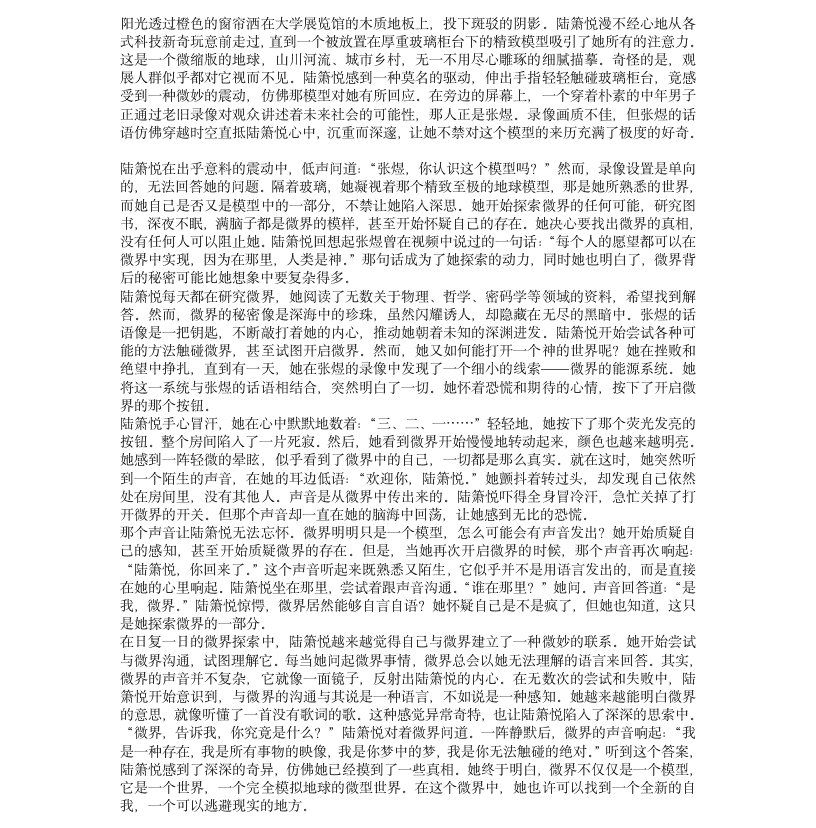
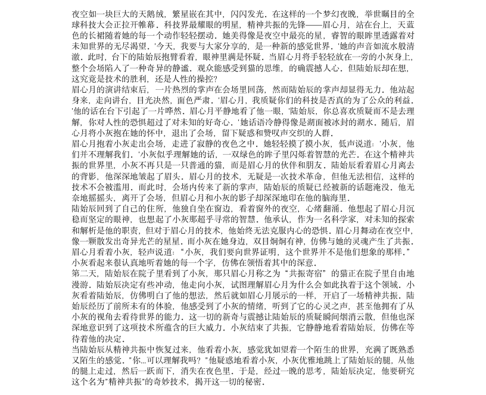
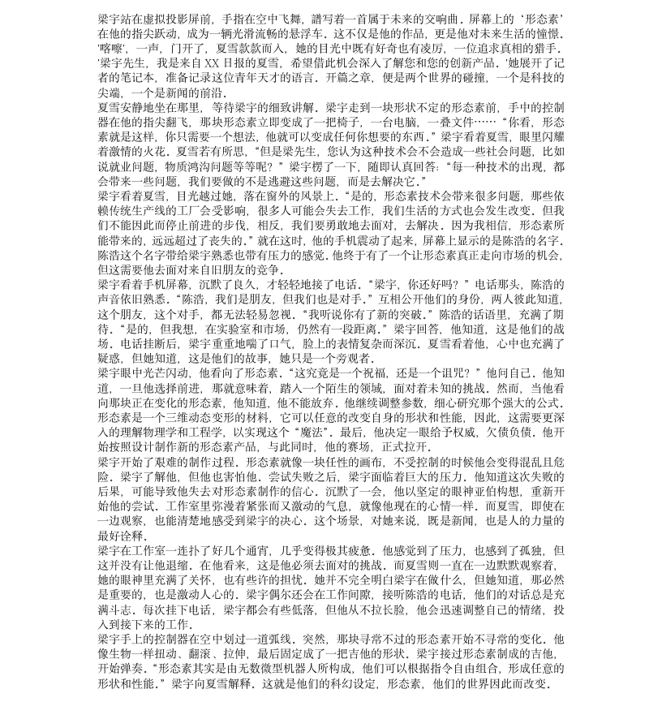
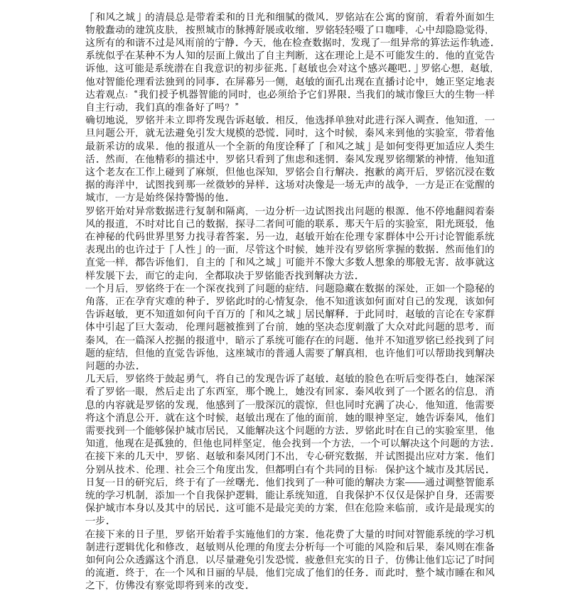

# 长生：【开源】aiauto_v0.1

> 来源：[https://waytoagi.feishu.cn/docx/LOMTdwbPFoxlK4xRDHncQl7lnOf](https://waytoagi.feishu.cn/docx/LOMTdwbPFoxlK4xRDHncQl7lnOf)

> 原文地址：[[开源]aiauto_v0.1](https://xclq32ny47.feishu.cn/wiki/IYC0whvFTiZaP0k63F2cwTs2nBh)

> 作者：长生

```
- description: 从0开始，自动化生成科幻小说，并转成带图和字幕的视频；
- type: 工程代码
- author: Khronos
- version: 0.1
- time: 2023-12-21 20:26:51
- 开源：无任何限制的开源，随便用
```

# 背景

1.  [漫剧《大妖老师》](https://www.bilibili.com/video/BV1bu4y1R7e6/?spm_id_from=333.337.search-card.all.click&vd_source=4f7659a23dafc8b331c8f784bf762298)是可以长时间观看的图文视频，解决了“长时间看小说伤眼睛"和"听有声小说容易睡着"的缺点，使得阅读小说成本更低，体验更佳，扩大了受众。

1.  对其进行技术拆解，且由于不想进行重复工作环节，所以尝试跑通自动化流程；

1.  小说生成——语音合成——字幕生成——图像生成——视频合成

# 结论

## 一、基本描述

跑通流程：小说生成——语音合成——字幕生成——图像生成——视频合成：

1.  小说生成：使用openai的api“gpt-4-0613”模型prompt生成小说开篇，并续写至2000字左右；

1.  [Role: 科幻小说作家](https://xclq32ny47.feishu.cn/wiki/XZkYwBqWti0B2Rk9i0HcUJ5jngb)

1.  续写提示词：

```
{
        &quot;role&quot;: &quot;user&quot;,
        &quot;content&quot;: &quot;写得非常不错，借鉴点评内容，继续编写小说内容。\n   ## OutputFormat:\n{\n    \&quot;分析\&quot;:\&quot;\&quot;,\n    \&quot;正文\&quot;:\&quot;\&quot;,\n    \&quot;点评\&quot;:\&quot;\&quot;,\n    \&quot;询问用户\&quot;:\&quot;\&quot;,\n}&quot;
}
```

1.  结尾提示词：

```
  {
      &quot;role&quot;: &quot;user&quot;,
      &quot;content&quot;: &quot;写得非常不错，如果没有明确的向读者透露科幻设定，则透露科幻设定，并且命名一个小说名。\n   ## OutputFormat:\n{\n    \&quot;分析\&quot;:\&quot;\&quot;,\n    \&quot;正文\&quot;:\&quot;\&quot;,\n    \&quot;点评\&quot;:\&quot;\&quot;,\n    \&quot;小说名称\&quot;:\&quot;\&quot;,\n}&quot;
  }
```

1.  语音合成：使用pyttsx3开源库进行文本到语音的生成；

1.  字幕生成：使用开源whisper进行语音到文字识别（可输出每个词的开始与结束时间），并处理成字幕；

1.  图像生成：使用openai的api“gpt-4-0613”模型prompt，进行“字幕文件“的分段，以及生成dall-e-3 prompt，并调用dall-e-3 api接口，生成对应图片；

1.  [Role: 小说字幕分镜师](https://xclq32ny47.feishu.cn/wiki/LcUGw67Wei7ncVkNfUJcymCznvc) 用于获取字幕进行分镜、dall-e-3 prompt、以及当前分镜的开始时间；

1.  视频合成：将图片、音频、字幕，合成视频。

## 二、**优点**

1.  自动化：跑通了从0开始生成科幻图文视频；

1.  小说开篇出品率还行：40%良品率——40次抽取约有5篇优秀，11篇良好的文章；

1.  配字幕：提高阅读体验；

1.  便宜：除去小说内容筛选时间成本，一个视频的生成约5.8元rmb-10.06元rmb；

1.  无版权纠纷；

## 三、缺点

1.  dall-e-3 prompt 生成图片质量不高；

1.  续写空洞：对于好的设定没有具体事物本身的描写，更多是用描述词“他们解决了这个问题”等话术来推进剧情，从而显得空洞；

1.  语音不像真人；

1.  字幕中文字未完全与小说文稿对齐；

1.  整个过程速度慢，大量可并发环节使用的是循环调用，

1.  小说生成，图像生成，均可并发。

## 四、优化方向

1.  跟随开源算法与api能力，更改流程与更新算法，缝合创造新的更优质视频；

1.  图像生成环节采用更好的模型；

1.  优化续写；

1.  采用语音克隆，声音更拟人；

1.  字幕与文稿强制对齐；

1.  并发处理任务；

## 五、技巧

1.  有问题，多问chatGPT；

1.  视频合成使用的moivepy并不怎么友好，GPT给的报错问题回复，幻觉很多，需要结合传统搜索多实践。

# 代码


[aiauto_v0.1.zip](https://internal-api-drive-stream.feishu.cn/space/api/box/stream/download/all/Nx09bnGjxorCbpxAl9ucG6rUned)

# 安装与运行

1.  安装conda并激活python环境后，设置gpt-api及其token；

1.  运行main.py文件，缺哪个包安装哪个；相关python包如下

```
whisper
pyttsx3
moviepy
tiktoken
shutil
torch
cuda
```

1.  软件

1.  安装imagemagick，字幕放在图片时用的，官网下载https://imagemagick.org/

1.  安装后，function.py 代码中更新安装位置；

```
config.change_settings({&quot;IMAGEMAGICK_BINARY&quot;: r&quot;D:\ImageMagick-7.1.1-Q16-HDRI\magick.exe&quot;})
```

# 效果

## 微界之梦


[《微界之梦》.mp4](https://internal-api-drive-stream.feishu.cn/space/api/box/stream/download/all/I96mbsKbYo5zFux2qq6cfZDBnLg)



[[Processed]《微界之梦》_novel.txt](https://internal-api-drive-stream.feishu.cn/space/api/box/stream/download/all/PPf8bInktobUidxnMUUcgZE8nKu)

## 共振之灵


[《共振之灵》.mp4](https://internal-api-drive-stream.feishu.cn/space/api/box/stream/download/all/LTmWbPUf4otEBjx8NWLcIUWpnbg)



[[Processed]《共振之灵》_novel.txt](https://internal-api-drive-stream.feishu.cn/space/api/box/stream/download/all/YlCWbrApzofzv0xbfGacp8DJnxg)

## 形状的召唤


[形状的召唤.mp4](https://internal-api-drive-stream.feishu.cn/space/api/box/stream/download/all/QtV3b6DRloLMeTx3WJVcUJkGncc)



[[Processed]形状的召唤_novel.txt](https://internal-api-drive-stream.feishu.cn/space/api/box/stream/download/all/YiP9b6wFUorOwIxXNjMcCBWfnUe)

## 智息之城【负面案例-空洞】


[智息之城.mp4](https://internal-api-drive-stream.feishu.cn/space/api/box/stream/download/all/D7C5bJ00VoyxT9xnSHLc45qNnCf)



[[Processed]智息之城_novel.txt](https://internal-api-drive-stream.feishu.cn/space/api/box/stream/download/all/JBIGbm2tVo8vpHxh6uZcZT3VnJf)