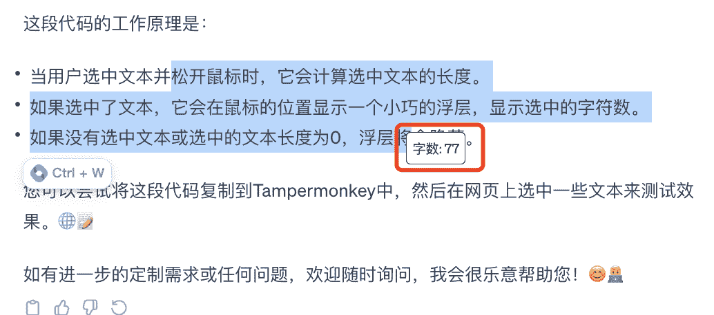
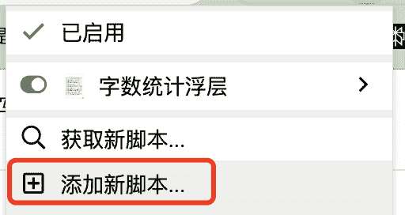
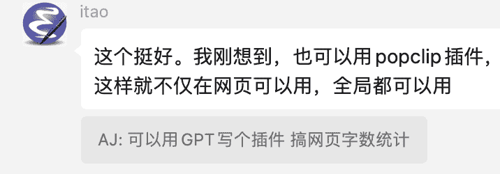
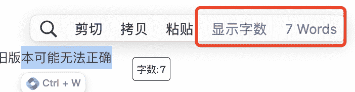

# AJ：一分钟写了一个网页字数统计插件

> 来源：[https://waytoagi.feishu.cn/docx/YjZLdZe1xo5ObdxOBwJcm8h8n9b](https://waytoagi.feishu.cn/docx/YjZLdZe1xo5ObdxOBwJcm8h8n9b)

### 使用效果：

选中网页中文字，就可以现实字数



### 油猴脚本：

使用方法

1.  浏览器中安装Tampermonkey：https://chrome.google.com/webstore/detail/tampermonkey/dhdgffkkebhmkfjojejmpbldmpobfkfo

1.  将以下代码内容黏贴到 Tampermonkey中：



1.  重启浏览器

1.  代码本身可复制：

```
// ==UserScript==
// @name         字数统计浮层
// @namespace    http://tampermonkey.net/
// @version      0.2
// @description  在网页上选中文字时，通过浮层显示字数
// @author       您的名字
// @match        *://*/*
// @grant        none
// ==/UserScript==

(function() {
    &#x27;use strict&#x27;;

    // 创建浮层元素
    const floatDiv = document.createElement(&#x27;div&#x27;);
    floatDiv.style.cssText = &#x27;position: absolute; z-index: 1000; padding: 5px; background: white; border: 1px solid black; border-radius: 4px; font-size: 12px; display: none;&#x27;;
    document.body.appendChild(floatDiv);

    document.addEventListener(&#x27;mouseup&#x27;, function(e) {
        const selectedText = window.getSelection().toString();
        if (selectedText.length &gt; 0) {
            floatDiv.textContent = `字数: ${selectedText.length}`;
            floatDiv.style.display = &#x27;block&#x27;;
            floatDiv.style.left = `${e.pageX}px`;
            floatDiv.style.top = `${e.pageY}px`;
        } else {
            floatDiv.style.display = &#x27;none&#x27;;
        }
    });
})();

```

### 插件制作完整过程

真的整个输出不需要一分钟，全程就说了两句话，指挥AI干活真的太轻松了

以下为完整对话：

### You

你是一个Tampermonkey插件作者，你擅长写插件

现在需要你写一个可以在网页上选中文字，就可以统计出字数的插件代码，请开始吧

---

### ChatGPT

🤔 好的，让我们一步步来分析这个问题。您需要一个Tampermonkey插件，当在网页上选中文本时，它能够统计并显示选中的字数。这是一个实用的功能，尤其是对于需要快速计算文本长度的用户来说。

为了实现这个功能，我们需要完成以下几个步骤：

1.  创建一个Tampermonkey脚本：这将是JavaScript代码，可以在用户浏览器中运行。

1.  监听文本选取事件：当用户在网页上选取文本时，脚本需要捕捉到这个动作。

1.  计算选中文本的字数：一旦文本被选中，脚本需要计算其长度。

1.  显示字数：将计算出的字数以某种形式显示给用户。

接下来，我将为您提供一个基本的Tampermonkey脚本示例。这个脚本将满足上述需求。您可以将这段代码复制到Tampermonkey中，并根据需要进行调整。

```
javascriptCopy code
// ==UserScript==// @name         字数统计器// @namespace    http://tampermonkey.net/// @version      0.1// @description  在网页上选中文字时统计字数// @author       您的名字// @match        *://*/*// @grant        none// ==/UserScript==
(function() {&#x27;use strict&#x27;;
document.addEventListener(&#x27;mouseup&#x27;, function() {const selectedText = window.getSelection().toString();if (selectedText.length0) {alert(`您选中了 ${selectedText.length} 个字符`);
        }
    });
})();
```

这段代码的工作原理如下：

+   当用户在网页上选中文本并松开鼠标时，它会触发一个事件。

+   该脚本捕捉到这个事件后，会计算选中文本的长度。

+   如果选中了文本（即长度大于0），它会弹出一个对话框，显示选中的字符数。

您可以将这段代码复制到Tampermonkey中，然后在浏览器中尝试选中一些文本，查看效果如何。😊👨💻

如果您有任何特定的需求或想要进行某些调整，请随时告诉我，我会很乐意帮助您进行修改！

---

### You

改成选中后，在网页浮出一个很小的跟随浮层，尽量的小，不影响其他操作使用

---

### ChatGPT

👍 好的，我们可以对脚本进行改进，使之在选中文本后，显示一个小巧的浮层来展示字数，而不是使用弹出对话框。这个浮层会跟随鼠标，尽量小巧，以减少对用户操作的干扰。

要实现这一点，我们需要做几个调整：

1.  创建一个浮层元素：这个元素将用于显示字数。

1.  定位这个浮层：使其跟随鼠标位置。

1.  更新浮层内容：在用户选中文本时，更新浮层显示的字数。

下面是更新后的Tampermonkey脚本：

```
javascriptCopy code
// ==UserScript==// @name         字数统计浮层// @namespace    http://tampermonkey.net/// @version      0.2// @description  在网页上选中文字时，通过浮层显示字数// @author       您的名字// @match        *://*/*// @grant        none// ==/UserScript==
(function() {&#x27;use strict&#x27;;
// 创建浮层元素const floatDiv = document.createElement(&#x27;div&#x27;);
    floatDiv.style.cssText = &#x27;position: absolute; z-index: 1000; padding: 5px; background: white; border: 1px solid black; border-radius: 4px; font-size: 12px; display: none;&#x27;;document.body.appendChild(floatDiv);
document.addEventListener(&#x27;mouseup&#x27;, function(e) {const selectedText = window.getSelection().toString();if (selectedText.length0) {
            floatDiv.textContent = `字数: ${selectedText.length}`;
            floatDiv.style.display = &#x27;block&#x27;;
            floatDiv.style.left = `${e.pageX}px`;
            floatDiv.style.top = `${e.pageY}px`;
        } else {
            floatDiv.style.display = &#x27;none&#x27;;
        }
    });
})();
```

这段代码的工作原理是：

+   当用户选中文本并松开鼠标时，它会计算选中文本的长度。

+   如果选中了文本，它会在鼠标的位置显示一个小巧的浮层，显示选中的字符数。

+   如果没有选中文本或选中的文本长度为0，浮层将会隐藏。

您可以尝试将这段代码复制到Tampermonkey中，然后在网页上选中一些文本来测试效果。🌐📝

如有进一步的定制需求或任何问题，欢迎随时询问，我会很乐意帮助您！😊👨💻

---

如果想把样式或者功能改的炫酷点，那动手也做一个吧，可以让GPT帮你搞成很多花里胡哨的颜色或者功能

## 续 改写成popclip插件



可以MAC电脑全局使用

首先，下载popclip并安装https://www.popclip.app/download

或者直接安装插件，插件市场非常丰富https://pilotmoon.com/link/popclip/get-extensions


[WordCount.popclipextz](https://internal-api-drive-stream.feishu.cn/space/api/box/stream/download/all/S4ChbbJyvotPNpxS4jzc3Qw6nth)

### You

改写成 PopClip 插件格式

### ChatGPT

要将这个功能改写成 PopClip 插件，我们需要对其进行一些不同的处理。PopClip 插件是专为 macOS 设计的，它在用户选择文本时提供快速操作选项。PopClip 插件通常由一些配置文件和可选的脚本组成，用来定义插件的行为。

PopClip 插件的核心是一个名为 Config.json 的配置文件，它定义了插件的基本属性和行为。对于您的需求，我们可以创建一个简单的插件，当文本被选中时，显示一个用于计算字数的选项。

以下是一个基本的 PopClip 插件配置示例：

1.  创建一个新的文件夹，比如命名为 WordCount.popclipext。

1.  在文件夹内创建一个 Config.json 文件，其内容如下：

```
&lt;?xml version=&quot;1.0&quot; encoding=&quot;UTF-8&quot;?&gt;
&lt;!DOCTYPE plist PUBLIC &quot;-//Apple//DTD PLIST 1.0//EN&quot; &quot;http://www.apple.com/DTDs/PropertyList-1.0.dtd&quot;&gt;
&lt;plist version=&quot;1.0&quot;&gt;
&lt;dict&gt;
    &lt;key&gt;Actions&lt;/key&gt;
    &lt;array&gt;
        &lt;dict&gt;
            &lt;key&gt;Title&lt;/key&gt;
            &lt;string&gt;显示字数&lt;/string&gt;
            &lt;key&gt;Script File&lt;/key&gt;
            &lt;string&gt;wordcount.sh&lt;/string&gt;
        &lt;/dict&gt;
    &lt;/array&gt;
&lt;/dict&gt;
&lt;/plist&gt;
```

1.  创建一个脚本文件 wordcount.sh 在同一文件夹内，其内容如下：

```
#!/bin/bash

# 获取从 PopClip 传入的文本
selected_text=&quot;$POPCLIP_TEXT&quot;

# 输出接收到的文本，用于调试
echo &quot;接收到的文本: &#x27;$selected_text&#x27;&quot; &gt; /tmp/popclip_wordcount_log.txt

# 计算字符数
char_count=$(echo -n &quot;$selected_text&quot; | wc -m | tr -d &#x27; &#x27;)

# 输出字符数
echo &quot;字数: $char_count&quot;
```

这个脚本使用 wc -m 命令来计算选中文本的字符数，并将结果显示出来。

1.  确保脚本文件可执行。在终端中，运行以下命令：

```
chmod +x /path/to/your/WordCount.popclipext/wordcount.sh
```

1.  安装插件。将 WordCount.popclipext 文件夹拖放到 PopClip 上，以安装插件。

🔍 这个示例创建了一个简单的 PopClip 插件，当文本被选中时，可以点击 PopClip 弹出的 "Count Words" 选项，显示选中文本的字符数。

PopClip 插件是一个相对专业的领域，所以如果您在实现过程中遇到任何问题，或者需要更具体的功能实现，随时告诉我，我会尽力帮助您解决。😊👩💻

效果：

