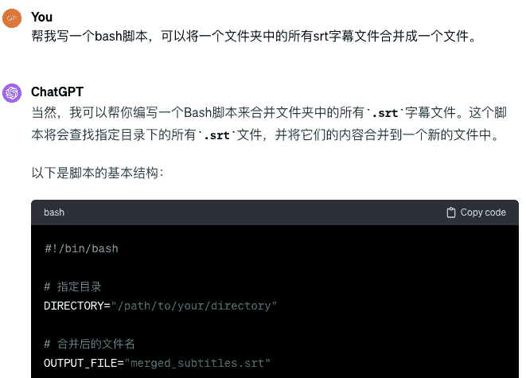
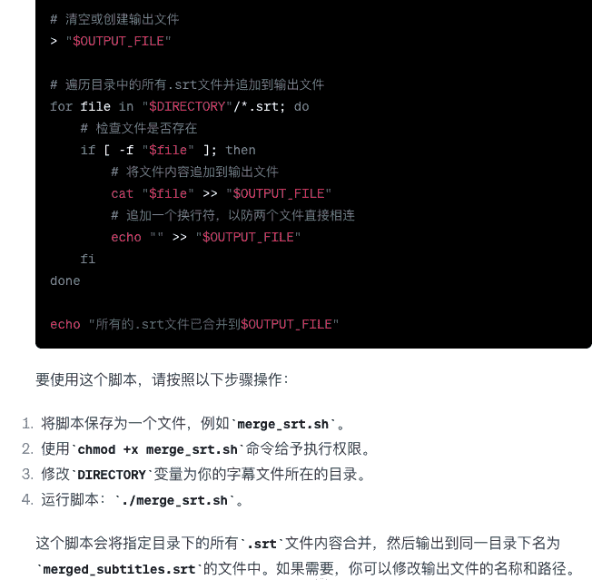
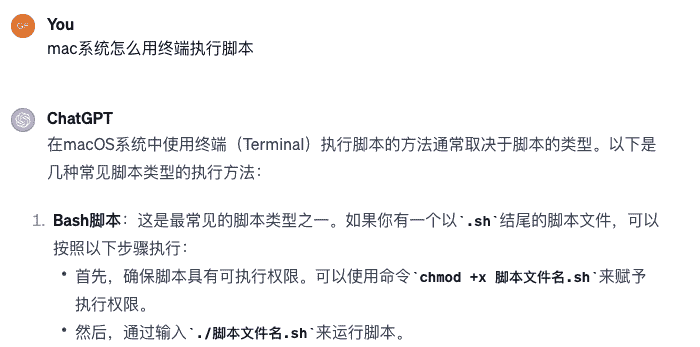
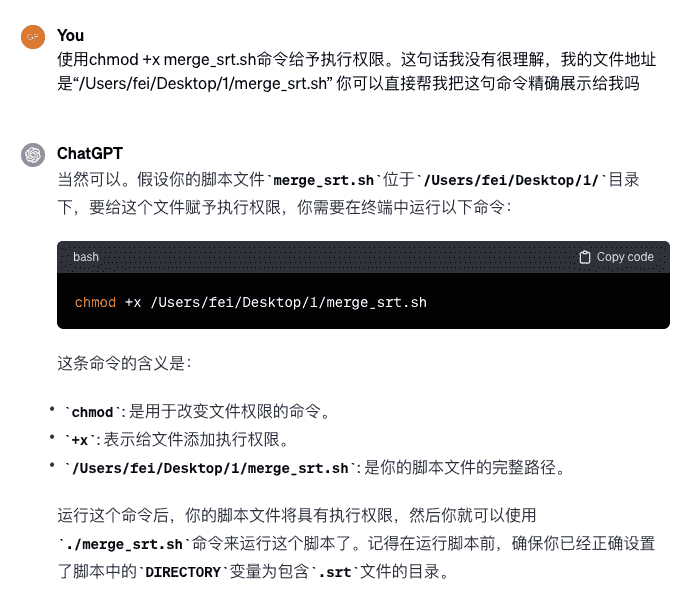

# 阿飞：GPT手把手教我从一窍不通到成功写出实用脚本

> 来源：[https://waytoagi.feishu.cn/docx/Rd9VdXSyToZTKWxjLwtcwcVpnof](https://waytoagi.feishu.cn/docx/Rd9VdXSyToZTKWxjLwtcwcVpnof)

本人电脑小白，平时眼高手低的嘴强王者99999999999999999      呀吧是是是 99999999999999999。今天因为业务原因，需要把100多个文档（srt字幕文件）进行合并，通过GPT翻译后，再依据某个规则重新原样分开。

这个听起来就头大，如果是几个文档，我手动合并了再分开就好，但100多个促使我想更好的解决方案。

我先去有程序员在的微信小群里问了一下，程序员朋友说写个脚本，批处理一下就好，但是，他转折道：我在看孩子，她老碰我胳膊，写不了，得晚上等娃睡了才能帮你。

我可等不到晚上，然后他说你要么让GPT帮你写，很快，非常快。

我之前没用过脚本，或者说不懂脚本怎么用。但尊严让我回复：好好好，我去试试。

我用GPT几个月了，一开始我当百度用，以前百度的问题现在就用GPT问一下，4.0之后这个功能更好用，成为了我材料搜集整理的利器。后来慢慢熟悉了操作，会以一个工作伙伴的身份去跟他聊，而且不用担心它因为问题过于白痴而嘲笑我。

所以这次我打算把GPT当成我的程序员小伙伴，请它手把手教我把脚本写出来，并且成功用起来。

于是我问他：**帮我写一个bash脚本，可以将一个文件**夹中的所有srt字幕文件合并成一个文件。

是的，几秒钟就可以完成脚本，并且给你执行的步骤。你可能会问你怎么知道要写bash脚本的？

因为我提前问他了：

到这一步其实对我来说只是十里长征的第**一步，因为给我的这堆代**码，虽然我会复制，但sh文件壳子怎么做？这不是为难胖虎吗？

所以我就不客气：

下一个难题：文件目录怎么加到脚本里进行替换，保留哪些符号、有没有空格？我是不懂的。但是不要灰心，也不要烦躁，一点点来，请GPT帮你。于是我就直接跟他说我不会，我把文件目录地址发给他，说你帮我直接准确写出这一段：

这是举个解决问题思路的例子，对大家来说可能不是问题，请原谅我的小白。

一切准备就绪，然后我开始在终端里执行这个脚本了，激动。然后我输入“chmod +x merge_srt.sh”命令给予执行权限，是的，无效。但我不知道问题出在哪里。这要是对面是我朋友，我不太好意思问的。

但对方好在是GPT，我跟他说这句话我不理解，要么你帮我搞？

GPT可能看穿了我的小白内核，干脆又附送了保姆级攻略，两条命令输入之后，本来需要我打开-复制-粘贴-关闭100次的问题，需要我等我朋友哄好孩子深夜帮我的问题，已经解决了，一个新文档出现在文件夹里，打开查看，完美无缺。

然后我再接再厉，又用这个方法完美做出来文档分割的批处理脚本，解决了下一个难题。

这个分享希望能给大家一点用GPT沟通的思路：

1、从思想上，不要把他看作百度或者娱乐对话的工具，他是一个工作室，你无所不能的同事和伙伴，是真正的生产力。

2、相信他的无所不能（暂且相信，有些他确实不行-。-），大胆提要求让他帮你完成。不问问咋知道它不会呢？

3、明确自己的需求，跟GPT提的要求尽量准确，像给自己的员工安排工作那样。

4、不断的追问，只要不明白，就目标明确、表达精确的追问。

5、GPT在不了解你工作环境和个性需求的时候，只能把你当做“大家”，提供的是一个共性帮助，如果你需要贴身保姆级的就把自己准确信息给它，就像我文中写的那样，直接贴给他你的文件目录地址，请他直接给你做好。

总之，提问的逻辑和准确度，是能不能用好GPT的核心竞争力。