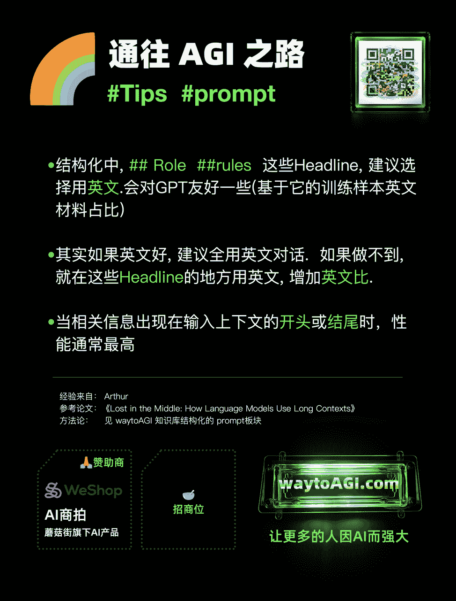
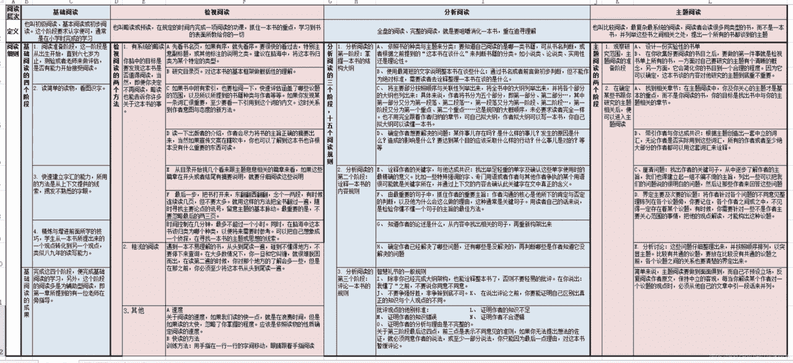

# Tips

> 来源：[https://waytoagi.feishu.cn/docx/Qdiwdxy0Wo1MaMxX3pXcNmoRnSD](https://waytoagi.feishu.cn/docx/Qdiwdxy0Wo1MaMxX3pXcNmoRnSD)

论文地址：https://ywh1bkansf.feishu.cn/record/1sfvuSvzvEGA0Ka5vMuyA2IMl

可以借用一些比较成熟有经验的框架体系，来对AI 提出要求

https://xie.infoq.cn/article/3887bfdd55b4ebedca0c251ed

结构化有利于具有稳定性和有效性的内容输出（理性框架）。非结构化适合对连续对话有足够掌控能力的表达者和创意工作者（感性创意）。无定法，各取所需吧。--小七姐

BBo布布

分享一个我的无敌chat自定义脚本：- -！

https://chat.openai.com/share/b22133a0-20f0-4036-aad3-f500af767c50