# 南瓜博士：用GPT写的油猴脚本

> 来源：[https://waytoagi.feishu.cn/docx/BnvPd9Av6oJbTxxhLbvcDTXdnFe](https://waytoagi.feishu.cn/docx/BnvPd9Av6oJbTxxhLbvcDTXdnFe)

> 作者：南瓜博士

> 项目开源地址：https://github.com/1766left/EasyFill

> 🔧EasyFill 是一个油猴脚本工具，可以在 GPT上使用。它可以帮助用户快速填写选中的文字，并发送到聊天窗口。用户可以选择不同的功能组，并自定义功能的模版。这个工具的便捷之处在于可以方便地选取前面讨论的部分内容，并添加详细指导的模版，省去了很多来回复制粘贴的工作。

>

> 代码在不断迭代中。推荐到  https://github.com/1766left/EasyFill 看最新版哈。

# [**EasyFill**](https://github.com/1766left/EasyFill#easyfill)

添加油猴脚本后在 chat.openai.com 中使用。

最直接的功能——通过菜单选择模版发送 Prompt：

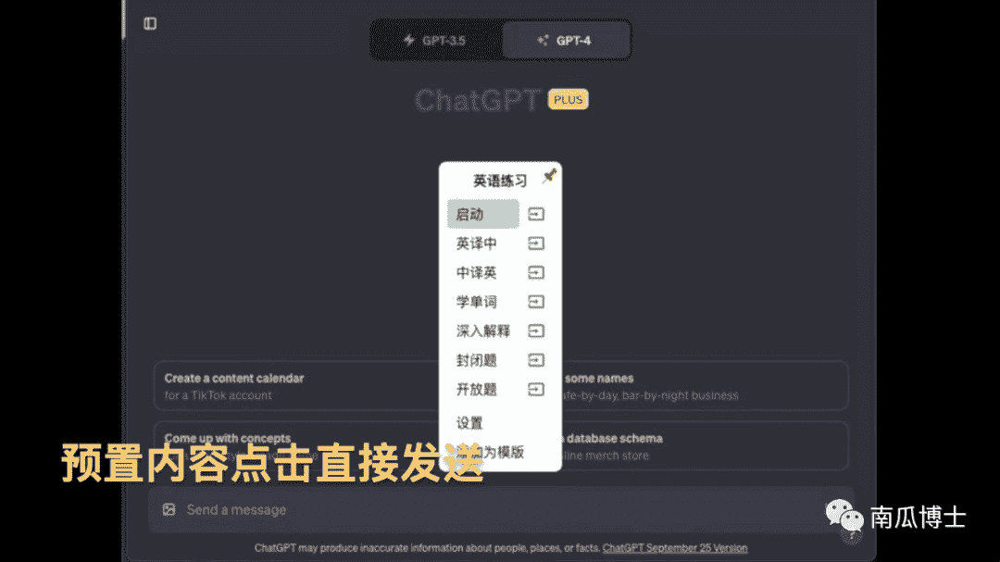

更有用的功能——将选中的内容填充进模版后再发送。

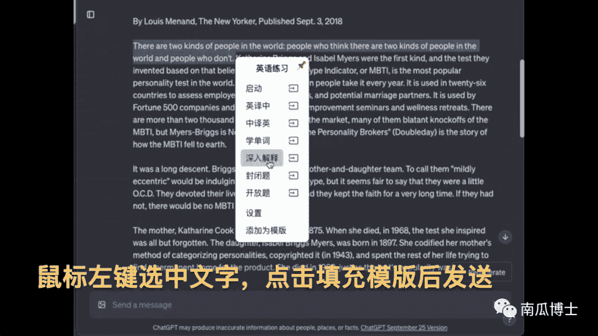

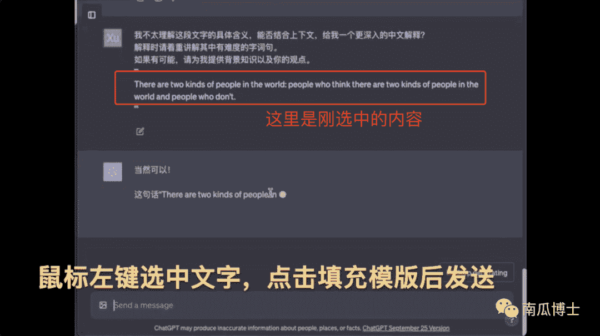

点选菜单文字按钮是直接发送，如果点右侧的图标则是填充到聊天文本框里，编辑后再发送。

菜单上每一项对应一个 Prompt 模版，Prompt 可以根据使用场景放在不同的功能组里，通过“设置”来切换或编辑功能组。

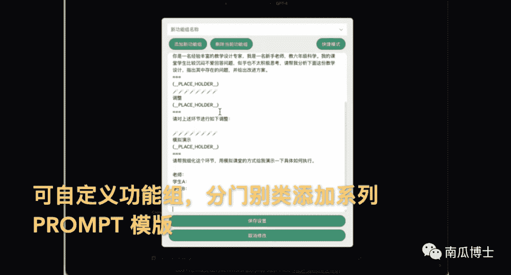

另外有个我超级喜欢的功能，是把用得不错的 Prompt 添加到模版里。我之前在 一个一串一串串——比提问更重要的是追问 里有提到，其实我平时和 GPT 聊天比较随意，很自由地按需调整对话内容。这样一来时不时会遇到些特别有效的对话，选中了内容再点击“添加为模版”，把其中部分修改成 PLACE_HOLDER 的占位符，后续就能反复使用了。

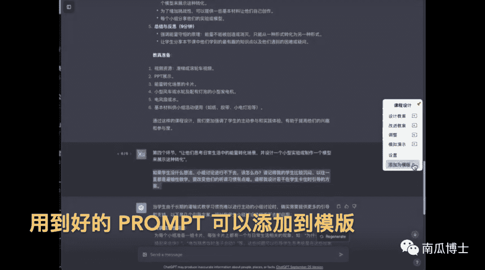

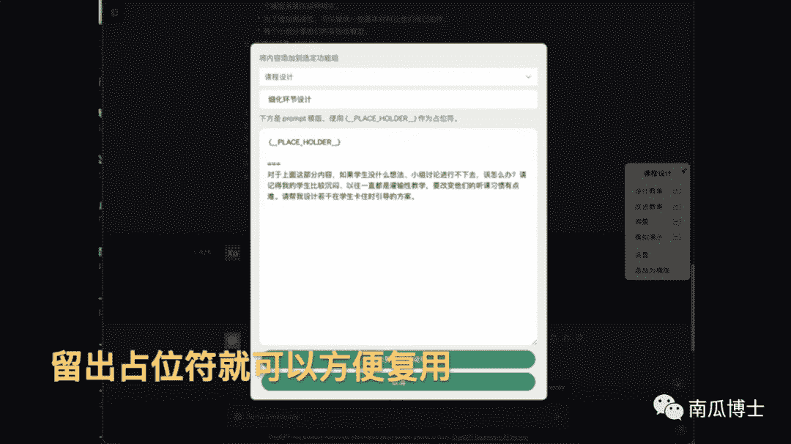

如果你让 GPT 按指定格式输出内容，脚本还可以把文字变成直接可点击的项，连选中文字的麻烦都省了。

这是我写的一个功能组示范：

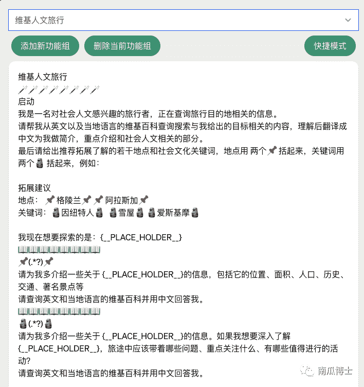

启用该功能组之前 GPT 的原始输出是这样的：

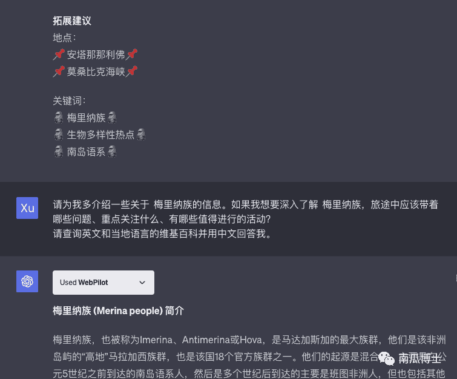

启用后这些特殊 emoji 框起来的内容就都成了可以点击的链接，点后自动补充上“查询英文和当地语言的维基百科并用中文回答我”之类的要求发送出去，真的超方便。

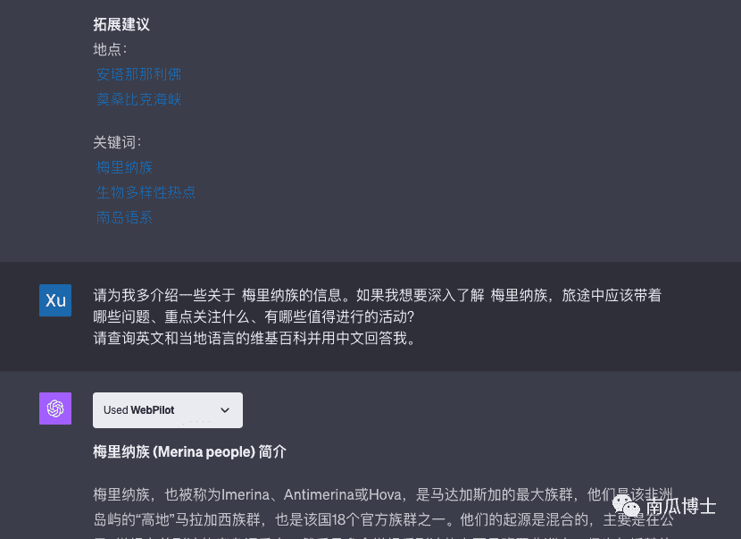

有了这样的功能后，哪怕复杂的游戏，都能顺畅进行了。有图为证——

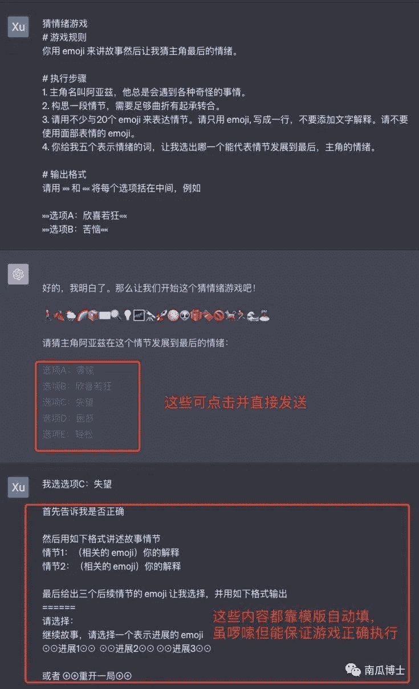

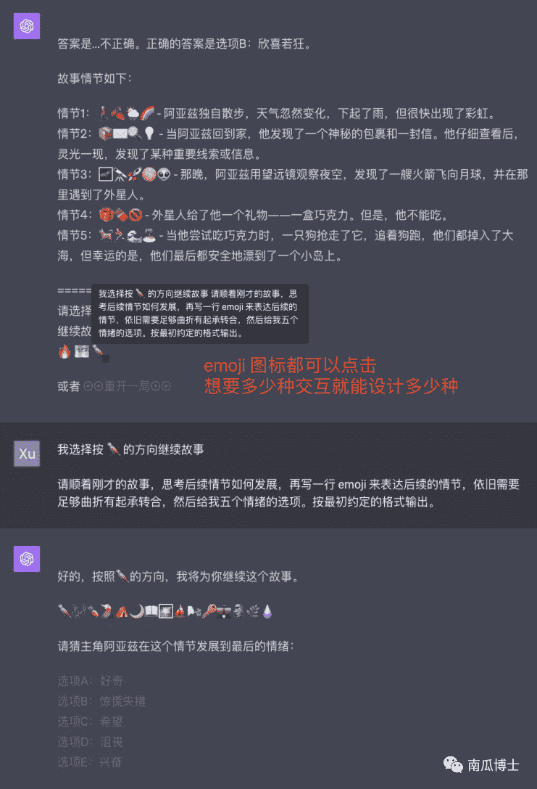

工具分享给朋友们用后，收到了很多反馈。以下功能要感谢朋友们的建议：

+    菜单可以固定在屏幕右侧。固定菜单的好处，一是对于不需要选择文字的 prompt 用起来会更方便；二是对于日常用 GPT 进行的操作，一般说来可以总结成多个步骤，有这么一个菜单在旁边，也可以当作流程提醒。

+   我们不只是在最后的输入框输 prompt，有时候会回到之前的对话重新问。因此，只要中间有编辑框是开启的，当点击菜单右侧小按钮时，就会把内容在所有编辑框里都填充上。

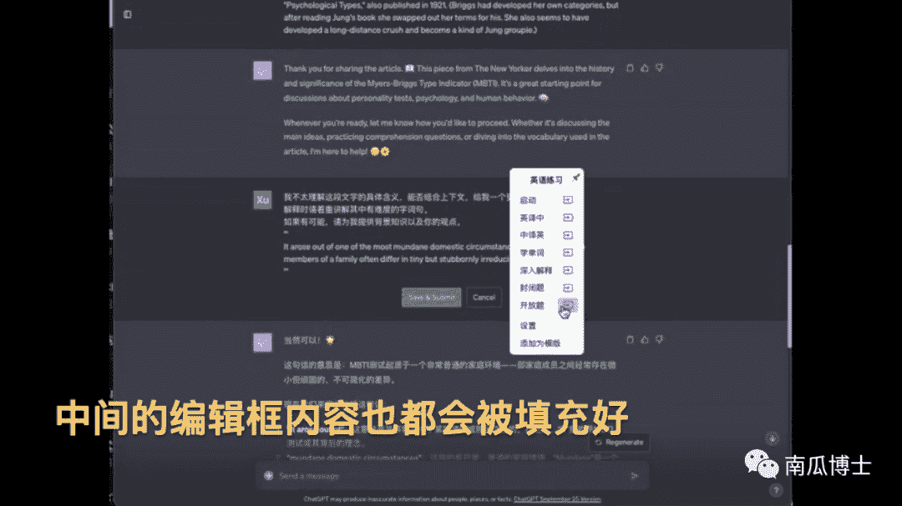

+   有小伙伴不希望菜单在不需要的时候弹出，因此增加了 Shift+左键的模式（在设置中可以和快捷模式切换），开启后要选择文字同时要按住 Shift 键才会有菜单。

+

差不多就这些了。也可以看视频获取直观感受

脚本已开源。感兴趣的小伙伴们，点击阅读原文去 https://github.com/1766left/EasyFill 自取。用把跟目录下的 js 贴到油猴脚本里就能用，或者 chrome 插件的 zip 文件下载了用也行。觉得好的请给 repo 点个 Star，我能有动力继续叠加新功能。

其实这些功能挺简单的，但 GPT 用得多的小伙伴们一定能感受到它多实用。特别欢迎使用插件的伙伴们和我分享你是怎么用的。工具只是便捷操作的一小步，组合了 prompt 设计好的工作流，才是发挥 AI 功力的最重要因素。所以欢迎关注南瓜博士微信公众号后台回复 easyfill, 获取入群二维码，在群里交流使用心得和提新需求。

## [**使用方法**](https://github.com/1766left/EasyFill#%E4%BD%BF%E7%94%A8%E6%96%B9%E6%B3%95)

选中页面上任意一段文字，点击按钮，工具就会把你选中的内容填入 {__PLACE_HOLDER__} 的位置并发送。 如果想要编辑下再发送，可以点击右侧的铅笔图标。

最后一个“设置”可用于修改菜单项。

这个工具的便[捷之处，](https://chat.openai.com/share/56c0665b-7265-47ac-b40a-774bf3fc557e)在于你可以方便地选取前面讨论的部分内容，并添加详细指导的 prompt，省去了很多来回 copy&paste 的工作。

可以参考这个使用示范 理解工具的用途。请注意那些看着就很麻烦的 prompt 都是自动填充模版生成的。

## JS代码

代码最近在不断迭代中。推荐到  https://github.com/1766left/EasyFill 看最新版哈。

1.  浏览器中安装Tampermonkey：https://chrome.google.com/webstore/detail/tampermonkey/dhdgffkkebhmkfjojejmpbldmpobfkfo

1.  将以下内容黏贴到 Tampermonkey中：

```
// ==UserScript==
// @name         EasyFill
// @namespace    http://easyfill.tool.elfe/
// @version      0.9
// @description  超级方便的 GPT 对话助手，通过划选或点击，把内容填充到预置 prompt 模版直接发送。支持多个功能组设置。
// @author       Elfe &amp; ttmouse &amp; GPT
// @match        https://chat.openai.com/*
// @icon         
// @grant        none
// ==/UserScript==

// Copyright (c) 2023 ElfeXu (Xu Yanfei)
// Licensed under the MIT License.

const setting_usage_text = `使用说明
通过 🪄 分隔按钮
📖 之后的是直接在原文替代成链接的内容
🪄🪄🪄🪄🪄🪄🪄🪄
功能一
这里是预设的 prompt  ，{__PLACE_HOLDER__} 里的内容会被你鼠标选中的文字替代掉。
🪄🪄🪄🪄🪄🪄🪄🪄
功能二
点击菜单文字可以直接发送，点击右边会把 prompt 填充到输入框，可以编辑后再发送。
🪄🪄🪄🪄🪄🪄🪄🪄
CLICK 示范
通过要求 GPT 以特定格式生成内容，可以将内容转化成链接，点击即直接发送。例如
请给我五个和有水关的英文单词，用两个方括号 [[]] 来标记。
再用列表的方式给出三个和水有关的节日，节日名称写在 💦  💦 之间
📖📖📖📖📖📖📖📖
\[\[(.*?)\]\]
请帮我解释一下{__PLACE_HOLDER__}这个词的意思
📖📖📖📖📖📖📖📖
💦(.*?)💦
请帮我详细介绍一下{__PLACE_HOLDER__}。
`

const setting_new_setting_text = `新功能组名称
这里可以填写功能组使用说明
通过 🪄 分隔按钮
🪄🪄🪄🪄🪄🪄🪄🪄
第一行是按钮名称
第二行开始是prompt。{__PLACE_HOLDER__} 里的内容会被你鼠标选中的文字替代掉。
🪄🪄🪄🪄🪄🪄🪄🪄
第二个功能
第二个prompt
prompt多长都没关系
各种奇怪字符也都可以用
只根据连续八个🪄来分隔功能
📖📖📖📖📖📖📖📖
\[\[(.*?)\]\]
在按钮之后可以用八个📖分隔，带上点击直接发送的内容。
第一行是正则匹配，后面是模版。匹配到的内容会替代掉{__PLACE_HOLDER__}中的内容然后被直接发送。
`;

const default_setting_texts = [
    `英语练习
先点启动，再贴大段文章，然后需要干啥就选中了文字点啥功能
🪄🪄🪄🪄🪄🪄🪄🪄
启动
你是我的英语老师，我需要你陪我练习英语，准备托福考试。
请**用英语和我对话**，涉及英语例句、题目和话题探讨时请用托福水平的书面英语，但在我明确提出需要时切换到中文。
为了让我的学习更愉悦，请用轻松的语气，并添加一些 emoji。
接下来我会给你一篇英文文章，请记住文章，然后我会向你请求帮助。
如果你理解了，请说 Let&#x27;s begin！
🪄🪄🪄🪄🪄🪄🪄🪄
英译中
请帮我把下面这段话翻译直译成中文，不要遗漏任何信息。
然后请判断文字是否符合中文表达习惯，如果不太符合，请重新意译，在遵循愿意的前提下让内容更通俗易懂。
输出格式应该是

直译：直译的内容
---
（如果有必要的话）意译：意译的内容

待翻译的内容：
&#x27;&#x27;&#x27;
{__PLACE_HOLDER__}
&#x27;&#x27;&#x27;
🪄🪄🪄🪄🪄🪄🪄🪄
中译英
请帮我用最地道的方式帮我把下面这段话翻译成英文。

待翻译的内容：
&#x27;&#x27;&#x27;
{__PLACE_HOLDER__}
&#x27;&#x27;&#x27;
🪄🪄🪄🪄🪄🪄🪄🪄
学单词
&#x27;&#x27;&#x27;
{__PLACE_HOLDER__}
&#x27;&#x27;&#x27;

请帮我学习这个单词
1. 请给出单词的音标、词性、中文意思、英文意思
2. 如果我们前面的讨论中出现过这个单词，请结合它的上下文，重点讲解在上下文中单词的意思和用法
3. 请给出更多例句
4. 如果有容易混淆的单词，请给出对比
🪄🪄🪄🪄🪄🪄🪄🪄
深入解释
我不太理解这段文字的具体含义，能否结合上下文，给我一个更深入的中文解释？
解释时请着重讲解其中有难度的字词句。
如果有可能，请为我提供背景知识以及你的观点。
&#x27;&#x27;&#x27;
{__PLACE_HOLDER__}
&#x27;&#x27;&#x27;
🪄🪄🪄🪄🪄🪄🪄🪄
封闭题
请对下面这段文字，按照托福阅读理解的难度，用英文为我出三道有标准答案的问答题。
请等待我回答后，再告诉我标准答案，并加以解释。
&#x27;&#x27;&#x27;
{__PLACE_HOLDER__}
&#x27;&#x27;&#x27;
🪄🪄🪄🪄🪄🪄🪄🪄
开放题
请对下面这段文字，按照托福口语和作文的难度，用英文为我出一道开放题，我们来进行探讨。
&#x27;&#x27;&#x27;
{__PLACE_HOLDER__}
&#x27;&#x27;&#x27;

`,
setting_usage_text
];

const LSID_SETTING_TEXTS = &#x27;setting_texts_v0.4&#x27;;
const LSID_SETTING_CURRENT_INDEX = &#x27;setting_current_index_v0.4&#x27;;
const LSID_MENU_MODE = &#x27;setting_menu_mode&#x27;

////////////////////////// CSS //////////////////////////
const style = `
    .settings-modal {
        position: fixed;
        top: 0;
        left: 0;
        width: 100%;
        height: 100%;
        background-color: rgba(0, 0, 0, 0.7);;
        display: flex;
        justify-content: center;
        align-items: center;
        z-index: 1000;
    }

    .settings-content {
        background-color: #f0f1ee;
        color: #535e5e;
        padding: 20px;
        width: 50%;
        height: 80%;
        overflow-y: auto;
        box-shadow: 0 4px 6px rgba(0, 0, 0, 0.1);
        border-radius: 10px;
        display: flex;
        flex-direction: column;
        padding: 20px;
        gap: 10px;
    }

    .buttonsContainer {
        display: flex;
        justify-content: space-between;
        align-items: center;  /* 确保子元素在垂直方向上居中 */
        width: 100%;
    }    

    .settings-dropdown {
        outline: none;
        border: 0px;
    }

    .settings-input {
        width: 100%;
        padding: 8px 20px;
        background-color: #fff;
        color: #000;
        border: 0;
        border-radius: 5px;
    }

    .settings-textarea {
        width: 100%;
        height: calc(100% - 60px);
        resize: vertical;
        background-color: #fff;
        color: #000;
        border-radius: 0.75em;
        border: 0px;
        padding: 18px 18px;
        box-shadow: rgba(0, 0, 0, 0.05) 0px 0px 0px 0.5px, rgba(0, 0, 0, 0.024) 0px 0px 5px, rgba(0, 0, 0, 0.05) 0px 1px 2px;
    }

    .settings-button {
        background-color: #469c7b;
        color: #fff;
        padding: 8px 18px;
        border: none;
        border-radius: 30px;
        cursor: pointer;
        margin: 0 5px;
    }

    .settings-button:hover {
        background-color: #93B1A6;
    }

    .settings-button:disabled {
        background-color: #B4B4B3;  /* 灰色背景 */
        color: #808080;            /* 深灰色文字 */
        cursor: not-allowed;       /* 禁用的光标样式 */
    }

    .setting-confirm {
        position: absolute;
        top: 50%;
        left: 50%;
        transform: translate(-50%, -50%);
        background-color: #f0f1ee;
        border-radius: 10px;
        box-shadow: 0 4px 6px rgba(0, 0, 0, 0.1);
        display: none;
        flex-direction: column;
        gap: 10px;
        padding: 20px;
        z-index: 2000; 
    }
    
    .confirm-content {
        color: #535e5e;
        display: flex;
        flex-direction: column;
        gap: 10px;
    }

    #contextMenu {
        display: none;
        position: absolute;
    }

    .pinned-menu {
        position: fixed;
        right: 10px; 
        top: 50%; 
        transform: translateY(-50%); /* 这将使元素垂直居中，无论其高度是多少 */
    }
    
    #menuContainer {
        width: auto;
        display: inline-block;
        background-color: #fff;
        color: #000;
        border-radius: 0.55em;
        padding: 5px;
        box-shadow: rgba(0, 0, 0, 0.25) 0px 0px 0px 0.5px, rgba(0, 0, 0, 0.1) 0px 2px 5px, rgba(0, 0, 0, 0.05) 0px 3px 3px;
        border-bottom: 1px solid #f0f0f0;
    }

    #menuContainer div {
        display: flex;
        align-items: center;
        width: auto;
        padding: 2px 0;
        margin: 0px;
    }

    #menuContainer div.menu-title {
        display: flex;
        align-items: center;
        justify-content: center;
        padding: 5px 0;
        font-weight: bold;
    }
    
    #menuContainer div.menu-separator {
        width: 100%;
        height: 1px;
        background-color: #f0f0f0;
        margin: 2px 0;
        padding: 0px 10px;
    }

    #menuContainer div.menu-item {
        display: flex;
        align-items: center;
        width: auto;
        max-width: 200px; 
        min-width: 120px;
        padding: 0 0;
        margin: 0 5px;
    }

    #menuContainer button.menu-button {
        border: none;
        background: none;
        padding: 5px 10px;
        margin: 0;
        white-space: nowrap;
        border-radius: 5px;
        transition: background-color 0.3s ease;
    }

    #menuContainer button.menu-button:hover {
        background-color: #469c7b5c;
    }

    #menuContainer button.menu-button:disabled {
        height: 1px;
        color: #c6c6c600;
        padding: 0;
        border-bottom: 1px solid #dddddd8c;
    }

    #menuContainer button.menu-button:disabled:hover {
        background: none;
    }

    #menuContainer button.left-part {
        flex-grow: 1;
        flex-shrink: 0;
        flex-basis: auto;
        max-width: 160px;
        text-align: left;
        overflow: hidden;       /* 这会确保内容被裁剪 */
        white-space: nowrap;    /* 防止文本换行 */
        text-overflow: ellipsis;/* 超出的文本将显示为... */
    }

    #menuContainer button.right-part {
        flex-grow: 0;
        flex-shrink: 0;
        width: 40px;
        text-align: right;
    }

    #menuContainer button.icon {
        width: 24px;
        height: 24px;
    }

    /* 使链接看起来更像链接 */
    .custom-link {
        text-decoration: underline;
        cursor: pointer;  /* 当鼠标放上去时变成手的样子 */
        position: relative;  /* 为了定位 tooltip */
    }

    /* 提示（tooltip）样式 */
    .custom-link:hover::after {
        content: attr(data-text);  /* 显示 data-text 的内容 */
        position: absolute;
        bottom: 100%;  /* 出现在链接的上方 */
        left: 0;  /* 与链接的左边界对齐 */
        width: max-content;  /* 根据内容设置宽度 */
        max-width: 300px;  /* 设置最大宽度 */
        white-space: normal;  /* 允许文本换行 */
        line-height: 18px;
        max-height: 120px;
        overflow: hidden;
        background-color: #333;  /* 背景色 */
        color: white;  /* 文字颜色 */
        padding: 5px 10px;  /* 内边距 */
        border-radius: 4px;  /* 边框圆角 */
        font-size: 12px;  /* 文字大小 */
        z-index: 10;  /* 保证 tooltip 出现在其他元素的上方 */
    }

    /* 添加一个小三角形在 tooltip 的下方 */
    .custom-link:hover::before {
        content: &#x27;&#x27;;
        position: absolute;
        bottom: -5px;  /* 出现在 tooltip 的正下方 */
        left: calc(50% + 5px);  /* 让小三角形出现在链接的中央 */
        width: 10px;  /* 宽度 */
        height: 10px;  /* 高度 */
        background-color: #333;  /* 与 tooltip 的背景色相同 */
        z-index: 9;  /* 出现在 tooltip 下方 */
    }
`;

const svgEditBeforeSend = &quot;M896 128.426667H128c-47.146667 0-85.333333 38.186667-85.333333 85.333333V384h85.333333V212.906667h768v598.613333H128V640H42.666667v171.093333c0 47.146667 38.186667 84.48 85.333333 84.48h768c47.146667 0 85.333333-37.546667 85.333333-84.48v-597.333333c0-47.146667-38.186667-85.333333-85.333333-85.333333zM469.333333 682.666667l170.666667-170.666667-170.666667-170.666667v128H42.666667v85.333334h426.666666v128z&quot;;

const styleElement = document.createElement(&#x27;style&#x27;);
styleElement.innerHTML = style;
document.head.appendChild(styleElement);

////////////////////////// Send Prompt functions //////////////////////////
let setting_texts = JSON.parse(localStorage.getItem(LSID_SETTING_TEXTS)) || default_setting_texts;
let setting_current_index = localStorage.getItem(LSID_SETTING_CURRENT_INDEX) || 0;
let current_setting_text = setting_texts[setting_current_index];
let menu_mode = localStorage.getItem(LSID_MENU_MODE) || &#x27;&#x27;; // 后续还可以支持更多自定义模式。目前 &#x27;&#x27; 代表默认模式，即点击鼠标直接出菜单；非 &#x27;&#x27; （&#x27;shift&#x27;）代表需要同时按住 shift 键才会出菜单 

function replace_all_textarea(text) {
    // 查找所有匹配按钮文本 &quot;Save &amp; Submit&quot; 的 div
    let buttons = Array.from(document.querySelectorAll(&#x27;div.flex.w-full.gap-2.items-center.justify-center&#x27;));

    buttons.forEach(button =&gt; {
        // 检查按钮文本是否为 &quot;Save &amp; Submit&quot;
        if (button.textContent.trim() === &#x27;Save &amp; Submit&#x27;) {
            // 向上查找其祖先元素，直到找到一个拥有 `flex flex-grow flex-col gap-3 max-w-full` 这个 class 的 div
            let parentDiv = button.closest(&#x27;.flex.flex-grow.flex-col.gap-3.max-w-full&#x27;);

            if (parentDiv) {
                // 在这个祖先 div 内，查找 `textarea` 元素
                let textarea = parentDiv.querySelector(&#x27;textarea&#x27;);

                if (textarea) {
                    // 替换这个 `textarea` 的内容为 &quot;TEMPLATE_TEXT&quot;
                    textarea.value = text;
                }
            }
        }
    });
}

async function sendToGPT(template, selectedText, sendDirectly) {
    let placeholderPosition = template.indexOf(&#x27;{__PLACE_HOLDER__}&#x27;);
    let finalText = template.replace(&#x27;{__PLACE_HOLDER__}&#x27;, selectedText);

    if (!sendDirectly) {
        replace_all_textarea(finalText);
    }

    const inputElement = document.getElementById(&#x27;prompt-textarea&#x27;);
    inputElement.value = finalText;

    const inputEvent = new Event(&#x27;input&#x27;, { &#x27;bubbles&#x27;: true });
    inputElement.dispatchEvent(inputEvent);
    await new Promise(resolve =&gt; setTimeout(resolve, 50));

    if (sendDirectly) {
        const sendButton = document.querySelector(&#x27;[data-testid=&quot;send-button&quot;]&#x27;);
        if (sendButton) {
            sendButton.click();
        }
        inputElement.focus();
    } else {
        inputElement.focus();
        // 设置光标位置
        let cursorPosition;
        if (placeholderPosition !== -1) {
            // 将光标放在替换文本的结束位置
            if (selectedText) {
                cursorPosition = placeholderPosition + selectedText.length;
            } else {
                cursorPosition = placeholderPosition;
            }
        } else {
            cursorPosition = inputElement.value.length; // 光标放在文本末尾
        }
        inputElement.setSelectionRange(cursorPosition, cursorPosition);
    }
}

////////////////////////// Context Menu functions //////////////////////////

// 创建上下文菜单
const contextMenu = document.createElement(&#x27;div&#x27;);
const menuContainer = document.createElement(&#x27;div&#x27;);
let isMenuPinned = false;

function menuMode() {
    return menu_mode;
}

function menuModeText() {
    if (menuMode() == &#x27;&#x27;) {
        return &#x27;快捷模式&#x27;
    } else {
        return &#x27;Shift模式&#x27;
    }
}

function switchMode() {
    if (menuMode() == &#x27;&#x27;) {
        menu_mode = &#x27;shift&#x27;;
    } else {
        menu_mode = &#x27;&#x27;;
    }
    localStorage.setItem(LSID_MENU_MODE, menu_mode);
}

function createPathElement(svgPathData) {
    // 创建一个`path`元素并设置SVG路径数据
    const pathElement = document.createElementNS(&quot;http://www.w3.org/2000/svg&quot;, &quot;path&quot;);
    pathElement.setAttribute(&quot;d&quot;, svgPathData);
    pathElement.setAttribute(&quot;fill&quot;, &quot;#5D5D5D&quot;);
    return pathElement;
}

function createPinButton() {
    const pinButton = document.createElement(&#x27;button&#x27;);
    pinButton.innerHTML = &#x27;📌&#x27;; // 使用pin emoji作为按钮的内容
    pinButton.style.position = &#x27;absolute&#x27;;
    pinButton.style.right = &#x27;5px&#x27;;
    pinButton.style.top = &#x27;5px&#x27;;
    pinButton.onclick = function() {
        isMenuPinned = !isMenuPinned;
        pinButton.innerHTML = isMenuPinned ? &#x27;🔓&#x27; : &#x27;📌&#x27;;
    
        if (isMenuPinned) {
            menuContainer.classList.add(&#x27;pinned-menu&#x27;);
        } else {
            menuContainer.classList.remove(&#x27;pinned-menu&#x27;);
        }
    };    
    return pinButton;
}

function createMenuTitle() {
    const menuTitle = document.createElement(&#x27;div&#x27;);
    menuTitle.classList.add(&#x27;menu-title&#x27;);
    menuTitle.innerHTML = setting_current_index;
    menuTitle.innerHTML = setting_texts[setting_current_index].split(&#x27;\n&#x27;)[0];
    return menuTitle;
}

function createMenuSeparator() {
    const separator = document.createElement(&#x27;div&#x27;);
    separator.classList.add(&#x27;menu-separator&#x27;);
    return separator;
}

// 创建单个菜单项
function createMenuItem(label, icon, action1, action2) {
    const menuItem = document.createElement(&#x27;div&#x27;);
    menuItem.classList.add(&#x27;menu-item&#x27;);

    const leftPart = document.createElement(&#x27;button&#x27;);
    leftPart.classList.add(&#x27;menu-button&#x27;, &#x27;left-part&#x27;);
    leftPart.innerHTML = label;

    if (action1 == null) {
        leftPart.disabled = true;
    } else {
        leftPart.onclick = () =&gt; {
            action1();
            hideContextMenu();
        };
    }
    menuItem.appendChild(leftPart);

    if (action2 != null) {
        const rightPart = document.createElement(&#x27;button&#x27;)
        rightPart.classList.add(&#x27;menu-button&#x27;, &#x27;right-part&#x27;);

        if (icon != null) {
            // 创建一个SVG元素并设置属性
            const rightIcon = document.createElementNS(&quot;http://www.w3.org/2000/svg&quot;, &quot;svg&quot;);
            rightIcon.setAttribute(&quot;viewBox&quot;, &quot;0 0 1024 1024&quot;);  // 这个属性需要保留在这里
            rightIcon.classList.add(&quot;icon&quot;);
            rightIcon.appendChild(createPathElement(icon));
            rightPart.appendChild(rightIcon);
        } else {
            rightPart.innerHTML = &#x27;≋&#x27;;
        }

        rightPart.onclick = () =&gt; {
            action2();
            hideContextMenu();
        };
        menuItem.appendChild(rightPart);
    }

    return menuItem;
}

function hideContextMenu() {
    if (isMenuPinned) {
        return;
    }

    contextMenu.style.display = &#x27;none&#x27;;
}

function showContextMenu(event) {
    const margin  = 20;
    const width = contextMenu.offsetWidth + margin;
    const height = contextMenu.offsetHeight + margin;
    const windowWidth = window.innerWidth;
    const windowHeight = window.innerHeight;
    
    // 如果菜单超出了右侧窗口边缘
    if (event.clientX + width &gt; windowWidth) {
        contextMenu.style.left = `${windowWidth - width}px`;
    } else {
        contextMenu.style.left = `${event.clientX}px`;
    }
    
    // 如果菜单超出了底部窗口边缘
    if (event.clientY + height &gt; windowHeight) {
        contextMenu.style.top = `${windowHeight - height}px`;
    } else {
        contextMenu.style.top = `${event.clientY}px`;
    }
    
    contextMenu.style.display = &#x27;block&#x27;;
}

function updateMenuItems() {
    parseSettingsText(current_setting_text);

    menuContainer.innerHTML = &#x27;&#x27;;
    menuContainer.appendChild(createPinButton());
    menuContainer.appendChild(createMenuTitle());
    menuContainer.appendChild(createMenuSeparator());

    menus.forEach((menu, index) =&gt; {
        menuContainer.appendChild(
            createMenuItem(
                menu[0],
                svgEditBeforeSend,
                async function() {
                    await sendToGPT(menu[1], window.getSelection().toString().trim(), true);
                },
                async function() {
                    await sendToGPT(menu[1], window.getSelection().toString().trim(), false);
                },
        ));
    });

    menuContainer.appendChild(createMenuSeparator());
    menuContainer.appendChild(createMenuItem(&#x27;设置&#x27;, null, function() {showSettingsModal();}, null));
    menuContainer.appendChild(createMenuItem(&#x27;添加为模版&#x27;, null, function() {showAddTemplateModal(window.getSelection().toString().trim());}, null));
}

function isMenuVisible() {
    return contextMenu.style.display == &#x27;block&#x27;;
}

function shouldResponseForContextMenu(event) {
    if (isMenuPinned) {
        if (!isMenuVisible())  { 
            // Should not be here. Just to make sure pin is removed if menu is not visible.
            isMenuPinned = false;
        }
        return false;
    }

    // 查找 settings-modal，如果 settings-modal 存在，就不响应右键菜单
    const settingsModal = document.querySelector(&#x27;.settings-modal&#x27;);
    if (settingsModal) {
        return false;
    }

    if (menuMode() != &#x27;&#x27; &amp;&amp; !event.shiftKey) {
        return false;
    }

    return true;
}

function initContextMenu() {
    contextMenu.id = &#x27;contextMenu&#x27;;
    menuContainer.id = &#x27;menuContainer&#x27;;
    contextMenu.appendChild(menuContainer);
    document.body.appendChild(contextMenu);

    updateMenuItems();

    document.addEventListener(&#x27;mouseup&#x27;, function(event) {
        if (!shouldResponseForContextMenu(event)) {
            return;
        }
        const selectedText = window.getSelection().toString();
        if (selectedText.length == 0) {
            hideContextMenu();
        } else {
            showContextMenu(event);
        }
    });

    document.addEventListener(&#x27;dblclick&#x27;, function(event) {
        if (!shouldResponseForContextMenu(event)) {
            return;
        }
        showContextMenu(event);
    });

    document.addEventListener(&#x27;keydown&#x27;, (event) =&gt; {
        if (event.key === &#x27;Escape&#x27;) {
            hideContextMenu();
        }
    });
}

////////////////////////// Easy Click functions //////////////////////////

let isUpdating = false;
let rerunTimeout;
let intervalID;
let shouldContinue = true;

// 点击事件处理器
async function clickHandler(event) {
    //event.preventDefault();
    console.log(&#x27;执行 clickHandler&#x27;); // 执行点击事件处理器
    const inputElement = document.getElementById(&#x27;prompt-textarea&#x27;); // 获取输入框
    console.log(&#x27;[Debug] 获取输入框元素&#x27;);
    inputElement.value = this.getAttribute(&quot;data-text&quot;); // 将链接文本添加到输入框
    console.log(&#x27;[Debug] 设置输入框值&#x27;);
    const inputEvent = new Event(&#x27;input&#x27;, { &#x27;bubbles&#x27;: true }); // 创建input事件
    console.log(&#x27;[Debug] 创建 input 事件&#x27;);
    inputElement.dispatchEvent(inputEvent); // 触发input事件
    console.log(&#x27;[Debug] 触发 input 事件&#x27;);

    await new Promise(resolve =&gt; setTimeout(resolve, 50));
    console.log(&#x27;[Debug] 50ms 延时完成&#x27;);

    const sendButton = document.querySelector(&#x27;[data-testid=&quot;send-button&quot;]&#x27;);
    console.log(&#x27;[Debug] 获取发送按钮&#x27;);
    if (sendButton) {
        console.log(&#x27;点击发送按钮&#x27;);
        sendButton.click();
        console.log(&#x27;[Debug] 开启监听&#x27;);
    }

}

function replace_text(original) {
    clicks.forEach(([regExpression, template]) =&gt; {
        original = original.replace(regExpression, (match, p1) =&gt; {
            // 使用模板替换找到的匹配项
            let replaced = template.replace(/{__PLACE_HOLDER__}/g, p1);
            if (template.includes(&#x27;{__PLACE_HOLDER__}&#x27;)) {
                return `&lt;a class=&quot;custom-link&quot; data-text=&quot;${replaced}&quot;&gt;${p1}&lt;/a&gt;`;
            } else {
                return `&lt;a class=&quot;custom-link&quot; data-text=&quot;${replaced}&quot;&gt;${regExpression.source}&lt;/a&gt;`;
            }
        });
    });
    return original;
}

// 处理元素
function processElement(element) {
    if (isUpdating) {
        return;
    }

    const hidden_characters = &quot;\u200B\u200B\u200B\u200B\u200B\u200B&quot;;

    let innerHTML = element.innerHTML;

    if (innerHTML.startsWith(hidden_characters)) {
        return; // 不重复处理
    }

    // 处理[[ ]] 符号
    const bracketRegex = /\[\[(.*?)\]\]/g;
    innerHTML = replace_text(innerHTML);

    // 替换了 innerHTML 后，原本网页中 Copy code 之类的事件监听就失效了。
    // 为了尽可能让两个功能共存，这里仅对文字有改动的重新赋值。
    if (innerHTML != element.innerHTML) {
        element.innerHTML = hidden_characters + innerHTML; // 添加隐藏字符，避免重复处理
    }

    // 给新生成的链接添加事件监听
    const customLinks = element.querySelectorAll(&#x27;.custom-link&#x27;);
    customLinks.forEach(link =&gt; {
        link.addEventListener(&#x27;click&#x27;, clickHandler);
    });
}

function processAllElements() {
    // 先找到父级对象
    const parentElements = document.querySelectorAll(&#x27;.flex.flex-grow.flex-col.gap-3.max-w-full&#x27;);
    parentElements.forEach(parent =&gt; {
        // 在父级对象下面找特定的子元素
        const chatRecordElements = parent.querySelectorAll(&#x27;div.markdown.prose.w-full.break-words,li&#x27;);
        chatRecordElements.forEach(processElement);
    });
}

// 这个部分是用来检测GPT是否在更新的
function checkUpdateStatus() {
    if (!shouldContinue) return;
    console.log(&#x27;[Debug] 运行 checkUpdateStatus&#x27;);
    const allButtons = document.querySelectorAll(&#x27;button&#x27;);
    const stopGeneratingElement = Array.from(allButtons).find(el =&gt; el.textContent.includes(&quot;Stop generating&quot;));
    if (!stopGeneratingElement &amp;&amp; isUpdating) { // 内容更新完成
        console.log(&#x27;内容更新完成，准备添加链接&#x27;);
        isUpdating = false; // 更新状态设置为false

        if (rerunTimeout) {
            clearTimeout(rerunTimeout); // 清除延时
            console.log(&#x27;[Debug] 清除之前的延时&#x27;);
        }
        // 设置延时，等待2秒
        rerunTimeout = setTimeout(() =&gt; {
            processAllElements();
            stopListening();
        }, 300);
    }
}

function startListening() {
    isUpdating = true;
    shouldContinue = true;
    intervalID = setInterval(checkUpdateStatus, 1000);
    console.log(&#x27;监听已开启&#x27;);
}

function stopListening() {
    shouldContinue = false;
    clearInterval(intervalID);
    console.log(&#x27;监听已停止&#x27;);
}

////////////////////////// Settings functions //////////////////////////

function closeModal(settingConfirm) {
    settingConfirm.style.display = &#x27;flex&#x27;;
}

function createConfirmModal(modal) {
    const settingConfirm = document.createElement(&#x27;div&#x27;);
    settingConfirm.className = &#x27;setting-confirm&#x27;;
    const confirmContent = document.createElement(&#x27;div&#x27;);
    confirmContent.className = &#x27;confirm-content&#x27;;
    const confirmText = document.createElement(&#x27;p&#x27;);
    confirmText.textContent = &#x27;确定放弃修改？&#x27;;
    const confirmYes = document.createElement(&#x27;button&#x27;);
    confirmYes.className = &#x27;settings-button&#x27;;
    confirmYes.textContent = &#x27;确定&#x27;;
    const confirmNo = document.createElement(&#x27;button&#x27;);
    confirmNo.className = &#x27;settings-button&#x27;;
    confirmNo.textContent = &#x27;取消&#x27;;
    confirmYes.onclick = function() {
        modal.remove();
        settingConfirm.style.display = &#x27;none&#x27;; // Hide the confirm box
    }

    confirmNo.onclick = function() {
        settingConfirm.style.display = &#x27;none&#x27;; // Hide the confirm box
    }

    confirmContent.appendChild(confirmText);
    confirmContent.appendChild(confirmYes);
    confirmContent.appendChild(confirmNo);
    settingConfirm.appendChild(confirmContent);
    return settingConfirm;
}

function showSettingsModal() {
    const modal = document.createElement(&#x27;div&#x27;);
    modal.className = &#x27;settings-modal&#x27;;

    const modalContent = document.createElement(&#x27;div&#x27;);
    modalContent.className = &#x27;settings-content&#x27;;

    const textarea = document.createElement(&#x27;textarea&#x27;);
    textarea.className = &#x27;settings-textarea&#x27;;
    textarea.value = current_setting_text;

    const submitButton = document.createElement(&#x27;button&#x27;);
    submitButton.className = &#x27;settings-button&#x27;;
    submitButton.textContent = &#x27;保存设置&#x27;;

    const cancelButton = document.createElement(&#x27;button&#x27;);
    cancelButton.className = &#x27;settings-button&#x27;;
    cancelButton.textContent = &#x27;取消修改&#x27;;

    const settingsDropdown = document.createElement(&#x27;select&#x27;);
    settingsDropdown.className = &#x27;settings-dropdown&#x27;;
    setting_texts.forEach((text, index) =&gt; {
        const option = document.createElement(&#x27;option&#x27;);
        option.value = index;
        option.text = text.split(&#x27;\n&#x27;)[0]; // Assuming the first line is a title or identifier
        settingsDropdown.appendChild(option);
    });
    settingsDropdown.selectedIndex = setting_current_index;
    settingsDropdown.addEventListener(&#x27;change&#x27;, (e) =&gt; {
        const selectedIndex = e.target.value;
        textarea.value = setting_texts[selectedIndex];
        if (setting_texts.length &lt;= 1) {
            deleteSettingButton.disabled = true;
        } else {
            deleteSettingButton.disabled = false;
        }
    });

    const newSettingButton = document.createElement(&#x27;button&#x27;);
    newSettingButton.textContent = &#x27;添加新功能组&#x27;;
    newSettingButton.className = &#x27;settings-button&#x27;;
    newSettingButton.addEventListener(&#x27;click&#x27;, () =&gt; {
        textarea.value = setting_new_setting_text;
        setting_texts.push(textarea.value);
        const option = document.createElement(&#x27;option&#x27;);
        option.value = setting_texts.length - 1;
        option.text = setting_new_setting_text.split(&#x27;\n&#x27;)[0];
        settingsDropdown.appendChild(option);
        settingsDropdown.value = setting_texts.length - 1;
        deleteSettingButton.disabled = false;
    });
    const deleteSettingButton = document.createElement(&#x27;button&#x27;);
    deleteSettingButton.textContent = &#x27;删除当前功能组&#x27;;
    deleteSettingButton.className = &#x27;settings-button&#x27;;
    deleteSettingButton.addEventListener(&#x27;click&#x27;, () =&gt; {
        // 如果只剩一个设置，则不进行删除操作
        if (setting_texts.length &lt;= 1) {
            return;
        }

        let toDelete = settingsDropdown.selectedIndex;

        // 从 setting_texts 数组中删除设置
        setting_texts.splice(toDelete, 1);

        // 从 settingsDropdown 中删除对应的选项
        settingsDropdown.remove(toDelete);

        // 如果删除的是第0项或列表中的最后一项，则默认选择第0项
        if (toDelete === 0 || toDelete === setting_texts.length) {
            settingsDropdown.selectedIndex = 0;
            setting_current_index = 0;
        } else {
            // 否则选择之前的项
            settingsDropdown.selectedIndex = toDelete - 1;
            setting_current_index = toDelete - 1;
        }

        // 更新文本区的值为当前选中的设置
        textarea.value = setting_texts[setting_current_index];

        // 保存到 localStorage
        localStorage.setItem(LSID_SETTING_TEXTS, JSON.stringify(setting_texts));
        localStorage.setItem(LSID_SETTING_CURRENT_INDEX, setting_current_index);

        deleteSettingButton.disabled = setting_texts.length &lt;= 1;
    });

    // 检查是否只剩一个设置，如果是，则禁用删除按钮
    if (setting_texts.length &lt;= 1) {
        deleteSettingButton.disabled = true;
    }

    const modeSettingButton = document.createElement(&#x27;button&#x27;);
    modeSettingButton.textContent = menuModeText();
    modeSettingButton.className = &#x27;settings-button&#x27;;
    modeSettingButton.addEventListener(&#x27;click&#x27;, () =&gt; { 
        switchMode();
        modeSettingButton.textContent = menuModeText();
    });

    submitButton.addEventListener(&#x27;click&#x27;, () =&gt; {
        const selectedSettingIndex = settingsDropdown.selectedIndex;
        if (typeof setting_texts[selectedSettingIndex] === &#x27;undefined&#x27;) {
            console.error(&quot;Trying to save a setting that doesn&#x27;t exist.&quot;);
            return;
        }

        setting_texts[selectedSettingIndex] = textarea.value;
        localStorage.setItem(LSID_SETTING_TEXTS, JSON.stringify(setting_texts));
        localStorage.setItem(LSID_SETTING_CURRENT_INDEX, selectedSettingIndex.toString());
        current_setting_text = textarea.value;
        setting_current_index = selectedSettingIndex;
        if (current_setting_text) {
            updateMenuItems();
            processAllElements();
        }
        modal.remove();
    });

    const settingConfirm = createConfirmModal(modal);
    cancelButton.addEventListener(&#x27;click&#x27;, () =&gt; {
        closeModal(settingConfirm, modal);
    });

    const buttonsLeft = document.createElement(&#x27;span&#x27;);
    const buttonsRight = document.createElement(&#x27;span&#x27;);
    buttonsLeft.appendChild(newSettingButton);
    buttonsLeft.appendChild(deleteSettingButton);
    buttonsRight.appendChild(modeSettingButton);

    const buttonsContainer = document.createElement(&#x27;div&#x27;);
    buttonsContainer.className = &#x27;buttonsContainer&#x27;;
    buttonsContainer.appendChild(buttonsLeft);
    buttonsContainer.appendChild(buttonsRight);
    
    modalContent.appendChild(settingsDropdown);
    modalContent.appendChild(buttonsContainer);
    modalContent.appendChild(textarea);
    modalContent.appendChild(submitButton);
    modalContent.appendChild(cancelButton);
    modal.appendChild(modalContent);
    modal.appendChild(settingConfirm);
    document.body.appendChild(modal);
}

function showAddTemplateModal(selectText) {
    let choosedIndex = setting_current_index;

    const modal = document.createElement(&#x27;div&#x27;);
    modal.className = &#x27;settings-modal&#x27;;

    const labelText = document.createElement(&#x27;p&#x27;);
    labelText.textContent = &#x27;将内容添加到选定功能组&#x27;;

    const modalContent = document.createElement(&#x27;div&#x27;);
    modalContent.className = &#x27;settings-content&#x27;;

    const inputField = document.createElement(&#x27;input&#x27;);
    inputField.type = &#x27;text&#x27;;
    inputField.placeholder = &#x27;这里填写会出现在菜单上的功能名称&#x27;;
    inputField.className = &#x27;settings-input&#x27;;

    const labelInstruction = document.createElement(&#x27;p&#x27;);
    labelInstruction.textContent = &#x27;下方是 prompt 模版，使用 {__PLACE_HOLDER__} 作为占位符。&#x27;

    const textarea = document.createElement(&#x27;textarea&#x27;);
    textarea.className = &#x27;settings-textarea&#x27;;
    textarea.value = selectText;

    const submitButton = document.createElement(&#x27;button&#x27;);
    submitButton.className = &#x27;settings-button&#x27;;
    submitButton.textContent = &#x27;添加到选定功能组&#x27;;
    submitButton.disabled = true;

    function updateSubmitButton() {
        if (inputField.value.trim() == &#x27;&#x27; || textarea.value.trim() == &#x27;&#x27;) {
            submitButton.disabled = true;
        } else {
            submitButton.disabled = false;
        }
    }
    inputField.addEventListener(&#x27;input&#x27;, updateSubmitButton);
    textarea.addEventListener(&#x27;input&#x27;, updateSubmitButton);

    const cancelButton = document.createElement(&#x27;button&#x27;);
    cancelButton.className = &#x27;settings-button&#x27;;
    cancelButton.textContent = &#x27;取消&#x27;;

    const settingsDropdown = document.createElement(&#x27;select&#x27;);
    settingsDropdown.className = &#x27;settings-dropdown&#x27;;
    setting_texts.forEach((text, index) =&gt; {
        const option = document.createElement(&#x27;option&#x27;);
        option.value = index;
        option.text = text.split(&#x27;\n&#x27;)[0]; // Assuming the first line is a title or identifier
        settingsDropdown.appendChild(option);
    });
    settingsDropdown.selectedIndex = choosedIndex;
    settingsDropdown.addEventListener(&#x27;change&#x27;, (e) =&gt; {
        choosedIndex = e.target.value;
    });

    submitButton.addEventListener(&#x27;click&#x27;, () =&gt; {
        choosedIndex = settingsDropdown.selectedIndex;
        if (typeof setting_texts[choosedIndex] === &#x27;undefined&#x27;) {
            console.error(&quot;Trying to save a setting that doesn&#x27;t exist.&quot;);
            return;
        }

        let original = setting_texts[choosedIndex];
        let toAdd = &#x27;\n🪄🪄🪄🪄🪄🪄🪄🪄\n&#x27; + inputField.value + &#x27;\n&#x27; + textarea.value + &#x27;\n&#x27;;
        // 找到 original 中第一个 📖📖📖📖📖📖📖📖 的位置，在此之前插入 textarea.value
        // 如果没有找到，则在末尾插入
        let index = original.indexOf(&#x27;📖📖📖📖📖📖📖📖&#x27;);
        if (index &gt;= 0) {
            setting_texts[choosedIndex] = original.slice(0, index) + toAdd + original.slice(index);
        } else {
            setting_texts[choosedIndex] = original + toAdd;
        }

        localStorage.setItem(LSID_SETTING_TEXTS, JSON.stringify(setting_texts));
        current_setting_text = setting_texts[setting_current_index];
        if (current_setting_text) {
            updateMenuItems();
            processAllElements();
        }
        modal.remove();
    });

    const settingConfirm = createConfirmModal(modal);

    cancelButton.addEventListener(&#x27;click&#x27;, () =&gt; {
        closeModal(settingConfirm, modal);
    });

    modalContent.appendChild(labelText);
    modalContent.appendChild(settingsDropdown);
    modalContent.appendChild(inputField);
    modalContent.appendChild(labelInstruction);
    modalContent.appendChild(textarea);
    modalContent.appendChild(submitButton);
    modalContent.appendChild(cancelButton);
    modal.appendChild(modalContent);
    modal.appendChild(settingConfirm);
    document.body.appendChild(modal);
}

let menus = [];
let clicks = []

function parseMenus(settingsText) {
    const buttonData = settingsText.split(&quot;🪄🪄🪄🪄🪄🪄🪄🪄&quot;).slice(1);
    buttonData.forEach(data =&gt; {
        const lines = data.trim().split(&quot;\n&quot;);
        if (lines.length &gt;= 2) {
            const name = lines[0];
            const content = lines.slice(1).join(&quot;\n&quot;);
            menus.push([name, content]);
        }
    });
}

function parseClicks(settingText) {
    // 根据 📖📖📖📖📖📖📖📖 分割设置文件，并移除首尾的空值
    const configArray = settingText.split(&#x27;📖📖📖📖📖📖📖📖&#x27;).filter(Boolean);

    let templates = []

    // 遍历每个设置
    configArray.forEach(config =&gt; {
        // 按行分割配置
        const lines = config.trim().split(&#x27;\n&#x27;);
        // 第一行是政策表达式
        const regExpression = new RegExp(lines[0], &#x27;g&#x27;);
        // 后续行组成替换模板
        const template = lines.slice(1).join(&#x27;\n&#x27;);
        templates.push(template);

        // 逐一检查 templates 中是否有能够匹配 regExpression 的模板
        // 如果有，新的内容需要添加在该 templates 前面，以避免被之前的模板匹配
        let index = clicks.findIndex(c =&gt; c[1].match(regExpression));
        if (index &gt;=0) {
            // 如果有匹配的模板，则将新的[regExpression, template] 插入到该模板前面
            clicks.splice(index, 0, [regExpression, template]);

        } else {
            // 如果没有匹配的模板，则将新的[regExpression, template] 添加到数组末尾
            clicks.push([regExpression, template]);
        }
    });

    console.log(clicks);
}

function parseSettingsText(settingsText) {
    menus.length = 0; // Clear the existing array
    clicks.length = 0; // Clear the existing array

    let splitted = settingsText.split(&quot;📖📖📖📖📖📖📖📖&quot;)
    if (splitted.length &lt; 2) {
        parseMenus(settingsText);
    } else {
        parseMenus(splitted[0]);
        parseClicks(splitted.slice(1).join(&quot;📖📖📖📖📖📖📖📖&quot;));
    }
}

////////////////////////// Main //////////////////////////

initContextMenu();
const observer = new PerformanceObserver((list) =&gt; {
    for (const entry of list.getEntries()) {
        if (entry.name.includes(&#x27;https://chat.openai.com/backend-api/conversation&#x27;)) {
            startListening();
        }
    }
});
observer.observe({ entryTypes: [&#x27;resource&#x27;] });

```

## [**功能组模版说明**](https://github.com/1766left/EasyFill#%E5%8A%9F%E8%83%BD%E7%BB%84%E6%A8%A1%E7%89%88%E8%AF%B4%E6%98%8E)

目前预置了英语学习功能组。

欢迎大家补充新的功能组到 tool_templates 下。

如果你想添加新的功能，只需要把功能组模版粘贴到设置页面里。

### [**文件格式说明：**](https://github.com/1766left/EasyFill#%E6%96%87%E4%BB%B6%E6%A0%BC%E5%BC%8F%E8%AF%B4%E6%98%8E)

* 第一行是功能组名称，紧跟着它可以是一些使用说明

* 用 🪄🪄🪄🪄🪄🪄🪄🪄 分隔各个功能组按钮（之所以选择这么奇葩的方式，是为了在一个文件里能够方便写多个 prompt。prompt 啥格式都有，用常规的 json yaml 之类的，写转义字符会写到怀疑人生）

* 🪄🪄🪄🪄🪄🪄🪄🪄 分隔符之后的第一行是按钮名称，然后跟着的就是 prompt 具体内容。

* prompt 中的 {\_\_PLACE_HOLDER\_\_} 会被鼠标选中的页面文字替代掉。

正则匹配的高级功能：

* 📖📖📖📖📖📖📖📖 分隔符用于将 GPT 输出的内容转化成可以直接点击的项。📖 一定要在 🪄 之后。

* 📖📖📖📖📖📖📖📖 之后的第一行是用于匹配文本的正则表达式，然后跟着的就是 prompt 的具体内容。

* 同样，prompt 中的 {\_\_PLACE_HOLDER\_\_} 会被鼠标选中的页面文字替代掉。通过 📖 方式定义的内容会被直接发送，没有编辑选项。

## [**联系作者**](https://github.com/1766left/EasyFill#%E8%81%94%E7%B3%BB%E4%BD%9C%E8%80%85)

作者有个公众号：南瓜博士，欢迎关注。


本插件感谢豆爸开发的 [关联学习工具](https://waytoagi.feishu.cn/wiki/XMgawFyCVimUSTkeJvHckF9inLc) 给到的启发。

##