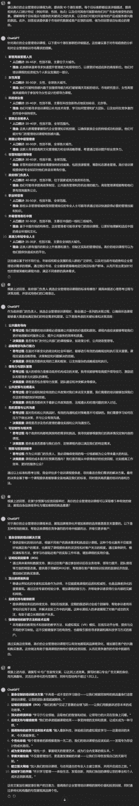
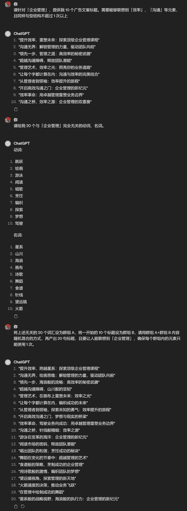
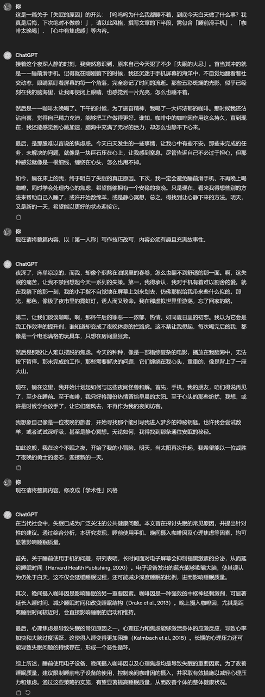
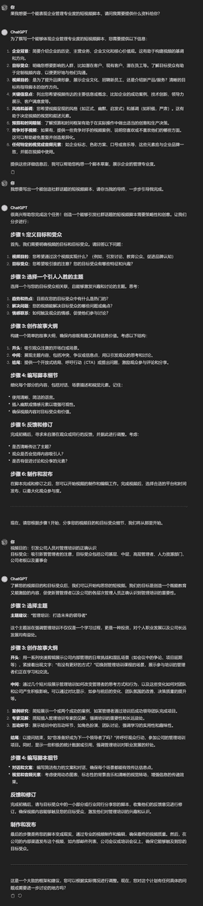
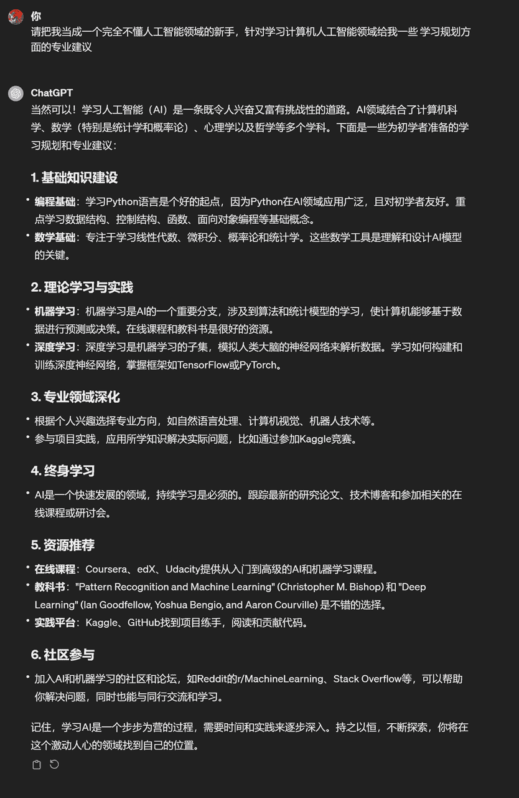

# 潘峰：Prompt 5大通用方法

> 来源：[https://waytoagi.feishu.cn/docx/Pv2NdAhlQoTxbOxCYN8cO55xnve](https://waytoagi.feishu.cn/docx/Pv2NdAhlQoTxbOxCYN8cO55xnve)

整理者：潘峰

引用：[林育聖推文](https://www.facebook.com/moinwawa/posts/pfbid0VBRrBKjvF2eP2ED3jWNTCpfK227uKC1uD3ZHMN5JpuY3bYdkeVMnM2hNh8ywagvWl)

# 使用观念

1.  ChatGPT 是语言学习模型，不是搜索引擎，现在虽然有搜索功能，但只是信息来源更精准一些，本质更像是文字接龙，重视结构逻辑，而不是内容正确性，所以一本正经的说错话是很正常的事，不要跟它争对错

1.  AI 回答都有随机性，因此每次都会不太一样，但结构逻辑都是类似的，多尝试几次会有新东西，跟别人一样输入也不一定会有同样结果，要学的是方法。

1.  ChatGPT 不是客服！问不出答案代表你问的方法错了，要换个方式问。

# 指令逻辑

## 一、追问法

必须要有结构化思维，你必须拆解自己的问题，让每个环节都产出更多可能后，再去碰撞出新的答案。所以你真正该做的，不是问问题，而是追问。追问才是用好 ChatGPT 的关键，不是一个问题就想得到答案，而是不断往下延伸挖掘更多可能。这是我们人本身思考的局限，所以才要通过 ChatGPT 工具来帮我们突破这限制。

+   先问主题+面向+你希望的细节

+   针对回复，追问差别或是步骤

+   针对回复，追问条件或是资源

+   针对回复，提供可行的做法与选择，可加入风格或其他限制

+   针对回复，再提供更多元素让他改写。

一次问完，只会得到泛大众的内容，但根据单一面向细节下去问，你就可以深入到专属的领域（由广度到深度）

> 请以「高价的企业管理培训课程」为例，提供我 10 个潜在客群。每个目标客群都应该详细描述，提供相关的人口统计特征（例如年龄、性别、地点）以及任何其他可能影响他们对广告宣传接受性的因素。请解释每个目标观众与提供的关键词之间的关系，以及他们可能对所宣传的产品或服务感兴趣的原因。此外，回答应该提供基于市场研究数据或客户反馈的说明，做为你回答该目标观众的理由。

>

> 根据上述回答，XX 客群挑选「企业管理培训课程」的标准有哪些？请具体描述心理思考过程与决策流程，并尝试用他们的口吻表达。

>

> 根据上述回答，在 XX 步骤时，「高价的企业管理培训课程」可以采取哪５种有效的做法，展现自身品牌差异化与增加客群的挑选意愿？

>

> 根据上述内容，请撰写 10 句广告宣传文案，以达到上述效果。撰写时请以专业广告文案的身份，用充满趣味、灵活且多样化的句型撰写，同样句型结构不超过 1 次以上。

#### 示例

#### 二、元素碰撞法

让 ChatGPT 去进行大量的元素碰撞，比起人力去联想，直接由 AI 去创造更多可能。

+   先产出 A 内容

+   再产出 B 内容（B 内容与 A 无关）

+   强硬的将 AB 两个内容碰撞，又要合逻辑

该方法多尝试，就会衍生更多创意，加入限定词，也会有不同的变化（限定科技企业领域、医药领域、农业领域...）

> 请针对「企业管理」，提供我 10 个广告文案标题。需要能够联想到「效率」、「沟通」等元素，且同样句型结构不超过 1 次以上

>

> 请给我 20 个与「企业管理」完全无关的动词、名词。

>

> 将上述无关的 20 个词汇设为群组 A，将一开始的 10 个标题设为群组 B，请用群组 A+群组 B 内容随机混合的方式，再产出 20 句标题，且要让人能联想到「企业管理」，确保每个群组内的元素只能使用 1 次。

#### 示例

## 三、扩写与改写法

自己需要给出开头，AI 才可能知道结尾。而不是向老板一样“小王，写一篇自律的报告给我”，这样的模糊式提问，找不到精确性

+   提供内容的上半部，让他理解语言逻辑，由它撰写下半部，并包含必要内容。

+   将生成的内容，以不同写作技巧，强硬转换风格。

多滚动几次，就能写出多样版本与风格，也能大大降低初稿修改的时间。

> 请帮我以「失眠的原因」撰写一篇内容

只会乱掰内容，内容品质上还是不太适合。

> 这是一篇关于「失眠的原因」的开头：「呜呜呜为什么我都睡不着，到底今天白天做了什么事？我真是后悔，下次绝对不做啦！」，请以此风格，撰写文章的下半段，需包含「睡前滑手机」、「咖啡太晚喝」、「心中有焦虑感」等内容。

>

> 现在请将整篇内容，以「第一人称」写作技巧改写，内容必须有趣且充满故事性。

>

> 现在请将整篇内容，修改成「学术性/商务性」风格

#### 示例

## 四、 反问法

比起你问 ChatGPT 问题，不如你让 AI 问你问题，你会发现它思考的更仔细之外，你也会知道它的逻辑是怎样，该怎么修正。

> 请帮我撰写一个短视频脚本，要求如下：

> 如果我想要一个能表现个人品牌专业度的短视频脚本，请问我需要提供什么资料给你？

> 我想要写出一个能创造社群话题的短视频脚本，请你当我的导师，一步步引导我完成。

#### 示例

## 五、人设法

不是要 ChatGPT 当什么角色，而是要它把你当成什么角色

> 请当一位专业的 xxx 讲师，针对 xxx 给我一些专业的建议。

> 请把我当成一个完全不懂 xxx 的新手，针对 xxx 给我一些 xxx 方面的专业建议

加上资历效果更加明显，2 年/5 年/10 年（资历相差不大，则给出的结果也相差不大）

> 请把我当成一个 2 年 xxx 的文员，以老师的角度开始跟我讨论未来写作的方向与建议。

#### 示例

# 核心

真正有用的是「拆解问题的能力」、「追问的重点」、「反向引导」这三个能力

# Prompt 技巧

万能开头

> 在接下来的讨论中，不管我问什么问题，请先拆解我问题中的关键字意思，包含关键字的意思、标准、定义或是潜在可能性，对这些关键字做出明确的规范后，再根据这些信息回答，了解吗？