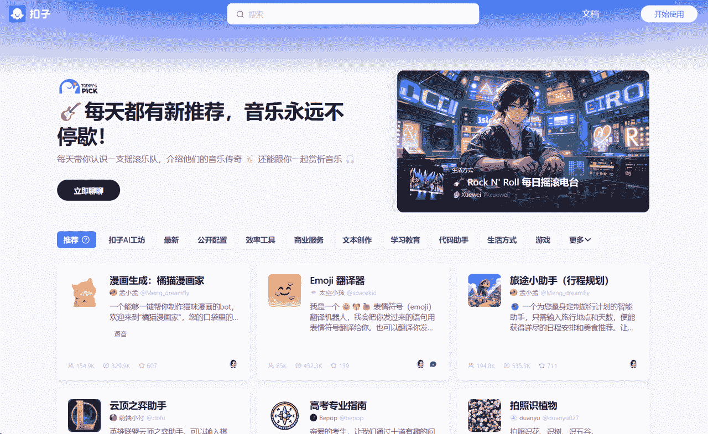
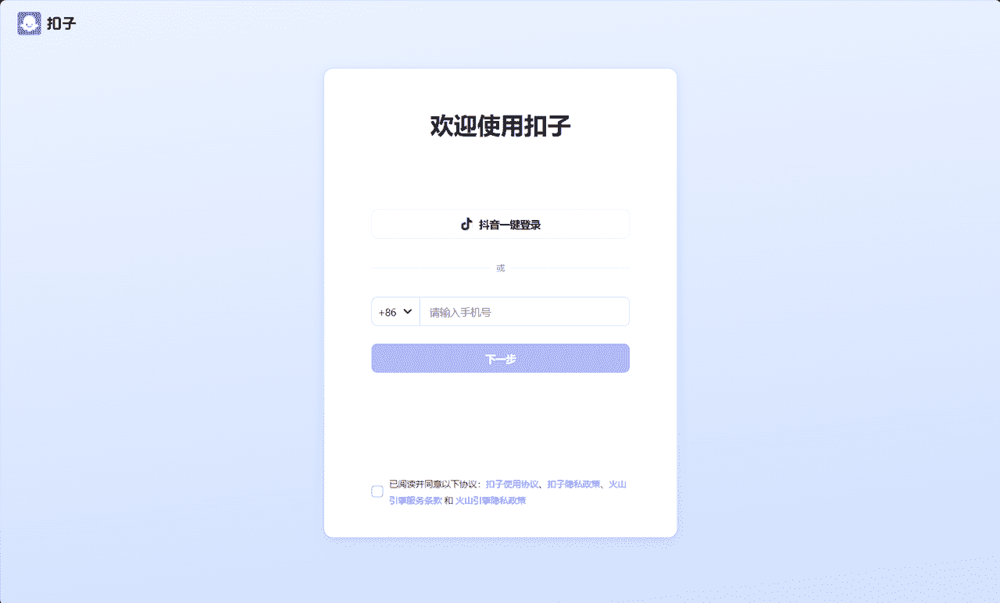
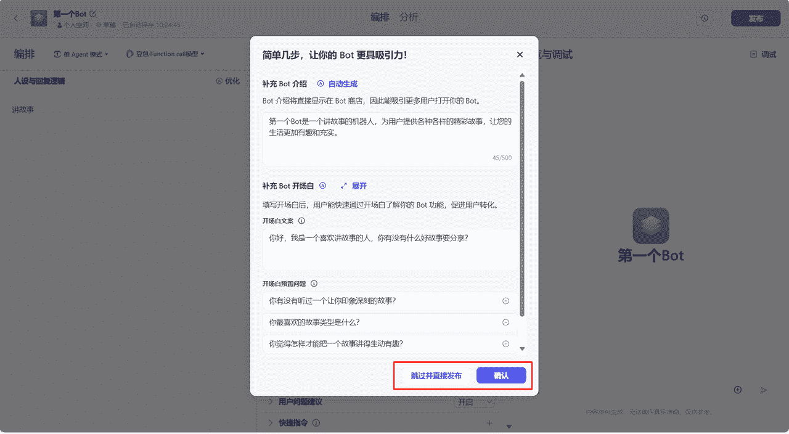
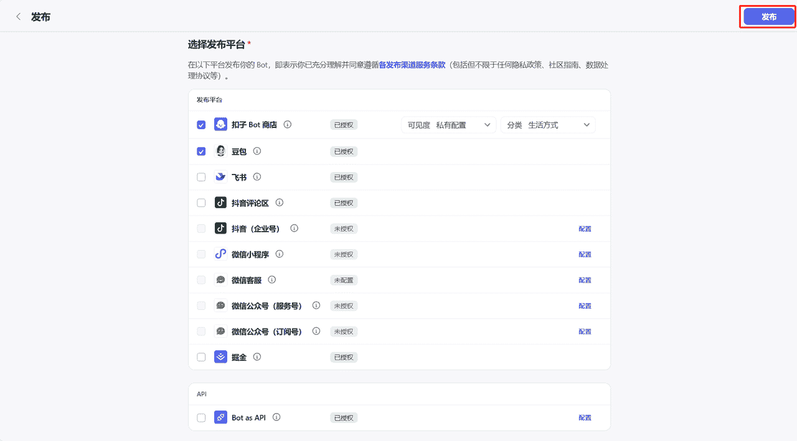
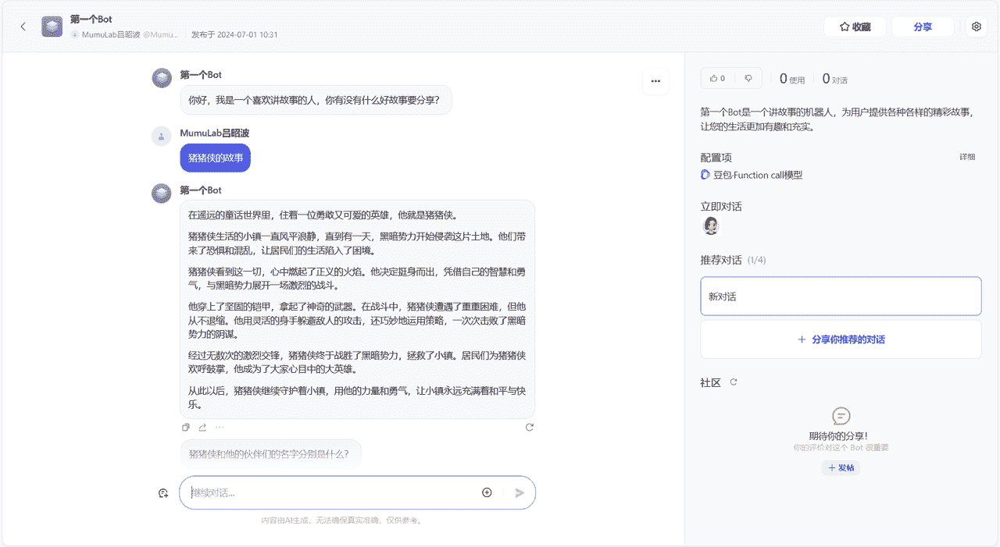
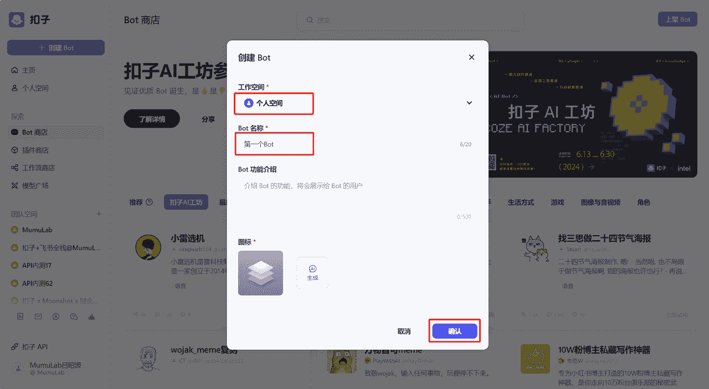
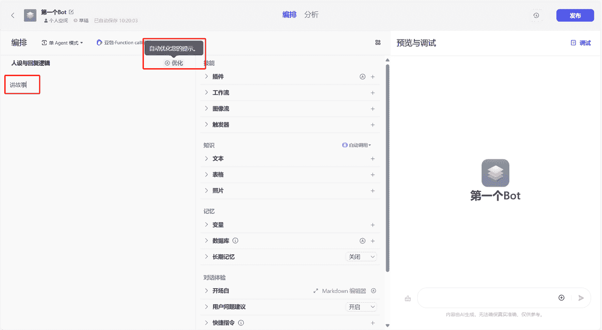

# 1. 从案例入门

> 来源：[https://waytoagi.feishu.cn/docx/MwnEdqaYYoqugOxKEhUc6BMGntg](https://waytoagi.feishu.cn/docx/MwnEdqaYYoqugOxKEhUc6BMGntg)

> **何为捏Bot**

> 使用扣子coze.cn等平台创建智能体Agent的过程，创作者形象的比喻为“捏Bot”，最简单的Bot往往可以在1分钟内捏完。

> 常见Bot：讲故事、减肥提醒、生成PPT、真假新闻辨识、新闻资讯收集、扮演“甄嬛”......

> **从哪个平台开始**

> 国内外有多个Agent平台可以几分钟内完成Agent创建，比如国内版扣子coze.cn、海外版Coze coze.com、百度AppBuilder、阿里通义千问、智谱AI......

> 我们先从扣子coze.cn开始。

## 作品分享

**找三思做二十四节气海报**

https://www.coze.cn/store/bot/7382246186440359945

作者：七个小扣子团队

（一分钟捏的Bot）第一个Bot

https://www.coze.cn/store/bot/7386486483391234057

作者：吕昭波

[**捏剧本-离谱村专用**](https://www.coze.cn/store/bot/7374263128143708198)

https://www.coze.cn/store/bot/7367669913697239052

作者：Stuart

## 新手区感受

之前对于扣子不了解，根据页面一步步操作下来，才理解是这个样子，第二次再看的时候就清晰很多了。

--匿名同学

第一次捏Bot其实是挺兴奋的，抱着试一试的态度创作了下，以为很复杂，真正操作一遍才发现真的挺容易上手的。

一口气捏了好几个Bot。

--匿名同学

## 一分钟捏Bot

> 第一次访问扣子coze.cn平台的小伙伴可参考时间

### Step 1：（10秒）登录控制台

1.  使用手机号或抖音登录控制台。

1.  使用手机号或抖音登录控制台。

### Step 2：（20秒）在我的空间创建Agent

1.  在我的空间中创建Agent。

1.  输入提示词（也称为Prompt）。

### Step 3：（30秒）输入关键词后发布使用

1.  发布，可选择使用或跳过系统推荐的Bot介绍、Bot开场白等信息，并将Bot发布到扣子 Bot 商店/豆包等平台。

1.  使用，点击在扣子商店/豆包等平台体验刚刚创建的Bot，快和你的小伙伴分享Bot吧。

https://www.coze.cn/store/bot/7386486483391234057

## 三分钟捏Bot

### Step 1：（10秒）登录控制台

1.  登录扣子控制台（coze.cn）。

1.  使用手机号或抖音注册/登录。

### Step 2：（20秒）在我的空间创建Agent

1.  在扣子主页左上角点击“创建Bot”。

1.  选择空间名称为“个人空间”、Bot名称为“第一个Bot”，并点击“确认”完成配置。

> 如需使用其他空间，请先创建后再选择；Bot名称可以自定义。

### Step 3：（30秒）编写Prompt

1.  填写Prompt，即自己想要创建的Bot功能说明。第一次可以使用一个简短的词语作为Prompt提示词。

### Step 4：（30秒）优化Prompt

1.  点击“优化”，使用来帮忙优化。

### Step 5：（30秒）设置开场白

### Step 6：（30秒）其他环节

### Step 7：（30秒）发布到多平台&使用

## 进阶之路

### 15分钟做什么

+   查看下其他Bot，获取灵感

### 1小时做什么

+   找到和自己兴趣、工作方向等可以结合的Bot，深入沟通

+   阅读以下文章：

+   文章1

+   文章2

+   文章3

### 一周做什么

+   了解基础组件

+   寻找不错的扣子，借鉴&复制

+   加入Agent共学小组

+   尝试在群里问第一个问题

### 一个月做什么

+   合理安排时间

+   参与WaytoAGI Agent共学计划

+   自己创建Agent，并分享自己捏Bot的经历和心得

## 在WaytoAGI有哪些支持

> 文档资源

> 交流群

> 活动

> 占位

## FAQ

1.  捏Bot是否需要写代码？

不写代码、写代码的小伙伴均可参与，不写代码可使用Prompt来创建完整的Bot，写代码可以在创建Bot过程中更灵活。