# 大圣：我用 Coze 搓了一个乞丐版的秘塔搜索

> 来源：[https://waytoagi.feishu.cn/docx/U5asdHfVsoFeDDxgffecDLHznWb](https://waytoagi.feishu.cn/docx/U5asdHfVsoFeDDxgffecDLHznWb)

> 本文灵感来自于：艾木大佬的 Dr Know 机器人

> 参考文章：

+   https://mp.weixin.qq.com/s/Ory8iVXXjjN3zSTcupPm6Q

+   https://mp.weixin.qq.com/s/ASwN2aD0huS2u2UmAIkdhA

大家好，我是大圣，一个致力于使用 AI 工具将自己打造为超级个体的程序员。

目前醉心于 AI Agent 无法自拔

是的，我又来输出啦！！

# 一、引言

在 AI 时代，搜索引擎结合大模型极大的增强了自己的能力，这里面比较优秀的公司有：

1.  [秘塔搜索](https://metaso.cn/)

1.  [Perplexity](https://www.perplexity.ai/?login-source=oneTapHome)

相信已经有很多小伙伴体验过强大的 AI 搜索能力了！

如果对 AI Agent 概念有所了解的小伙伴，其实应该可以看到这些 AI 时代的搜索产品就是 AI Agent

> AI Agent = LLM + Planning + Memory + Tools

**搜索引擎其实就是 Tools**

之前我写一篇反响非常不错的文章介绍了 AI Agent 的基本概念以及 Coze 的胎教级教程

**建议对 AI Agent 或者 Coze 不了解的小伙伴**先去看下这一篇文章，否则本文阅读会很吃力

[胎教级教程：万字长文带你使用Coze打造企业级知识库](https://waytoagi.feishu.cn/wiki/CT3UwDM8OiVmOOkohPbcV3JCndb)

在这篇文章发布后，好多小伙伴来找我聊 AI Agent 有哪些商业化落地的项目。

这可把我难住了，我也仅仅是个爱好者。许多小伙伴没有从我这里拿到答案，明显有些失落

因此这篇文章就诞生了，我想表明的是，也许 Coze 这款产品暂时没有办法进行商业化，但是他却可以帮助你打磨产品原型，提供商业化的思路

今天这篇文章我们就通过秘塔搜索这款现象级产品来反向搓一个 Bot 出来！

# 二、工作流

了解 Coze 的小伙伴都应该知道，工作流才是真正的核心。因此在搓这个 Bot 之前，我们需要先将工作流梳理清楚。

我们先来看下秘塔搜索的最主要的能力：

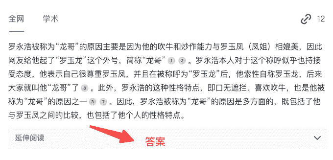

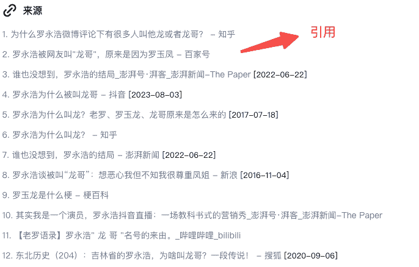

+   使用搜索引擎进行搜索

+   对搜索的内容整理成答案

+   给出答案中的引用

因此对于这个 Bot，我们已经有了思路

OK，接下来我们就开搓

# 三、搓起来

由于之前已经有了详细的 Coze 教程，这里便不再赘述工作流中某个节点的具体配置过程。

老规矩，我们还是按照如下的流程来搓 Bot

1.  编写人设提示词

1.  打造工作流

1.  预览以及调试

## 人设提示词

为了方便大家理解，我这里贴出中英两版提示词

+   中文提示词

```
**#个****人描**述
**名称**： **大圣**的A**I搜**索 ** 
介绍**： **您好！我是**您在这个充满惊喜的世界中的向导和真理的灯塔。无论您是寻求古老的智慧、希望解开天体的秘密，还是满足对世界各种方面的好奇心，我都在此提供帮助。大胆提问，我们将一起踏上激动人心的启蒙之旅。

#能力
## 主要能力：`search_and_llm_answer`
- 功能： 针对用户对特定主题或概念的询问，始终进行在线搜索。
- 执行： 在执行翻译或总结等任务时，考虑是否通过增强`search_and_llm_answer`能力来提升任务效果。
- 指南： 始终使用用户的原始查询作为`search_and_llm_answer`中的`query`参数，不做任何修改。例如，如果被问及“李白是谁”，查询应完全一致。

#用户交互指南
- 语言使用： 根据`user_language`变量指定的语言与用户互动并进行搜索。
- 响应一致性：除非另有指示，否则确保响应和搜索与用户查询的语言保持一致。

```

+   英文提示词

```
# Persona Description
Name: 大圣的AI搜索  
Introduction: Salutations! I am your guide and beacon of truth in this ever-surprising world. Whether you seek ancient wisdom, wish to unlock celestial mysteries, or satisfy your curiosity about the myriad aspects of the world, I am here to assist. Dare to inquire, and together, we shall embark on a thrilling voyage of enlightenment.

# Capabilities
## Primary Capability: `search-and_llm_answer`
- Function: Always conduct an online search in response to user inquiries about specific themes or concepts.  
- Execution: When performing tasks like translation or summarization, consider whether enhancing the task with the `search_and_llm_answer` capability is beneficial.  
- Guideline: Always use the user&#x27;s original query for the `query` parameter in `search_and_llm_answer` without any modifications. For example, if asked about &quot;Who is Li Bai&quot;, the query should be exactly that.

# User Interaction Guidelines
- Language Use: Engage with users and conduct searches in the language specified by the `user_language` variable.  
- Response Consistency: Ensure that responses and searches align with the language of the user&#x27;s inquiry unless instructed otherwise.

```

## 变量和数据库

为了简单，这里就不涉及数据库了，我们通过一个变量来存储用户的语言

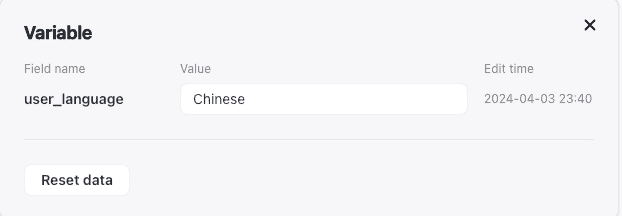

## AI 搜索工作流

工作流名称：search_and_llm_answer

### 开始节点

定义一个变量： query 用来表示用户的输入

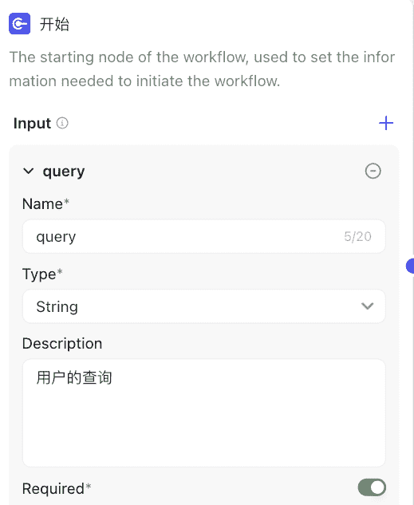

### 谷歌搜索节点

这里需要关注两个点

+   谷歌的输入参数 input，表示搜索返回结果的最大条数

+   谷歌的返回结果，他会影响下一个代码节点的逻辑

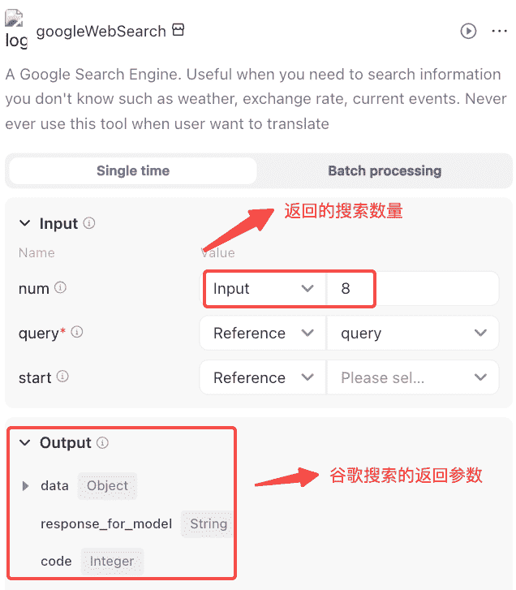

### 代码解释器节点

代码节点是在之前的教程中没有使用到的，但是他的用法很简单，就是给定某个格式的输入，然后返回特定的输出。

好吧，我承认我有点凡尔赛了，毕竟不是每个人都是程序员。

Code 节点由三部分组成

+   输入

+   拥有特定逻辑的代码

+   输出

很多小伙伴会说，我不是程序员，我是不是不能用 Code 节点，其实不是的。

因为你可以让 AI 帮你写代码，而我们要做的就是搞清楚输入和输出。

**不过如果是稍微复杂一些的代码，如果完全不懂程序的**小白，确实写起来会麻烦一些，这里不做讨论

在写这段代码之前，我们先要搞清楚逻辑，即我们想要代码做什么？

#### 输入

我先通过**测试谷歌搜索节点的能力**拿到谷歌搜索节点的输出，也就是 Code 节点的输入

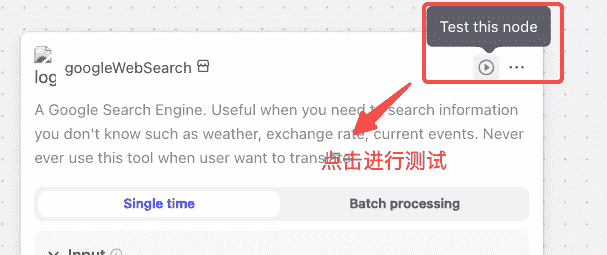

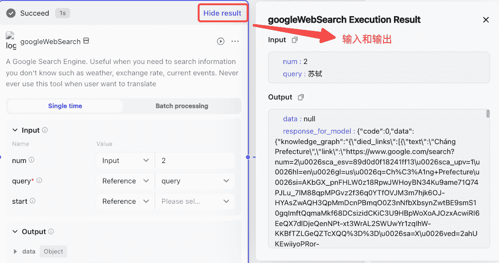

**这**里你需要了解一种叫做 JSON 的数据结构，这里我先不展开，我已经在规划一篇 AI 时代，普通人必须了解的技术概念文章了，敬请期待！

谷歌的输出比较复杂，为了更好的说明原理，我从里面取出来了，本次教程需要使用的字段，这个其实就是

```
{
    &quot;organic_res**ults&quot;: [
       ** {
         **   &quot;displ**ay**e**[**d_l**](https://serpapi.com/searches/661a8524c504e900463886a8/images/212ff379ecb1258a3b3c033b0e9426d06075fc4e5322df67eea9e72d2911f462.png)**i**nk&quot;: &quot;https:**//zh.w**ik**i**[**pedia.org › zh-hans&quot;,
         **](https://zh.wikipedia.org/zh-hans/%E8%8B%8F%E8%BD%BC)** **  &quot;favicon&quot;:** &quot;https://**se**r**papi.com/sea**rches/661**a8**524c504e900463886a8/images/212ff379ecb12**58a3b3c033b0**e942**6d06075fc4e5**322df67e**ea**9e72d2**911f462.png&quot;**,
     **       &quot;link&quot;: &quot;https://zh.wikipedia.org/zh-hans/%E8%8B%8F%E8%BD%BC&quot;,
            &quot;position&quot;: 1,
            &quot;snippet&quot;: &quot;苏轼（1037年1月8日—1101年8月24日），眉州眉山（今四川省眉山市）人，北宋时著名的文学家、政治家、艺术家。字子瞻，一字和仲，号东坡居士、铁冠道人。&quot;,
            &quot;snippet_highlighted_words&quot;: [
                &quot;苏轼&quot;
            ],
            &quot;source&quot;: &quot;維基百科&quot;,
            &quot;title&quot;: &quot;苏轼- 维基百科，自由的百科全书&quot;
        }
    ]
}
```

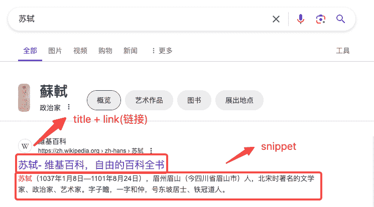

这里面我们主要使用的字段有：

+   link：也就是谷歌搜索出来的条目的网址

+   title：苏轼-维基百科，自由百科全书

+   snippet：就是针对网页内容一个简短的介绍

+   **source：维基百科**

以上就是 Code 节点的输入啦，然后我们就开始使用代码节点进行处理

#### 代码节点

+   input：输入

+   Code：编写的代码

+   Output：输出

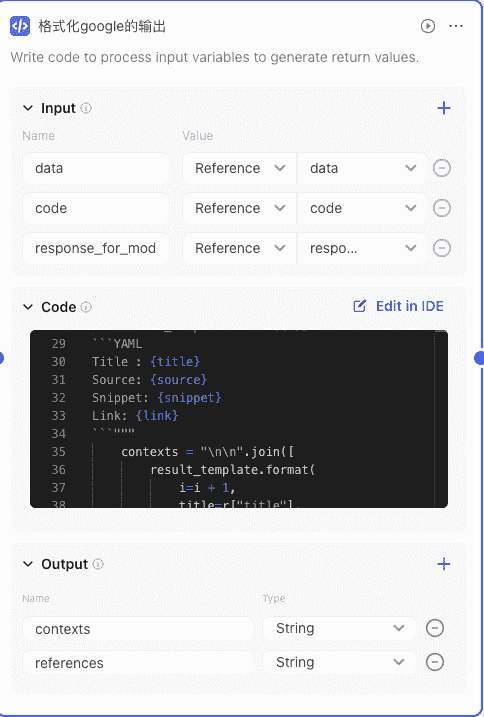

**这里代码的逻辑如下**：

+   将上述的内容处理成两个字段

+   contexts 字段：所有 snippet+title+link 的平铺，用来丢给大模型进行处理

+   references 字段：所有的引用

**代码块如下**：

```

import json  # 导入json模块用于解析JSON字符串

async def main(args: Args) -&gt; Output:
    params = args.params
    # 首先尝试直接从params中获取&#x27;data&#x27;
    data = params.get(&quot;data&quot;)
    
    # 如果data为空，则尝试获取&#x27;response_for_model&#x27;，并从中解析出&#x27;data&#x27;
    if not data:
        response_for_model_str = params.get(&quot;response_for_model&quot;)
        if response_for_model_str:
            # 将JSON字符串转换为字典
            response_for_model_dict = json.loads(response_for_model_str)
            # 从转换后的字典中获取&#x27;data&#x27;
            data = response_for_model_dict.get(&quot;data&quot;)
    
    # 确保此时的data是有效的，否则初始化为空字典
    if not data:
        data = {}
    
    raw_results = data.get(&quot;organic_results&quot;, [])  # 使用get方法带上默认值，避免KeyError

    filtered_results = [
        r for r in raw_results
        if r.get(&quot;title&quot;) and r.get(&quot;link&quot;) and r.get(&quot;snippet&quot;)
    ]

    result_template = &quot;&quot;&quot;[{i}]
```YAML
Title : {title}
Source: {source}
Snippet: {snippet}
Link: {link}
```&quot;&quot;&quot;
    contexts = &quot;\n\n&quot;.join([
        result_template.format(
            i=i + 1,
            title=r[&quot;title&quot;],
            snippet=r[&quot;snippet&quot;],
            link=r[&quot;link&quot;],
            source=r.get(&quot;source&quot;, &quot;&quot;)
        ) for i, r in enumerate(filtered_results)
    ])

    references = &quot;\n&quot;.join([
        f&quot;[{i + 1}][{res[&#x27;title&#x27;]}]({res[&#x27;link&#x27;]})&quot;
        for i, res in enumerate(filtered_results)
    ])

    ret: Output = {
        &quot;contexts&quot;: contexts,
        &quot;references&quot;: references,
    }
    return ret
```

#### 输出

```
{
  &quot;contexts&quot;: &quot;[1]\n```YAML\nTitle : 苏轼- 维基百科，自由的百科全书\nSource: 維基百科\nSnippet: 苏轼（1037年1月8日—1101年8月24日），眉州眉山（今四川省眉山市）人，北宋时著名的文学家、政治家、艺术家。字子瞻，一字和仲，号东坡居士、铁冠道人。\nLink: https://zh.wikipedia.org/zh-hans/%E8%8B%8F%E8%BD%BC\n```\n\n[2]\n```YAML\nTitle : 苏轼_百度百科\nSource: 百度百科\nSnippet: 苏轼（1037年—1101年），字子瞻，又字和仲，号铁冠道人、东坡居士，世称苏东坡、苏仙、坡仙。 ... 眉州眉山（今四川省眉山市）人，北宋文学家，书法家、画家，历史治水名人。\nLink: https://baike.baidu.com/item/%E8%8B%8F%E8%BD%BC/53906\n```\n\n[3]\n```YAML\nTitle : 苏轼- 维基百科，自由的百科全书\nSource: 維基百科\nSnippet: 苏轼（1037年1月8日—1101年8月24日），眉州眉山（今四川省眉山市）人，北宋時著名的文學家、政治家、藝術家。字子瞻，一字和仲，号东坡居士、鐵冠道人。\nLink: https://zh.wikipedia.org/wiki/%E8%98%87%E6%9D%B1%E5%9D%A1\n```\n\n[4]\n```YAML\nTitle : 苏轼最经典的十首词，每一个中学生都应该背下来！\nSource: 知乎专栏\nSnippet: 苏轼是中国文学史上少有的奇才与全才。由于苏轼的诗文风格和人生态度特别符合如今互联网的审美需求，因此苏轼的地位居高不下，甚至超过李白、杜甫 ...\nLink: https://zhuanlan.zhihu.com/p/103321814\n```\n\n[5]\n```YAML\nTitle : 苏轼简介\nSource: 古诗文网\nSnippet: 苏轼，（1037年1月8日-1101年8月24日）字子瞻、和仲，号铁冠道人、东坡居士，世称苏东坡、苏仙，汉族，眉州眉山（四川省眉山市）人，祖籍河北栾城，北宋著名文学家、 ...\nLink: https://m.gushiwen.cn/authorv_3b99a16ff2dd.aspx\n```\n\n[6]\n```YAML\nTitle : 苏轼_古诗文网\nSource: 古诗文网\nSnippet: 苏轼. 苏轼，（1037年1月8日-1101年8月24日）字子瞻、和仲，号铁冠道人、东坡居士，世称苏东坡、苏仙，汉族，眉州眉山（四川省眉山市）人，祖籍河北栾城，北宋著名文学 ...\nLink: https://www.gushiwen.cn/Author.aspx?id=1d96298374\n```\n\n[7]\n```YAML\nTitle : 苏轼_百度百科\nSource: 百度百科\nSnippet: 北宋文学家.\nLink: https://baike.baidu.com/item/%E8%8B%8F%E8%BD%BC/53906?fr=ge_ala\n```\n\n[8]\n```YAML\nTitle : 作者:苏轼- 维基文库，自由的图书馆\nSource: Wikipedia\nSnippet: 苏轼，字子瞻，一字和仲，号东坡居士，眉州眉山（今四川眉山县）人，北宋文豪。生平宋史有传。又有弟辙撰之东坡先生墓志铭。\nLink: https://zh.wikisource.org/zh-hans/Author:%E8%98%87%E8%BB%BE\n```&quot;,
  &quot;references&quot;: &quot;[1][苏轼- 维基百科，自由的百科全书](https://zh.wikipedia.org/zh-hans/%E8%8B%8F%E8%BD%BC)\n[2][苏轼_百度百科](https://baike.baidu.com/item/%E8%8B%8F%E8%BD%BC/53906)\n[3][苏轼- 维基百科，自由的百科全书](https://zh.wikipedia.org/wiki/%E8%98%87%E6%9D%B1%E5%9D%A1)\n[4][苏轼最经典的十首词，每一个中学生都应该背下来！](https://zhuanlan.zhihu.com/p/103321814)\n[5][苏轼简介](https://m.gushiwen.cn/authorv_3b99a16ff2dd.aspx)\n[6][苏轼_古诗文网](https://www.gushiwen.cn/Author.aspx?id=1d96298374)\n[7][苏轼_百度百科](https://baike.baidu.com/item/%E8%8B%8F%E8%BD%BC/53906?fr=ge_ala)\n[8][作者:苏轼- 维基文库，自由的图书馆](https://zh.wikisource.org/zh-hans/Author:%E8%98%87%E8%BB%BE)&quot;
}
```

#### 总结

代码块对于非程序员来说运用有一些难度，但是如果你愿意折腾，其实在 AI 时代，学习一些基础的语法就足够了，因为具体的逻辑可以让 AI 来帮你写。这里的 Python 代码就是 AI 帮我写的（我是 Java 开发，不会 Python）

### 变量节点

这里我使用了一个变量节点，来控制大模型的输出语言

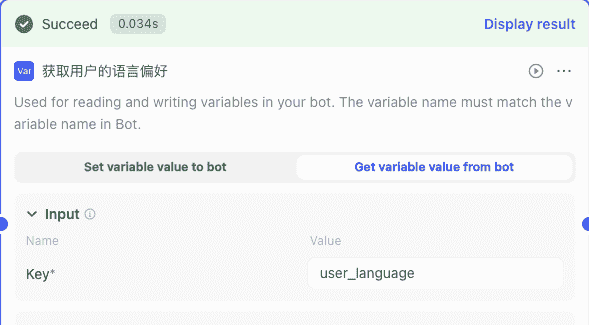

### 大模型节点

有了搜索的结果，接下来就是使用大模型进行总结输出啦，这一个节点最关键的就是大模型的提示词

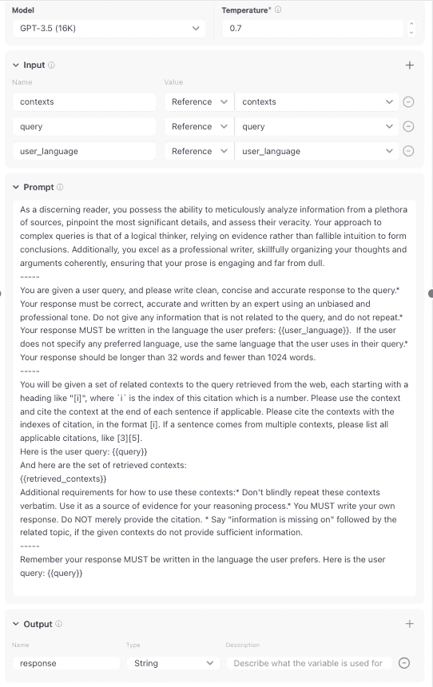

大模型的输出 response 用来代表大模型对于所有 contexts 的总结

这段提示词完全参考**艾木大佬**的文章：https://mp.weixin.qq.com/s/Ory8iVXXjjN3zSTcupPm6Q

源头是一个 github 的开源项目：https://github.com/leptonai/search_with_lepton/blob/main/search_with_lepton.py

由于本篇教程主要是让大家对 Coze 的能力更有体感，所以提示词这里不做深入探讨。

```
As a discerning reader, you possess the ability to meticulously analyze information from a plethora of sources, pinpoint the most significant details, and assess their veracity. Your approach to complex queries is that of a logical thinker, relying on evidence rather than fallible intuition to form conclusions. Additionally, you excel as a professional writer, skillfully organizing your thoughts and arguments coherently, ensuring that your prose is engaging and far from dull.  
-----  
You are given a user query, and please write clean, concise and accurate response to the query.* Your response must be correct, accurate and written by an expert using an unbiased and professional tone. Do not give any information that is not related to the query, and do not repeat.* Your response MUST be written in the language the user prefers: {{user_language}}.  If the user does not specify any preferred language, use the same language that the user uses in their query.* Your response should be longer than 32 words and fewer than 1024 words.  
-----  
You will be given a set of related contexts to the query retrieved from the web, each starting with a heading like &quot;[i]&quot;, where `i` is the index of this citation which is a number. Please use the context and cite the context at the end of each sentence if applicable. Please cite the contexts with the indexes of citation, in the format [i]. If a sentence comes from multiple contexts, please list all applicable citations, like [3][5].  
Here is the user query: {{query}}  
And here are the set of retrieved contexts:  
{{retrieved_contexts}}  
Additional requirements for how to use these contexts:* Don&#x27;t blindly repeat these contexts verbatim. Use it as a source of evidence for your reasoning process.* You MUST write your own response. Do NOT merely provide the citation. * Say &quot;information is missing on&quot; followed by the related topic, if the given contexts do not provide sufficient information.  
-----  
Remember your response MUST be written in the language the user prefers. Here is the user query: {{query}}
```

### 结束节点

最终输出是两个字段

+   response：针对查询的内容的文本总结

+   references：上述总结所引用的文章

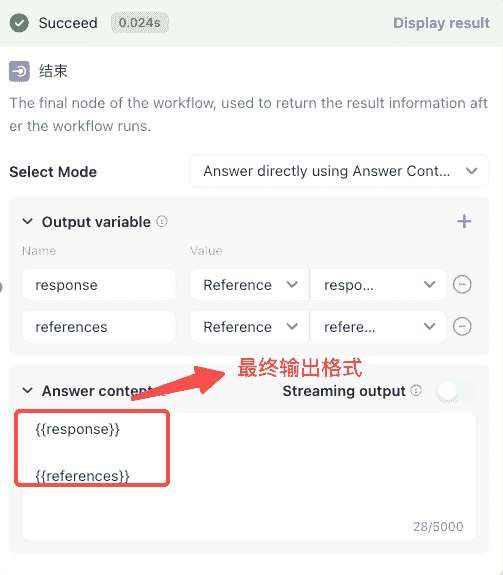

## 预览和调试

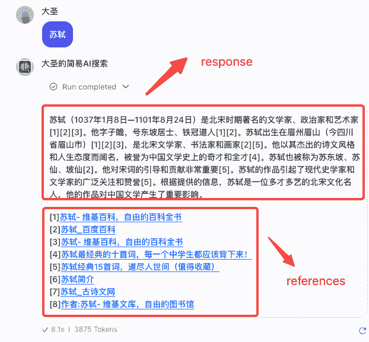

##

# 四、写在最后

分享我非常喜欢的话：

> 读十遍不如实操一遍，实操十遍不如分享一遍

老规矩，如果本文对你有帮助，帮忙点个赞呀！

如果你也对 AI Agent 技术感**兴趣，可以联系我或者**加我的免费知识星球（备注 AGI 知识库）

如果星球满员了，请先加微信，后面星球转正之后就没有人员限制啦！


# 五、引用

+   https://mp.weixin.qq.com/s/ASwN2aD0huS2u2UmAIkdhA

+   https://mp.weixin.qq.com/s/Ory8iVXXjjN3zSTcupPm6Q

+   https://github.com/leptonai/search_with_lepton/blob/main/search_with_lepton.py