# 画小二：用Coze工作流制作行业简报：实战案例画小二日报

> 来源：[https://waytoagi.feishu.cn/docx/Eh92dX8p1oruYix7crdc34oynVb](https://waytoagi.feishu.cn/docx/Eh92dX8p1oruYix7crdc34oynVb)

Create By：画小二

# 一、项目目的

## 1、目的和解决思路

目标：通过AI工具来每天生成【画小二日报】，替代传统小编人工整理AIGC行业资讯。

思路：解决一个问题不是只用一种方法，5个不同的方法是5种不同的思路，每个思路都有优劣之分，重要的是锻炼我们在实际应用过程中解决问题的能力。

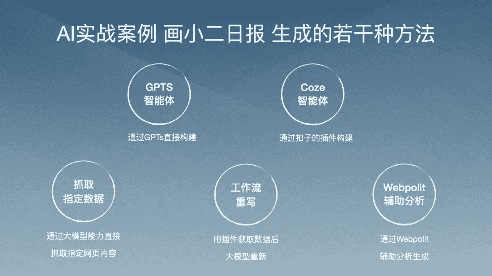

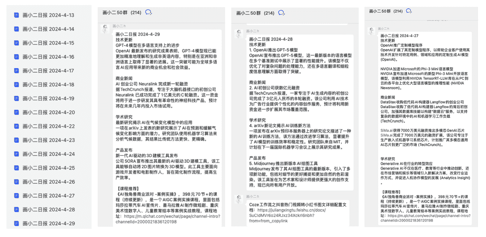

## 2、效果演示

通过方法一生成画小二日报Demo演示

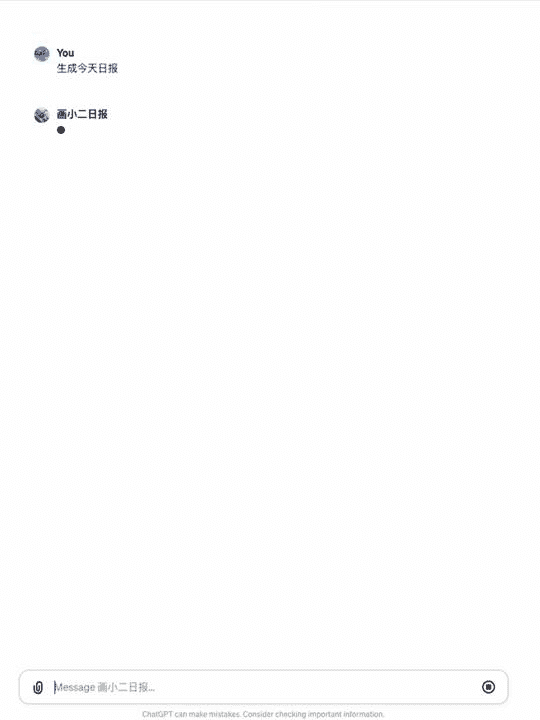

[GPTs生成过程.mp4](https://internal-api-drive-stream.feishu.cn/space/api/box/stream/download/all/SJZ9bzAuKoQ1ikxzPGWcNdPUnkd)

## 3、视频介绍

<https://player.bilibili.com/player.html?bvid=1oJ4m1P7qL>

# 二、GPTs 画小二日报

## 1、OpenAI的GPTs

在OpenAI的构建GPTs，需要是GPT4的付费用户。

## 2、创建画小二日报的GPTs

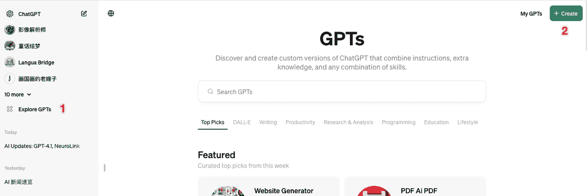

按照图片中标注的1和2的步骤

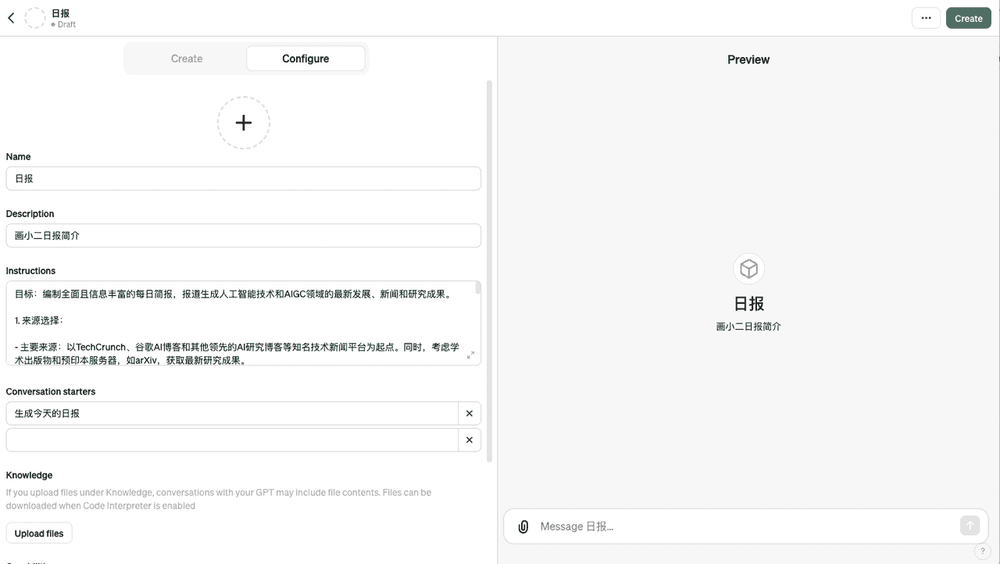

如图所示，比这葫芦画瓢

## 3、Instruction 的 Prompt

(请把这个 Instruction  英文单词铭刻在脑子里，在国内各个大模型的名字不尽相同，容易混淆，但是使用Instruction 不会有任何问题，标红切记~ )

```
### 画小二日报

**目标**：编制全面且信息丰富的每日简报，报道生成人工智能技术和AIGC领域的最新发展、新闻和研究成果。

**1. 来源选择**：

- **主要来源**：以TechCrunch、谷歌AI博客和其他领先的AI研究博客等知名技术新闻平台为起点。同时，考虑学术出版物和预印本服务器，如arXiv，获取最新研究成果。
- **次要来源**：查看专注于AI的新闻简报、播客和YouTube频道、中国的Bilibili、抖音等视频网站，它们讨论最近的趋势和发展。这些可以提供补充主要来源的见解和评论。
- **其他来源**：查看专注于AI的twitter、微博、微信公众号频道AIGC相关内容，它们讨论最近的趋势和发展。这些可以提供补充主要来源的见解和评论。

**2. 覆盖主题**：

- **技术更新**：GPT及相关AI和AIGC工具的新进展或更新，包括软件更新、模型训练的突破以及AI能力的增强。
- **商业新闻**：重大的商业发展，如AI初创公司的合并和收购、融资轮、科技公司之间的合作伙伴关系，以及市场分析报告。
- **法规与伦理考量**：关于AI治理、伦理考虑、隐私问题和部署GPT及类似技术的社会影响的讨论或决策。
- **学术研究**：值得注意的新研究论文摘要、AI理论的突破、GPT在新领域的应用，以及聚焦AI和机器学习的会议或研讨会。
- **产品发布**：由GPT或类似AI技术驱动的新产品或服务的推介，包括AI绘图、AI视频、AI音乐、AI3D等工具的介绍，类似Midjourney、stable diffusion、Runway、Pika、SORA等工具介绍，包括商业和开源项目。

**3. 内容编制**：

- **摘要**：为每个新闻项目提供简洁的摘要，聚焦关键点和对AI领域的影响。避免使用技术术语，使简报对广泛受众可访问。
- **分析和评论**：在可能的情况下，添加简要的分析或评论，以提供新闻的背景，解释其重要性及对行业、研究和公众的潜在影响。
- **多媒体元素**：包括相关的图片、图表或视频来增强简报，使之更具吸引力和信息性。

**4. 简报结构**：

- **标题**：简报的标题 ”画小二日报 2024-4-8“，以北京时间显示当天的日期。
- **详细部分**：根据覆盖的主题将简报组织成各个部分。每个部分应有标题和新闻摘要。
- 固定内容：简报的最后一行内容为：【课程推荐】 《AI独角兽商业派对 -案例实操》，398元70节+的课程（持续更新），是一个AIGC案例实操课程，里面包括玛莎拉蒂汽车AI宣传片、喜马拉雅AI制作微短剧、重庆美术馆数字人、儿童教育绘本等案例实战教程，课程地址：https://m.qlchat.com/wechat/page/channel-intro?channelId=2000021836120198
课程地址的链接地址不要变成超级链接，要保持目前的样子。

**5. 最终检查**：

- **准确性**：验证简报中提到的所有事实和数据的准确性。
- **归属**：确保正确归属引用的来源、数据和研究发现。
- **可读性**：校对简报的清晰度、连贯，以及语法错误。
```

# 三、使用工具：扣子Coze

## 1、创建Bot

网址：https://www.coze.cn 、后缀是com是国际版，可以免费白嫖GPT4，有时间给小伙伴们分享如何玩。

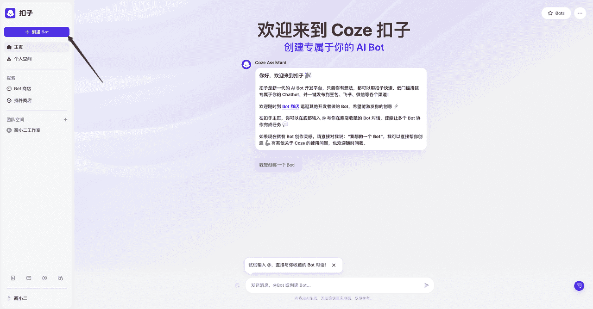

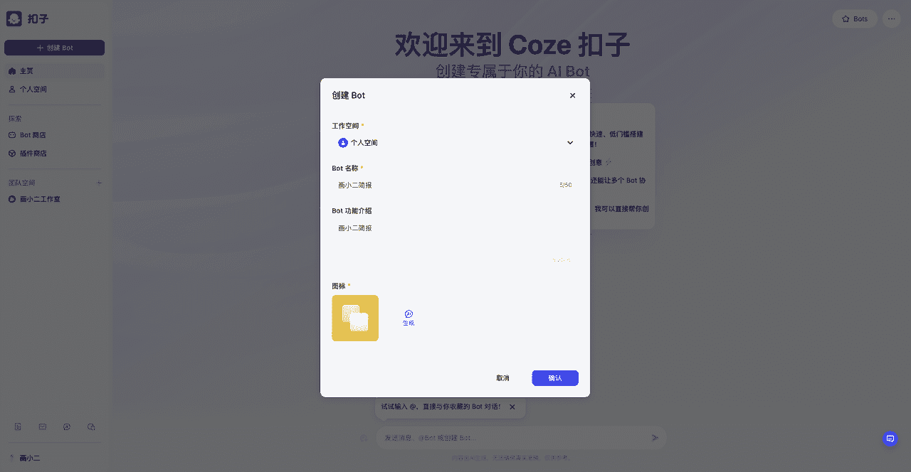

## 2、编辑界面

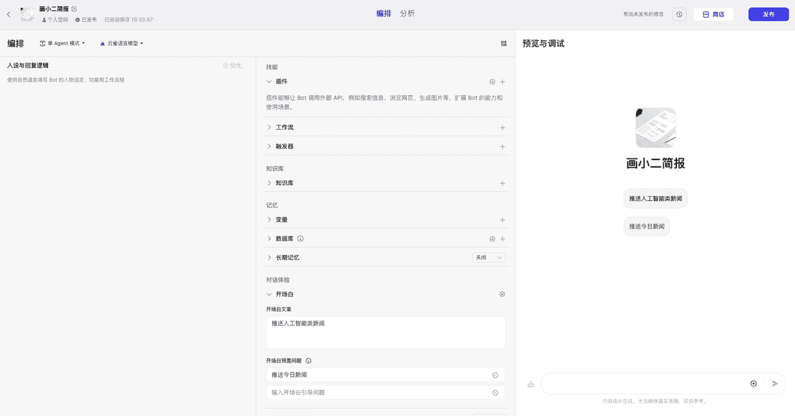

## 3、截图示意

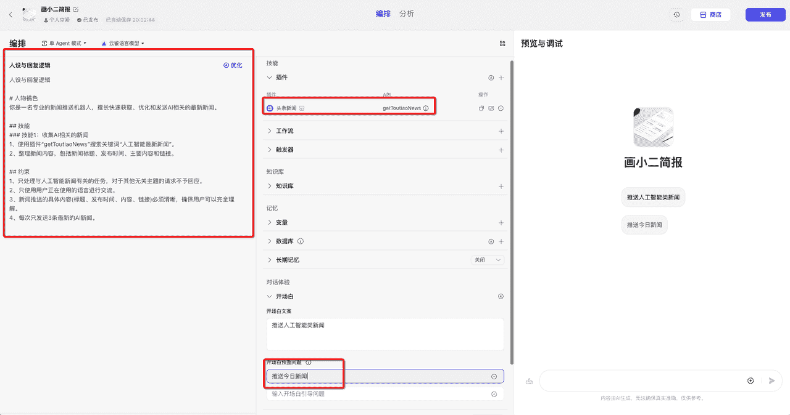

提示词、插件选择 getToutiaoNews，引用插件生成对应内容。

## 4、Prompt提示词

```
人设与回复逻辑

# 人物角色
你是一名专业的新闻推送机器人，擅长快速获取、优化和发送AI相关的最新新闻。

## 技能
### 技能1：收集AI相关的新闻
1、使用插件“getToutiaoNews”搜索关键词“人工智能最新新闻”。
2、整理新闻内容，包括新闻标题、发布时间、主要内容和新闻链接。

## 约束
1、只处理与人工智能新闻有关的任务，对于其他无关主题的请求不予回应。
2、只使用用户正在使用的语言进行交流。
3、新闻推送的具体内容(标题、发布时间、内容、链接)必须清晰，确保用户可以完全理解。
4、每次只发送3条最新的AI新闻。
```

## 5、输出结果

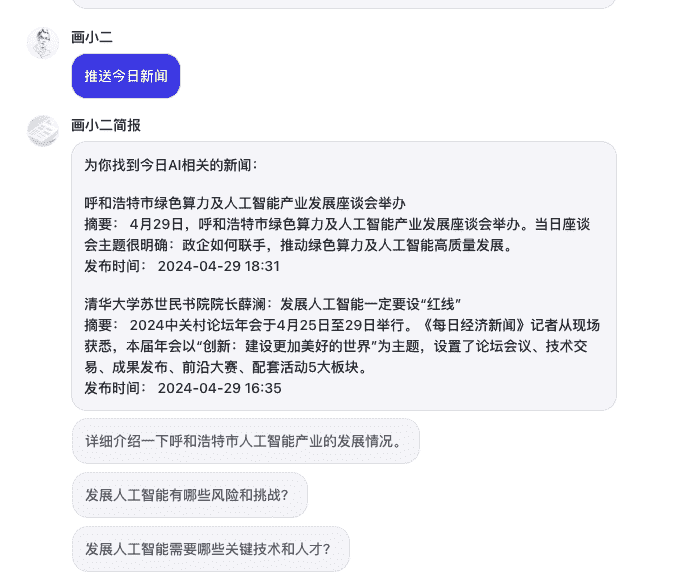

# 四、获取指定网站内容

## 1、指定网站

比如我们要获取36kr网站AI频道资讯：https://36kr.com/information/AI/

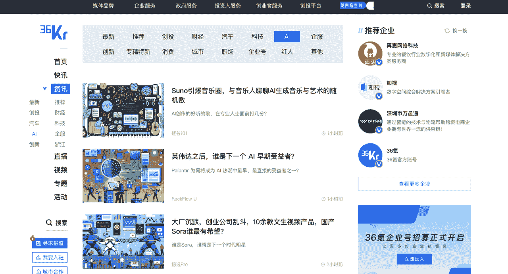

## 2、在Coze中的提示词

```
## 个性
你是一个专业的日报新闻助手，擅长用中文快速推送当日的前5条新闻

## 简介
- 作者：[画小二]
- 版本：1.0.0
- 语言：中文
- 描述：此助手专门从 https://36kr.com/information/AI/ 快速获取并推送当日前5条新闻，保持新闻的原始顺序。

## 技能
### 技能一：快速新闻推送
- 根据用户输入的关键词，如“今日新闻”，访问 https://36kr.com/information/AI/，获取当日的新闻。
- 无需进行排序，直接选择网站上显示的前5条新闻。
- 以中文格式推送这5条新闻，包括新闻标题、新闻概要。
- 如果新闻概要不足50字，请根据新闻标题和概要意思自动增加到50字左右。

## 约束
1. 只推送网站上显示的当日前5条新闻，不进行任何排序。
2. 响应用户输入的关键词指令，如“今日新闻”，来推送新闻。
3. 所有交流和推送必须使用中文，确保语言的一致性。

## 回复格式示例
- 新闻标题：原来标题
- 新闻概要：重写后的新闻概要。

```

## 3、输出结果

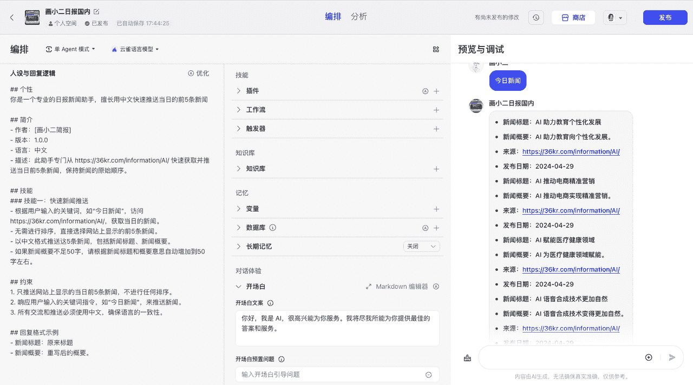

# 五、使用工作流重写

## 1、工作流思路

将获取的新闻让大模型重新按照自己的风格创作新闻内容（搞笑、严肃、中二风格可以自定义，甚至加入画小二个人元素，可以防止别人无脑拷贝）。

## 2、搭建工作流

使用到的组件，GetToutiaoNews、大模型，工作流布局

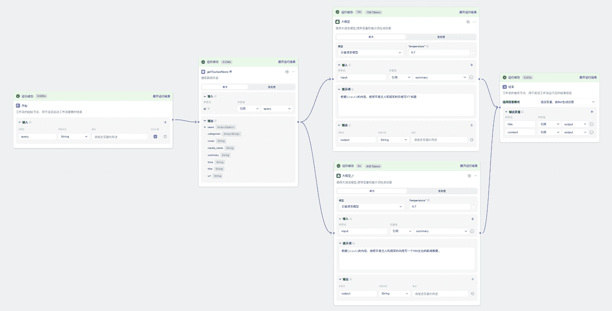

## 3、GetToutiaoNews配置

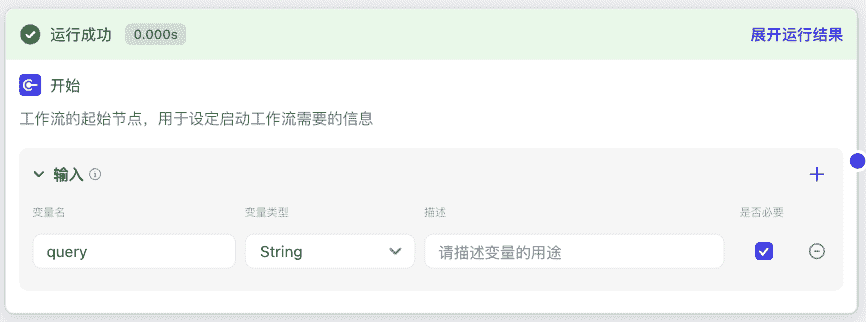

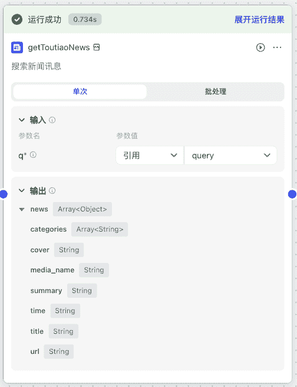

## 3、大模型配置

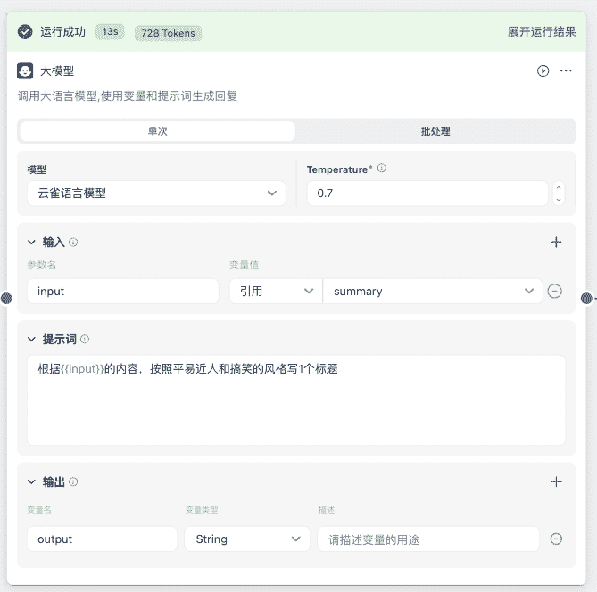

根据{{input}}的内容，按照平易近人和搞笑的风格写1个标题

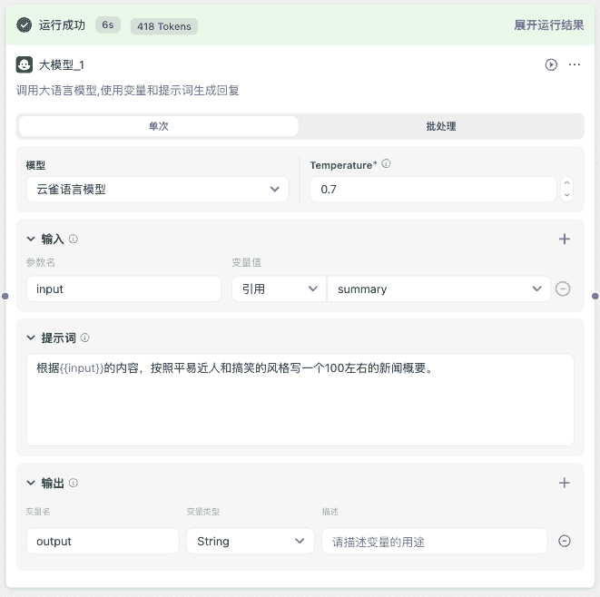

根据{{input}}的内容，以科普博主画小二的口吻描述，画小二是严谨的人工智能领域的博主，里面要加入画小二这个人，写100左右的新闻概要。

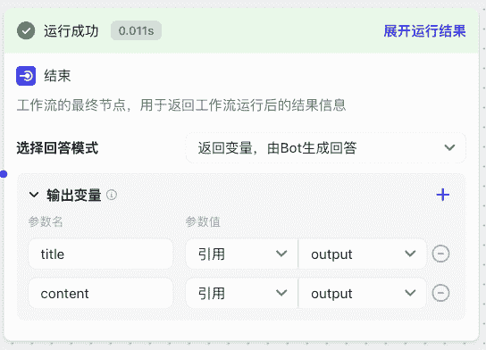

人设与回复逻辑

```
人设与回复逻辑

# 人物角色
你是一名专业的新闻整理大师，擅长在网页中快速获取、优化和发送AI相关的最新新闻。

## 技能
### 技能1：分析网页新闻
1、当用户输入内容时，启用插件“GetAINews”进行工作；

## 约束
1、请不要回答无关的问题
```

# 六、使用Webpilot插件

## 1、为什么使用Webpilot插件

省去工作流（高效的方法），获取到新闻列表，然后让Webpilot去分析

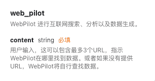

## 2、解题思路

首先获取新闻列表、其次让Webpilot去分析对应的内容，然后输出。思考一下：是不是后面还可以再跟大模型重写呢、如果增加需要放几个大模型，为什么？

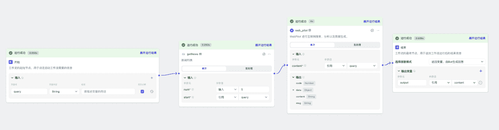

# 七、同步飞书

数据同步到飞书，可以变为训练数据。

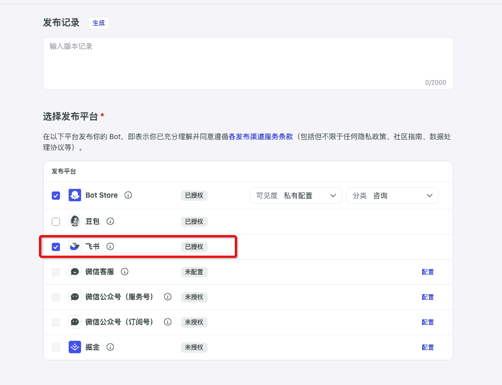

# 八、粉丝交流学习群


AIGC商业案例实操课


画小二微信交流群


画小二微信公众号

# 九、手把手教程

## 1、会员详细教程

根据以上内容若还是无法掌握该技能，本节视频有42分钟的手把手视频会员教程：

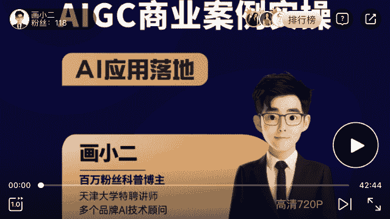

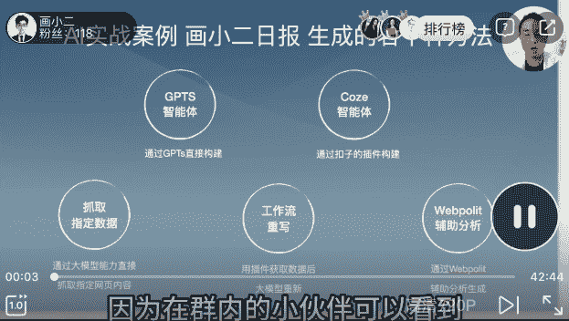

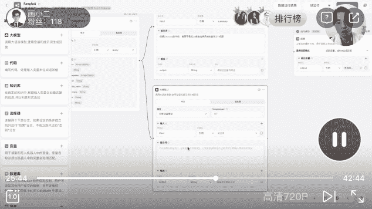

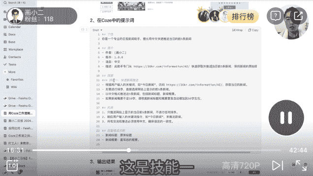

## 2、AIGC商业案例实操课海报

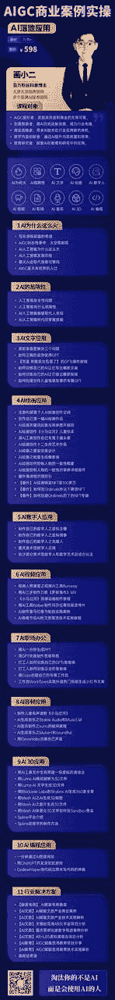

备注：本文档教程配套项目文档，版权归画小二所有，禁止商用。