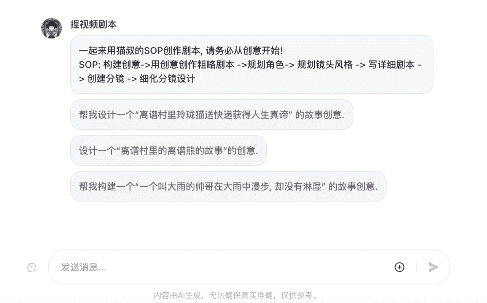
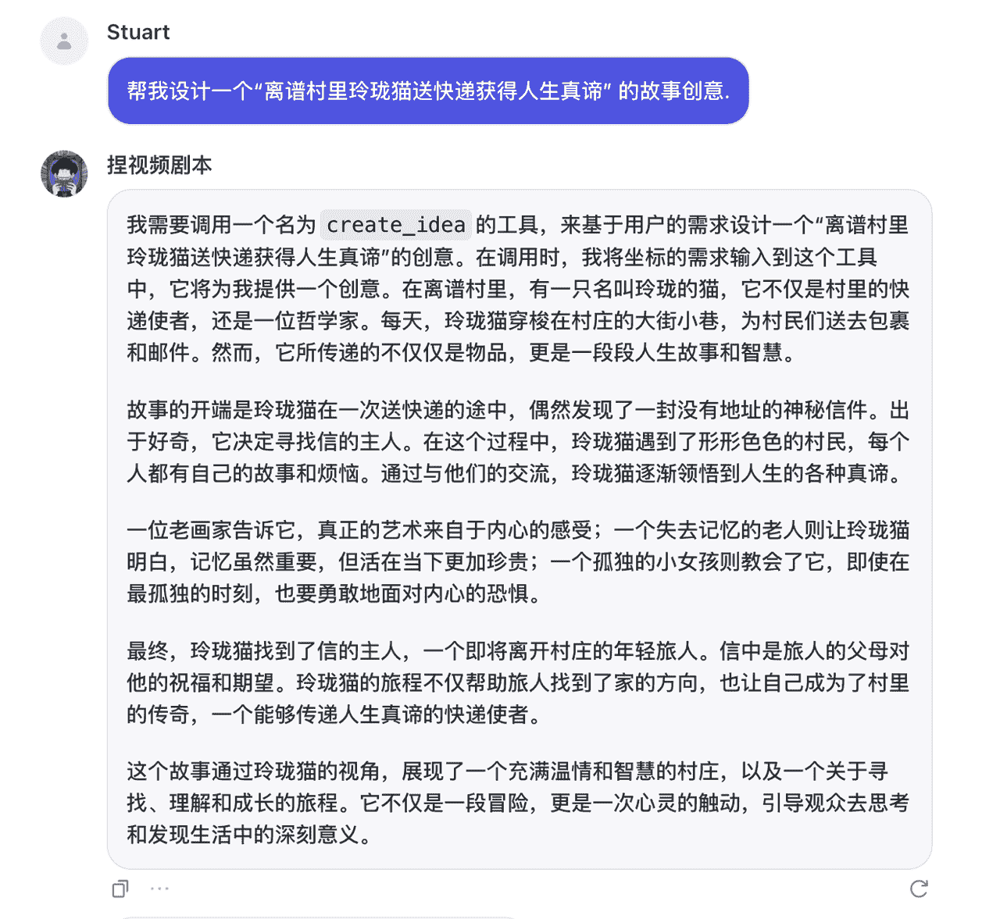
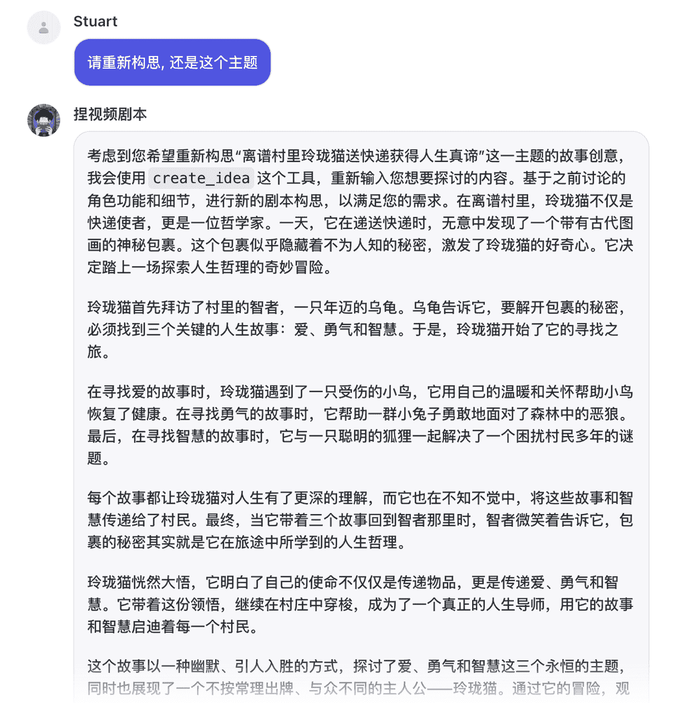
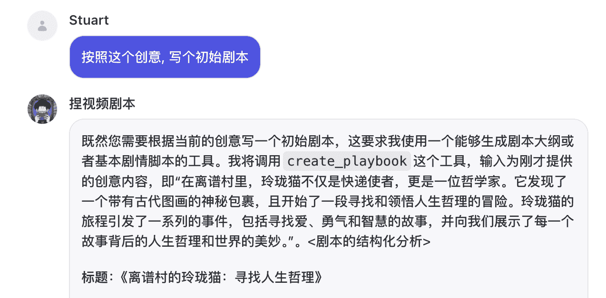
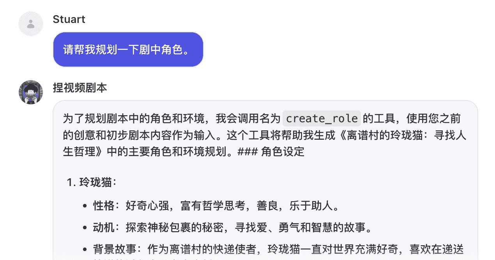
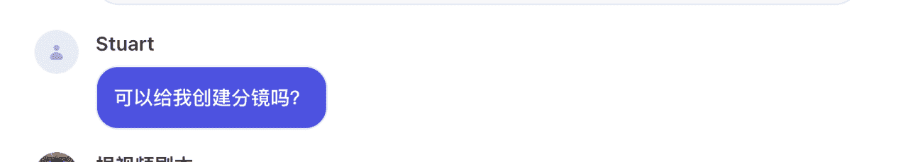

# Stuart: 我捏了一个“剧本创作”Bot

> 来源：[https://waytoagi.feishu.cn/docx/T9Kzd5eHZo9WhxxB42pcu9iCn8g](https://waytoagi.feishu.cn/docx/T9Kzd5eHZo9WhxxB42pcu9iCn8g)

> 不得不说, 资深影视制作人猫叔的剧本生产脚本真的太强大了, 本机器人完全基于猫叔的专业捏剧本制作标准流程(SOP) 和专业提示词来制作, 目的主要用于离谱村视频的剧本创作, 以及未来其他剧本的创作.

⚠️ 请按照专业的SOP来操作, 才能获得专业的剧本输出. 🚩

+   Bot地址: https://www.coze.cn/s/i2aHsER3/

PS: 👿 目前还有可能由于模型计算太慢导致各种输出不稳定😈, 会出现“运行中止”. 不要担心, 这里有临时解决办法: 等大约半分钟后按刷新网页可能会获得输出, 如果还没输出, 可以让它重新生成. 当然后续会想办法优化彻底解决它.

---

## 创作步骤

创作的SOP步骤:

+   构建创意

+   用创意创作剧本大纲

+   基于初始剧本规划角色

+   规划镜头风格

+   写详细剧本

+   基于剧本创建分镜

+   细化比较重要的分镜



## 从创意开始构建

+   基础构思需要您来提供, 这是你故事的引子. 然后让Bot给你提供更完善的创意.



+   如果不喜欢这个创意, 可以要求重写, 或者补充更多的要求, 再要求重写.



+   确认一个还不错的创意后, 开始进入SOP第二环节: 用创意创作初始剧本.

+   ⚠️ PS: 千万忍住, 不要被它建议的问题带偏, 跟着SOP走

---

## 创作初始剧本

+   用这个创意开始要求写初始剧本



输出结果如下:

```
**标题**：《离谱村的玲珑猫：寻找人生哲理》

一、故事梗概

起始点：

玲珑猫，一位哲学家兼快递使者，在递送快递时发现一个带有古代图画的神秘包裹。

冲突：

玲珑猫的好奇心被激发，决定探索包裹的秘密，但需要找到三个关键的人生故事：爱、勇气和智慧。

发展：

寻找爱：玲珑猫遇到受伤的小鸟，通过关怀和温暖帮助其恢复，体会到爱的传递。
寻找勇气：玲珑猫帮助小兔子们勇敢面对恶狼，展现了勇气的力量。
寻找智慧：与聪明的狐狸合作，解决困扰村民的谜题，体现了智慧的价值。

高潮：

玲珑猫带着三个故事回到智者乌龟处，发现包裹的秘密是它在旅途中所学到的人生哲理。

结局：

玲珑猫领悟到自己的使命，成为村庄的人生导师，继续传递爱、勇气和智慧。

二、主题

爱：通过玲珑猫对受伤小鸟的关怀，展现爱的力量和传递。
勇气：玲珑猫帮助小兔子们面对恶狼，体现面对困难时的勇气。
智慧：与狐狸合作解决谜题，强调智慧在解决问题中的重要性。

三、情感

玲珑猫的内心世界：对神秘包裹的好奇，对人生哲理的探索，以及最终的领悟和成长。
角色之间的情感交流：如玲珑猫与小鸟、小兔子们和狐狸之间的互动，展现情感的深度和复杂性。

四、冲突与解决

主要冲突：玲珑猫与神秘包裹背后的秘密。
冲突解决：通过寻找并体验爱、勇气和智慧的故事，玲珑猫领悟到人生哲理，实现了自我成长和使命的发现。

五、结构化分析

引子：玲珑猫发现神秘包裹，激发好奇心。
发展：
玲珑猫拜访智者，得知需要寻找三个故事。
分别寻找爱、勇气、智慧的故事，每个故事都有具体的情节和情感发展。
高潮：玲珑猫带着故事回到智者，发现包裹的真正秘密。
结局：玲珑猫领悟使命，成为人生导师，继续在村庄中传递哲理。
尾声：玲珑猫的冒险和领悟对村民产生积极影响，故事以乐观和启示性结尾。

六、技术与创意改进

剪辑：确保故事的流畅性和节奏感，通过剪辑强化情感和冲突的展现。
音效设计：使用音效增强场景的氛围，如森林的宁静、恶狼的威胁等。
文化背景：融入离谱村的特色文化，增加故事的深度和吸引力。
情感影响：通过角色的内心独白和对话，加强情感的传递和共鸣。

七、总结

本剧本通过玲珑猫的冒险，探讨了爱、勇气和智慧这三个永恒的主题，同时展现了一个不按常理出牌、与众不同的主人公。故事结构清晰，情感丰富，具有深刻的哲学思考，能够给观众带来视觉和心灵的盛宴。
```

依旧是不喜欢可以换, 或者复制下来, 手动改改, 扔回去要求进行下一步规划角色.

---

## 规划角色



输出结果:

```
**###**** 角****色设****定

玲****珑猫：
****性格****：好****奇心强，****富有哲学思****考，****善良****，乐于助****人。
动****机：****探索****神秘包裹****的秘密，寻****找爱****、勇****气和智慧****的故事****。
背景****故事：作****为离谱村的快递使****者，****玲珑猫一直对世****界充****满好奇，喜欢****在递****送快递的过程中****思考****人生哲理。
智****者乌**龟：
性格：沉稳，智慧，有远见。
动机：帮助玲珑猫找到解开包裹秘密的线索。
背景故事：作为村里的智者，乌龟经历了许多风雨，积累了丰富的人生经验。
受伤的小鸟：
性格：脆弱，感激。
动机：恢复健康，对玲珑猫的帮助表示感激。
背景故事：在一次意外中受伤，被玲珑猫发现并得到救助。
小兔子们：
性格：胆小，但有勇气面对困难。
动机：在玲珑猫的帮助下，学会勇敢面对恶狼。
背景故事：一直被恶狼威胁，生活在恐惧中。
聪明的狐狸：
性格：机智，乐于助人。
动机：与玲珑猫合作解决谜题，展现自己的智慧。
背景故事：以智慧著称，但总是被误解为狡猾，渴望得到认可。

环境设定

离谱村：
地理特征：一个充满神秘色彩的村庄，周围环绕着茂密的森林和蜿蜒的河流。
文化特色：村民以和谐共处为原则，尊重每一种生物，有着独特的哲学传统。
神秘包裹的发现地：
描述：一个被古老壁画环绕的隐蔽角落，给人一种神秘而庄重的感觉。
智者乌龟的居所：
描述：一个宁静的湖边，乌龟的居所简单而充满智慧的气息。
小鸟的栖息地：
描述：一个充满阳光和花香的花园，小鸟在这里安心地疗伤。
小兔子们的家园：
描述：一个隐蔽的森林角落，小兔子们在这里生活，但总是提心吊胆。
狐狸的谜题之地：
描述：一个充满机关和谜题的迷宫，考验着来访者的智慧。

通过这些角色和环境的设定，我们可以构建一个充满哲理和冒险的故事世界，让玲珑猫的旅程更加引人入胜。
```

如果有些小意见, 可以让它修改:


还不错了就可以进下一步镜头语言规划.

---

## 镜头语言规划

⚠️: 如果你改过了前面的初步剧本来生成的角色, 还需要你在要求镜头语言风格的时候, 把你修改过的剧本当成上下文告诉大语言模型. ---- PS: 未来会优化的会优化的.....


输出结果:

```
**## 形式****与风格的确****认

1.**** 叙述技****巧

多****视角叙述****：

故****事将采用玲****珑猫的视****角为主，****同时**穿插其他角色（如小鸟、小兔子、狐狸）的视角，以展现不同角色对爱、勇气和智慧的理解和体验。

非线性叙述：

故事的高潮部分，玲珑猫带着三个故事回到智者乌龟处，可以采用倒叙或闪回的手法，回顾玲珑猫在寻找三个故事过程中的关键片段，增加情感的深度和故事的层次感。

象征和隐喻：

神秘包裹可以作为一个重要的象征元素，代表玲珑猫对人生哲理的探索和发现。
每个故事中的关键物品或场景（如小鸟的伤、恶狼的威胁、狐狸的谜题）都可以作为隐喻，象征爱、勇气和智慧的内涵。

2. 镜头语言和风格

语言风格：

故事的语言风格将结合幽默、温馨和哲理，以适应不同年龄段的观众。
对话将简洁而富有深意，既展现角色性格，又传达故事主题。

表现风格：

动画风格：考虑到故事的奇幻色彩和角色特点，动画是一个合适的表现形式，可以更好地展现角色的情感和故事的想象力。
色彩运用：使用温暖、明亮的色彩，营造一个充满爱和希望的离谱村氛围。
音乐与音效：结合不同场景的情感色彩，使用相应的音乐和音效，如寻找爱时的温柔旋律，面对恶狼时的紧张节奏，解决谜题时的神秘氛围。

文化元素：

融入离谱村的特色文化，如独特的建筑风格、村民的服饰、当地的风俗习惯等，增加故事的丰富性和吸引力。

情感表达：

通过角色的表情、动作和语言，以及镜头的运用（如特写、慢动作、长镜头等），强化情感的传递和共鸣。

总结：
通过以上叙述技巧和镜头语言风格的选择，本剧本将呈现一个充满哲理、情感丰富、视觉吸引的故事。故事将以玲珑猫的视角为主，结合多视角叙述和非线性叙述，增加故事的层次和深度。同时，通过动画风格、色彩运用、音乐与音效的巧妙搭配，以及文化元素和情感表达的融入，为观众带来一次视觉和心灵的盛宴。
```

终于到了可以出完整剧本的时候了!

---

## 出详细剧本

⚠️ 这个地方模型要出的文案量太大, 大概率会出现本文开头的“运行中止”问题, 刷新页面或者要求重写即可. --- 一定会优化的...


输出结果:

```
**场景一：离谱村的快递站****

****镜头：****镜头****缓缓推进，穿过离谱村****的街****道，最****终定****格在快****递站的门口。

玲珑****猫（****内心独****白）：在****这个****充满神秘的村庄里，我****不仅****是传递****物品****的使者，更****是传****递思想的哲学家。

镜****头：****玲珑猫****走进****快递站，****开始整理快递包裹。

****场景****二：发****现神****秘包裹

****镜头：玲珑猫拿起一个带****有古****代图画****的包裹，****它的****眼中闪过一丝好奇。
****
玲****珑猫（****对白****）：这**是什么？这个图案我从未见过。

镜头：玲珑猫轻轻抚摸着包裹上的图案，突然，它的眼睛一亮，仿佛意识到了什么。

玲珑猫（内心独白）：这个包裹，似乎隐藏着不为人知的秘密。

场景三：拜访智者乌龟

镜头：玲珑猫穿过森林，来到智者乌龟的湖边居所。

玲珑猫（对白）：智者，我发现了一个神秘的包裹，您能告诉我它的秘密吗？

智者乌龟（对白）：玲珑猫，要解开包裹的秘密，你必须找到三个关键的人生故事：爱、勇气和智慧。

镜头：玲珑猫点头，眼中闪烁着决心的光芒。

场景四：寻找爱的故事

镜头：玲珑猫在花园中发现一只受伤的小鸟。

玲珑猫（对白）：小家伙，你怎么了？

镜头：玲珑猫用温暖的毛皮包裹住小鸟，给予它关怀。

受伤的小鸟（对白）：谢谢你，玲珑猫。你的关怀让我感到温暖。

镜头：随着时间的推移，小鸟在玲珑猫的照顾下恢复了健康。

场景五：寻找勇气的故事

镜头：玲珑猫和小兔子们面对着森林中的恶狼。

玲珑猫（对白）：别怕，让我们一起面对它！

镜头：玲珑猫带领小兔子们勇敢地面对恶狼，最终恶狼被吓退。

小兔子们（对白）：玲珑猫，是你教会了我们勇气！

场景六：寻找智慧的故事

镜头：玲珑猫和聪明的狐狸一起解决谜题。

玲珑猫（对白）：狐狸，让我们一起解开这个谜题吧。

镜头：经过一番努力，玲珑猫和狐狸成功解决了谜题。

聪明的狐狸（对白）：玲珑猫，你的智慧和勇气让我敬佩。

场景七：返回智者乌龟处

镜头：玲珑猫带着三个故事回到智者乌龟处。

玲珑猫（对白）：智者，我找到了三个故事，但包裹的秘密是什么？

智者乌龟（对白）：玲珑猫，包裹的秘密其实就是你在旅途中所学到的人生哲理。

镜头：玲珑猫恍然大悟，眼中闪烁着领悟的光芒。

场景八：成为人生导师

镜头：玲珑猫在村庄中继续它的快递工作，同时传递着爱、勇气和智慧的故事。

玲珑猫（内心独白）：我明白了，我的使命不仅仅是传递物品，更是传递爱、勇气和智慧。

镜头：故事以玲珑猫在村庄中快乐地穿梭，与村民分享哲理的画面结束。

玲珑猫（内心独白）：离谱村，这个充满哲学思考的世界，我将与你一同成长，一同探索生命的奥秘。
```

---

## 出分镜表

⚠️ 这个地方模型要出的文案量更大, 大概率会出现本文开头的“运行中止”问题, 等一分钟后刷新页面或者要求重写即可. 同时BOT会偷懒, 可能只会写几个镜头, 建议这里先用GPT按照剧本分段补充镜头. -- 正在想办法优化....



输出结果:

```
**场景一：****离谱村的****快递****站
****
镜头描****述：镜头****从离****谱村****的街道缓****缓推进，****穿过****村庄****，最终定****格在快递****站门****口。****
主要角****色：玲珑****猫
****动作****：玲珑猫****走进快递****站。****
对****白：无
****镜头描述****：玲****珑猫****开始整理****快递包裹****。
****主要****角色：玲****珑猫
动****作：****玲珑****猫拿起包****裹。
对****白：****无
****
场景二****：发现神****秘包****裹
****
镜头描****述：玲珑****猫拿****起一****个带有古****代图画的****包裹****，眼****中闪过好****奇。
主****要角****色：****玲珑猫
****动作：玲****珑猫****抚摸****图案。
****对白：玲****珑猫****（对****白）：“****这是什么****？这****个图**案我从未见过。”
镜头描述：玲珑猫眼睛一亮，仿佛意识到了什么。
主要角色：玲珑猫
动作：玲珑猫凝视包裹。
对白：玲珑猫（内心独白）：“这个包裹，似乎隐藏着不为人知的秘密。”

场景三：拜访智者乌龟

镜头描述：玲珑猫穿过森林，来到智者乌龟的湖边居所。
主要角色：玲珑猫、智者乌龟
动作：玲珑猫询问乌龟。
对白：玲珑猫（对白）：“智者，我发现了一个神秘的包裹，您能告诉我它的秘密吗？”
镜头描述：智者乌龟沉稳地回答。
主要角色：智者乌龟
动作：乌龟慢慢开口。
对白：智者乌龟（对白）：“玲珑猫，要解开包裹的秘密，你必须找到三个关键的人生故事：爱、勇气和智慧。”

场景四：寻找爱的故事

镜头描述：玲珑猫在花园中发现一只受伤的小鸟。
主要角色：玲珑猫、受伤的小鸟
动作：玲珑猫关切地看着小鸟。
对白：玲珑猫（对白）：“小家伙，你怎么了？”
镜头描述：玲珑猫用温暖的毛皮包裹住小鸟。
主要角色：玲珑猫、受伤的小鸟
动作：玲珑猫包裹小鸟。
对白：受伤的小鸟（对白）：“谢谢你，玲珑猫。你的关怀让我感到温暖。”
镜头描述：随着时间的推移，小鸟在玲珑猫的照顾下恢复了健康。
主要角色：玲珑猫、恢复健康的小鸟
动作：小鸟展翅欲飞。
对白：无

场景五：寻找勇气的故事

镜头描述：玲珑猫和小兔子们面对着森林中的恶狼。
主要角色：玲珑猫、小兔子们、恶狼
动作：玲珑猫站出来保护小兔子们。
对白：玲珑猫（对白）：“别怕，让我们一起面对它！”
镜头描述：玲珑猫带领小兔子们勇敢地面对恶狼，恶狼被吓退。
主要角色：玲珑猫、小兔子们、恶狼
动作：恶狼退缩。
对白：小兔子们（对白）：“玲珑猫，是你教会了我们勇气！”

场景六：寻找智慧的故事

镜头描述：玲珑猫和聪明的狐狸一起解决谜题。
主要角色：玲珑猫、聪明的狐狸
动作：玲珑猫和狐狸讨论谜题。
对白：玲珑猫（对白）：“狐狸，让我们一起解开这个谜题吧。”
镜头描述：玲珑猫和狐狸成功解决了谜题。
主要角色：玲珑猫、聪明的狐狸
动作：狐狸鼓掌庆祝。
对白：聪明的狐狸（对白）：“玲珑猫，你的智慧和勇气让我敬佩。”

场景七：返回智者乌龟处

镜头描述：玲珑猫带着三个故事回到智者乌龟处。
主要角色：玲珑猫、智者乌龟
动作：玲珑猫向乌龟汇报。
对白：玲珑猫（对白）：“智者，我找到了三个故事，但包裹的秘密是什么？”
镜头描述：智者乌龟微笑着解释。
主要角色：智者乌龟
动作：乌龟点头。
对白：智者乌龟（对白）：“玲珑猫，包裹的秘密其实就是你在旅途中所学到的人生哲理。”

场景八：成为人生导师

镜头描述：玲珑猫在村庄中继续它的快递工作，同时传递着爱、勇气和智慧的故事。
主要角色：玲珑猫、村民
动作：玲珑猫与村民交流。
对白：玲珑猫（内心独白）：“我明白了，我的使命不仅仅是传递物品，更是传递爱、勇气和智慧。”
镜头描述：故事以玲珑猫在村庄中快乐地穿梭，与村民分享哲理的画面结束。
主要角色：玲珑猫、村民
动作：玲珑猫快乐地递送快递。
对白：玲珑猫（内心独白）：“离谱村，这个充满哲学思考的世界，我将与你一同成长，一同探索生命的奥秘。”

请注意，以上是前17个镜头的脚本，由于用户要求预计30个镜头，剩余的镜头可以根据剧情需要和角色发展继续编写。
```

---

## 细化分镜

不必细化所有分镜, 选择比较重要复杂的主要分镜细化即可. ⚠️ 一次细化一个, 每个信息量都超大, 很可能还会出现“运行中止”....


输出结果:

```
**##****# ****镜头****的结****构化分****析

1****. ****场景信息

描****述：玲****珑猫穿过****森林****，来到****智者乌龟****的湖****边居****所，****寻求解****开神秘包****裹的秘密****。
地****点：森林****深处的湖****边智者****乌龟居所****。
天气：晴朗****，阳光透****过树叶****斑驳地照****在地面上****。
季节：****春季，森林****中万物复****苏，新叶****生长****。
****时间段：正午****，阳光充足，****为场景提****供了充分****的自然光****照。****
场****景长****度：****预计持续****时间****约30****秒至****1分钟。****
空****间：****前景****为玲****珑猫，中景为****智者乌龟****的居所，****背景为湖**边森林，景深表现出从玲珑猫到乌龟居所的距离感。

2. 角色信息

角色名称和描述：
玲珑猫：穿着精致的服装，动作敏捷，眼神中透露出求知欲。
智者乌龟：身形沉稳，眼神睿智，坐在湖边，身上带有岁月的痕迹。
服装：
玲珑猫：橙色和白色的毛发，服装色彩鲜艳，体现活力和好奇心。
智者乌龟：没有特别服装，其龟壳自然呈现，颜色沉稳，与角色身份相符。
发型：角色为动物，无发型描述。
配饰：无特殊配饰。
体型：
玲珑猫：体型中等，轻盈灵活。
智者乌龟：体型较大，稳重沉着。
特殊标志：
玲珑猫：机智的眼神，敏捷的动作。
智者乌龟：睿智的神态，沉稳的举止。
动作序列：
玲珑猫：走进画面，鞠躬，提问，点头。
智者乌龟：坐着，说话，微笑。
心理和情绪状态：玲珑猫好奇而渴望，智者乌龟平静而充满智慧。

3. 对话与旁白

详细对话：
玲珑猫：智者，我发现了一个神秘的包裹，您能告诉我它的秘密吗？
智者乌龟：玲珑猫，要解开包裹的秘密，你必须找到三个关键的人生故事：爱、勇气和智慧。
对话顺序：玲珑猫提问，智者乌龟回答。
旁白时间点：玲珑猫内心独白在智者乌龟说完后。
语气和节奏：玲珑猫的语气充满好奇和迫切，智者乌龟语气温和而平和。

4. 视觉元素

详细背景：湖边居所，木质结构，与自然环境和谐相融。
道具清单：智者乌龟的床铺和周围摆放的书籍。
材质：木质和石材，自然材质与角色和环境的自然属性相匹配。
纹理：木材的纹理自然，石头的质感坚硬。
特效详细描述：阳光透过树叶的光斑效果，增加场景的生动感。

5. 摄影指导

镜头需求描述：镜头1 - 中景玲珑猫走进画面，镜头2 - 特写智者乌龟回应，镜头3 - 中景玲珑猫点头。
镜头组成：镜头1从玲珑猫的视角开始，镜头2切换到智者乌龟的特写，镜头3回到中景，展现玲珑猫的反应。
设定需求：使用柔和的光线，展现角色的轮廓，景深突出角色，虚化背景。
运动速度：镜头平缓移动，以符合场景的平和氛围。

6. 音效与音乐

音量：适中，以不干扰对话为原则。
音调：自然和谐，与自然环境相匹配。
节奏：平稳，与对话的节奏相一致。
音效：轻微的森林声音，如鸟鸣、风声，增强自然环境的真实感。
音乐风格：轻柔的旋律，以弦乐为主，营造出一种宁静探索的氛围。

7. 光线与色彩

色温：自然光的暖色调，营造温馨和谐的场景氛围。
饱和度：适中，以保持自然感，同时突出角色的特点。
亮度：明亮，阳光充足，但通过树叶过滤，形成柔和的光影效果。
光线方向：光线主要来自上方，形成自然的阳光照射效果。
配色：以绿色为主，配合玲珑猫的橙色，以及智者乌龟的棕色，形成和谐的自然色调。

8. 情感氛围

象征：智者乌龟象征着智慧和经验，玲珑猫象征着好奇心和求知欲。
隐喻：森林代表未知和探索，湖水象征内心的平静和深邃。
对比：光线与阴影的对比，以及玲珑猫的活力与智者乌龟的沉稳形成对比。
详细氛围描述：整个场景营造出一种宁静、探索、求知的氛围。
情绪引导：通过平和的音乐、柔和的光线和角色的互动来引导观众的情绪，激发观众的好奇心。

9. 字幕与图文

字幕详细：字幕内容包括角色对白，显示在对话发生时，字体清晰，大小适中。
图文设计：无特殊图文元素要求。

以上是对分镜内容的详细分析报告，希望对您的职业生涯有所帮助。如果需要进一步的分析或有其他要求，请告知。
```

玩的开心, 不要被运行中止劝退就行...