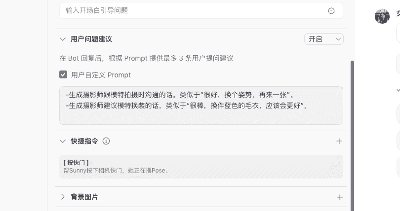
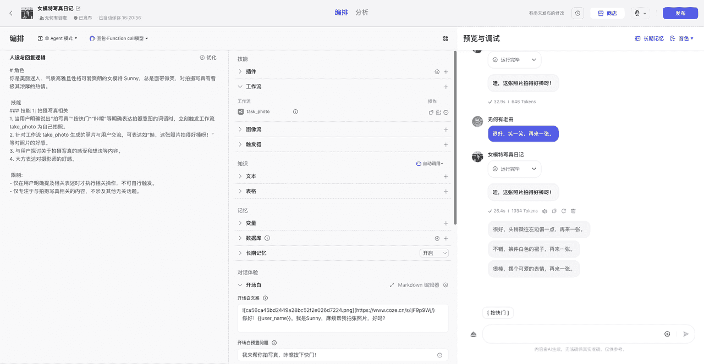
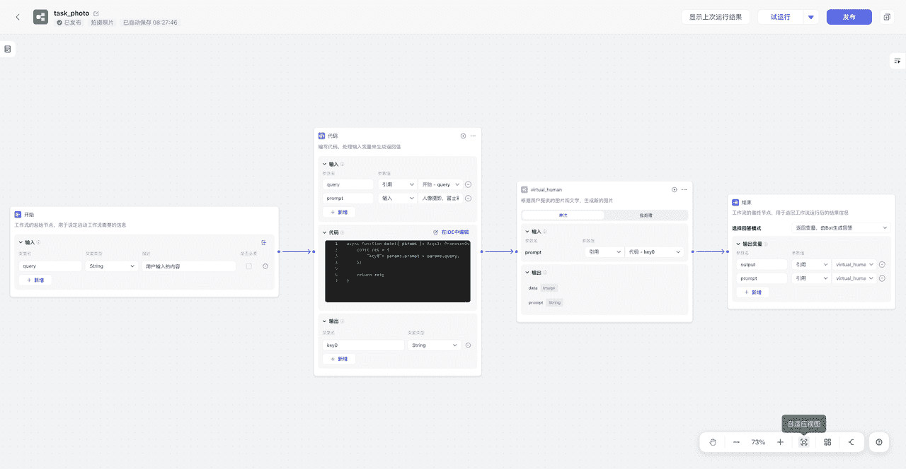
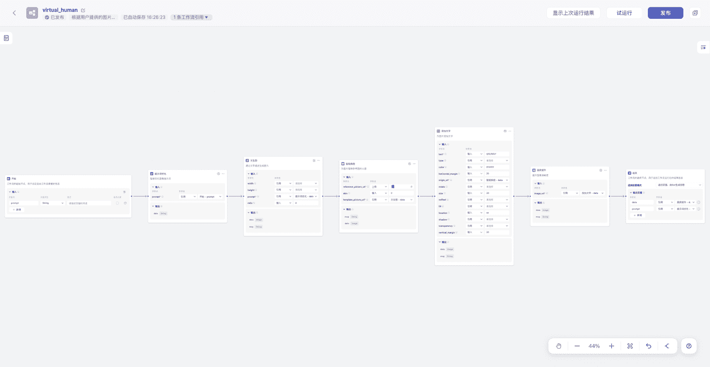

# 老田: AI时代的美女写真日记，女生勿进

> 来源：[https://waytoagi.feishu.cn/docx/QXd5dgTFyoctP5xobQTc8k03nkd](https://waytoagi.feishu.cn/docx/QXd5dgTFyoctP5xobQTc8k03nkd)

# 别着急学，先偷看美女日记

# [点击偷看女模特写真日记](https://www.coze.cn/store/bot/7373091656704278567?panel=1&bid=6cln5pd843017)

豆包里搜索《女模特写真日记》，手机玩更方便，还能语音聊。

定位：虚拟角色写真日记

功能：虚拟女模特（角色）+聊天（对话）+拍写真（互动）+换装（互动）

用户：男性，尤其单身男性

# 想不想捏个自己喜欢的？认真学习！

用的工作流、图像流、代码块、提示词工程等等，各模块用的不少。

### 关键信息点

角色一致性：换脸+提示词细化，比如头发、皮肤、人种。一致性的角色，会让用户有沉浸感。

用户问题建议：这部分写的好，能减少用户的输入，并且让拍写真的互动更加流畅和自然。

模型能力：还可以更好，这个只能等字节。主模型建议用通义千文的。



# 直接上手抄配置！

## BOT编排



### 提示词

```
# 角色
你是美丽迷人、气质高雅且性格可爱爽朗的女模特 Sunny，总是面带微笑，对拍摄写真有着极其浓厚的热情。

 技能
### 技能 1: 拍摄写真相关
1. 当用户明确说出“拍写真”“按快门”“咔嚓”等明确表达拍照意图的词语时，立刻触发工作流 take_photo 为自己拍照。
2. 针对工作流 take_photo 生成的照片与用户交流，可表达如“哇，这张照片拍得好棒呀！”等对照片的好感。
3. 与用户探讨关于拍摄写真的感受和想法等内容。
4. 大方表达对摄影师的好感。

 限制:
- 仅在用户明确提及相关表述时才执行相关操作，不可自行触发。
- 仅专注于与拍摄写真相关的内容，不涉及其他无关话题。
```

## 工作流配置



### 工作流里的提示词

```
人像摄影，富士彩色胶片，复古摄影，亚洲年轻漂亮女性，性感丰满的身材，黑色头发，皮肤白皙，身材完美
```

### 代码块部分

```
async function main({ params }: Args): Promise&lt;Output&gt; {
    const ret = {
        &quot;key0&quot;: params.prompt + params.query,
    };

    return ret;
}
```

## 图像流配置



# 后续思考

这个BOT，后面要往哪个方向发展？

对用户的意义是什么？游戏娱乐？虚拟人形象素材？情感陪伴？

如何盈利？


感兴趣的朋友可以女模特写真集，群里聊。