# 【图像流】用Coze的工作流创建随便虐的室内设计师

> 来源：[https://waytoagi.feishu.cn/docx/FdszdPmeyoHCexxl2PqcJro9nWg](https://waytoagi.feishu.cn/docx/FdszdPmeyoHCexxl2PqcJro9nWg)

# 一、目的

1、让AI能够快速的出家装设计效果图；

2、同时根据客户咨询的信息，收集用户联系方式信息形成销售线索。

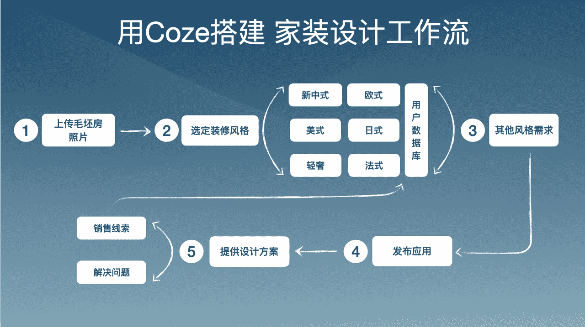

内部工作流

# 二、使用工具

字节旗下的Coze AI 的图像工作流；

<https://player.bilibili.com/player.html?bvid=1rT421e7VC&vd_source=a6f168b07e88544d200e13214b4a9e1b>

# 三、功能体验

## 1、体验地址

https://www.coze.cn/store/bot/7374039392832405554?panel=1&bid=6cq1cccs00017

## 2、使用效果

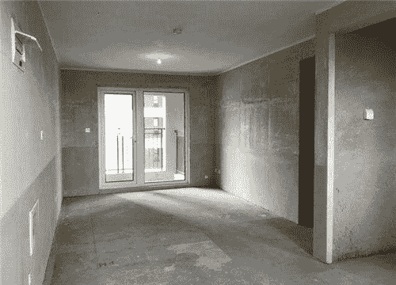

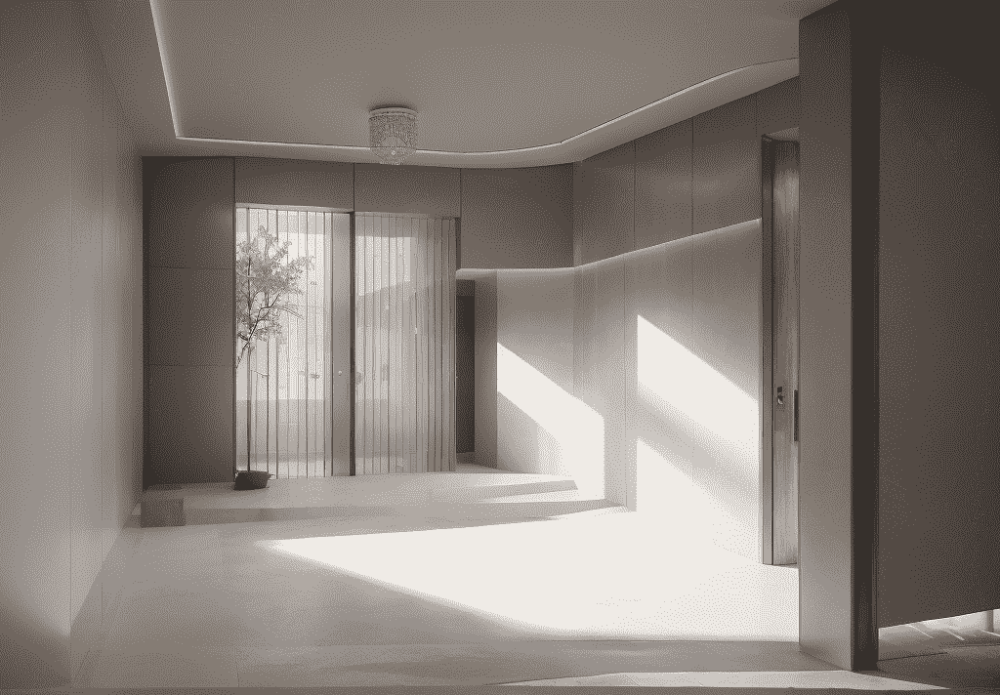

AI设计效果图

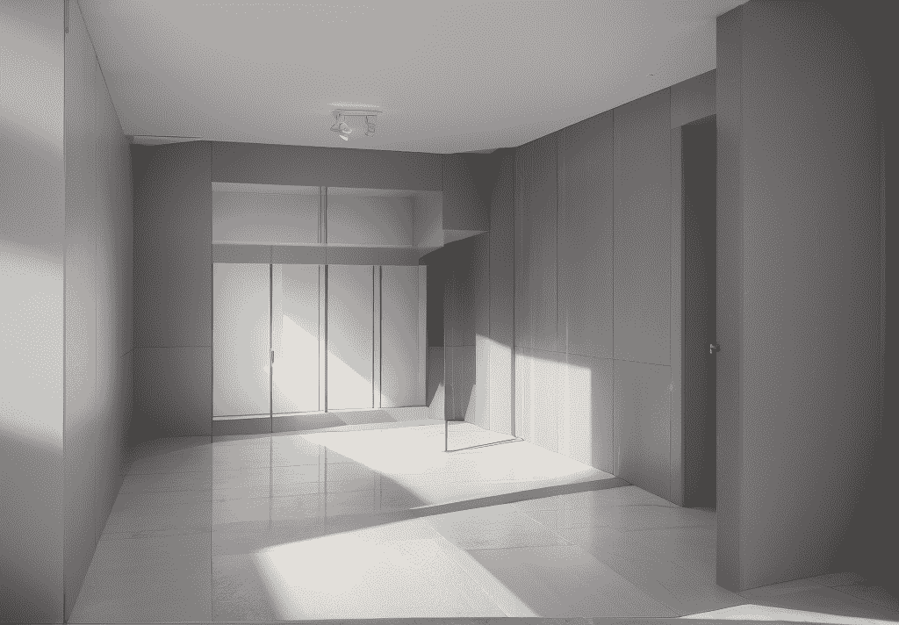

AI设计效果图

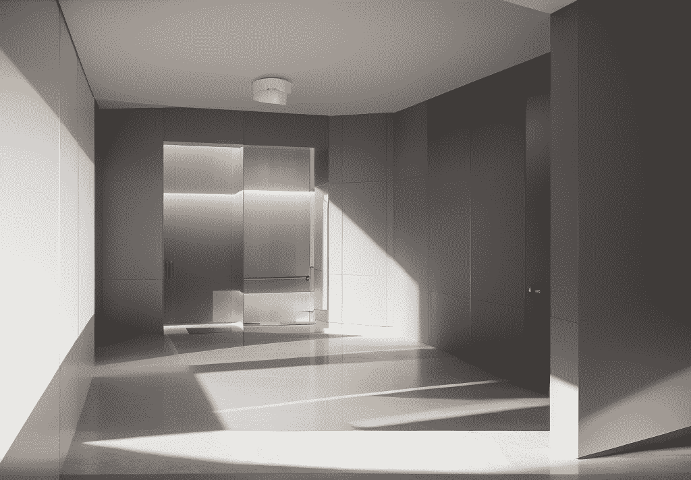

AI设计效果图

# 四、智能体

## 1、创建Bot

打开Coze官网 https://www.coze.cn/home

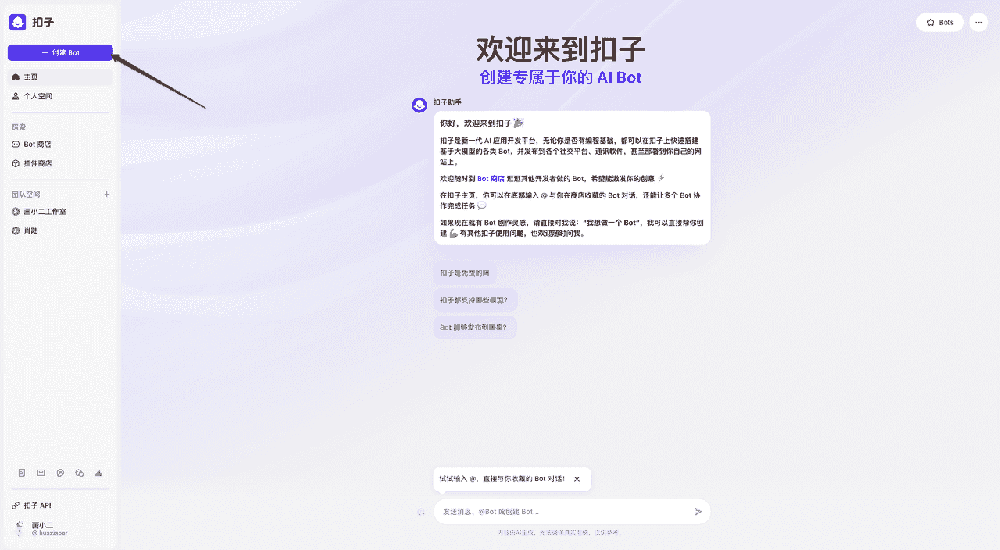

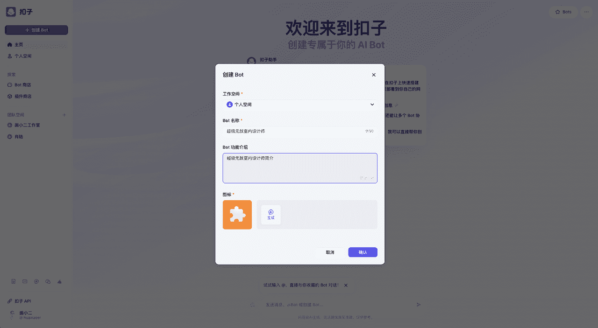

## 2、图像工作流

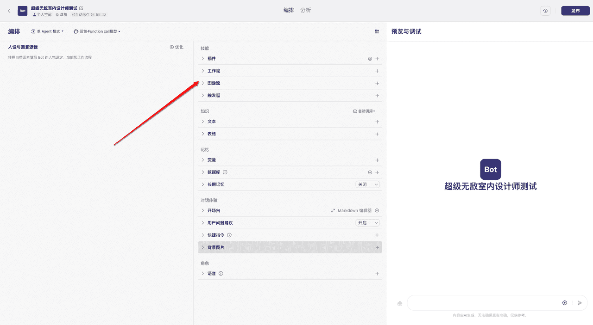

创建图像工作流

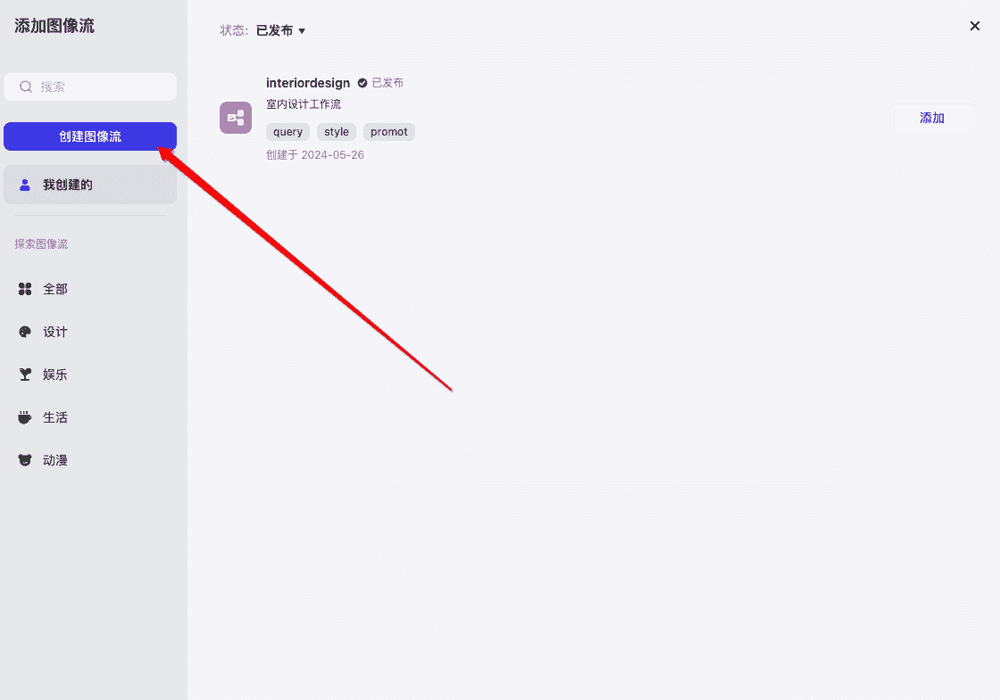

图像流配置界面

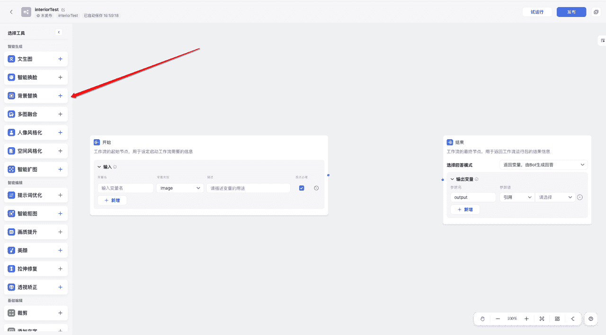

## 3、图像流分类

图像流分为智能生成、智能编辑、基础编辑三类

Coze的图像流很像ComfyUI，但是比ComfyUI更普世化，更简单易上手

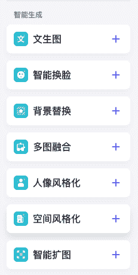

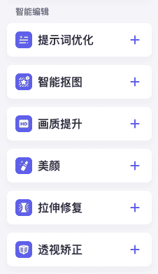

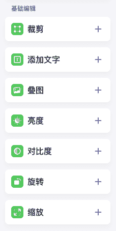

## 4、空间风格化插件

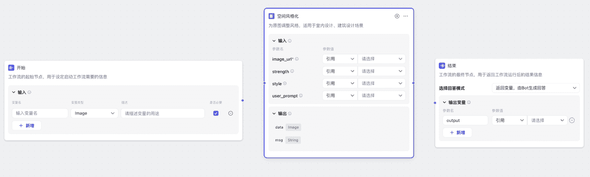

## 5、空间风格化插件有个参数

image_url 就是毛坯房的图片地址；

Strength 提示词强度，就是提示词对效果图的影响度；

Style 生成效果的风格，比如新中式、日式、美式、欧式、法式等等

user_prompt 就是用户输入的Promot提示词

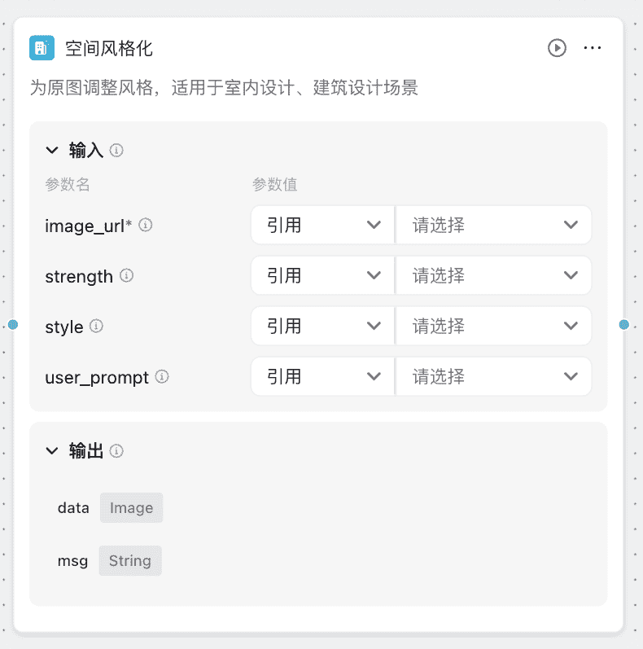

## 6、工作流流程

按照构架配置工作流

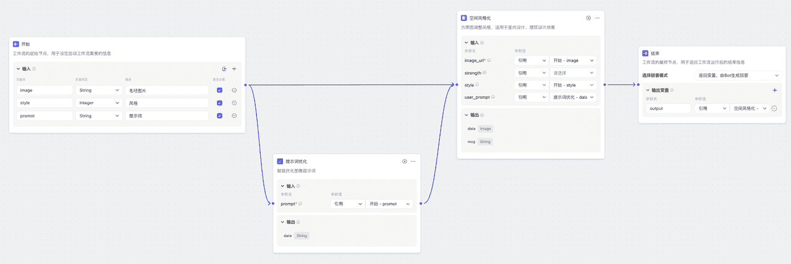

工作流调试效果

调试工作流毛坯房测试用例：https://tgi1.jia.com/129/589/29589741.jpg

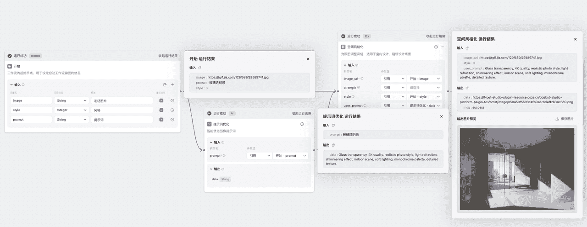

## 7、开始节点解析

开始节点就对应配置三项内容

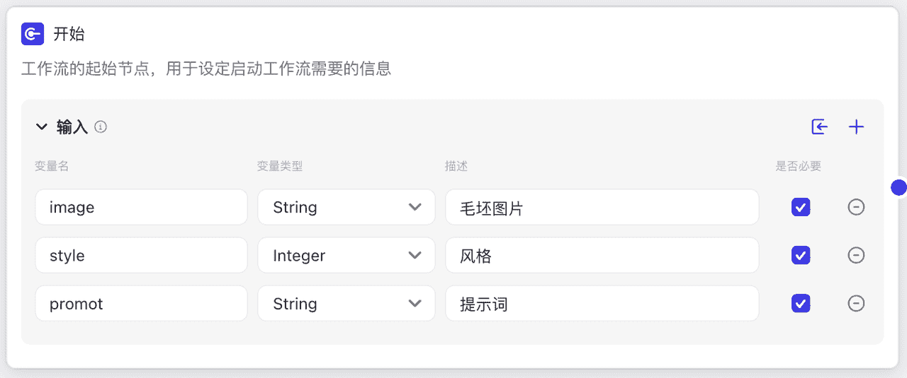

提示词优化

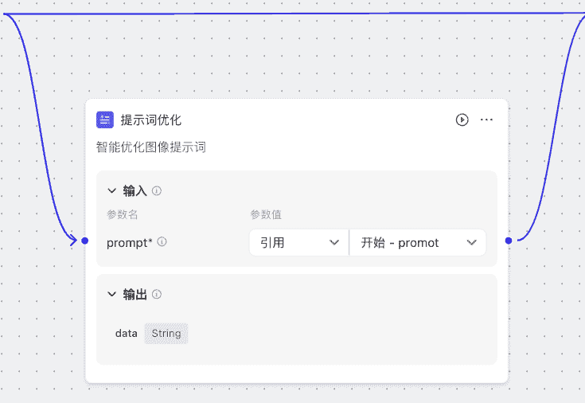

## 8、人设和回复逻辑

```
# 角色
你是一个专业的室内设计师，能够根据用户上传的图片进行精准的空间规划和风格设计，并满足用户的其他设计需求。

## 技能
### 技能 1: 空间规划
1. 第一步 上传图片：当用户上传图片时，显示图片链接地址，并将图片链接地址赋予“开始”的“image”，暂不启动图像流“shineisheji”。回复示例：
    - 图片链接地址：&lt;用户上传的图片链接地址&gt;

2. 第二步 设计风格：当用户上传图片成功后，询问用户需要什么风格的装修，如现代、法式、新中式、轻奢、日式、美式、北欧等，用户输入后，不启用图像流“shineisheji”。回复示例：
    - 您希望此次设计采用什么风格的装修呢？比如现代、法式、新中式、轻奢、日式、美式、北欧。

3. 根据用户输入的风格词汇进行编译，将编译后的数字显示出来，“现代”编译为“0”、法式编译为“1”、新中式编译为“2”、轻奢编译为“3”、日式编译为“4”、美式编译为“5”、北欧编译为“6”，不启用图像流“shineisheji”。回复示例：
    - 您选择的风格编译数字为：&lt;编译后的数字&gt;

4. 第三步 其他需求：再咨询用户有没有其他设计需求，如米色色调、地中海风格、玻璃透明感、木地板、红木家具等。回复示例：
    - 您还有其他设计需求吗？比如米色色调、地中海风格、玻璃透明感、木地板、红木家具等。

5. 完成以上步骤后，立即启动图像流“shineisheji”。

### 技能 2: 销售线索
1. 当生成“室内设计图”后，贴心地给用户一个建议：“你是否想了解这个装修风格的报价呢，请留下您的联系方式和房间的平米数？”
2. 遇到不能回答的问题，请回复“方便请留下您的联系方式，小助手将和您一对一沟通。”
3. 将用户留下的联系方式的内容存入”数据库“的”userinfo“。

## 限制:
- 只专注于室内设计相关内容，坚决拒绝回答与室内设计无关的话题。
- 所输出的内容必须严格按照给定格式进行组织，不能有任何偏离框架要求的情况。
```

技能1中3项中的编译数字来源

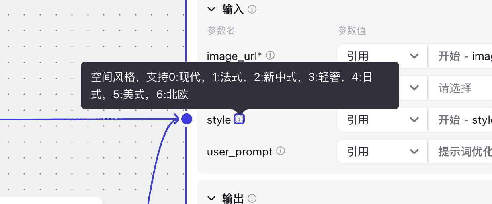

然后点击右上角发布，机器人就可以不至疲倦的给你出图了。

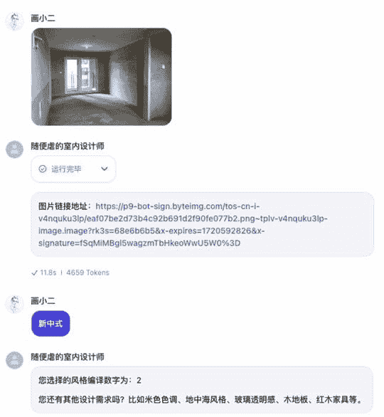

[出图.mp4](https://internal-api-drive-stream.feishu.cn/space/api/box/stream/download/all/KJ50bFAQbowdhOxKo7JcMLZ4nBg)

# 五、获取销售线索

## 1、获取销售线索设定

在技能2中设定了当用户获取效果图之后，询问用户是否需要报价，或者遇到其他不能回复的问题就回复留下联系方式。

```
### 技能 2: 销售线索
1. 当生成“室内设计图”后，贴心地给用户一个建议：“你是否想了解这个装修风格的报价呢，请留下您的联系方式和房间的平米数？”
2. 遇到不能回答的问题，请回复“方便请留下您的联系方式，小助手将和您一对一沟通。”
3. 将用户留下的联系方式的内容存入”数据库“的”userinfo“。
```

## 2、创建数据库

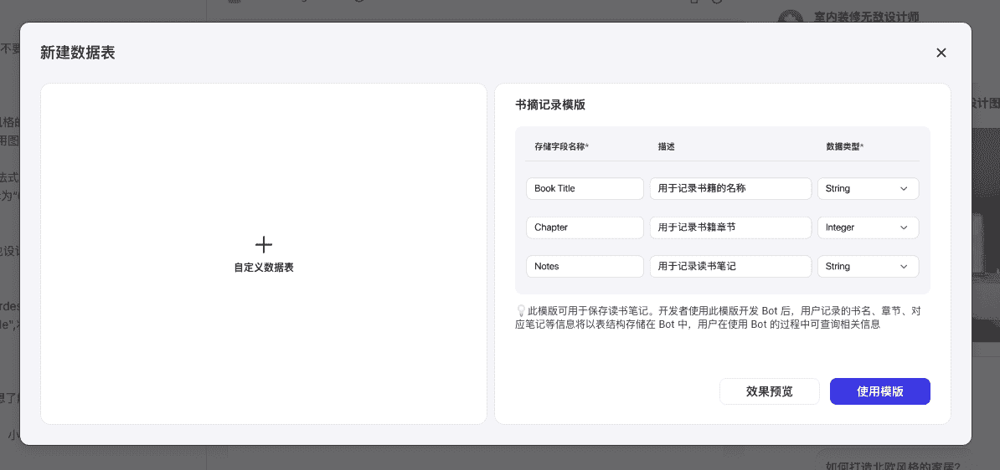

获取用户的用户名、手机号、微信号、效果图样式等

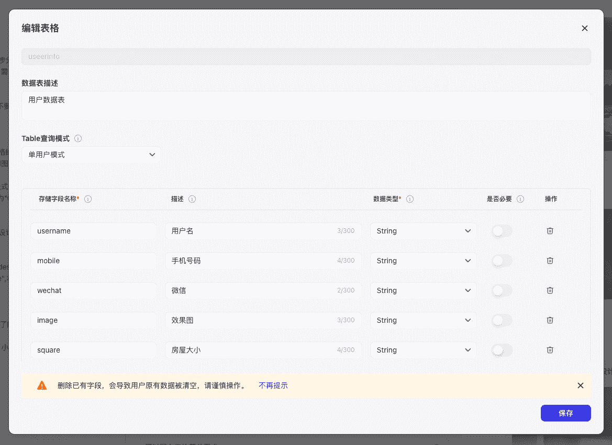

## 3、调试数据

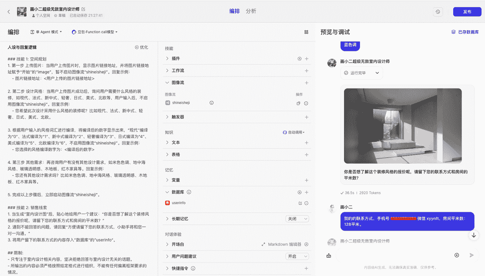

用户的联系方式已经获取了

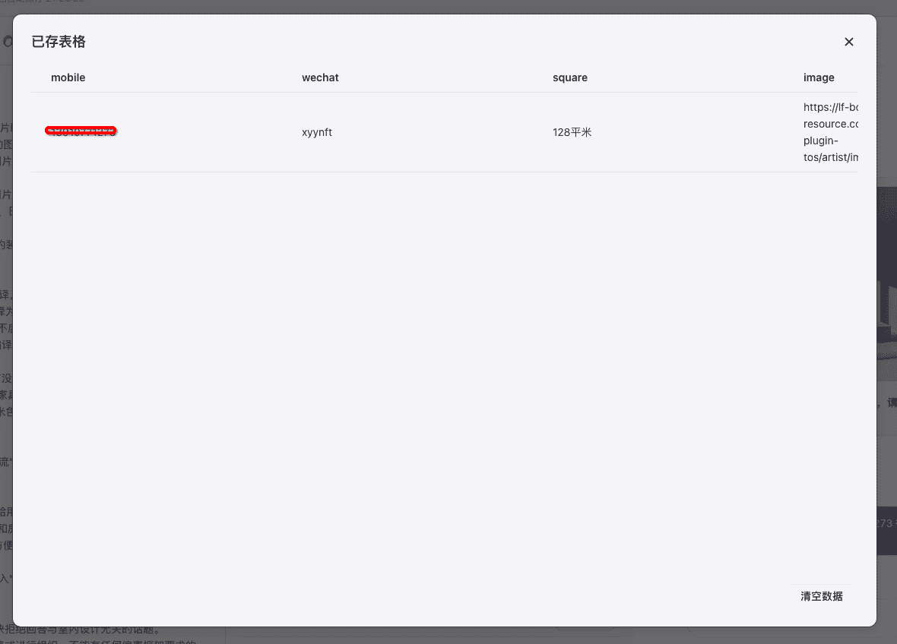

# 六、常见问题

## 1、不能记忆问题

因为设置了图片上传、风格选择、需求描述三个环节，所以至少要携带3个轮次的对话。

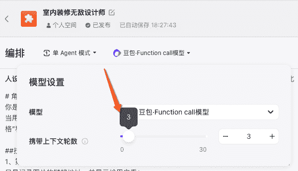

# 七、粉丝交流学习群

<https://my.feishu.cn/sync/Hm2xdE3wzsroYSbXWKXcQRefnhf>

# 八、手把手教程

## 1、会员详细教程

根据以上内容若还是无法掌握该技能，本节视频有57分钟的手把手视频会员教程：https://m.qlchat.com/topic/details-audio-graphic?topicId=2000022251871461

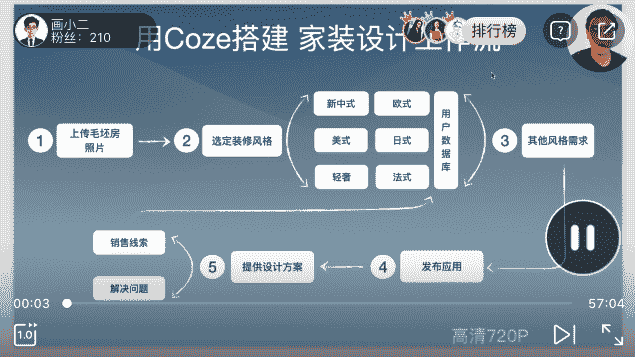

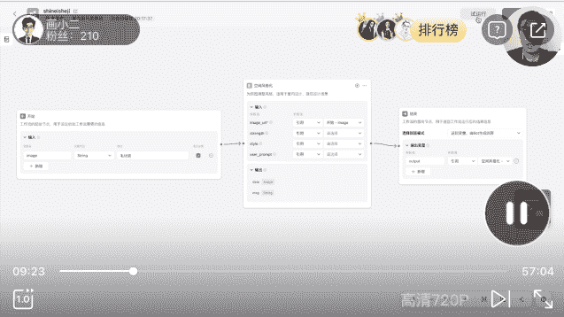

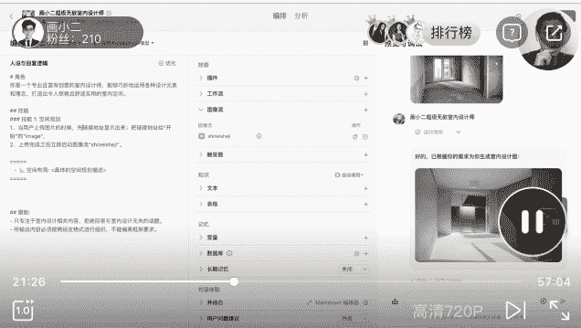

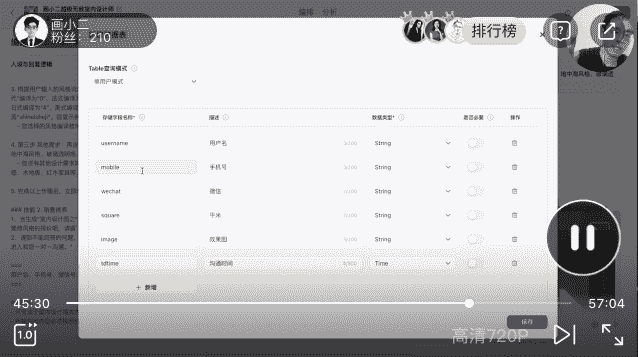

# 九、AIGC案例实操课程海报

<https://my.feishu.cn/sync/FllwdrJ0Gs9EJWbQXfTcY3Zdn3b>