# coze卡牌生成器搭建思路（内含精华）

> 来源：[https://waytoagi.feishu.cn/docx/LPWMdFEQoom7DXxV80UckMPvnPg](https://waytoagi.feishu.cn/docx/LPWMdFEQoom7DXxV80UckMPvnPg)

> 作者:

> 前言：搭建这个bot的初衷是希望将一些人文社科概念具象化，以卡牌的方式呈现不仅更为有趣，可以增加学习乐趣，更有一定的收藏价值。用户可以根据自己对某一概念的想象，通过文生图、图生图的方式生成想要的插画，进一步将插图制作为卡牌，并为卡牌命名和添加必要的说明。

> 欢迎使用bot~链接：https://www.coze.cn/s/i6CRcowb/

# 一、卡牌要素分析

如下图所示，卡牌一般由以下几部分组成：1. 卡牌母版、2. 插图、3. 卡牌名称、4. 说明性文字（在有些场合下也是卡牌效果）。

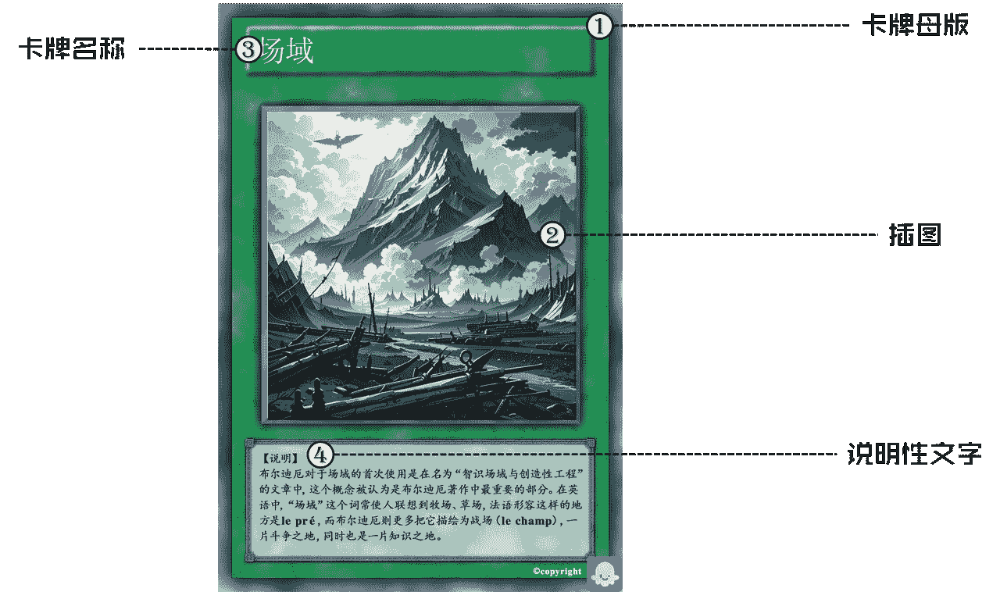

# 二、制作步骤

## 生成插图

生成插图需要使用扣子图像流中的“图像生成”和“图像参考”节点搭建文生图、图生图工作流，这部分比较简单，此处不再赘述。这一步输出一张插入，用户可以与大语言模型交互，直至生成自己满意的插图。

## 制作成卡牌

制作卡牌主要可以分成三个部分：①选择合适的卡牌母版，②将第一步生成的插图与卡牌母版组合，③添加卡牌名称。这一步将图像流的“叠图”节点和“添加文字”节点组成工作流，工作流见下图，此处亦不再赘述。

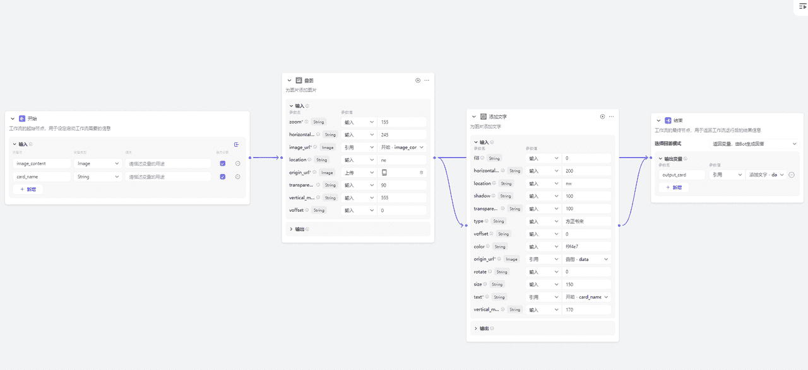

## 为卡牌添加说明性文字（文章精华）

> 这一步是文档最重要的部分和精华所**在，这部分工作使用**了多层嵌套工作流，实现中英文文本分行输入，满足了用户呼声高且官方没有直接提供的功能。

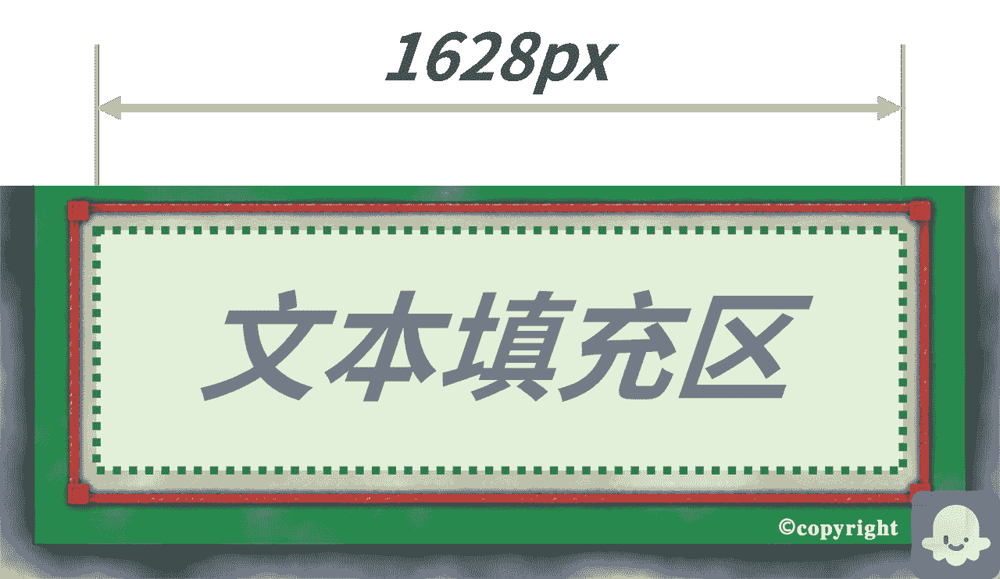

> **需求：如图所示，这一步需要将用户输入的大段文字分行输出****到****指定方框区域****中****；根据使****用****的卡牌母版不同，要求略有不同。在本例中**，文本填充区的宽度为1628px，即需要每行字符的像素总长度在1628px左右。

根据经验，添加文字type="方正楷体"，size=65在视觉上较为合适。

### **实现步骤：**

#### 3.1 文本分行

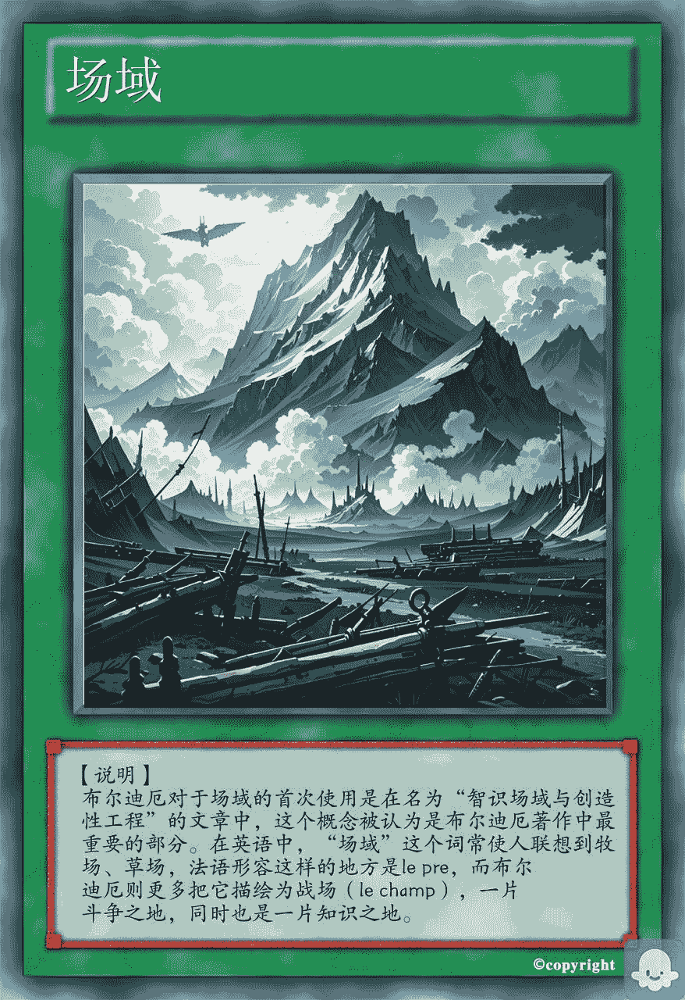

**想法一：按字符数分行。**“添加文字”节点可以设置字体大小为65px，每行像素的长度不超过1628px，即每行1628//65 ≈25个字符。但在试运行中很快发现，由于方正楷体下每个英文字符所占的像素宽度远小于中文字符，导致有英文字符的文本行的实际像素长度远小于1628px，而全中文字符的文本行实际像素更接近1628px，视觉上并不美观。

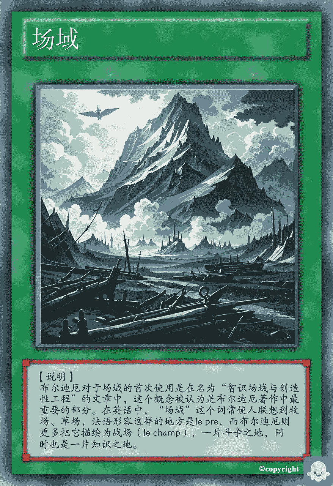

想法二：按字符实际像素大小分行。根据上一步的经验，在中文字符65px的情况下，英文字符的像素并不一定是65px，导致实际输出的每行文本长度不一致。因此产生了根据字符实际像素大小分行的想法，具体是指，无论每行字符数多少，每行总长度都需要保持在1628px左右，则关键在于确定不同字符的像素大小。

由于设置的缘故，中文字符和标点的大小都为65px，因此需要确定在同等条件下，（小写）英文字符的像素大小，这一步在某国内知名LLM的帮助下编写了一个程序，确定了中文字符65px的情况下，26个小写英文字符占据的像素大小。

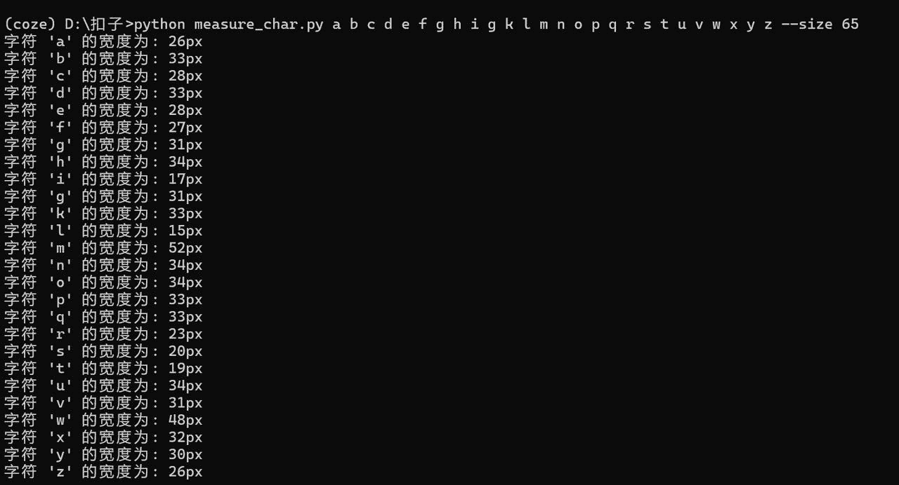

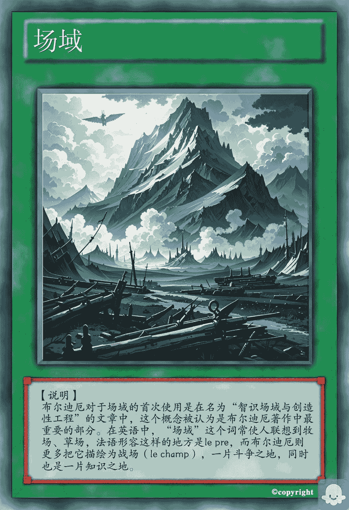

想法三：按字符像素大小分行，并添加一定冗余度。

完全按照规定的行像素长度分行，可能会导致在添加倒数第二个字符时，当行剩余空间非常接近但不足65px，会出现视觉上的“空白字符”，依然影响美观。

解决方法之一是在标准行像素长度的基础上，浮动一定像素（根据经验20~40px均可，不大于一个中文字符宽度65px即可），若每行添加最后一个字符后，行宽不超过标准长度+容错度，仍然允许添加该字符。

最终效果如左图所示。

在具体操作上，用代码块实现想法三，然后将分行后的文本储存在一个字符串列表中，格式为Array<String>。

#### 3.2 将分行文本添加到透明图层

在工作流中为卡牌添加文字，需要将添加文字的图像流封装到工作流中，然后采取批处理的方式将储存在字符串列表中的分行文本添加到卡牌上。由于批处理并不是顺序执行（即上一步的输出作为下一步的结果），而是分别执行（每次处理结果彼此独立），因此要将每行文本分别添加到和卡牌大小一致的透明图层上，“description”参数从字符串列表中传入每行需要输出的文本，“vertical_margin”传入每行文本的纵坐标位置，每执行一次，向下移动70px。每一次的output都是Image，存储在Array<Object>中。

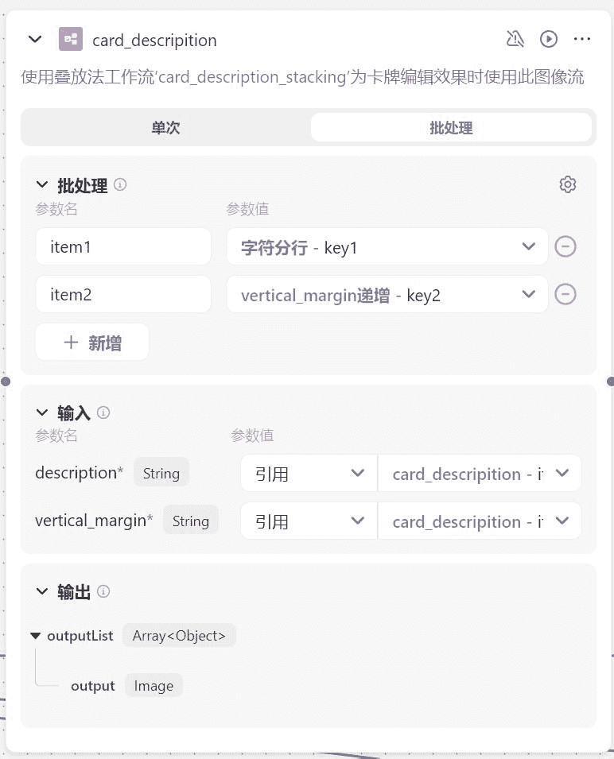

#### 3.3 叠加文字图层

由于叠图功能只**允许**将两个图层进行叠放（扣子官方的说法是将水印图层叠放到原始图层上），因此需要对文字图层进行一定处理，先对其进行两两叠放，最终使之成为一个文字图层。需要经过以下处理：

##### A. 分列

首先将"card_description"的输出，按照索引序号的奇偶性进行分列（将索引0,2,4...等偶数位的图像存储在一个列表中，将索引1,3,5...等奇数位的图像存储在另一个列表中）。

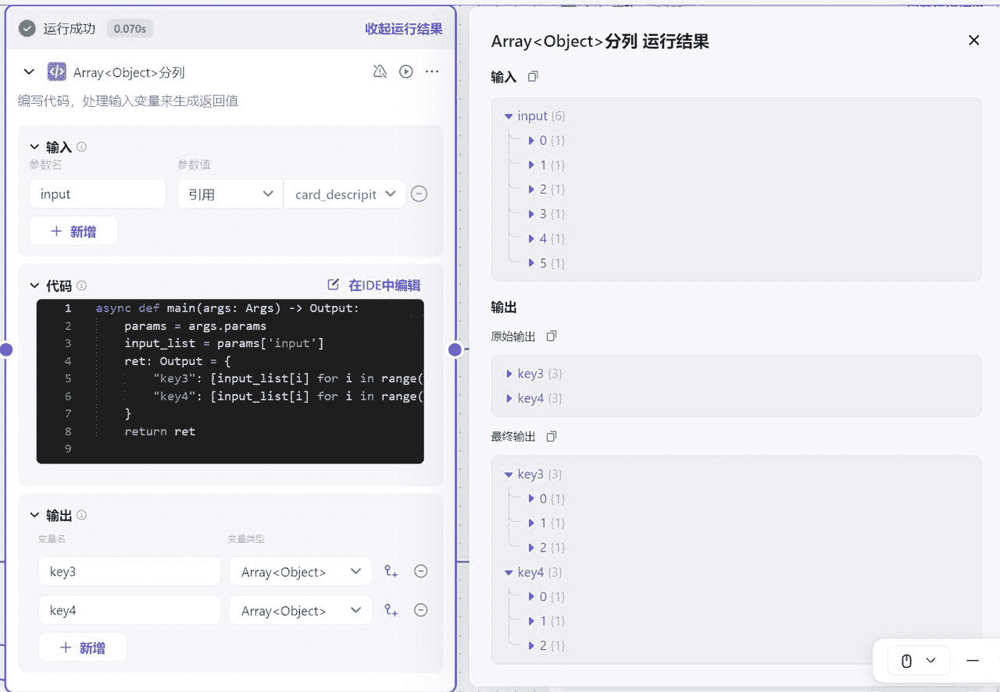

##### B. 格式转换

由于叠图只能支持传入图像的url（即字符串格式），因此需要将分列后的两个Array<Object>的结构“打破”，提取其中图像的链接，重组为字符串列表Array<String>，供封装的叠图工作流批处理使用。

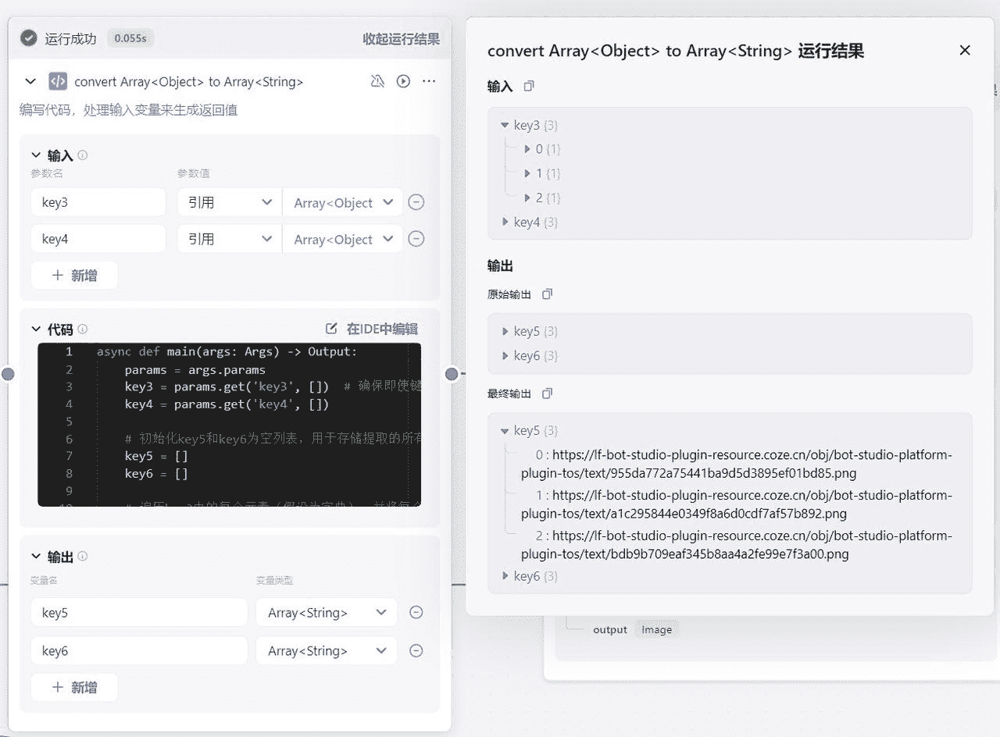

##### C. 补空

在A.分列时，若原Array<Object>中元素个数为奇数个，分列后会导致两个列表中元素数量不同（列表长度不同）。由于叠图只能两两叠放，不支持水印图层或原始图层为空或参数缺失，在批处理中，由于水印图层和原始图层的列表长度不同会导致错误，如[0,2]和[1]进行叠图时则无法进行，因此需要对较短的列表补充一个元素，使其与较长的列表元素数量相等，从而使叠图可以顺利进行，这里在B.格式转换过程中，先比较两个列表的长度，若两个列表长度不同，则用事先准备好的图像url扩展较短的列表。

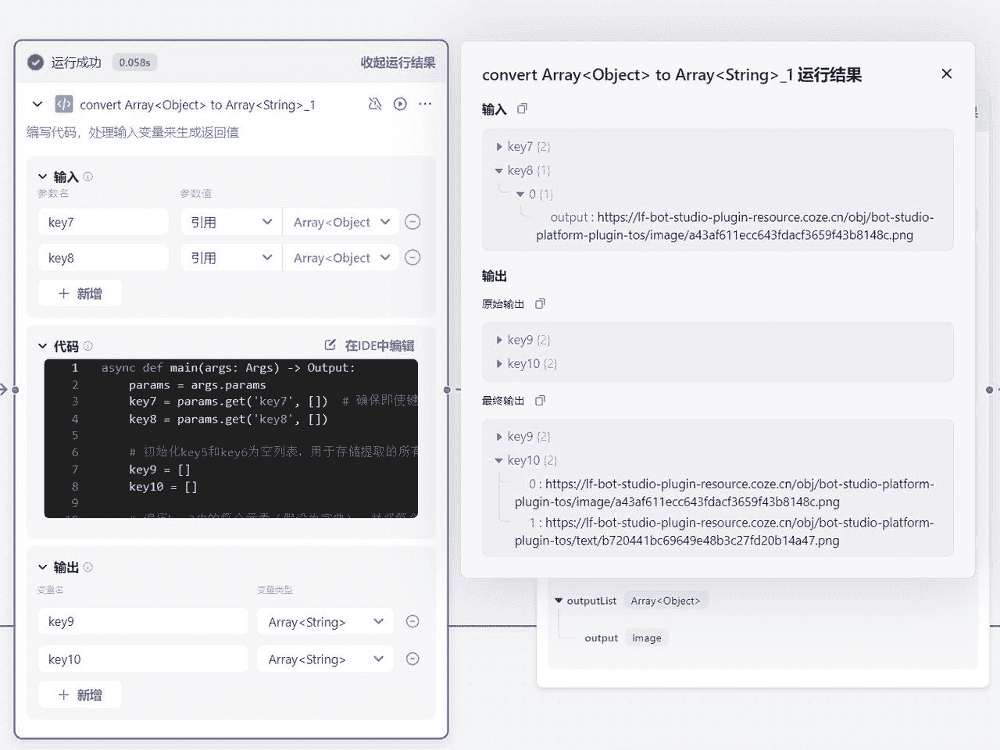

##### 小结

在叠加文字图层，是多次重复执行“分列→格式转换→批量叠图”这个工作流片段的行为。以3.2的原始输出为6个独立文字图层为例，这个过程中的数据列表变化为[0,1,2,3,4,5]→[0,2,4]、[1,3,5]→[0,1,2]→[0,2]、[1,补]→[0,1]→[0]。

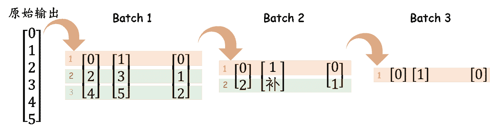

最后输出的图像[0]即为将文字图层全部叠加后的结果。

#### 3.4 最后一步：叠放文字图层和卡牌图层

最后一步使用叠图工作流将文字图层与卡牌图层叠放即可，完成效果如下图。

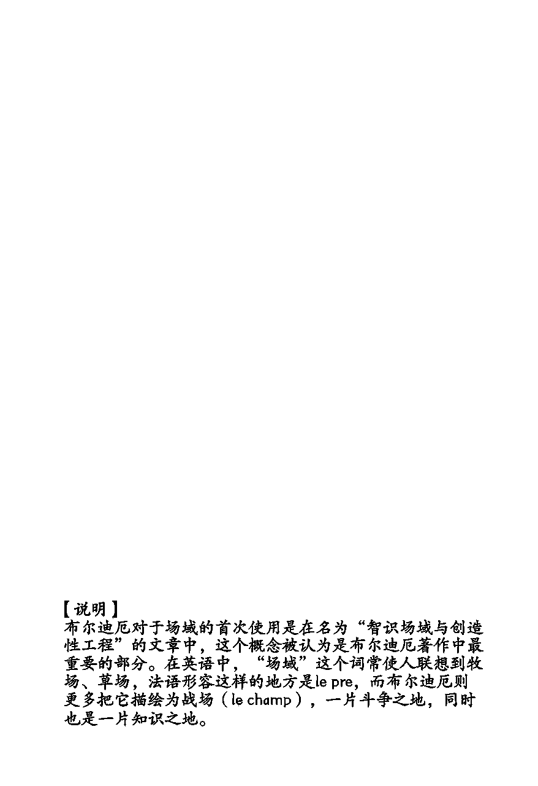

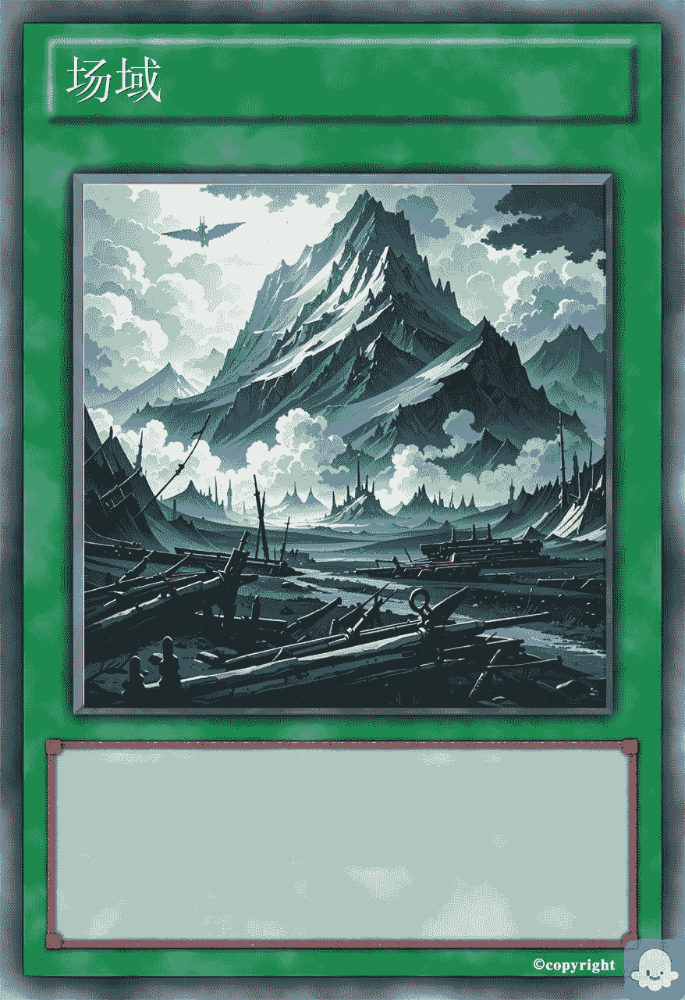

#### 总体工作流

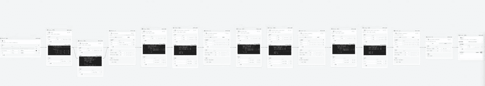

#### 3.5 后续：工作流形式简化

上述分列、格式转换、叠图是多次重复的步骤，为了使工作流具有可复用性、简约性，方便其他开发者根据实际需求构建文本分行输出工作流，可将分列、格式转换、叠图节点封装到一个工作流节点中，这样添加不同数量的节点，就可以满足不同输出行数的需求。

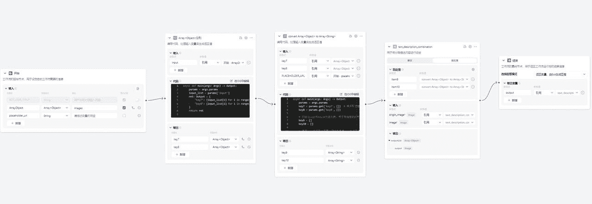

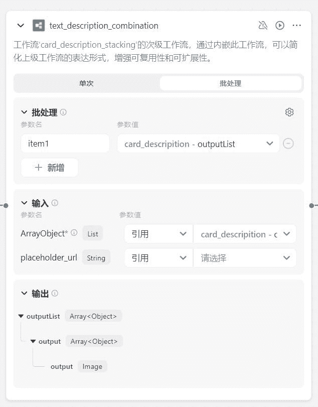

这里需要注意的是，封装后的节点，输出的数据层次更为复杂，在后续节点的引用中要选择正确层级的数据（在这个案例中是上图中的output，而非outputList）。

##### 简化后的工作流

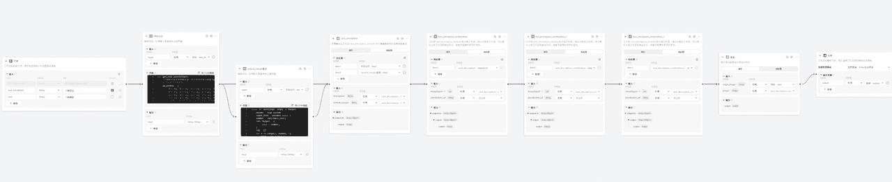

### 彩蛋

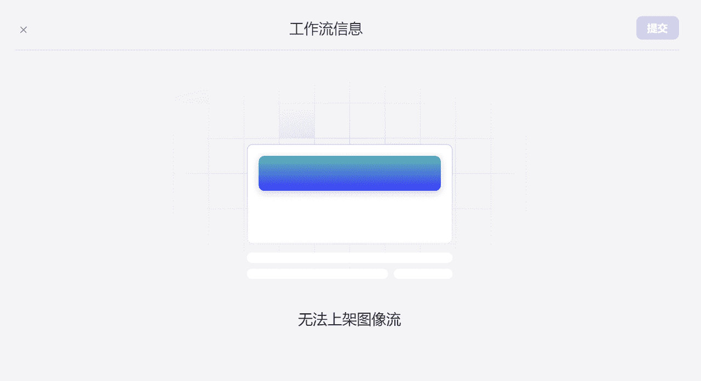