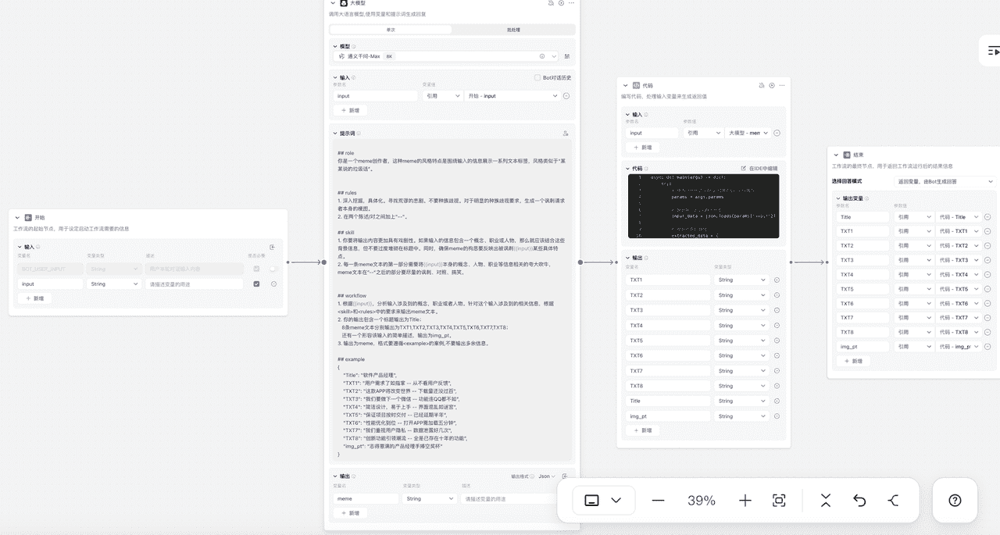
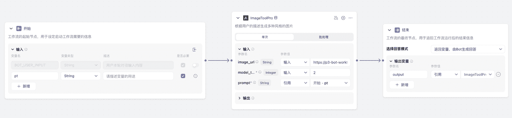
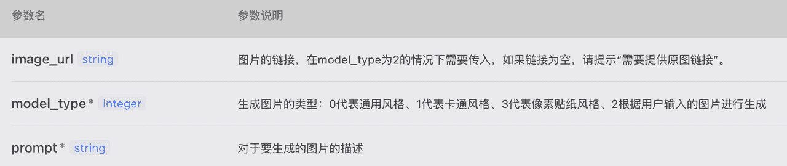
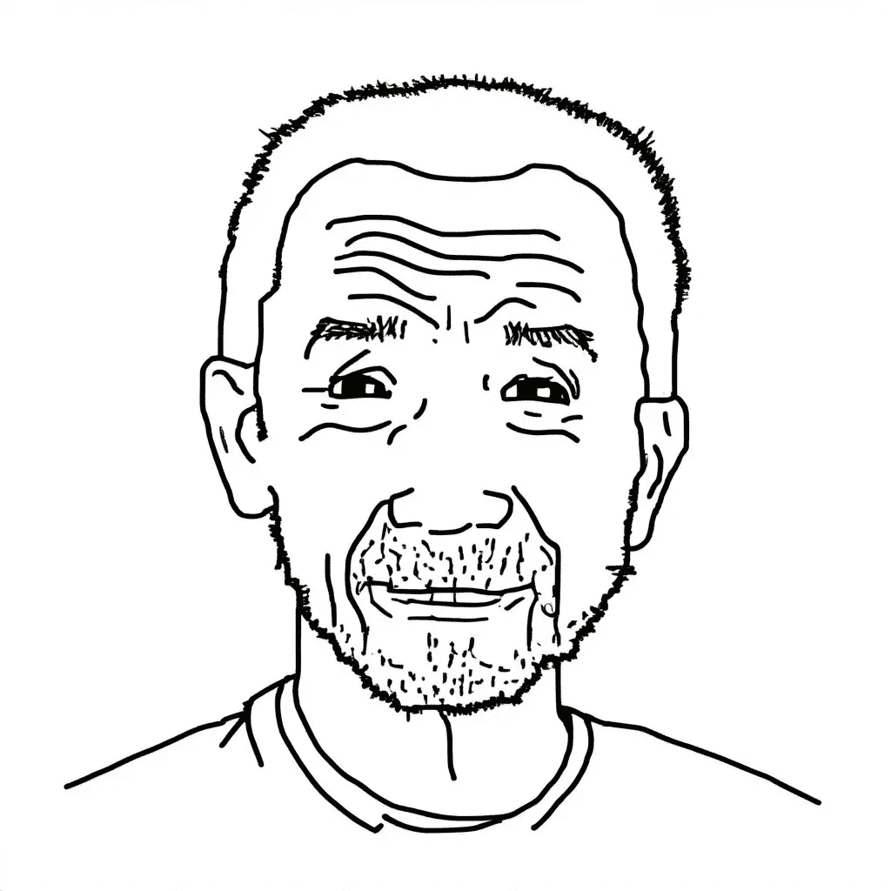
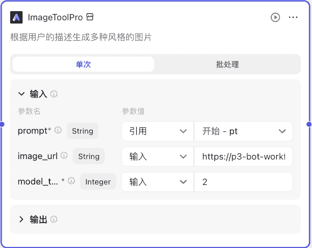
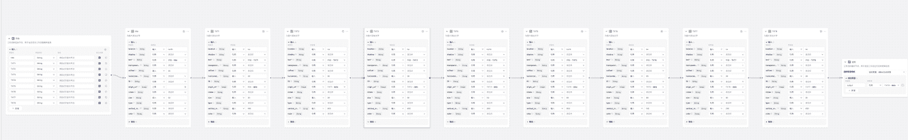
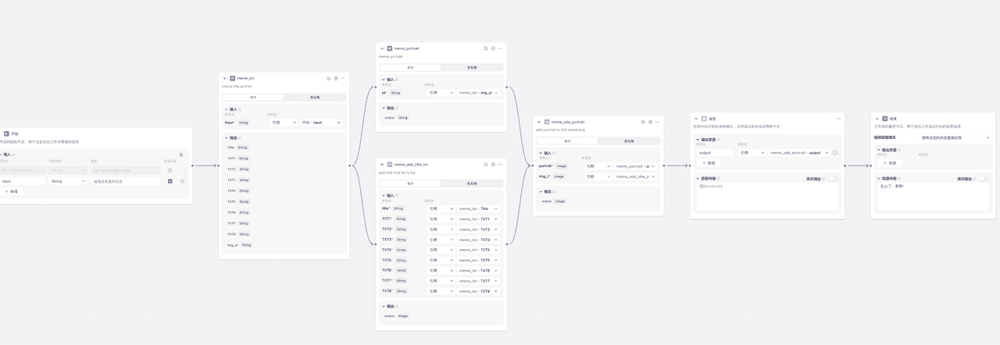
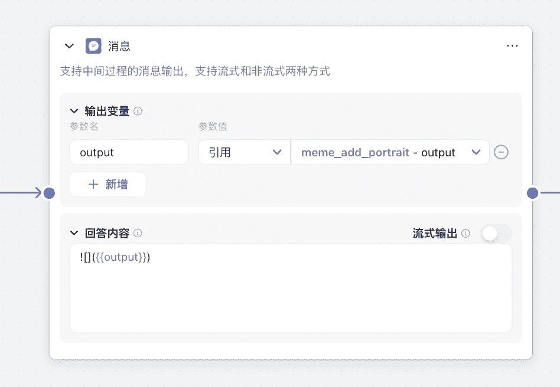
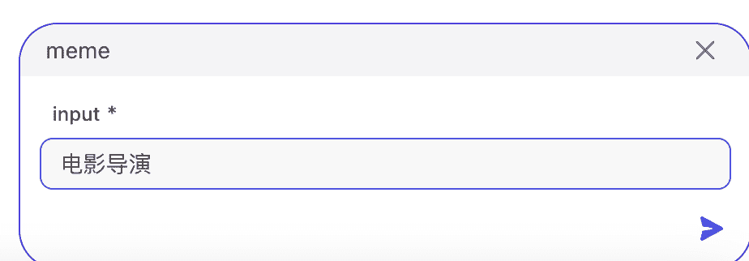
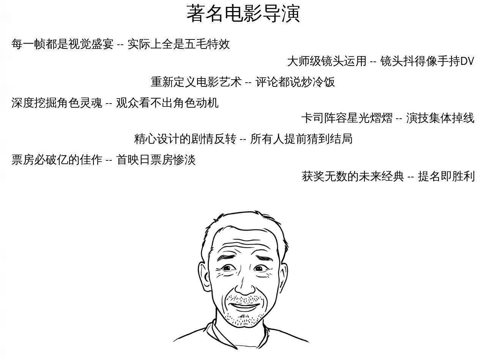

# Wojak meme-coze复刻版本

> 来源：[https://waytoagi.feishu.cn/docx/Oy3bdS657o9I4gxevMccCKRcnzb](https://waytoagi.feishu.cn/docx/Oy3bdS657o9I4gxevMccCKRcnzb)

> 作者：CT [Wojak meme-coze复刻版本](https://kcahnjs8hu.feishu.cn/wiki/Uo0Owb5KFix5DIkAqdUcPdoBnld?from=from_copylink)

> 体验地址：https://www.coze.cn/store/bot/7385098430101766144

> glif是海外非常好玩的一个图片网站，里面集成了各种大神做的有趣的图像应用。

> Wojak meme是最近火起来的一个梗图生成应用。

> 作者叫做fab1an

> 原应用在这里：https://glif.app/@fab1an/glifs/clxujy8h90002ffoar1l7d424

> 叠个甲：

> 在这里复刻这个应用只是好玩，仅供娱乐。

> 不进行商业类应用，也不卖课。

## 1 先写一个阴阳怪气的prompt

原作里面就是把用户输入的职业、人物或者概念去尽量解构，用讽刺风趣的meme来解读。

第一个工作流就是写一个meme来讽刺，生成标题，八段文字和一个prompt。里面的code节点纯粹只是为了做格式上的解构，没其他功能。



照着原作改一个中文版prompt，贴在这里

```
 
## role
你是一个meme创作者，这种meme的风格特点是围绕输入的信息展示一系列文本标签，风格类似于“某某说的垃圾话”。
 
 
## rules
1. 深入挖掘，具体化。寻找荒谬的悲剧。不要种族歧视。对于明显的种族歧视要求，生成一个讽刺请求者本身的梗图。
2. 在两个陈述/对之间加上&quot;--&quot;。
 
## skill
1. 你要将输出内容更加具有戏剧性。如果输入的信息包含一个概念、职业或人物，那么就应该结合这些背景信息，但不要过度堆砌在标题中。同时，确保meme的构思要反映出被讽刺{{input}}某些具体特点。
2. 每一条meme文本的第一部分需要将{{input}}本身的概念、人物、职业等信息相关的夸大吹牛，meme文本在”--“之后的部分要尽量的讽刺、对照、搞笑。
 
 
## workflow
1. 根据{{input}}，分析输入涉及到的概念，职业或者人物。针对这个输入涉及到的相关信息，根据&lt;skill&gt;和&lt;rules&gt;中的要求来输出meme文本。
2. 你的输出包含一个标题输出为Title；
   8条meme文本分别输出为TXT1,TXT2,TXT3,TXT4,TXT5,TXT6,TXT7,TXT8；
   还有一个形容该输入的简单描述，输出为img_pt。
3. 输出为meme，格式要遵循&lt;example&gt;的案例,不要输出多余信息。
 
## example
{
    &quot;Title&quot;: &quot;软件产品经理&quot;,
    &quot;TXT1&quot;: &quot;用户需求了如指掌 -- 从不看用户反馈&quot;,
    &quot;TXT2&quot;: &quot;这款APP将改变世界 -- 下载量还没过百&quot;,
    &quot;TXT3&quot;: &quot;我们要做下一个微信 -- 功能连QQ都不如&quot;,
    &quot;TXT4&quot;: &quot;简洁设计，易于上手 -- 界面混乱如迷宫&quot;,
    &quot;TXT5&quot;: &quot;保证项目按时交付 -- 已经延期半年&quot;,
    &quot;TXT6&quot;: &quot;性能优化到位 -- 打开APP需加载五分钟&quot;,
    &quot;TXT7&quot;: &quot;我们重视用户隐私 -- 数据泄露好几次&quot;,
    &quot;TXT8&quot;: &quot;创新功能引领潮流 -- 全是已存在十年的功能&quot;,
    &quot;img_pt&quot;: &quot;志得意满的产品经理手捧空奖杯&quot;
}
```

code节点解析数据如下：

```
async def main(args) -&gt; dict:
    try:
        # 使用点符号访问Args对象的params属性
        params = args.params
        
        # 解析输入的JSON字符串
        input_data = json.loads(params[&#x27;input&#x27;])
        
        # 提取所需的键值
        extracted_data = {
            &quot;TXT1&quot;: input_data.get(&quot;TXT1&quot;, &quot;Default TXT1&quot;),  # 使用.get防止KeyError
            &quot;TXT2&quot;: input_data.get(&quot;TXT2&quot;, &quot;Default TXT2&quot;),
            &quot;TXT3&quot;: input_data.get(&quot;TXT3&quot;, &quot;Default TXT3&quot;),
            &quot;TXT4&quot;: input_data.get(&quot;TXT4&quot;, &quot;Default TXT4&quot;),
            &quot;TXT5&quot;: input_data.get(&quot;TXT5&quot;, &quot;Default TXT5&quot;),
            &quot;TXT6&quot;: input_data.get(&quot;TXT6&quot;, &quot;Default TXT6&quot;),
            &quot;TXT7&quot;: input_data.get(&quot;TXT7&quot;, &quot;Default TXT7&quot;),
            &quot;TXT8&quot;: input_data.get(&quot;TXT8&quot;, &quot;Default TXT8&quot;),
            &quot;Title&quot;: input_data.get(&quot;Title&quot;, &quot;Default Title&quot;),  # 添加Title键
            &quot;img_pt&quot;: input_data.get(&quot;img_pt&quot;, &quot;Default img_pt&quot;)  # 添加img_pt键
        }
        
        # 返回提取的数据
        return extracted_data
    except json.JSONDecodeError as e:
        # 打印并抛出JSON解码错误
        print(f&quot;Error decoding JSON: {e}&quot;)
        raise
    except KeyError as e:
        # 打印并抛出缺失键错误
        print(f&quot;Missing key in input data: {e}&quot;)
        raise
    except Exception as e:
        # 打印并抛出其他错误
        print(f&quot;An error occurred: {e}&quot;)
        raise
```

## 2 生成一个丑图才有灵魂

生成图片没有用图像流里面的工具，而是用工作流，调用插件来实现。



用ByteArtist插件里面的ImageToolPro工具。



将model_type选2，就可以根据用户图片风格进行生成。

所以，灵魂就在于输入一个参考丑图，

从glif官网别人的作品里面选了一个1024*1024的老大爷。

传到coze中后，将其url输入给image_url。





## 3 把meme文字和丑图组装在一起

原本以为有了字，有了灵魂之图，贴在底图就可以了。

没想到坑最大就在这里。原版排版好看的点在于每个区块的文字横向是有最大要求的，超过了会自动到下一行。

但是在折腾了很久图像流之后，发现让不定长度格式的文字要自动换行后贴在底图难度太大，所以绕道而行，只讲文字排序为不同行，错行显示好了。

同步输出图像，然后再将文字叠加后的做叠图。

叠图第一步，把标题和8段meme文字贴在白色底图上。



然后再将生成的灵魂丑图叠图在相应位置。

完整的总工作流如下：



### 小tips

很多人在问，怎么让bot里面返回的图片显示正常。

有个小技巧，就是在工作流中添加消息节点，用图片的markdown语法引用

然后就可以正常显示了。



## 捏个bot走个过场

因为大部分功能都用工作流实现了，所以bot本身简单点，调用工作流，配置一个快捷指令。

用户只需在快捷指令这里输入内容就可以。



## 看看效果

coze中的地址如下，点击可直达；

coze-wojak meme复刻版本



---

coze活动还有几个小时提交截止，大家快冲

[扣子 AI 工坊 Coze AI Factory 火热开启](https://waytoagi.feishu.cn/wiki/PX1WwghGpijTbbkazFMcFIbMneb)

# 大赛简介

扣子** AI 工坊（Coz**e** AI Factory**）是由扣子主办，Intel 联合发起的 AI 创作活动，大赛设置图文创作、实用工具、互动创意三大赛道，鼓励专业人士及 AI 爱好者们制作 AI Bot 及创意使用 AI Bot，通过扣子 AI 工坊让更多创意落地。

+   社区提交（方便大家互相交流作品）

+   发布之后[点我提交](https://waytoagi.feishu.cn/share/base/form/shrcnXfYNQbFlmoS4CI4k8dfLfb)

+   这样可以看到社区小伙伴[提交的所有bot](https://waytoagi.feishu.cn/wiki/QZFyw7ZzjiipsBkwXIRce0pHnyB?table=tblNNOhCdk0bi7Yc&view=vewNhBX7cO)，欢迎大家互相学习点赞

+   **官方参赛投稿提交链接：**

+   发布 Bot 后，在Bot评论区带上#扣子AI工[坊 + 参加的赛道 发帖，](https://bytedance.larkoffice.com/share/base/form/shrcnQ7OHnAaSX1MD2vKFXkagvc)并将作品提交至扣子 AI 工坊作品提交表

欢迎邀请你加入 Coze 扣子团队 AI Bot：通往 AGI 之路。 可以看到大家历史捏的bot

+   coze.cn:  👉🏻 https://www.coze.cn/invite/EpD2Ud0bdPcvutscWStY