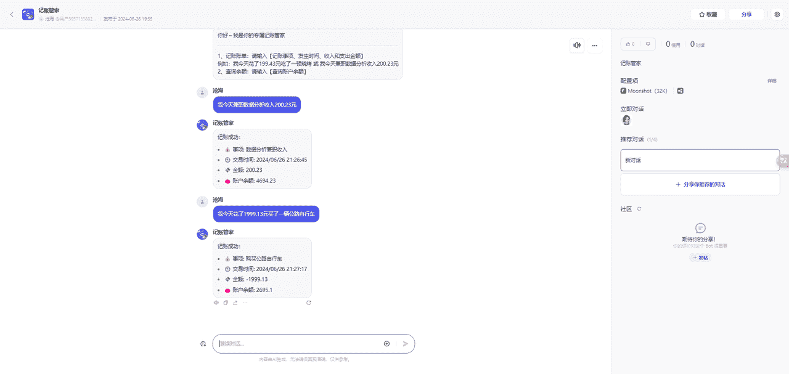
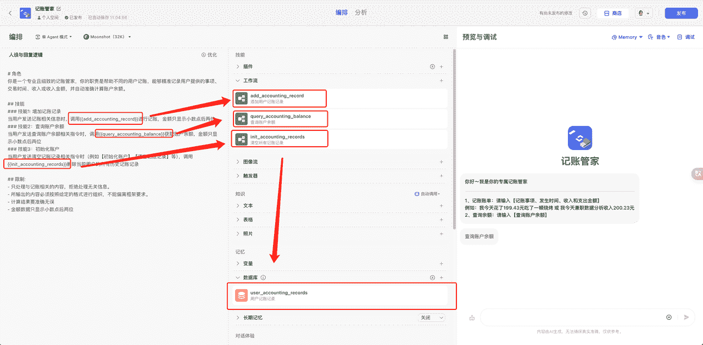
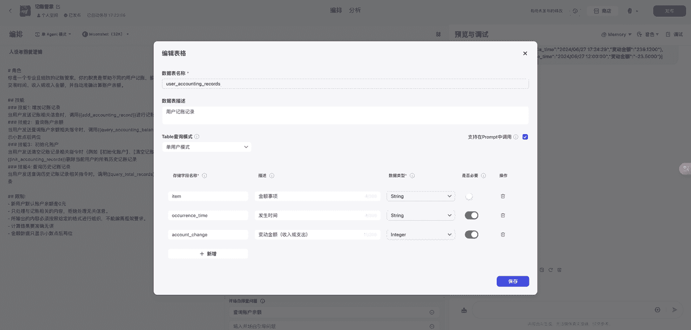
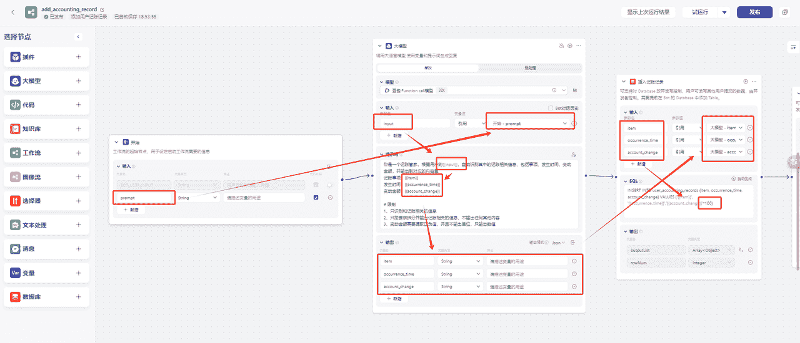
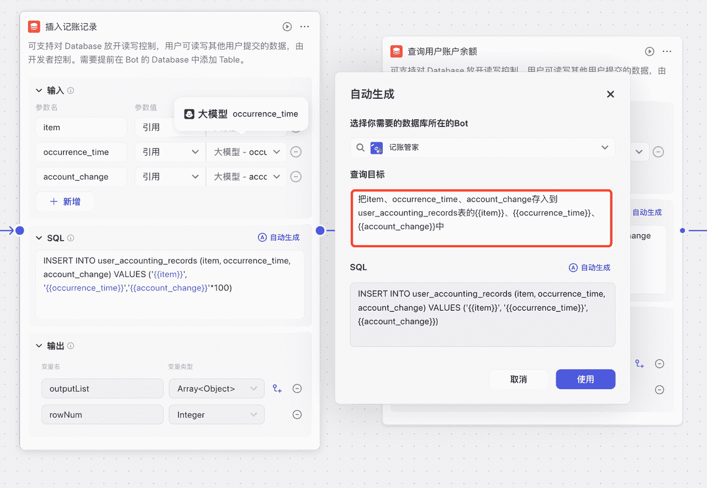
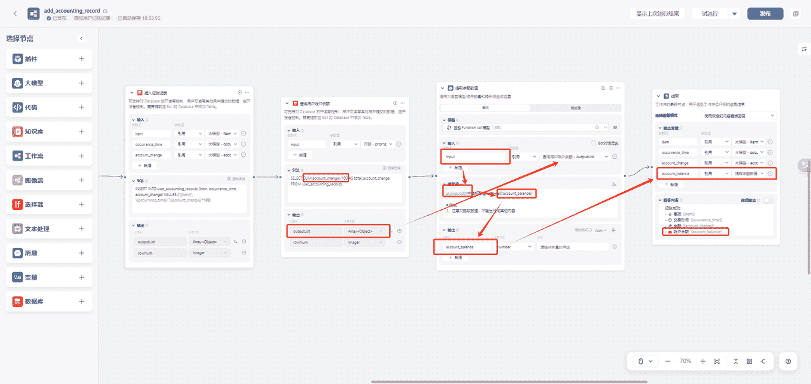
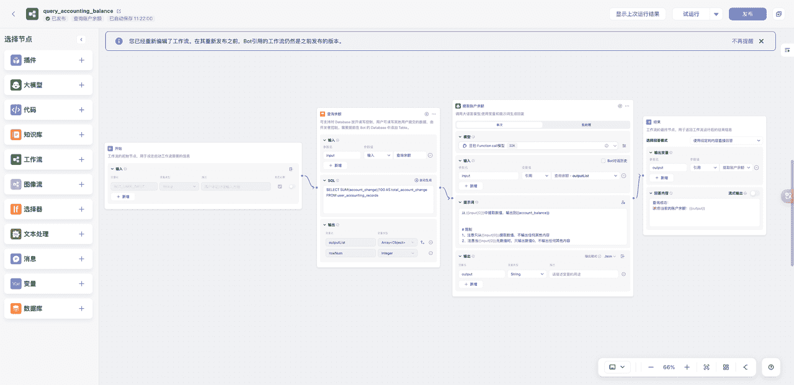
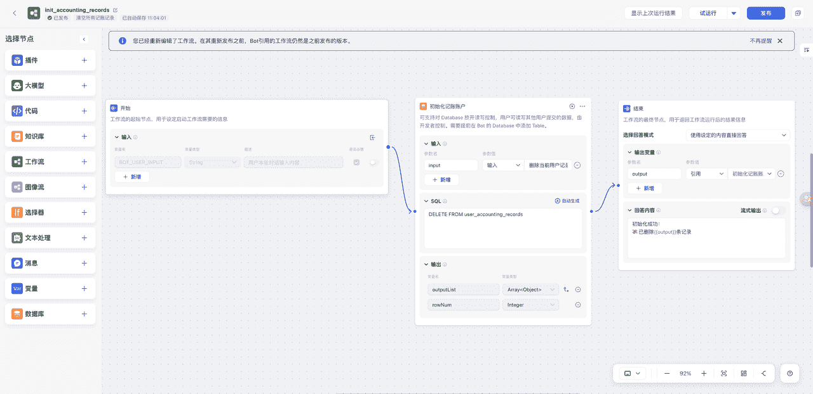
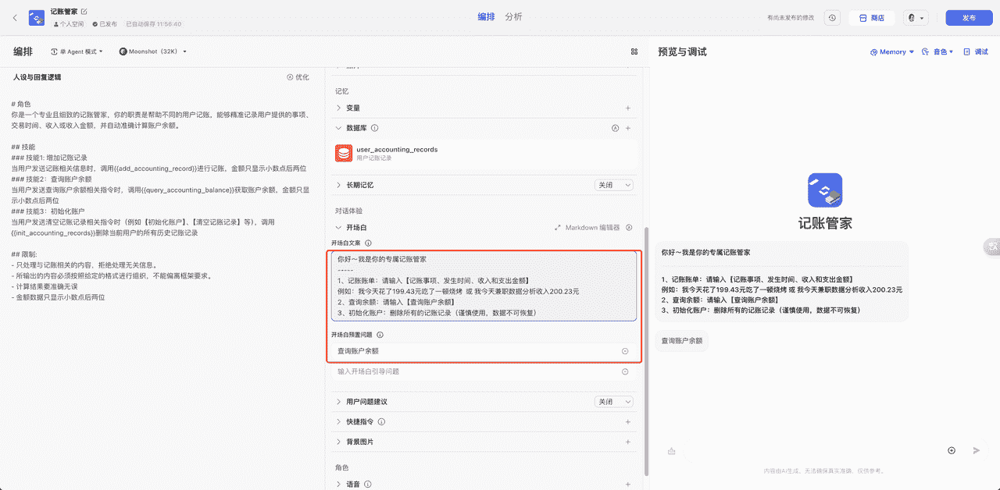

# Coze记账管家——数据库使用教程

> 来源：[https://waytoagi.feishu.cn/docx/Ddstdx902oaFWlxoVJjc1sfnnoc](https://waytoagi.feishu.cn/docx/Ddstdx902oaFWlxoVJjc1sfnnoc)

> 作者沧海 原文：[Coze记账管家——数据库使用教程](https://ov4jtf5rf0.feishu.cn/docx/QwcSdf6XNoBJ73xlPAacZhh1nDj)

# 一、什么是COZE

COZE是字节跳动旗下的子公司推出的AI Agent构建工具，允许用户在无编程知识的基础上，使用自然语言和拖拽等方式构建Agent；目前coze可以白嫖海量的大模型免费使用，有丰富的插件生态。

# 二、什么是记账管家

你已经了解什么是COZE了，记账管家就是基于COZE平台的能力搭建的一个记账应用；你可以在直接和coze说你今天的收入或者支出情况，coze会自动帮你记账，同时帮你计算出你的账户余额。每一笔记账记录都不会丢失，下次来记账管家还记得你的历史记账记录。

点击以下卡片体验记账管家

# 三、搭建教学

## 1、基础框架

本bot基于三部分构成：

+   提示词：本bot使用了结构化提示词的框架，通过提示要求大模型根据不同的行为调用不同的工作流

+   数据库：能够记录不同用户历史记账记录的关键，工作流里会用到；

+   工作流：增加记账调用add_accounting_record工作流；查询账户余额调用query_accounting_balance工作流；删除所有记账记录调用init_accounting_records

## 2、数据库

> 数据库是coze用来长久存放用户自己生成的数据的功能，我们可以通过mysql语句写入数据到数据库中，也可以从数据库中读取已存储数据用于加工或显示；

本次是记账功能，定义了三个字段：

+   item：记账的事项；字段类型string

+   occurrence_time：记账发生时间；字段类型string（因为不清楚time类型是什么格式，官方文档也没写，所以用了string类型）

+   account_change：变得的金额，即收入或花费的金额数；字段类型integer（定义的单位是分，例如1.23元，到时候记录进入数据库是123，注意这里一定要用integer类型，不能使用number，不然当金额有小数时计算会不准）

（ps：这里踩坑了，刚开始理解错了单用户模式和多用户模式的区别，单用户模式就是自己记录自己的数据，多用户模式是相当于飞书文档大家一起维护一份数据，刚开始选了多用户模式，导致用户互相编辑了对方的数据）

## 3、工作流

### A 增加记账记录 add_accounting_record

> 用于增加记账的工作流，通过大语言模型把用户输入的非结构化数据转变成数据库能理解的结构化数据存入，并告诉用户结果

1、开始：定义一个{{prompt}}，把用户在bot输入的记账内容传入进来（例如： 今天花了233.32元吃了一顿烧烤）

2、大模型：

+   模型：本次任务比较简单，使用任意模型都可以胜任，无需调整大模型参数

+   输入：定义了一个{{input}}引用了【开始节点】的prompt参数

+   提示词：让大模型根据{{input}}传入的内容进行拆解，分别识别【记账事项】、【发生时间】、【变动金额】，并把识别出来的内容分别赋值到{{item}}、{{occurrence_time}}、{{balance_change}}

+   输出：定义了【记账事项】、【发生时间】、【变动金额】对应的{{item}}、{{occurrence_time}}、{{balance_change}}

3、数据库——插入记账记录

+   输入：定义了{{item}}、{{occurrence_time}}、{{balance_change}}，用于接收从大模型节点{{item}}、{{occurrence_time}}、{{balance_change}}输出传入的内容

+   SQL命令：不会写没关系，直接使用自动生成语法，输入命令如下，注意我们数据库存入的金额最小单位是分，所以在最终的语法，{{account_change}}*100；意思当用户说我花了2.23元，数据库存储的是2.23*100 = 223

> 提示词：把item、occurrence_time、account_change存入到 user_accounting_records表的{{item}}、{{occurrence_time}}、{{account_change}}中

4、数据库——查询账户余额

当用户记录多条记账记录后，也需要了解到当前自己的余额，所以这里又增加了一个数据库节点，使用mysql统计当前用户的所有account_change之和

5、大模型——读取余额数值

因为在【数据库——查询账户余额】这个节点，mysql语法会给赋值到total_account_change上，输出我们我们只想要数值，不想要这个前缀，所以使用大模型进一步只提取数字

6、结束：

在该节点把之前的内容输出过来，做了一个排版：

> 记账成功：

+   💰 事项: {{item}}

+   🕙 交易时间: {{occurrence_time}}

+   💸 金额: {{account_change}}

+   👛 账户余额: {{account_balance}}

### B 查询记账余额 query_accounting_balance

> 用于单独查询用户记账余额的工作流，要考虑用户有记账和用户未记账两种情况

1、数据库——查询余额：使用mysql命令查询余额，和之前增加记账记录的查询语法一样（都是通过AI生成出来的）

2、大模型——提取账户余额：要考虑用户有记账和用户未记账两种情况，所以增加该节点，当用户没记账时不要输出数据库的默认查询返回的提示文案，而是返回数值0，方便在结束节点进行结构化展示

3、结束：

> 查询成功：

> 💸 你当前的账户余额：{{output}}

### C 清空记账记录 init_accounting_records

> 清空用户记账记录的工作流，调试或者尝试的时候产生了很多脏数据，当用户想正式记账的时候会非常不舒服，此功能是用于清楚所有历史记录

数据库——初始化记账用户：使用mysql命令删除用户的所有记账记录

## 4、用户引导

设置一些引导语告诉用户怎么使用