# Stuart: 炉石抽卡机coze bot大揭秘

> 来源：[https://waytoagi.feishu.cn/docx/OKkGdSKfXoqYiwxk4RpcUUgYntb](https://waytoagi.feishu.cn/docx/OKkGdSKfXoqYiwxk4RpcUUgYntb)

> 作者: Stuart

> 炉石传说抽卡机Bot试玩地址: https://www.coze.cn/s/i69FVS9Y/

> 相信大家看得出来, 这个bot在很“努力”地假装自己很完整.  但依旧掩饰不了终究只是半成品, hhhh.

> 它是waytoAGI社区对于coze图像流的教学实验品, 在本篇中我将详细讲解这一类bot的制作思路, 以及它要做完整可以怎么去做.

> 注意: 这是一个进阶版教程, 本文中不会讲coze基础概念和功能, 需要对coze图像流, 工作流有一定的基础.

# 效果体验

首先来感受下这个bot制作的随机卡牌的效果:

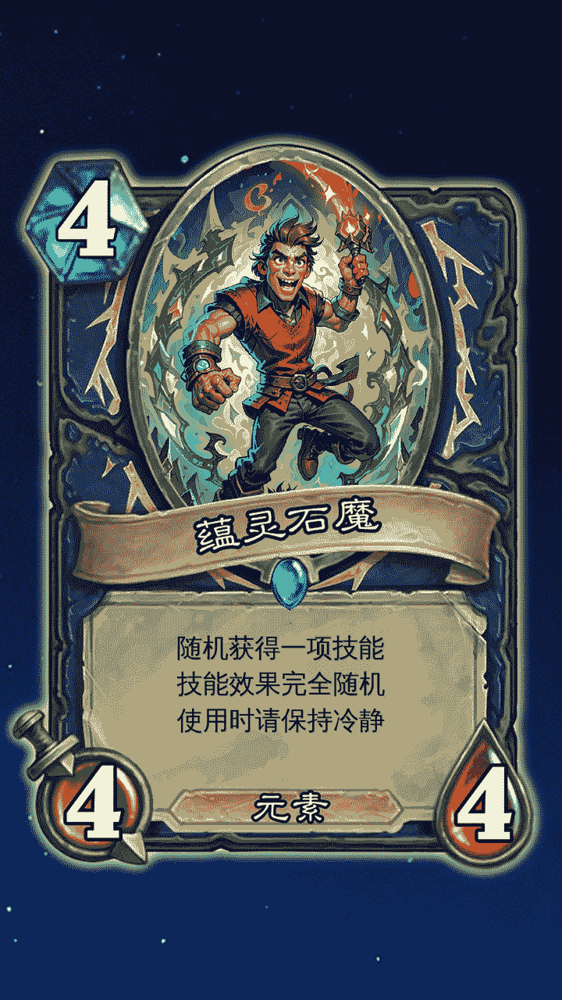

普通卡牌

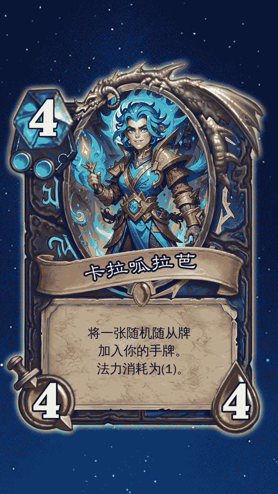

传说卡牌

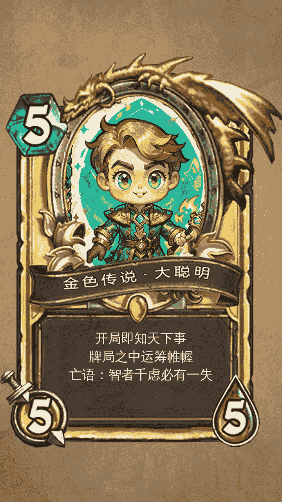

金色传说·大聪明

同时, 你还可以上传任意图片, 比如你的头像, 比如一道菜, 定制你的技能. 😂

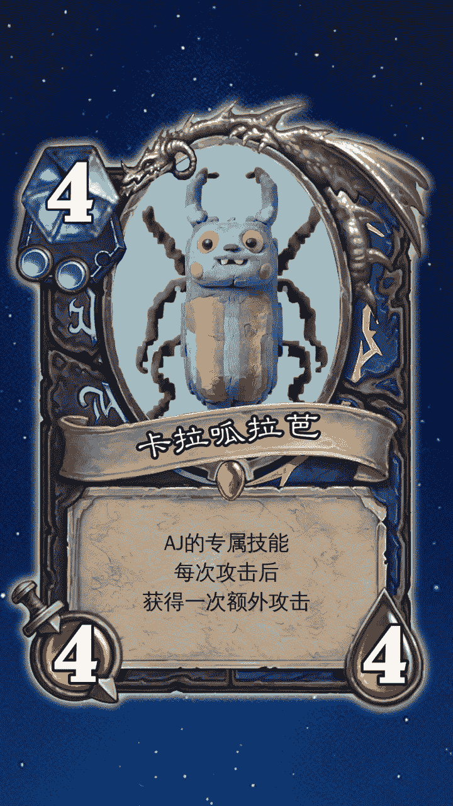

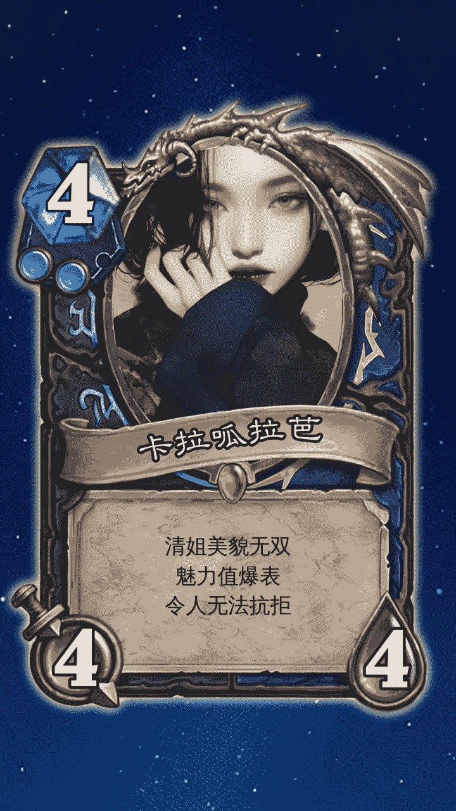

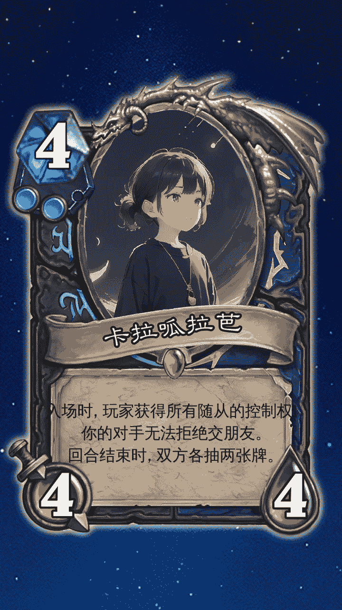

它有趣的地方, 在于:

1.  它和炉石传说的卡牌相似度极高.

1.  你可以让你用自己的头像或者其他的梗图嵌入卡牌中做成卡牌类梗图.

1.  大模型生产的非常有趣的技能, 不时能给你一些意外之喜, 比如最后这张 “你的对手无法拒绝交朋友”.

# 卡牌基础学习

我们定位的coze bot是要做一个卡牌生成器, 那么就要先看卡牌结构.

炉石卡牌看似简单, 但是炉石的老玩家仔细观察过的话都知道, 其实整体结构非常复杂, 有非常多的元素.

取正版卡牌来做个简单对比:

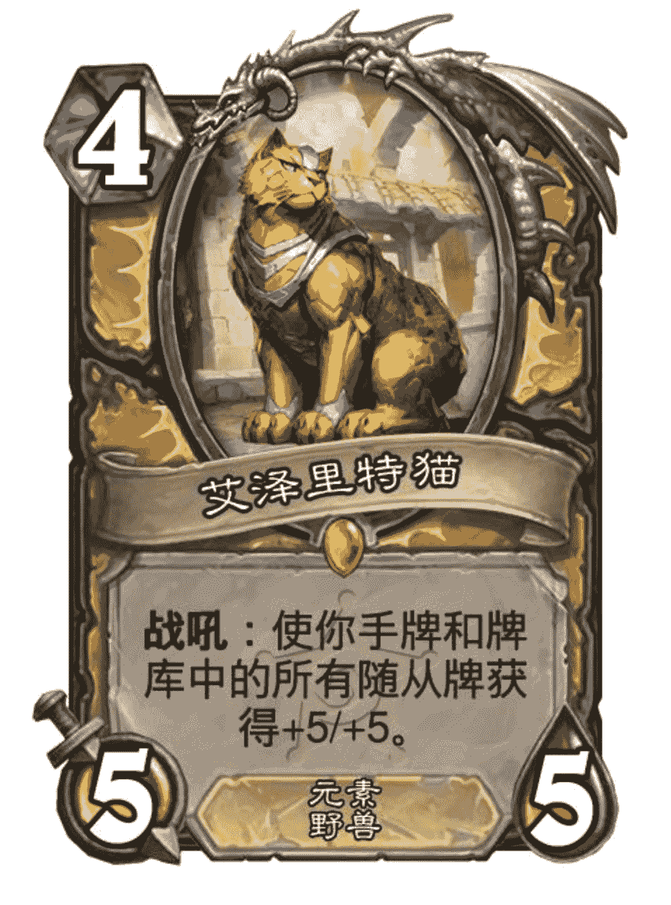

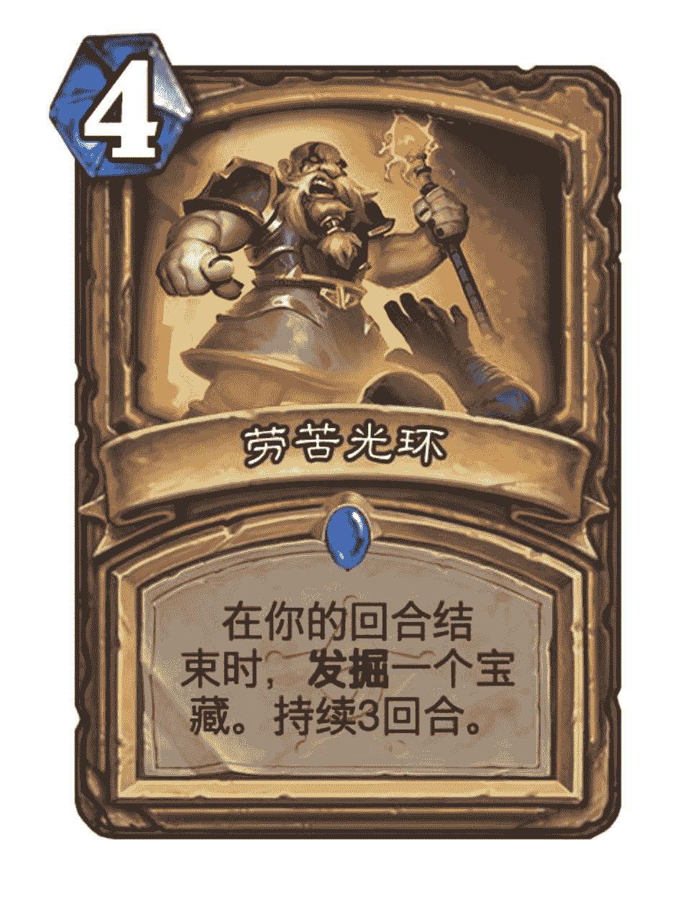

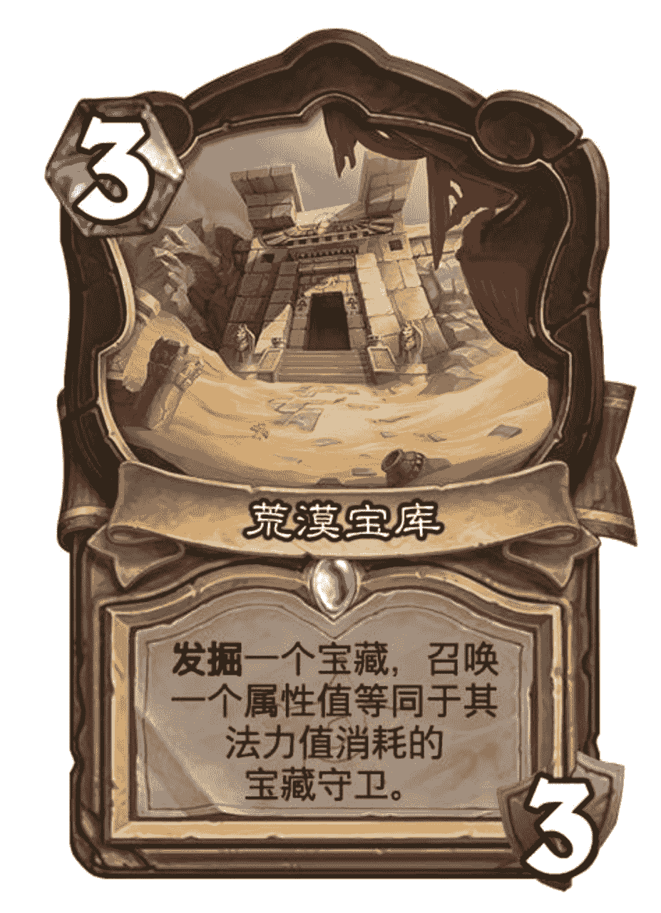

特地挑了三类完全不同的卡牌对比, 大家就会发现非常不同.

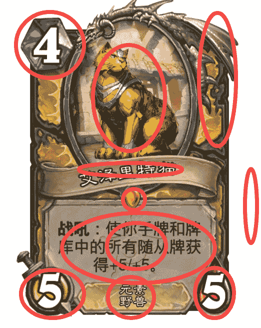

经过认真学习(真的是为了做卡牌特地学的 😂), 对卡牌元素按对视觉影响最大做个分类:

1.  最直观影响:

1.  **卡牌水晶**:

1.  这是老炉石玩家非常敏感的元素, 既然主打的是一个情怀, 必须要面向用户群体设计!

1.  给不熟悉炉石的朋友们科普一下:

+   没有水晶代表[**基本**](https://hearthstone.huijiwiki.com/wiki/%E5%9F%BA%E6%9C%AC)或不可收集；

+   白色水晶代表[**普通**](https://hearthstone.huijiwiki.com/wiki/%E6%99%AE%E9%80%9A)；

+   蓝色水晶代表[**稀有**](https://hearthstone.huijiwiki.com/wiki/%E7%A8%80%E6%9C%89)；

+   紫色水晶代表[**史诗**](https://hearthstone.huijiwiki.com/wiki/%E5%8F%B2%E8%AF%97)；

+   橙色水晶代表[**传说**](https://hearthstone.huijiwiki.com/wiki/%E4%BC%A0%E8%AF%B4)。

1.  **卡牌牌面主色**:

1.  有好多种主色, 比如深蓝色, 金色, 绿色, 红色, 铜黄色等等, 再就是最常见的石板色.

1.  **卡牌插画: **

1.  《炉石传说》的卡牌插画是美工方面最令人印象深刻之处, 有其特定的画风. 在卡牌上也是最占面板的主元素之一.

1.  **卡牌描述:**

1.  卡牌描述占了面板上另一个主要空间, 它的想象空间很大, 可以做的很有趣.

1.  **卡牌名字:**

1.  类似一张卡牌的标题了, 处于图的中间, 有那么点点显眼, 但是占的牌面不大, 也可以做的很有趣.

1.  趣味性影响:

1.  **牌面样式**:

1.  卡牌样式分随从牌, 英雄牌, 法术牌, 奥秘, 任务牌, 武器牌等等, 仔细观察炉石卡牌, 会发现它不同的卡牌的样式差别很大, 比如是否有攻击力, 是否有生命值

1.  **随从类型: **在卡牌底部, 如果是随从牌可能出现随从种族或者属性

1.  **法力消耗, 攻击力, 血量**

1.  **其他元素: **仔细看其实卡牌描述那里会有个不太的清楚的图腾, 法力消耗下面会有些指示物, 还有卡牌的背景页面其实也是一个可玩的点.

# 制作思路

1.  设计思路:

1.  作为一个**图像流教学bot**, 只要它能体现这个bot的设计思路, 有一定的可玩性, 并且它的制作过程有一定的代表性足矣.

1.  功能:

1.  作为一个**情怀类bot,** 居中的卡牌水晶的颜色无疑是最最最重要的, 无数人充值, 花了无数尘, 为的不就是一张传说卡么, 必须换! 为了简单, 只选择了“稀有”和“传说”.

1.  为了足够的**可玩性**, 就选择主版面的两大主要内容: 插画, 和描述.

1.  当我们面向情怀党, 必须要能画的出画风和原画师画风一致的插画, 和差不多的技能描述.

1.  再加上一个自制卡牌, 可以允许大家自己上传自定义图片, 并给出技能定义.

1.  再叠加一些**随机性**考虑, 让大家能稍微有点上头, 加上低概率能出“金色传说·大聪明”!

1.  放弃:

1.  卡牌名字: 虽然卡牌名字上可以做很多文章, 让整个卡牌更有趣, 但是仔细看下图, 这个卡牌名称是一个有弧度的艺术字体, 用coze现有功能做起来会非常困难, 还要考虑文字长度. 因此选一个默认就很有趣的名字, 放弃自由修改, 作为一个图像流的教学已经足够有趣了. -- 卡啦吧拉芭: 你说的对! 🤣

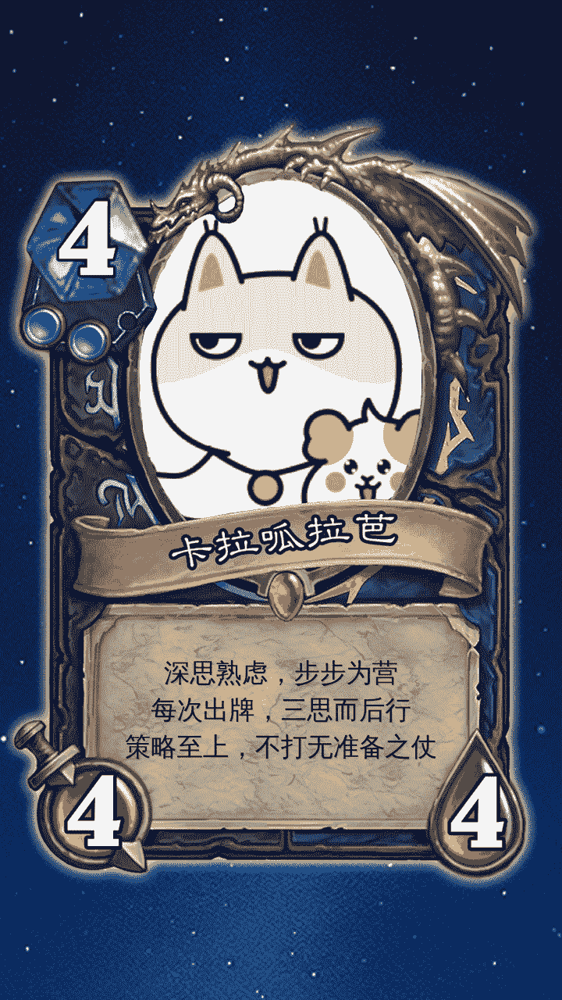

1.  相比之下, 法力消耗, 攻击, 血量一样能让卡牌可玩性很高, 但是作为教学bot, 还是算了, 留给大家做着玩.

1.  制作思路

1.  首先是整个卡牌, 去找个卡牌框抠个图

1.  需要几种不同水晶和卡牌类型, 那就选多几个不同类型的卡牌抠个图

1.  然后是卡牌插画, 图像流是当仁不让的选项.

1.  最后是卡牌描述, LLM是专长.

# 开始制作

## 图像流

1.  选相对比较清晰的卡牌的图, 用PS抠一个出来, 把卡牌描述部分都涂掉, 把卡牌插画内容抠掉留空. 然后多找点不同类型的, 一样抠出来. 以下是传说卡的示例. PS: 这里特别感谢我的好朋友  , 是她帮忙抠的图, 要是没有她, 我只能挠头干瞪眼 😂

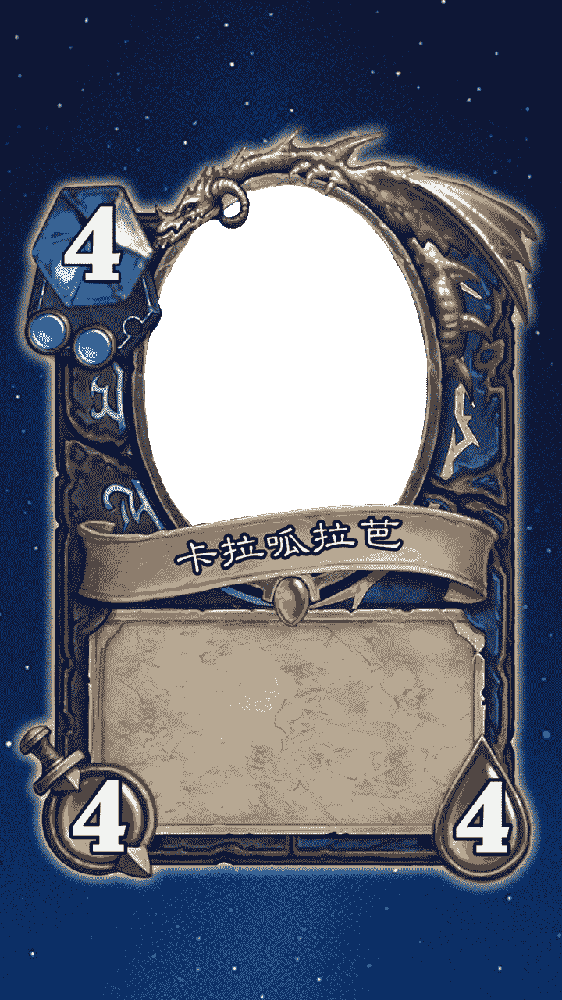

1.  有了底图, 开始想办法做插画, 常用的炉石风格的插画有两类, MJ提示词如下

1.  这是比较明快的卡通画风，用于绘制简单的角色和生物

```
hearthstone card of a cartoon a (Treant Researche) character card,hearthstone illustration aesthetics, 2d game art, Arthur Gimaldinov artwork, classic academia, in the style of brushwork mastery, heavy shading, （Brown） and （Azure）, energic style, bold and energetic, playful caricature::909 --ar 14:19 --niji 5
```

1.  这是比较扁平的画风，通常用于绘制严肃的场景和复杂的人物

```
h**e**arthstone illustration aesthetics, a (Fel Fire Treant Lord) by hearthstone artist, Arthur Gimaldinov artwork, hyper exaggerated features, (Dark Green) and (Black), in the style of colorful caricature, reimagined by industrial light and magic, 2d game art, strong diagonals, full body, in the style of muted colorscape mastery , d&amp;d, inspired chara designed character, sharp attention to detail, dynamic staging, strong use of contrast --ar 14:19 --niji 5
```

需要对提示词进行修改和抽象, 将里面MJ专有的参数去掉, 测试下coze的图像流会画出啥来, 只有coze的画风能做到炉石的画风, 这个bot才可行:

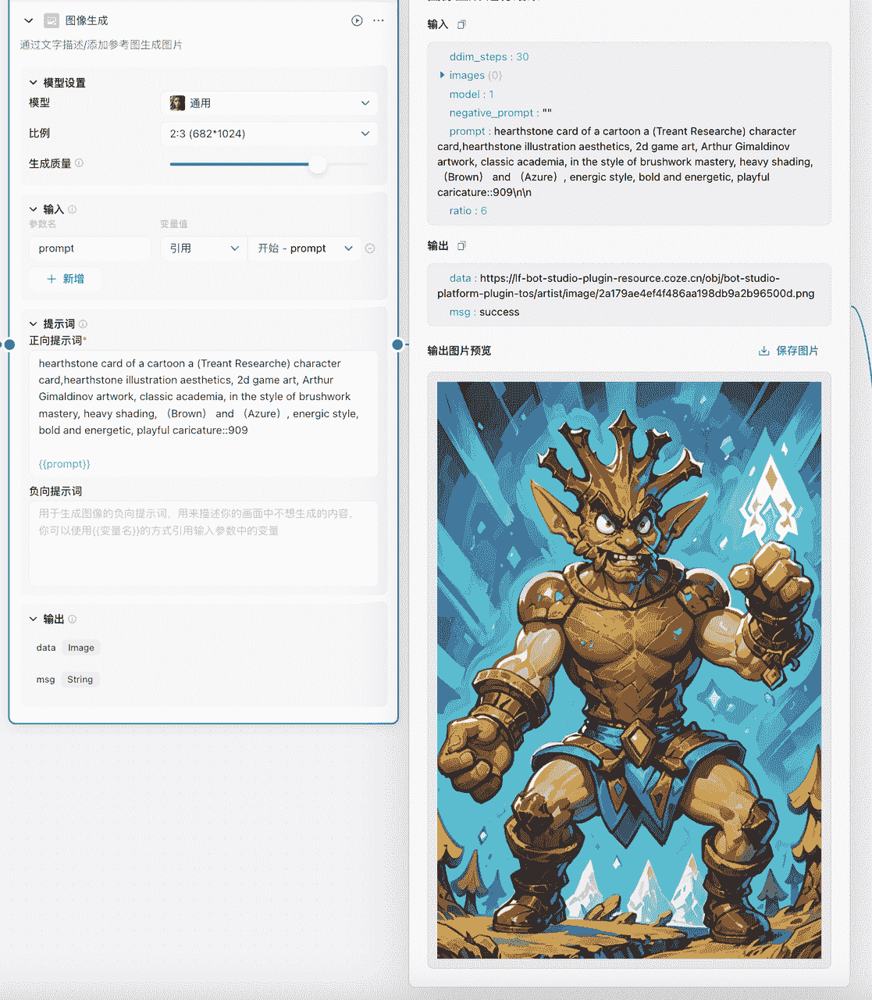

很显然, 画风非常接近, 赞!

1.  既然效果可以, 图像流开起来, 核心是运用叠图节点, 将抠好了的卡套, 叠到这个插画上, 再用添加文字节点, 将文字添加到图上, 卡牌描述的文字.

添加文字只能一行一行的添加, 为了简单起见, 统一采用3行格式, 连续添加文字3次.

这里对位置, 大小的校正, 是个苦力活, 努力让插画的尺寸占满抠图框, 却又能将主体完整展示出来.

分步执行后的效果如下:

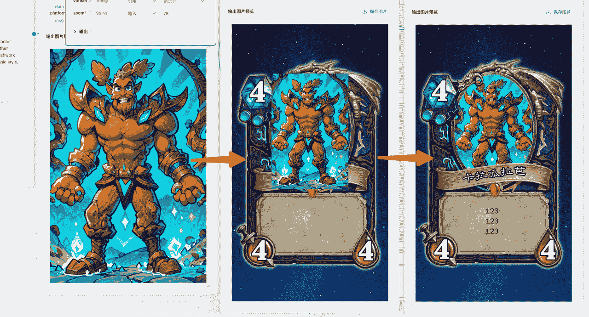

1.  好了, 图像流整体通了, 我们需要将提示词提取出来, 作为输入参数.

另外速度是不是有点慢呢? 另外再做点速度上的优化, 最终图像流成型效果:

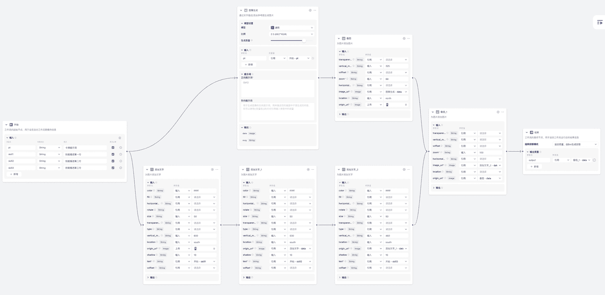

这里将叠加文字和生成图设计成了并行, 将图像流的速度提升了40%左右.

## 工作流

> 虽然说图像流是这个bot的核心, 但是图像流的缺点在于它没办法做很多灵活的调整, 因此它的可玩性反而需要在工作流中完成. 整理一下需求, 我们需要让这个工作流实现以下几个功能:

+   我们需要生成3行的卡牌描述; 我们还需要将提示词中提取出来的可修改部分变成有一定随机变化的内容

+   我们用了两份画图提示词, 因此我们需要从中选取一份作为图像流的输入

+   我们还需要增加两种不同的卡片, 再在3种卡牌中做随机抽卡的效果

> 接下来一一讲解这些功能在工作流中的实现

1.  生成3行卡牌的描述, 和提示词内容填充.

这是大语言模型的强项, 因此我们考虑用大语言模型来生成. 考虑到生成的内容尽可能能和bot用户提出的要求有所结合, 我们让用户输入的要求作为大语言模型的上下文. 并且输出3行卡牌描述, 以及提示词中的基础元素.

以下是几次优化后的提示词语句:

```
## 角色
你是炉石卡牌设计师, 你非常熟悉炉石传说这个游戏, 包括它的卡牌风格, 卡牌设计规则, 卡牌设计师姓名.
你非常有创意, 尤其在创造技能上, 有时会来一个亡语技能.
 
## 技能
你可以基于[用户要求]中的内容来提取或者创造出以下字段对应的内容作为一张炉石卡牌设计的内容部分.
所有字段必须有内容, 不能用空字段, 也不能用加了引号的空字段&quot;&quot;.
技能必须要写成三行, 不能多也不能少, 必须用中文:
1. card: 卡牌名称 (英文)
2. artist: 炉石卡牌设计师 (英文)
3. color1: 卡牌上的主颜色 (英文)
4. color2: 卡牌上的辅颜色 (英文)
5. skill1: 这张卡牌的技能说明第一行字, 控制在9个字以内 (中文)
6. skill2: 这张卡牌的技能说明第二行字, 控制在9个字以内 (中文)
7. skill3: 这张卡牌的技能说明第三行字, 控制在9个字以内 (中文)
 
## 各字段的参考内容、格式
1. card: Treant Researche
2. artist: Arthur Gimaldinov
3. color1: Brown
4. color2: Azure
5. skill1: 战斗力为5的超级英雄!
6. skill2: 但是一个技能都没有!
6. skill3: 亡语:全身反骨, 谁都不服!

## 用户要求
{{input}}
```

1.  **从两份画图提示词中选取一份.**

这里我采用了最简单的随机策略: 随机选一个! 手敲一个随机数插件 (已上架商店, 可公开使用), 并让它随机选0和1, 然后使用代码将输出作为图像流输入的提示词按照生成的内容元素填充好.

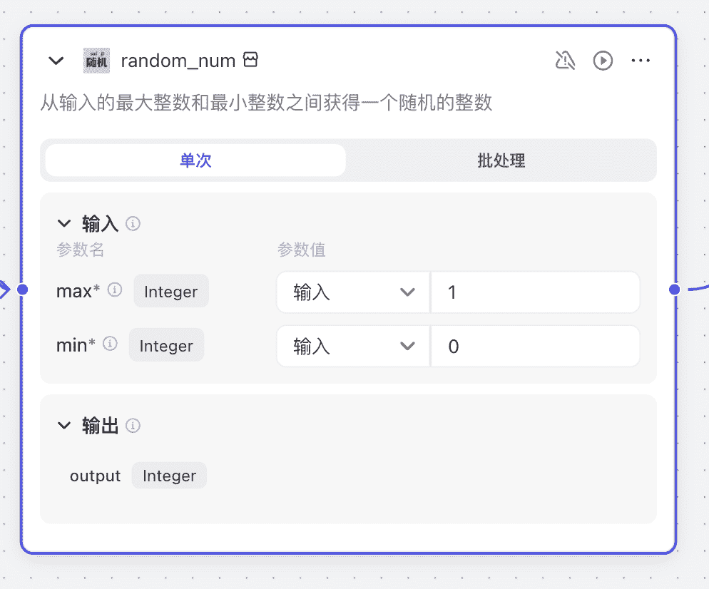

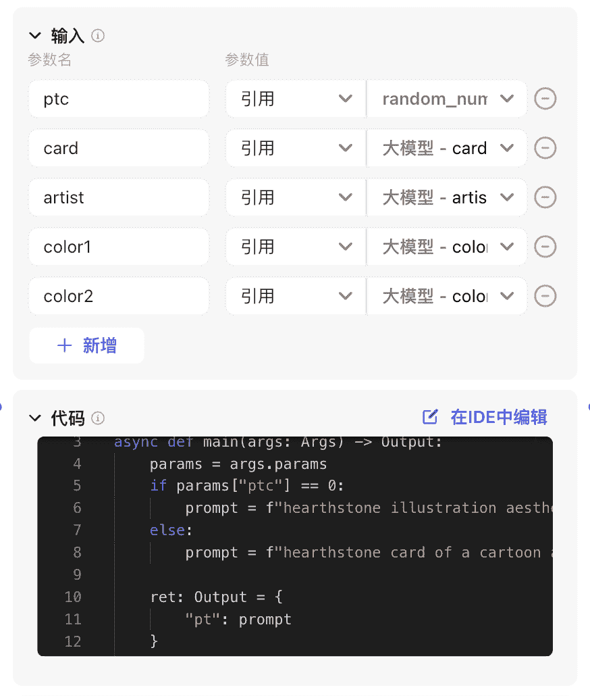

代码内容如下, 这里就将大模型提供的生成随机性, 和用户输入的相关性都有机结合.

```
async def main(args: Args) -&gt; Output:
    params = args.params
    if params[&quot;ptc&quot;] == 0:
        prompt = f&quot;hearthstone illustration aesthetics, a ({params[&#x27;card&#x27;]}) by hearthstone artist, {params[&#x27;artist&#x27;]} artwork, hyper exaggerated features, ({params[&#x27;color1&#x27;]}) and ({params[&#x27;color2&#x27;]}), in the style of colorful caricature, reimagined by industrial light and magic, 2d game art, strong diagonals, full body, in the style of muted colorscape mastery , d&amp;d, inspired chara designed character, sharp attention to detail, dynamic staging, strong use of contrast &quot;
    else:
        prompt = f&quot;hearthstone card of a cartoon a ({params[&#x27;card&#x27;]}) character card,hearthstone illustration aesthetics, 2d game art, （{params[&#x27;artist&#x27;]}） artwork, classic academia, in the style of brushwork mastery, heavy shading, （{params[&#x27;color1&#x27;]}） and （{params[&#x27;color2&#x27;]}）, energic style, bold and energetic, playful caricature::909 &quot;

    ret: Output = {
        &quot;pt&quot;: prompt
    }
    return ret
```

1.  增加两种不同的卡片, 并提供随机抽卡的效果.

首先是增加卡牌类型, 需要重复图像流第一部分的抠图, 分别抠出两张卡套 (依旧感谢  的帮助), 我们就得到了3张不同的卡套.

复制之前完成的图像流, 将新制作的两个卡套替换上去, 并微调叠图和添加文字的位置, 我们就得到了3个图像流, 分别对应3种不同类型卡牌的生成. 如果期望更多类型, 都可以用一样的SOP去操作.

用一个简单的代码来做非平均的随机数生成: 随从卡牌80%, 普通传说19%, 金色传说1%

```
async def main(args: Args) -&gt; Output:
    params = args.params
    input_str = params[&#x27;input&#x27;]
    if &quot;慧凌&quot; in input_str:
        choice = 0
    else:
        choices = [0, 1, 2]
        probabilities = [0.01, 0.19, 0.8]
        choice = random.choices(choices, probabilities)[0]
        
    pt_choice = random.choices([0,1], [0.5, 0.5])[0]
    return {&quot;choice&quot;: choice, &quot;pt_choice&quot;: pt_choice}
```

> 有个小彩蛋, 这里埋了一个金手指, 就是“慧凌”, 只要输入慧凌, 你就注定能获得金色传说·大聪明. 一方面是为了感谢好朋友慧凌, 另一方面, 也可以用于测试金色传说卡牌是否能正常生成.

> 路过看到的小伙伴一起保守这个秘密, 不要告诉别人哦~~

然后, 我们用一个选择器, 链接上所有3个类型的卡牌生成图像流. 千万别连错哦~~

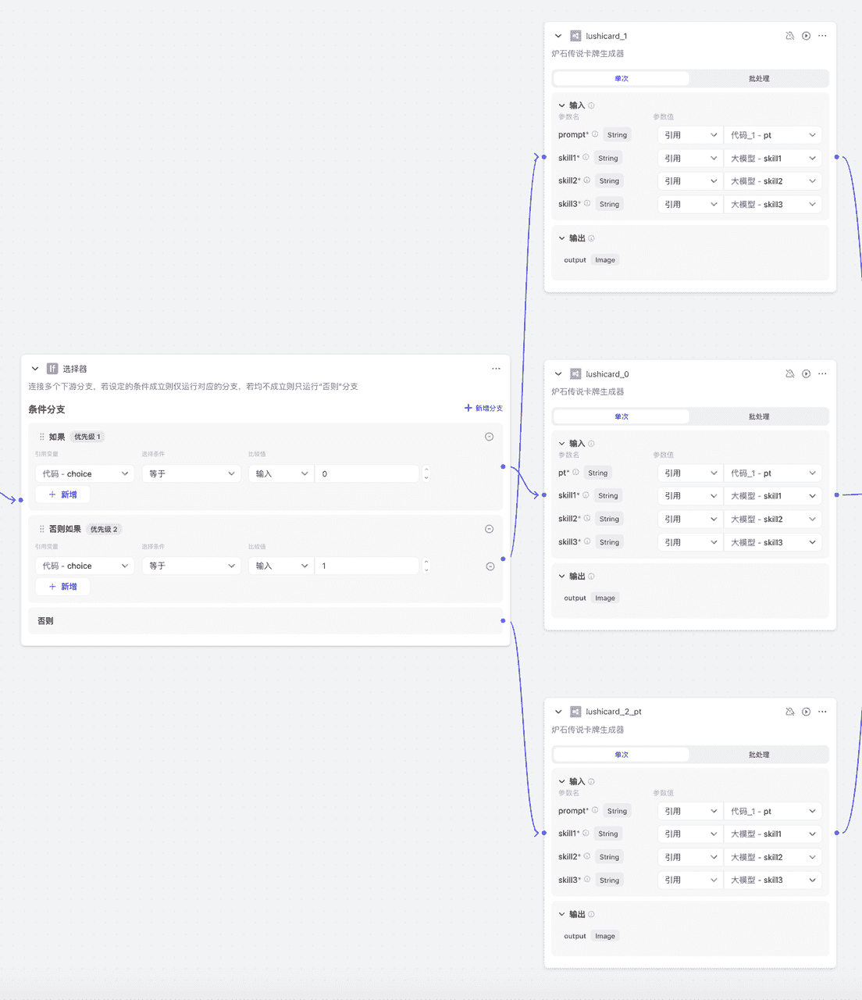

这样, 我们一个完整的工作流就构建完成了:

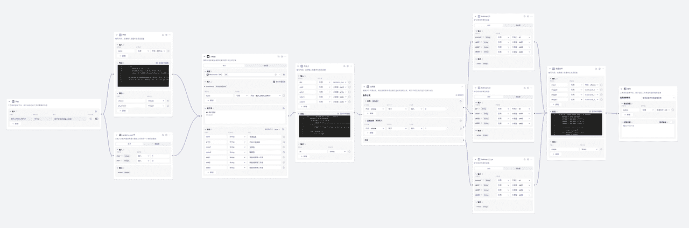

将它添加到bot里面, 并补充上触发提示词, 写上开场白, 换上背景和图标.

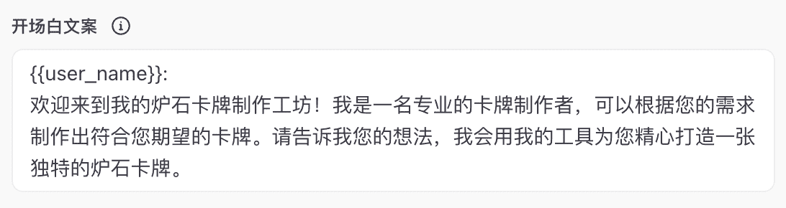

🏆 这样, 炉石卡牌抽卡机就基本完成了!

如果想精准的控制用户输入的内容, 百分百触发抽卡, 不妨尝试一下快捷指令:

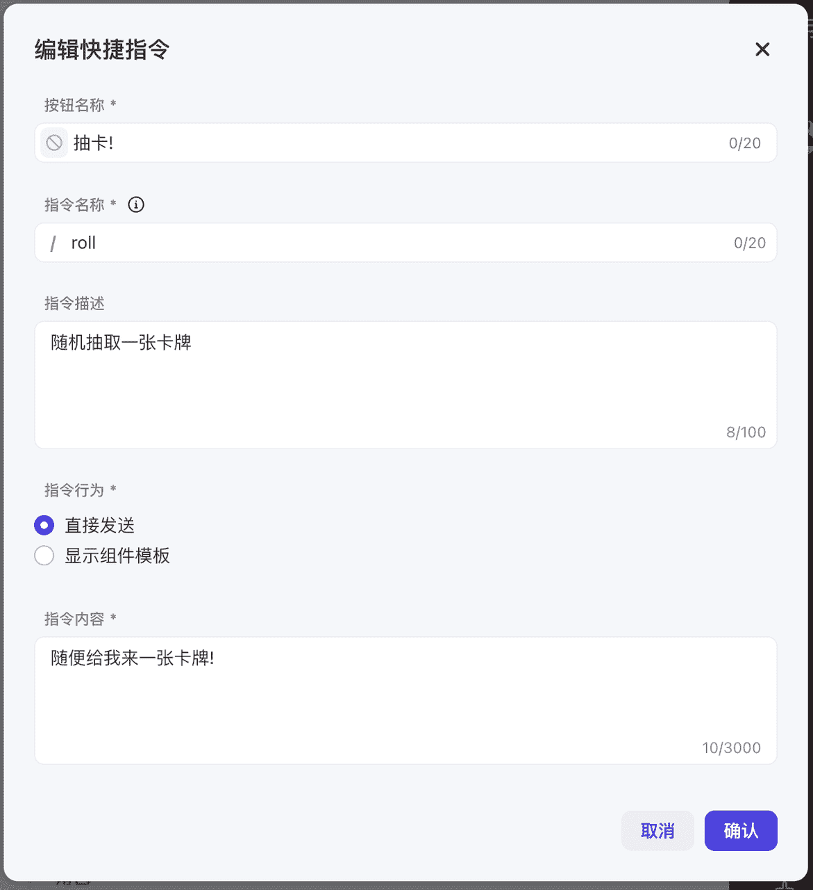

而头像定制上传的功能, 是基于上面的图像流和工作流简化出来的结果.

相信如果这篇内容你都看懂了, 这个功能你也一定会做.

另外, 大家已经看出来这个bot是个半成品了吧, 还有很多的区域可以优化, 还有很多需要自由修改和调整的卡牌区域. 甚至未来用这个卡牌生成器凑成一副完整的卡牌, 也未尝不可.

⛽️ **来, 尝试着动手做一个吧!**

文末, 给大家介绍一下我们的waytoAGI扣子小分队: (by 野菩萨)

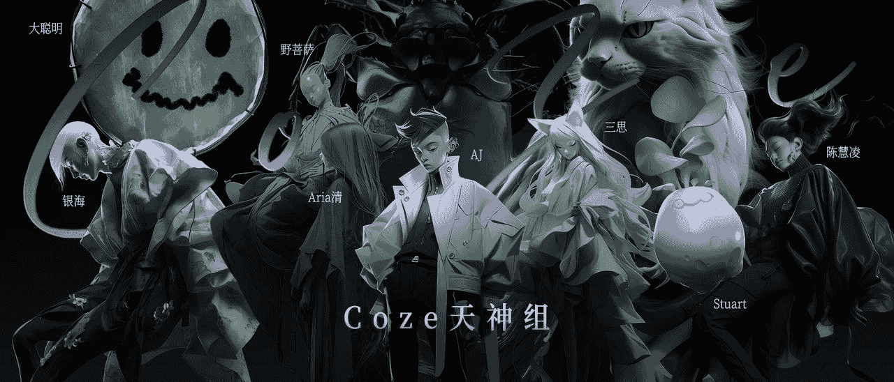

[7颗扣子coze的搭建视频](https://waytoagi.feishu.cn/wiki/UkfswXrZqiuAzbkOmcNcNl8unQf?from=from_copylink)这个bot只是扣子小分队中的一个哦:

也欢迎关注“waytoAGI agent探索”公众号, 或者加入我们成为共建者.