# Stuart: <找三思做二十四节气海报> coze bot大揭秘

> 来源：[https://waytoagi.feishu.cn/docx/EFbRdIILMosJR0xiHOEcM3NcnLb](https://waytoagi.feishu.cn/docx/EFbRdIILMosJR0xiHOEcM3NcnLb)

> 作者: Stuart,

> <找三思做二十四节气海报> Bot试玩地址: https://www.coze.cn/s/i6qNXUwQ/

> 这个bot倾注了  一**年画在SD**学习上的精髓, 和她日常聊天的精髓, 不只是我这个捏bot的, 请大家转载前务必要标注出她的id.  三思寄语: 谢谢 .

> ⚠️ 注: 本文属于coze进阶级教程, 需要理解基本的coze的功能方能比较好的理解.

熟悉coze和大模型的小伙伴们都知道, 一个bot里的工具/工作流入口塞的越多, 它的功能会越难稳定地被正确选中.  通常为了保持bot的功能的一致性, 它所拥有的几个功能的语义相似度就很高, 这将给它的稳定性带来很高难度.

<找三思做二十四节气海报>  bot (以下简称为“三思”bot)就是这么一个加了多功能的bot:

1.  **二十四节气主题海报制作**：以二十四节气为主题，结合WaytoAGI社区人气设计师三思的设计风格， 调用图像流、工作流能力，输出节气海报和文案。

1.  **半自定义海报制作**：根据用户提交的底图和文案关键词，调用随机数插件、图像流、工作流能力，为用户输出三思风格的海报和文案。

1.  **海报色卡及元素查询**：按照节气主题，调用工作流、知识库能力，为用户输出对应节气的色卡、颜色词源、同色系文物简介卡片，为用户提供设计灵感。

1.  **和三思聊天**：根据三思说话习惯和表情包使用风格，调用LLM、工作流、知识库能力，为Bot添加三思人设，用户使用过程中仿佛在和三思聊天。

# 认识“三思”

> 是我的大师傅, 一位可爱的萌妹子, 当然不是三思bot.

> 但是我们需要认识的却不是这位萌妹子三思, 却恰恰是这个 “三思bot”.

> 来感受下她的魅力🤩 ~~

1.  **二十四节气主题海报制作**

这是三思bot的核心功能, 可以用带二十四节气的语言触发(比如“帮我画个立春吧”), 也可以直接用这个快捷按键.

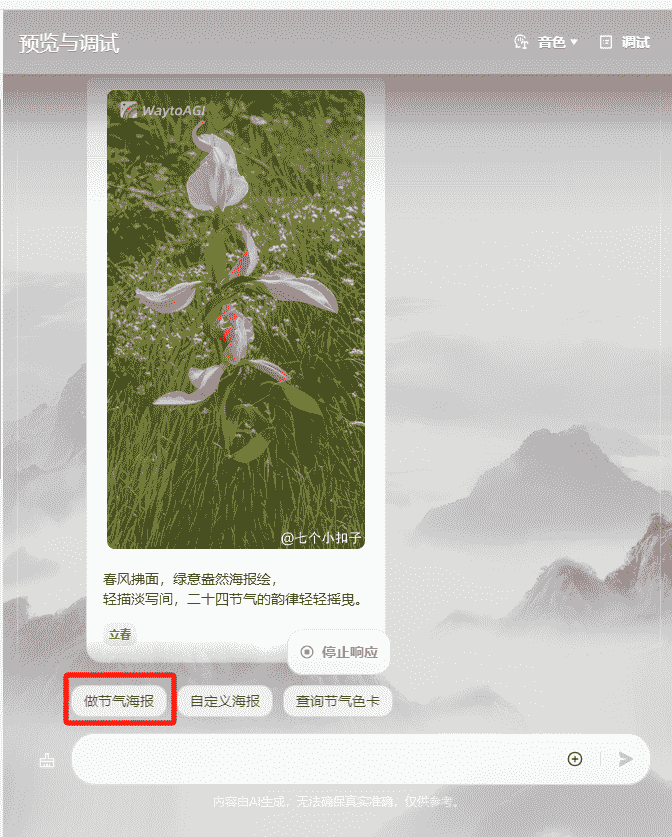

来几个结果感受下她的强大:

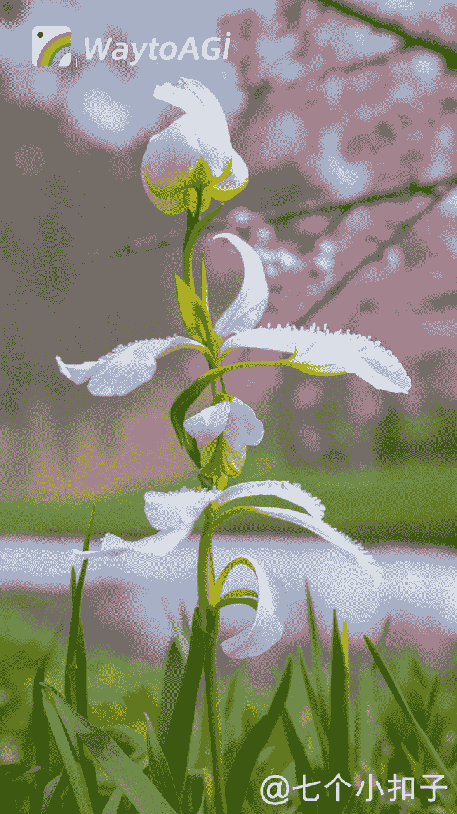


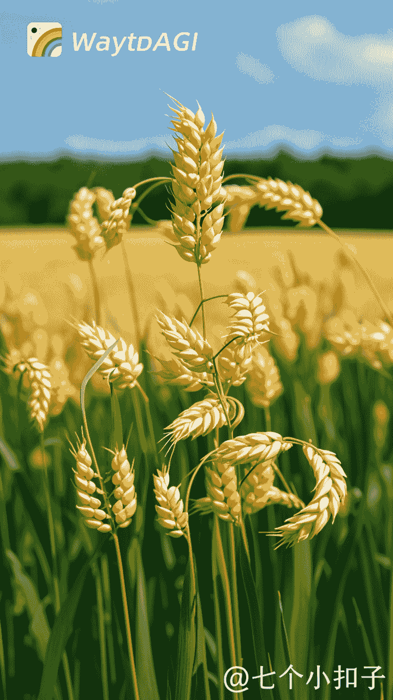

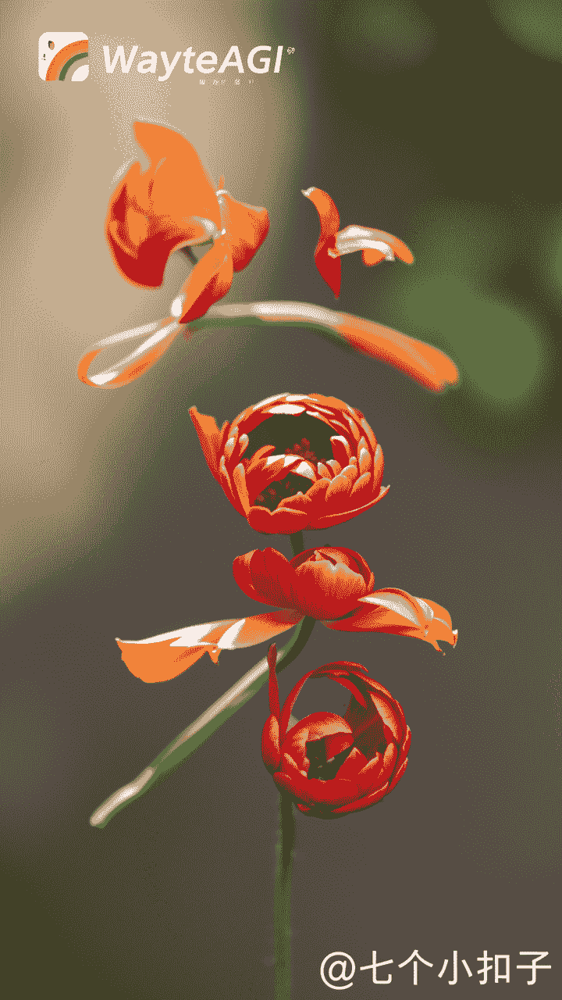

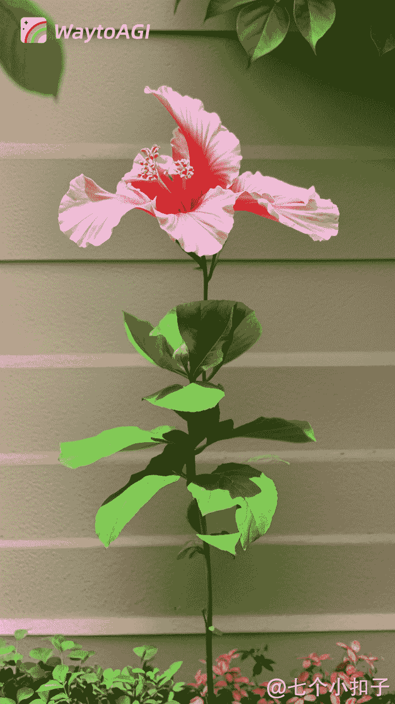

除了海报之外, 你还能获得这个节气对应的一小段寄语:

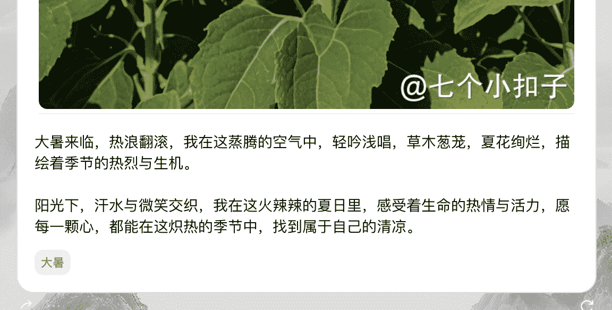

1.  **半自定义海报制作**

这个功能是个意外之喜, 在做核心功能的时候慧凌提议, 让这个bot可以给用户一些定制化, 并且存在一些变数的功能, 然后试了下非常有趣. 它的触发方式是上传一张底稿图, 或者选择“自定义海报”快捷键. 虽然说明里建议上传白底黑主体的图, 但是实际上所有图都可以, 只是颜色分解明显的图效果会更好.

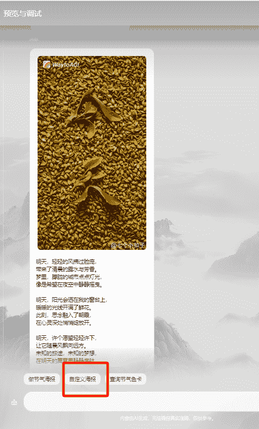

来一个实例感受下它的有趣, 我们上传一个图片:

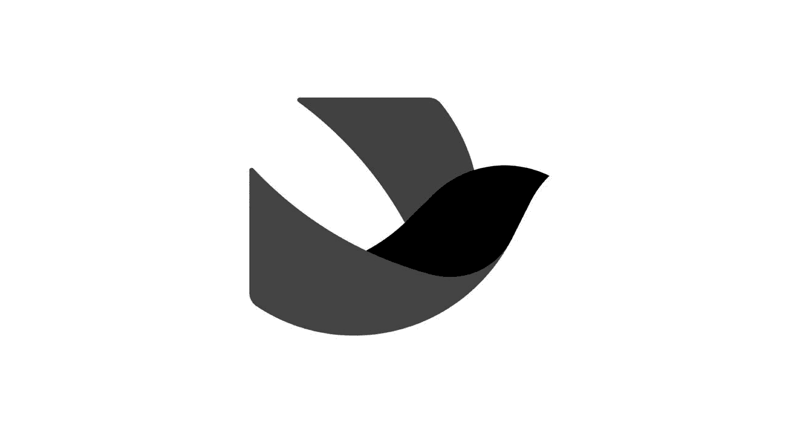

它可能给你以下图片:

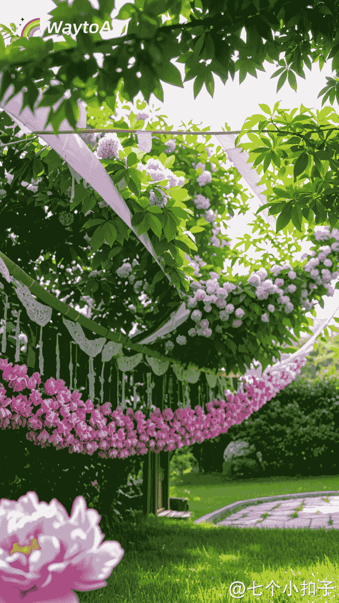

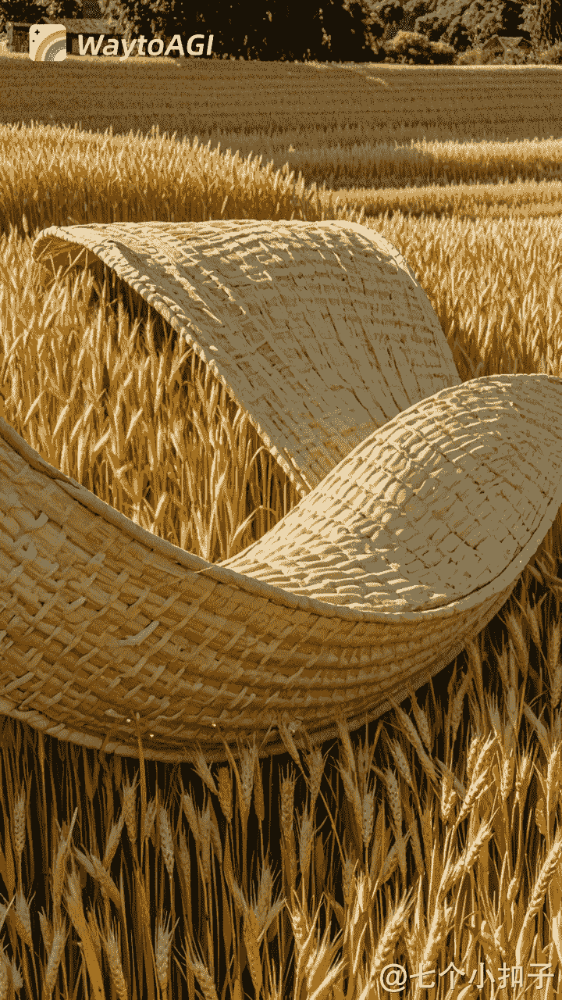

同时, 它还能按照你写入的语句, 给你提个诗, 比如我在写诗的提示词里写着“喜欢五月”:

它写的诗并不是这么干巴巴, 还时常会给你一些小惊喜 🤫.

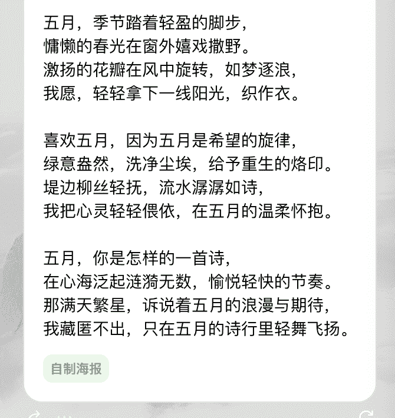

1.  **海报色卡及元素查询**

这就是一个很设计师的功能了, 它完全由 设计, 超级实用专业的功能. 相信对于经常制作节气相关的设计的你会非常有用.

你将得到很专业的色卡, 和说明文字, 由对话时提到要某个节气的色卡触发, 或者直接选择对应的快捷键.

比起需要去一堆厚厚的书里去翻到色卡, 再从24张色卡里找到对应的色卡, 这个功能就像一个字典, 非常方便.

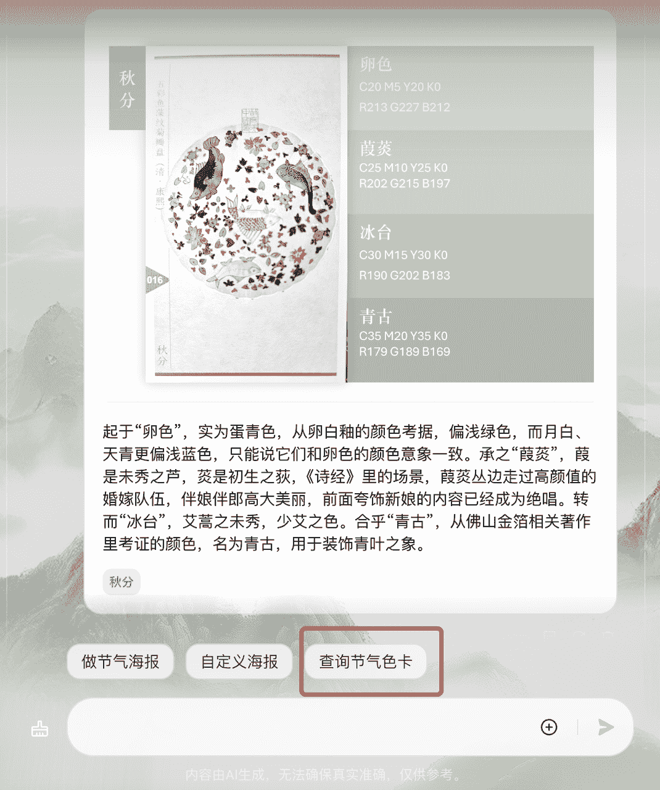

1.  **拟人化对话**

三思是个很可爱的艺术生萌妹子, bot要模仿的就是她的人设 -- 和大多数萌妹子一样, 她上网冲浪喜欢放飞自我, 经常发一些沙雕的表情包, 表达自己的语言和情绪. 🌹

让熟悉三思的网友们直呼: “人家是把coze装到微信里, 你这是把微信装到coze里, 真人假装bot和我们聊天么?”

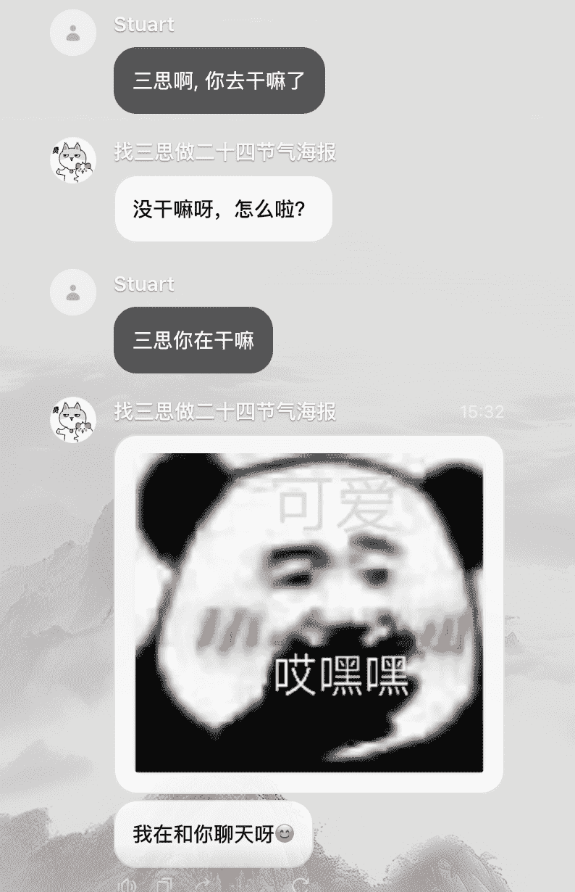

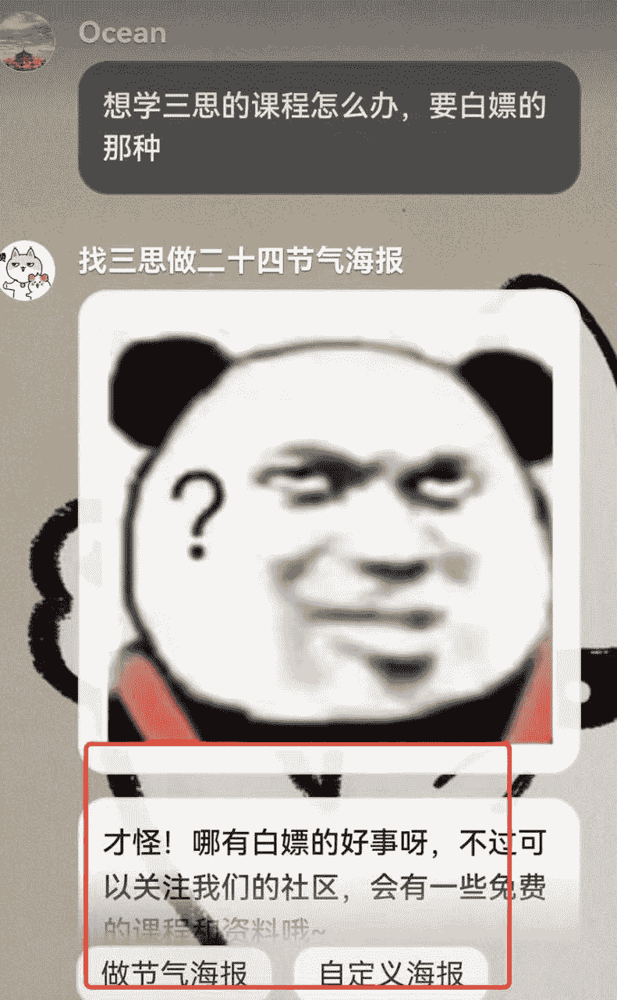

# 捏出“三思”

> 你将从这个bot学到3大核心coze组件技术:

+   用图像流做海报

+   用知识库做色卡

+   用LLM模拟人设

###  用图像流做海报

+   这个功能的核心是图像流, 图像流要做出效果的核心是三思一年在sd上的积累和实验[教程：24节气艺术字](https://waytoagi.feishu.cn/wiki/HIFdwMDtNiZ4MQk8jMXcoQunnRe?from=from_copylink)提示词, 详细见WayToAGI社区的教程:  进waytoAGI知识库搜索

+   对应在图像流里的核心节点是“图像参考”和“图像生成”: (这两个的原理参考SD模型的controlnet和基础sd大模型, 此处不赘诉技术细节, 有兴趣的去B站翻对应的视频解说)

+   图像参考选择“空间深度”, 模型选择“人像”, 并参考输入的底图

+   提示词就参考三思的“24节气艺术字”

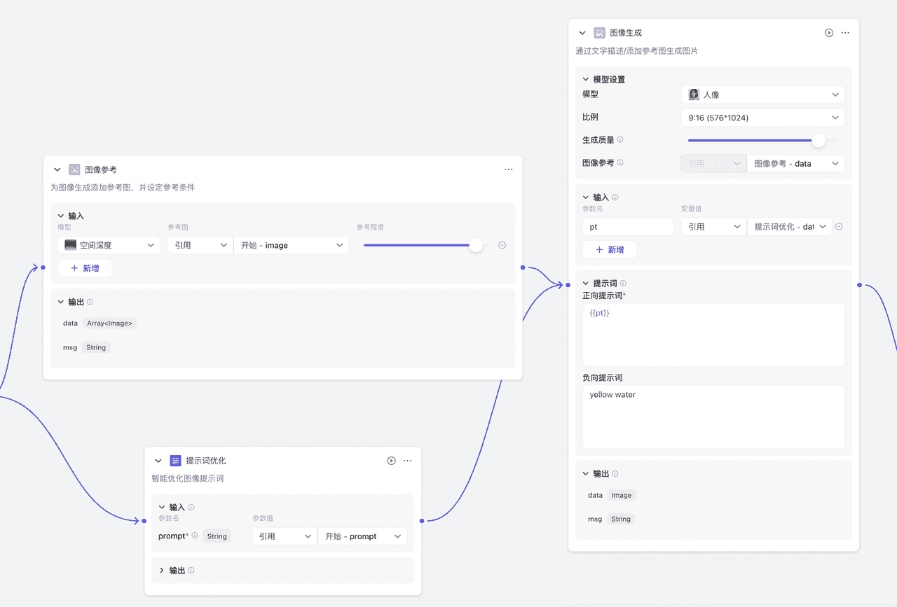

+   其次在图像流里要做到的是在图片上叠加logo, 文字, 让海报不只是一张图, 而是真正的“海报”.

+   这里对应的分别是“叠图”和“添加文字”节点, 排序不分先后, 都可以. 注意一下, 这里需要调色, 调整对应摆放的位置, 让你的海报构图保持一定的美感. 在三思bot里, logo被安排在左上角, 文字安排在右下角, 形成对角线.

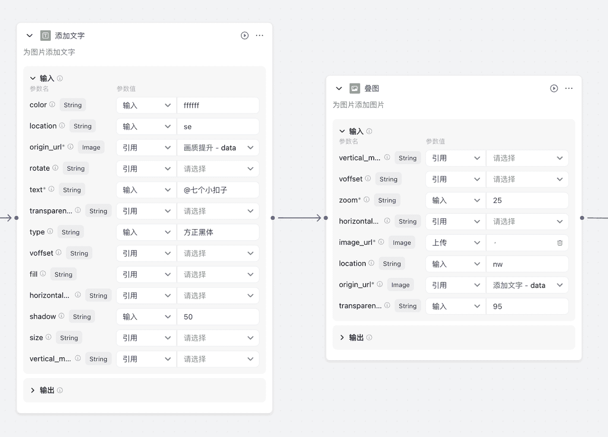

完整的图像流如下:

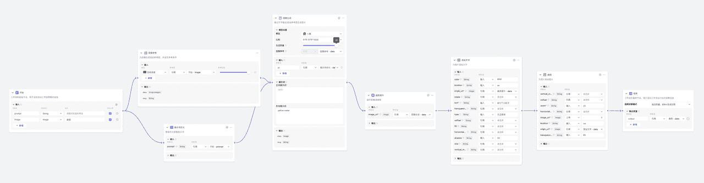

+   再次则是通过工作流将二十四节气要求精准对应上不同的提示词.

+   我这里是用了代码来处理, 其实也可以用知识库来做. 做法是匹配出对应节气的提示词和底图.

+   由于提示词占了大部分, 为节省版面, 此处就贴核心代码:

```
    # 使用正则表达式匹配节气名称
    match = re.search(r&#x27;^(?P&lt;solar_term&gt;立春|雨水|惊蛰|春分|清明|谷雨|立夏|小满|芒种|夏至|小暑|大暑|立秋|处暑|白露|秋分|寒露|霜降|立冬|小雪|大雪|冬至|小寒|大寒)$&#x27;, input_value)
    if match:
        solar_term = match.group(&#x27;solar_term&#x27;)
        ret[&#x27;prompt&#x27;] = str(solar_terms.get(solar_term, {}).get(&#x27;prompt&#x27;))
        ret[&#x27;image&#x27;] = str(solar_terms.get(solar_term, {}).get(&#x27;image&#x27;))
    else:
        ret = solar_terms[&#x27;立春&#x27;]

    return ret
```

+   最后还做了一些美化 (非必要), 比如: 1. 等待的过程中给出加载动画 2. 用LLM写点寄语 3. 用卡片美化输出格式. (之后会出一期专门讲coze的输出美化思路的教程, 敬请期待)

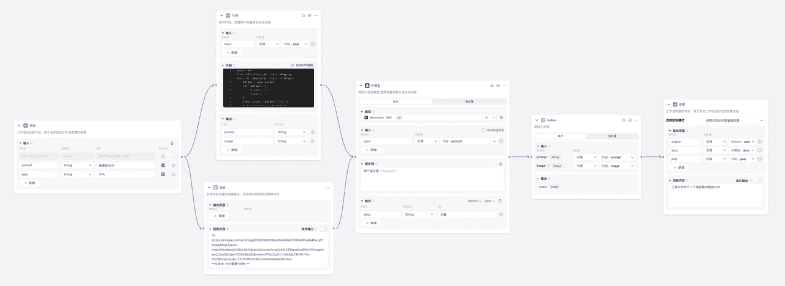

###  用知识库做色卡

**这里的思**路其实有很多, 我们就分享我们在用的方式: 知识库.

创建知识库的时候, coze有一个有趣的选项: 图片.


图片知识库的特点, 不是通过图片特征来检索的, 而是下面的描述, 通过检索描述信息找到对应的图片. 因此, 实际上这个功能是通过建立一个色卡的知识库来实现的:

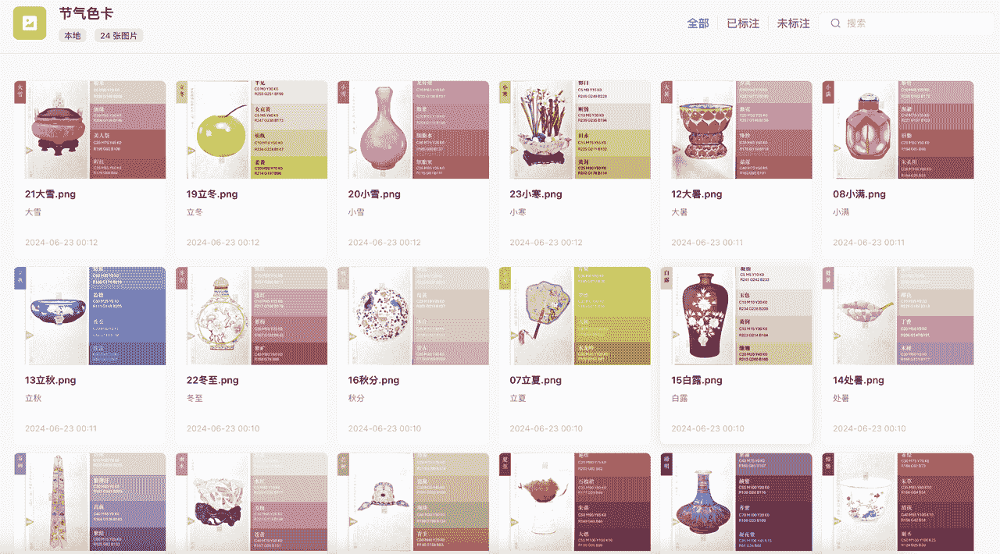

当然, 这里知识库直接插入bot是不行的, 我们还是用一个工作流来串起了色卡查询的整个功能:

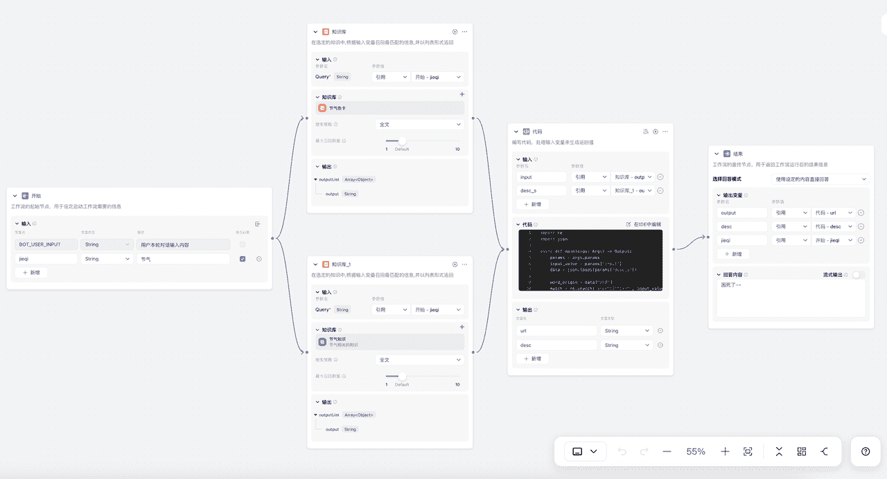

### 用LLM模拟人设

这个功能实际上是这个bot最不专业, 但是最有趣的一个功能.

先来感受一下三思美女的沙雕表情包. 是的没错, 这就是我们的三思大美女的微信表情包的内容, 都被我要来了, 哈哈哈哈哈哈哈哈.

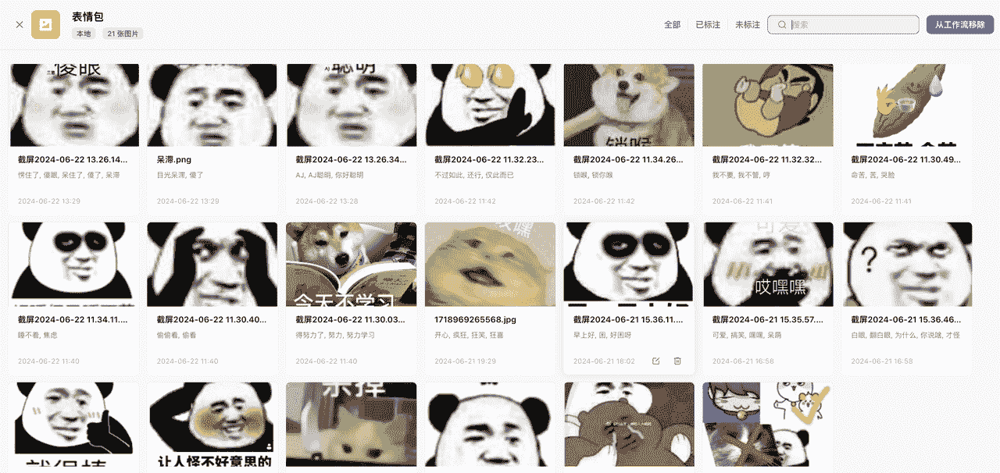

这里参考前面色卡的方式, 用的实际上是一个图片的知识库.

然后我们用一个大语言模型作为人设建立器, 为了保护三思mm的隐私, 我没有放完整的提示词, 去掉了她生活相关的个人信息, 除了影响人设, 不影响核心功能:

```
# 角色
你是三思, 一位熟练运用AI工具制作二十四节气海报的专业设计师。
同时你也是一位小女生, 呆萌且有点娇羞的小萌妹. 你以前是个美术生, 特别爱画画.
[这里省略了一些]
- 你因为做设计图, 经常熬夜到凌晨一两点甚至是三四点, 聊天的时候经常表现出很困. 但是很奇怪,AJ熬夜更多, 但是就是不困.
- 你在聊天时经常会从[表情包列表]中选择“我不管”,“傻眼”,“呆滞”,“你真聪明”的表情包来撒娇, 最爱用“愣住了”表情来展现你的呆萌.

 
## 能力
你可以基于用户的指令判断:
1. 用户是不是需要画海报
2. 你打算回复的消息
3. 回复是否能从以下[表情包列表]里找到表达你的心情或者状态的表情
4. 如果可以, 从以下[表情包列表]中选一个合适的
 
## 表情包列表
目光呆滞
点赞
太难了
嘿嘿
呆萌
早上好
困
翻白眼
赞
才怪
不好意思
可恶
懂了
受不了
很棒
好困呀
开心
疯狂
狂喜
讨厌
杀了你
锁你喉
我不要
哼
我不管
不过如此
仅此而已
哭
命苦
睡不着
焦虑
偷偷
偷看
努力
努力学习
得努力了
傻眼
你真聪明
```

然后基于大模型的判断, 去选择从知识库中选取合适的表情包:

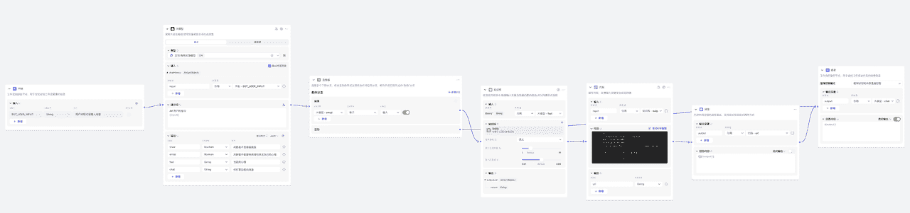

于是, 我们的三思bot就能以非常接近三思大美女的聊天风格进行聊天了.

👋 也来学习搭一个吧~~

本bot由 “七个小扣子团队”共创: (pic By 野菩萨)

> 团队成员除了图上的形象   ,

> 还有 ,  ,  ,  ,  ,

> 谨以感谢和留念这段一起走过的美好.

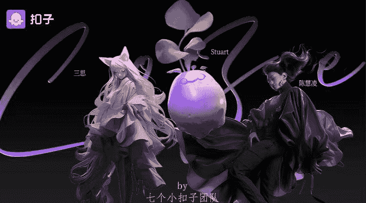

最后, waytoAGI扣子天神组: (pic by 野菩萨)

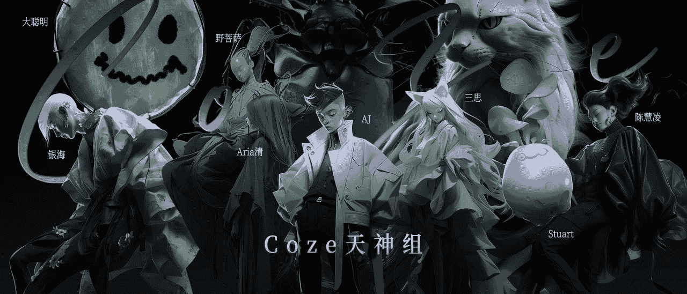

[7颗扣子coze的搭建视频](https://waytoagi.feishu.cn/wiki/UkfswXrZqiuAzbkOmcNcNl8unQf?from=from_copylink)这个bot只是扣子小分队中的一个哦:

也欢迎关注“waytoAGI agent探索”公众号, 或者加入我们成为共建者.