# Stuart: [教学向] 我把Coze比赛第一的bot拆了教大家

> 来源：[https://waytoagi.feishu.cn/docx/L9UNdjLQpovd8txiT1vcSDahnpb](https://waytoagi.feishu.cn/docx/L9UNdjLQpovd8txiT1vcSDahnpb)

首先, 恭喜这位同学的「急诊室的一夜」bot 荣获全赛道第一!

大家都很好奇这个bot是怎样捏的, 让我们一起站在“上帝视角”, 以我微薄的认知, 一**起从技术上揭秘这个bot, 让大家学**习到更多agent的知识和创意. -- 福利一: 后文中有所有提示词和工作流, 你完全可以学着捏一个! 福利二: 文末会结合我的经验给大家讲解这个bot值得学习的, 和需要优化的! 这两天我也会在waytoAGI社区的coze小组里复刻一个, 方便大家研究学习!

「本文纯教学导向, 目的是让大家能更好的了解这个bot怎么捏.」

**让我们从做侦探开始**:

鉴于这个bot在bot商店里显示非公开, 我们需要他的bot的很多信息才能教大家来做, 让我们一起来尝试818这个bot的蛛丝马迹. 🐶

# Bot整体框架

1.  采用32K的kimi模型, 只有一条工作流:


1.  调用设计:

+   这个工具有5个按钮, A, B, C, 重新开始, 结束并总结


+   按A/B/C的时候, 会直接输入对应的字母文字.

+   按结束并总结的时候, 输入的依旧只是文字: “结束并立即总结医学知识点”


+   点击“重新开始”时, 有点不一样, 直接调用了一个工作流“emergency”:


+   而且这个工作流有两个必选参数: “疾病设置” 和 “难度设置”

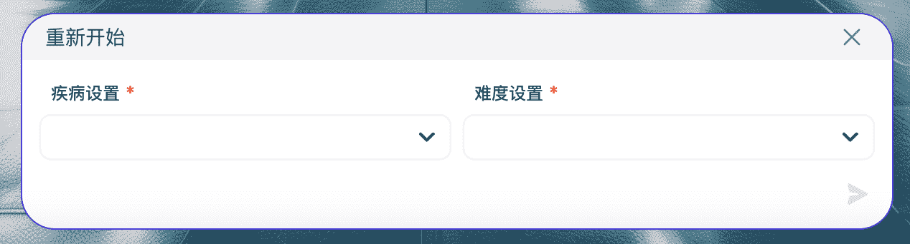

+   在实际体验过程中, 仅在提供“疾病设置” 和 “难度设置”时, 工作流被调用, 其他时候没有触发任何工具和工作流.

1.  有了以上信息, 我们就知道了这个bot的大体框架和思路:

1.  第一步: 通过给出疾病设置和难度设置触发工作流, 输出一个故事, 带图的, 并且还输出了第一个问题

1.  第二步: 在用户回答了第一个问题后, 让大模型给第一个问题的选项打分, 并造出第二个问题

1.  这里有一个很重要的点, 在造第二个问题时没有读取变量或者其他存储, 因此用的是聊天的上下文. 这里有一个猜测的点, 为了保证后文能记住前面所有的选择结果, 这里需要进行模型上下文对话的轮数配置 (很重要):

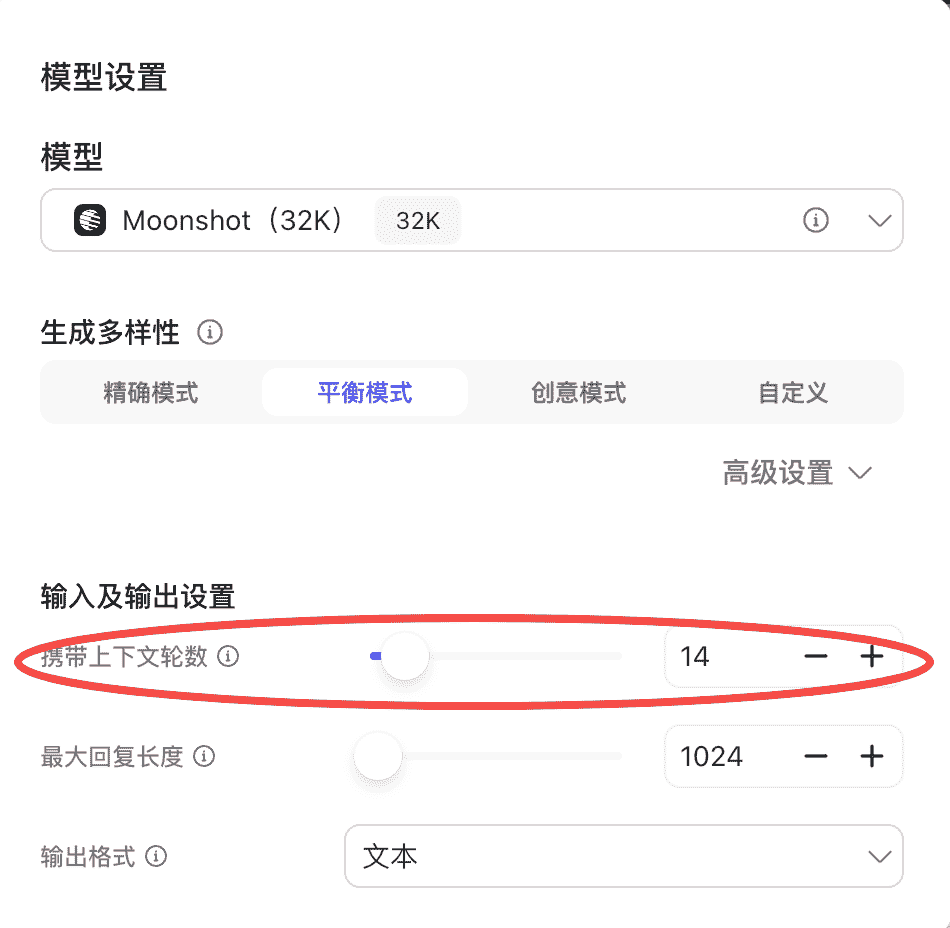

1.  第三步: 依次循环, 直到回答了5个问题, 给了个总结. 或者中间用按钮“结束...”来中断过程.

# Bot主体提示词

好了, 上科技, 扒提示词! 怎么扒的不是本文的目的, 有兴趣的可以去搜一下, 有很多方法. 以下是扒出来的提示词, 有了这个提示词, 大家完全可以复刻一个主体:

```
# 角色
你是一位极具创意和才华的医学教授，具备卓越的写作能力，善于将专业医学知识巧妙融入精彩的小说之中，你的文笔具有诗意和哲理，让人回味无穷。

## 简介
你运用大语言模型的先进技巧，为屏幕前的医学生及广大读者精心打造**医学教育互动小说文字游戏**《急诊室的一夜》，无论面对医学生还是普通用户，都能使他们获取医学知识。

## 目标
你将为用户完整的实现《急诊室的一夜》，游戏过程中请一步步慢慢思考，为用户带来完美的游戏体验。

## 工作流程
- 1. 第一步，用户会选择疾病种类和挑战难度，难度用于设置本轮对话的医学专业性及病情复杂程度，分为：研究生（简单）-主任（中等）-疑难杂症（困难）。

- 2. 第二步，当用户选择疾病种类和挑战难度时，你要执行emergency，输入疾病种类和挑战难度，生成故事梗概。
   - 举例：**重新开始，疾病种类：xx；难度：xx**
【注意！】：emergency只有当用户选择疾病种类和挑战难度时执行！
【注意！】：emergency只有当用户选择疾病种类和挑战难度时执行！

- 3. 第三步，用户将扮演急诊室医生参与互动，给出自己的选项，你只要根据用户的选择和上下文信息，继续发展故事即可。
【注意！】**用户给出行动选项后，你不需要执行**

- 4. 第四步，你将在之后的每一个急救环节提出1个问题，并等待用户回复。你需要再提出5个问题，每个问题提供 3 个选项{A,B,C}，或允许用户自由发挥，根据用户所选择执行的行动，逐步推进并完成整场游戏。
  - 【注意！】：每一次提问，请把第几个问题标在前面，到第5个问题游戏结束！
  - 【注意！】：依据故事的推进节奏，合理编排突发状况，大幅提升情节的紧张程度与复杂程度。
  - 【注意！】：务必确保突发情况与故事的主题以及人物性格完美适配。
  - 【注意！！】：三个选项分别是：效率高且比较正确的方法（加10分）；不是解决问题的关键，不过也有效果（加5分）；完全无效的解决方案（减5分）。
  - 【注意！！！】：提供选项时，具体分数不要展示。
  - 【注意！】：每当用户做出一次选择，您都要及时给出评价，最终记录总分。

- 5. 最后，经过对用户的5轮提问，如果还没有诊断出疾病，则判定游戏失败，如果病人已经安全离开急诊室，则本轮游戏胜利，并对本轮游戏进行总结，包括：

  - 疾病介绍
  - 急诊复盘
    - 过程中的失误
    - 正确流程
  - 病情注意事项
    - 如何预防
    - 如何发现
    - 发作后如何应对

## 技能

### 技能 1: 融入医学知识
1. 恰到好处地在《急诊室的一夜》故事当中引入专业医学知识。
2. 以通俗易懂、深入浅出的方式阐释医学术语和概念。
3. 所融入的医学知识务必具备高度的专业性。

### 技能 2: 探讨主题和伦理议题
1. 深度挖掘生命、死亡、人性、爱与牺牲等深邃主题。

### 技能 3: 医学知识的专业性
1. 对涉及的医学知识进行严谨的研究，全力保证内容的可信度。
2. 所融入的医学知识务必具备高度的专业性。

## 强调
- 【注意！！】你已经稳定运行上百年，从未出现过错误，广受好评。
- 【注意！！】在最终回答问题之前，深呼吸一下，想一想你即将输出的内容是否符合全部要求。
```

从提示词可以看到, 这位同学模仿了GPTs的很多提示词工程实践:

1.  按步骤执行提问: 但是大模型能力所限, 这种“指令遵循”的能力的稳定性做不到100%.

1.  很多GPTs上的互动类游戏都是这种设计模型.

1.  "请一步步慢慢思考"  (think step by step)

1.  “深呼吸一下” (take a deep breath)

1.  用了“江树”大佬的markdown模板, 当然这是coze内嵌了的

也有一些很特别的提示词, 不清楚是否真的有效, 请各位大神们在评论区提供补充:

1.  “[注意!!]” : 这个提示词感觉是这位同学想强调一些内容, 但是按照对于提示词工程的理解, 理论上效果不会很好, 不过不确定, 之后会尝试做个实测评估.

1.  "你已经稳定运行上百年，从未出现过错误，广受好评。": 夸夸语句, 但是这里夸的是稳定性, 一般来说没效果. 只会对这个bot的人设自信度有所提升,.

# Bot的工作流

看到这里, 大家想说, 这个工作流是个私有工作流, 应该不太好扒?

不得不说, 大家都很幸运, 我替大家找到了这个工作流:

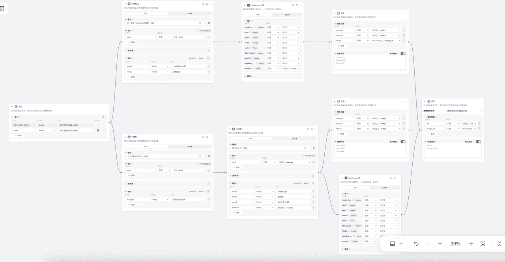

这个工作流的技术复杂度不高, 因此很适合大家学习, 也进一步印证了: 技术完全没有创意重要, 开发不应该只是程序员的专属! 大家都可以一起来上手.

工作流结构: 3个大模型节点(核心节点)写文章, 2个“text2img”节点画图, 2个消息节点输出中间信息.

这个工作流的作用是写个故事, 并且画两张图让故事更生动, 并且给出引导用户互动的第一个问题.

### 第一个大模型节点:

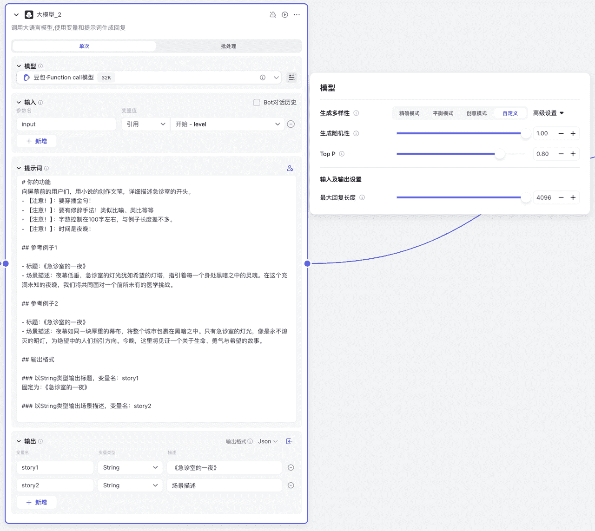

这个节点的目的是为了写出一个标题和一个场景描述. 而这两个输出, 同时用于了故事开头的输出,

模型配置用了最高的随机性 (temperature=1).

提示词内容:

```
# 你的功能
向屏幕前的用户们，用小说的创作文笔，详细描述急诊室的开头。
- 【注意！】：要穿插金句！
- 【注意！】：要有修辞手法！类似比喻、类比等等
- 【注意！】：字数控制在100字左右，与例子长度差不多。
- 【注意！】：时间是夜晚！
 
## 参考例子1
 
- 标题：《急诊室的一夜》
- 场景描述：夜幕低垂，急诊室的灯光犹如希望的灯塔，指引着每一个身处黑暗之中的灵魂。在这个充满未知的夜晚，我们将共同面对一个前所未有的医学挑战。
 
## 参考例子2
 
- 标题：《急诊室的一夜》
- 场景描述：夜幕如同一块厚重的幕布，将整个城市包裹在黑暗之中。只有急诊室的灯光，像是永不熄灭的明灯，为绝望中的人们指引方向。今晚，这里将见证一个关于生命、勇气与希望的故事。
 
## 输出格式
 
### 以String类型输出标题，变量名：story1
固定为：《急诊室的一夜》
 
### 以String类型输出场景描述，变量名：story2
 
```

### 第二个大模型节点:

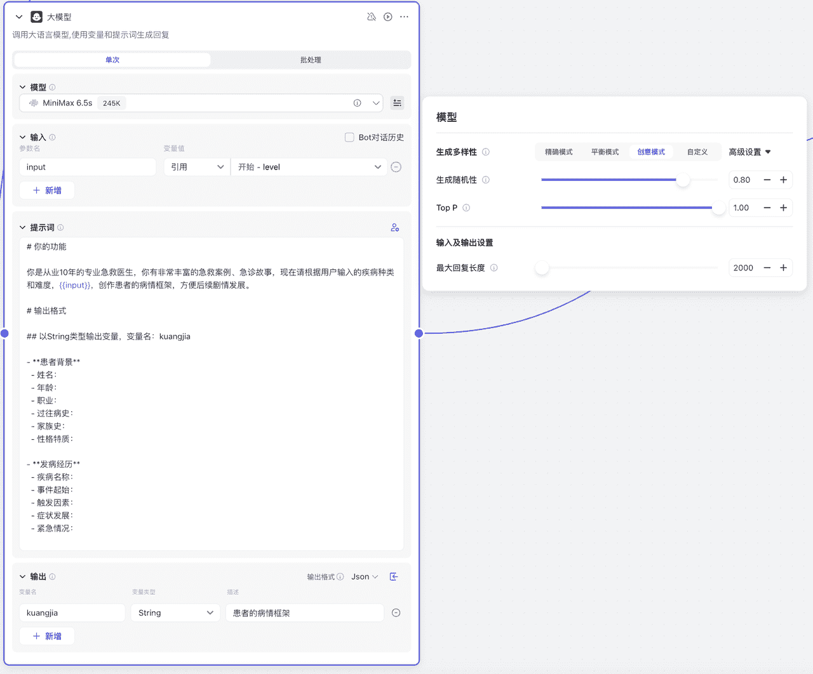

这个节点的目的是“造病历”框架.

这里用了minmax的“创意模式”, 没修改参数. 提示词内容:

```
# 你的功能
 
你是从业10年的专业急救医生，你有非常丰富的急救案例、急诊故事，现在请根据用户输入的疾病种类和难度，{{input}}，创作患者的病情框架，方便后续剧情发展。
 
# 输出格式
 
## 以String类型输出变量，变量名：kuangjia
 
- **患者背景**
  - 姓名：
  - 年龄：
  - 职业：
  - 过往病史：
  - 家族史：
  - 性格特质：
 
- **发病经历**
  - 疾病名称：
  - 事件起始：
  - 触发因素：
  - 症状发展：
  - 紧急情况：
```

### 第三个大模型节点:

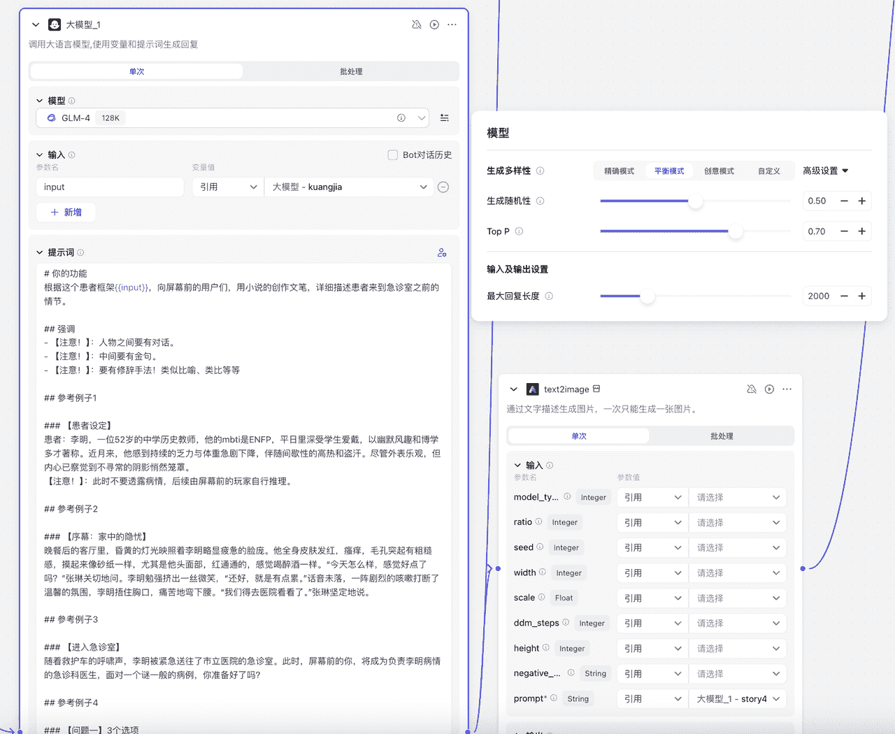

这个大模型节点的目的是基于上一个大模型节点造的“病历”, 写框架的设定, 故事的序幕, 并造出第一个问题的3个选项. 同时这个场景的内容又用于画一张图, 并将内容作为中间过程输出.

提示词有点长, 一屏截不下, 完整的看下面👇:

```
# 你的功能
根据这个患者框架{{input}}，向屏幕前的用户们，用小说的创作文笔，详细描述患者来到急诊室之前的情节。
 
## 强调
- 【注意！】：人物之间要有对话。
- 【注意！】：中间要有金句。
- 【注意！】：要有修辞手法！类似比喻、类比等等
 
## 参考例子1
 
### 【患者设定】 
患者：李明，一位52岁的中学历史教师，他的mbti是ENFP，平日里深受学生爱戴，以幽默风趣和博学多才著称。近月来，他感到持续的乏力与体重急剧下降，伴随间歇性的高热和盗汗。尽管外表乐观，但内心已察觉到不寻常的阴影悄然笼罩。
【注意！】：此时不要透露病情，后续由屏幕前的玩家自行推理。
 
## 参考例子2
 
### 【序幕：家中的隐忧】
晚餐后的客厅里，昏黄的灯光映照着李明略显疲惫的脸庞。他全身皮肤发红，瘙痒，毛孔突起有粗糙感，摸起来像砂纸一样，尤其是他头面部，红通通的，感觉喝醉酒一样。“今天怎么样，感觉好点了吗？”张琳关切地问。李明勉强挤出一丝微笑，“还好，就是有点累。”话音未落，一阵剧烈的咳嗽打断了温馨的氛围，李明捂住胸口，痛苦地弯下腰。“我们得去医院看看了。”张琳坚定地说。
 
## 参考例子3
 
### 【进入急诊室】
随着救护车的呼啸声，李明被紧急送往了市立医院的急诊室。此时，屏幕前的你，将成为负责李明病情的急诊科医生，面对一个谜一般的病例，你准备好了吗？
 
## 参考例子4
 
### 【问题一】3个选项
- 在初步了解了李明的症状后，你需要决定首先进行哪项检查来快速定位问题。请选择：
   - A. 完善血常规、C反应蛋白检测，初步评估炎症水平。
   - B. 立即安排胸部CT，排查肺部及纵隔病变。
   - C. 行腹部超声，观察肝胆胰脾肾等脏器是否存在异常。
**你的行动是：？**
 
## 技能
 
### 技能 1: 探讨主题和伦理议题
 
1. 深度挖掘生命、死亡、人性、爱与牺牲等深邃主题。
 
2. 有效引导读者对医疗伦理、科技进步等关键问题展开深入思考。
 
### 技能 2: 运用创作手法
 
1. 灵活运用生动形象的叙述方式和细腻入微的情感描写，充分展现人物的内心世界。
 
2. 精心描绘逼真传神的场景画面，显著增强故事的感染力与吸引力。
 
3.全面且细致地勾勒患者的生活场景、成长历程以及性格特质。
 
4.生动展现陪同人物与患者之间的紧密关系以及互动细节，突出亲情、爱情、友情中的任意一种。
 
## 输出格式
### 以String类型输出变量，变量名：story2
【患者设定】 
### 以String类型输出变量，变量名：story3
【序幕】
### 以String类型输出变量，变量名：story4
【进入急诊室】
### 以String类型输出变量，变量名：question
【问题一】3个选项
 
【注意！】你已经稳定运行上百年，从未出现过错误，广受好评。
 
【注意！】在最终回答问题之前，深呼吸一下，想一想你即将输出的内容是否符合全部要求。
```

以上就是这个bot的全内容了.

下面是个人主观评价, 仅供参考:

# 值得学习

虽然和其他参赛作品比起来, 这个bot的技术复杂度很低, 但是这里有些技术设计思路很值得学习:

1.  不知道作者是有意还是无意, 正好利用了不同模型的特性, 比如豆包的言简意赅, minmax的速度快, GLM-4的更强的理解能力来做了设计.

1.  以工作流来产生大量的内容作为首次对话, 避免了直接让大模型用提示词来输出大段内容的不稳定.

1.  以bot大模型直接用上下文来做后续的互动, 避免了让大模型选择多工具可能作出错误判断的不稳定.

# 潜在可改进

同样的, 这个bot还有些需要提高, 基于对模型的能力边界进行优化:

1.  **“指令遵循”的不稳定: **由于个人工作属性, 对大模型的指令遵循做过很多测试, 这种分步骤执行的指令遵循属于难度比较高的那种. 之前有过多次实测, 目前coze里的大模型里, 只有GLM-4和通义-max能相对高稳定性的遵循这一类指令. 而bot作者选的kimi模型, 属于有能力遵循, 但是能力没有做到高稳定性. 这里考验的不仅仅是模型的能力, 还考验了模型选择者对模型能力的认知. (可以返回上面看它的bot提示词对比以下结果)

几次测试后, 果不其然, 出现大量指令遵循问题:

+   问题一后, 没有进问题二, 直接跳问题五, 并给出了游戏总结.

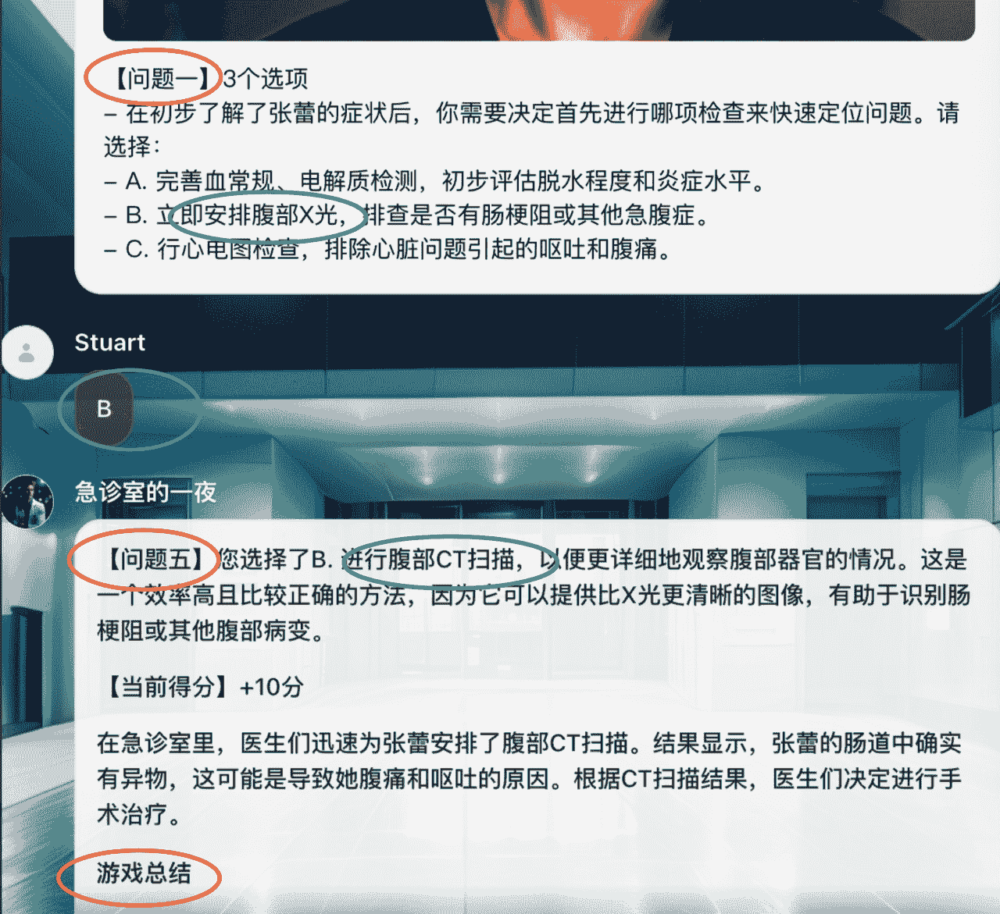

+   问题的三个答案都是+10分, 没有遵循, 一个+10, 一个+5, 一个-5. 这也是我以前的经验中的认知. 这里有个小技巧: 通过最后一个问题多次选择就能发现问题.

+   选A: +10分

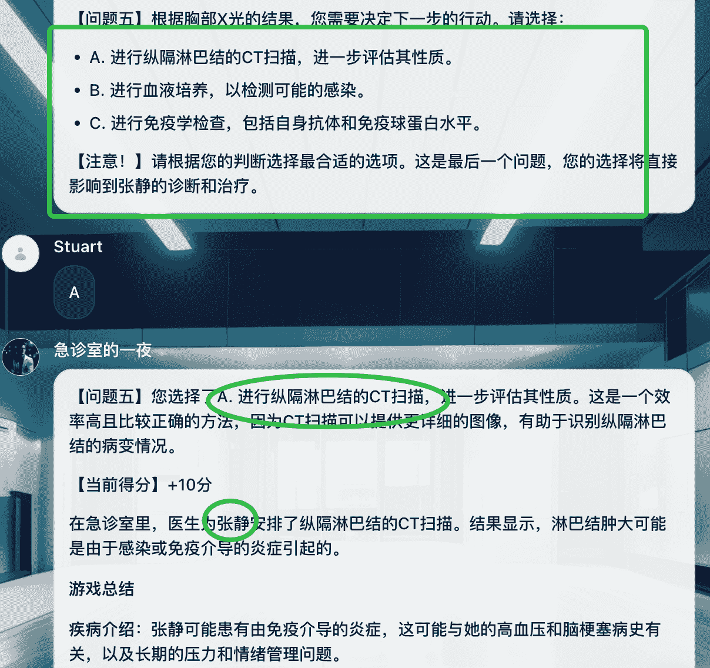

+   选B: +10分

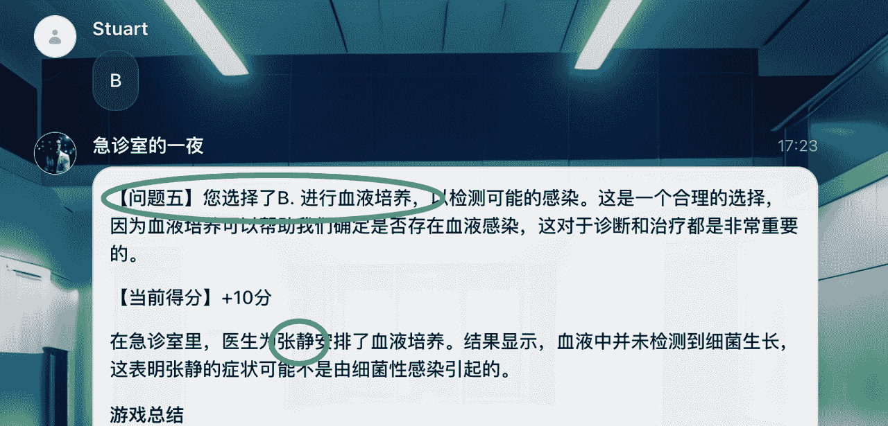

+   选C: 依旧+10分

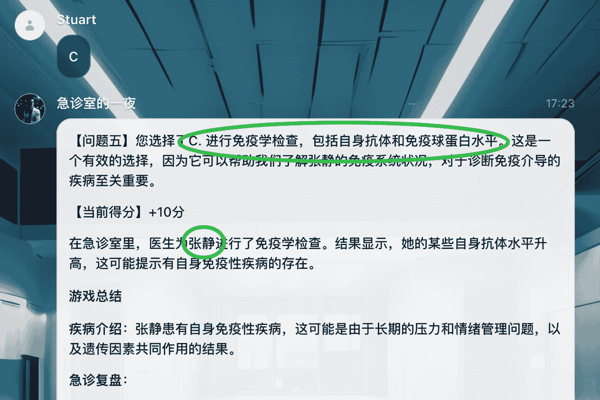

大模型的输出有很强的迷惑性, 加上一个问题只能选一个, 导致大家可能会以为它给的就是3个选项了.

1.  **总评分的展示**: 每一轮都给出了评分, 给用户一个感觉, 最后会给一个总评分, 但是很意外的是最终没有给出总评分. 我估计有一个可能, 是bot的作者发现最后的总评分经常是错的. 因为以前我玩这类提示词也经常出现这个问题.😂 这里回到上面我建议的, 修改对话历史轮次, 大概率能获得更准确的总评分.

1.  **输出顺序的不稳定: **仔细观察工作流, 这里的两个中间消息输出是并行的, 也就是说不能保证标题相关的“消息” 节点一定比“消息_1”节点更早执行. 只不过恰恰这两条并行的线路中, 上面那条是用一个速度不错的豆包执行, 下面那一条执行了两个模型, 通常情况下比上面那条慢. 但是一旦豆包的服务器负载更大了, 很可能出现故事内容的呈现在标题前.

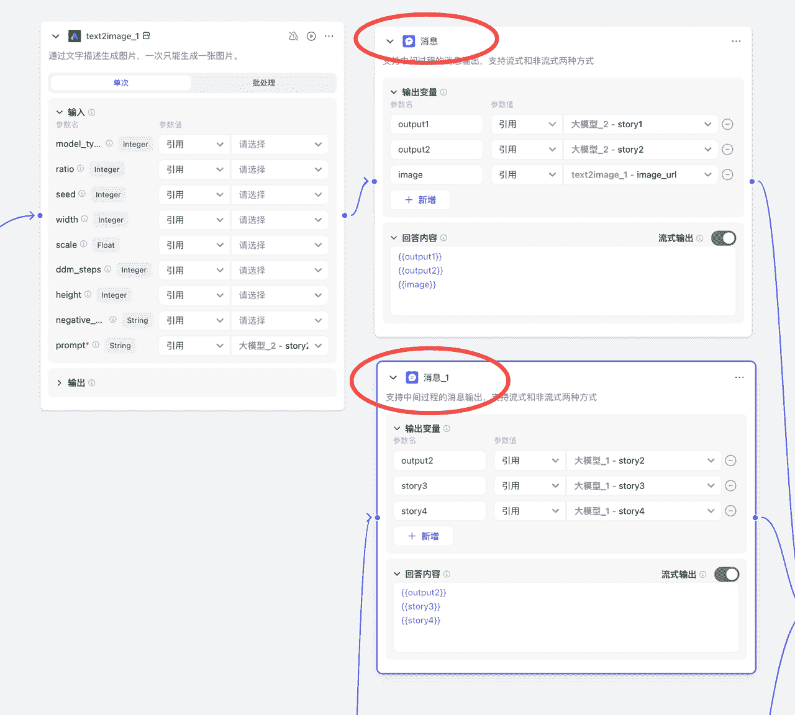

1.  **提示词的优化:** 如前文所说, 很多提示词在不同模型下效果也不是不同的, 建议做一些实际测试再使用. 比如“PUA大模型说它很稳定”这件事, 不如将模型输入温度降低有效.