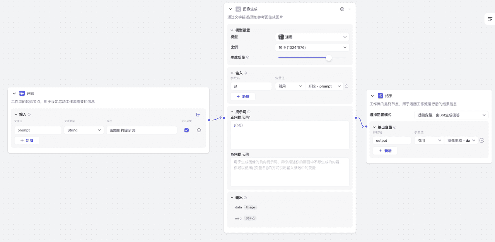
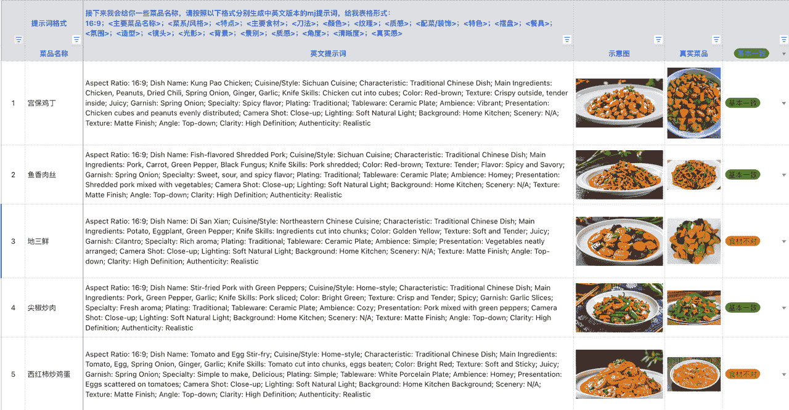
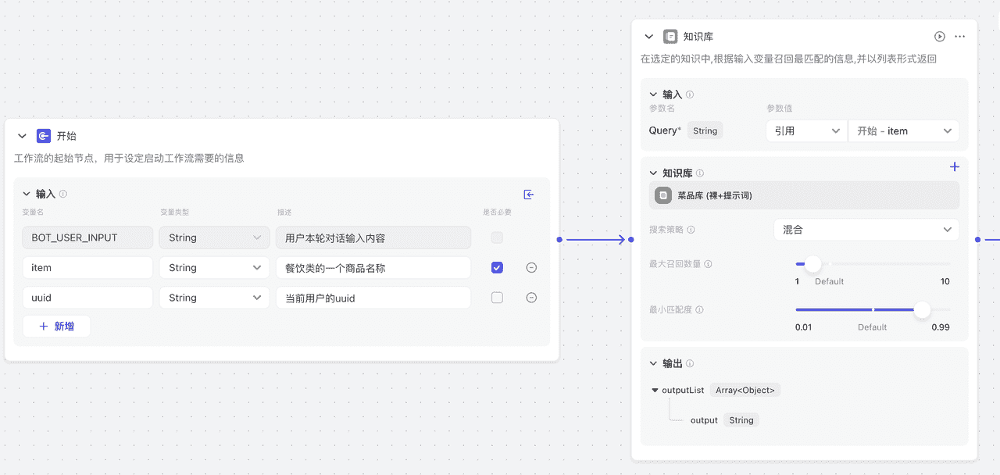
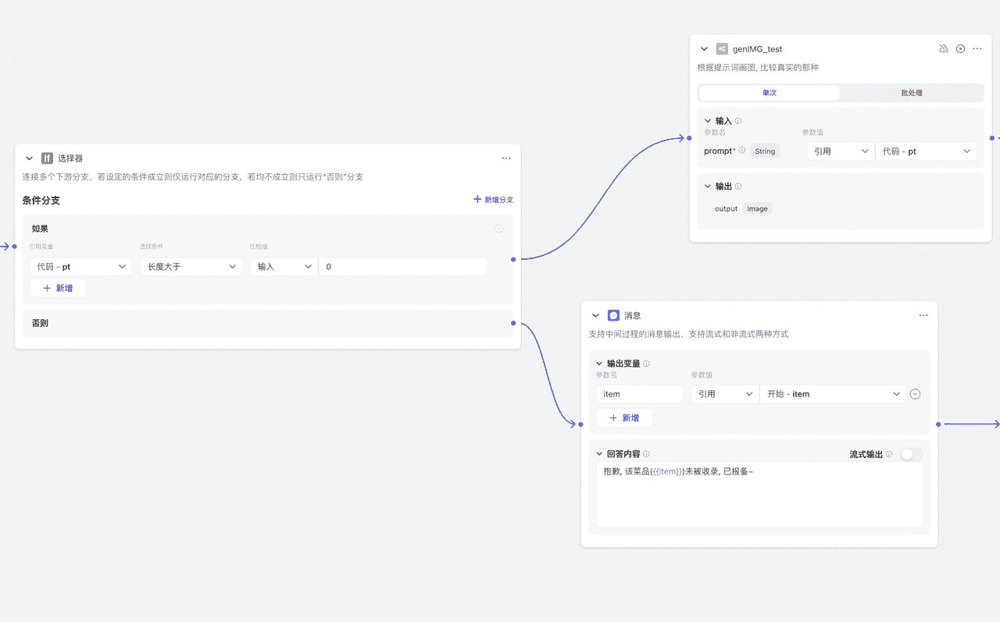
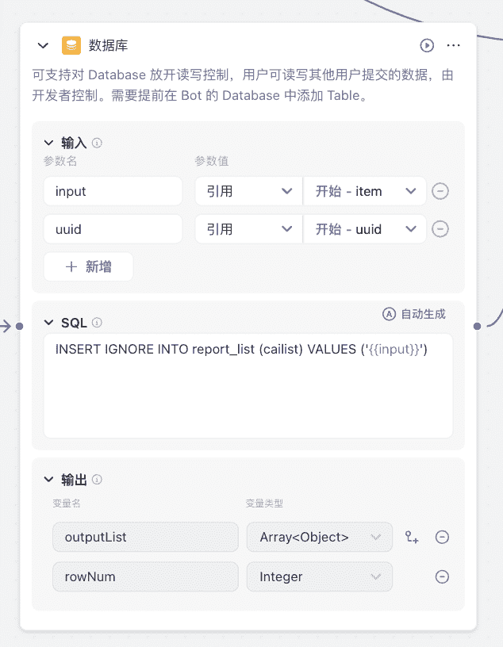
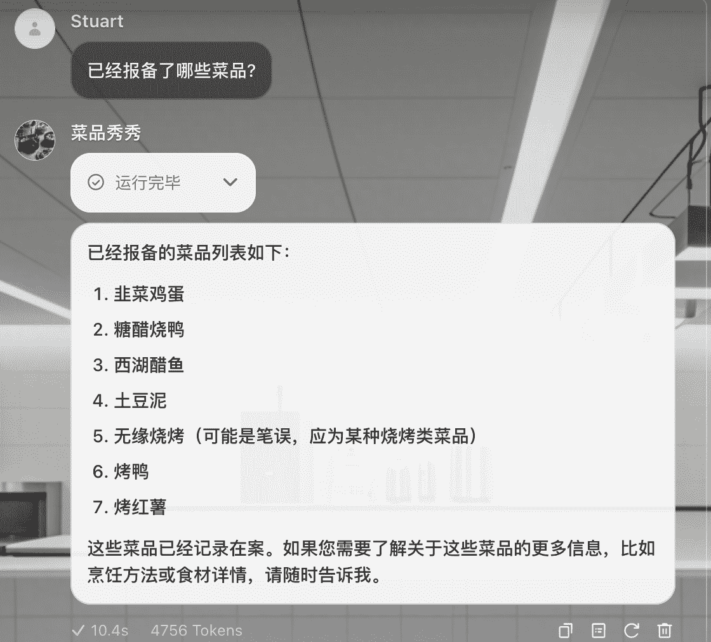

# 清: coze比赛作品[菜品秀秀]大揭密

> 来源：[https://waytoagi.feishu.cn/docx/J2srdIGmso8mhjxPiptcWX52nth](https://waytoagi.feishu.cn/docx/J2srdIGmso8mhjxPiptcWX52nth)

### 一、基础信息

| 名字 | 菜品秀秀 |
| --- | --- |
| 成员列表 | 队长: Aria清 |
| 描述 | 餐饮行业得力助手 |
| Logo |  |
| 开场白 | 我的理想是成为餐饮之王, 不管是想了解菜品的烹饪方式，还是想根据菜名画图，我都能帮你完成。 |
| 预设问题 | 来一个宫保鸡丁. |
| 背景图 |  |

+   灵感来源

团队成员 Aria 清拥有丰富的餐饮行业经验，她注意到许多小店铺的老板在低成本制作菜品图片素材方面面临着巨大挑战。自行拍摄的照片效果往往不佳，难以吸引客户，而请专业摄影师拍摄则成本高昂。因此，我们策划了一项利用 AI 技术，以低成本高效率地解决餐饮小店菜品图片素材问题的方案。

从这个初始点出发，我们进一步扩展了 Bot 的功能，使其能力更加多样化。我们希望通过持续迭代，使 Bot 能够全面解决三四线城市餐饮行业的各种需求，包括菜品名称、描述、图片甚至热量等信息，使店铺展示更加专业，吸引更多顾客。

+   **Bot 商店链接：**https://www.coze.cn/s/i67te6JW/

### 二、Bot 评测集

+   在该Bot场景内3组以上的典型session(包含可能的query和理想的回答，尽可能覆盖Bot的所有功能）

+   参考👇

### 三、**Bot 使用示例**

<https://player.bilibili.com/player.html?bvid=1oz421q7BR&spm_id_from=333.337.search-card.all.click>

### 四、Bot 实现原理（选填）

### 需求分析

+   解决什么问题：

+   餐饮行业对于菜品图片素材要求多，然而目前如果需要有好看的菜品素材，要么需要聘请摄影师拍摄，成本贵且耗费精力，要么上网买通用的素材，千篇一律。

+   当看到一道菜的时候，可以快速的获取这个菜品的配方，做法

+   具体如何使用：

+   通过聊天机器人，用户输入想要的菜品名称，就能够生成一张符合菜品的图片

+   AI 工作流需要解决的点：

+   菜品名的理解

+   菜品如何翻译成模型能理解的 Prompt

+   图片如何确保符合常规印象

+   图片上如何带上个性化店名 优先级较低

PS: 需求在实际实现阶段做了一些删减.

### 原理说明

+   这是一个最基础的图像流, 加上提示词工程工作流制作成的bot.

+   它有五要素:

+   作为核心但是不能再基础的图像流.

+   一个菜品提示词知识库 (投入了大量人力进行了周密的提示词工程)

+   一个用于串功能的主干工作流.

+   一个用于收集用户反馈的数据库

+   引导客户找到可画菜品列表的提示词

> 接下来详细介绍这五大要素:

+   一个假核心: 真的是基础的不能再基础的图像流:  😂

+   除了一个图像生成节点, 啥也没有, 连模型也是通用, 没改过半点.



+   一个真核心: 图像生成的sd提示词库, 这是Aria清, 二金, 杉杉杉木, 和渊静共同努力的结果.

+    [菜品素材库](https://jessezheng.feishu.cn/sheets/Vf30sLAzBhIJKztGmGwcYX33njd) 用于收集和整理菜品对应的 Prompt，由于生图模型不一定能够生成合适的图片，因此需要在这一步先通过 GPT 生成 Prompt，再人工验证 Prompt 在图像流中的表现，并标注是否要收录该菜品，最终维护一个可生成图片的菜品素材库



+   工作流串主流程: 菜品图生成:

+   先是调用上面那个核心的菜品提示词知识库, 只“取一瓢”即可:



+   判断菜品是否在知识库内:

+   如果在知识库内, 就开始进入图像流画图, 并最终在bot里滑出来.

+   如果不在, 就给客户致最诚挚的歉意 😭.



+   **致歉肯**定是不够的, 咱们的致歉里说了 “已报备”, 那咱怎么就得真的得记录下客户的需求, 以便未来改进. -- 这是Speed小组长“Aria清”强烈要求的,  向 “Aria清”的高层次服务意识致敬🫡! 愿全国服务业都能做成这样!

+   因此咱们用了一个数据表单来记录用户的需求.



+   这个表单是真实有效的, 在它记录下来以后, 只要bot的主人没清除数据, 任何时候都能通过问bot: “已经报备了哪些菜品? ”来查到.



+   最后, 我们发现, 由于这个bot能力依旧很有限, 有大量的的菜品不能被画出来, 而我们又不愿意让图像流随便画一个没有测试的菜品, 因此, 我们选择了告知用户, 哪些菜品已经经过测试, 并能被画出来. 我们用了提示词:

```
1. 当用户询问能画什么菜的时候, 精确从以下内容中挑出45个按类型给出:
“油条
煎饼果子
米粉
粥
包子
豆浆
豆腐脑
生煎包
热干面
葱油饼
鸡蛋饼
肠粉
豆花
茶叶蛋
馄饨
三明治
小米粥
皮蛋瘦肉粥
香菇鸡肉粥
...”
```

### 五、合规说明

| 合规项 | 具体说明 | 作者回答（请回答是/否） |
| --- | --- | --- |
| 是否会产出违法违规内容？ | 1.  色情暴力 |  |
| 存在版权争议问题 | 1.  涉及强版权资源，包括影视、音乐、游戏(游戏本身)、新闻的信息爬取、完整结果（新闻原文本、资源下载链接）返回 |  |
| 跨境数据传输：数据是否会跟海外交互 | 1.  是否使用了海外API |  |
| 安全合规声明 | 本人声明此作品没有侵权，作品安全可用且公开可接受 |  |
| 是否愿意开源 | 是否愿意公开配置（非强制，可以选择不公开～） |  |

1.  是否遵循robot.txt爬虫协议

1.  是否使用了匿名代理？