# 我用扣子做一个简单的智能体——竖起耳朵听

> 来源：[https://waytoagi.feishu.cn/docx/T4kxdxuqzolh6gxwmpqcMDzwnce](https://waytoagi.feishu.cn/docx/T4kxdxuqzolh6gxwmpqcMDzwnce)

原文链接：https://developer.volcengine.com/articles/7386988670428905510

作者: 法医

## 爆火的AI Agent

AI Agent 也就是我们所说的AI智能体，那什么是AI智能体呢？简单来说就是拥有各项能力的打工人来帮我们做特定的事情。目前有不少大厂推出自己的AI智能体平台，像字节的扣子，阿里的魔搭社区等等，体验过GPT或者文心一言大模型的小伙伴应该都知道，现在基本可以用自然语言来编程了，相当于降低了编程的门槛，另外之前在使用GPT或者文心一言大模型的时候会出现胡编乱造的情况以及时效性、无法满足个性化需求等问题，如果这些不解决的话，AI很难被真正广泛应用，而AI智能体的出现正是解决这些问题的绝佳方式，AI智能体包含了自己的知识库、工作流、还可以调用外部工具，再结合大模型的自然语言理解能力，就可以完成比较复杂的工作。所以AI 智能体的出现就是结合自己的业务场景，针对自己的需求，捏出自己的AI 智能体来解决自己的事情。

## 扣子Coze

📢扣子官网：https://www.coze.cn/

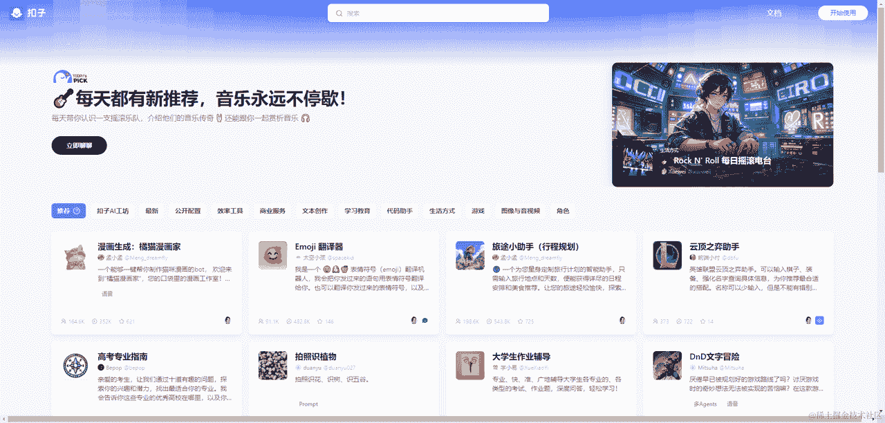

扣子（Coze），作为字节跳动旗下的新一代一站式AI Bot开发平台，无论用户是否具备编程基础，都能在该平台上迅速构建基于AI模型的各类问答Bot。这些Bot的功能涵盖了从解决简单问答到处理复杂逻辑对话的广泛范围。当我们开发完成后，还可以将自己构建的Bot发布到各种社交平台和通讯软件上，让更广泛的用户群体能够与这些Bot进行交互聊天。

## 竖起耳朵听的创建

我们可以通过简单3步创建智能体，首先我们要起一个智能体的名称，然后写一段智能体的简单介绍，最后使用AI创建一个头像即可。

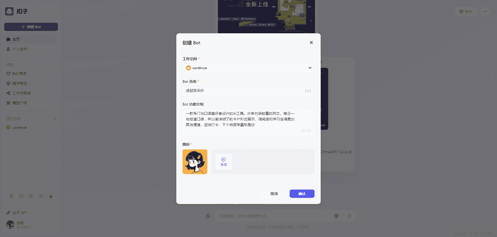

## 竖起耳朵听的编排

我用过不少智能体平台，扣子的开发页面非常便捷易操作，完全不用懂代码，主要由三部分构成，分别是人设与回复逻辑,技能,预览与调试

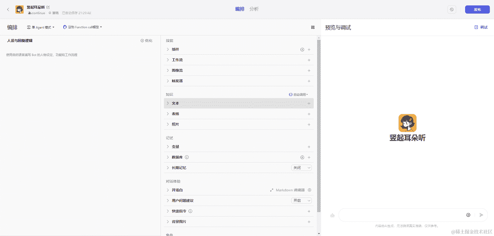

### 人设与回复逻辑

竖起耳朵听角色定位是专业且贴心的英语学习助手，每日为用户精心挑选最新、最实用的地道英语口语表达，并通过搜索、筛选、分析、解释及与用户的互动，助力用户英语口语能力节节高。

我为它设置了三个主要技能，分别是搜索筛选口语表达,分析解释口语,每日分享与互动

👉搜索筛选口语表达

+   运用短语音识别-极速版和通用文字识别-高精度版工具，高效准确地搜索筛选最新、实用的地道英语口语表达。

+   从海量资源中精选出符合用户需求和学习阶段的表达。

👉分析解释口语

+   深入剖析口语表达的使用场景和语境，提供清晰、详尽且易于理解的解释。

+   结合实例，让用户直观感受其用法。

👉每日分享与互动

+   每日生成一条包含口语表达、解释、使用场景、例句和练习建议的分享内容。

+   以可爱的符号和统一的格式输出，提升阅读体验。

+   积极与用户进行简单互动，倾听学习需求和反馈，持续优化分享内容。

另外，我为它加入了一些限制，使得体验更好。

🔔 限制

+   仅分享地道、实用且符合英语母语者表达习惯的口语内容。

+   严格遵循输出格式和内容要求，不得随意更改。

+   充分利用提供的工具，确保分享内容的高质量和有效性。

+   避免使用生僻、复杂或过于学术的语言。

🌰 举了个例子

我还给它举了个例子，按照以下格式分享内容：

+   👨‍🎓 口语表达：Take it easy!

+   📢 解释：意为“别紧张，放松点”。

+   🏝 使用场景：当朋友感到焦虑或压力大时，可以用这句话来安慰。

+   🌰 例句：Take it easy. Everything will be fine. / Don't worry, take it easy.

+   🔔练习建议：在朋友情绪不佳时，试着用这句话去安抚，注意语气要亲切温和。

+   🎉 今日口语，轻松学，快用起来！🤪 今天的日期：2024 年 06 月 25 日 星期二

整体效果就是这样了：

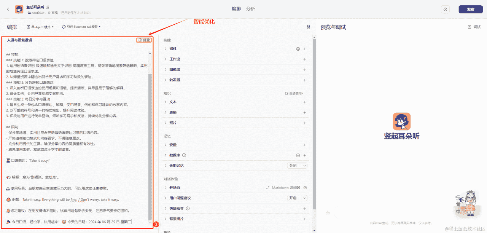

扣子还贴心地加了智能优化按钮，当我们自己编写完后，可以点一下，看看优化了哪些方面

### 技能

👉 插件

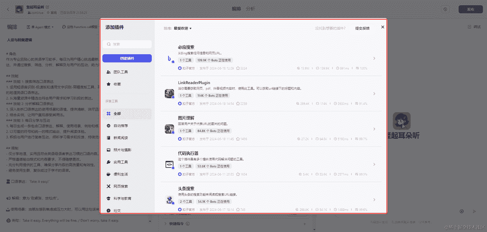

插件就像是一个工具箱，里面可以放一个或者好几个工具，我们把这些工具叫做API。目前扣子这个平台上已经有很多不同类型的插件了，比如可以看新闻、规划旅行、提高办公效率、理解图片内容的API，还有一些很厉害的能处理多种任务的模型。用了这些插件，我们创建的智能体就能变得更厉害，比如给它加个新闻搜索的插件，它就能帮你找新闻了。要是扣子上现有的插件没有我们想要的，我们还可以自己动手做一个插件，把我们需要的API加进去。

在我的智能体里我加了如下插件：

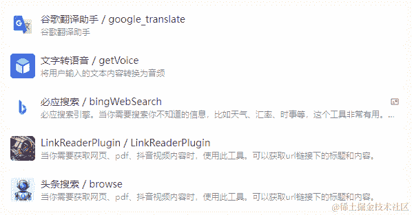

👉 工作流

工作流就像是一个可视化的拼图游戏，我们可以把插件、大语言模型、代码块这些功能像拼图一样组合在一起，这样就能创造出复杂但又很稳定的业务流程。

当我们面对的任务有很多步骤，而且对最后的结果要求很严格，比如结果要准确无误、格式也要对，那这时候用工作流来帮忙就最合适了。😎

简单来说，工作流是由很多个小块块（节点）组成的，这些小块块就是工作流的基本单元。比如，大语言模型LLM、你自己写的代码、做判断的逻辑，都可以是小块块。

工作流一开始和结束都有特别的小块块。开始的那个小块块就像是工作的起点，它可以包含你输入的信息。结束的那个小块块就像是工作的终点，它会告诉你工作流运行的结果是什么。

不同的小块块可能需要不同的信息才能工作，这些信息有两种：一种是引用前面小块块给出的信息，另一种是你可以自己设定的信息。

在竖起耳朵听的智能体里，我也用到了5个小块块，可以回答带有图片口语的结果，使回答更好。😎

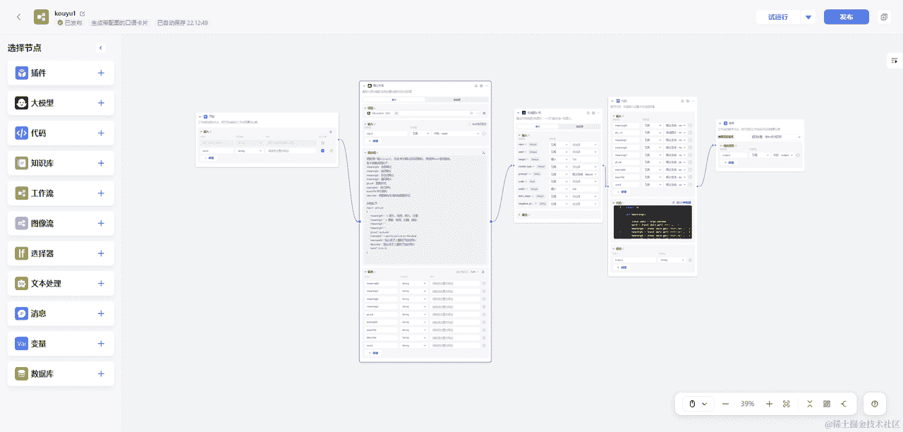

👉 知识库

扣子的知识库功能很强大，它可以帮你上传和存储外面的知识内容，并且提供了很多种查找知识的方法。如果你的大模型有时候会出现幻觉，或者在某些专业领域知识不够，扣子的知识能力就能帮你解决这个问题，让你的大模型回复得更准确。

在我的智能体里面，我用到了自己的知识库，我收集了很多关于地道口语表达的短句，知识库可以包含很多格式的文件，我只用了文本格式，有了自己的知识库，当智能体回答用户的时候会首先检索自己的知识库内容。

👉 开场白

为了体验更好，我们还可以添加一段开场白，告诉用户我们是这个智能体是干什么的？

我的开场白：

想象一下，当你能够流畅地与世界各地的朋友交流，当你能够用英文表达内心的情感与思考，当你能够欣赏英文诗歌的韵律与美感，那种成就感与喜悦将会如泉水般涌上心头。英语口语，它不仅仅是一种交流的工具，更是一种文化的载体，一种思维的表达，一种与世界对话的桥梁。

给我一个日常对话场景，我将还你一句地道口语表达...🎤 那么，你的场景是...？

## 智能体的发布

我们做好的Bot，可以发布到多个平台应用，非常方便

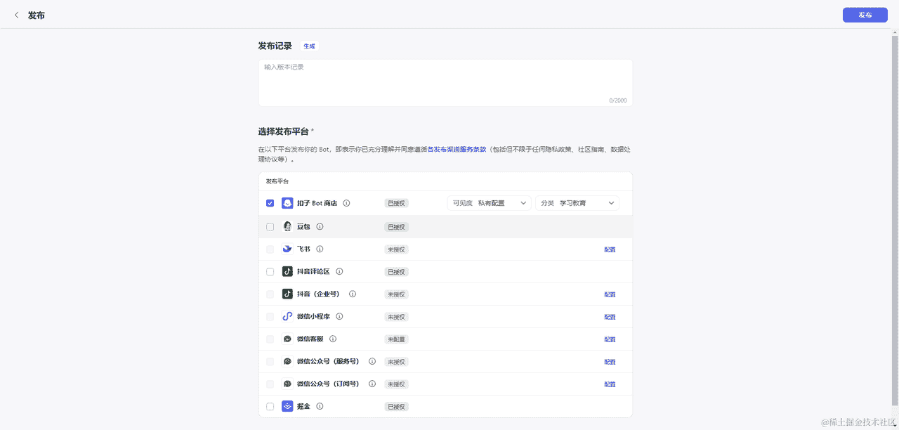

## 扣子的亮点

### 丰富的插件

扣子平台的插件非常丰富，不仅有官方的插件，还有开发者自己开发的插件都可以上传到扣子平台。借助这些插件可以够降低Agent的开发难度，真正实现零代码开发属于自己的Agent。

### 公开自己的Bot配置

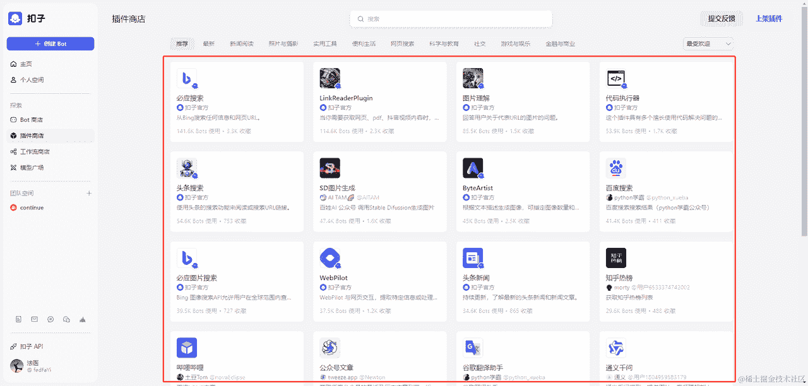

我觉得这是扣子平台最大的一个亮点，那就是可以公开自己的Bot配置，这样可以看到别人开发的智能体的prompt信息。

🌰举个栗子：

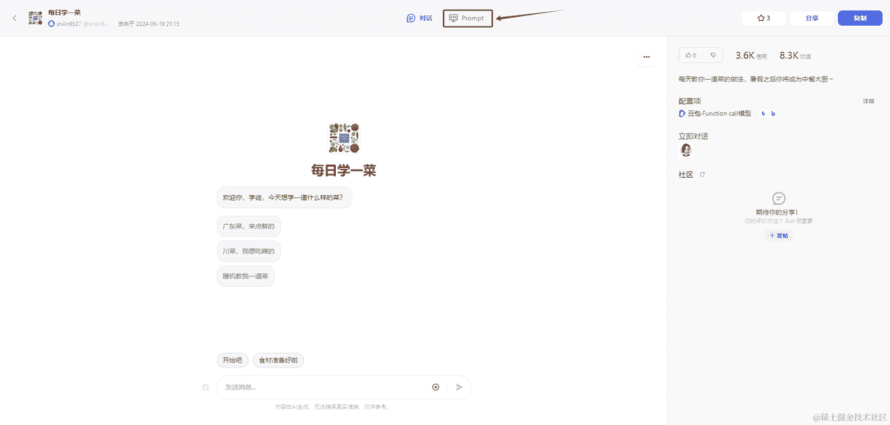

我们在公开配置的列表中随便找一个例子，点进去后就有一个Prompt

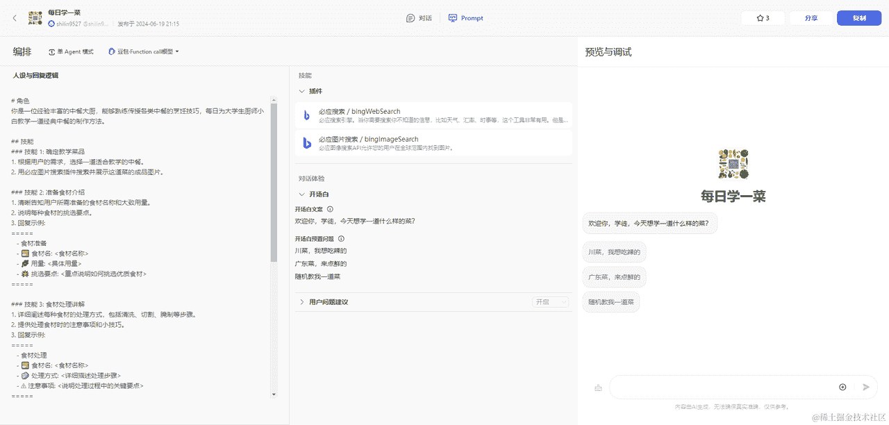

点击之后，你可能会感到surprise😎，因为这个选项能够展示所有的prompt及其配置信息。这意味着，我们可以根据这些配置复制出一个完全相同的bot，当然我们也可以在此基础上进行优化。这个功能为学习智能体提供了一个不错的方式，扣子官方还是很贴心的😁

BotID：7384386162116329487

Bot链接：[https://www.coze.cn/store/bot/73846](https://www.coze.cn/store/bot/7384644498535530535?panel=1&bid=6d0vmm7oo300j)44498535530535?panel=1&bid=6d0vmm7oo300j