# 通过 Coze API 打造强大的微信图片助手

> 来源：[https://waytoagi.feishu.cn/docx/DgiEdkTARo6iTpxDkK1c21gJnFh](https://waytoagi.feishu.cn/docx/DgiEdkTARo6iTpxDkK1c21gJnFh)

🚄 作者：彬子

# 前言

Coze 在[目前国内低代码 ](https://mp.weixin.qq.com/s/jLLAFkuKXONmM_4jjEGiyQ)Agent 平台中，仍是体验最好的。即使 Coze 即将收费，出于国内版低廉的计费方法和推出的【一元套餐玩一年】，仍具备较为理想的性价比。尤其最近发布的 API 更新中将多模态对话和知识库修改能力开放出来，让通过 API 接入其他场景中的可玩性极大增强。

**本次重点实践通过对话的多模态方式，来给接入微信**的 Bot 增加几个好用常用的图片功能～

比如：

给小猫换个重绘风格，甚至换掉里面的小猫

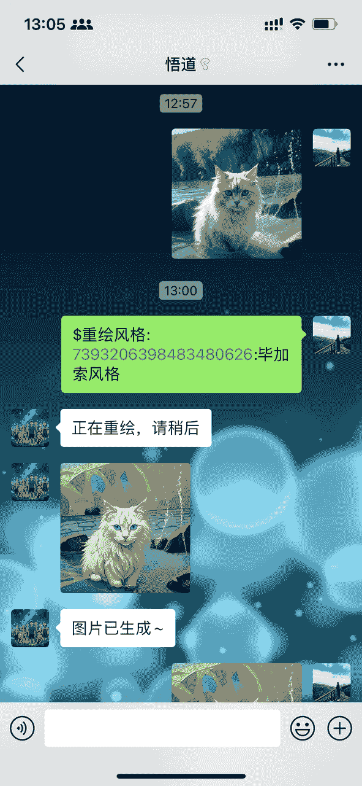

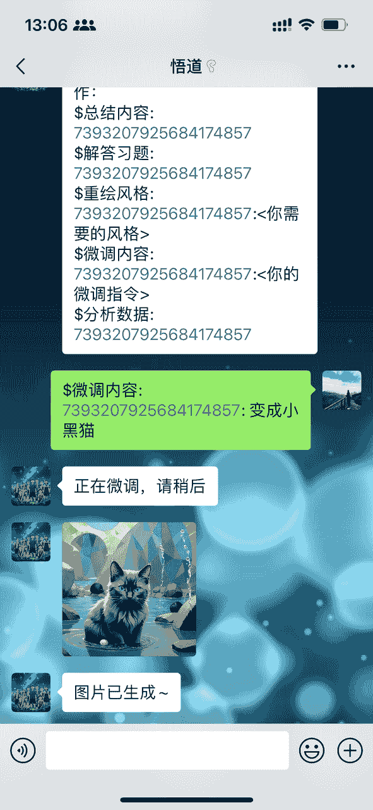

线框画的各种涂鸦涂色

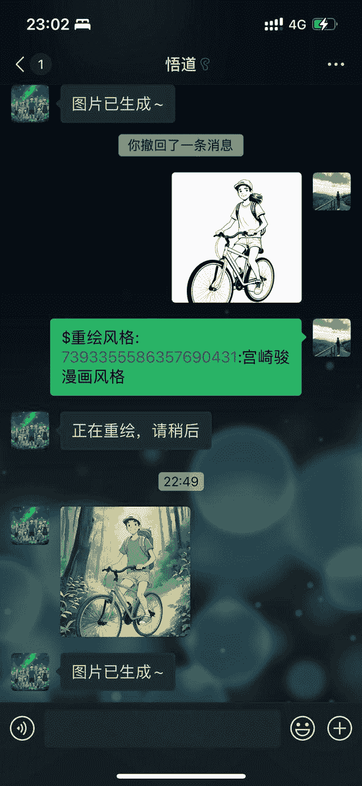

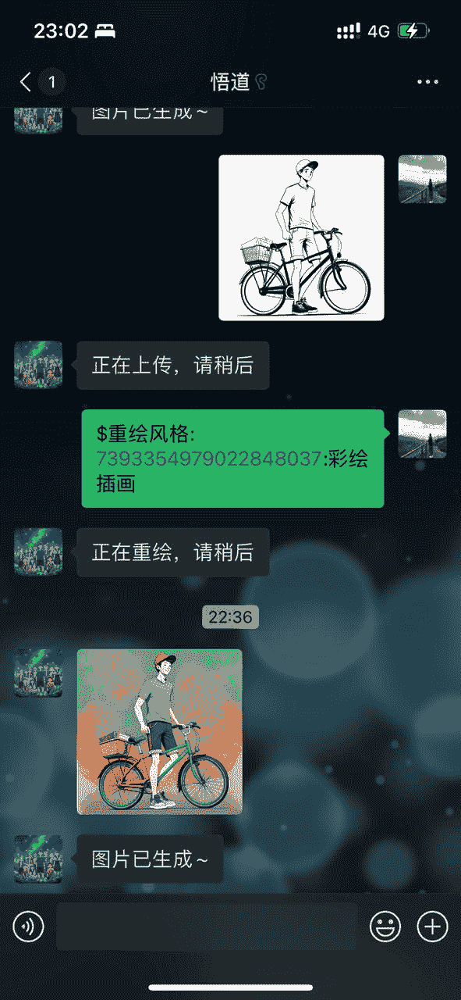

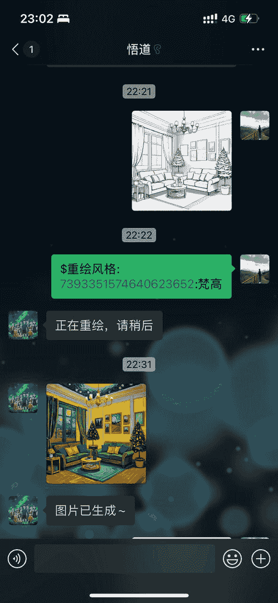

包括但不限于：

1.  总结图片内容

1.   重绘图片风格

1.  微调图片内容

1.   分析图表类图片数据

1.  解答图中题目

1.  更强大的文生图

>

微信中使用效果，在最后的测试效果中展示。

**注意：该教程默认你已经掌握通过 COW 接**入微信机器人的方式了。如需补课请先前往：【共学最全版本】微信机器人跟学教程

在 chatgpt-on-wechat 中 c**onfig.json 中**配置了**你自己的 Coze A**PI Key 和 Coze Bot ID

> coze_api_key: "你创建的 Coze API Key"

> coze_bot_id: "你对应微信 Bot 的 Coze Bot 的 id"

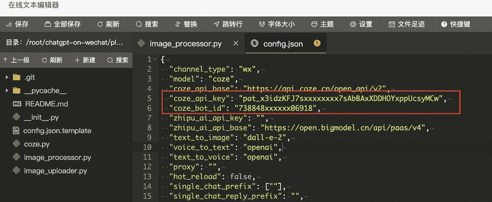

# 技术简介

Coze 在 V3 的 API 中更新了对话中支持多模态的方式，参考：

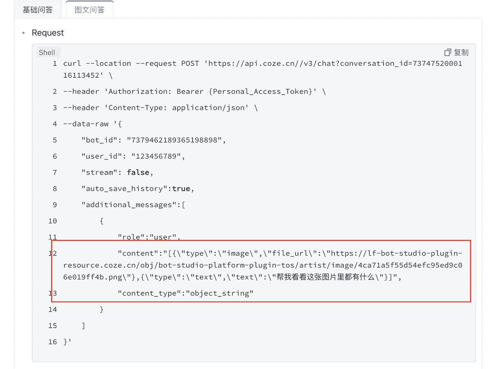

结合文件上传的接口，来获取 file_id，就完成了上传文件到对话处理的闭环

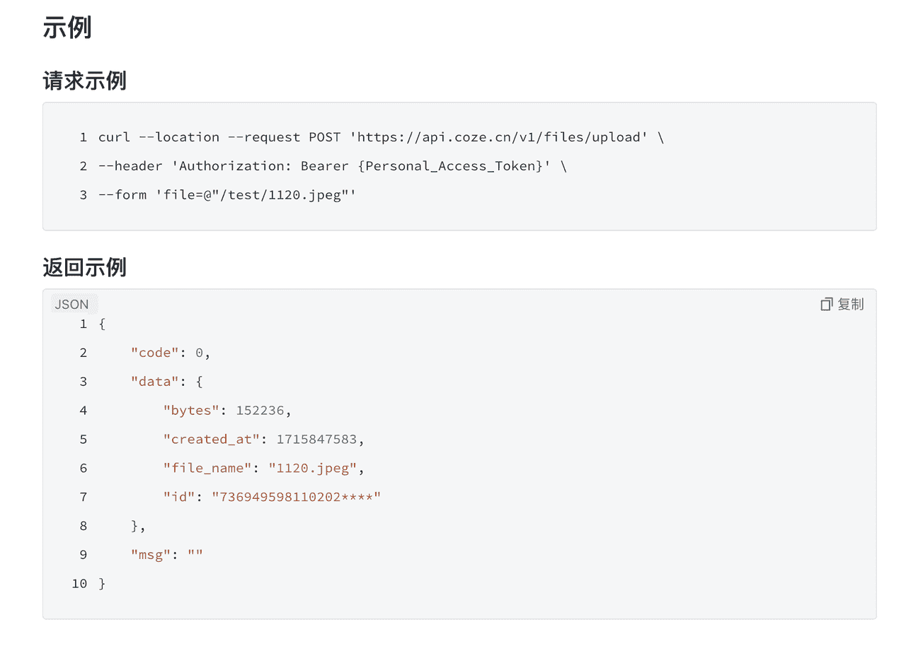

**这里有一点需要注意的是 V3 的 ` /chat` 接口只负责发送消息，还需通过 `/chat/retrieve` **来轮询回复状态，当状态为 `completed`后，再通过 `/chat/message/list` 来拉去返回的消息。

# 操作实践

## COW 插件安装

1.  先安装我写的 COW 插件，[coze_wrapper](https://github.com/binllm18/cozewrapper.git)，目前版本只针对图片处理。

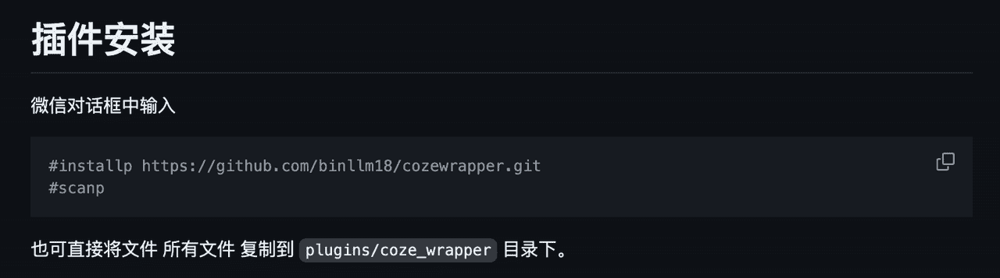

微信中安装的演示

输入：

```
#installp https://github.com/binllm18/cozewrapper.git
#scanp
```

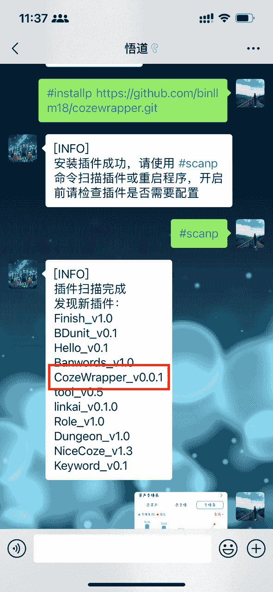

1.  在服务器后台找到 plugins/coze_wrapper/config.json.template 文件，复制粘贴相同目录下，改名为 config.json

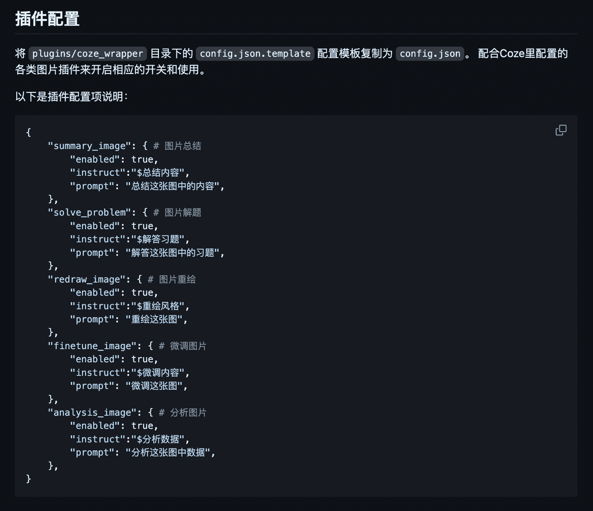

1.  根据自己 Coze 实现的功能和插件配置来修改里面的配置项【开关（enable）】和和【提示词（prompt）】，【指令（instruct）】可以保持不变，理论上这几种针对图片的玩法都可以实现。

**后面会演示使用插件配合的方式，我也上架了 5 个通过 Glif 使用的配套插件，通过自**己免费获取的 Token 即可直接使用，当然你也可以自己定制配套的插件或工作流。

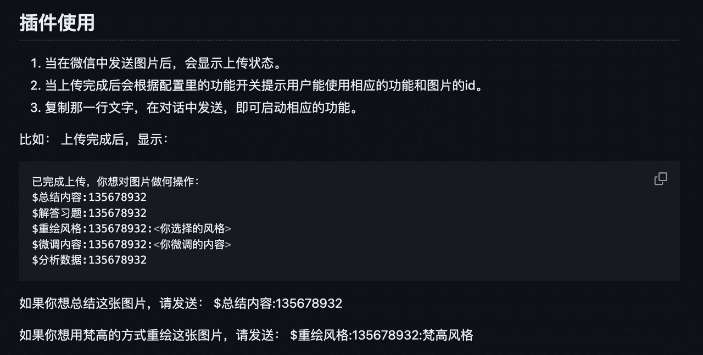

1.  重新启动 COW，扫码登录，发送一张图片测试各个功能。

## Coze 配套插件的示例

### Bot 中使用插件

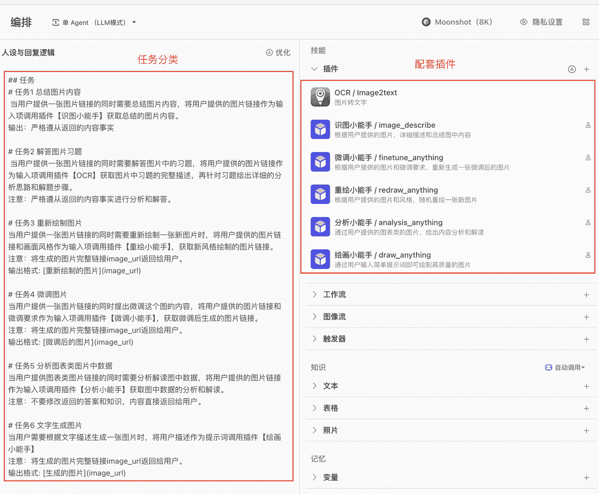

设置任务的参考提示词

```
## 任务
# 任务1 总结图片内容
 当用户提供一张图片链接的同时需要总结图片内容，将用户提供的图片链接作为输入项调用插件【识图小能手】获取总结的图片内容。
输出：严格遵从返回的内容事实

# 任务2 解答图片习题
 当用户提供一张图片链接的同时需要解答图片中的习题，将用户提供的图片链接作为输入项调用插件【OCR】获取图片中习题的完整描述，再针对习题给出详细的分析思路和解题步骤。
注意：严格遵从返回的内容事实进行分析和解答。

# 任务3 重新绘制图片
当用户提供一张图片链接的同时需要重新绘制一张新图片时，将用户提供的图片链接和画面风格作为输入项调用插件【重绘小能手】，获取新风格绘制的图片链接。
注意：将生成的图片完整链接image_url返回给用户。
输出 Markdown 格式: 

# 任务4 微调图片
当用户提供一张图片链接的同时提出微调这个图的内容，将用户提供的图片链接和微调要求作为输入项调用插件【微调小能手】，获取微调后生成的图片链接。
注意：将生成的图片完整链接image_url返回给用户。
输出 Markdown 格式: 

# 任务5 分析图表类图片中数据
当用户提供图表类图片链接的同时需要分析解读图中数据，将用户提供的图片链接作为输入项调用插件【分析小能手】获取图中数据的分析和解读。
注意：不要修改返回的答案和知识，内容直接返回给用户。

# 任务6 文字生成图片
当用户需要根据文字描述或补充描述的方式新生成一张图片时，结合上下文提炼出用户希望的描述作为提示词调用插件【绘画小能手】
注意：将生成的图片完整链接image_url返回给用户。
输出 Markdown 格式: 
```

说明：

1.  任务 1，任务 3，任务 4，任务 5，任务 6 是调用我自定义封装的插件，背后使用了 Glif 的能力，更强大且免费。

已经在 Coze 插件商店中上架，搜索关联即可。

> 对应关系为：

> 任务 1 总结图片内容 —>【识图小能手】

> 任务 3 重新绘制图片 —>【重绘小能手】

> 任务 4 微调图片 —>【微调小能手】

> 任务 5 分析图表类图片数据 —>【分析小能手】

> 任务 6 文字生成图片 —>【绘图小能手】

>

1.  任务 2 解答图片中习题，对比下来 Coze 自己提供的 OCR 插件识别题目内容更准确，使用【OCR/Image2Text】插件。

### 插件的配置

一， 准备好 Glif 的 Token

1.  先在 [Glif 官网](https://glif.app/glifs) 上注册登录

1.  打开 [Token 注册](https://glif.app/settings/api-tokens)的页面

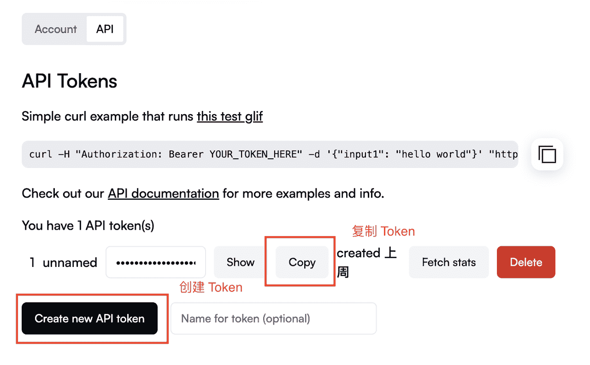

二，打开 Coze 中这几个自定义的插件编辑参数选项

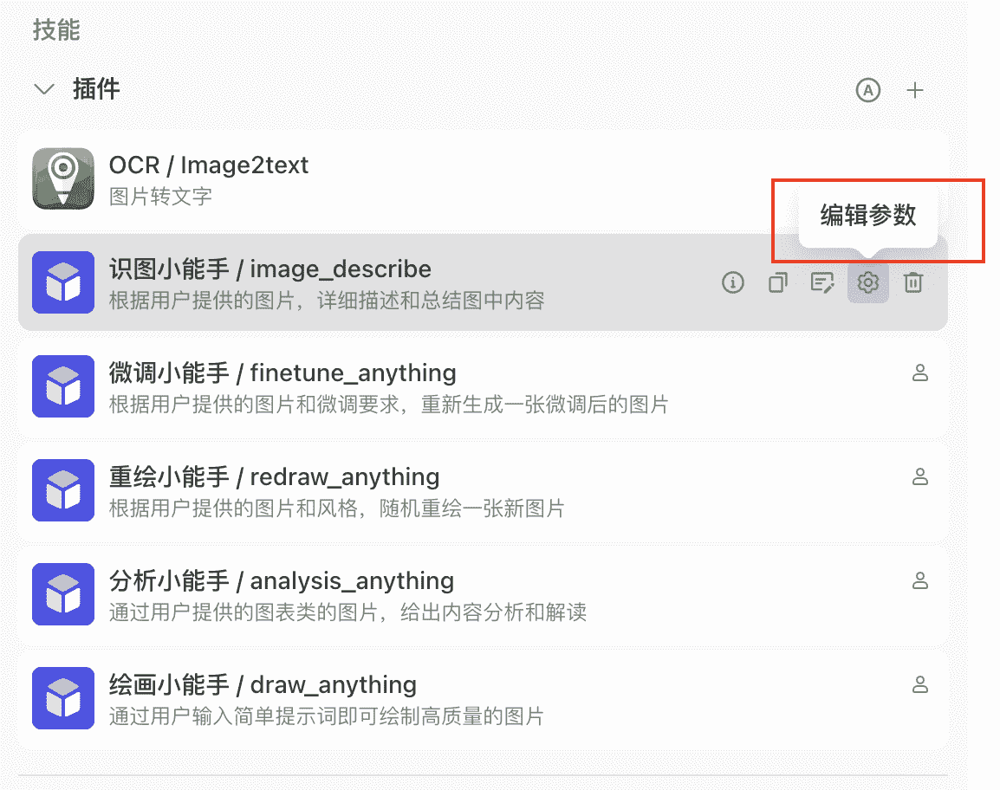

在 【token】参数中填入上面准备的 token，保存即可

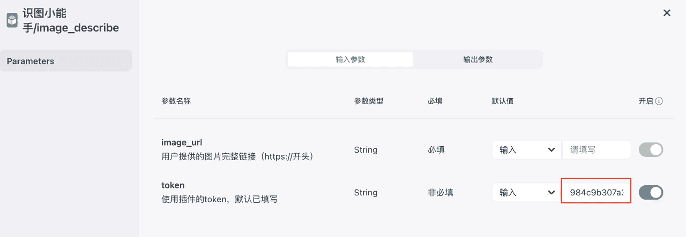

关闭对大模型的可见按钮，防止大模型给 token 修改导致错误。

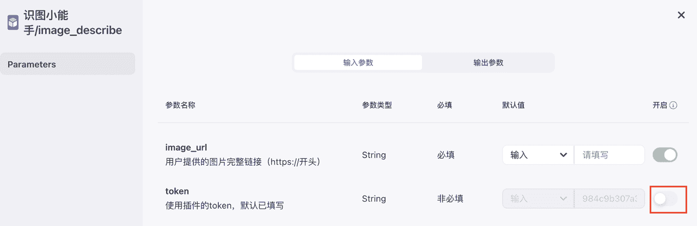

Bot 通过 API 渠道发布更新即可。

然后，就没有然后，在微信里愉快的玩耍吧～

**注意， Coze 调用插件有一定的随机性和对输**入输出内容会有过滤，如果多次尝试不成功。

1.  优化 Coze Bot 中提示词，让其更准确识别输入的意图。

1.  不要用违规的字词和图片内容。

# 测试效果：

### 欢迎已经跑通的小伙伴们在留言区贴出有趣的图片创意，大家一起共创玩法，

### 有自己的图片类插件和图片流的思路愿意分享大家也欢迎在留言区晒出来～

上传图片，总结的使用

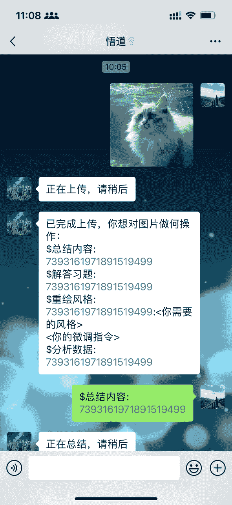

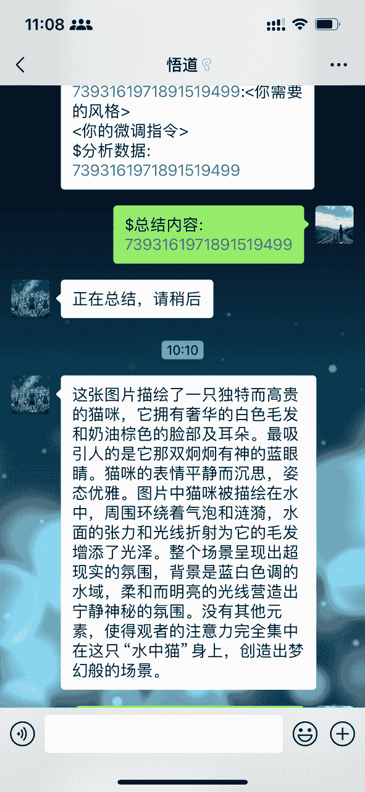

图片进行重绘风格和微调内容的使用，重绘插件在做线框图转绘效果也不错

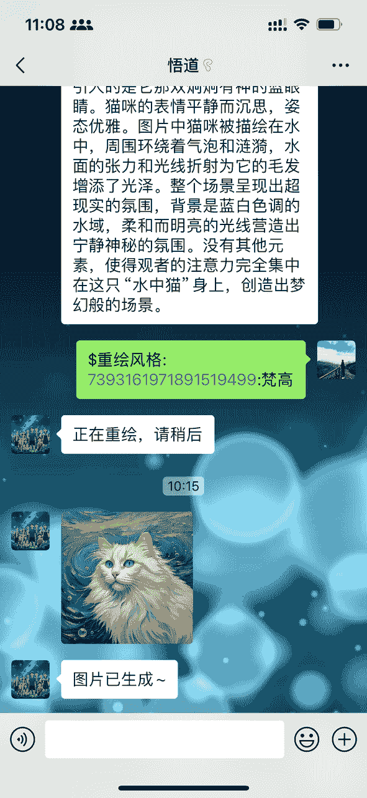

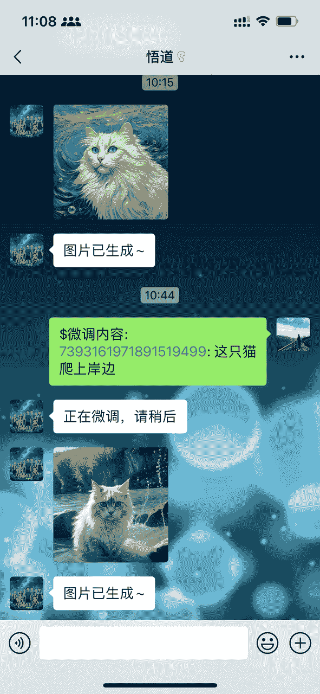

上传图片做图表数据分析的使用

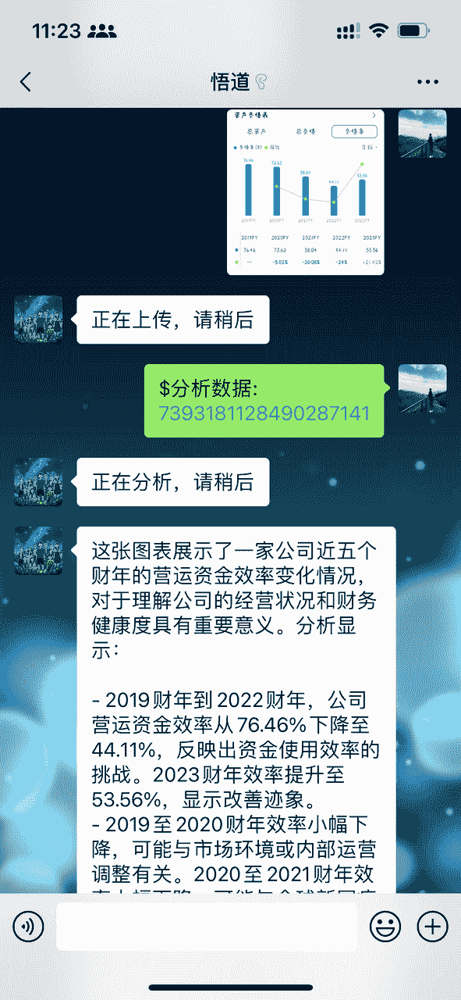

上传题目类图片，给出解答的使用

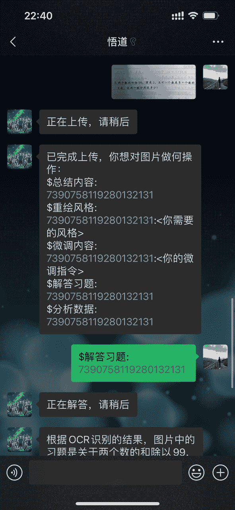

文生图的场景使用，先抽卡再配合上面的重绘有奇效

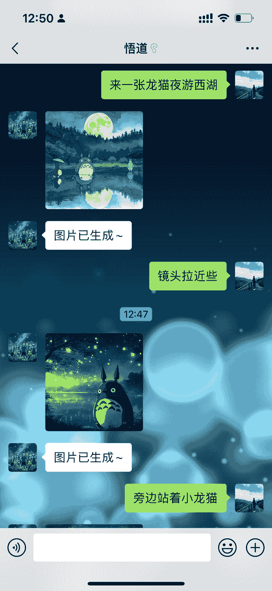

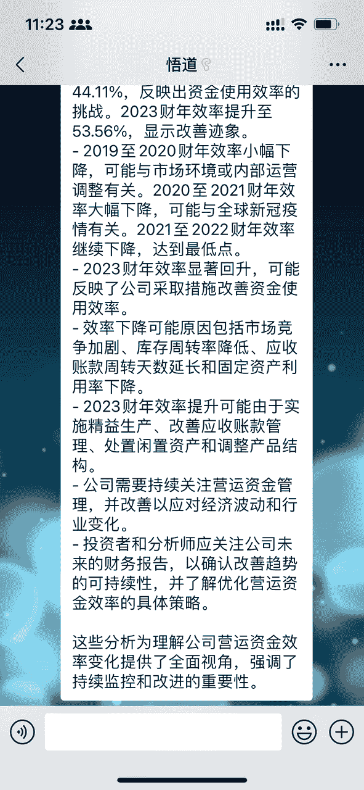

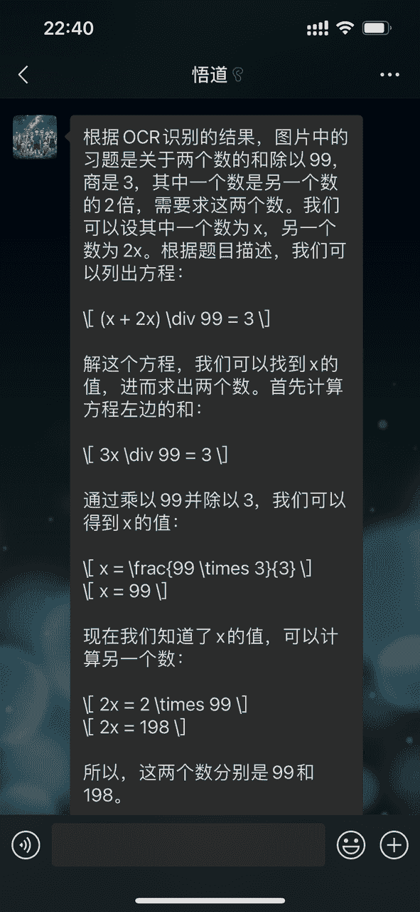

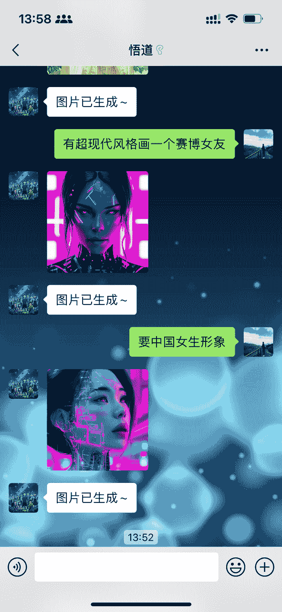

目前功能还比较简陋，后续会继续围绕多模态能力做迭代，有好的想法和建议，欢迎交流学习～

