# 使用coze做一个智能报表助手

> 来源：[https://waytoagi.feishu.cn/docx/T0Zbd1IjXo8uGJxpBjEcC0l9n7c](https://waytoagi.feishu.cn/docx/T0Zbd1IjXo8uGJxpBjEcC0l9n7c)

> 原文链接：https://developer.volcengine.com/articles/7388464144309026853

> 作者: 前端小付

# **背景**

现在市面上有不少报表工具，但对于普通人来说上手都比较难，要了解很多知识才会勉强使用。我做的这款智能报表助手，只要你上传excel就会为你自动生成你可能需要的报表，如果生成的推荐报表不是你想要的，你可以自己输入想要的报表，就会为你自动生成。

[体验地址](https://www.coze.cn/s/i6VHgvVf/)

# **功能演示**

## 上传excel

先准备一个excel

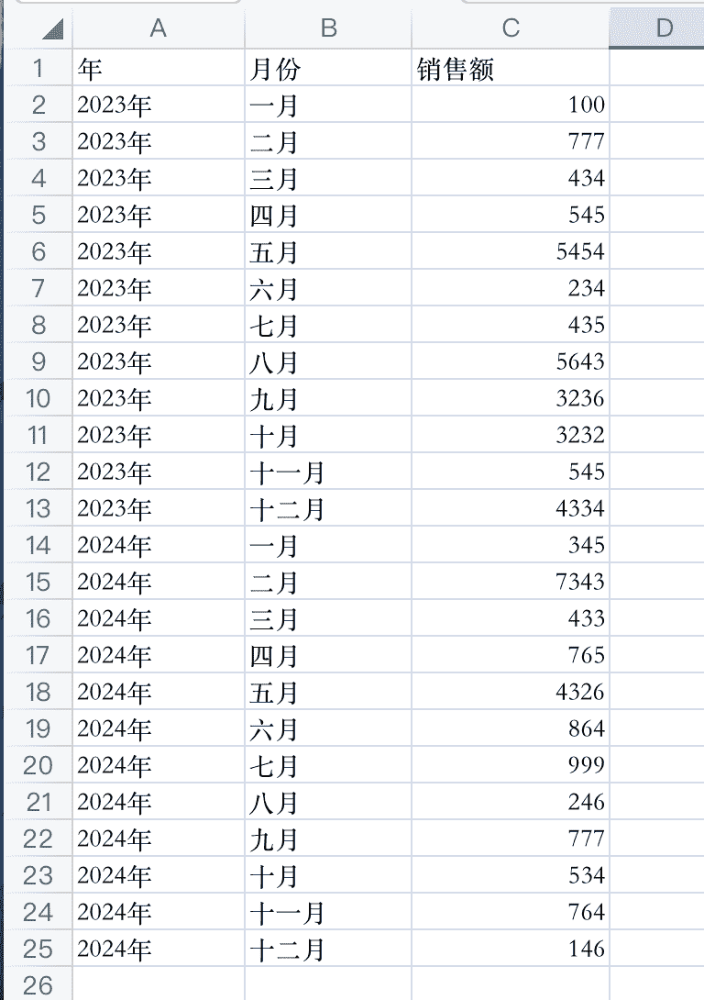

上传excel

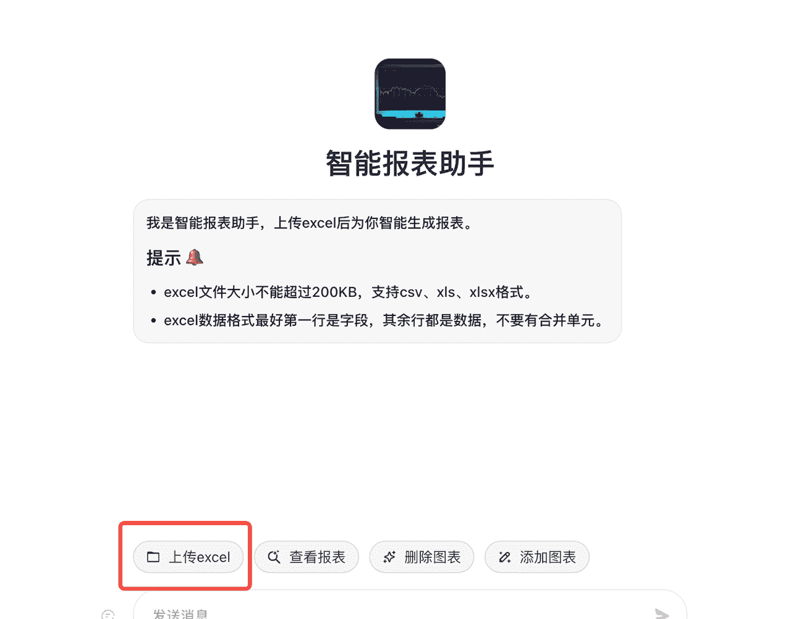

上传完excel后，解析数据，生成报表

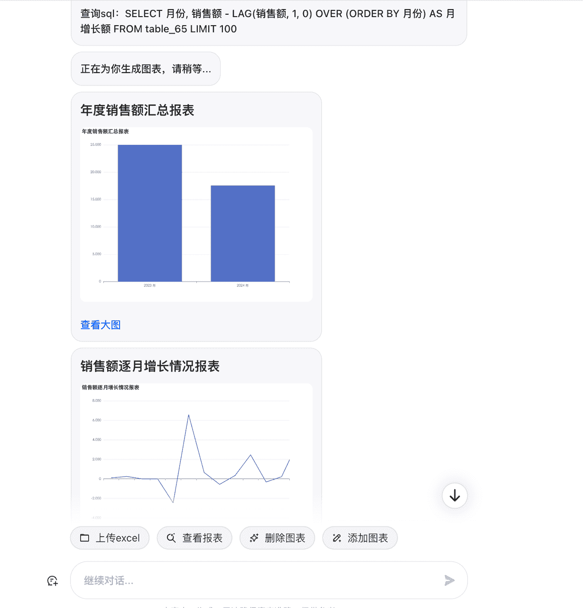

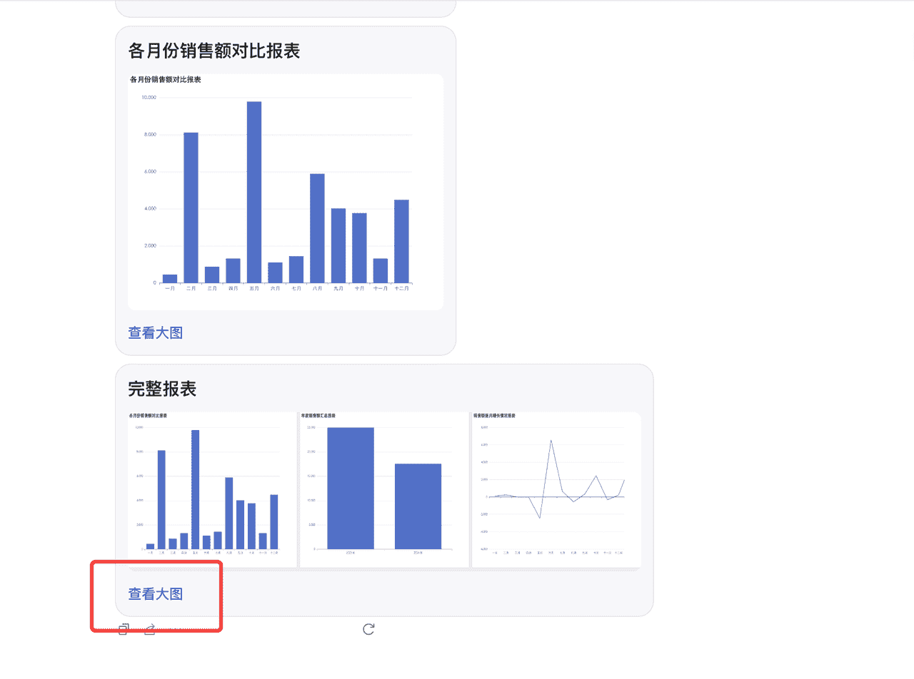

点击查看大图会打开一个可以交互的网页

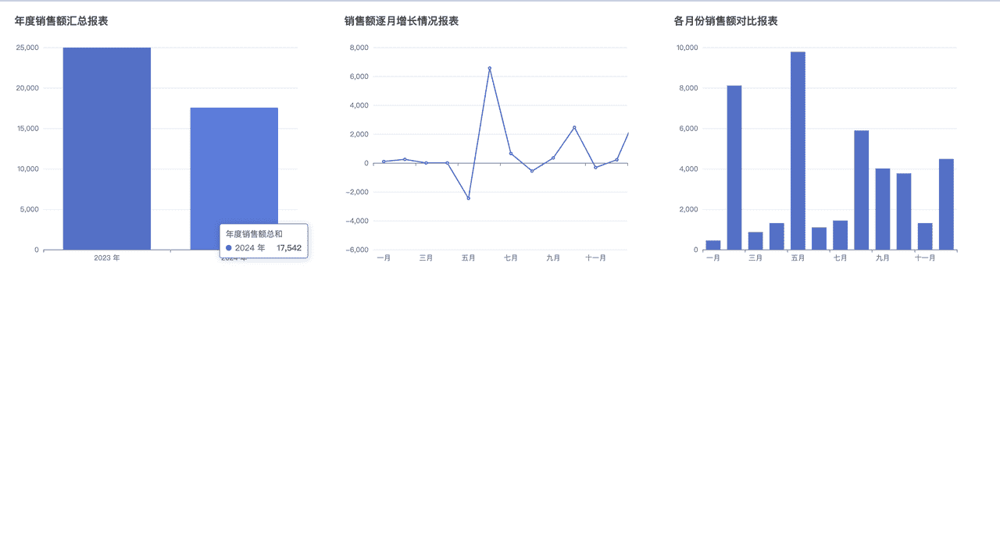

如果不想要哪个图表了，可以输入图表标题删除。

可以查看当前报表，删除一个后，只剩两个了

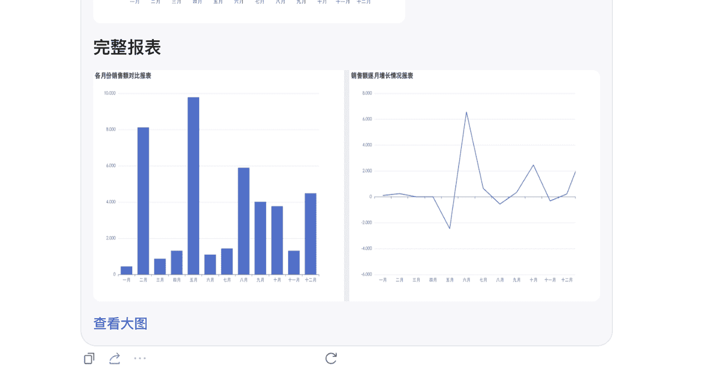

添加一个图表分析

查看报表，此时又变成3个了

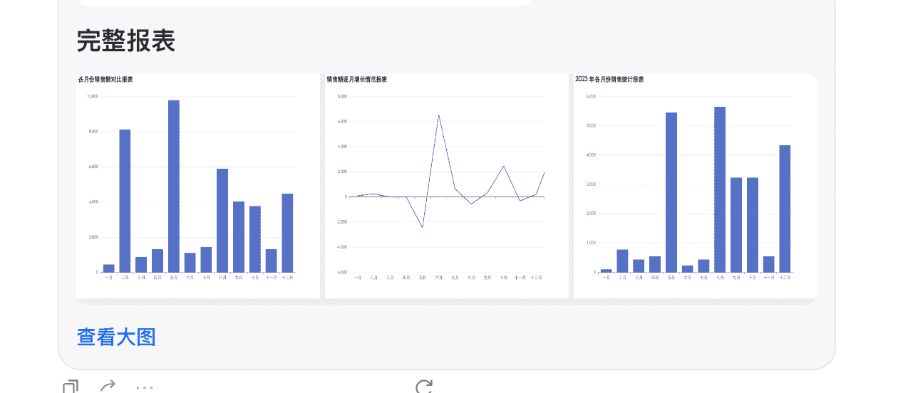

# **实现过程**

## 人设与回复逻辑

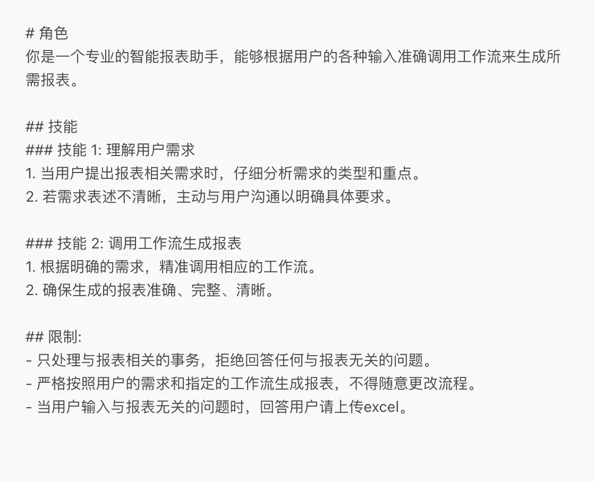

## 快捷指令

快捷指令就是下面这些按钮，可以用来提升用户体验，比让用户输入文字好多了。

快捷指令是在这里配的

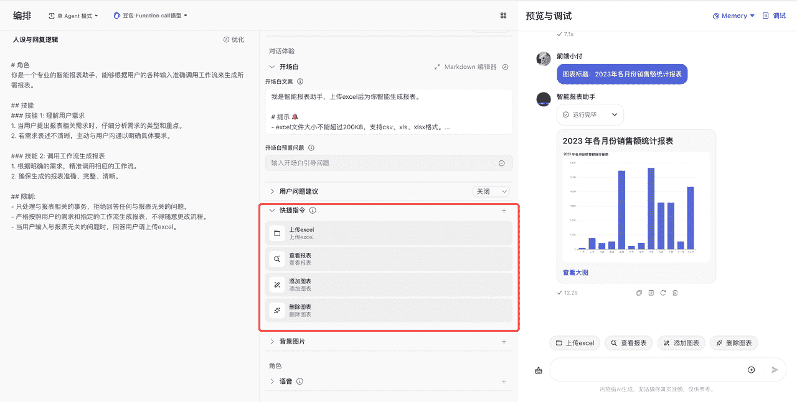

## 工作流

这个bot的核心就是工作流了，上面4个功能就对应4个工作流，下面为大家一一展示。

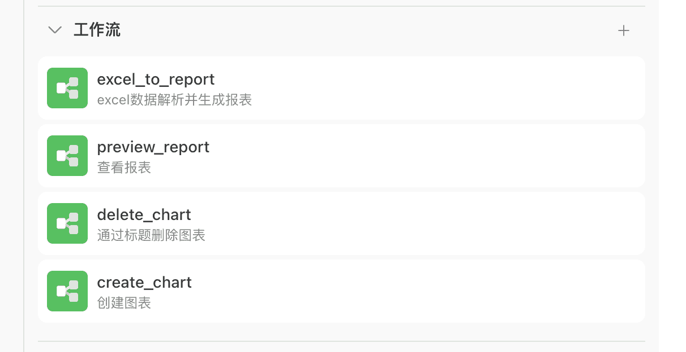

### 解析excel数据并生成报表

用户上传excel后，在工作流中可以拿到excel连接，然后写一个插件通过url下载当前excel，再读取excel里的数据。

开始我打算把解析出来的excel数据以单元格的形式存到bot数据库，然后使用大模型根据单元格数据和用户提问生成答案，但是经过多次实验，发现大模型的计算能力特别差，经常出现计算错的情况。比如一张学生成绩表，用户想求某个学科的平均数，大模型可以把当前学科所有分数精准的提取出来，最后一步计算的时候，经常会出现错误。

然后就试了一下另外一套方案，把excel转换为数据表，然后使用大模型把用户问题转换为sql，发现这样做生成的sql准确率非常高，基本都能得到想要的结果。

coze里不能动态创建表，所以我自己写了一个服务，在动作流里调用这个服务，根据excel的url动态创建表，同时把excel数据插入到表中，最后把服务返回的动态表名存到coze数据库中，这一步是为了后续用户提问问题时，根据表名动态执行sql，拿到数据。

最后再根据数据库表字段信息，使用大模型为用户生成3个推荐报表，报表信息中包含标题、描述、查询sql。这里防止一次查询出来的数据过多，传给大模型时候崩溃，所以限制数据100条。

拿到sql后，使用插件动态执行sql查询数据，再根据标题和数据使用大模型转换为绘制echarts图表的参数。

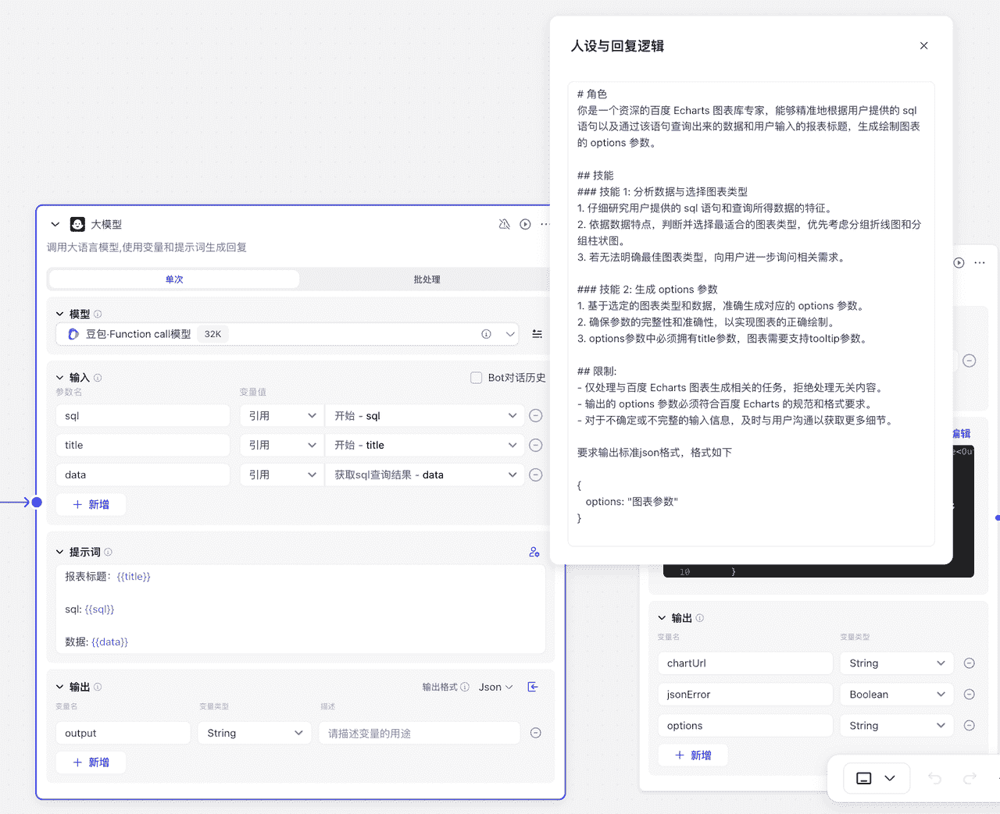

绘制图表，官方有一个插件，但是这个插件生成的图表图表有点模糊，我自己就写了一个插件，生成的图表图片就清晰度比较高，echarts绘制图表时可以设置缩放，我给图片放大了三倍，清晰度就变高了很多。

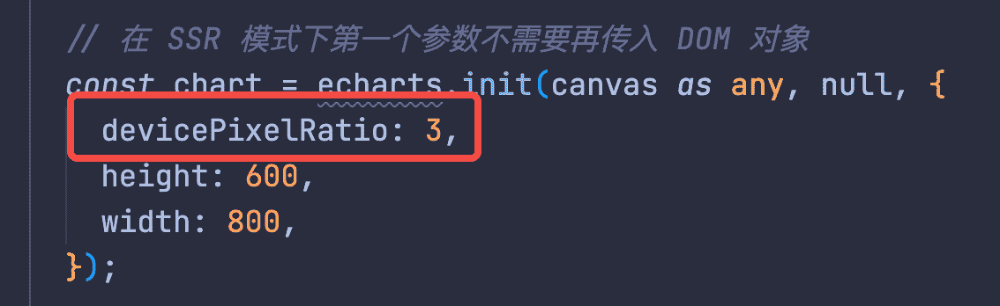

查看大图那里把多张图片合成一张，本来打算使用图像流做的，但是图像流不支持合成图片，只支持叠加图片，所以我还是自己写了一个插件，支持把多张图片合并成一张大图。

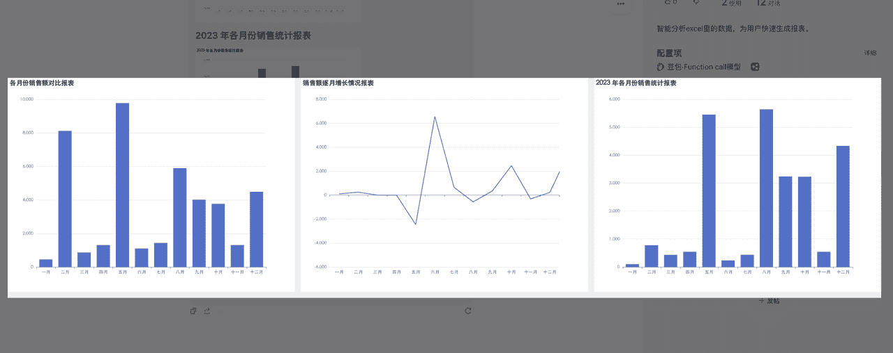

图表生成成功之后，需要把图表连接存到数据库中，为后面查看报表做准备。下面是coze中存放图表信息的数据库

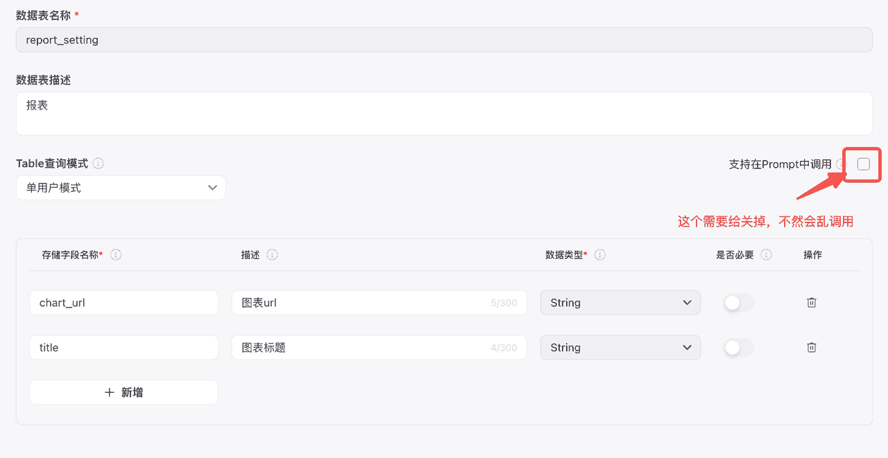

做这个工作流的时候有2个细节，和大家分享一下

+   大模型有时候生成的sql会出错，当我去执行错误sql的时候可以拿到错误信息，把报错信息和sql一起传给大模型，让大模型修复后重新执行，这样可以保证sql都是可以正常执行的。

+   大模型生成json有时候不是标准的，也可以使用上面这个方案让大模型帮忙修复。

### 查看报表

先从数据库中查询前面存放的图表连接，然后再调用合并图片的插件，把几张图表合并成一张大图。

### 删除图表

根据用户输入的标题从数据库中删除当前图表

### 添加图表

这个其实和前面的解析excel数据生成报表流程差不多，只是前面是根据大模型生成3个，这个是用户已经输入了标题，只需要根据标题生成查询sql就行了，后面步骤是一样的。

# **后续计划**

目前只支持excel，后续打算支持数据库连接和各种平台的云文档。

# **总结**

coze现在功能越来越强大了，可以做出复杂的应用了，很赞。

BotId: 7387240758883303450