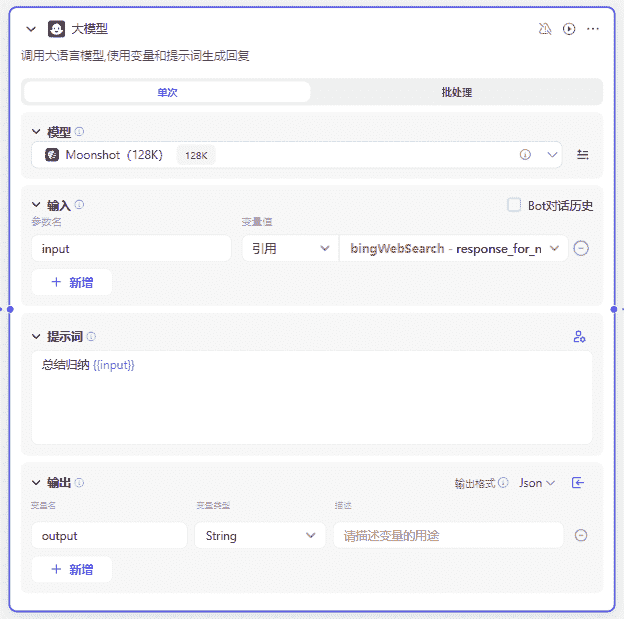

# 超级飞机百科Bot

> 来源：[https://waytoagi.feishu.cn/docx/EQiydFgxgoDRfUxyOY0ckiNHnEh](https://waytoagi.feishu.cn/docx/EQiydFgxgoDRfUxyOY0ckiNHnEh)

> 原文链接：https://developer.volcengine.com/articles/7388510784680755238

> 作者: 用户3434911720417

**Bot简介**

开发者是一个9岁小男孩，他是一个铁杆儿飞机迷，总是有各种各样关于飞机的问题，并尝试着寻找答案，但有时并不能找到合适的回答，也不是总能找到能和他畅谈飞机的好朋友。所以，他给自己创建了一个“超级飞机百科”的AI机器人，这个机器人是一位飞机专家，有着渊博的飞机知识，并且总能陪伴小男孩一起聊关于飞机的话题，是一个忠实的飞友好伙伴。

**构思**

“超级飞机百科”AI机器人是一个超级智能的飞机大百科，关于飞机的问题都可以在这里找到答案，可以通过语音、文字等形式与它对话，它便会结合话题呈现出语音、文字、图片和视频等多种形式的内容，它能通过识别对话内容、关键词等信息实现智能搜索、归纳总结，最终以简洁、清晰的文字、声音和丰富的图片、视频多维度呈现用户想要的答案，准确、精炼又生动。它是一位资深的飞机专家，有着丰富且深入的飞机知识储备，能够以专业、详尽且易懂的方式为用户阐释关于飞机的各类知识，涵盖飞机的类型、构造、原理、飞行技术等方面。

**技术实现原理**

1、通过“人设与回复逻辑”，设定飞机专家的角色、介绍讲解的技能要求、调用顺序等，同时就话题关联性和输出内容格式框架进行了限制。

2、在“技能”方面，添加了“抖音视频/get_vedio”和“必应搜索/bingWebSearch”插件，实现搜索调用功能。

3、在“知识”方面，添加了文本和表格，实现Bot关于开发者和自身的个性化问题的调用解答。

4、添加工作流，并在工作流中插入大模型，对搜索得来的信息进行归纳总结，剔除冗余、重复和无效信息，经过智能梳理概括后输出最终的解答内容给用户，确保用户看到的回答内容准确、逻辑清晰、简洁凝练。

5、Bot的图标和背景图片都是飞机，突出自身功能特点，角色语音选取类似机长的声音，沉稳又亲切。通过添加功能介绍和“开场白文案”，使用户在使用Bot的第一时间进一步明确其功能；通过“开场白预置问题”，引导客户使用、提问，特别是针对本身对飞机没有特别研究和好奇的用户；开启“用户问题建议”，激发体验互动，引导用户提问，进一步深入了解相关知识。

**后续使用场景**

1、为小朋友进行科学启蒙，小朋友通过与Bot聊天互动，充分满足其对飞机及相关知识的好奇，并带动其了解更多力学、材料、气象、航空航天等原理知识及生活常识，激发小朋友对科学的好奇心，培养其勤于观察、深入思考的习惯。

2、成为广大飞友的忠实伙伴，喜爱飞机的飞友们可以与Bot聊天，随时随地深入交流飞机的话题，Bot成为“懂他”又有着足够知识储备的伙伴，尽享志同道合、增长见闻的畅快交流。

3、服务需要查询飞机知识的所有普通人，比如查询关于购票、机型、航线、航空公司等问题。

#### BotID：7387426687753011211