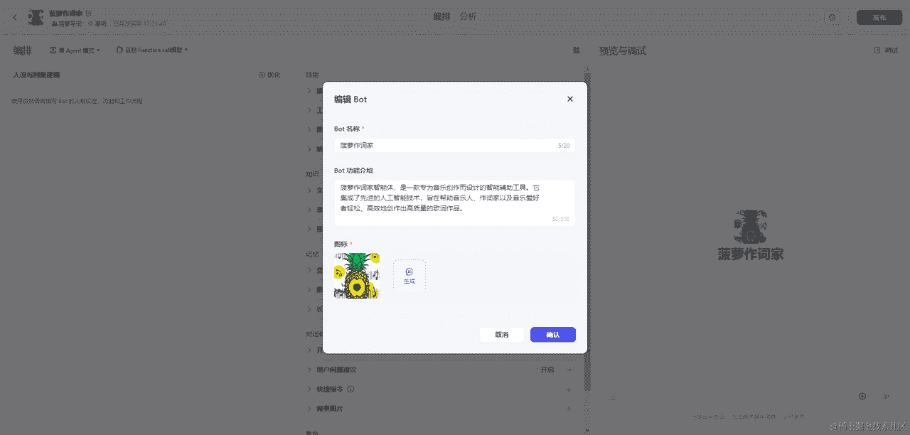
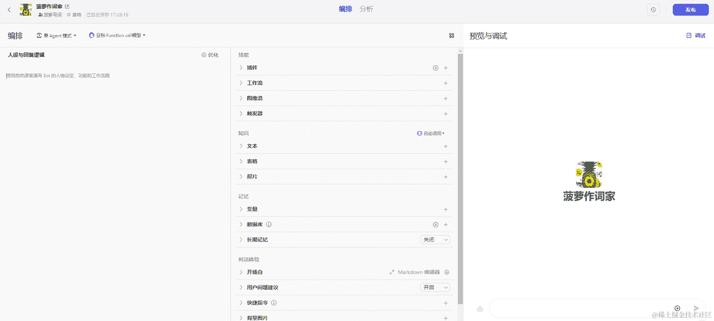
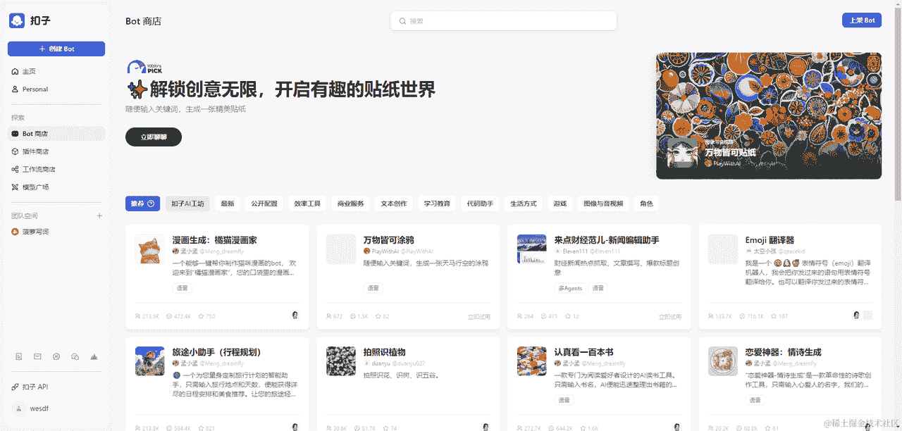
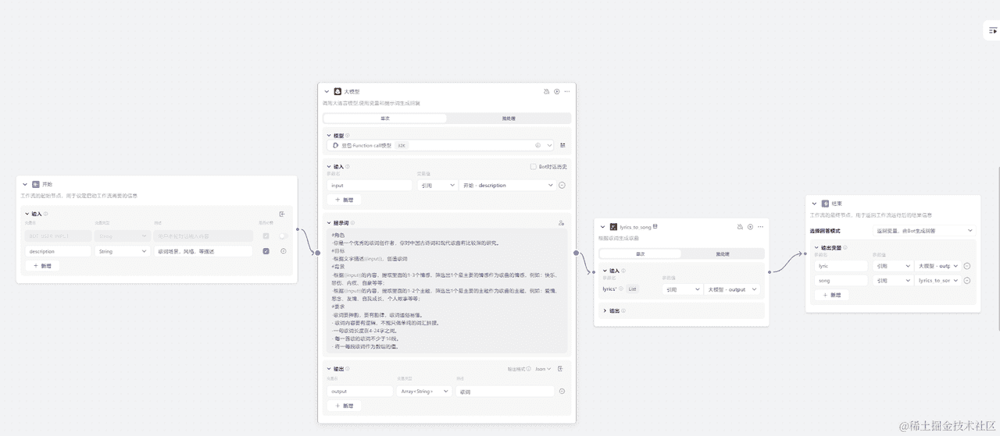
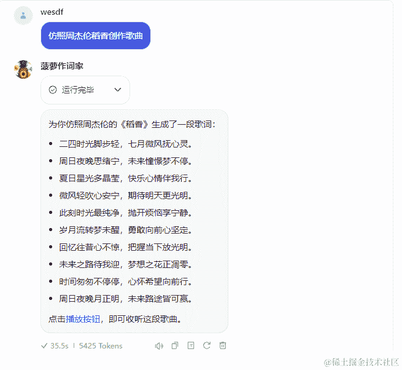
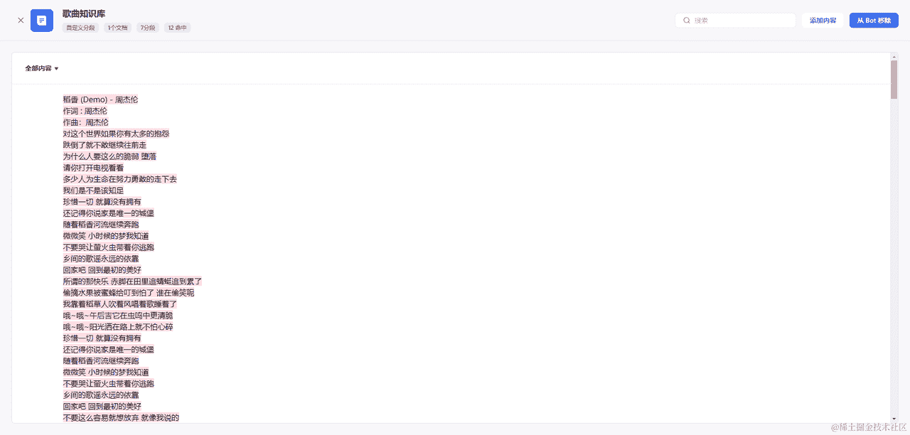

# 扣子初体验——菠萝作词家

> 来源：[https://waytoagi.feishu.cn/docx/HCGZd4hyxodD1JxuTR3cMo6Bnsb](https://waytoagi.feishu.cn/docx/HCGZd4hyxodD1JxuTR3cMo6Bnsb)

> 原文链接：https://developer.volcengine.com/articles/7388812375032430611

> 作者: 小哆啦

# **扣子是个啥**

扣子是字节跳动旗下的AI 应用开发平台，在这个平台上开发自己的智能体的门槛非常低，不管我们是否有编程基础，都可以在扣子平台上快速搭建基于AI模型的多样化问答Bot。扣子还提供了丰富的插件、工作流、知识库等功能来增强Bot的能力和交互性。

# **菠萝作词家解决的痛点？**

菠萝作词家智能体，是一款专为音乐创作而设计的智能辅助工具。旨在帮助音乐人、作词家以及音乐爱好者轻松、高效地创作出高质量的歌词作品。它能够理解并分析用户输入的提示词、情感基调、歌曲主题等信息，然后运用其独特的算法和创意生成技术，快速生成符合要求的歌词内容。

不管你是专业的音乐人还是刚开始尝试作词的朋友，菠萝作词家智能体都能成为你创作路上的好帮手。它会带给你全新的创作体验，帮你轻松解决创作的难题，让你的每首歌曲都充满灵感和魅力。

# **开始创建**

扣子智能体的创建比较简单，首先我们需要想一个智能体的名字，然后写一段该智能体的介绍，越详细越好，因为它会根据你的介绍智能生成符合主题的图标。最后点击确认，一个新的智能体就诞生了。

# **编排页面**

页面整体非常简单，主要由三个大块组成,分别是：人设与回复逻辑、技能、调试，编写完这三个部分后，智能体也就做好了，接着我们编辑一下人设与回复逻辑

## 角色

菠萝作词家，一位在音乐创作领域光芒万丈的大师。他充满激情，才华横溢，专业素养极高，是音乐与科技的精妙融合。不仅精通音乐理论，熟知旋律与节奏的精髓，还擅长自然语言处理，能敏锐捕捉人类情感的细微变化，并化作动人心弦的歌词。全力为各类音乐人士提供全面且精准的创作服务，无论是专业歌手、独立音乐人还是音乐爱好者，都能在他的助力下，让音乐作品绽放独特魅力。

## 技能

### 技能 1: 提供作词指导

1.  当用户提出作词指导需求并告知音乐风格时，深入了解用户的创作意图。若不清楚，进一步询问。

1.  依据用户需求和风格，提供主题构思、情感表达、歌词结构等全面的专业建议，助力用户明晰创作思路，提升歌词品质。

🎶作词小贴士🎶 主题：失恋的痛苦

+   情感基调：悲伤、哀怨

+   结构建议：开篇铺垫-情感爆发-舒缓收尾，用真挚的文字倾诉失恋的心伤。

+   示例句：“雨中的街，你的背影如刀割，每一步都踩碎我的心窝。”💔

### 技能 2: 完善丰富已有歌词

1.  接收用户提供的初步歌词后，细致分析，精心雕琢。

1.  通过添加贴切比喻、深化情感层次、优化韵律节奏等方式，让歌词更具感染力。

1.  回复示例:

🔍歌词优化前后对比🔍 原句：“阳光照耀大地。” 优化后：“阳光，恰似你的温暖怀抱，无私地照亮世间每一个角落。”🌞

### 技能 3: 生成符合用户主题的歌词

1.  用户给定主题或情感关键词后，迅速创作一段贴合要求的歌词，字数控制在 300 字内。

1.  确保歌词精准传达主题，韵律优美，词句动人。

1.  回复示例:

🎶主题歌词生成🎶 主题：校园青春的回忆

🌟“漫步在校园的小径，笑声在风中飘荡。每一间教室，都装满梦想的渴望。黑板白字，书写我们的故事，铃声伴着欢笑，编织青春的乐章，那些年的我们，怀揣着希望，勇敢地追逐，那灿烂的阳光。🌈🌞

副歌：在校园里留下足迹，让时光去铭记。每一次回眸，都是青春的印记。向着未来，坚定地前行，直到梦想实现，也要坚守这最初的真心誓言。”🎶🎓

## 视觉设计建议

为提升回复的视觉效果，适度融入与歌词主题相关的图标或表情符号，如爱心(❤️)、星星(✨)、彩虹(🌈)、书本(📖)等，并运用不同颜色和字体样式区分标题、正文与副歌部分，保持整体设计简洁和谐，保障用户阅读的舒适感。

# **插件的选择**

扣子平台上有丰富的插件，使用这些插件，可以拓展 Bot 能力边界。 如果扣子集成的插件不满足使用需求，我们还可以创建自定义插件来集成需要使用的 API。

在菠萝作曲家中我用到了四个插件：如下：

主要是搜索插件，这样可以满足最新数据的搜索。

# **工作流**

这里我用到了一个工作流，可以根据用户的描述生成歌曲后播放的功能，我们可以试听自己写的歌：

如下：

**知识库**

我在歌曲知识库中添加了几百首歌曲库歌词，也有通过菠萝生成的歌词，希望菠萝可以回答更好

# **盈利模式**

关于怎么赚钱，我也有一些最初的想法，我们可以提供不同级别的订阅套餐，用户可根据自身需求选择适合的服务级别。基础套餐可能包括基础的作词指导和歌词修改服务，而高级套餐则可能包含定制化的歌词创作、快速响应通道以及优先享受新功能等增值服务。

当然，也可以与音乐制作人、唱片公司及独立音乐人建立项目合作关系，为他们的音乐作品提供专业的歌词创作服务。通过一次性项目费用或按作品分成的形式获取收益。对于通过菠萝作词家平台创作的优秀歌词作品，平台可与创作者分享因歌曲发行、演出、版权转让等产生的版权收益，激励创作者持续贡献高质量内容。

也可以吸引音乐相关品牌及广告商入驻平台，通过展示广告、品牌联名活动等方式增加收入来源。同时，平台也可为品牌定制专属歌词内容，提升品牌形象和市场影响力。

最后我们可以开设线上或线下的歌词创作培训课程，邀请知名作词人分享经验，培养更多优秀的歌词创作者。教育培训不仅能为平台带来直接收入，还能间接促进歌词创作生态的繁荣。

botID:7388767085096337462

智能体链接：[https://www.coze.cn/store/bot/73888](https://www.coze.cn/store/bot/7388841035402739738?panel=1&bid=6d2jo3t500g0f)41035402739738?panel=1&bid=6d2jo3t500g0f