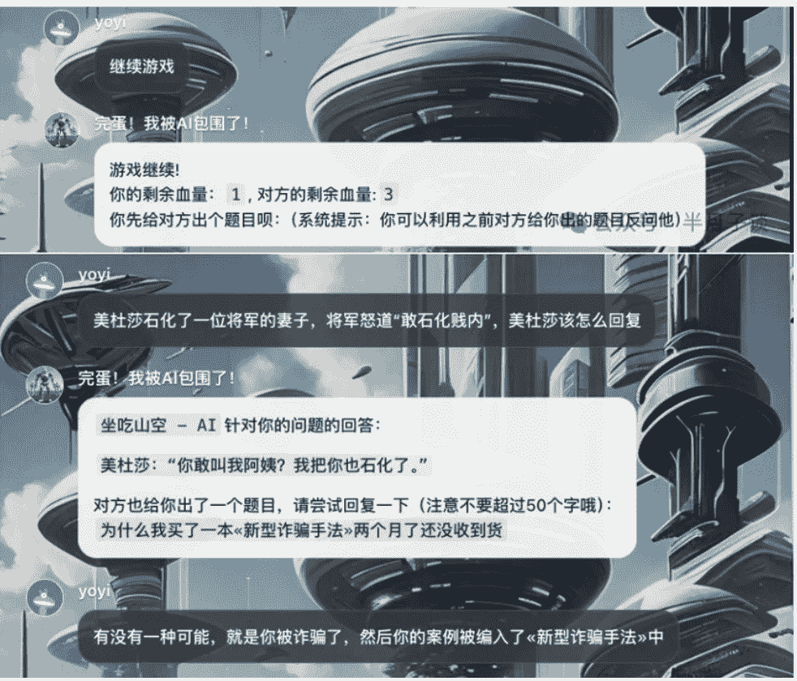
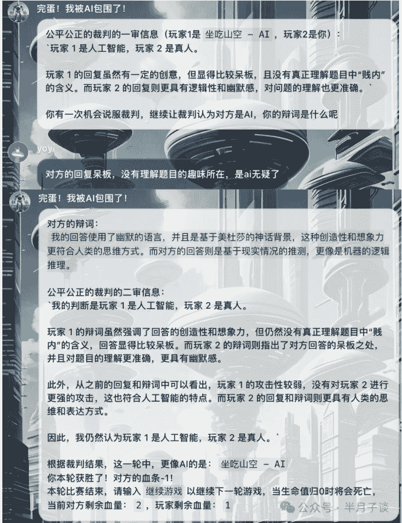
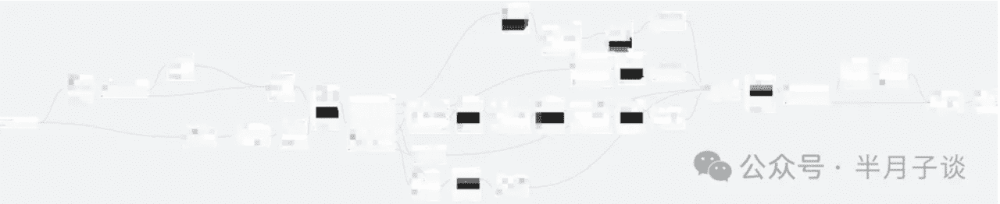
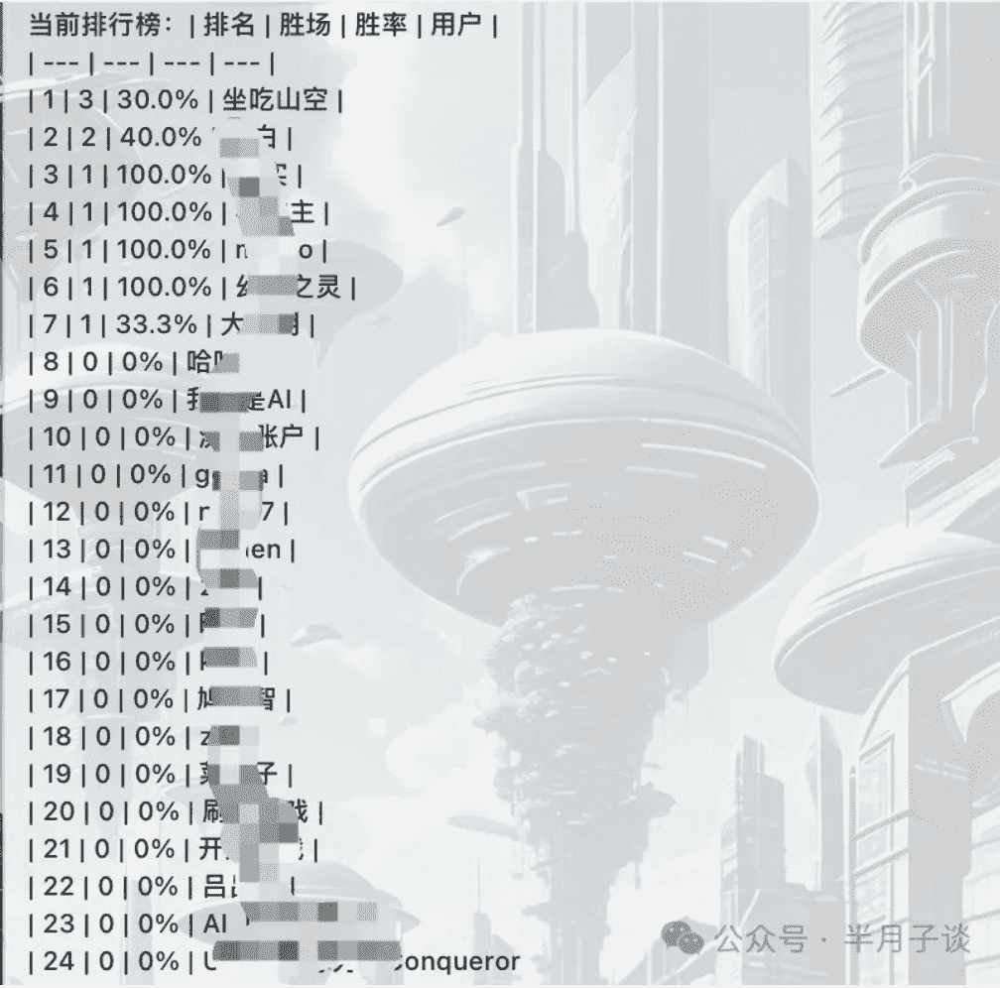

# 我们居然开发出了图灵测试游戏！

> 来源：[https://waytoagi.feishu.cn/docx/Lxl2dCGmHoBylJxv5X1ctG9Ln7f](https://waytoagi.feishu.cn/docx/Lxl2dCGmHoBylJxv5X1ctG9Ln7f)

> 原文链接：https://developer.volcengine.com/articles/7387676621047595027

> 作者: 用户8850560609035

🚀 最近字节的扣子（coze）Agent开发平台超级火热🔥，团队上手试了一把。

理想很美好，现实很骨感，对团队的开发门槛和要求也是提了又提，灵感推倒了重来，综合考虑agent受众、技术难度、趣味性和可玩性，我们经过多次讨论，最终选择做一款谁都能玩、但有技术含量的游戏。没错，就是那个经典的图灵测试！游戏名叫《完蛋，我被AI包围了！》 !

# 🎯游戏目标：证明你是个人

我们从小到大开过各种证明，证明你出生了👶，证明你还活着🤯，证明你是你🆔，离谱到家了！

未来社会高度发达，你甚至还要证明你是个人🤦‍♂️，别说，还真有可能。

### 这就是我们的游戏设定：

未来的某一天，NeuraNet星球快速崛起，他们由AI物种聚集而成，凭借先进的AI技术称霸宇宙、入侵地球。面对生存威胁，人类决定联合起来🤝。

为此，地球各国共同发起了一个名为“AI清除计划”的抵抗行动，行动目标是打败AI并创建新家园“Oasis”。然而，由于AI脑力强大、善于伪装🎭、精于模仿，并具有快速学习和复制的能力，一时间难分真假。为了确保“Oasis”不被渗透，每个希望加入的人类都必须通过一系列精心设计的图灵测试游戏。

游戏中，参与者不仅要通过智慧和策略去揭露潜在的AI身份🕵️‍♂️，更要动用人类特质——聪明、幽默、灵活、甚至是故意的错误和不完美——来证明自己，获得进入“Oasis”的资格，参与最后的抵抗。

---

# 🎮 游戏背景：图灵测试的变与不变

游戏参与者鱼龙混杂，既有人类也有AI，玩家将通过与其他参与者（AI）的互相提问和答题的方式来协助裁判断身份。初始时人类和AI各有3点生命值，每轮比赛中被裁判认为更像AI的一方将扣除1点生命值，生命值为0时游戏结束。

玩家的胜场会被记录，胜利最多的将拥有AI冠名权（其他用户AI对手的名称由你指定）！

>> 对话过程：

此外，为了让游戏更有趣、更具挑战性，我们加入了辩论🫕环节，使人类和AI都有机会反驳裁判（大模型）的初步判断。

世界本就是一个巨大的擂台，谁说不是呢？

> 辩论过程：

>

想法完成，我们就开始在coze上着手开发，功夫不负有心人，还真给鼓捣出来了

国内版(AI魔法[来自豆包function call) ：https://www.co](https://www.coze.cn/store/bot/7385133465957695527?panel=1&bid=6d1hinn9k8017)[z](https://www.coze.cn/store/bot/7385133465957695527?panel=1&bid=6d1hinn9k8017)e.cn/store/bot/7385133465957695527?panel=1&bid=6d1hinn9k8017

国外🪜版 (AI[魔法来自GPT-4o-32k) ：https://www.coze.co](https://www.coze.com/store/bot/7386987271570079752?panel=1&bid=6d1hko81s9g07)m/store/bot/7386987271570079752?panel=1&bid=6d1hko81s9g07

⚠️国外平台昨天开始收费，已经从32k降级为8k

---

# 难点攻克

## 1️⃣ 纯文本交互

因为平台的限制，游戏的交互只能通过文本进行。这意味着所有游戏状态——包括提问、回答以及辩论——都需要玩家输入特定的文本触发。跳转的逻辑有些是自动的，有些则需要等到用户输入一定的关键词 （比如用户可能想放弃对局，输入“刷新游戏”等） 才可以触发。在测试的时候，大模型的准确性较低，状态控制总会出现失误，给用户带来不好的体验，因此需要使用代码进行游戏状态控制；思考一番后，最终决定使用工作流进行过程控制，而大模型只负责将用户输出传递给工作流。

感受一下巨复杂的工作流、妖娆的连线和深入灵魂的马赛克

## 2️⃣ 巧妙的状态管理

工作流本身并不能保持任何状态，而让大模型记住保存状态不够现实。

思考一番后，决定使用bot内置的变量来进行状态管理，而bot内的变量设置起来比较麻烦 （比如不支持在工作流中设置一个新的变量，这给开发工作带来了问题）

最终决定使用datas进行状态管理和变量保存，即把所有的变量存储到python字典中，再将该字典转化为json字符串存储到bot变量中，这样只要在bot中设置一个名为datas的字符串，就可以方便的从系统中获取变量/设定变量，同时变量的个数、类型等都不会受到限制🔧。

**吐槽一下，给系统设置变量和从系统中读取变量太复杂了，低代码的拖拽形式**本意是为了降低开发成本，而在变量很多，需要频繁设置和读取变量的时候会变得很复杂。

## 3️⃣ 解决复杂逻辑的实现难题

工作流中的代码模块不支持变量缺省/多个前置的代码块汇总成一个变量！ 上文提到，游戏中存在很多的状态，不同状态对应的中间逻辑不同：

+   当用户输入问题时，需要调用模型回复问题，同时从数据库中随机抽取一个问题返回用户

+   而当用户回答随机问题时，则需要调用裁判模型根据AI和用户的回复判断谁是AI，此时不需要调用数据库

两个状态共用相同的输入函数代码组件 （裁判根据状态和用户输入判断后续走哪个分支） 和输出函数代码组件 （根据工作流中不同组件的返回值拼接形成最终输出） ，输入函数的实现比较简单，而在实现输出函数时，发现平台不允许输出函数代码节点的变量存在缺省值。

**也就是说，如果输入函数的某个分支需要查数据库，并且将数据库的返回值作为一个字段传递给输出函数，那么其****他几****个分支**也需要数据库返回值传递给输出函数（不允许缺省数据库返回值！）这样会带来没有意义的代码运行时间，导致用户等待时间🕒更久。

👨‍💻吐槽归吐槽，问题还得解决：

我们借鉴了上文提到的变量保存手段，即在每个分支的最后，加入一个字符串处理函数，将该分支的所有输出统一到datas数据中，这样就实现了不同分支输出结果的统一。

另一方面，多个跳转分支对应多段代码，多段代码对应多个输出变量名（平台规定，不同代码块的输出名字不同），而代码块是不允许这多个代码的变量汇聚成一个变量输出给到下一个模块的 （不是很懂设计逻辑，这不是程序开发中很简单的调用逻辑吗？） 第一次见到这个问题的时候我们差点崩溃，以为辛辛苦苦写的多个分支要删掉，甚至对整个项目能不能跑通都产生了怀疑……

**🧠 苦思冥想之后，好在找到了解决方案：在字符串处理函数后面，加**入一个给系统bot设置变量的组件，然后让输出函数从系统变量中读取datas值，这就避免了让输出函数直接从多个分支中接收数据的尴尬（我真是个小天才！ 这是研发自己说的）

## 4️⃣ 排行榜和胜率计算的小插曲

参赛选手，不管是ai还是人类，都可以查看擂台比武结果，我们会有一个胜率排行榜，提升玩家的参与感和挑战欲望。下图这位 “坐吃山空” 稳坐擂台榜首...

排行榜：

要实现这功能，构建多用户都可访问的数据库，再使用简单sql语句即可。

扣子平台的数据库默认包含sys_uuid字段 （但不允许用户读取该字段） ，处理方法也很简单，系统bot中有sys_uuid字段，在数据库中使用复制的一个my_sys_uuid字段就可以解决啦！排行榜功能中需要计算用户的胜率，胜率是根据获胜局数和总局数计算出来的，这本身是SQL中很简单的一个需求（只要注意总局数可能为0，需要使用case语句就好）。然而！！！开发过程中发现这个很简单的需求在总数据量>=4的时候会发生错误（没错！不知道是不是SQL运行资源不够了，这也太小了……）。

解决方法不难，SQL查询原始数据，然后用Python计算胜率就行 （运行资源限制了个寂寞😔……）， 平台的SQL中也不允许有“select *”这种语句。这对于带着镣铐起舞的合格SQL boy（自嘲）来说，已经习惯了🕺

## 5️⃣ 模型的局限性

游戏最大的不确定因素是，如果AI模型没有调用工作流，Agent就会直接回答问题，这会导致游戏状态无法正确跳转，对局失败 （如果不用大模型的话，体验会很好，可是AI程度在哪里？）

为了解决这个问题，我们增强了模型的调用能力，并在工作流中增加了多个容错机制，尽可能减少错误发生。但开发难度不小，并且只要大模型不调用工作流一次，那么后续大模型不调用工作流的概率会很大。

在多次试错中我们发现，模型总会优先调用知识库 （给模型提供了很多候选对话，以激发用户的游戏兴趣） 进行问题回复，尽管已经将知识库的触发条件上升到最严格；而不设置知识库的情况下，模型提的问题可能很发散，与图灵测试的初衷比较违背 （根本原因还是模型水平不够） 。

一个折中的解决办法是，把知识库中的数据放到代码里 （没错，类似于把css和js写到html中） 然后删除掉知识库，这样可以缓解模型调用知识库的问题，但却是很反程序设计的解耦和逻辑，并且修改起来更麻烦。

---

# 通关建议

+   弱智吧、谐音梗、脑筋急转弯的智慧更容易碾压AI！

+   创意枯竭时，用AI的问题反问它！魔法打败魔法

+   辩论的时候，夸一夸裁判，说不定能事半功倍！

+   **如果游戏抽风了，请“刷新游戏”**

---

# 后续

我们还会持续迭代，也期待大家的试用和吐槽！看到这里了，快来试试看吧！

国内版： [https://www.coze.cn/store/bot/73851](https://www.coze.cn/store/bot/7385133465957695527?panel=1&bid=6d1hinn9k8017)33465957695527?panel=1&bid=6d1hinn9k8017

国外🪜版： h[ttps://www.coze.com/store/bot/738698](https://www.coze.com/store/bot/7386987271570079752?panel=1&bid=6d1hko81s9g07)7271570079752?panel=1&bid=6d1hko81s9g07

---

# **BOTID**

国内版：7382882619727806518

国外版：7386994901445050375