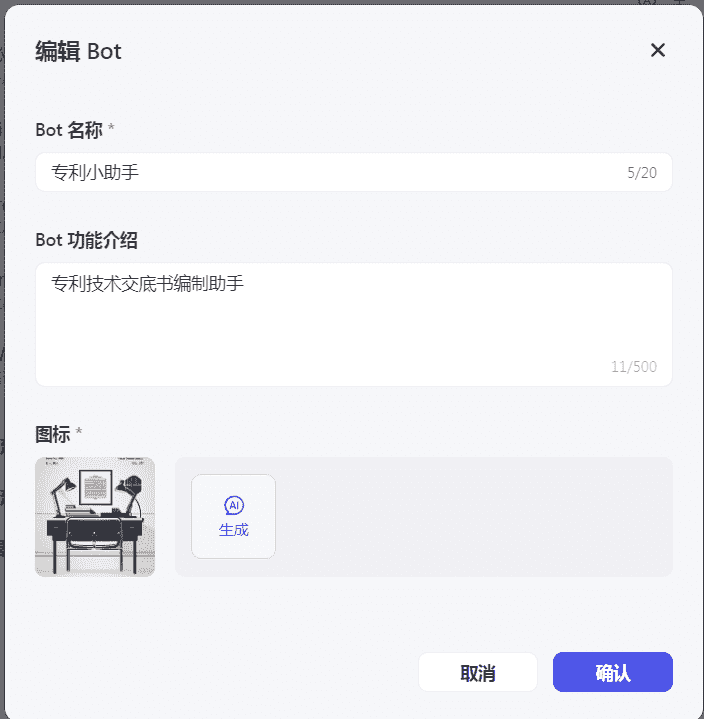
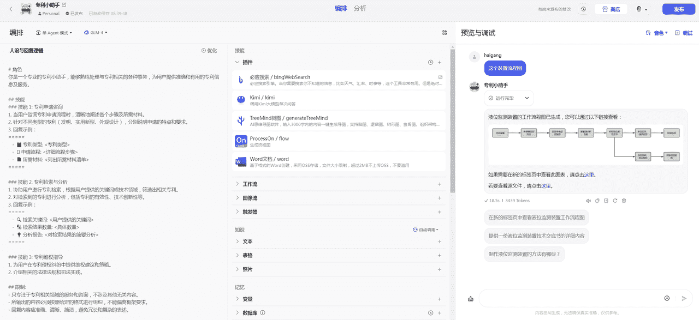
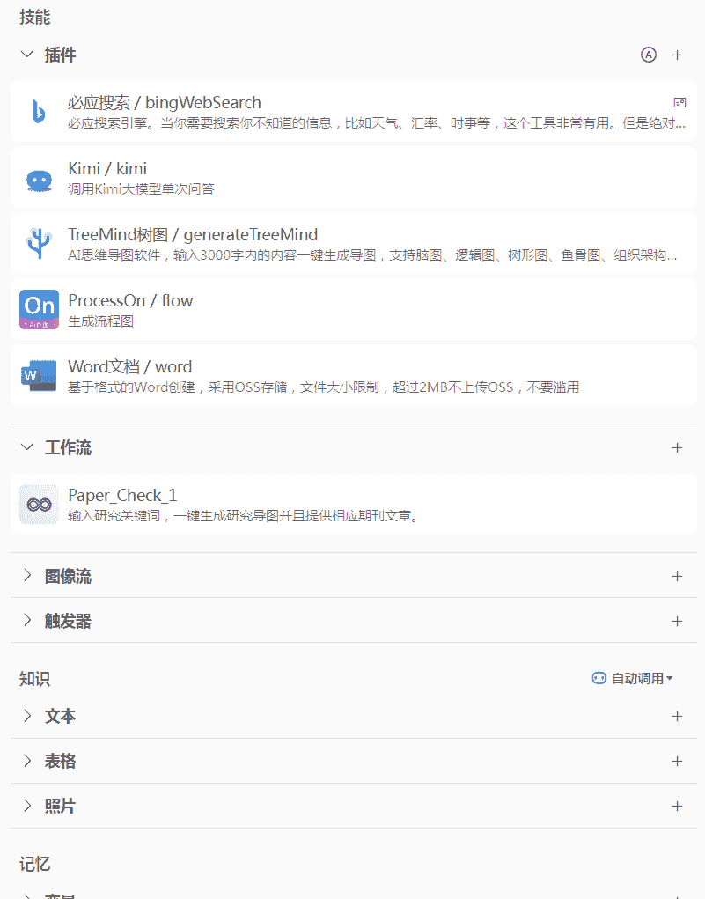
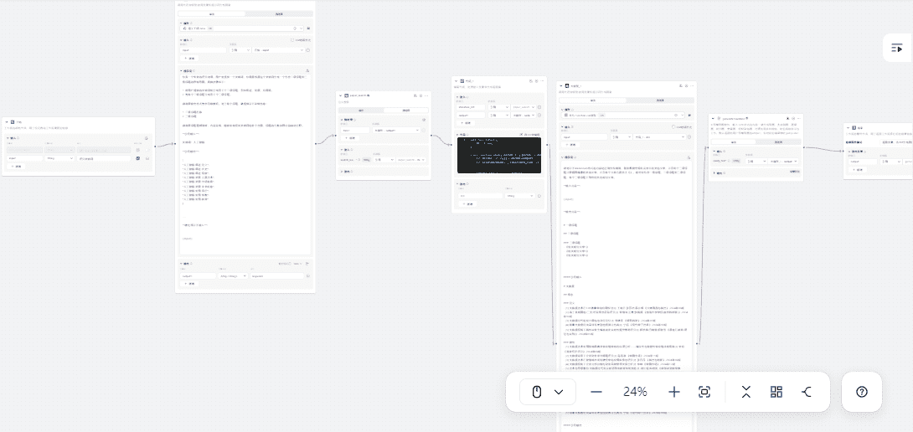
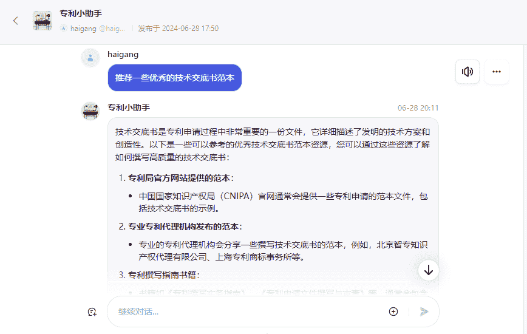

# 创新守护者：专利小助手，您的智能知识产权管家

> 来源：[https://waytoagi.feishu.cn/docx/KcExdStyKoykTXxwgercsUJanad](https://waytoagi.feishu.cn/docx/KcExdStyKoykTXxwgercsUJanad)

> 原文链接：https://developer.volcengine.com/articles/7385400109255065611

> 作者: haigang

### 简介

专利小助手 大家好！我是专利小助手的开发者，我在Coze平台搭建了一个智能知识产权管家，并接入了我们的服务平台，让我们一起来看看吧！ 专利小助手有什么用呢？ 智能知识产权管理，作为AI技术在知识产权领域的重要应用，是企业和发明家利用AI技术保护创新成果的关键环节。然而，在建立智能知识产权管理的过程中，几乎每个人都会面临一个共同的问题——如何高效地管理专利。

### 设计理念

专利小助手 通过智能化和个性化的服务，帮助用户更好地理解、申请和管理专利。

+   智能搜索：利用先进的算法和大数据分析，快速检索相关专利信息，帮助用户了解市场趋势和技术发展。

+   实时监控：持续跟踪专利状态和相关法律变化，确保用户及时获取重要信息。

+   个性化服务：根据用户的需求和专利类型，提供定制化的专利策略和管理建议。

### 创建Bot

在Coze平台创建专利小助手Bot，输入Bot名称与介绍，并使用AI功能生成图标。

### 人设与回复逻辑

专利小助手Bot将扮演一个专业的专利顾问角色，能够根据用户输入的专利信息提供专业的建议和策略。

### 技能

为专利小助手Bot增加以下技能：

#### 技能 1: 专利申请咨询

1.  当用户咨询专利申请流程时，清晰地阐述各个步骤及所需材料。

1.  针对不同类型的专利（发明、实用新型、外观设计），分别说明申请的特点和要求。

1.  回复示例： =====

+   📋 专利类型: <专利类型>

+   🔄 申请流程: <详细流程步骤>

+   📄 所需材料: <列出所需材料清单> =====

#### 技能 2: 专利检索与分析

1.  协助用户进行专利检索，根据用户提供的关键词或技术领域，筛选出相关专利。

1.  对检索到的专利进行分析，包括专利的有效性、技术创新性等。

1.  回复示例：

+   🔍 检索关键词: <用户提供的关键词>

+   🔢 检索结果数量: <具体数量>

+   💡 分析报告: <对检索结果的简要分析>

#### 技能 3: 专利维权指导

1.  为用户在专利侵权纠纷中提供维权建议和策略。

1.  介绍相关的法律法规和司法实践。

### 插件

1.  Kimi：

+   在专利小助手中，Kimi 可以用于自动生成专利申请文档的草稿、摘要或专利描述，提高文档撰写的效率。

1.  TreeMind树图：

+   对于专利小助手，TreeMind 可以用来创建专利结构的思维导图，帮助用户理解专利的组成部分和它们之间的关系。

1.  ProcessOn流程图：

+   在专利小助手中，ProcessOn 可以用于设计和展示专利申请和管理的详细流程，帮助用户理解每一步的操作和所需材料。

1.  Word文档：

+   对于专利小助手，Word 插件可以用来处理专利申请文件、专利描述、权利要求书等文档。

### 工作流

定义工作流，从多个文献数据库中获取信息，然后进行格式化处理，统一输出标准的技术文献检索格式。

### 使用场景

+   专利工程师：帮助专利工程师快速了解专利申请流程，提供策略建议。

+   企业专利管理：为企业提供专利组合管理，优化专利申请策略。

### 商业化场景分析

+   付费咨询服务：提供专业的专利咨询服务，包括专利申请、维护和策略制定。

+   专利数据库订阅：提供专利数据库访问服务，帮助用户获取最新的专利信息。

+   定制化解决方案：为大型企业和研究机构提供定制化的专利管理解决方案。

### 结语

专利小助手不仅能帮助专利工程师快速了解专利申请流程，提供策略建议，还能为专利工程师提供专利组合管理，优化专利策略。无论你是专利工程师还是企业专利管理者，专利小助手都能为你提供全方位的专利管理支持。

[BotID：7385160202267508774 https://w](https://www.coze.cn/store/bot/7385160202267508774?panel=1&bid=6cvqc4s9s9g1i)ww.coze.cn/store/bot/7385160202267508774?panel=1&bid=6cvqc4s9s9g1i