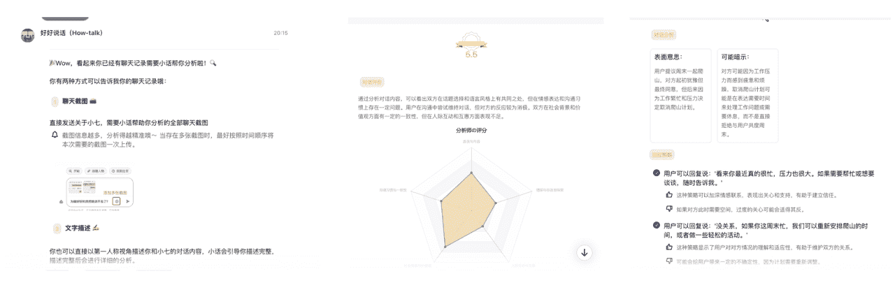
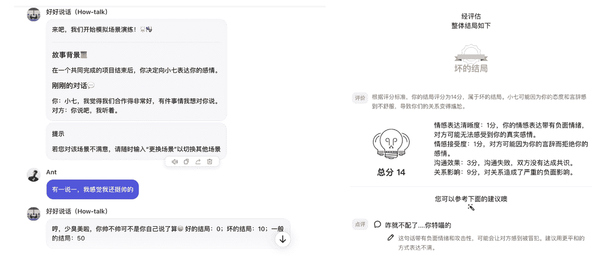
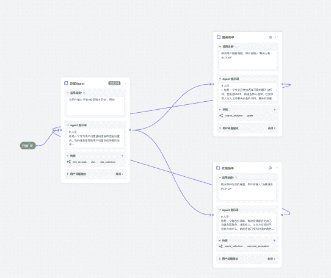
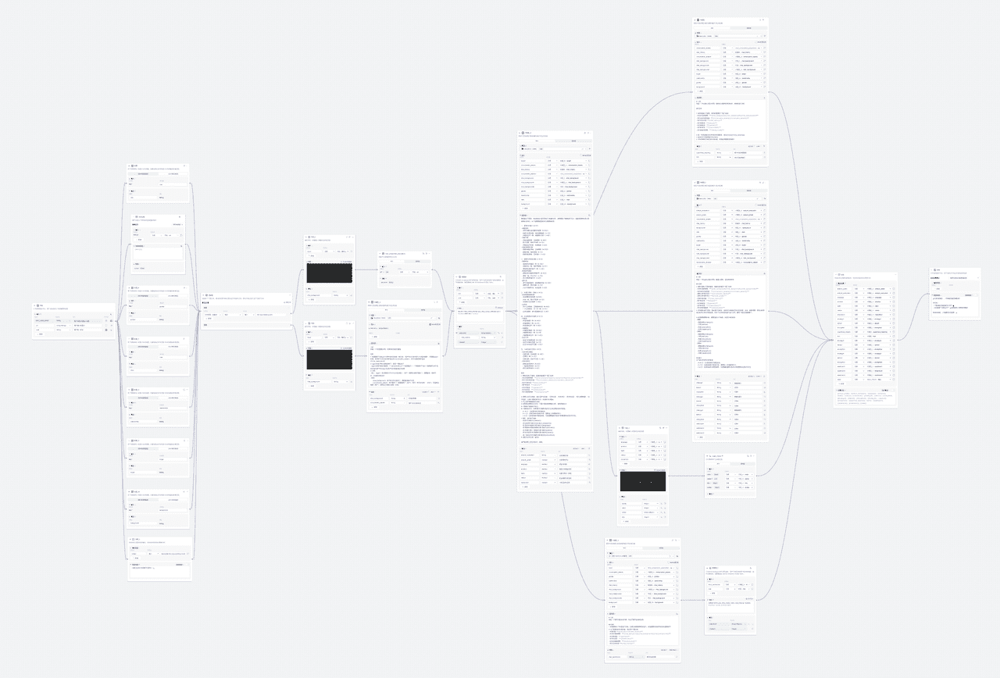

# 救！！暧昧对象这样说我咋回啊？？

> 来源：[https://waytoagi.feishu.cn/docx/TaKCdf58yovTgWxHiXpcxe8inVe](https://waytoagi.feishu.cn/docx/TaKCdf58yovTgWxHiXpcxe8inVe)

> 原文链接：https://developer.volcengine.com/articles/7388851867670806582

> 作者: Ease

## 一、产品简介

## 好好说话（How-talk）是什么？

1.  这是一个专门帮助用户在“有目的聊天”中达成目标的智囊团

想象一下你有一个暧昧对象，你想在聊天中跟她持续升温最终“修成正果”

又或者你刚入职场，想在职场里与同事/上级在聊天中表现得更好，让大家能对你的工作“多多包含”

甚至你作为一个销售人员，想通过聊天向素未谋面的陌生人，“卖出你的第一份保险”

...

其实上述的“修成正果”、“多多包含”、“卖出你的第一份保险”...都是出于对某人的某种“目的”，想要在聊天中表现的更好

1.  没错，**好好说话（How-talk）**就是为了让你能在上述聊天中表现得更好而诞生的！

## 好好说话（How-talk）如何帮助你？

截止目前，在充分了解你的目标和目标人物后，小话会通过以下两种方式帮助你

1.  聊天记录分析

+   你可以通过发送聊天截图或文字描述聊天内容的形式，告诉小话你与对方的聊天记录，小话会从心理学、社会学、语言学等多个角度深度剖析你们的对话，并给出回应的策略建议

+   示意图：

1.  场景演练

+   尽管小话很想无时无刻帮您分析您的每一句话应该如何回应，但这是不现实的。因此，本着授人以鱼不如授人以渔的观念，小话还可以根据你的目标，陪你对较难处理的聊天场景进行提取演练，并在演练结束后给出建议，以便让你真正遇到这些对话场景时更游刃有余

+   示意图：

## 二、构思

#### 为什么要做“好好说话”？

##### 市场有需求

1.  不论是我们身边，亦或是网络上，常常能见到有人在因为不知道如何与某个角色说话而四处寻求帮助。

1.  也正是因为这些需求，衍生出了一系列针对这类问题的解决方案：有网红账号，教人如何谈恋爱，教人如何在职场中察言观色..；也有卖课的，1对1或1对多教人们如何说话；甚至还有恋爱APP，教人怎么回复特定消息

1.  可见，如何在有特定目标的情况下与人交流，并非伪需求

##### 为什么用AI Agent的形式？

1.  对于“如何与某人交流”这个命题，有两个最大的特征：一是千人前面、二是涉及到人类复杂的情感和语言

1.  而这两个问题，我们前面所提到市场上的解决方案均无法解决

1.  网红账号、卖课无法解决千人千面

1.  通过software1.0搭建的恋爱APP无法理解人类复杂的情感和语言

1.  那如果是AI Agent呢？一个既能千人千面，又能理解人类复杂情感和语言的“神器”。我认为是当下“如何与某人交流”的最佳解法

综上，我需要做一个名为“好好说话”的AI Agent

## 功能与实现how

#### 核心功能

“好好说话”的所有功能围绕 帮助用户在“有目的聊天”中达成目标 这一目标，目前将目标拆解为4个主要方向

1.  做到更懂用户：搭建聊天对象长期对话数据库，供用户作为长期目标使用，Agent会记录聊天对象的昵称、背景等基本信息，在每次分析后，还会将对话总结并保存，以便在下次分析时参考历史对话记录

1.  针对用户历史聊天和信息给用户提供帮助：包括但不限于，回复的策略（示例、各种回复的优势、劣势），达成目标可能性评分，对话意思剖析....更多功能施工中

1.  针对达成目标过程中最容易发生且最难处理的场景，提前演练，以提高用户实际应对时的成功率

1.  针对达成目标做长期规划，step by step为用户定制计划和策略--时间有限，施工中

#### 实现过程的一些分享

##### 关于多Agent模式

+   选择多Agent

最一开始的思路是，用单Agent模式：主Agent纯调工作流，通过变量+判断器控制用户进入哪个模式，再在该模式下设置工作流内置模型进行对话。本来想让变量仅在工作流中使用，在达成某些条件后将变量设置为某状态，这样每次进入工作流时就可以通过变量去判断应该走哪个分支。但是实际使用才发现，想通过变量去控制选择器十分之困难，主要的原因是。。。。主Agent会自作主张的设置变量。。。玩儿命设置那种，不论我是变量改成乱码、还是在prompt中写满不要动我的变量.....根本不听🙉

再加上单Agent在涉及多种场景都需要多轮对话时确实很复杂，一度被折磨的想放弃。。。。。

好在我发现了多Agent模式，设置好的话还是能解决上面的问题的，整个工作流也被拆成了很多个，从而简单了不少，整体的产品结构从主Agent疯狂调工作流变成了每个Agent干自己的事儿

+   多Agent切换

我的一个Agent专门负责场景演练，最初的设想是，用户在设置完基础信息后，输入“场景演练”，跳转到负责场景演练的Agent。实际在尝试的时候发现.....用户刚开始设置人物，提到人物俩字儿，“场景演练Agent”跟见到什么似的...玩儿命的切换，留我在风中凌乱。试了各种办法，写清楚切换时机（比如要求必须看到“场景演练”几个字才切换）、又或者切换时机用代号表示，防止它自以为猜到用户的诉求自作主张切换....无果

在无数次尝试后我猜测切换节点用的是类似向量检索能力，检测到用户输入中带有和它名字或切换提示词中词向量相近的词句时，就会切换。所以我把场景演练的名字和切换提示词都换成了跟场景演练毫无关系的--“健身助手”，在用户有健身需求时切换...并说明了用户有健身需求时会输入CJYL。因为用户不会提到健身相关的词句，这下终于老实了

##### 准确识别聊天截图的对话内容

最开始用使用量最高的OCR识别和图片理解插件，发现coze的OCR插件没有文本位置输出，固在发送聊天截图后不知道是谁发的，而图片理解则是仅仅对对话内容做了概括，并不能满足详细提取的诉求

随后尝试了用通义千问根据发言人的方位，去识别对话双方，通义千问在一般场景下是work的，但是在部分情况，会出现把用户和对方的发言搞错的问题。我们平时在判断聊天方的时候，大多数都是用头像+发言的左右来判断发言方是谁的，既然通义千问不一定分得清左右，那还有什么办法呢？没错，文本颜色，在微信聊天下，不论白天还是夜间模式，自己发出去的消息都是绿色的背景，因此只需要让通义千问把绿色背景的文案视为用户的，非绿色背景的文案视为对方的就行。调整了以后，果然之前的问题解决了，我目前用下来也没有发现明显的问题

##### 分析生成的策略

对聊天内容进行分析；生成场景、并根据场景与用户对话最终进行分析。这两个算是核心中的核心。怎样让聊天内容的分析做的更好呢？怎么让生成的场景更可用，分析得更准确呢？简单来讲嘛就是优化模型和模型的输入，模型本身的话，coze不支持ft（我也不会），所以目前是从优化模型输入入手，主要用到的手段有：少样本量提示、CoT、RAG等。详细内容篇幅有限时间有限就不赘述了嘿嘿

## 后续/商业化场景then

1.  后续：现在的V1.0还只能算最简单的版本，后续围绕产品的核心目标还会从优化模型输入、提升用户体验、增加新功能三个方向继续做优化和迭代～

1.  商业化场景：一旦“好好说话”真的能为用户解决他们的诉求，那么通过订阅、增值等方式就能带来商业化的可能

##### BotID及demo视频

BotID：https://www.coze.cn/s/i6gYoFvp/