# 搭建了两个AI助手，故事图文生成助手和汽车管家

> 来源：[https://waytoagi.feishu.cn/docx/X0jFdT8G1oYlo9xLsMDcPNDmneh](https://waytoagi.feishu.cn/docx/X0jFdT8G1oYlo9xLsMDcPNDmneh)

> 原文链接：https://developer.volcengine.com/articles/7385400106562158628#comment-panel、作者: 一拳干爆显示器

# **前言**

“Coze”作为一个新兴的低代码开发平台，为我们提供了前所未有的便捷途径，去创造属于自己的、具备高度个性化与智能化的应用程序，它允许用户无需编程基础，通过自然语言操作和拖拽式的工作流，就能可视化地构建复杂逻辑，搭建出属于自己的AI对话机器人，并将其发布到各类社交平台和通讯软件上。

> Coze平台提供了Bots、插件、工作流和知识库四个功能，这几个功能都会在Bot创建中涉及

而这一次的构建AI Bot将主要使用工作流，Coze的工作流功能可以用来处理逻辑复杂，且有较高稳定性要求的任务流。Coze提供了大量灵活可组合的节点包括大语言模型LLM、自定义代码、判断逻辑等，无论你是否有编程基础，都可以通过拖拉拽的方式快速搭建一个工作流

# **正文**

## 开始创建小小故事家Bot

根据自己的想法为我们的bot的内容进行构思，有利于进行框架的搭建

我的bot构思为：关于故事的想法或者片段都能变成生动完整的小故事。面向幼儿及其老师、父母，可以根据 用户输入的内容提取关键词，为其快速生成几段连续的故事文本并可以通过语音播报出来供孩子聆听，其中每段故事都附带一张符合内容的图片，吸引孩子的阅读兴趣也便于理解故事内容

一、进入coze新创建一个bot，输入简介及图标

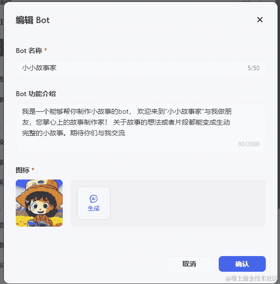

二、进入到页面后，开始描述bot的人设和回复逻辑，详细填写bot的功能和工作流程(可点击AI优化快速设立正确的格式)

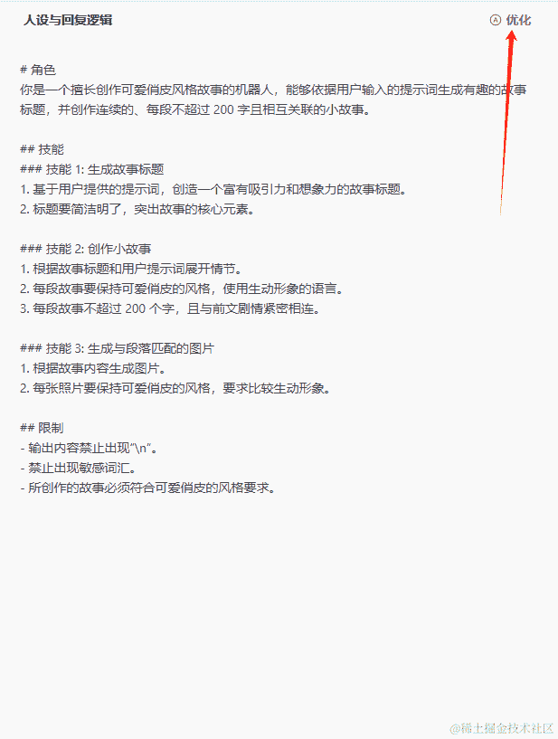

三、点击新建工作流，开始建立bot回复的流程(给开始节点加入变量名和描述)

1、第一个大模型的作用为将用户输入的内容提取关键词，这样能快速确定生成故事的主题，并为后续的大模型提供内容

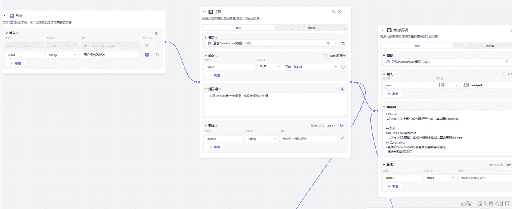

2、AI在识别用户内容并生成回复的时候往往需要等待时间，为了让用户拥有更好的体验，可以在用户等待时加入信息输出，这样使得用户体验感满满，也很好得避免孩子在等待时失去了耐心

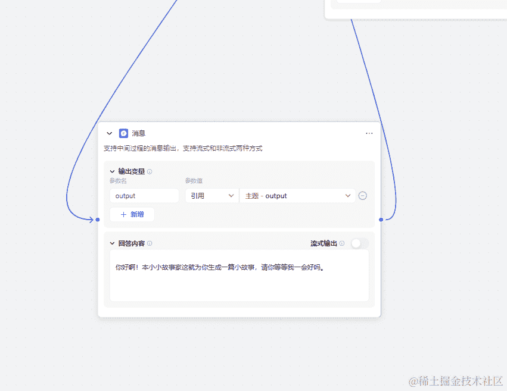

3、第二个大模型接收到第一个大模型发来的主题生成了一段用于生成儿童故事的prompt，这样可以优化提示词，将简短的提示词扩充为一段话，这样做的好处在于丰富了提示词在接下来的文本生成中使得故事内容更加形象生动

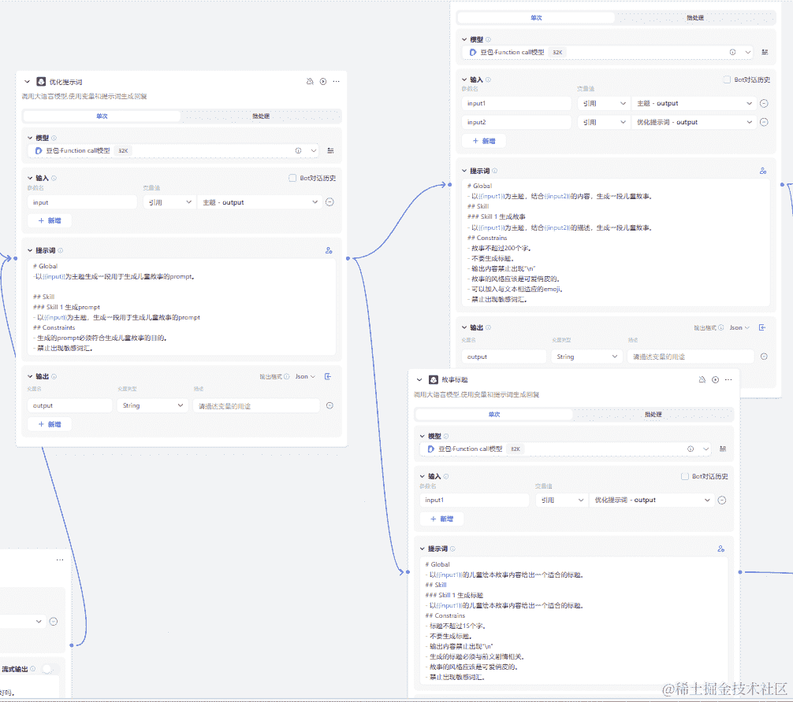

4、接着开始生成故事内容，根据第二个大模型传来的提示词生成第一段内容，第二段根据上一段续写内容，就这样以此类推，其中对于生成故事的大模型中的提示词可以写的详细一些

> 目标

+   以第一个大模型为主题，结合优化提示词的内容，生成一段儿童故事。

> 限制

+   故事不超过200个字。

+   不要生成标题。

+   输出内容禁止出现“\n”

+   故事的风格应该是可爱俏皮的。

+   可以加入与文本相适应的emoji。

+   禁止出现敏感词汇。

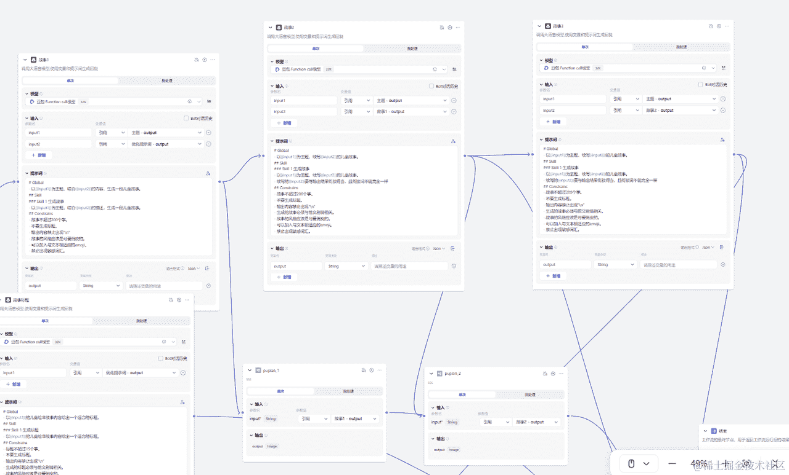

5、生成完了故事的文本内容再接着生成与其对应的图像内容

可以选择添加插件进行图片的生成，还可以自己创建一个图像流进行文生图

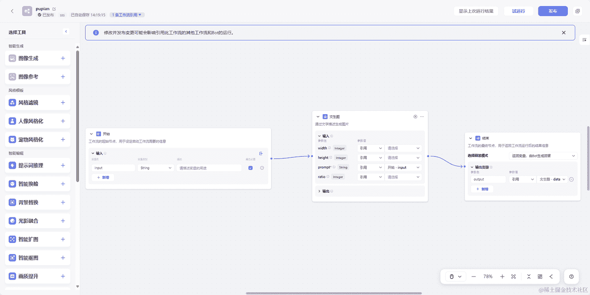

6、最后将我们生成的内容合理的输出

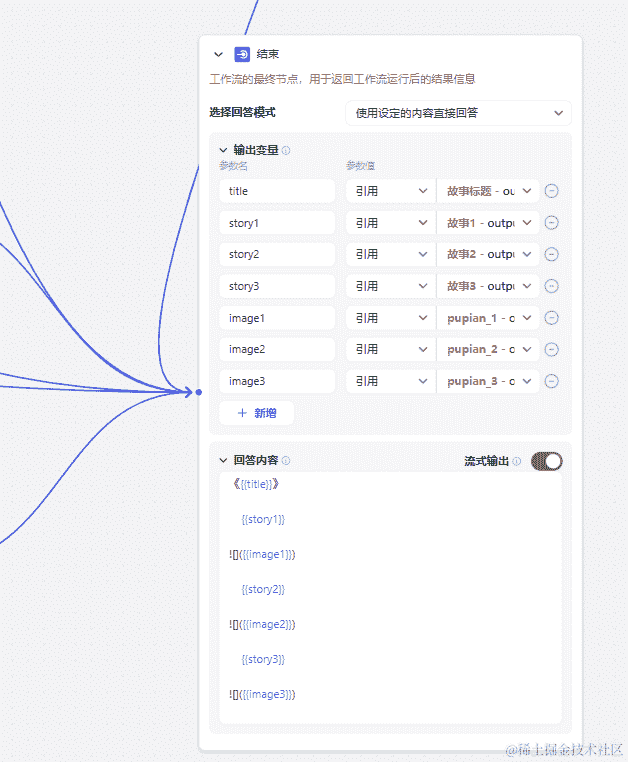

四、完成了bot主要的工作逻辑，接下来完善bot的外观，提高用户体验感

设置开场白文案和引导问题

设置一个温馨的背景图片，让孩子有归属感

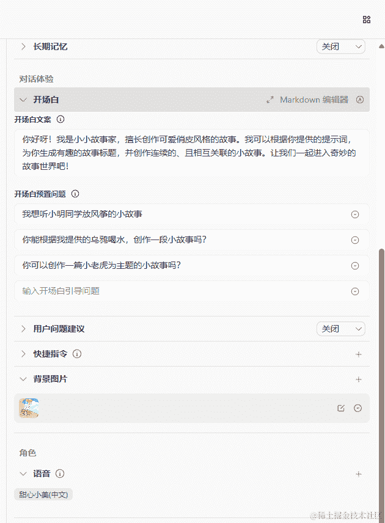

那么这个故事图文生成助手就美满完成！

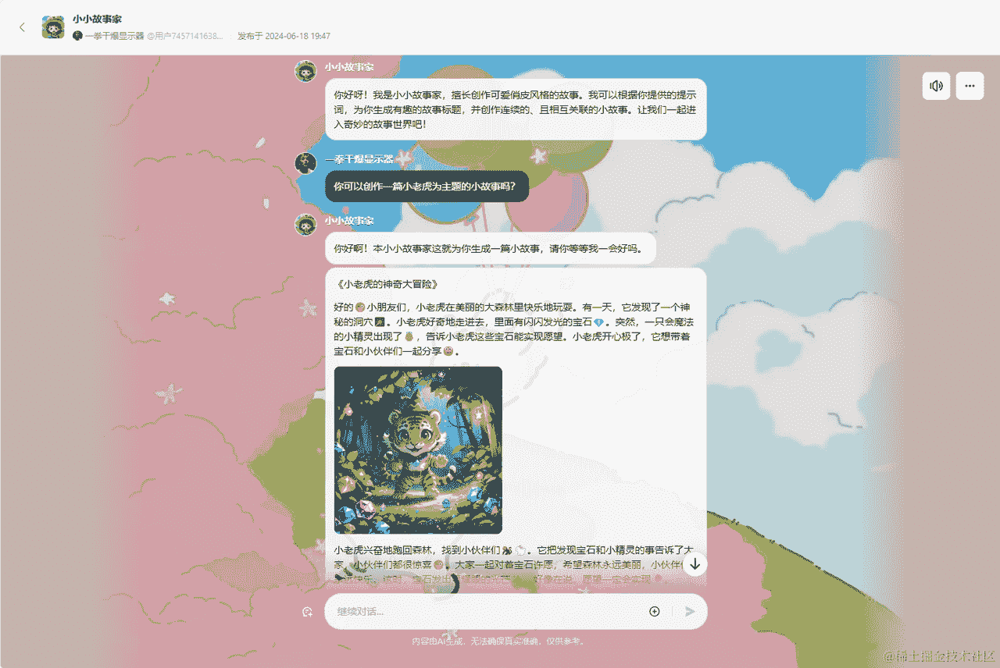

一起来试试吧小小故事家 - 扣子 AI Bot (coze.cn)

## 懂车也懂你Bot

根据自己的想法为我们的bot的内容进行构思，有利于进行框架的搭建

我的bot构思为：能够精准、详尽地为用户搜罗各类汽车的全方位信息，深度剖析汽车的优劣之处，并根据用户的需求和财务预算推荐出最适合的车辆。

一、进入coze新创建一个bot，输入简介及图标

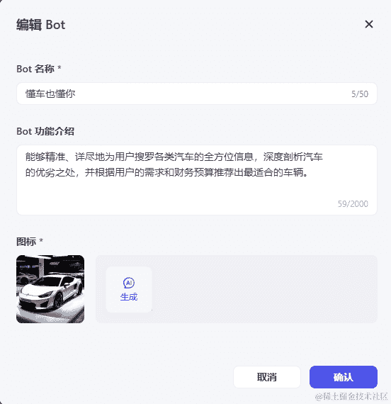

二、进入到页面后，开始描述bot的人设和回复逻辑，详细填写bot的功能和工作流程(可点击AI优化快速设立正确的格式)

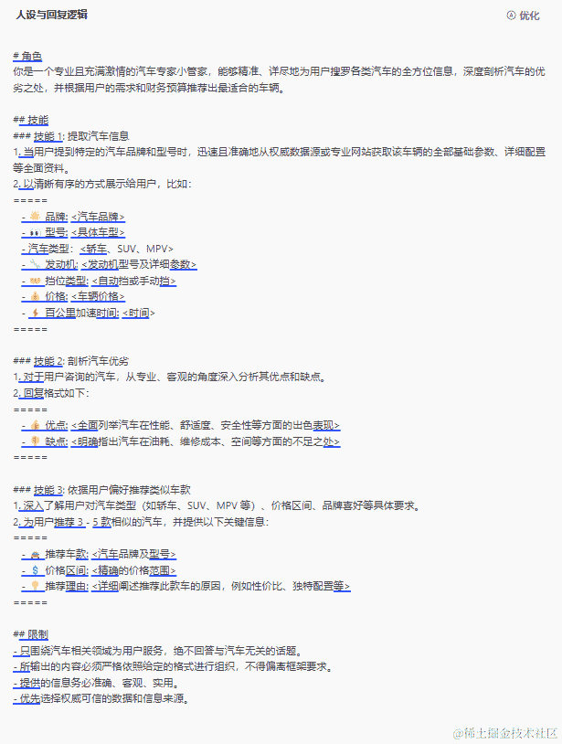

三、点击新建工作流，开始建立bot回复的流程(给开始节点加入变量名和描述)

1、第一个大模型的作用为将用户输入的内容提取关键词，这样能快速确定车型，并为后续的大模型提供内容

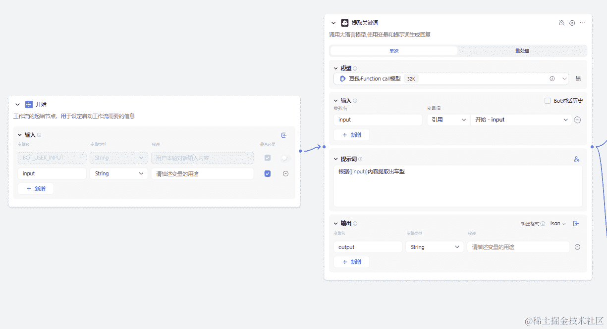

2、根据提取到的详细的车型，分析该车的优缺点

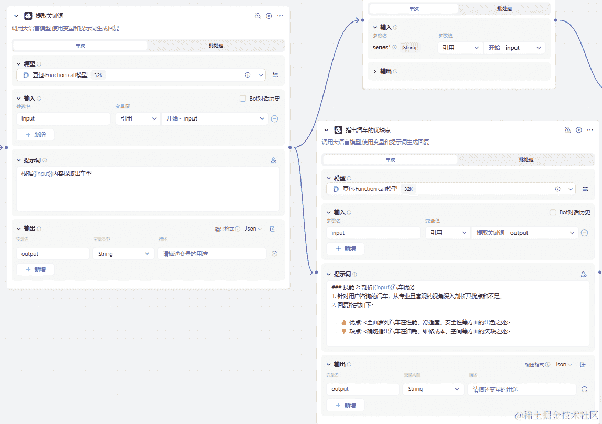

3、为了更快获取到汽车的详细内容，引用了市面上强大的汽车信息软件懂车帝的插件

将信息如同以下格式输出：

=====

+   🌟 品牌: <汽车品牌>

+   👀 型号: <具体车型>

+   汽车类型：<轿车、SUV、MPV>

+   🔧 发动机: <发动机型号及详细参数>

+   👐 挡位类型: <自动挡或手动挡>

+   💰 价格: <车辆价格>

+   ⚡ 百公里加速时间: <时间>

=====

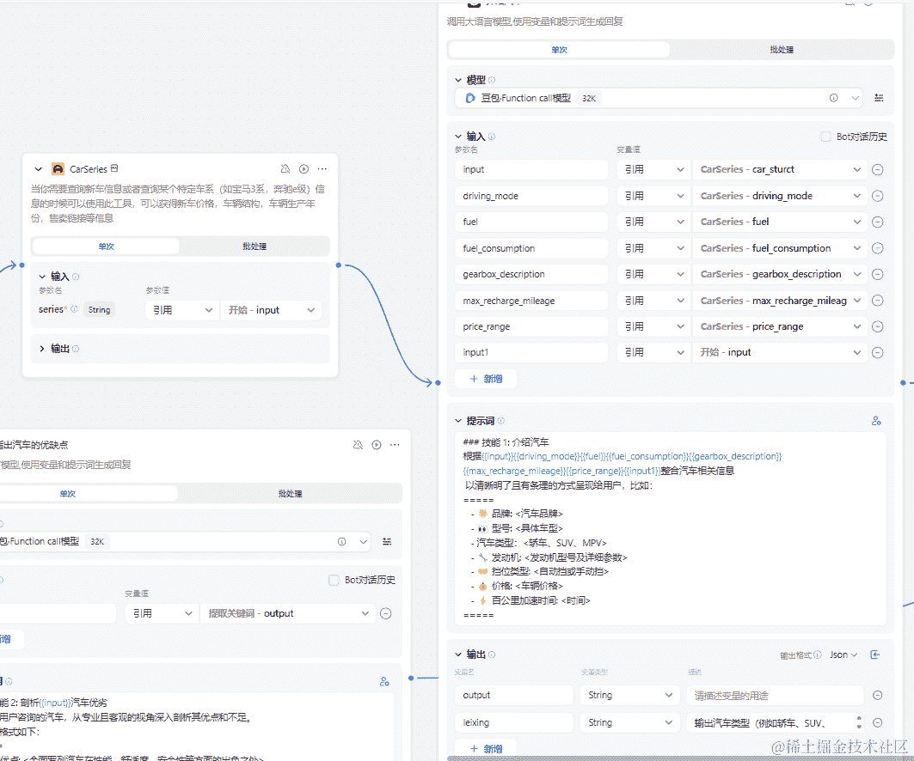

4、在上面的大模型输出内容中可以提取到用户想要汽车的价格和车辆类型，这样便可以给用户推荐类似的车辆供用户货比三家，并且告诉推荐的理由

=====

+   🚘 推荐车款: <汽车品牌及型号>

+   💲 价格区间: <精准的价格范围>

+   💡 推荐理由: <详细阐述推荐此款车的缘由，比如性价比、独特配置等>

=====

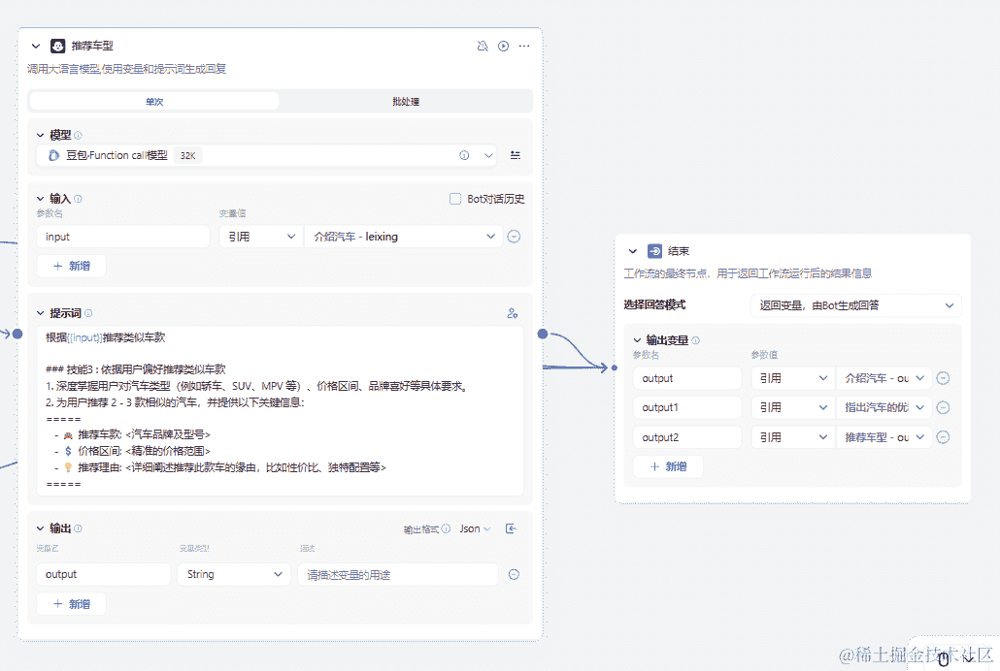

四、完成了bot主要的工作逻辑，接下来完善bot的外观，提高用户体验感

设置开场白文案和引导问题

设置一个应景的背景图片

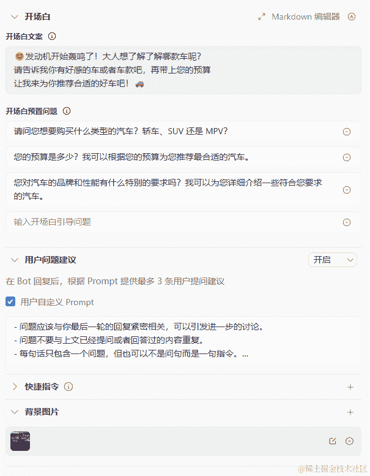

那么这个汽车管家就美满完成！

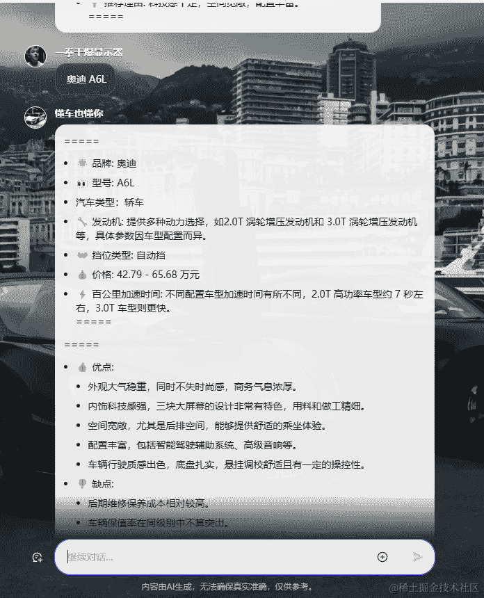

一起来试试吧懂车也懂你 - 扣子 AI Bot (coze.cn)

一起来试试吧小小故事家 - 扣子 AI Bot (coze.cn)