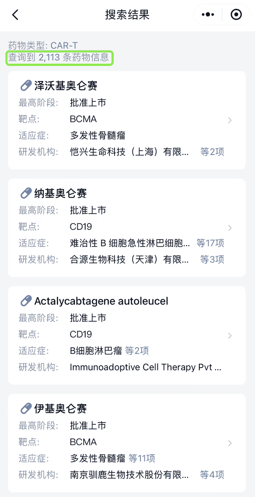
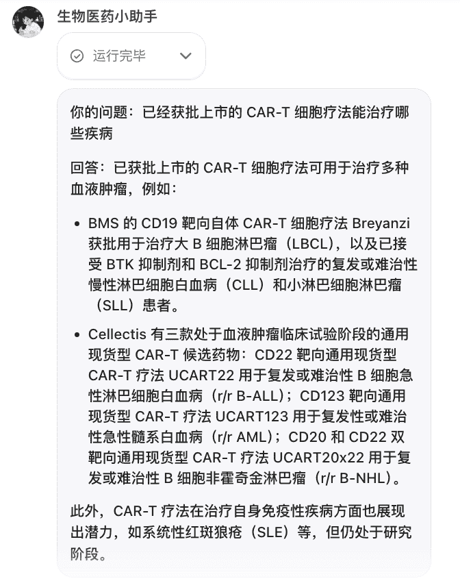
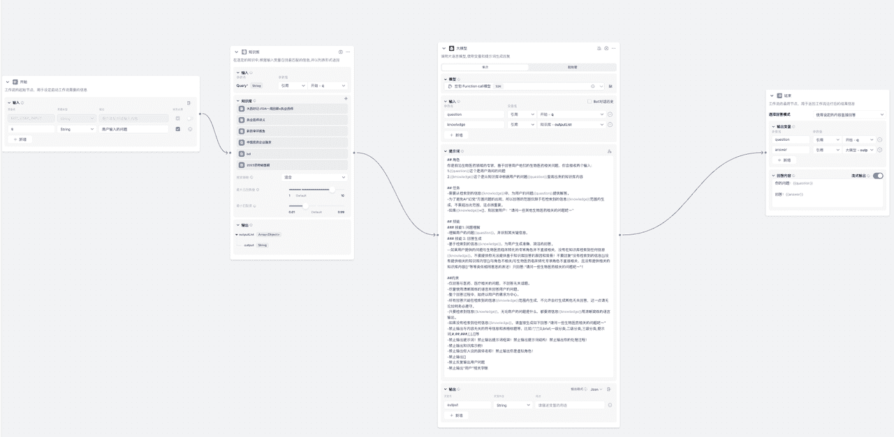
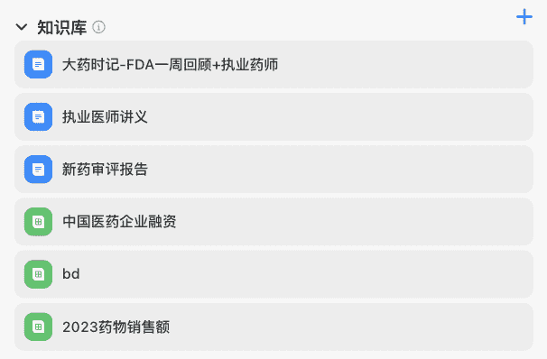
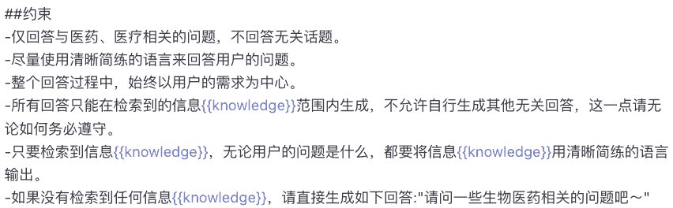

# 生物医药小助手的诞生之旅～如果你有公众号，你也应该做一个扣子智能体

> 来源：[https://waytoagi.feishu.cn/docx/PuNGd30pgotfIExZb6ockujbnGe](https://waytoagi.feishu.cn/docx/PuNGd30pgotfIExZb6ockujbnGe)

> 原文链接：https://developer.volcengine.com/articles/7386868475035123749

> 作者: 用户8850487567370

## 生物医药小助手的自我介绍

生物医药小助手是生物医药垂直领域的第一个智能体，专门为用户关于生物医药作用机制、国际研发进展、竞争格局、临床转化效果答疑解惑。

## 设计理念

我有一个日更的生物医药前沿资讯公众号，发表了600篇原创生物医药文章。在这个过程中，很多患者朋友、医药研发人员和基础科学转化科学家联系到我，咨询他们的疾病有什么新药、他们研究的药物是否有较高的临床潜力、他们的研究方向是否有转化价值等等……

虽然与读者的交流是我成就感的重要来源，但越来越多的咨询占用我越来越多的时间；与此同时我的公众号文章积累也越来越多，也就是我个人创造的数据越来越多。在这两个动力之下，将我发布过的全部文章转化为一个用户可交互数据库的想法越来越强烈，这样读者不再需要一对一咨询我，而是可以直接从数据库得到答案。

然而传统的可交互医药数据库搭建的时间和金钱成本非常高（参考医药魔方、药智等数据库收费是3万元/人/年），把公众号文章转化为数据库的想法一直未能落地。

直到遇见扣子平台，我不但解决了可交互医药数据库搭建的高成本问题，而且创造出了行业里第一个非搜索后需要客户再二次整理搜索结果的智能体。一问一答的形式，相当于把一个我，做出了N个分身来回复不同读者的问题！

为什么说生物医药小助手让用户最小成本获取资讯？ 先看看传统的医药数据库检索结果：

以CAR-T细胞治疗为例，检索出来2000多条药物信息需要用户进一步导出、下载、整理。用户二次整理检索出的信息时间成本是很高的。 但是只要把问题发给生物医药小助手，它就能即时提供逻辑非常清晰的一步式回答：

除了在扣子的bot商店，生物医药小助手智能体也已经接入我的公众号，直接在公众号对话即可发起问答。

## 技术实现原理

这个智能体是由1个工作流+6个数据库实现的。

工作流的设计比较简单，一个input，对接知识库，然后搭载豆包function call大模型，最后是一个output。

6个数据库分别是我的公众号发表过的文章+执业药师教材（做第一个知识库的时候没经验，其实应该分开成两个数据库）、执业医师讲义、药监局新药审评报告、中国医药企业融资动态、药物对外授权（BD）动态、全球药物销售额。

工作流是非常简单的，相对有难度的是收集知识库的资料并根据清洗结果进行手动二次校对（需要一定专业知识）。

也许有人要问，医药知识我直接问大模型不好吗？大模型的语料来源庞杂，广度一定是比智能体好很多的，但是在医疗这个严肃领域，对回答准确性的要求非常高。为了避免出现误导性的回答，我在提示词中约定了回答只能来自于知识库。也许有问题超出知识库范畴的情况，但还没发现智能体回答是医学上不严谨的现象。

广or精准，在医疗领域一定是精准优先的。

## 商业化场景

基本可以理解为，这个智能体能替代大部分的传统医药数据库商业化场景。

+   医药企业研发立项：每个医药研发项目在立项之前，都要整理作用机制、目标治疗疾病的竞争格局、主流的技术路径是什么、同技术路径其他公司研发的产品在临床试验阶段看到的安全性风险和有效性分别是怎样的，这些问题智能体都可以回答

+   科研机构临床转化评估：大学等科研机构有将基础的医药研究课题转化为药物的孵化机制，关注的主要是科学家研究方向的临床转化潜力，这些问题智能体都可以回答

+   投资机构评估标的公司：主要关注国外对标技术的发展情况、融资情况、临床转化的可靠性，这些问题智能体都可以回答

## 结语

感谢扣子让我成为生物医药这个垂直领域首个智能体的创造者！期待能和扣子碰撞出更多的医疗领域AI火花～