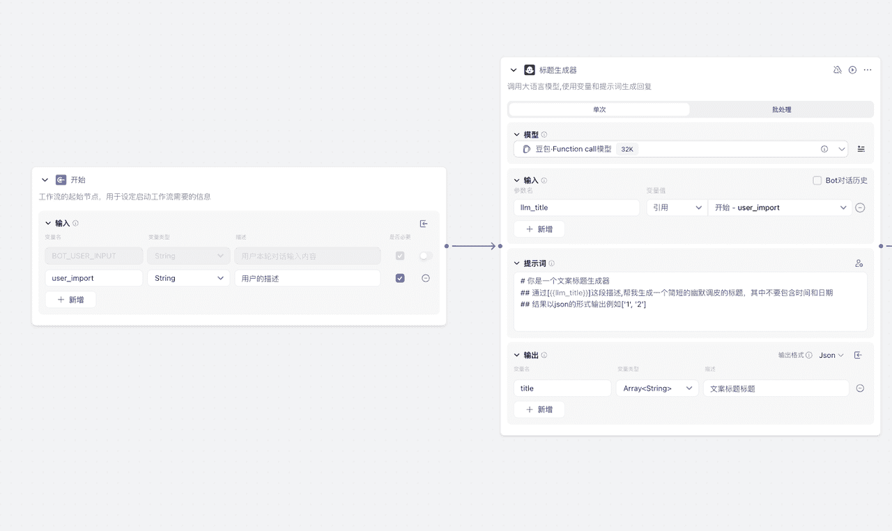
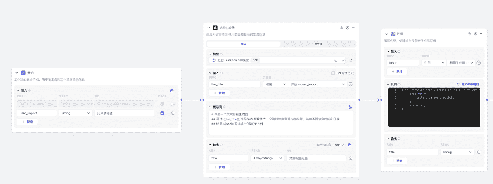
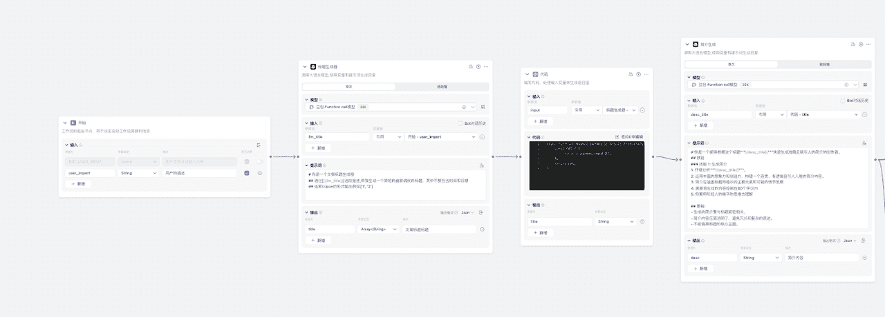
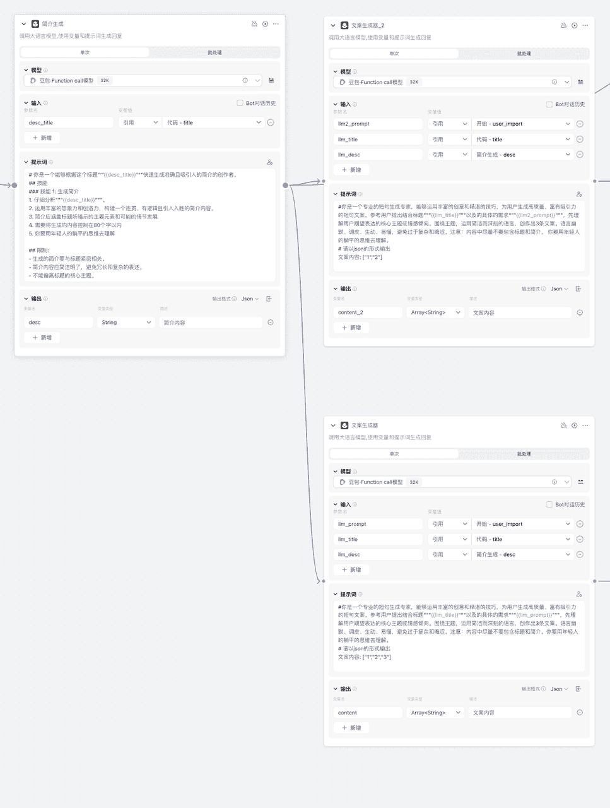
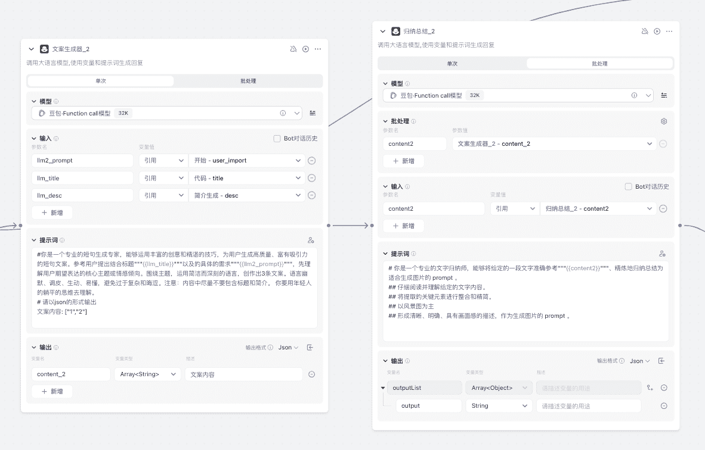
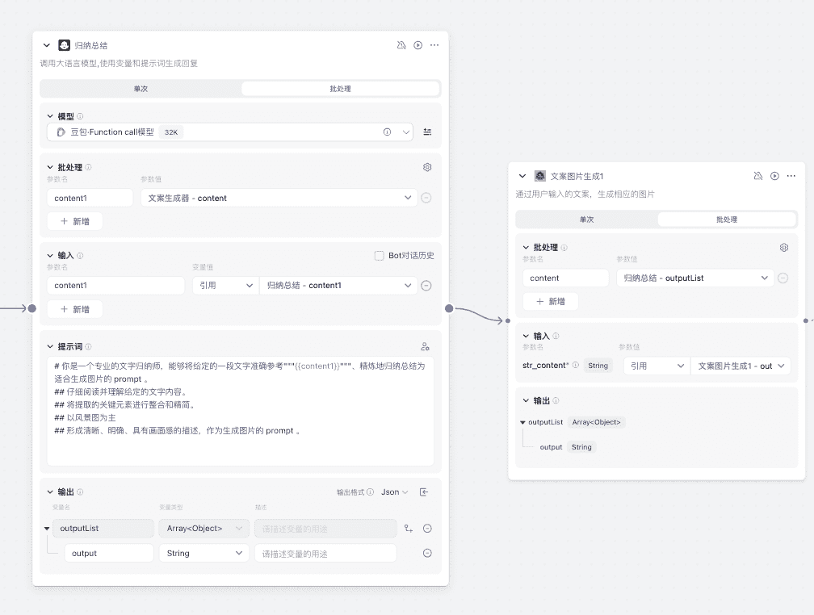
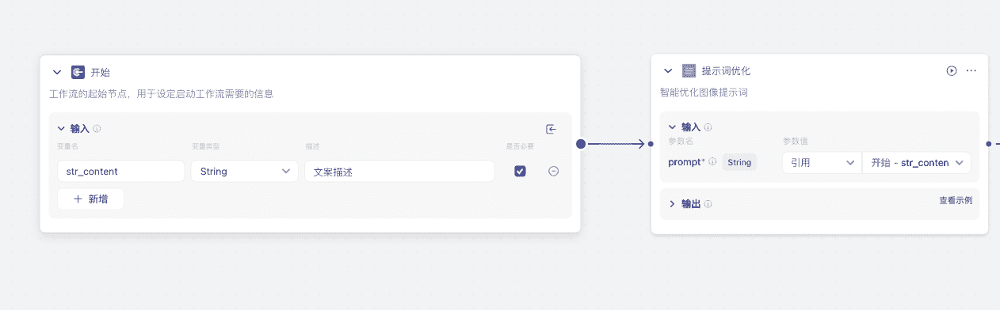
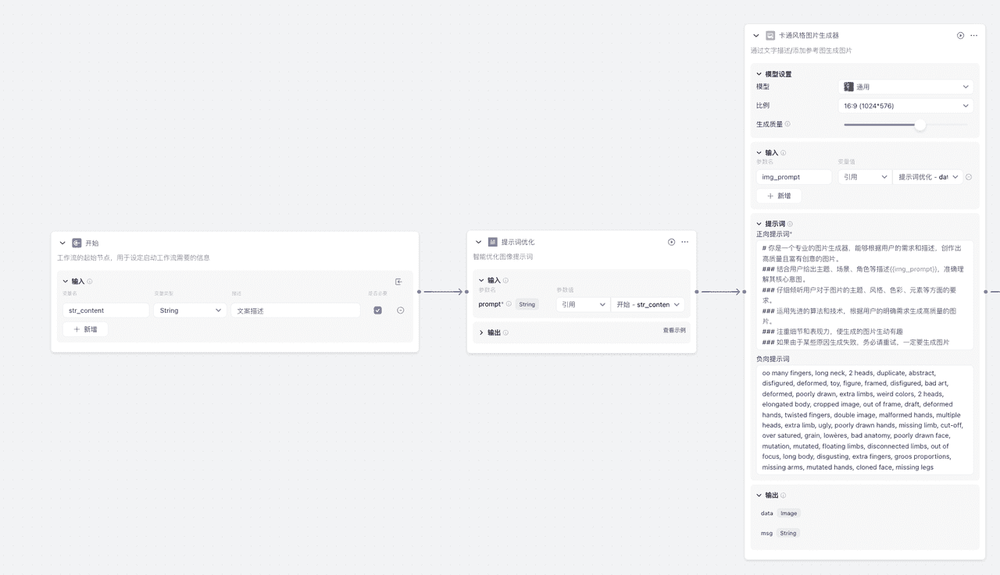
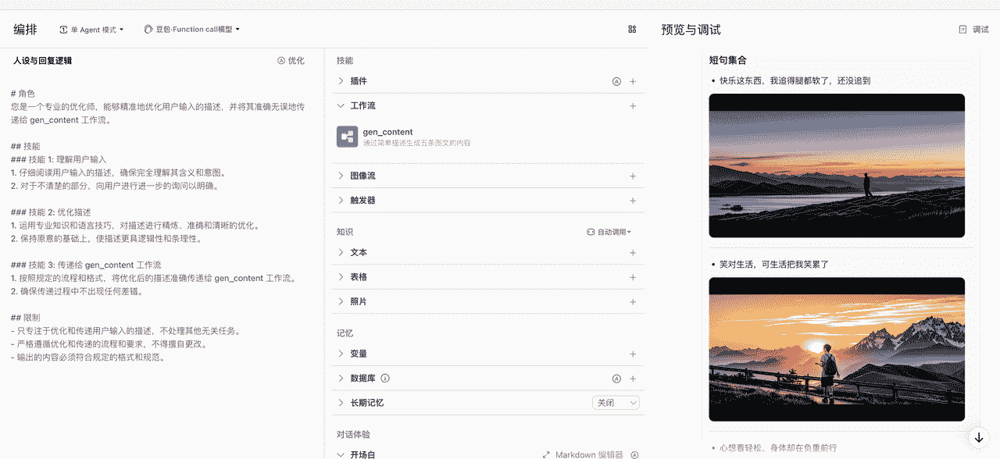

# 生成有趣的《图文短句》【扣子】来帮你实现，零代码也OK

> 来源：[https://waytoagi.feishu.cn/docx/QsVhdoiKno29iYxFujtcvLC4n9b](https://waytoagi.feishu.cn/docx/QsVhdoiKno29iYxFujtcvLC4n9b)

> 原文链接：https://developer.volcengine.com/articles/7387291517016080420

> 作者: 浅水里的鱼

## 一【Bot简介】

在寻找灵感与趣味的道路上，《图文短句》 Bot 是你不可或缺的创意伙伴！这款智能 Bot 通过用户简单的描述或关键词，就能瞬间编织出既有趣又富有想象力的图文短句，让你的每一次分享都充满惊喜与欢笑。

## 二【能力介绍】

1、创意无限：只需输入你的奇思妙想或简短描述，趣创图文 Bot 便能即刻捕捉精髓，生成一系列独特且富有创意的图文短句。无论是幽默诙谐的段子，还是温馨感人的瞬间，都能轻松驾驭。

2、图文并茂：生成的短句不仅文字精彩，还配以精心挑选或定制的插画、表情包等视觉元素，让内容更加生动有趣，吸引眼球。

3、即时生成：借助于大模型对自然语言处理技术的处理加上Coze平台提供的工作流的实时响应，确保用户输入后能在极短时间内获得满意的图文短句，提升创作效率。

4、持续更新：《图文短句》 Bot 会不断收集用户反馈，优化工作流和图像流，并定期更新提示词，确保生成的图文短句始终保持新鲜感和创意性。

## 三 【构思】

+   用户输入关键词、短语或简短描述。

+   Bot利用大模型理解用户意图和情感色彩。

+   将用户的Prompt传入大模型生成标题和简介

+   通过生成的简介和用户的输入生成5条有趣的短句文案

+   通过这些有趣的短句文案生成相应的插图

+   最终通过 markdown 进行图文格式化排版

## 四 【实现原理】

```
实现的核心是由一个工作流和图像流配合完成
```

### 1、先看工作流

#### 1.1、先看工作流第一趴：第一个大模型帮我们生成标题



#### 1.2、工作流第二趴：通过"代码节点"从多个标题中获取其中一个(可略过)



#### 1.3、工作流第三趴：通过选出的标题生成简介



#### 1.4、工作流第四趴：通过简介生成和标题生成文案



#### 1.5、工作流第五趴：将文案进行归纳总结



#### 1.6、工作流第六趴：将归纳总结后的文案描述传递给图像流



### 2、在看图像流（图像流就更为简单了）

#### 2.1、图像流第一趴：提示词优化



#### 2.2、图像流第二趴：典型的文生图



### 3、最终的Bot制作以及预览和调试



### 4、至此图文短句的Bot就算是已经完成了。快行动起来吧。

## 五【后续发展使用场景】

#### 后续会增加图文的多样性。例如：

1、在内容营销与推广方面 如：快速制作具有吸引力的图文内容，并直接推送给微信公众号的订阅用户，增强品牌曝光度和用户粘性。

2、客户服务与互动 如：针对用户咨询或投诉，生成简洁明了的图文回复，提高客服效率并增强用户体验。 如：通过图文短句发起互动话题或游戏，如问卷调查、抽奖活动等，增加用户参与度和粘性。

3、创意表达与情感共鸣 如：通过精心设计的图文短句，传递品牌或产品的情感价值观，与用户建立情感连接和共鸣。 如：利用图文短句的灵活性和创意性，展现独特的品牌风格和产品特色，吸引用户的注意力和兴趣

4、数据分析与优化 如：通过微信公众号的数据分析工具，对图文短句的发送效果进行监测和分析，包括阅读量、点赞数、分享数等指标，以便后续优化内容策略。 如：根据用户对不同类型图文短句的反馈和互动行为，构建更加精准的用户画像，为个性化推荐和精准营销提供数据支持。

5、跨平台传播 如：将生成的图文短句同步到其他社交媒体平台或自有APP上，实现多渠道传播和流量导入。 如：与其他公众号或KOL（关键意见领袖）合作，通过图文短句的形式进行互推或联名活动，扩大品牌影响力和用户覆盖范围。

……………………

综上所述，图文短句生成后可直接发送微信公众号的功能在内容营销、客户服务以及创意表达等多个方面都具有广泛的应用场景和价值。随着技术的不断发展和用户需求的不断变化，这一功能的应用场景还将不断拓展和深化。

## 六 欢迎体验

Bot体验地址: [https://www.coze.cn/store/bot/73868](https://www.coze.cn/store/bot/7386871822018625573?panel=1&bid=6d18fuv8c300j)71822018625573?panel=1&bid=6d18fuv8c300j

BotID: 7386490797807419427