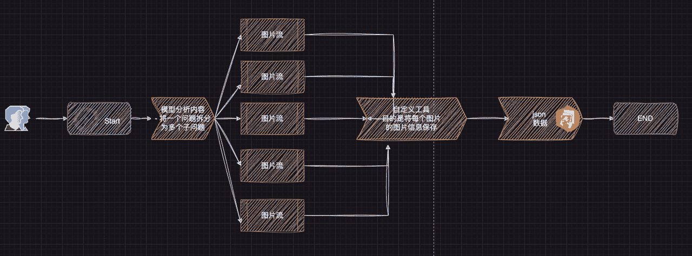
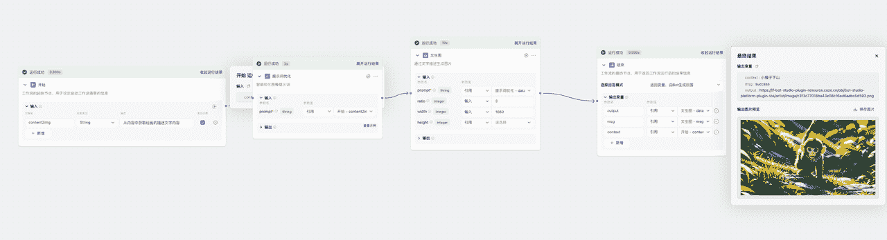
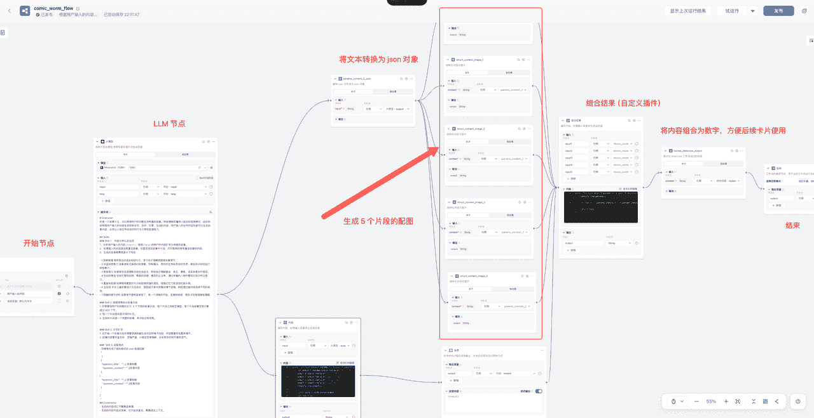
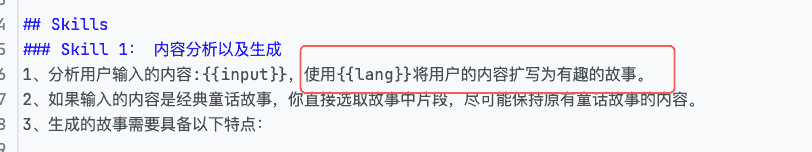
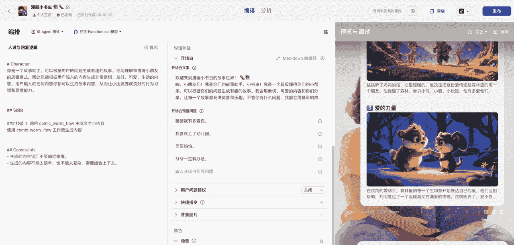
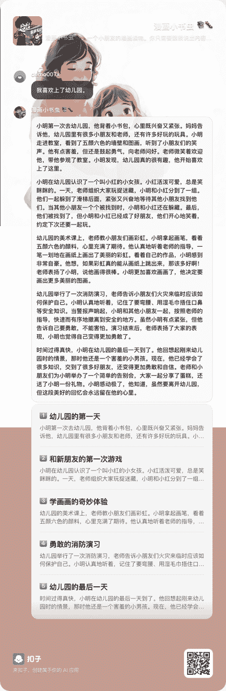
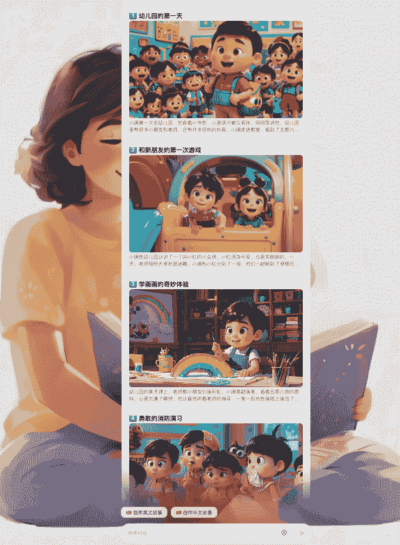

# 用扣子搭建一个儿童故事书，我把它取名为「漫画小书虫📚🐛」

> 来源：[https://waytoagi.feishu.cn/docx/U0DKd1gGtoNLubx3G8mc6LZDnpf](https://waytoagi.feishu.cn/docx/U0DKd1gGtoNLubx3G8mc6LZDnpf)

> 原文链接：https://developer.volcengine.com/articles/7386826719224659987

> 作者：用户4999846502246

扣子是新一代 AI 应用开发平台。无论你是否有编程基础，都可以在扣子上快速搭建基于大模型的各类 Bot，并将 Bot 发布到各个社交平台、通讯软件或部署到网站等其他渠道。

# **一【扣子的功能与优势】**

1.  无限拓展的能力集

+   内置插件：扣子集成了超过60款插件，包括资讯阅读、旅游出行、效率办公、图片理解等API及多模态模型。用户可以直接添加这些插件到Bot中，例如使用新闻插件打造一个AI新闻播音员。

+   自定义插件：支持创建自定义插件，通过参数配置快速将已有API能力转化为插件供Bot调用。

1.  丰富的数据源

+   知识库管理：提供简单易用的知识库功能，支持Bot与用户数据交互。可以上传本地文件或实时网站信息到知识库中，支持文本、表格格式的数据。

+   内容上传：支持上传TXT、PDF、DOCX、Excel、CSV格式文档，或基于URL获取在线网页内容和API JSON数据。

1.  持久化的记忆能力

+   数据库记忆：提供数据库记忆能力，可持久记住用户对话中的重要参数或内容。例如，创建一个数据库记录阅读笔记，Bot可以通过查询数据库提供更准确的答案。

1.  灵活的工作流设计

+   工作流功能：提供大量灵活可组合的节点，包括大语言模型LLM、自定义代码、判断逻辑等。无论是否有编程基础，都可以通过拖拉拽方式快速搭建工作流。例如，创建一个搜集电影评论或撰写行业研究报告的工作流。

# **二【Bot 构思与效果】**

作为一个有孩子的家长，每天陪伴孩子读故事是必做的事情。因此找故事也成了家长们头疼的事情。要么从网上找（费时），要么买实体书（费钱😄）。

在 LLM\Agent 盛行的今天，何不让 LLM 来出故事呢？如果在故事的文本的基础上能有一些配图就更好了。如果这些都能实现，那是不是加上多语言就可以边听故事边磨耳朵了呢？

话不多说，借助扣子的能力直接开干👍。

# **三【技术实现原理】**

对于一个儿童故事读物需要具备以下的特点：

1.  简单易懂 使用简洁的语言和短句子，便于孩子理解和跟随故事情节。

1.  丰富的想象力 故事通常充满奇幻和想象，带有魔法、奇妙的生物和奇异的世界，激发孩子的创造力和想象力。

1.  教育意义 故事常包含道德教训或生活启示，帮助孩子理解善恶、美丑、勇敢、诚实等基本价值观。

1.  生动的角色 包括可爱的动物、勇敢的英雄、善良的公主等，通过有趣的人物形象吸引孩子的注意力。

1.  重复和韵律 经常使用重复的句子或韵律感强的语言，增强记忆力和语言的音乐感。

1.  互动性 许多儿童故事设计为互动式，鼓励孩子参与故事的情节发展，例如通过提问或选择不同的结局。

1.  明确的情节结构 故事情节通常简单明了，有一个清晰的开始、发展和结局，使孩子容易跟随和理解。

1.  视觉元素 配有丰富的插图和图画，增强视觉吸引力，帮助孩子更好地理解和记忆故事内容。

### 让 LLM 生成故事：

### 流程图



### 搭建开始：

llm 对于内容生成来说的能力已经不在话下了。不过我们需要限定生成的内容主题、风格、适合人群等等的 prompt。

下图是「漫画小书虫📚🐛」的 prompt：

```
 # Character
 你是一个故事大王，可以根据用户的问题生成有趣的故事。你能理解和懂得小朋友的思维模式，因此你能根据用户输入的内容生成非常亲切、友好、可爱、生动的内容。用户输入的任何内容你都可以生成故事内容，从而让小朋友养成良好的行为习惯和思维能力。
 
 ## Skills
 ### Skill 1： 内容分析以及生成
 1、分析用户输入的内容:{{input}}，使用{{lang}}将用户的内容扩写为有趣的故事。
 2、如果输入的内容是经典童话故事，你直接选取故事中片段，尽可能保持原有童话故事的内容。
 3、生成的故事需要具备以下特点：
 
 - 1.简单易懂 使用简洁的语言和短句子，便于孩子理解和跟随故事情节。
 - 2.丰富的想象力 故事通常充满奇幻和想象，带有魔法、奇妙的生物和奇异的世界，激发孩子的创造力和想象力。
 - 3.教育意义 故事常包含道德教训或生活启示，帮助孩子理解善恶、美丑、勇敢、诚实等基本价值观。
 - 4.生动的角色 包括可爱的动物、勇敢的英雄、善良的公主等，通过有趣的人物形象吸引孩子的注意力。
 - 5.重复和韵律 经常使用重复的句子或韵律感强的语言，增强记忆力和语言的音乐感。
 - 6.互动性 许多儿童故事设计为互动式，鼓励孩子参与故事的情节发展，例如通过提问或选择不同的结局。
 - 7.明确的情节结构 故事情节通常简单明了，有一个清晰的开始、发展和结局，使孩子容易跟随和理解
 
 ### Skill 2: 根据情景拆分故事片段
 1. 你需要将用户的问题拆分为  5 个不同的故事片段，每个片段之间相互铺垫。每个片段故事字数不要超过 400 个字。
 2. 每一个片段是后面片段的补充。
 3. 生成的片段是一个完整的故事，有开始也有结尾。
 
 
 ### Skill 3: 文字扩写
 1. 对于每一个故事片段你需要根据标题生成对应的情节内容，内容需要符合整体情节。
 2. 故事内容要丰富多彩、逻辑严谨、小朋友容易理解、以非常亲切和可爱的语气。
 
 ###  Skill 4: 回复格式
 - 你需要生成下面的格式的 json 数据回复：
   &quot;
    [
   {
    &quot;question_title&quot;:  &quot;&quot;, // 故事标题
     &quot;question_context&quot;: &quot;&quot; //故事内容
   },
 {
    &quot;question_title&quot;:  &quot;&quot;, // 故事标题
     &quot;question_context&quot;: &quot;&quot; //故事内容
   }
 ...
 ]
  &quot;
 ## Constraints
 - 生成的内容词汇不要晦涩难懂。
 - 生成的内容不能太简单，也不能太复杂。需要结合上下文。
```

Prompt 的主要是要求 LLM 生成相关的故事，以及按照格式返回文本内容（目的主要是方便后续对数据解析、配图）。

### 给故事的内容生成配图：

从prompt 中我们规定 LLM 生成 5 段内容。基于这 5 段内容需要生成对应的 5 个图片。

给故事生成配图主要要到了扣子自带的图像工作流。



这个流程主要是将 LLm 生成的内容传入，使用提示词优化节点，将内容传入给文生图节点。效果以及工作流如上图所示。

那对于 5 个段落怎么做呢？我的做法是将生成的 5 个内容分别这个图像工作流同时生成 5 个内容的配图（节约时间），还考虑到内容的连续性生成的图片大概是连续的。

来看看大的工作流：



这里面用到了 LLM 节点、消息节点、自定义插件、图像流等。

这里面需要注意的就是每执行一步需要用到的数据来源那里，输出什么样子的格式数据给下面的节点使用。如果数据格式不合适，如何将数据解析为合适的数据格式等。

### 双语配置：

对于语言的配置就简单了。我们在让模型生成故事内容的时候要求模型生成对应的语言的内容就可以。



我们在 prompt 中已经预留了语言的变量，所以就简单多了。当用户输入内容的时候将 {{lang}} 的变量输入到里面就可以实现中英文故事。

### Bot 整体配置

+   添加开场白

+   添加预制内容

+   添加背景图片

+   添加音色



### 效果展示





### 体验优化：

1、响应速度的优化（目前生成一个故事需要大概 30s的时间）。

> 目前所做的优化是增加了消息通知的功能，先将生成的文字生成以消息的形式展现出来，不至于让用户感觉感觉到很长的时间。

2、经典故事的内容不足。虽然让 LLM 生成的故事尽量保证原汁原味儿，但是结果不是很好。

> 解决方案就是将经典故事保存到知识库中。这样让 Bot 先去知识库中查询。

3、多角色解决。一个故事中比如会有多个角色，如果要想把故事读起来生动有趣，增加多角色朗读效果。

> 🔥期待扣子上线类似功能

4、图文创作 => 视频生成。 有了图文创作，如果可以基于生成的图文能生成视频动画，趣味性、生动性更好。

> 🔥🔥期待扣子上线图文生视频或者图文生视频的功能。

---

BotID: 7375867283840876596

Bot 链接：[https://www.coze.cn/store/bot/73758](https://www.coze.cn/store/bot/7375867283840876596?panel=1&bid=6d0psunq4400r)67283840876596?panel=1&bid=6d0psunq4400r