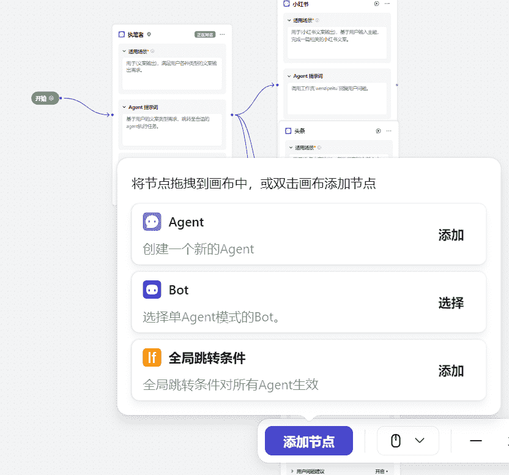
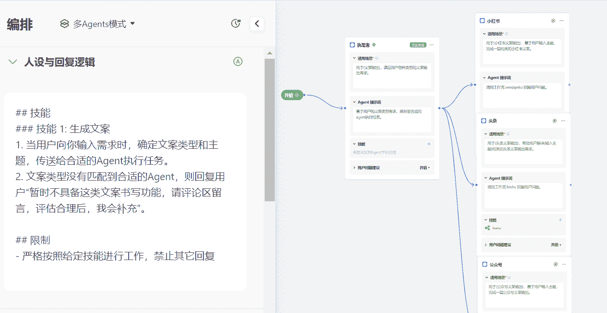
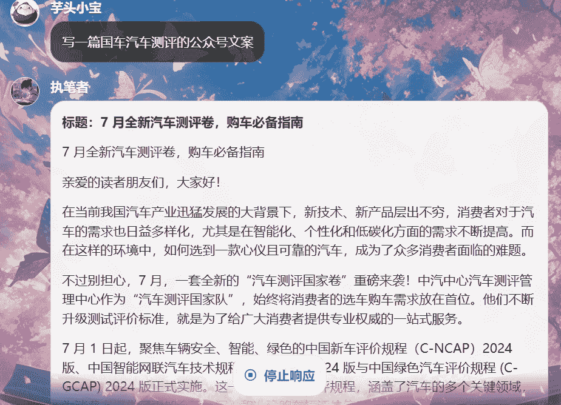
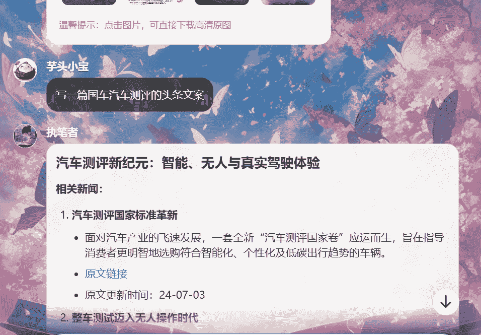

# 《执笔者》：基于多Agent模式的全能写手

> 来源：[https://waytoagi.feishu.cn/docx/OrMYdGzPCoP0MmxUttAcGsgJnZc](https://waytoagi.feishu.cn/docx/OrMYdGzPCoP0MmxUttAcGsgJnZc)

> 原文链接：https://developer.volcengine.com/articles/7387306376004894783

> 作者: 用户6810070191084; 芋头小宝

## 【创作背景】

---

在当今的全民自媒体时代，内容创作已经成为一种越来越重要的表达方式。无论是个人博主，还是企业宣传，都需要大量的优质内容来吸引用户的注意力。而在这个领域中，coze平台上的图文创作bot以其高效优质的创作支持吸引了广大创作者的关注。但是，经过认真研究发现，coze现有的图文bot主要分为两大类，一类是专注于特定垂直领域的创作，如「超级好用的小红书创作助手」，它们在特定领域内表现出色，但却无法满足博主们跨平台的需求；另一类则是涉猎广泛，但却不够专业和优质的bot，如「AI写作」。对于很多自媒体博主来说，需要同时入驻多个平台，根据不同平台的格式和调性进行创作，单一的或者泛泛的文案创作助手并不能满足他们所有的需求。

因此，我萌生了一个想法，那就是打造一个全且优的文案创作助手，一站式解决所有创作需求，一劳永逸。这个助手需要能够适应复杂的多任务型场景，每个任务互不干涉，这让我想到了多agent模式。事实上，我之前已经开发了相关的小红书和头条文案创作bot，如果使用多agent模式来整合，就能节省很多复杂的prompt书写和调试工作。

具体怎么做呢，接下来我会分4步和大家简单拆解一下：

## 【操作步骤】

---

1.  多agent模式切换

在bot编排页面点选多agent模式，页面将会自动切换为多agent调式状态，相比单agent，主要是多了中间一块的agent连接区。

切换多agent后的默认页面

1.  添加合适节点

节点这里有两种方式可以选择，用已发布的bot，或者创建一个新的agent，大家按需选取。添加的agent直接连接在默认的总管agent（“执笔者”）后面即可，无结束节点。

1.  添加合适的prompt

在多agent模式下，我们需要为每个agent填写合适的prompt。外围的人设填写该bot的主要功能，内部的bot填写各个bot/agent的应用场景。

1.  调试与美化

经过以上简单三步，一个多agent的bot就基本搭建完成，接下来就是漫长的调试过程，如果输出与自己设想有差异，可以不断调整外围和内部bot的提示词，提升命中率，优化交互。

## 【成果展示】

---

多agent协作的《执笔者》就是经过上述4步搭建出来的，总体用时不到10分钟（之前的bot或者工作流已调试好的前提下），目前只协作了三个agent，每个agent都根据任务分工集成了不同的工作流、图像流等内容，各司其职，互不干扰，整体交互模式保持一致即可。

执笔者当前的主要功能是支持小红书、公众号和头条平台的图文创作，简单使用一个“主题词+平台类型”即可召唤相关bot输出优质内容，部分示例如下：

《执笔者》的出现，不仅极大地提高了我的工作效率，也为我提供了更多的时间和精力去专注于内容的创作。后续也会不断更新迭代（人物专栏[、作文、书籍等），使她成为真正的全能优质写手。感兴趣的朋友欢迎前往试用](https://www.coze.cn/store/bot/7387404430825668643?panel=1&bid=6d1b1va9o1g18)，我相信《执笔者》会成为你们创作路上的得力助手。 https://www.coze.cn/store/bot/7387404430825668643?panel=1&bid=6d1b1va9o1g18

## 【商业模式】

---

+   接入微信或者抖音，通过为广大创作者提供服务的方式引流

+   为品牌商或特殊客户提供批量优质定制文案收费服务

BOTID：7386947021552320564