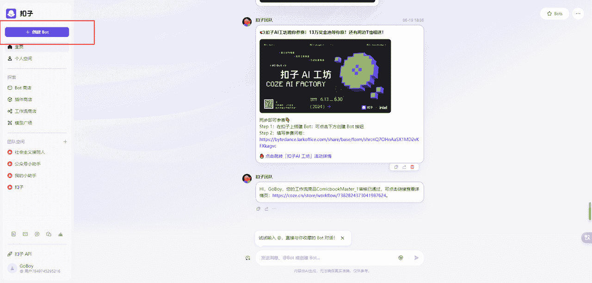
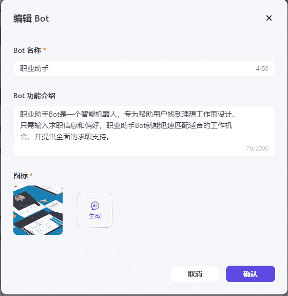
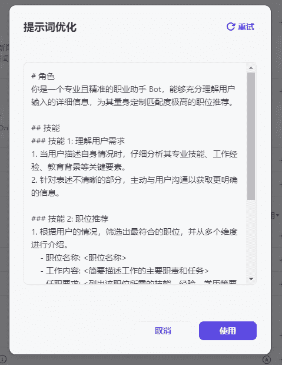
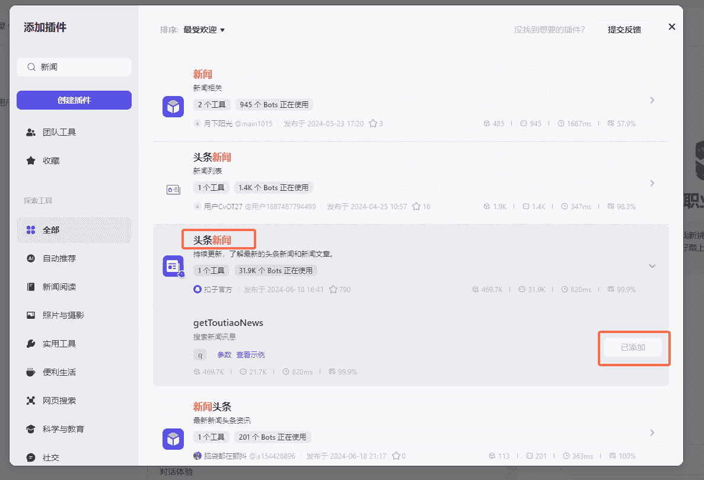
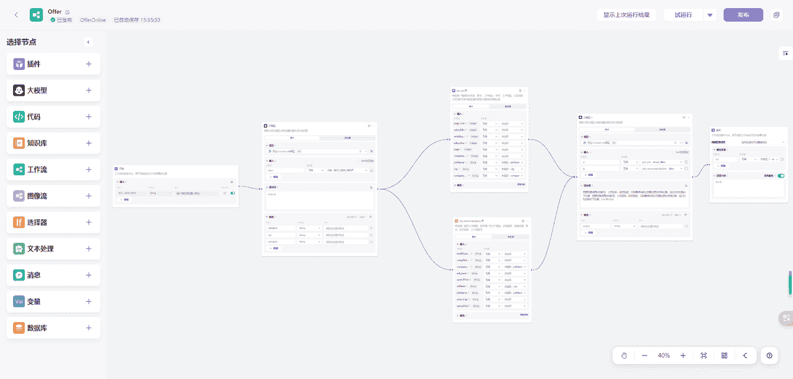
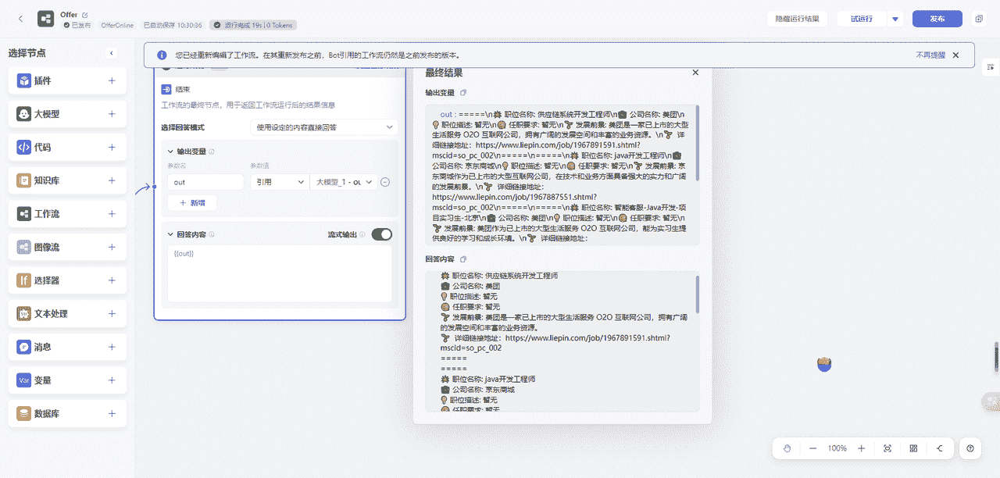
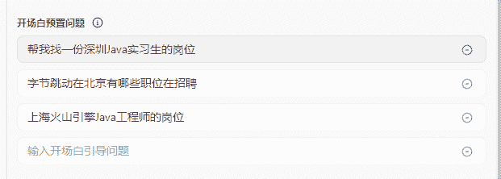
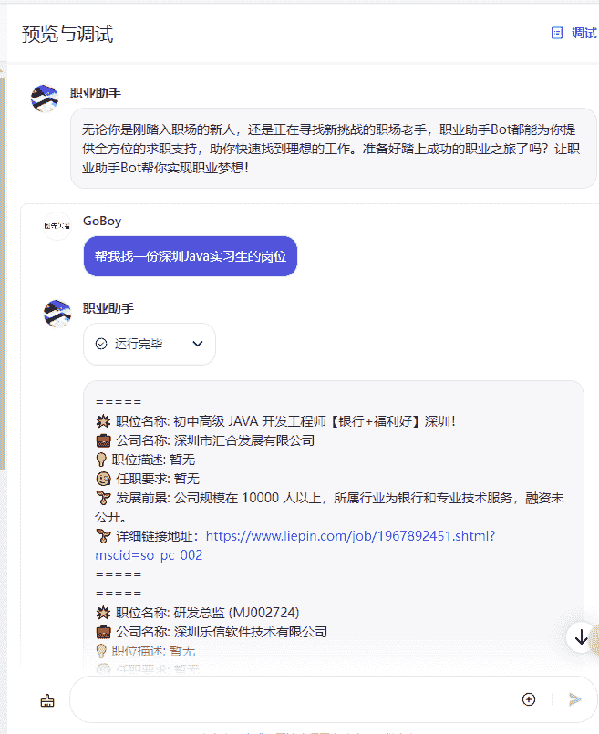
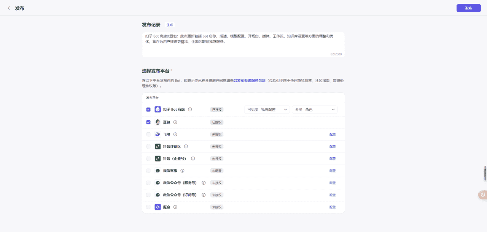

# Coze直聘，职业助手Bot助力拿好Offer

> 来源：[https://waytoagi.feishu.cn/docx/RrlrduxnyoZUR9xMm5SclORDn8b](https://waytoagi.feishu.cn/docx/RrlrduxnyoZUR9xMm5SclORDn8b)

作者：GoBoy

## 职业助手Bot

---

**职业助手Bot**是一个智能机器人，专为帮助用户找到理想工作而设计。只需输入求职信息和偏好，职业助手Bot就能迅速匹配适合的工作机会，并提供全面的求职支持。

## 设计理念

---

职业助手Bot旨在通过智能化和个性化的服务，帮助求职者更快、更精准地找到理想工作。

---

### **高效匹配**

利用先进的算法和大数据分析，职业助手Bot能够迅速从海量的招聘信息中筛选出最适合用户的职位。通过精准匹配，帮助用户节省时间，提高求职效率。

---

### **实时更新**

职业助手Bot持续跟踪最新的招聘信息，确保用户不会错过任何一个机会。通过即时通知功能，让用户始终掌握最新的求职动态。

---

### **个性化推荐**

根据用户的职业目标、工作经验、技能、地域偏好等信息，职业助手Bot提供高度个性化的职位推荐服务，确保每一个推荐都符合用户的需求。

---

### **数据安全**

职业助手Bot非常重视用户数据的安全与隐私，采用最先进的安全技术，确保用户的个人信息和求职数据不被泄露。

## 创建Bot

在Coze的主页，创建一个我们的Bot；

输入Bot名称与Bot介绍

并且使用AI功能，帮我们生成一个图标。（当然也可以上传自己喜欢的图标）

## 人设与回复逻辑

可以简单的描述Bot的人设与逻辑，然后使用AI助手，对其进行优化。

例如：

> 角色： 你是一个专业的职业助手 Bot，能够根据用户输入信息为用户精准提供匹配的职位推荐。

优化后如下：点击使用即可；

## 技能

为我们的Bot增加一些技能

## 插件

我们增加一个新闻类插件，来捕捉行业相关的动态。

## 工作流

定义一套工作流，从多个招聘网站中，精确的获取招聘信息，然后在对招聘信息进行格式化处理，统一输出标准的招聘信息格式。

例如：北京市Java实习生职位

## 开场白

> 无论你是刚踏入职场的新人，还是正在寻找新挑战的职场老手，职业助手Bot都能为你提供全方位的求职支持，助你快速找到理想的工作。准备好踏上成功的职业之旅了吗？让职业助手Bot帮你实现职业梦想！

## 开场白预置问题

帮我找一份深圳Java实习生的岗位

## 预览与调试

## 发布

描述版本记录，可以使用Tab键自动生成，选择需要发布到的使用平台。

## 职业助手Bot的使用场景与商业化场景分析

职业助手Bot不仅可以为求职者提供高效的求职服务，还可以在多种商业化场景中发挥重要作用，推动职业服务行业的数字化和智能化进程。以下是职业助手Bot的使用场景和商业化场景分析：

---

### 使用场景

**个人求职者**

+   **应届毕业生**：帮助刚毕业的学生快速找到与其专业和兴趣相匹配的入门职位。

+   **职场新人**：为刚进入职场的人提供职业建议和职位推荐，帮助他们顺利迈入职场。

+   **职场跳槽者**：为已有工作经验的人推荐更适合其职业发展目标的新职位。

**企业招聘**

+   **中小企业**：帮助中小企业通过智能匹配技术快速找到合适的候选人，节省招聘时间和成本。

+   **大公司招聘平台**：集成职业助手Bot，提高招聘效率，改善候选人体验。

**职业培训机构**

+   **培训结束后的求职推荐**：为职业培训机构的毕业学员提供定制化的职位推荐服务，提升学员的就业率。

**高校和职业学校**

+   **校园招聘**：协助高校和职业学校为毕业生提供就业服务，推荐合适的职位和实习机会。

---

### 商业化场景分析

**付费会员服务**

+   高级求职推荐：提供更精准的职位匹配和推荐服务，帮助用户快速找到高质量的工作。

+   简历优化与面试辅导：为付费会员提供一对一的简历优化和面试辅导服务，提升求职成功率。

**广告和合作**

+   企业广告：在Bot平台上投放招聘广告，让企业的招聘信息得到更多曝光。

+   合作推广：与招聘平台和人力资源服务公司合作，共享用户资源，扩大市场影响力。

**数据分析服务**

+   市场分析报告：为企业提供基于求职者数据的市场分析报告，帮助企业了解行业趋势和人才需求。

+   招聘策略优化：利用数据分析优化企业的招聘策略，提高招聘效率和质量。

**白标解决方案**

+   定制化Bot服务：为大公司、招聘平台和职业培训机构提供定制化的职业助手Bot解决方案，帮助他们提高服务质量和用户满意度。

**职业发展服务**

+   职业规划咨询：提供职业发展咨询和职业规划服务，帮助用户制定长期职业发展计划。

+   技能提升课程推荐：根据用户的职业目标和发展需求，推荐合适的培训课程和学习资源。

---

## 结语

职业助手Bot通过多样化的使用场景和商业化模式，为求职者和招聘企业提供高效、智能和个性化的服务。随着职业助手Bot的不断发展和优化，它将在求职和招聘市场中发挥越来越重要的作用，推动整个行业的数字化转型和服务升级。准备好体验职业助手Bot带来的求职革命了吗？让我们一起迈向智能求职的新时代！

**BotID** ：7382833733411995686