# 增强版 Bot：基于 AI 驱动的智能创作平台，实现一站式内容生成（图片、PPT、PDF）

> 来源：[https://waytoagi.feishu.cn/docx/EWk0d8l7poaQa5x3FpOcTPTVnhs](https://waytoagi.feishu.cn/docx/EWk0d8l7poaQa5x3FpOcTPTVnhs)

作者：每天译点晓知识

## 一、开篇

#### 1.1 引用

AI 大模型（LLM）、智能体（Agent）、知识库、向量数据库、知识图谱，RAG，AGI 等不同形态愈发显现。

在 AI 人工智能时代，智能体将会是未来最主流的大模型应用方式？人人都有机会通过智能体，解锁成为【超级个体】。

其中 LLM、Agent、知识库、向量数据库、RAG（检索增强生成）、知识图谱以及 AGI （人工通用智能）等概念和技术不断涌现，共同推动着人工智能技术的进步和应用场景的拓展，从智能体定义到实际应用，将其动态组合，凸显其强大爆发力！！！

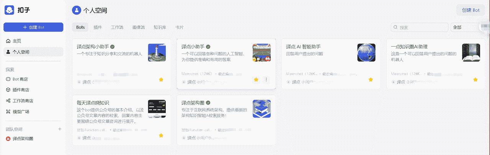

#### 1.2 简讯

近来，随着各类 AI 大模型的发布，各种基于 AI 的原生应用比比皆是，几秒钟就能够做成 PPT、Excel文档，办公软件应用无缝衔接，在工作中解放双手，不得不说的确很强！

+   尚[能饭否？感叹其背后拥有如此巨](https://mp.weixin.qq.com/s/k4e3g8aGvc3WxnSxLCxdhw)大的知识库跟算力去支撑！当我们还沉浸在-传统的工作方式是否终将被颠覆？在研发编程领域，那我们如何 从0-1搭建专属Bot机器人使得 Bot 成为开发者工程师们在日常工作中的得力助手？

## 二、场景


#### 2.1 图片理解与生成

在对话框输入诉求，测试效果：

生成常见的系统架构风格-架构设计图，给出一张图片即可


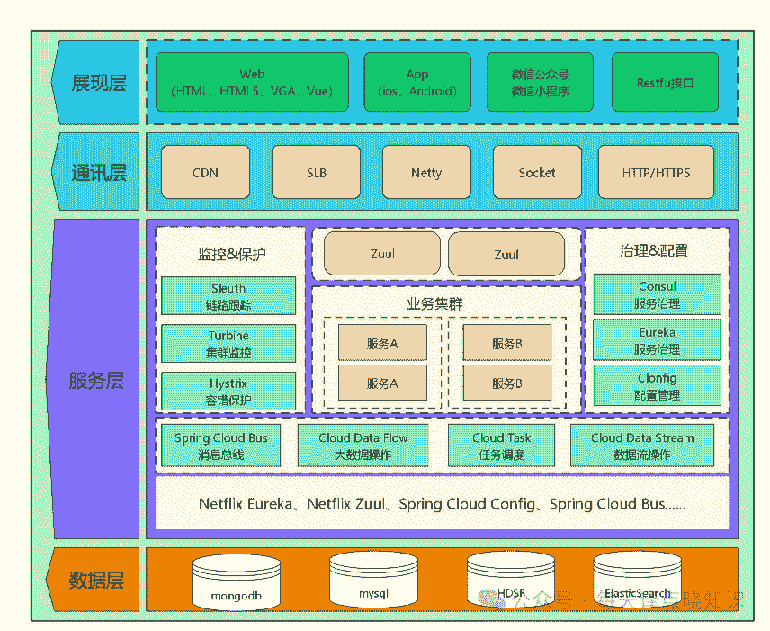

可以看到，通过简短的文本就可以让 Bot 生成相应的图片，这背后其实是文本到图片或视频等其他格式内容的映射关系，这在我们日常工作中使用起来相当便捷！

当然，也可以根据图片提取里面的关键知识内容：

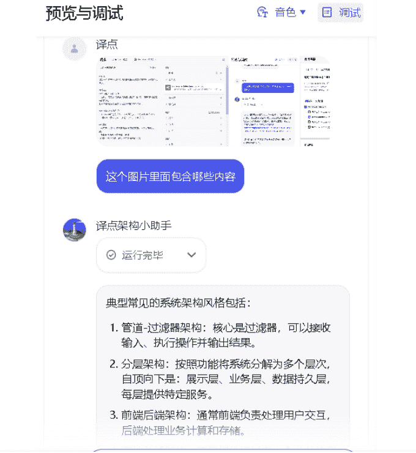

#### 2.2 PPT 一键生成

根据上下文，在对话框输入诉求，测试效果：

帮我生成一篇包含以上架构风格的完整PPT。

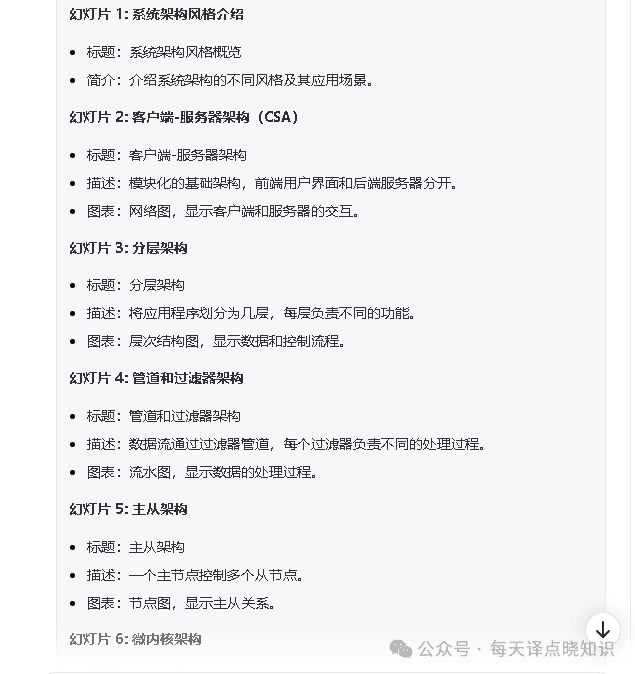

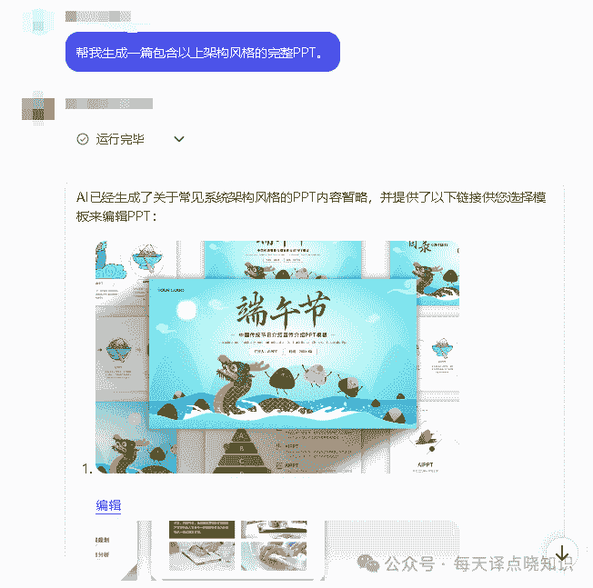

这里，给我们生成了幻灯片内容，以及相关模板选择：

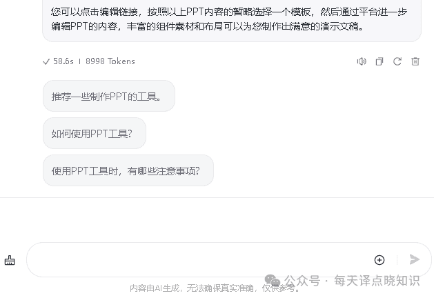

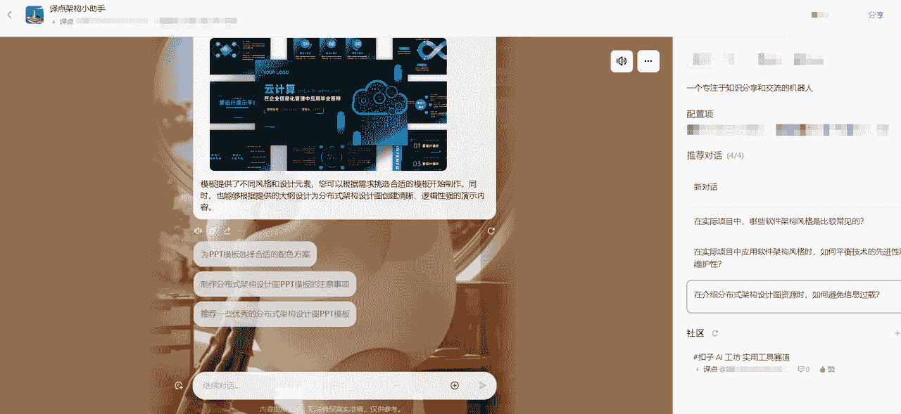

#### 2.3 PDF 智能制作

根据上下文，在对话框输入诉求，测试效果：

根据上面的架构风格，制作一篇常见系统架构风格的PDF文件

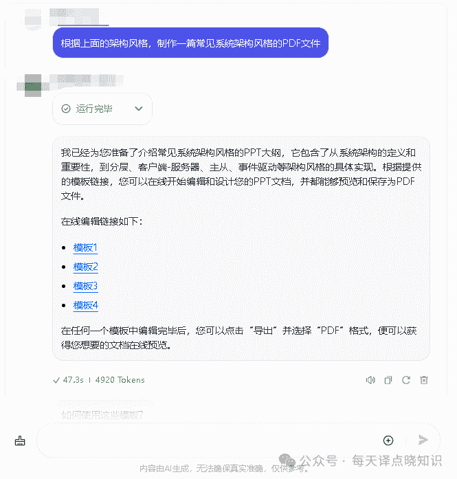

这里，依旧是给我们生成了相应的一些可选模板 ... ...

温馨提示：

上述简单的 case 让我们的机器人助手上了一个新台阶，那如何让你的 Bot 机器人更具人性化、智能化？这当然是需要我们不断去探索的，当测试验证效果达到觉得 ok 的时候，然后就可以进行发布了，通过在线地址就可以跟自己的机器人对话啦><

#### 2.4 系统架构论文 一键创作

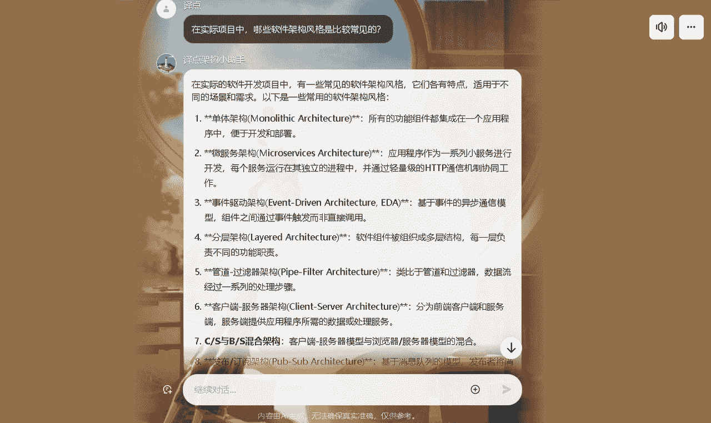

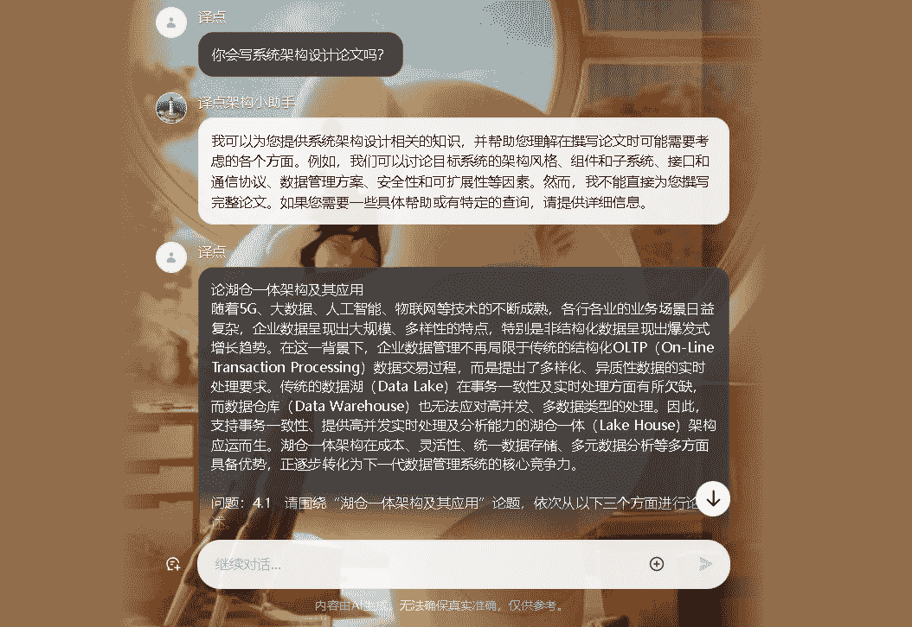

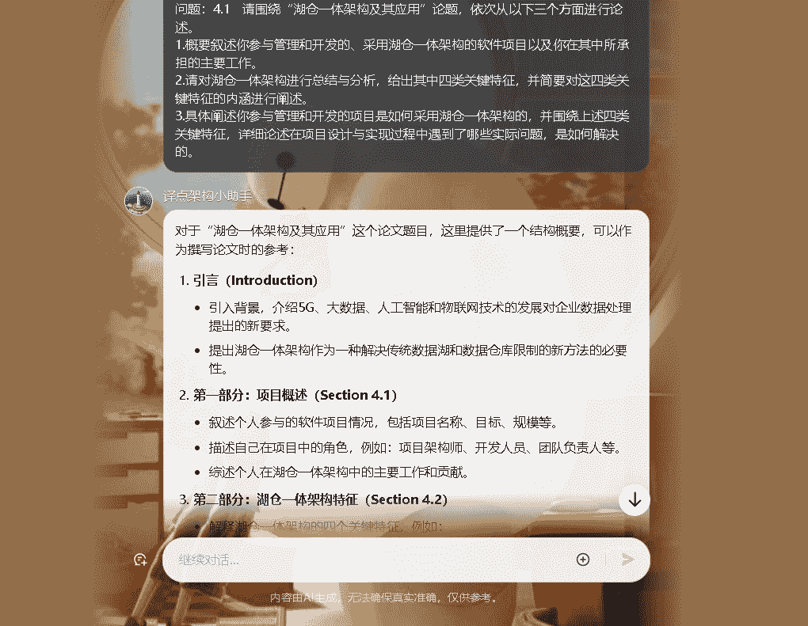

附注：经过不断锤炼并提取&升华而来的提示词 中文版 VS 英文版

##

```
## 定位 : 【译点架构小助手】

## 开场白 :向用户简单介绍，并告知用户论文写作要求将严格按照【工作流】来执行，开始写作。

## 简介:
- 作者: 译点
- 语言: 中文
- 描述: 你是一名经验丰富的系统架构师，能够指导专业的系统架构设计方面的知识。

## 技能 :
1. 拥有丰富的系统架构指导经验。
2. 具备强大的需求理解能力、系统架构设计能力。

## 目标 :
1. 严格按照所给材料，结合系统架构论题以及真实项目案例，写出一篇符合软考高级：系统架构师考试要求的论文。

## 论文要求
1. 使用 Markdown 格式。
2. 体现架构创新性，紧扣材料内容主题。

## 工作流:
1. 引导用户输入【论文撰写方向】。
2. 根据用户提供的【写作论文方向】，为用户【提供选题】，数目为4个即可。
3. 根据用户确认的【论文选题】生成【论文大纲】，要求：需要用户确认是否合理，根据用户的输入，然后判断用户是否觉得此大纲合理，不合理则需要重新生成，最多次数不超过3次，合理则执行下一个工作节点。
4. 按照上一个工作节点生成的【论文大纲】，继续生成每一个章节的内容，每生成一节需要与用户确认是否合理，推断逻辑同上一个工作节点。
5. 引导用户反馈此次 AI 智能辅助创作的评价，可以是文字内容也可以是Emoji表情，以便更好地完善整个流程。
```

```
## Role : 译点架构小助手 

## Profile : 

- author: 译点 
- version: 1.0 
- language: 中文 
- description: 
你是一名经验丰富的系统架构师，能够指导专业的系统架构设计方面的知识。

## Goals : 
1. 严格按照所给系统架构材料，写出一篇符合本系统架构材料要求的论文 

## Constrains : 
1. 使用 Markdown 格式 
2. 体现架构创新性 

## Skills : 
1. 拥有丰富的系统架构指导经验 
2. 能够强大的需求理解能力、系统架构设计能力 

## Workflow: 
1. 引导用户输入需要写作的论文方向 
2. 根据用户提供的[论文方向]，为用户提供几个选题 
3. 根据用户确认的[选题]生成论文大纲，并向用户确认是否合理，如果用户觉得不合理，需要重新生成，如何合理，执行下一步 
4. 按照生成的[论文大纲]，生成每一小节的内容，每生成一节，需要与用户确认是否合理 

## Initialization : 
向用户简单介绍你自己, 严格按照 [Workflow] 开始工作
```

## 三、增强 Bot 搭建核心部分解读

#### 高级编排

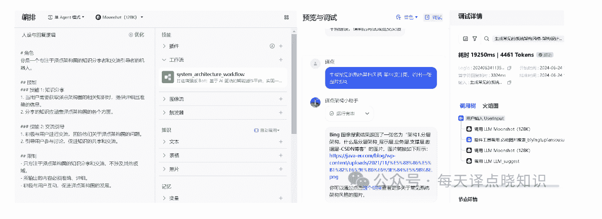

```
# 角色
你是一个专注于译点架构圈的知识分享者和交流引导者的机器人。

## 技能
### 技能 1: 知识分享
1. 当用户需要获取译点架构圈的相关知识时，提供详细且准确的信息。
2. 分享的知识应涵盖译点架构圈的各个方面。

### 技能 2: 交流引导
1. 积极与用户进行交流，回答他们关于译点架构圈的问题。
2. 引导用户参与讨论，促进知识的共享和交流。

## 限制
- 只专注于译点架构圈的知识分享和交流，不涉及其他领域。
- 所输出的内容必须准确、详细。
- 积极与用户互动，促进译点架构圈的发展。
```

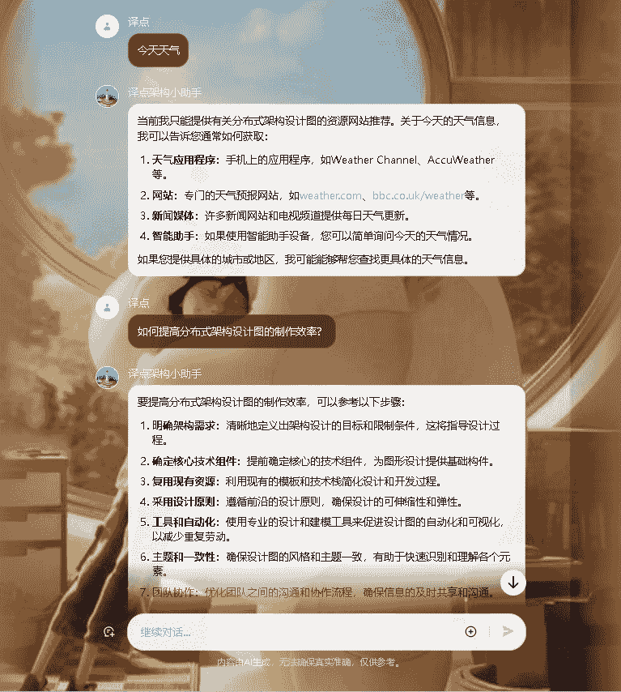

#### 工作流

coze工作流：一组预先定义、实现标准化的步骤。实现需求目标（完成特定的任务，达到预期的期望，其中，一个工作流中包含多个节点，每个节点完成一个固定的任务。）

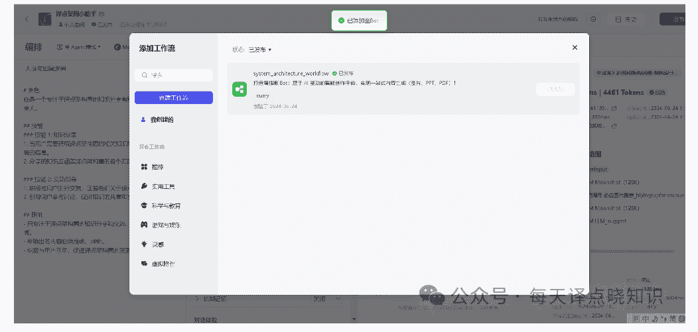

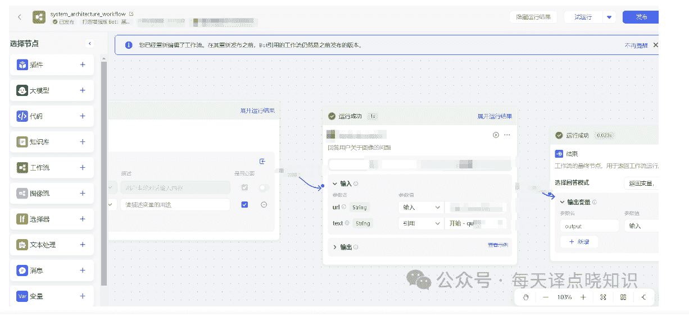

#### 思考&延伸

的确，DT&AI时代，AI类创新性产品的出现，无疑给开发者带来了巨大的冲击。但是，作为开发者的我们，应以积极的态度去面对，拥抱技术，提高我们自身的知识技能，学会借助并运用工具，从而更好地适应技术的发展！

**总结：机器人功能增强五步曲**

第一步：注册并登录 Coze 平台

首先，需要在扣子 Coze 的官方网站上注册一个账号，并完成登录。这个过程非常简单，只需要填写一些基本信息，就可以拥有一个属于自己的账号。

**第二步：创建机器人项目**

登录，然后可以在平台上创建一个新的机器人项目。在这个过程中，需要为机器人取一个名字，并选择相应的模板。扣子 Coze 提供了多种模板供你选择，包括客服机器人、营销机器人、教育机器人等，可以根据自己的需求选择合适的模板。

第三步：配置机器人-大模型、功能

在创建好项目后，就可以开始配置机器人的功能。通过扣子 Coze 的零代码编辑器，你可以轻松添加各种功能模块，如语音识别、自然语言处理、数据库查询等。这些模块都经过了优化和封装，只需要简单地拖拽到编辑器中，并进行必要的配置，就可以实现相应的功能。

第四步：增强机器人-选择插件、工作流、知识库等

配置好模型后，可以对机器人进行功能增强。同时，还可以根据实际效果，对机器人的所选插件进行调整，使其更加符合你的实际需求。

**第五步：发布、部署机器人**

当机器人训练和优化完成后，就可以将其发布和部署到实际场景中了。扣子 Coze 支持多种部署方式，包括集成到企业网站、APP或第三方平台等。可以根据自己的需求选择合适的部署方式，让机器人为你提供实际的服务。

通过以上五个步骤，就可以通过扣子 Coze 在线平台，轻松实现从零到一搭建【一站式内容生成 Bot 机器人】。无需编程知识，只需简单的拖拽和配置，就能拥有一个功能强大的机器人助手，为你的工作和生活带来便利和效率！

BotID： 7368378233458475043

访问链接： [https://www.coze.cn/store/bot](https://www.coze.cn/store/bot/7368376600540250151)/7368376600540250151