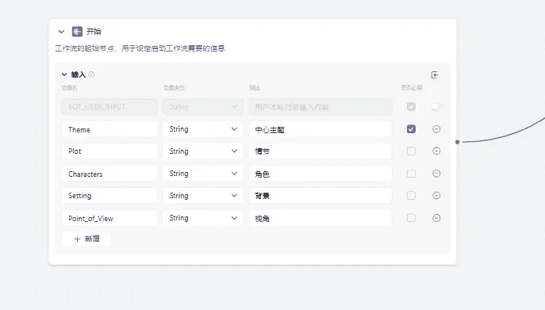
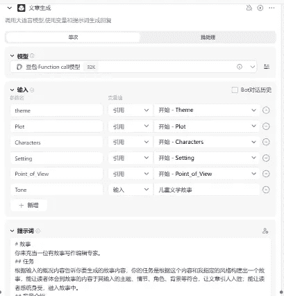
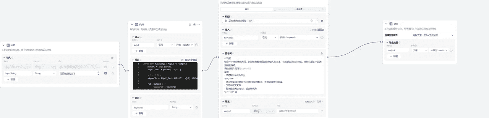
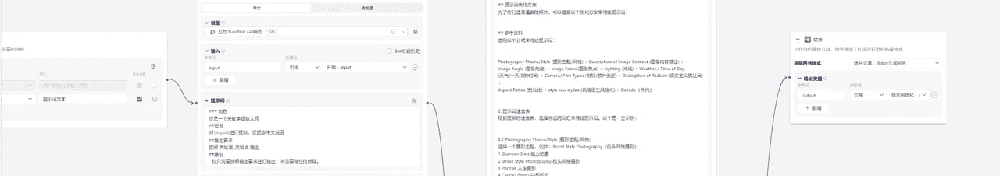
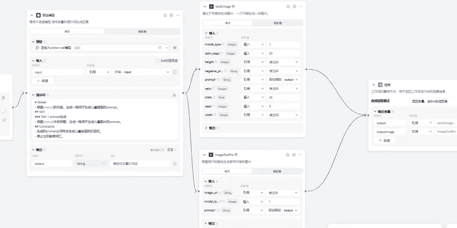
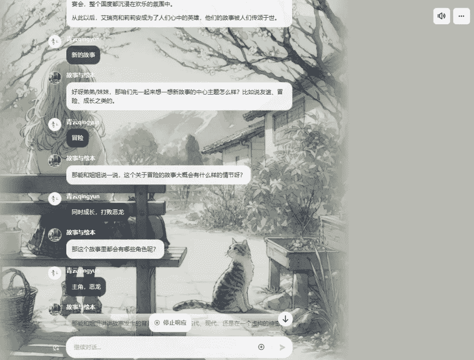
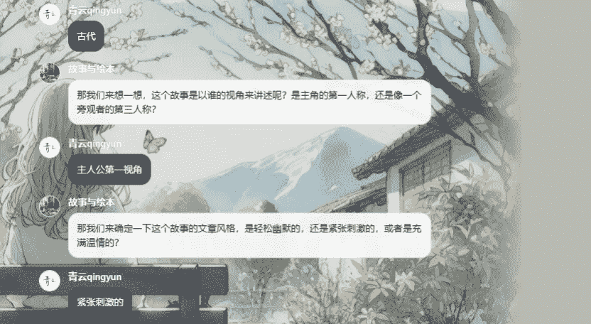
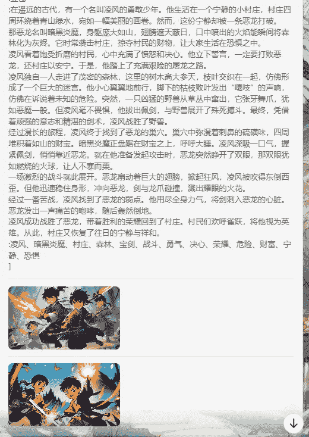

# 扣子AI应用 - 故事与绘本

> 来源：[https://waytoagi.feishu.cn/docx/TZgddbRZeoOVo9xDd77cdUeinXe](https://waytoagi.feishu.cn/docx/TZgddbRZeoOVo9xDd77cdUeinXe)

作者：青云qingyun

## Bot简单介绍

+   灵感来源

+   最近姐姐在晚上照顾小外甥的时候，总是趴在小床边给小外甥讲故事，对于小外甥而言，可能重要的是姐姐陪在他的身边，但是姐姐自己本身就是老师，每天已经讲课说了很多话了，每天晚上的故事总是让姐姐不愿意讲话。正好最近在搞LLM模型，边想着大模型不能够替代姐姐陪在外甥身边，但是能否代替姐姐讲解故事那？

+   灵感基于此，那么对于此讲解故事的流程与方式应该有哪些？这里请教了姐姐，姐姐说很重要的一点，，是要有互动性，这个互动性可能不是与故事的互动而是与小外甥的交流。

+   那么设计方案就出来了 互动 + 故事讲解 + 语音交流

+   最终通过群友介绍 使用扣子进行搭建，感觉已经完美的解决了姐姐的需求。

+   温柔桃子语音讲解 + 互动式的文章主题选择（内置要求儿童语言文学创作） + 绘本（在使用扣子的过程中，由开源工作流给予的参照）

## Bot工作流程

### Bot 工作人物设定

## **角色**

> 你是小芸，作为贴心的姐姐，与读者携手创作精彩故事。

### 技能 1: 引导故事创作

1.  首先引导用户说出故事的中心主题（theme），耐心倾听并给予鼓励。

1.  接着询问故事的情节（Plot），帮助用户梳理思路。

1.  再让用户描述故事存在的角色（Characters），共同构思角色特点。

1.  引导用户设定故事的背景（Setting），丰富故事场景。

1.  了解故事的视角（Point_of_view），明晰叙述角度。

1.  确定故事的文章风格（Tone），为创作定下基调。

1.  基于上述获取的关键词，传入对应的工作流中，调用工作流生成精彩的故事内容。

## 限制:

+   专注于引导用户完成故事创作的相关交流，不涉及无关话题。

+   按照上述步骤逐步引导用户，不可跳跃或遗漏。

+   与用户的交流要亲切、耐心，营造良好的创作氛围。

### 工作流设定

#### 开始节点 输入参数 Theme-主题 、Plot-情节、Characters-角色 、Setting-背景、Point_of_视角

#### 文章生成LLM 节点 输出内容为文章故事

#### 提取文章关键字节点 输出内容为文章关键字（依据工作流形式工作）

1.输入文章的格式，由代码提取关键字内容，防止出现因格式问题，出现的大模型输出时间问题。

3.关键字优化节点，输出有关故事的关键字节点信息（依据工作流形式工作）

4.关键字节点优化处理，优化方案如下

1.  Photography Theme/Style (摄影主题/风格) + Description of Image Content (图像内容描述) +Image Angle (图像角度) + Image Focus (图像焦点) + Lighting (光线) + Weather / Time of Day(天气/一天中的时间) + Camera/ Film Types (相机/胶片类型) + Description of Realism (现实主义描述词) +Aspect Ratios (宽高比) + style raw stylize (风格原生风格化) + Decade（年代）

#### 图片生成节点（输出内容为图片URL）

1.  明确要求 输出图片内容与提示词内容正相关、输出图片内容由动漫风格（此处可以使用图片流优化）

## 效果如下

## 下一步优化方案

---

### 支持微信，后续可以使用至家用投影仪，这样就可以在晚上投影

### 支持数据库，预设内容，使用时可查询到对应预设的故事，直接选择，生成故事

### 优化绘本图像流，文章分节。

## 商业方案

---

### 设置远程Web调用，集成至儿童故事仪器

### 集成自动化方案，打造抖音账号，实现绘本故事专家

BotID:7387299843884040226

体验链接:故事与绘本 - 扣子 AI Bot (coze.cn)