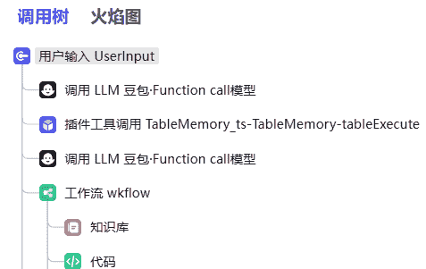

# 🌟 一站式职业规划服务，为您量身定制求职路径， 从性格测试到理想工作匹配，助您实现职业目标

> 来源：[https://waytoagi.feishu.cn/docx/ZsWadqJZZoqTsoxxU4Xcln2hnve](https://waytoagi.feishu.cn/docx/ZsWadqJZZoqTsoxxU4Xcln2hnve)

作者：less is more

### 一、背景

随着国内高校毕业生逐年增加与高质量岗位的短缺，许多人对如何规划自己的职业生涯感到困惑。尤其对于学生和职场新人，在选择职业路径时更是因为职业资源不充分而困难重重。基于此，本 BOT 致力于职业规划，旨在通过系统的分析和个性化的建议，帮助用户了解自己专业的就业前景，评估自身技能与市场需求的匹配程度，制定科学合理的职业发展计划。接下来，我会从它的简介、构思、技术实现原理到未来的使用场景和商业化前景，带大家全面了解这个作品。

### 二、Bot简介

职业规划导师（校招版）功能包括：

1.  **职业趋势分析**：基于最新的市场数据和行业报告，协助用户分析自身专业或职业的职业前景，帮助用户了解未来的职业趋势。

1.  **技能评估与提升**：通过测评工具评估用户当前的职业兴趣，提供针对性的学习资源和课程建议，帮助用户提升专业技能。

1.  **职业匹配与推荐**：根据用户的兴趣、技能和职业目标，推荐适合的职业路径和职位，提供个性化的职业建议。

1.  **职业发展规划**：结合用户的个人情况和市场需求，制定详细的职业发展计划，包括短、中、长期目标，帮助用户在 AI 时代中找到自己的职业定位。 通过这款 AI 职业规划产品，我们希望帮助用户在快速变化的就业市场中保持竞争力，实现职业理想，同时也为企业培养更多具备 AI 技能的人才，推动整体社会的科技进步和经济发展。 ### 三、搭建思路 智能客服助手的核心构思在于利用企业已有的知识积累，结合大模型的强大能力，为用户提供准确且简洁的答案。具体而言，通过创建一个企业私有知识库，收录企业过去的问答记录和资料，再利用大模型对用户咨询的问题进行处理，确保回答的准确性和一致性，还能在必要时提供原回答的完整版，以满足用户的深度需求。 这一思路的另一个关键点是对接人工客服。在智能助手无法解决用户问题时，用户可以快速转接到人工客服，确保问题的及时解决。这种人机结合的模式，有助于提升整体服务质量和客户满意度。

### 三、职业规划导师（校招版）的实现依赖于一套多工作流，主要包括以下几个工作节点：

调用树图-1

1.  **知识库导入**：首先，将霍兰德职业兴趣测试的题目作为只是哭的内容进行储存，以减少每次执行工作流时间。

1.  **代码节点**：在进行霍兰德职业兴趣测试时，对用户各领域得分进行计数。

1.  **大模型分析与总结**：基于用户输入的基本信息与测试结果进行分析与总结，帮助用户确定自己感兴趣与擅长的职业方向

1.  **变量节点**：通过多个变量，将不同工作流的数据互通，以贯穿整条职业规划流程

### 四、后续使用场景及商业化前景

+   **学生和应届毕业生**

+   **职业选择和规划**：学生可以通过产品了解AI技术在不同职业中的应用，评估自己的兴趣和技能，选择合适的职业路径，并制定详细的职业规划。

+   **技能提升**：根据职业目标，学生可以获得个性化的学习建议和资源，提升自己在AI领域的技能，为未来的就业做好准备。

+   **职场新人和职业转换者 **-

**职业发展指导**：职场新人可以根据自身的职业目标和市场需求，制定职业发展计划，明确短期和长期的职业目标。

+   **职业转型支持**： 对于希望从其他领域转型到AI相关领域的从业者，产品可以提供详细的转型路径和必要的技能培训资源，帮助他们顺利转型。

+   **企业 **-人才招聘和培养： 企业可以利用产品评估应聘者的AI技能水平，选择合适的候选人。同时，可以为现有员工提供职业发展规划和技能提升的建议，培养内部AI人才。

+   **员工职业发展**： 企业可以为员工制定个性化的职业发展计划，提供持续的职业指导和培训，提升员工的职业满意度和留任率。

+   **教育机构 - 职业指导服务**： 高校和职业培训机构可以将该产品作为学生职业指导的一部分，帮助学生了解AI领域的职业机会和发展路径，提升就业率。

+   **课程设计和优化**： 根据市场需求和学生的职业规划，教育机构可以优化课程设置，提供更有针对性的AI技能培训。

+   **职业咨询师**

+   **辅助工具**： 职业咨询师可以使用该产品为客户提供更精准的职业规划建议和技能评估，提升咨询服务的质量和效率。

+   **数据支持**： 基于产品提供的市场数据和职业趋势分析，咨询师可以为客户提供更加全面和前瞻性的职业指导。

### 五、BotID BotID： 7388833785208504358